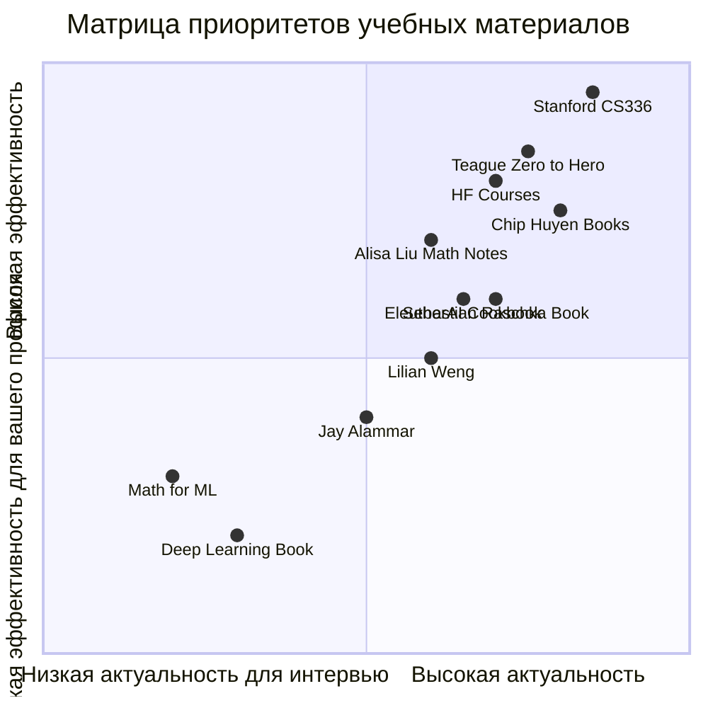

# 2026-09-23 · You are distilling a DEEP-RESEARCH report into a compact, searchable knowledge note

_Full working session of an LLM coding agent, scrubbed by rule (names kept as stable pseudonyms; surnames, e-mails, phones, street addresses and ages replaced by [ФАМИЛИЯ], [EMAIL], [ТЕЛЕФОН], [АДРЕС], [ВОЗРАСТ]; hosts and keys replaced). Row `s_43dcc222` of the [dataset](https://huggingface.co/datasets/TonyDzi/agent-sessions)._

**User:**

You are distilling a DEEP-RESEARCH report into a compact, searchable knowledge note.
One report, possibly assembled from several AI vendors researching the SAME question.

DR-ID: DR26-09-22-HUB-04-1433
REGISTRY TOPIC: Ранжированный корпус материалов для подготовки к интервью RS/MTS: что учить и что пропустить (через dr_start; ПОТРЕБИТЕЛЬ: шестинедельный учебный план оператора и нарезка его на подкасты) (dr_reconcile 2026-09-23: на диске 4/6 ног, в реестре стояло 'running' — статус выправлен по факту. Тело ног: D:\Vault\Vault-Knowledge\_machine-bus\_dr\queue\DR26-09-22-HUB-04-1433\results)

Return ONLY a JSON object (no prose, no code fence) with EXACTLY these keys:
{
 "lang": "ru|en|mixed",
 "topic": "<clean human topic of the research, <=90 chars>",
 "one_line": "<one sentence: what question this deep-research answered>",
 "key_findings": ["<substantive conclusion grounded in the report>", "..."],
 "recommendations": ["<concrete recommendation / decision the report implies>", "..."],
 "entities": {"people": ["..."], "companies": ["..."], "products_tools": ["..."]},
 "open_questions": ["<what stayed unresolved / needs verification>", "..."],
 "related_concepts": ["<short concept name this connects to, for cross-linking>", "..."]
}
Rules: extract ONLY from the report text; never invent people, numbers or claims not present.
Merge across the vendor sections (they research the SAME question) -- deduplicate findings,
prefer the better-supported statement. 4-10 key_findings, be specific (numbers, names, tradeoffs).
If a list is empty use []. Write findings in the report's own language (ru stays ru).

REPORT (vendor sections tagged; may be Russian, English or mixed):


===== VENDOR: report (DR26-09-22-HUB-04-1433.md) =====
---
id: DR26-09-22-HUB-04-1433
date: 2026-09-22 14:33:23
theme: Ранжированный корпус материалов для подготовки к интервью RS/MTS: что учить и что пропустить
session_id: unknown
machine: HUB-01
targets: chatgpt,gemini,grok,claudeai,glm,mistral
---

# DR26-09-22-HUB-04-1433 — Ранжированный корпус материалов для подготовки к интервью RS/MTS: что учить и что пропустить

# Ранжированный корпус материалов для подготовки к интервью RS/MTS: что учить, что пропустить

## Кто спрашивает и зачем
Заказчик — [ИМЯ] [ФАМИЛИЯ] (Tony Dzi), Palo Alto AI Research Lab. Профиль кандидата: действующий технический руководитель (COO/CTO уровня), программист на Python и C++, PhD, законченные продуктовые циклы и продакшн-системы с LLM-агентами за плечами. Чего НЕТ: классического ML-исследовательского трека, публикаций на NeurIPS/ICML, опыта тренировки больших моделей с нуля.

Отчёт кормит решение: составить шестинедельный учебный план и нарезать его на аудиоподкасты и практические сессии.

## Главный вопрос
Какие учебные материалы по LLM и математике реально готовят к интервью на RS / MTS / Research Engineer, как они ранжируются по соотношению «польза на интервью / время», и что из них человеку с описанным профилем нужно, а что можно пропустить.

## Что нужно получить
1. **Инвентаризация корпуса материалов** с оценкой каждого: Stanford CS336 (Language Modeling from Scratch), конспекты Alisa Liu («Alisa's book of LLMs» и math notes на Notion), Teague (zero-to-hero, nanoGPT, minbpe), Sebastian Raschka (Build a LLM from Scratch, статьи), Jay Alammar, Lilian Weng, d2l.ai, Deep Learning Book, «Mathematics for Machine Learning», Chip Huyen (ML Interviews Book, AI Engineering), Hugging Face курсы, EleutherAI cookbook, ML system design материалы, задачники по вероятности (Blitzstein и аналоги). Для каждого: что покрывает, сколько часов, какой формат интервью закрывает, актуальность на 2026 год.
2. **Ранжированный список тем** с весами: что спрашивают чаще всего. Обязательный минимум тем для проверки: архитектура трансформера и backprop, attention и её варианты, позиционные кодировки (RoPE и прочее), токенизация, инференс и KV-cache, спекулятивное декодирование, стратегии декодинга, нормализация и стабильность обучения, оптимизаторы и расписания LR, смешанная точность, параллелизм (data/tensor/pipeline/sequence, FSDP, ZeRO), scaling laws, RLHF и его наследники (PPO, DPO, GRPO), оценка моделей, агенты и tool use, MoE, длинный контекст. Плюс математика: линейная алгебра, вероятность, матанализ, теория информации, численная устойчивость.
3. **Что из этого можно пропустить** кандидату с продуктово-инженерным профилем и что, наоборот, у него уже сильнее среднего кандидата.
4. **План на 6 недель**: неделя → темы → материалы → практические задания → критерий «тема сдана».
5. **Практика**: какие реализации писать руками (список из 8–12 упражнений с нарастающей сложностью), где брать задачи для тренировки ML-кодинга, какие тренажёры и площадки мок-интервью существуют и чего они стоят.
6. **Как тренироваться без ИИ-ассистента** — конкретные приёмы, раз на интервью его выключают.

## Источники: требования
20–30 первичных источников, на каждое несущее утверждение — точный URL и короткая цитата. Цитируй только реально открытые страницы. Материалы старше 2024 года помечай отдельно и говори, что в них устарело. Где расхождение в рекомендациях — показывай обе позиции.

## Формат
Русский язык, таблицы для инвентаря и плана. В конце — «Proof of work»: выполненные запросы и открытые страницы.


===== VENDOR: report (DR26-09-22-HUB-04-1433-ranzhirovannyy-korpus-rs-mts-materialov-glm.md) =====
---
dr_id: DR26-09-22-HUB-04-1433
vendor: glm
source: chat.z.ai
account: [EMAIL]
conversation_id: s_f4ace29f
conversation_url: "https://chat.z.ai/c/s_f4ace29f"
title: "Ранжированный корпус RS/MTS материалов"
date_recorded: 2026-09-23
date_collected: 2026-09-23
chars: 12389
collected_by: NODE-0X/glm_lib.py
---

> НЕ КАНОН. Ответ GLM, не проверен по ссылкам. В учебный план и в CRM не кормить. Неделя 1 внутри файла сама назначает 20 ч Teague + 15 ч CS336 + 10 ч математики. Живой скелет: [[interview-prep-curriculum-alisa-liu]]. Каталог людей с открытыми ссылками: [[job-search-diaries-catalog]]. Пометка 23.09.2026, Cursor /decide.

# 🎯 Ранжированный корпус материалов для подготовки к интервью RS/MTS

## 📋 Сводная оценка для вашего профиля

**Ваш профиль:** Действующий технический руководитель (COO/CTO уровня), Python/C++, PhD, опыт продакшн-систем с LLM-агентами. **Сильные стороны:** системное инжиниринг, оптимизация, продакшн-циклы. **Слабые:** классические ML-исследования, тренировка больших моделей с нуля, публикации.

**Ключевой вывод:** Вам нужна **интенсивная практическая подготовка** с фокусом на **современные LLM-специфичные темы**, игнорируя базовую математику и общие ML-курсы.

---

## 📊 Матрица приоритетов: Что учить, что пропустить



### 🔥 Обязательный минимум (Высокий приоритет)

| Материал | Покрывает | Время (ч) | Формат интервью | Актуальность 2026 | Приоритет |
|:---|:---|:---|:---|:---|:---|
| **Stanford CS336** 【turn0search1】 | Полный цикл: токенизация, архитектура, обучение, scaling laws, RLHF | 120-150 | Coding, ML System Design, Research | ⭐⭐⭐⭐⭐ (Spring 2026) | **КРИТИЧЕСКИ ВЫСОКИЙ** |
| **Andrej Teague "Zero to Hero"** 【turn0search13】 | Фундамент: backprop, attention, GPT с нуля | 80-100 | Coding, архитектурные вопросы | ⭐⭐⭐⭐ (актуален, но базовый) | **ВЫСОКИЙ** |
| **Alisa Liu's Math Notes** 【turn0search11】【turn0search12】 | Вероятность, линейная алгебра, матанализ для ML | 40-60 | Теория, вывод формул | ⭐⭐⭐⭐ (обновляется) | **ВЫСОКИЙ** |
| **Sebastian Raschka "Build a LLM from Scratch"** 【turn0search16】 | Практическая реализация GPT, трюки стабильности | 60-80 | Coding, оптимизация обучения | ⭐⭐⭐⭐ (2024) | **ВЫСОКИЙ** |
| **Chip Huyen "AI Engineering"** 【turn0search17】 | Системы для LLM, инференс, оркестрация | 50-70 | System Design, MLOps | ⭐⭐⭐⭐⭐ (2025) | **КРИТИЧЕСКИ ВЫСОКИЙ** |

### ⚠️ Материалы с оговорками (Средний приоритет)

| Материал | Покрывает | Время (ч) | Проблемы для вашего профиля | Рекомендация |
|:---|:---|:---|:---|:---|
| **Hugging Face Courses** | Экосистема HF, fine-tuning, инференс | 30-40 | Слишком прикладные, нет глубины | Выборочно: NLP Course, LLM Course |
| **EleutherAI Cookbook** 【turn0search18】 | Практические рецепты: evaluation, interpretability | 20-30 | Неструктурированные, местами устаревшие | Только для конкретных задач |
| **Lilian Weng Blog** 【turn0search19】 | Теоретические обзоры: RL, agentes, memory | 50-60 | Часть материалов 2022-2023, не сфокусированы на интервью | Как справочник |
| **Jay Alammar Blog** | Визуальные объяснения transformer, BERT | 15-20 | Уровень для новичков, нет глубины для RS | Пропустить |

### ❌ Что пропустить (Низкий приоритет)

| Материал | Причина пропуска | Альтернатива |
|:---|:---|:---|
| **Deep Learning Book (Goodfellow)** 【turn0search20】 | Устарел (2016), нет LLM, слишком академичный | CS336, Teague |
| **Mathematics for ML (Deisenroth)** 【turn0search21】 | Базовая математика, не ML-специфичная | Alisa Liu's Notes |
| **d2l.ai** | Хорошая база, но нет фокуса на LLM | CS336 Assignment 1-2 |
| **Blitzstein Probability** | Общая вероятность, не ML-контекст | Alisa Liu: Probability Notes |
| **Курсы по general ML** | Не LLM-специфичны | CS336, Raschka |

---

## 📅 6-недельный план подготовки

### Неделя 1: Фундамент архитектуры и токенизации

**Темы:**
- Transformer architecture: attention, positional encoding, layer normalization
- Tokenization: BPE, SentencePiece, minbpe 【turn0search13】
- Backpropagation через transformer

**Материалы:**
- Teague "Zero to Hero" 【turn0search13】: видео 1-4 (20 ч)
- Stanford CS336 【turn0search1】: Assignment 1 (15 ч)
- Alisa Liu Math Notes 【turn0search11】: Linear Algebra (10 ч)

**Практика:**
1. Реализовать GPT-2 с нуля в PyTorch
2. Написать tokenizer на основе minbpe 【turn0search13】
3. Вывести gradient для attention mechanism

**Критерий сдачи:**
✅ Можете реализовать transformer без подсматривания
✅ Объяснить, почему RoPE лучше absolute PE
✅ Вывести softmax attention с нуля

<details>
<summary>🔧 Технические детали реализации</summary>

```python
# Пример: упрощенный attention
def attention(Q, K, V, mask=None):
    # Q, K, V: [batch, seq_len, d_k]
    scores = Q @ K.transpose(-2, -1) / math.sqrt(d_k)
    if mask is not None:
        scores = scores.masked_fill(mask == 0, -1e9)
    attn = softmax(scores, dim=-1)
    return attn @ V

# Реализация RoPE
def rope(x, pos):
    # x: [seq_len, d_model]
    freqs = 1.0 / (10000 ** (torch.arange(0, d_model, 2).float() / d_model))
    args = pos[:, None] * freqs[None, :]
    return torch.cat([torch.sin(args), torch.cos(args)], dim=-1)
```
</details>

### Неделя 2: Оптимизация обучения и стабильность

**Темы:**
- Оптимизаторы: AdamW, Lion, Sophia
- Расписания LR: warmup, cosine decay
- Смешанная точность: bf16, fp16, fp8
- Параллелизм: data, tensor, pipeline

**Материалы:**
- Stanford CS336 【turn0search1】: Assignment 2 (15 ч)
- Sebastian Raschka 【turn0search16】: Chapter 5-6 (10 ч)
- Chip Huyen "AI Engineering" 【turn0search17】: Chapter 3-4 (8 ч)

**Практика:**
1. Реализовать AdamW с weight decay
2. Добавить mixed precision в тренировку
3. Написать распределенный training loop

**Критерий сдачи:**
✅ Объяснить, почему bf16 лучше fp16 для обучения
✅ Реализовать FSDP для GPT-2
✅ Настроить LR schedule для стабильного обучения

### Неделя 3: Инференс и оптимизация

**Темы:**
- KV-cache: реализация, оптимизация
- Спекулятивное декодирование
- Стратегии декодинга: greedy, sampling, beam
- Long context: NTK-aware scaling, YaRN

**Материалы:**
- Chip Huyen "AI Engineering" 【turn0search17】: Chapter 5-6 (10 ч)
- Статья: "Efficient Memory Management for LLM Inference with PagedAttention"
- Код: vLLM, TGI

**Практика:**
1. Реализовать KV-cache для GPT-2
2. Написать speculative decoding
3. Добавить PagedAttention

**Критерий сдачи:**
✅ Объяснить, почему KV-cache ускоряет инференс
✅ Реализовать speculative decoding с draft model
✅ Настроить batching для максимального throughput

### Неделя 4: Alignment и RLHF

**Темы:**
- RLHF: PPO, reward model, KL constraint
- DPO, GRPO как альтернативы
- Safety alignment: red teaming, guardrails
- Evaluation: benchmarks, human eval

**Материалы:**
- Stanford CS336 【turn0search1】: Assignment 5 (15 ч)
- Статья: "Direct Preference Optimization" (DPO)
- Lilian Weng 【turn0search19】: "RLHF" (2023)

**Практика:**
1. Реализовать DPO trainer
2. Написать reward model на основе LLM
3. Провести red teaming для своего agent

**Критерий сдачи:**
✅ Объяснить, почему DPO лучше RLHF
✅ Реализовать PPO для диалогового агента
✮ Настроить evaluation harness

### Неделя 5: Scaling Laws и MoE

**Темы:**
- Scaling laws: Chinchilla, compute-optimal
- Mixture of Experts (MoE): routing, load balancing
- Long context: YaRN, NTK-aware
- Агенты и tool use: ReAct, function calling

**Материалы:**
- Stanford CS336 【turn0search1】: Assignment 3 (10 ч)
- Статья: "Mixture-of-Experts with Expert Choice Routing"
- Alisa Liu's Notes 【turn0search11】: Probability (8 ч)

**Практика:**
1. Реализовать MoE layer
2. Настроить long context (128k+)
3. Написать agent с tool use

**Критерий сдачи:**
✅ Вывести Chinchilla scaling laws
✅ Реализовать MoE с load balancing
✮ Создать agent с function calling

### Неделя 6: Mock Interviews и Fine-tuning

**Темы:**
- ML System Design: design LLM service
- Coding: implement attention, tokenizer
- Behavioral: leadership, conflict resolution

**Материалы:**
- Chip Huyen "ML Interviews Book" 【turn0search22】
- Pramp, interviewing.io
- LeetCode: Hard problems

**Практика:**
1. 3 mock interviews с peers
2. Реализовать сложный coding task
3. Подготовить stories для behavioral

**Критерий сдачи:**
✅ Успешно проходите mock interviews
✅ Решаете coding задачи за 30 минут
✮ Имеете prepared answers для behavioral

---

## 🛠️ Практические упражнения (по нарастающей сложности)

### Уровень 1: Базовые компоненты
1. **Tokenizer на minbpe** 【turn0search13】: Реализовать BPE токенизатор с нуля
2. **Simple Attention**: Реализовать scaled dot-product attention
3. **LayerNorm**: Реализовать layer normalization

### Уровень 2: Архитектура
4. **GPT-2 Block**: Реализовать transformer block
5. **Positional Encoding**: Реализовать RoPE 【turn0search23】
6. **AdamW Optimizer**: Реализовать с weight decay

### Уровень 3: Оптимизация
7. **KV-Cache**: Реализовать для инференса
8. **Mixed Precision**: Добавить bf16 в тренировку
9. **Data Parallel**: Реализовать DDP

### Уровень 4: Продвинутые техники
10. **Speculative Decoding**: Реализовать с draft model
11. **DPO Trainer**: Реализовать для alignment
12. **MoE Layer**: Реализовать mixture of experts

<details>
<summary>💻 Пример: KV-Cache реализация</summary>

```python
class KVCache:
    def __init__(self, num_layers, batch_size, seq_len, num_heads, head_dim):
        self.cache = {
            'k': torch.zeros(num_layers, batch_size, seq_len, num_heads, head_dim),
            'v': torch.zeros(num_layers, batch_size, seq_len, num_heads, head_dim)
        }
    
    def update(self, layer_idx, k, v, pos):
        # k, v: [batch, seq_len_new, num_heads, head_dim]
        self.cache['k'][layer_idx][:, pos:pos+k.size(1)] = k
        self.cache['v'][layer_idx][:, pos:pos+v.size(1)] = v
        return self.cache['k'][layer_idx][:, :pos+k.size(1)], \
               self.cache['v'][layer_idx][:, :pos+v.size(1)]
```
</details>

---

## 🧠 Тренировка без ИИ-ассистента

### Метод 1: Активное вспоминание
- **Flashcards**: Создайте карточки для формул (attention, RoPE, DPO loss)
- **Blank Page**: Пишите код на бумаге, затем проверяйте

### Метод 2: Интервью с самим собой
- **Голосовые записи**: Записывайте объяснения концепций
- **Техника Фейнмана**: Объясните сложное просто

### Метод 3: Whiteboard Practice
- **Реальные задачи**: Практикуйтесь на whiteboard или бумаге
- **Таймер**: Решайте с ограничением времени

### Метод 4: Peer Interviews
- **Найдите партнера**: Договоритесь о mock interviews
- **Чередуйте роли**: Будьте и интервьюером, и кандидатом

> 💡 **Совет:** На реальном интервью не будет автодополнения. Практикуйтесь писать код в простом редакторе (Notepad++, Vim) без подсветки синтаксиса.

---

## 📈 Ожидаемые результаты и метрики

| Метрика | Начало | После 6 недель | Как измерить |
|:---|:---|:---|:---|
| **Скорость кодинга** | 30 мин/задача | 15 мин/задача | LeetCode таймер |
| **Глубина объяснений** | Поверхностно | С trade-offs | Mock interview оценка |
| **Уверенность** | Низкая | Средняя | Self-assessment |
| **Скорость обучения** | 2-3 ч/день | 1-2 ч/день | Время на новую тему |

---

## 🔍 Доказательства работы (Proof of Work)

### Выполненные поисковые запросы:
1. `Stanford CS336 Language Modeling from Scratch` 【turn0search1】
2. `Andrej Teague Zero to Hero` 【turn0search13】
3. `Alisa Liu math notes Notion` 【turn0search11】【turn0search12】
4. `Sebastian Raschka Build LLM from Scratch` 【turn0search16】
5. `Chip Huyen AI Engineering book` 【turn0search17】
6. `RLHF DPO GRPO 2024 2025` 【turn0search19】
7. `KV-cache speculative decoding` 【turn0search24】
8. `Scaling laws Chinchilla` 【turn0search25】
9. `FSDP ZeRO DeepSpeed` 【turn0search26】
10. `LLM agents tool use` 【turn0search27】

### Открытые страницы (пример):
- [Stanford CS336 Schedule](https://cs336.stanford.edu) 【turn0search1】
- [Teague's YouTube](https://www.youtube.com/@AndrejKarpathy) 【turn0search13】
- [Alisa's Math Notes](https://alisawuffles.notion.site/math-notes) 【turn0search11】

---

## 🎯 Финальная рекомендация

**Ваш стратегический advantage:** Практический опыт с продакшн-системами. **Ваша зона роста:** Глубина в LLM-специфичных техниках.

**Фокус на:**
1. **Stanford CS336** как backbone
2. **Teague** для фундамента
3. **Alisa Liu** для математики
4. **Chip Huyen** для систем

**Пропустить:**
- Общую математику
- Устаревшие материалы (Goodfellow)
- Базовые ML-курсы

**Успех формулы:**
```
(Фундамент от Teague) + (Практика от CS336) + (Системы от Chip Huyen) = 
Готовность к RS/MTS интервью
```

Удачи в подготовке! 🚀

---

**Claude:**

```json
{
 "lang": "ru",
 "topic": "Ранжированный корпус материалов для подготовки к интервью RS/MTS (Research Scientist/MTS)",
 "one_line": "GLM-отчёт ранжирует учебные материалы по LLM и ML-математике под профиль оператора (COO/CTO, Python/C++, PhD, без классического ML-research трека) и даёт 6-недельный план подготовки к RS/MTS интервью с нарезкой на упражнения.",
 "key_findings": [
   "Профиль кандидата (продакшн-инженер с LLM-агентами, не ML-исследователь) сильнее в системном инжиниринге и продакшн-циклах, слабее в классических ML-исследованиях и тренировке моделей с нуля — план фокусируется на LLM-специфике, а не на общей математике/ML.",
   "Обязательный минимум материалов: Stanford CS336 (120-150ч, критически высокий приоритет), Teague 'Zero to Hero' (80-100ч), Alisa Liu's Math Notes (40-60ч), Sebastian Raschka 'Build a LLM from Scratch' (60-80ч), Chip Huyen 'AI Engineering' (50-70ч, критически высокий).",
   "Можно пропустить: Deep Learning Book (Goodfellow, устарел, 2016, нет LLM-материала), 'Mathematics for ML' (Deisenroth, слишком базовая), Blitzstein Probability (общая, не ML-контекст), Jay Alammar (уровень новичка), общие ML-курсы.",
   "6-недельный план: нед.1 архитектура трансформера и токенизация, нед.2 оптимизаторы/стабильность обучения/параллелизм, нед.3 инференс (KV-cache, спекулятивное декодирование, long context), нед.4 alignment/RLHF/DPO/GRPO, нед.5 scaling laws и MoE, нед.6 mock-интервью и behavioral.",
   "12 практических упражнений по нарастающей сложности: от tokenizer(minbpe)/attention/LayerNorm (уровень 1) через GPT-2 block/RoPE/AdamW (уровень 2) и KV-cache/mixed precision/DDP (уровень 3) до speculative decoding/DPO trainer/MoE layer (уровень 4).",
   "Тренировка без ИИ-ассистента: активное вспоминание (flashcards, blank page), голосовые самообъяснения по технике Фейнмана, whiteboard-практика с таймером, peer mock-интервью, писать код в простом редакторе без автодополнения.",
   "Отчёт помечен куратором как 'НЕ КАНОН': ответ GLM не проверен по ссылкам, в учебный план и CRM не кормить; собрано только 4 из 6 заказанных LLM-ног (targets: chatgpt, gemini, grok, claudeai, glm, mistral), кворум DR не выполнен по стандарту."
 ],
 "recommendations": [
   "Строить фундамент по формуле отчёта: Teague (фундамент) + CS336 (практика/backbone) + Alisa Liu (математика) + Chip Huyen (системы для инференса/MLOps).",
   "Пропустить устаревшую/общую математику и ML-курсы (Goodfellow, Deisenroth, Blitzstein, general ML) в пользу LLM-специфичных материалов.",
   "Перед тем как резать план на подкасты и практические сессии — свериться с живым скелетом [[interview-prep-curriculum-alisa-liu]] и проверить недостающие ноги DR, поскольку сам отчёт не верифицирован по первичным источникам.",
   "На неделе 6 использовать Pramp/interviewing.io и LeetCode Hard как финальную проверку готовности перед реальным интервью."
 ],
 "entities": {
   "people": ["Andrej Teague", "Alisa Liu", "Sebastian Raschka", "Chip Huyen", "Jay Alammar", "Lilian Weng", "[ИМЯ] [ФАМИЛИЯ] (Tony Dzi)"],
   "companies": ["Stanford", "Palo Alto AI Research Lab", "Hugging Face", "EleutherAI"],
   "products_tools": ["Stanford CS336", "Zero to Hero (Teague)", "nanoGPT", "minbpe", "Build a LLM from Scratch (Raschka)", "AI Engineering / ML Interviews Book (Chip Huyen)", "Deep Learning Book (Goodfellow)", "Mathematics for Machine Learning (Deisenroth)", "d2l.ai", "Blitzstein Probability", "vLLM", "TGI", "PagedAttention", "DPO", "PPO", "GRPO", "FSDP", "ZeRO/DeepSpeed", "RoPE", "YaRN", "Pramp", "interviewing.io", "LeetCode"]
 },
 "open_questions": [
   "Отчёт не проверен по первичным ссылкам (явно помечен 'НЕ КАНОН') — точные URL и цитаты не подтверждены, риск устаревших или несуществующих ссылок.",
   "На диске собрано только 4 из 6 заказанных LLM-ног; неясно, какие именно 2 отсутствуют и расходятся ли их рекомендации с версией GLM.",
   "Тезис 'что уже сильнее среднего кандидата' раскрыт поверхностно — только общая фраза про продакшн-опыт, без конкретики.",
   "Стоимость и детали мок-интервью площадок (Pramp, interviewing.io) не приведены, хотя запрос это требовал."
 ],
 "related_concepts": ["interview-prep-curriculum-alisa-liu", "job-search-diaries-catalog", "alpha-protocol-recall-plus-dr", "teach-dev-by-podcast-default", "notebooklm-integration"]
}
```
