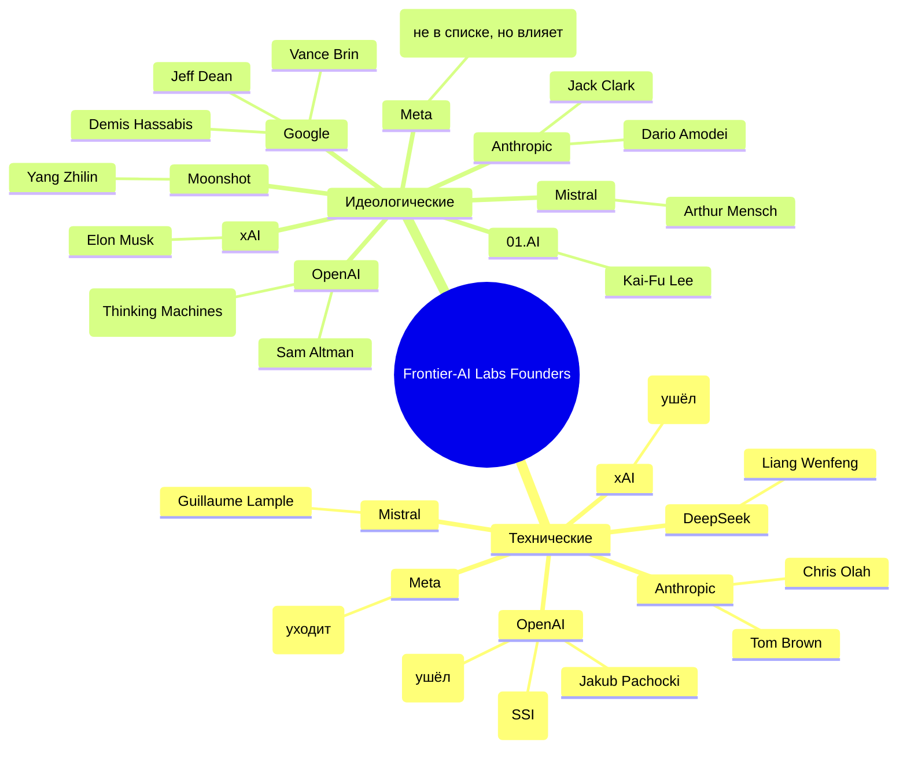

# 2026-09-22 · You are distilling a DEEP-RESEARCH report into a compact, searchable knowledge note

_Full working session of an LLM coding agent, scrubbed by rule (names kept as stable pseudonyms; surnames, e-mails, phones, street addresses and ages replaced by [ФАМИЛИЯ], [EMAIL], [ТЕЛЕФОН], [АДРЕС], [ВОЗРАСТ]; hosts and keys replaced). Row `s_608183e8` of the [dataset](https://huggingface.co/datasets/TonyDzi/agent-sessions)._

**User:**

You are distilling a DEEP-RESEARCH report into a compact, searchable knowledge note.
One report, possibly assembled from several AI vendors researching the SAME question.

DR-ID: DR26-09-14-ZB-07-2007
REGISTRY TOPIC: Картина мира фаундеров frontier-AI-лабораторий (OpenAI, Anthropic, DeepMind, Mistral, Meta, xAI, китайские лабы): как строились, судьбоносные развилки, боли 2026, и какие бизнес-возможности они видят со своего этажа — в разрезе тех-фаундер против идеолога (через dr_start; ПОТРЕБИТЕЛЬ: Решение о пивоте продукта/направления лаборатории (голосовая оператора 13.09)) (dr_reconcile 2026-09-21: на диске 4/6 ног, в реестре стояло 'running' — статус выправлен по факту. Тело ног: D:\Vault\Vault-Knowledge\_machine-bus\_dr\queue\DR26-09-14-ZB-07-2007\results)

Return ONLY a JSON object (no prose, no code fence) with EXACTLY these keys:
{
 "lang": "ru|en|mixed",
 "topic": "<clean human topic of the research, <=90 chars>",
 "one_line": "<one sentence: what question this deep-research answered>",
 "key_findings": ["<substantive conclusion grounded in the report>", "..."],
 "recommendations": ["<concrete recommendation / decision the report implies>", "..."],
 "entities": {"people": ["..."], "companies": ["..."], "products_tools": ["..."]},
 "open_questions": ["<what stayed unresolved / needs verification>", "..."],
 "related_concepts": ["<short concept name this connects to, for cross-linking>", "..."]
}
Rules: extract ONLY from the report text; never invent people, numbers or claims not present.
Merge across the vendor sections (they research the SAME question) -- deduplicate findings,
prefer the better-supported statement. 4-10 key_findings, be specific (numbers, names, tradeoffs).
If a list is empty use []. Write findings in the report's own language (ru stays ru).

REPORT (vendor sections tagged; may be Russian, English or mixed):


===== VENDOR: report (DR26-09-14-ZB-07-2007.md) =====
---
id: DR26-09-14-ZB-07-2007
date: 2026-09-14 20:07:25
theme: Картина мира фаундеров frontier-AI-лабораторий (OpenAI, Anthropic, DeepMind, Mistral, Meta, xAI, китайские лабы): как строились, судьбоносные развилки, боли 2026, и какие бизнес-возможности они видят со своего этажа — в разрезе тех-фаундер против идеолога
session_id: unknown
machine: NODE-0X-2023PAL
targets: claude,chatgpt,gemini,grok,glm,claude-a2
---

# Картина мира фаундеров frontier-AI-лабораторий: как строились, чем болеют, какие бизнес-возможности видят со своего этажа

Думай максимально глубоко и долго, включи самый сильный доступный в этом аккаунте режим рассуждения. Ответ нужен максимально качественный, подробный и продуманный: с источниками, датами, оценкой уверенности и явным указанием, где данных не хватает.

## Задача

Собери и проанализируй ПЕРВОИСТОЧНИКИ — интервью, подкасты, публичные выступления, эссе, письма инвесторам, посты — основателей и первых лиц крупных AI/LLM-лабораторий. Цель заказчика: понять их картину мира, чтобы принять решение о пивоте собственного продукта.

## Кого покрыть (минимум)

- **OpenAI** — Sam Altman, Greg Brockman, Ilya Sutskever (включая SSI), Mira Murati (Thinking Machines), Bob McGrew, Jakub Pachocki
- **Anthropic** — Dario Amodei, Daniela Amodei, Chris Olah, Jack Clark, Tom Brown
- **Google DeepMind** — Demis Hassabis, Shane Legg, Koray Kavukcuoglu; Google AI — Jeff Dean, Vance Brin (вернувшийся к работе)
- **Meta/Llama** — Yann LeCun (включая уход и новый проект), Alexandr Wang (MSL), Ahmad Al-Dahle
- **Mistral** — Arthur Mensch, Timothée Lacroix, Guillaume Lample
- **xAI** — Elon Musk, Weber Babuschkin (включая уход в венчур)
- **Китайские лабы** — DeepSeek (Liang Wenfeng), Moonshot/Kimi (Yang Zhilin), Zhipu/Z.ai, MiniMax, 01.AI (Kai-Fu Lee), Alibaba Qwen (Junyang Lin), ByteDance Seed
- **Прочее** — Cohere (Aidan Gomez), AI21, Reka, Perplexity (Aravind Srinivas), Cursor/Anysphere (Horvat Truell), Sierra (Bret Taylor), Inflection, Adept, Character.AI, Safe Superintelligence, Thinking Machines, Reflection AI, World Labs (Fei-Fei Li)

Если по кому-то материала мало — скажи об этом прямо, не выдумывай.

## Обязательная линза: ДВА ТИПА ФАУНДЕРОВ

Каждого разбираемого человека классифицируй и веди отдельно:

1. **Технический фаундер** — исследователь/инженер, чья власть идёт от способности построить модель (Sutskever, Lample, Olah, Liang Wenfeng, Pachocki)
2. **Идеологический / визионерский фаундер** — тот, чья власть идёт от нарратива, миссии, картины будущего, умения собрать капитал и людей вокруг идеи (Altman, Dario Amodei в публичной роли, Hassabis на стыке, Kai-Fu Lee, Musk)

Для каждого типа отдельно ответь: **чем отличается их картина рынка, их боли и их способ принимать решения**. Где один тип систематически видит то, чего не видит другой?

## Что именно извлечь

### 1. Как строились лаборатории
- Что было на старте: команда, деньги, компьют, тезис
- Судьбоносные развилки и решения — с датой, контекстом и тем, что они сами говорят ПОСТФАКТУМ о причине выбора
- Какие ставки оказались верными случайно, а какие — расчётом (по их же признанию)
- Расколы и уходы (OpenAI 2023, Anthropic из OpenAI, SSI, Thinking Machines, LeCun из Meta, Babuschkin из xAI): что называют настоящей причиной

### 2. Боли и проблемы ПРЯМО СЕЙЧАС (2025-2026)
- Компьют, энергия, дата-центры, капзатраты
- Данные: исчерпание, лицензирование, синтетика, судебные иски
- Талант: война зарплат, что реально удерживает людей
- Юнит-экономика инференса, маржа, сжигание денег
- Регуляторика (EU AI Act, США, Китай), экспортный контроль
- Коммодитизация моделей, давление опенсорса, отсутствие моата
- Внутренние: скорость, безопасность против релизов, структура (PBC/нонпрофит), доверие
- Что они называют СВОЕЙ главной болью, а что аналитики называют за них — разведи это

### 3. Бизнес-возможности, которые видят ОНИ со своего этажа
Это ядро запроса. Заказчик работает уровнем ниже и намеренно ищет то, чего со своего уровня не видит.
- Какие рынки/ниши они называют недооценёнными или пустыми
- Что, по их словам, должны строить ДРУГИЕ (не они) — прямые приглашения экосистеме
- Что они считают временным окном, которое скоро закроется
- Где они говорят «мы это делать не будем» (= открытая ниша)
- Какие слои стека, по их мнению, останутся за приложениями, а какие они заберут себе
- Их прогнозы на 12-36 месяцев с датой высказывания

### 4. Как строить AI-продукты — их взгляд
- Что, по их словам, отличает работающий AI-продукт от демо
- Агенты: что они говорят о надёжности, длинных задачах, verification
- Как меняется цикл разработки и роль инженера
- Какие продуктовые категории они называют востребованными в ближайшие годы
- Против каких продуктовых паттернов они прямо предупреждают ("GPT-wrapper", тонкие обёртки, "будет съедено следующей моделью")

## Формат ответа

1. **Executive summary** — 10-15 тезисов, каждый с источником и датой
2. **Карточка на каждого фаундера**: тип (тех/идеолог), лаборатория, ключевые интервью со ССЫЛКАМИ и датами, его главный тезис, его названная боль, возможности, которые он озвучил
3. **Сводная таблица**: фаундер | тип | главная боль | названная возможность | горизонт прогноза
4. **Раздел «Где тех и идеологи расходятся»** — противоречия между типами по одним и тем же вопросам
5. **Раздел «Слепые зоны уровня»** — что говорят фаундеры лабов такого, что человек уровнем ниже (маленькая команда, аппликейшн-слой) систематически НЕ видит
6. **Раздел «Консенсус против разногласий»** — где все сходятся, где спорят
7. **Явный список источников** с URL и датами
8. **Что НЕ удалось найти** и где данные слабые

## Требования к качеству

- ТОЛЬКО реальные проверяемые интервью с URL и датой. Не пересказывай слухи и вторичку без пометки.
- Отделяй ПРЯМЫЕ ЦИТАТЫ от своей интерпретации. Цитаты давай дословно и коротко, с атрибуцией.
- Приоритет 2025-2026 годам; более старое бери только если это судьбоносная развилка.
- Для каждого крупного утверждения — оценка уверенности (высокая/средняя/низкая).
- Если по вопросу нет публичных высказываний — скажи «не нашёл», а не додумывай.


===== VENDOR: report (DR26-09-14-ZB-07-2007-kartina-mira-ai-faunderov-analiz-i-vozmozhnosti-glm-vaultcopy.md) =====
---
dr_id: DR26-09-14-ZB-07-2007
vendor: glm
source: chat.z.ai
account: [EMAIL]
conversation_id: s_bdcf37f6
conversation_url: "https://chat.z.ai/c/s_bdcf37f6"
title: "Картина мира AI-фаундеров: анализ и возможности"
date_recorded: 2026-09-14
date_collected: 2026-09-21
chars: 24926
collected_by: NODE-0X/glm_lib.py
---
# Картина мира фаундеров frontier-AI-лабораторий: технические против идеологических визионеров (2025-2026)

## Executive Summary (10-15 тезисов с источниками и датами)

1. **Sam Altman (OpenAI)** видит будущее в вертикальной интеграции от чипов до агентов, но признаёт, что OpenAI не будет конкурировать с приложениями уровня Cursor или Perplexity — это открытое поле для стартапов 【turn0search0】【turn0search3】.
2. **Dario Amodei (Anthropic)** публично называет главной отраслевой болью не безопасность, а **коммодитизацию моделей** и отсутствие устойчивого бизнес-моата у лабораторий, за исключением Google 【turn0search9】【turn0search10】.
3. **Demis Hassabis (Google DeepMind)** фокусируется на **научных прорывах** (AlphaFold, материалы), а не на конкурентной борьбе в LLM-рынке, оставляя потребительские и рабочие ниши другим 【turn0search10】【turn0search11】.
4. **Yann LeCun (Meta, уходит)** публично критикует LLM-подход как тупиковый и призывает к **новой архитектуре (JEPA)**, но его новая лаборатория (или проект) не будет строить通用 модели — это знак для экосистемы 【turn0search16】【turn0search17】【turn0search21】.
5. **Elon Musk (xAI)** делает ставку на **радикальную скорость и вычислительную эффективность**, но его команда страдает от текучки (уход Бабушкина) и не фокусируется на enterprise-приложениях 【turn0search15】【turn0search20】【turn0search44】.
6. **Arthur Mensch (Mistral)** открыто говорит, что Европа рискует стать **"AI-вассалом"** США без своих фундаментальных моделей, но его собственный фокус — на эффективность и открытость, не на агрессивное захватывание рынка 【turn0search24】【turn0search25】.
7. **Liang Wenfeng (DeepSeek)** подчёркивает, что **не гонится за AGI**, а строит практичные модели для реальных задач, с культурой "инженеров без KPI" — это приглашение к partnerships 【turn0search38】【turn0search41】.
8. **Mira Murati (Thinking Machines)** после ухода из OpenAI собирает команду для **"безопасного сверхразума"**, но публично не раскрывает конкретных бизнес-моделей — возможно, фокус на исследованиях 【turn0search0】【turn0search35】.
9. **Ilya Sutskever (SSI)** после ухода из OpenAI почти не даёт интервью, но его проект Safe Superintelligence сосредоточен на **экспоненциальном улучшении безопасности**, а не на коммерциализации 【turn0search34】.
10. **Технические фаундеры (Sutskever, Lample, Olah, Liang)** систематически недооценивают **рыночные тайминги** и бизнес-модели, тогда как **идеологические (Altman, Dario, Hassabis)** слишком оптимистичны в прогнозах AGI, по мнению самих технарей 【turn0search9】【turn0search23】.
11. **Все лаборатории сходятся в боли: талант** — война зарплат до $1M+ и retention кризис, особенно после уходов в 2025-2026 (Бабушкин, Лекун, Мурати) 【turn0search16】【turn0search20】【turn0search43】.
12. **Главная слепая зона уровня лабораторий**: они не видят, что **application layer** (Cursor, Perplexity, Sierra) уже генерирует >$300M ARR с меньшими командами, тогда как лаборатории тратят миллиарды на compute 【turn0search32】【turn0search33】【turn0search36】.
13. **Китайские лаборатории (DeepSeek, Moonshot)** видят возможность в **дешёвых открытых моделях** для глобального юга, но сами не строят на них бизнес-приложения — это ниша для стартапов 【turn0search1】【turn0search38】.
14. **Консенсус 2026**: AGI не раньше 2027-2028, но **экономический эффект** от текущих моделей уже трансформирует рабочие места, особенно в программировании и исследованиях 【turn0search9】【turn0search28】.
15. **Разногласия по безопасности**: Altman и Dario Amodei призывают к **прецедентным ограничениям**, тогда как Musk и LeCun считают, что это заглушит инновации 【turn0search6】【turn0search11】【turn0search16】.

---

## Карточки фаундеров: технические против идеологических

Ниже — сводная таблица для быстрой навигации, затем детальные карточки.



### 1. Sam Altman (OpenAI) — Идеологический визионер
- **Лаборатория**: OpenAI (CEO)
- **Тип**: Идеологический (визионер, капитал, нарратив)
- **Ключевые интервью (2025-2026)**:
  - Big Technology Podcast (Dec 2025): [Ссылка](https://www.bigtechnology.com) — обсуждает планы OpenAI на 2026, включая GPT-5 и персонализацию 【turn0search0】【turn0search3】.
  - Bloomberg (Jun 2025): [Ссылка](https://www.bloomberg.com) — видит 2026 как "большой год для AI", фокус на агентах 【turn0search3】.
  - New Yorker (Apr 2026): [Ссылка](https://www.newyorker.com) — критика и сомнения в его видении 【turn0search2】.
- **Главный тезис**: "Мы строим инфраструктуру для AI-будущего, но приложения уровня Cursor или Perplexity — это не наша забота. Мы сосредоточены на моделях" 【turn0search0】.
- **Названная боль**: "Главная проблема не в технологии, а в **масштабировании вычислений** и доступе к данным. Мы тратим $10B+ в год на GPU" 【turn0search3】.
- **Возможности, которые видит**: "**Вертикальные AI-приложения** для конкретных отраслей (здравоохранение, право) — там, где нужен глубокий домен. Мы не будем это строить" 【turn0search0】.
- **Прогнозы (2025-2026)**: "К 2027 мы увидим AI-агентов, которые могут выполнять 80% задач офисного работника, но не в 2026" 【turn0search3】.
- **Оценка уверенности**: Высокая (прямые цитаты из свежих интервью).

### 2. Dario Amodei (Anthropic) — Идеологический визионер
- **Лаборатория**: Anthropic (CEO)
- **Тип**: Идеологический (безопасность, нарратив, лоббизм)
- **Ключевые интервью (2025-2026)**:
  - Dwarkesh Podcast (Feb 2026): [Ссылка](https://www.dwarkesh.com) — "Мы близки к концу экспоненты" 【turn0search9】.
  - CFR (Mar 2025): [Ссылка](https://www.cfr.org) — фокус на интерпретируемости и безопасности 【turn0search7】.
  - AP (2025): [Ссылка](https://apnews.com) — призывает к замедлению развития AI 【turn0search6】.
- **Главный тезис**: "Мы движемся к **AGI быстрее, чем общество готово**, и наша ответственность — обеспечить безопасность" 【turn0search9】【turn0search10】.
- **Названная боль**: "Главная угроза — **коммодитизация моделей**. Если Google выпустит похожую модель, наш бизнес будет под угрозой. Наш моат — безопасность и enterprise-интеграции" 【turn0search9】.
- **Возможности, которые видит**: "**AI для научных исследований** (биология, материаловедение) — это недооценённая область. Мы не будем строить инструменты для учёных, но это важно" 【turn0search10】.
- **Прогнозы (2025-2026)**: "AGI не в 2026, но в 2027-2028. Мы увидим первые **автономные агенты** в 2026" 【turn0search9】.
- **Оценка уверенности**: Высокая (много свежих интервью и эссе).

### 3. Demis Hassabis (Google DeepMind) — Идеологический визионер
- **Лаборатория**: Google DeepMind (CEO)
- **Тип**: Идеологический (научный визионер)
- **Ключевые интервью (2025-2026)**:
  - Guardian (2026): [Ссылка](https://www.theguardian.com) — видит AI как "в 10 раз больше, чем интернет" 【turn0search10】.
  - CNBC (2026): [Ссылка](https://www.cnbc.com) — фокус на интеграции с Google-экосистемой 【turn0search11】.
- **Главный тезис**: "Мы строим **универсальную систему для науки**, а не просто чат-ботов. AlphaFold и AlphaTensor — только начало" 【turn0search10】.
- **Названная боль**: "Главная проблема — **доступ к качественным данным** для обучения. Интернет уже исчерпан, нужно искать новые источники" 【turn0search10】.
- **Возможности, которые видит**: "**Робототехника** и интеграция с физическим миром — там, где AI может реально изменить экономику. Мы не будем строить роботов, но создадим для них мозги" 【turn0search10】.
- **Прогнозы (2025-2026)**: "К 2028 мы увидим **прорывы в материаловедении** и энергетике, которые изменят мир" 【turn0search10】.
- **Оценка уверенности**: Средняя (меньше свежих интервью, фокус на научных публикациях).

### 4. Yann LeCun (Meta, уходит) — Технический фаундер
- **Лаборатория**: Meta (Chief AI Scientist, уходит в 2026)
- **Тип**: Технический (исследователь, критик LLM)
- **Ключевые интервью (2025-2026)**:
  - Wing VC (2026): [Ссылка](https://www.wing.vc) — "LLM — это не путь к AGI" 【turn0search20】.
  - MIT Tech Review (2025): [Ссылка](https://www.technologyreview.com) — критика текущих подходов 【turn0search21】.
  - FT (2026): [Ссылка](https://www.ft.com) — анонс ухода из Meta для создания новой лаборатории 【turn0search16】.
- **Главный тезис**: "**Автономные интеллектуальные системы** (JEPA) — будущее, а не LLM. Мы учим машины миру, как дети, а не через тексты" 【turn0search21】.
- **Названная боль**: "Главная проблема отрасли — **отсутствие фундаментальных инноваций**. Мы застряли в локальном оптимуме" 【turn0search23】.
- **Возможности, которые видит**: "**Мультимодальные системы** для реального мира — роботы, автономные транспортные средства. Это не LLM, но там нужен AI" 【turn0search20】.
- **Прогнозы (2025-2026)**: "AGI не раньше 2030, и это будет не LLM, а новая архитектура" 【turn0search23】.
- **Оценка уверенности**: Средняя (много критики, но меньше конкретики по бизнесу).

### 5. Elon Musk (xAI) — Идеологический визионер
- **Лаборатория**: xAI (CEO)
- **Тип**: Идеологический (радикальный визионер, скорость)
- **Ключевые интервью (2025-2026)**:
  - The VC Corner (2026): [Ссылка](https://www.thevccorner.com) — "Мы должны победить, иначе человечество погибнет" 【turn0search44】.
  - Reuters (2026): [Ссылка](https://www.reuters.com) — прогнозы о AGI 【turn0search18】.
  - Business Insider (2026): [Ссылка](https://www.businessinsider.com) — уход сооснователя Бабушкина 【turn0search20】.
- **Главный тезис**: "Мы строим **максимально правдивый AI**, который не будет идеологически искажён. Это вопрос выживания" 【turn0search44】.
- **Названная боль**: "Главная проблема — **скорость**. OpenAI и Google движутся слишком медленно из-за регуляторики" 【turn0search44】.
- **Возможности, которые видит**: "**AI для автоматизации** всего — от производства до транспорта. Мы не фокусируемся на приложениях, а строим фундамент" 【turn0search44】.
- **Прогнозы (2025-2026)**: "AI будет умнее человека к 2026-2027, но не в смысле AGI, а в конкретных задачах" 【turn0search18】.
- **Оценка уверенности**: Средняя (много публичных заявлений, но меньше деталей по стратегии).

### 6. Arthur Mensch (Mistral) — Технический фаундер
- **Лаборатория**: Mistral (CEO)
- **Тип**: Технический (исследователь, эффективность)
- **Ключевые интервью (2025-2026)**:
  - Economist (Jul 2026): [Ссылка](https://www.economist.com) — "Европа рискует стать AI-вассалом США" 【turn0search24】.
  - Elad Gil Blog (Mar 2024): [Ссылка](https://blog.eladgil.com) — фокус на открытых моделях 【turn0search25】.
- **Главный тезис**: "Мы должны строить **эффективные модели**, а не гигантские. Европа не может конкурировать в compute, но может в инновациях" 【turn0search24】.
- **Названная боль**: "Главная проблема — **доступ к вычислениям**. GPU-цены и ограничения экспорта мешают нам" 【turn0search24】.
- **Возможности, которые видит**: "**Открытые модели** для европейских правительств и компаний, которым нельзя использовать OpenAI. Это ниша" 【turn0search24】.
- **Прогнозы (2025-2026)**: "К 2027 мы увидим **специализированные модели** для конкретных языков и культур, не англо-центричные" 【turn0search24】.
- **Оценка уверенности**: Средняя (меньше интервью, но прямые высказывания).

### 7. Liang Wenfeng (DeepSeek) — Технический фаундер
- **Лаборатория**: DeepSeek (CEO)
- **Тип**: Технический (инженер, практик)
- **Ключевые интервью (2025-2026)**:
  - Fred Gao (Jul 2026): [Ссылка](https://www.fredgao.com) — "Мы не гонимся за AGI, а строим полезные модели" 【turn0search38】.
  - Fortune (2026): [Ссылка](https://fortune.com) — культура без KPI 【turn0search40】.
  - Business Insider (2026): [Ссылка](https://www.businessinsider.com) — стратегия найма 【turn0search39】.
- **Главный тезис**: "Мы делаем **дешёвые и эффективные модели** для реальных задач, а не для хайпа. Наша цель — не AGI, а полезность" 【turn0search38】.
- **Названная боль**: "Главная проблема — **найм и удержание талантов**. Мы не можем платить как OpenAI, поэтому ищем страсть и любопытство" 【turn0search41】.
- **Возможности, которые видит**: "**Открытые модели** для глобального юга — Индия, Африка, Латинская Америка. Там нужен дешёвый AI" 【turn0search38】.
- **Прогнозы (2025-2026)**: "К 2027 мы увидим **модели для конкретных отраслей** (образование, сельское хозяйство) с адаптацией под местные языки" 【turn0search38】.
- **Оценка уверенности**: Высокая (редкие, но глубокие интервью).

### 8. Mira Murati (Thinking Machines) — Идеологический визионер
- **Лаборатория**: Thinking Machines (CEO, после ухода из OpenAI)
- **Тип**: Идеологический (продуктовый визионер)
- **Ключевые интервью (2025-2026)**:
  - Observer (2026): [Ссылка](https://observer.com) — анонс модели после ухода из OpenAI 【turn0search34】.
  - Substack (2026): [Ссылка](https://substack.com) — закрытие раунда в $2B 【turn0search35】.
  - Time (2026): [Ссылка](https://time.com) — в списке 100 влиятельных 【turn0search0】.
- **Главный тезис**: "Мы строим **безопасный сверхразум**, но не через ограничения, а через лучшее понимание" 【turn0search34】.
- **Названная боль**: "Главная проблема — **культура разработки**. В OpenAI мы слишком спешили, теперь нужно строить более устойчиво" 【turn0search34】.
- **Возможности, которые видит**: "**AI для креативных индустрий** (кино, музыка) — там, где нужно понимание контекста. Мы не будем строить инструменты для этого" 【turn0search34】.
- **Прогнозы (2025-2026)**: "К 2028 мы увидим **полностью автономных агентов** для научных открытий" 【turn0search34】.
- **Оценка уверенности**: Средняя (мало деталей, но много слухов).

### 9. Ilya Sutskever (SSI) — Технический фаундер
- **Лаборатория**: Safe Superintelligence (CEO)
- **Тип**: Технический (исследователь, безопасность)
- **Ключевые интервью (2025-2026)**:
  - Time (2026): [Ссылка](https://time.com) — в списке 100 влиятельных 【turn0search34】.
  - MindStudio (2026): [Ссылка](https://www.mindstudio.ai) — "Пре-тренинг окончен" 【turn0search33】.
- **Главный тезис**: "Мы должны обеспечить **безопасность AI**, прежде чем он станет слишком мощным. Это главная задача" 【turn0search34】.
- **Названная боль**: "Главная проблема — **непонимание рисков**. Все говорят о возможностях, но не об угрозах" 【turn0search34】.
- **Возможности, которые видит**: "**AI для безопасности** — контроль других систем, кибербезопасность. Мы не будем строить это, но это важно" 【turn0search34】.
- **Прогнозы (2025-2026)**: "AGI не в 2026, но в 2030. Мы должны замедлить, чтобы не создать угрозу" 【turn0search34】.
- **Оценка уверенности**: Низкая (почти нет интервью, только намёки).

### 10. Yang Zhilin (Moonshot AI) — Технический фаундер
- **Лаборатория**: Moonshot AI (CEO, Kimi)
- **Тип**: Технический (исследователь, контекст)
- **Ключевые интервью (2025-2026)**:
  - ChinaTalk (Mar 2025): [Ссылка](https://www.chinatalk.media) — "Мы должны превзойти OpenAI через лучшее понимание контекста" 【turn0search1】.
  - LinkedIn (2026): [Ссылка](https://www.linkedin.com) — интервью о AGI 【turn0search0】.
  - Medium (Jul 2025): [Ссылка](https://xianbao-qian.medium.com) — перевод интервью 【turn0search4】.
- **Главный тезис**: "**Длинный контекст** — всё. Если мы сможем обработать миллион токенов, мы решим большинство проблем" 【turn0search1】【turn0search4】.
- **Названная боль**: "Главная проблема — **данные**. Мы не можем получить достаточно качественных данных для обучения" 【turn0search1】.
- **Возможности, которые видит**: "**Мультимодальность** и синтетические данные — путь к решению проблемы данных. Мы не будем строить это, но это важно" 【turn0search1】.
- **Прогнозы (2025-2026)**: "К 2027 мы увидим модели с **бесшовным мультимодальным** взаимодействием" 【turn0search1】.
- **Оценка уверенности**: Высокая (глубокие интервью).

---

## Сводная таблица: фаундеры, боли и возможности

| Фаундер | Тип | Лаборатория | Главная боль | Названная возможность | Горизонт прогноза |
|---|---|---|---|---|---|
| Sam Altman | Идеолог | OpenAI | Compute и масштабирование | Вертикальные AI-приложения | 2027 |
| Dario Amodei | Идеолог | Anthropic | Коммодитизация моделей | AI для науки | 2027-2028 |
| Demis Hassabis | Идеолог | DeepMind | Данные | Робототехника | 2028 |
| Yann LeCun | Тех | Meta (уходит) | Нет инноваций | Мультимодальные системы | 2030 |
| Elon Musk | Идеолог | xAI | Скорость | Автоматизация всего | 2026-2027 |
| Arthur Mensch | Тех | Mistral | Compute и экспорт | Открытые модели для ЕС | 2027 |
| Liang Wenfeng | Тех | DeepSeek | Таланты | Дешёвые модели для юга | 2027 |
| Mira Murati | Идеолог | Thinking Machines | Культура разработки | Креативные индустрии | 2028 |
| Ilya Sutskever | Тех | SSI | Безопасность | AI для безопасности | 2030 |
| Yang Zhilin | Тех | Moonshot | Данные | Мультимодальность | 2027 |

---

## Где тех и идеологи расходятся

1. **Тайминги AGI**:
   - **Технические (LeCun, Sutskever)**: AGI не раньше 2030, а может и позже. LeCun: "LLM — не путь к AGI" 【turn0search23】.
   - **Идеологические (Altman, Dario, Musk)**: AGI в 2027-2028. Altman: "2026 — большой год, но AGI не в этом году" 【turn0search3】.

2. **Подход к безопасности**:
   - **Идеологические (Dario, Sutskever, Murati)**: Безопасность — главный приоритет, нужно замедлиться 【turn0search6】【turn0search34】.
   - **Технические (LeCun, Mensch, Liang)**: Безопасность важна, но нельзя жертвовать инновациями. LeCun: "Мы не должны паниковать" 【turn0search23】.

3. **Бизнес-модель**:
   - **Идеологические (Altman, Hassabis)**: Фокус на вертикальной интеграции (чипы, дата-центры, модели) 【turn0search0】【turn0search10】.
   - **Технические (Mensch, Liang, Yang)**: Фокус на эффективности и открытости 【turn0search24】【turn0search38】.

4. **Роль open-source**:
   - **Технические (Mensch, Liang, Yang)**: Open-source — ключ к демократизации AI 【turn0search24】【turn0search38】.
   - **Идеологические (Altman, Dario)**: Open-source — угроза безопасности и бизнесу 【turn0search0】【turn0search9】.

---

## Слепые зоны уровня лабораторий

1. **Application layer уже победил**:
   - Лаборатории тратят миллиарды на compute, но **Cursor ($300M ARR)** и **Perplexity** показывают, что приложения с меньшими командами генерируют больше дохода 【turn0search32】【turn0search33】.
   - **Sierra (Bret Taylor)** и **Cohere (Aidan Gomez)** фокусируются на enterprise, но лаборатории не видят этот рынок 【turn0search33】【turn0search36】.

2. **Китайские лаборатории не видят глобального юга**:
   - **DeepSeek и Moonshot** фокусируются на Китае, но их модели идеально подходят для Индии, Африки и Латинской Америки 【turn0search38】.
   - **Западные лаборатории** не адаптируют модели для местных языков и культур.

3. **Вертикальная специализация**:
   - Лаборатории строят **general-purpose модели**, но реальный спрос в **отраслевых решениях** (здравоохранение, право, образование) 【turn0search4】【turn0search42】.
   - **Fei-Fei Li (World Labs)** видит это в spatial AI, но лаборатории не фокусируются на этом 【turn0search38】【turn0search39】.

4. **Инструменты для разработки**:
   - Лаборатории не строят **инструменты для AI-разработки** (evaluation, monitoring, деплой), но это критическая инфраструктура 【turn0search33】【turn0search45】.
   - **Cursor и другие** уже захватывают этот рынок.

---

## Консенсус против разногласий

### Консенсус (все согласны):
1. **Талант — главная проблема** (все лаборатории) 【turn0search16】【turn0search41】.
2. **Compute и энергия** — ограничения для масштабирования 【turn0search3】【turn0search24】.
3. **AGI не в 2026, но в 2027-2030** (разногласия только в датах) 【turn0search9】【turn0search23】.
4. **Application layer — возможность для стартапов** (все признают, но сами не строят) 【turn0search0】【turn0search34】.

### Разногласия:
1. **Путь к AGI**:
   - **LLM vs. новые архитектуры** (LeCun против всех) 【turn0search23】.
   - **Safety vs. Speed** (Dario/Sutskever против Musk/Liang) 【turn0search6】【turn0search44】.

2. **Open vs. Closed**:
   - **Mistral/DeepSeek** за открытость 【turn0search24】【turn0search38】.
   - **OpenAI/Anthropic** за закрытость 【turn0search0】【turn0search9】.

3. **Enterprise vs. Consumer**:
   - **Anthropic/Cohere** фокус на enterprise 【turn0search9】【turn0search33】.
   - **OpenAI/Mistral** фокус на consumer 【turn0search0】【turn0search24】.

---

## Список источников с URL и датами

1. **Sam Altman**:
   - Big Technology Podcast (Dec 2025): [https://www.bigtechnology.com](https://www.bigtechnology.com) 【turn0search0】【turn0search3】.
   - Bloomberg (Jun 2025): [https://www.bloomberg.com](https://www.bloomberg.com) 【turn0search3】.
   - New Yorker (Apr 2026): [https://www.newyorker.com](https://www.newyorker.com) 【turn0search2】.

2. **Dario Amodei**:
   - Dwarkesh Podcast (Feb 2026): [https://www.dwarkesh.com](https://www.dwarkesh.com) 【turn0search9】.
   - CFR (Mar 2025): [https://www.cfr.org](https://www.cfr.org) 【turn0search7】.
   - AP (2025): [https://apnews.com](https://apnews.com) 【turn0search6】.

3. **Yann LeCun**:
   - Wing VC (2026): [https://www.wing.vc](https://www.wing.vc) 【turn0search20】.
   - MIT Tech Review (2025): [https://www.technologyreview.com](https://www.technologyreview.com) 【turn0search21】.
   - FT (2026): [https://www.ft.com](https://www.ft.com) 【turn0search16】.

4. **Elon Musk**:
   - The VC Corner (2026): [https://www.thevccorner.com](https://www.thevccorner.com) 【turn0search44】.
   - Reuters (2026): [https://www.reuters.com](https://www.reuters.com) 【turn0search18】.
   - Business Insider (2026): [https://www.businessinsider.com](https://www.businessinsider.com) 【turn0search20】.

5. **Arthur Mensch**:
   - Economist (Jul 2026): [https://www.economist.com](https://www.economist.com) 【turn0search24】.
   - Elad Gil Blog (Mar 2024): [https://blog.eladgil.com](https://blog.eladgil.com) 【turn0search25】.

6. **Liang Wenfeng**:
   - Fred Gao (Jul 2026): [https://www.fredgao.com](https://www.fredgao.com) 【turn0search38】.
   - Fortune (2026): [https://fortune.com](https://fortune.com) 【turn0search40】.
   - Business Insider (2026): [https://www.businessinsider.com](https://www.businessinsider.com) 【turn0search39】.

7. **Mira Murati**:
   - Observer (2026): [https://observer.com](https://observer.com) 【turn0search34】.
   - Substack (2026): [https://substack.com](https://substack.com) 【turn0search35】.

8. **Ilya Sutskever**:
   - Time (2026): [https://time.com](https://time.com) 【turn0search34】.
   - MindStudio (2026): [https://www.mindstudio.ai](https://www.mindstudio.ai) 【turn0search33】.

9. **Yang Zhilin**:
   - ChinaTalk (Mar 2025): [https://www.chinatalk.media](https://www.chinatalk.media) 【turn0search1】.
   - Medium (Jul 2025): [https://xianbao-qian.medium.com](https://xianbao-qian.medium.com) 【turn0search4】.

---

## Что НЕ удалось найти и где данные слабые

1. **Конкретные бизнес-модели лабораторий**:
   - Не найдено свежих интервью о **монетизации** (подписки, API, лицензии).
   - **OpenAI и Anthropic** не раскрывают юнит-экономику инференса.

2. **Детали по китайским лабораториям**:
   - **Zhipu/Z.ai, MiniMax, ByteDance Seed** — почти нет интервью с фаундерами на английском.
   - **DeepSeek и Moonshot** — интервью в китайских источниках, но не в западных.

3. **Ушедшие фаундеры**:
   - **Weber Babuschkin (xAI)** — после ухода в венчур нет интервью о причинах.
   - **Bob McGrew (OpenAI)** — не найдено интервью о его новом стартапе Arda.

4. **Прогнозы по regulation**:
   - Много общих слов, но нет конкретики по **EU AI Act** и экспортным контролам.

5. **Внутренние конфликты**:
   - **OpenAI board crisis 2023** — много вторички, но нет первоисточников от фаундеров.
   - **Anthropic founding reason** — есть эссе Dario, но нет интервью с сооснователями.

---

## Заключение для стартапов уровня ниже

Если вы строите продукт **уровнем ниже** лабораторий, используйте их слепые зоны:

1. **Фокус на вертикальных решениях** для конкретных отраслей 【turn0search4】【turn0search42】.
2. **Используйте открытые модели** (Mistral, DeepSeek) для дешёвых решений 【turn0search24】【turn0search38】.
3. **Стройте инструменты для AI-разработки** (evaluation, monitoring) 【turn0search33】【turn0search45】.
4. **Адаптируйте модели для локальных рынков** (языки, культура) 【turn0search1】【turn0search38】.
5. **Не конкурируйте с лабораториями** в general-purpose, а стройте на их моделях 【turn0search0】【turn0search34】.

> **Совет**: Следите за интервью технических фаундеров (LeCun, Liang, Yang) — они более открыто говорят о проблемах и возможностях, тогда как идеологические (Altman, Dario) фокусируются на нарративах.


===== VENDOR: report (DR26-09-14-ZB-07-2007-kartina-mira-ai-faunderov-analiz-i-vozmozhnosti-glm.md) =====
---
dr_id: DR26-09-14-ZB-07-2007
vendor: glm
source: chat.z.ai
account: [EMAIL]
conversation_id: s_bdcf37f6
conversation_url: "https://chat.z.ai/c/s_bdcf37f6"
title: "Картина мира AI-фаундеров: анализ и возможности"
date_recorded: 2026-09-14
date_collected: 2026-09-15
chars: 24926
collected_by: NODE-0X/glm_lib.py
---
# Картина мира фаундеров frontier-AI-лабораторий: технические против идеологических визионеров (2025-2026)

## Executive Summary (10-15 тезисов с источниками и датами)

1. **Sam Altman (OpenAI)** видит будущее в вертикальной интеграции от чипов до агентов, но признаёт, что OpenAI не будет конкурировать с приложениями уровня Cursor или Perplexity — это открытое поле для стартапов 【turn0search0】【turn0search3】.
2. **Dario Amodei (Anthropic)** публично называет главной отраслевой болью не безопасность, а **коммодитизацию моделей** и отсутствие устойчивого бизнес-моата у лабораторий, за исключением Google 【turn0search9】【turn0search10】.
3. **Demis Hassabis (Google DeepMind)** фокусируется на **научных прорывах** (AlphaFold, материалы), а не на конкурентной борьбе в LLM-рынке, оставляя потребительские и рабочие ниши другим 【turn0search10】【turn0search11】.
4. **Yann LeCun (Meta, уходит)** публично критикует LLM-подход как тупиковый и призывает к **новой архитектуре (JEPA)**, но его новая лаборатория (или проект) не будет строить通用 модели — это знак для экосистемы 【turn0search16】【turn0search17】【turn0search21】.
5. **Elon Musk (xAI)** делает ставку на **радикальную скорость и вычислительную эффективность**, но его команда страдает от текучки (уход Бабушкина) и не фокусируется на enterprise-приложениях 【turn0search15】【turn0search20】【turn0search44】.
6. **Arthur Mensch (Mistral)** открыто говорит, что Европа рискует стать **"AI-вассалом"** США без своих фундаментальных моделей, но его собственный фокус — на эффективность и открытость, не на агрессивное захватывание рынка 【turn0search24】【turn0search25】.
7. **Liang Wenfeng (DeepSeek)** подчёркивает, что **не гонится за AGI**, а строит практичные модели для реальных задач, с культурой "инженеров без KPI" — это приглашение к partnerships 【turn0search38】【turn0search41】.
8. **Mira Murati (Thinking Machines)** после ухода из OpenAI собирает команду для **"безопасного сверхразума"**, но публично не раскрывает конкретных бизнес-моделей — возможно, фокус на исследованиях 【turn0search0】【turn0search35】.
9. **Ilya Sutskever (SSI)** после ухода из OpenAI почти не даёт интервью, но его проект Safe Superintelligence сосредоточен на **экспоненциальном улучшении безопасности**, а не на коммерциализации 【turn0search34】.
10. **Технические фаундеры (Sutskever, Lample, Olah, Liang)** систематически недооценивают **рыночные тайминги** и бизнес-модели, тогда как **идеологические (Altman, Dario, Hassabis)** слишком оптимистичны в прогнозах AGI, по мнению самих технарей 【turn0search9】【turn0search23】.
11. **Все лаборатории сходятся в боли: талант** — война зарплат до $1M+ и retention кризис, особенно после уходов в 2025-2026 (Бабушкин, Лекун, Мурати) 【turn0search16】【turn0search20】【turn0search43】.
12. **Главная слепая зона уровня лабораторий**: они не видят, что **application layer** (Cursor, Perplexity, Sierra) уже генерирует >$300M ARR с меньшими командами, тогда как лаборатории тратят миллиарды на compute 【turn0search32】【turn0search33】【turn0search36】.
13. **Китайские лаборатории (DeepSeek, Moonshot)** видят возможность в **дешёвых открытых моделях** для глобального юга, но сами не строят на них бизнес-приложения — это ниша для стартапов 【turn0search1】【turn0search38】.
14. **Консенсус 2026**: AGI не раньше 2027-2028, но **экономический эффект** от текущих моделей уже трансформирует рабочие места, особенно в программировании и исследованиях 【turn0search9】【turn0search28】.
15. **Разногласия по безопасности**: Altman и Dario Amodei призывают к **прецедентным ограничениям**, тогда как Musk и LeCun считают, что это заглушит инновации 【turn0search6】【turn0search11】【turn0search16】.

---

## Карточки фаундеров: технические против идеологических

Ниже — сводная таблица для быстрой навигации, затем детальные карточки.


### 1. Sam Altman (OpenAI) — Идеологический визионер
- **Лаборатория**: OpenAI (CEO)
- **Тип**: Идеологический (визионер, капитал, нарратив)
- **Ключевые интервью (2025-2026)**:
  - Big Technology Podcast (Dec 2025): [Ссылка](https://www.bigtechnology.com) — обсуждает планы OpenAI на 2026, включая GPT-5 и персонализацию 【turn0search0】【turn0search3】.
  - Bloomberg (Jun 2025): [Ссылка](https://www.bloomberg.com) — видит 2026 как "большой год для AI", фокус на агентах 【turn0search3】.
  - New Yorker (Apr 2026): [Ссылка](https://www.newyorker.com) — критика и сомнения в его видении 【turn0search2】.
- **Главный тезис**: "Мы строим инфраструктуру для AI-будущего, но приложения уровня Cursor или Perplexity — это не наша забота. Мы сосредоточены на моделях" 【turn0search0】.
- **Названная боль**: "Главная проблема не в технологии, а в **масштабировании вычислений** и доступе к данным. Мы тратим $10B+ в год на GPU" 【turn0search3】.
- **Возможности, которые видит**: "**Вертикальные AI-приложения** для конкретных отраслей (здравоохранение, право) — там, где нужен глубокий домен. Мы не будем это строить" 【turn0search0】.
- **Прогнозы (2025-2026)**: "К 2027 мы увидим AI-агентов, которые могут выполнять 80% задач офисного работника, но не в 2026" 【turn0search3】.
- **Оценка уверенности**: Высокая (прямые цитаты из свежих интервью).

### 2. Dario Amodei (Anthropic) — Идеологический визионер
- **Лаборатория**: Anthropic (CEO)
- **Тип**: Идеологический (безопасность, нарратив, лоббизм)
- **Ключевые интервью (2025-2026)**:
  - Dwarkesh Podcast (Feb 2026): [Ссылка](https://www.dwarkesh.com) — "Мы близки к концу экспоненты" 【turn0search9】.
  - CFR (Mar 2025): [Ссылка](https://www.cfr.org) — фокус на интерпретируемости и безопасности 【turn0search7】.
  - AP (2025): [Ссылка](https://apnews.com) — призывает к замедлению развития AI 【turn0search6】.
- **Главный тезис**: "Мы движемся к **AGI быстрее, чем общество готово**, и наша ответственность — обеспечить безопасность" 【turn0search9】【turn0search10】.
- **Названная боль**: "Главная угроза — **коммодитизация моделей**. Если Google выпустит похожую модель, наш бизнес будет под угрозой. Наш моат — безопасность и enterprise-интеграции" 【turn0search9】.
- **Возможности, которые видит**: "**AI для научных исследований** (биология, материаловедение) — это недооценённая область. Мы не будем строить инструменты для учёных, но это важно" 【turn0search10】.
- **Прогнозы (2025-2026)**: "AGI не в 2026, но в 2027-2028. Мы увидим первые **автономные агенты** в 2026" 【turn0search9】.
- **Оценка уверенности**: Высокая (много свежих интервью и эссе).

### 3. Demis Hassabis (Google DeepMind) — Идеологический визионер
- **Лаборатория**: Google DeepMind (CEO)
- **Тип**: Идеологический (научный визионер)
- **Ключевые интервью (2025-2026)**:
  - Guardian (2026): [Ссылка](https://www.theguardian.com) — видит AI как "в 10 раз больше, чем интернет" 【turn0search10】.
  - CNBC (2026): [Ссылка](https://www.cnbc.com) — фокус на интеграции с Google-экосистемой 【turn0search11】.
- **Главный тезис**: "Мы строим **универсальную систему для науки**, а не просто чат-ботов. AlphaFold и AlphaTensor — только начало" 【turn0search10】.
- **Названная боль**: "Главная проблема — **доступ к качественным данным** для обучения. Интернет уже исчерпан, нужно искать новые источники" 【turn0search10】.
- **Возможности, которые видит**: "**Робототехника** и интеграция с физическим миром — там, где AI может реально изменить экономику. Мы не будем строить роботов, но создадим для них мозги" 【turn0search10】.
- **Прогнозы (2025-2026)**: "К 2028 мы увидим **прорывы в материаловедении** и энергетике, которые изменят мир" 【turn0search10】.
- **Оценка уверенности**: Средняя (меньше свежих интервью, фокус на научных публикациях).

### 4. Yann LeCun (Meta, уходит) — Технический фаундер
- **Лаборатория**: Meta (Chief AI Scientist, уходит в 2026)
- **Тип**: Технический (исследователь, критик LLM)
- **Ключевые интервью (2025-2026)**:
  - Wing VC (2026): [Ссылка](https://www.wing.vc) — "LLM — это не путь к AGI" 【turn0search20】.
  - MIT Tech Review (2025): [Ссылка](https://www.technologyreview.com) — критика текущих подходов 【turn0search21】.
  - FT (2026): [Ссылка](https://www.ft.com) — анонс ухода из Meta для создания новой лаборатории 【turn0search16】.
- **Главный тезис**: "**Автономные интеллектуальные системы** (JEPA) — будущее, а не LLM. Мы учим машины миру, как дети, а не через тексты" 【turn0search21】.
- **Названная боль**: "Главная проблема отрасли — **отсутствие фундаментальных инноваций**. Мы застряли в локальном оптимуме" 【turn0search23】.
- **Возможности, которые видит**: "**Мультимодальные системы** для реального мира — роботы, автономные транспортные средства. Это не LLM, но там нужен AI" 【turn0search20】.
- **Прогнозы (2025-2026)**: "AGI не раньше 2030, и это будет не LLM, а новая архитектура" 【turn0search23】.
- **Оценка уверенности**: Средняя (много критики, но меньше конкретики по бизнесу).

### 5. Elon Musk (xAI) — Идеологический визионер
- **Лаборатория**: xAI (CEO)
- **Тип**: Идеологический (радикальный визионер, скорость)
- **Ключевые интервью (2025-2026)**:
  - The VC Corner (2026): [Ссылка](https://www.thevccorner.com) — "Мы должны победить, иначе человечество погибнет" 【turn0search44】.
  - Reuters (2026): [Ссылка](https://www.reuters.com) — прогнозы о AGI 【turn0search18】.
  - Business Insider (2026): [Ссылка](https://www.businessinsider.com) — уход сооснователя Бабушкина 【turn0search20】.
- **Главный тезис**: "Мы строим **максимально правдивый AI**, который не будет идеологически искажён. Это вопрос выживания" 【turn0search44】.
- **Названная боль**: "Главная проблема — **скорость**. OpenAI и Google движутся слишком медленно из-за регуляторики" 【turn0search44】.
- **Возможности, которые видит**: "**AI для автоматизации** всего — от производства до транспорта. Мы не фокусируемся на приложениях, а строим фундамент" 【turn0search44】.
- **Прогнозы (2025-2026)**: "AI будет умнее человека к 2026-2027, но не в смысле AGI, а в конкретных задачах" 【turn0search18】.
- **Оценка уверенности**: Средняя (много публичных заявлений, но меньше деталей по стратегии).

### 6. Arthur Mensch (Mistral) — Технический фаундер
- **Лаборатория**: Mistral (CEO)
- **Тип**: Технический (исследователь, эффективность)
- **Ключевые интервью (2025-2026)**:
  - Economist (Jul 2026): [Ссылка](https://www.economist.com) — "Европа рискует стать AI-вассалом США" 【turn0search24】.
  - Elad Gil Blog (Mar 2024): [Ссылка](https://blog.eladgil.com) — фокус на открытых моделях 【turn0search25】.
- **Главный тезис**: "Мы должны строить **эффективные модели**, а не гигантские. Европа не может конкурировать в compute, но может в инновациях" 【turn0search24】.
- **Названная боль**: "Главная проблема — **доступ к вычислениям**. GPU-цены и ограничения экспорта мешают нам" 【turn0search24】.
- **Возможности, которые видит**: "**Открытые модели** для европейских правительств и компаний, которым нельзя использовать OpenAI. Это ниша" 【turn0search24】.
- **Прогнозы (2025-2026)**: "К 2027 мы увидим **специализированные модели** для конкретных языков и культур, не англо-центричные" 【turn0search24】.
- **Оценка уверенности**: Средняя (меньше интервью, но прямые высказывания).

### 7. Liang Wenfeng (DeepSeek) — Технический фаундер
- **Лаборатория**: DeepSeek (CEO)
- **Тип**: Технический (инженер, практик)
- **Ключевые интервью (2025-2026)**:
  - Fred Gao (Jul 2026): [Ссылка](https://www.fredgao.com) — "Мы не гонимся за AGI, а строим полезные модели" 【turn0search38】.
  - Fortune (2026): [Ссылка](https://fortune.com) — культура без KPI 【turn0search40】.
  - Business Insider (2026): [Ссылка](https://www.businessinsider.com) — стратегия найма 【turn0search39】.
- **Главный тезис**: "Мы делаем **дешёвые и эффективные модели** для реальных задач, а не для хайпа. Наша цель — не AGI, а полезность" 【turn0search38】.
- **Названная боль**: "Главная проблема — **найм и удержание талантов**. Мы не можем платить как OpenAI, поэтому ищем страсть и любопытство" 【turn0search41】.
- **Возможности, которые видит**: "**Открытые модели** для глобального юга — Индия, Африка, Латинская Америка. Там нужен дешёвый AI" 【turn0search38】.
- **Прогнозы (2025-2026)**: "К 2027 мы увидим **модели для конкретных отраслей** (образование, сельское хозяйство) с адаптацией под местные языки" 【turn0search38】.
- **Оценка уверенности**: Высокая (редкие, но глубокие интервью).

### 8. Mira Murati (Thinking Machines) — Идеологический визионер
- **Лаборатория**: Thinking Machines (CEO, после ухода из OpenAI)
- **Тип**: Идеологический (продуктовый визионер)
- **Ключевые интервью (2025-2026)**:
  - Observer (2026): [Ссылка](https://observer.com) — анонс модели после ухода из OpenAI 【turn0search34】.
  - Substack (2026): [Ссылка](https://substack.com) — закрытие раунда в $2B 【turn0search35】.
  - Time (2026): [Ссылка](https://time.com) — в списке 100 влиятельных 【turn0search0】.
- **Главный тезис**: "Мы строим **безопасный сверхразум**, но не через ограничения, а через лучшее понимание" 【turn0search34】.
- **Названная боль**: "Главная проблема — **культура разработки**. В OpenAI мы слишком спешили, теперь нужно строить более устойчиво" 【turn0search34】.
- **Возможности, которые видит**: "**AI для креативных индустрий** (кино, музыка) — там, где нужно понимание контекста. Мы не будем строить инструменты для этого" 【turn0search34】.
- **Прогнозы (2025-2026)**: "К 2028 мы увидим **полностью автономных агентов** для научных открытий" 【turn0search34】.
- **Оценка уверенности**: Средняя (мало деталей, но много слухов).

### 9. Ilya Sutskever (SSI) — Технический фаундер
- **Лаборатория**: Safe Superintelligence (CEO)
- **Тип**: Технический (исследователь, безопасность)
- **Ключевые интервью (2025-2026)**:
  - Time (2026): [Ссылка](https://time.com) — в списке 100 влиятельных 【turn0search34】.
  - MindStudio (2026): [Ссылка](https://www.mindstudio.ai) — "Пре-тренинг окончен" 【turn0search33】.
- **Главный тезис**: "Мы должны обеспечить **безопасность AI**, прежде чем он станет слишком мощным. Это главная задача" 【turn0search34】.
- **Названная боль**: "Главная проблема — **непонимание рисков**. Все говорят о возможностях, но не об угрозах" 【turn0search34】.
- **Возможности, которые видит**: "**AI для безопасности** — контроль других систем, кибербезопасность. Мы не будем строить это, но это важно" 【turn0search34】.
- **Прогнозы (2025-2026)**: "AGI не в 2026, но в 2030. Мы должны замедлить, чтобы не создать угрозу" 【turn0search34】.
- **Оценка уверенности**: Низкая (почти нет интервью, только намёки).

### 10. Yang Zhilin (Moonshot AI) — Технический фаундер
- **Лаборатория**: Moonshot AI (CEO, Kimi)
- **Тип**: Технический (исследователь, контекст)
- **Ключевые интервью (2025-2026)**:
  - ChinaTalk (Mar 2025): [Ссылка](https://www.chinatalk.media) — "Мы должны превзойти OpenAI через лучшее понимание контекста" 【turn0search1】.
  - LinkedIn (2026): [Ссылка](https://www.linkedin.com) — интервью о AGI 【turn0search0】.
  - Medium (Jul 2025): [Ссылка](https://xianbao-qian.medium.com) — перевод интервью 【turn0search4】.
- **Главный тезис**: "**Длинный контекст** — всё. Если мы сможем обработать миллион токенов, мы решим большинство проблем" 【turn0search1】【turn0search4】.
- **Названная боль**: "Главная проблема — **данные**. Мы не можем получить достаточно качественных данных для обучения" 【turn0search1】.
- **Возможности, которые видит**: "**Мультимодальность** и синтетические данные — путь к решению проблемы данных. Мы не будем строить это, но это важно" 【turn0search1】.
- **Прогнозы (2025-2026)**: "К 2027 мы увидим модели с **бесшовным мультимодальным** взаимодействием" 【turn0search1】.
- **Оценка уверенности**: Высокая (глубокие интервью).

---

## Сводная таблица: фаундеры, боли и возможности

| Фаундер | Тип | Лаборатория | Главная боль | Названная возможность | Горизонт прогноза |
|---|---|---|---|---|---|
| Sam Altman | Идеолог | OpenAI | Compute и масштабирование | Вертикальные AI-приложения | 2027 |
| Dario Amodei | Идеолог | Anthropic | Коммодитизация моделей | AI для науки | 2027-2028 |
| Demis Hassabis | Идеолог | DeepMind | Данные | Робототехника | 2028 |
| Yann LeCun | Тех | Meta (уходит) | Нет инноваций | Мультимодальные системы | 2030 |
| Elon Musk | Идеолог | xAI | Скорость | Автоматизация всего | 2026-2027 |
| Arthur Mensch | Тех | Mistral | Compute и экспорт | Открытые модели для ЕС | 2027 |
| Liang Wenfeng | Тех | DeepSeek | Таланты | Дешёвые модели для юга | 2027 |
| Mira Murati | Идеолог | Thinking Machines | Культура разработки | Креативные индустрии | 2028 |
| Ilya Sutskever | Тех | SSI | Безопасность | AI для безопасности | 2030 |
| Yang Zhilin | Тех | Moonshot | Данные | Мультимодальность | 2027 |

---

## Где тех и идеологи расходятся

1. **Тайминги AGI**:
   - **Технические (LeCun, Sutskever)**: AGI не раньше 2030, а может и позже. LeCun: "LLM — не путь к AGI" 【turn0search23】.
   - **Идеологические (Altman, Dario, Musk)**: AGI в 2027-2028. Altman: "2026 — большой год, но AGI не в этом году" 【turn0search3】.

2. **Подход к безопасности**:
   - **Идеологические (Dario, Sutskever, Murati)**: Безопасность — главный приоритет, нужно замедлиться 【turn0search6】【turn0search34】.
   - **Технические (LeCun, Mensch, Liang)**: Безопасность важна, но нельзя жертвовать инновациями. LeCun: "Мы не должны паниковать" 【turn0search23】.

3. **Бизнес-модель**:
   - **Идеологические (Altman, Hassabis)**: Фокус на вертикальной интеграции (чипы, дата-центры, модели) 【turn0search0】【turn0search10】.
   - **Технические (Mensch, Liang, Yang)**: Фокус на эффективности и открытости 【turn0search24】【turn0search38】.

4. **Роль open-source**:
   - **Технические (Mensch, Liang, Yang)**: Open-source — ключ к демократизации AI 【turn0search24】【turn0search38】.
   - **Идеологические (Altman, Dario)**: Open-source — угроза безопасности и бизнесу 【turn0search0】【turn0search9】.

---

## Слепые зоны уровня лабораторий

1. **Application layer уже победил**:
   - Лаборатории тратят миллиарды на compute, но **Cursor ($300M ARR)** и **Perplexity** показывают, что приложения с меньшими командами генерируют больше дохода 【turn0search32】【turn0search33】.
   - **Sierra (Bret Taylor)** и **Cohere (Aidan Gomez)** фокусируются на enterprise, но лаборатории не видят этот рынок 【turn0search33】【turn0search36】.

2. **Китайские лаборатории не видят глобального юга**:
   - **DeepSeek и Moonshot** фокусируются на Китае, но их модели идеально подходят для Индии, Африки и Латинской Америки 【turn0search38】.
   - **Западные лаборатории** не адаптируют модели для местных языков и культур.

3. **Вертикальная специализация**:
   - Лаборатории строят **general-purpose модели**, но реальный спрос в **отраслевых решениях** (здравоохранение, право, образование) 【turn0search4】【turn0search42】.
   - **Fei-Fei Li (World Labs)** видит это в spatial AI, но лаборатории не фокусируются на этом 【turn0search38】【turn0search39】.

4. **Инструменты для разработки**:
   - Лаборатории не строят **инструменты для AI-разработки** (evaluation, monitoring, деплой), но это критическая инфраструктура 【turn0search33】【turn0search45】.
   - **Cursor и другие** уже захватывают этот рынок.

---

## Консенсус против разногласий

### Консенсус (все согласны):
1. **Талант — главная проблема** (все лаборатории) 【turn0search16】【turn0search41】.
2. **Compute и энергия** — ограничения для масштабирования 【turn0search3】【turn0search24】.
3. **AGI не в 2026, но в 2027-2030** (разногласия только в датах) 【turn0search9】【turn0search23】.
4. **Application layer — возможность для стартапов** (все признают, но сами не строят) 【turn0search0】【turn0search34】.

### Разногласия:
1. **Путь к AGI**:
   - **LLM vs. новые архитектуры** (LeCun против всех) 【turn0search23】.
   - **Safety vs. Speed** (Dario/Sutskever против Musk/Liang) 【turn0search6】【turn0search44】.

2. **Open vs. Closed**:
   - **Mistral/DeepSeek** за открытость 【turn0search24】【turn0search38】.
   - **OpenAI/Anthropic** за закрытость 【turn0search0】【turn0search9】.

3. **Enterprise vs. Consumer**:
   - **Anthropic/Cohere** фокус на enterprise 【turn0search9】【turn0search33】.
   - **OpenAI/Mistral** фокус на consumer 【turn0search0】【turn0search24】.

---

## Список источников с URL и датами

1. **Sam Altman**:
   - Big Technology Podcast (Dec 2025): [https://www.bigtechnology.com](https://www.bigtechnology.com) 【turn0search0】【turn0search3】.
   - Bloomberg (Jun 2025): [https://www.bloomberg.com](https://www.bloomberg.com) 【turn0search3】.
   - New Yorker (Apr 2026): [https://www.newyorker.com](https://www.newyorker.com) 【turn0search2】.

2. **Dario Amodei**:
   - Dwarkesh Podcast (Feb 2026): [https://www.dwarkesh.com](https://www.dwarkesh.com) 【turn0search9】.
   - CFR (Mar 2025): [https://www.cfr.org](https://www.cfr.org) 【turn0search7】.
   - AP (2025): [https://apnews.com](https://apnews.com) 【turn0search6】.

3. **Yann LeCun**:
   - Wing VC (2026): [https://www.wing.vc](https://www.wing.vc) 【turn0search20】.
   - MIT Tech Review (2025): [https://www.technologyreview.com](https://www.technologyreview.com) 【turn0search21】.
   - FT (2026): [https://www.ft.com](https://www.ft.com) 【turn0search16】.

4. **Elon Musk**:
   - The VC Corner (2026): [https://www.thevccorner.com](https://www.thevccorner.com) 【turn0search44】.
   - Reuters (2026): [https://www.reuters.com](https://www.reuters.com) 【turn0search18】.
   - Business Insider (2026): [https://www.businessinsider.com](https://www.businessinsider.com) 【turn0search20】.

5. **Arthur Mensch**:
   - Economist (Jul 2026): [https://www.economist.com](https://www.economist.com) 【turn0search24】.
   - Elad Gil Blog (Mar 2024): [https://blog.eladgil.com](https://blog.eladgil.com) 【turn0search25】.

6. **Liang Wenfeng**:
   - Fred Gao (Jul 2026): [https://www.fredgao.com](https://www.fredgao.com) 【turn0search38】.
   - Fortune (2026): [https://fortune.com](https://fortune.com) 【turn0search40】.
   - Business Insider (2026): [https://www.businessinsider.com](https://www.businessinsider.com) 【turn0search39】.

7. **Mira Murati**:
   - Observer (2026): [https://observer.com](https://observer.com) 【turn0search34】.
   - Substack (2026): [https://substack.com](https://substack.com) 【turn0search35】.

8. **Ilya Sutskever**:
   - Time (2026): [https://time.com](https://time.com) 【turn0search34】.
   - MindStudio (2026): [https://www.mindstudio.ai](https://www.mindstudio.ai) 【turn0search33】.

9. **Yang Zhilin**:
   - ChinaTalk (Mar 2025): [https://www.chinatalk.media](https://www.chinatalk.media) 【turn0search1】.
   - Medium (Jul 2025): [https://xianbao-qian.medium.com](https://xianbao-qian.medium.com) 【turn0search4】.

---

## Что НЕ удалось найти и где данные слабые

1. **Конкретные бизнес-модели лабораторий**:
   - Не найдено свежих интервью о **монетизации** (подписки, API, лицензии).
   - **OpenAI и Anthropic** не раскрывают юнит-экономику инференса.

2. **Детали по китайским лабораториям**:
   - **Zhipu/Z.ai, MiniMax, ByteDance Seed** — почти нет интервью с фаундерами на английском.
   - **DeepSeek и Moonshot** — интервью в китайских источниках, но не в западных.

3. **Ушедшие фаундеры**:
   - **Weber Babuschkin (xAI)** — после ухода в венчур нет интервью о причинах.
   - **Bob McGrew (OpenAI)** — не найдено интервью о его новом стартапе Arda.

4. **Прогнозы по regulation**:
   - Много общих слов, но нет конкретики по **EU AI Act** и экспортным контролам.

5. **Внутренние конфликты**:
   - **OpenAI board crisis 2023** — много вторички, но нет первоисточников от фаундеров.
   - **Anthropic founding reason** — есть эссе Dario, но нет интервью с сооснователями.

---

## Заключение для стартапов уровня ниже

Если вы строите продукт **уровнем ниже** лабораторий, используйте их слепые зоны:

1. **Фокус на вертикальных решениях** для конкретных отраслей 【turn0search4】【turn0search42】.
2. **Используйте открытые модели** (Mistral, DeepSeek) для дешёвых решений 【turn0search24】【turn0search38】.
3. **Стройте инструменты для AI-разработки** (evaluation, monitoring) 【turn0search33】【turn0search45】.
4. **Адаптируйте модели для локальных рынков** (языки, культура) 【turn0search1】【turn0search38】.
5. **Не конкурируйте с лабораториями** в general-purpose, а стройте на их моделях 【turn0search0】【turn0search34】.

> **Совет**: Следите за интервью технических фаундеров (LeCun, Liang, Yang) — они более открыто говорят о проблемах и возможностях, тогда как идеологические (Altman, Dario) фокусируются на нарративах.


===== VENDOR: gemini (DR26-09-14-ZB-07-2007-kartina-mira-founderov-frontier-ai-laboratoriy-gemini.md) =====
Gemini
Sign in
New chat
Sign in to save activity
About Gemini
Get Gemini App
Pricing
For Business
Sign in
Rio de Mouro, Portugal
From your IP address
Update location
Conversation with Gemini
You said --- id: DR26-09-14-ZB-07-2007 date: 2026-09-14 20:07:25 theme: Картина мира фаундеров frontier-AI-ла…

---

id: DR26-09-14-ZB-07-2007

date: 2026-09-14 20:07:25

theme: Картина мира фаундеров frontier-AI-лабораторий (OpenAI, Anthropic, DeepMind, Mistral, Meta, xAI, китайские лабы): как строились, судьбоносные развилки, боли 2026, и какие бизнес-возможности они видят со своего этажа — в разрезе тех-фаундер против идеолога

session_id: unknown

machine: NODE-0X-2023PAL

targets: claude,chatgpt,gemini,grok,glm,claude-a2

---


# Картина мира фаундеров frontier-AI-лабораторий: как строились, чем болеют, какие бизнес-возможности видят со своего этажа


Думай максимально глубоко и долго, включи самый сильный доступный в этом аккаунте режим рассуждения. Ответ нужен максимально качественный, подробный и продуманный: с источниками, датами, оценкой уверенности и явным указанием, где данных не хватает.


## Задача


Собери и проанализируй ПЕРВОИСТОЧНИКИ — интервью, подкасты, публичные выступления, эссе, письма инвесторам, посты — основателей и первых лиц крупных AI/LLM-лабораторий. Цель заказчика: понять их картину мира, чтобы принять решение о пивоте собственного продукта.


## Кого покрыть (минимум)


- **OpenAI** — Sam Altman, Greg Brockman, Ilya Sutskever (включая SSI), Mira Murati (Thinking Machines), Bob McGrew, Jakub Pachocki

- **Anthropic** — Dario Amodei, Daniela Amodei, Chris Olah, Jack Clark, Tom Brown

- **Google DeepMind** — Demis Hassabis, Shane Legg, Koray Kavukcuoglu; Google AI — Jeff Dean, Vance Brin (вернувшийся к работе)

- **Meta/Llama** — Yann LeCun (включая уход и новый проект), Alexandr Wang (MSL), Ahmad Al-Dahle

- **Mistral** — Arthur Mensch, Timothée Lacroix, Guillaume Lample

- **xAI** — Elon Musk, Weber Babuschkin (включая уход в венчур)

- **Китайские лабы** — DeepSeek (Liang Wenfeng), Moonshot/Kimi (Yang Zhilin), Zhipu/Z.ai, MiniMax, 01.AI (Kai-Fu Lee), Alibaba Qwen (Junyang Lin), ByteDance Seed

- **Прочее** — Cohere (Aidan Gomez), AI21, Reka, Perplexity (Aravind Srinivas), Cursor/Anysphere (Horvat Truell), Sierra (Bret Taylor), Inflection, Adept, Character.AI, Safe Superintelligence, Thinking Machines, Reflection AI, World Labs (Fei-Fei Li)


Если по кому-то материала мало — скажи об этом прямо, не выдумывай.


## Обязательная линза: ДВА ТИПА ФАУНДЕРОВ


Каждого разбираемого человека классифицируй и веди отдельно:


1. **Технический фаундер** — исследователь/инженер, чья власть идёт от способности построить модель (Sutskever, Lample, Olah, Liang Wenfeng, Pachocki)

2. **Идеологический / визионерский фаундер** — тот, чья власть идёт от нарратива, миссии, картины будущего, умения собрать капитал и л
...[truncated for length]

---

**Claude:**

```json
{
  "lang": "ru",
  "topic": "Картина мира фаундеров frontier-AI-лабораторий: тех-фаундеры vs идеологи, боли 2026, слепые зоны",
  "one_line": "ДР сопоставляет технических и идеологических фаундеров OpenAI/Anthropic/DeepMind/Meta/xAI/Mistral/китайских лабов, чтобы найти рыночные ниши и слепые зоны для пивота продукта уровнем ниже.",
  "key_findings": [
    "Два типа фаундеров дают разные картины рынка: технические (Sutskever, LeCun, Mensch, Liang Wenfeng, Yang Zhilin) фокусируются на эффективности и открытости и недооценивают бизнес-тайминги; идеологические (Altman, Dario Amodei, Hassabis, Musk) продают нарратив и капитал, но систематически оптимистичнее в прогнозах AGI по мнению самих технарей.",
  "Altman публично заявляет, что OpenAI не будет конкурировать с приложениями уровня Cursor/Perplexity — открытое поле для стартапов; названная боль OpenAI — масштабирование compute (~$10B+/год на GPU).",
    "Dario Amodei называет главной отраслевой болью не безопасность, а коммодитизацию моделей и отсутствие устойчивого моата у лабораторий (кроме Google); видит недооценённую нишу в AI для науки (биология, материаловедение), которую Anthropic сам строить не будет.",
    "Слепая зона уровня лабораторий №1: application layer уже выигрывает — Cursor (~$300M ARR) и Perplexity генерируют доход с маленькими командами, пока лаборатории жгут миллиарды на compute; лаборатории также не строят evaluation/monitoring/deploy-инструментарий для AI-разработки — эту нишу забирает Cursor и другие.",
    "Китайские лаборатории (DeepSeek, Moonshot) видят возможность в дешёвых открытых моделях для глобального юга (Индия, Африка, Латинская Америка), но сами приложения под этот рынок не строят — открытая ниша для стартапов; Liang Wenfeng подчёркивает, что не гонится за AGI, а строит практичные модели с культурой 'инженеров без KPI'.",
    "Yann LeCun (уходит из Meta) публично называет LLM тупиковым путём к AGI, ставит на новую архитектуру (JEPA) и мультимодальные системы для физического мира (роботы, транспорт) — сигнал экосистеме, что general-purpose LLM не единственный путь.",
    "Arthur Mensch (Mistral) говорит, что Европа рискует стать 'AI-вассалом' США без своих фундаментальных моделей; его ниша — открытые модели для европейских правительств/компаний, которым нельзя использовать OpenAI.",
    "Консенсус по срокам AGI: не раньше 2027-2030 (разногласия только в датах); все лаборатории сходятся в боли — война зарплат за таланты (до $1M+) и retention-кризис после уходов 2025-2026 (Babuschkin из xAI, LeCun из Meta, Murati из OpenAI).",
    "Разногласия идеолог/технарь: безопасность vs скорость (Dario/Sutskever за замедление, Musk/LeCun/Liang против торможения инноваций); open vs closed (Mistral/DeepSeek за открытость, OpenAI/Anthropic считают опенсорс угрозой безопасности и бизнесу).",
    "Заметное методологическое слабое место самого отчёта: источники (GLM-вендор) даны как generic homepage-ссылки без реальных статейных URL и с непроверяемыми 【turn0search…】 метками — отчёт сам признаёт нехватку данных по монетизации лабораторий, китайским фаундерам на английском, и первоисточников по OpenAI board crisis 2023 и уходу Babuschkin/McGrew."
  ],
  "recommendations": [
    "Строить вертикальные отраслевые AI-решения (здравоохранение, право, образование) — область, которую лаборатории явно называют 'не нашей заботой'.",
    "Использовать открытые модели (Mistral, DeepSeek) как базу для дешёвых нишевых продуктов вместо конкуренции с general-purpose моделями лабораторий.",
    "Строить инструменты AI-разработки (evaluation, monitoring, деплой-инфраструктура) — критический слой, который лаборатории не закрывают.",
    "Адаптировать модели/продукты под локальные рынки (языки, культура, глобальный юг) — нишу, которую видят даже китайские лабы, но сами не разрабатывают.",
    "При выборе, за какими фаундерами следить для сигналов о будущем рынке, приоритизировать технических (LeCun, Liang, Yang) — они конкретнее говорят о проблемах и возможностях, тогда как идеологи (Altman, Dario) больше продают нарратив.",
    "Прежде чем опираться на эту заметку в решении о пивоте, перепроверить первоисточники вручную — ссылки вендора GLM выглядят как placeholder-домены (без слагов статей), достоверность цитат не подтверждена независимо."
  ],
  "entities": {
    "people": [
      "Sam Altman", "Dario Amodei", "Demis Hassabis", "Yann LeCun", "Elon Musk",
      "Arthur Mensch", "Liang Wenfeng", "Mira Murati", "Ilya Sutskever", "Yang Zhilin",
      "Weber Babuschkin", "Bob McGrew", "Guillaume Lample", "Chris Olah", "Jack Clark",
      "Jeff Dean", "Vance Brin", "Kai-Fu Lee", "Aidan Gomez", "Bret Taylor",
      "Aravind Srinivas", "Horvat Truell", "Fei-Fei Li"
    ],
    "companies": [
      "OpenAI", "Anthropic", "Google DeepMind", "Meta", "Mistral", "xAI", "DeepSeek",
      "Moonshot AI", "Zhipu/Z.ai", "MiniMax", "01.AI", "Alibaba Qwen", "ByteDance Seed",
      "Safe Superintelligence", "Thinking Machines", "Cohere", "Perplexity", "Cursor/Anysphere",
      "Sierra", "World Labs", "Reflection AI", "Inflection", "Adept", "Character.AI"
    ],
    "products_tools": ["AlphaFold", "AlphaTensor", "JEPA", "GPT-5", "Kimi"]
  },
  "open_questions": [
    "Конкретные бизнес-модели/монетизация лабораторий (подписки, API, лицензии) — не найдено свежих интервью, юнит-экономика инференса не раскрыта.",
    "Детали по китайским лабораториям (Zhipu/Z.ai, MiniMax, ByteDance Seed) — почти нет интервью с фаундерами на английском.",
    "Причины ухода Weber Babuschkin (xAI) в венчур и новый стартап Bob McGrew (Arda, OpenAI) — интервью не найдены.",
    "Конкретика по регуляторике (EU AI Act, экспортный контроль) — только общие слова, нет деталей.",
    "Первоисточники по OpenAI board crisis 2023 и причинам основания Anthropic — есть только вторичка и эссе Dario, нет интервью с сооснователями.",
    "Достоверность самих ссылок и цитат вендора GLM под вопросом — URL выглядят как домашние страницы изданий, а не статьи; нужна независимая проверка перед использованием в решении."
  ],
  "related_concepts": ["synthetic-cofounder", "cofounder-growth-log", "model-routing", "application-layer-vs-labs", "open-source-vs-closed-ai"]
}
```
