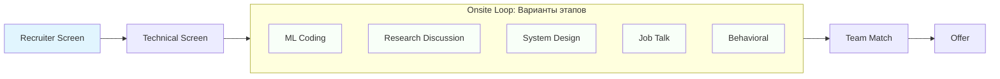
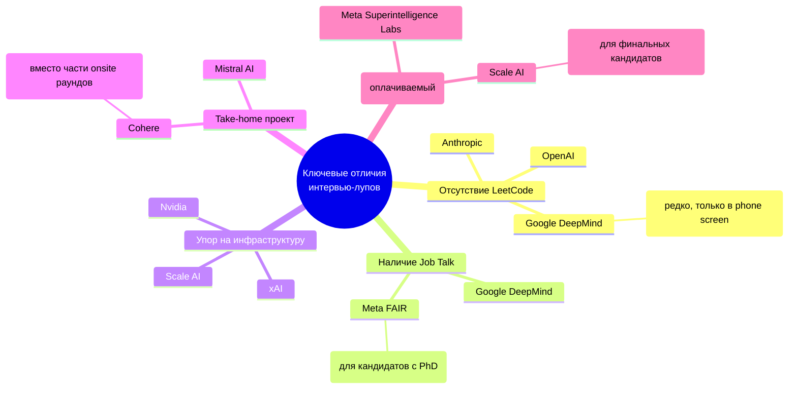

# 2026-09-23 · You are distilling a DEEP-RESEARCH report into a compact, searchable knowledge note

_Full working session of an LLM coding agent, scrubbed by rule (names kept as stable pseudonyms; surnames, e-mails, phones, street addresses and ages replaced by [ФАМИЛИЯ], [EMAIL], [ТЕЛЕФОН], [АДРЕС], [ВОЗРАСТ]; hosts and keys replaced). Row `s_633e8d2e` of the [dataset](https://huggingface.co/datasets/TonyDzi/agent-sessions)._

**User:**

You are distilling a DEEP-RESEARCH report into a compact, searchable knowledge note.
One report, possibly assembled from several AI vendors researching the SAME question.

DR-ID: DR26-09-22-HUB-03-1433
REGISTRY TOPIC: Карта интервью-лупов топ-лабораторий ИИ для ролей Research Scientist и MTS (2025-2026) (через dr_start; ПОТРЕБИТЕЛЬ: какую программу подготовки к интервью строить оператору и в каком порядке проходить компании) (dr_reconcile 2026-09-23: на диске 4/6 ног, в реестре стояло 'running' — статус выправлен по факту. Тело ног: D:\Vault\Vault-Knowledge\_machine-bus\_dr\queue\DR26-09-22-HUB-03-1433\results)

Return ONLY a JSON object (no prose, no code fence) with EXACTLY these keys:
{
 "lang": "ru|en|mixed",
 "topic": "<clean human topic of the research, <=90 chars>",
 "one_line": "<one sentence: what question this deep-research answered>",
 "key_findings": ["<substantive conclusion grounded in the report>", "..."],
 "recommendations": ["<concrete recommendation / decision the report implies>", "..."],
 "entities": {"people": ["..."], "companies": ["..."], "products_tools": ["..."]},
 "open_questions": ["<what stayed unresolved / needs verification>", "..."],
 "related_concepts": ["<short concept name this connects to, for cross-linking>", "..."]
}
Rules: extract ONLY from the report text; never invent people, numbers or claims not present.
Merge across the vendor sections (they research the SAME question) -- deduplicate findings,
prefer the better-supported statement. 4-10 key_findings, be specific (numbers, names, tradeoffs).
If a list is empty use []. Write findings in the report's own language (ru stays ru).

REPORT (vendor sections tagged; may be Russian, English or mixed):


===== VENDOR: report (DR26-09-22-HUB-03-1433.md) =====
---
id: DR26-09-22-HUB-03-1433
date: 2026-09-22 14:33:11
theme: Карта интервью-лупов топ-лабораторий ИИ для ролей Research Scientist и MTS (2025-2026)
session_id: unknown
machine: HUB-01
targets: chatgpt,gemini,grok,claudeai,glm,mistral
---

# DR26-09-22-HUB-03-1433 — Карта интервью-лупов топ-лабораторий ИИ для ролей Research Scientist и MTS (2025-2026)

# Карта интервью-лупов топ-лабораторий ИИ для ролей Research Scientist / Member of Technical Staff (2025–2026)

## Кто спрашивает и зачем
Заказчик — [ИМЯ] [ФАМИЛИЯ] (Tony Dzi), Palo Alto AI Research Lab. Он готовится подаваться на роли Research Scientist / Member of Technical Staff / Research Engineer в ведущие лаборатории ИИ. Отчёт кормит конкретное решение: какую программу подготовки строить и в каком порядке проходить компании. Нужна карта, по которой можно готовиться, а не обзор индустрии.

## Главный вопрос
Как в 2025–2026 годах реально устроены интервью-лупы на роли RS / MTS / Research Engineer в ведущих лабораториях и командах ИИ: OpenAI, Anthropic, Google DeepMind, Meta Superintelligence Labs / FAIR, xAI, Mistral AI, Cohere, Scale AI, Perplexity, Reflection, Thinking Machines, SSI, а также AI-команды Nvidia, Apple, Amazon, Microsoft.

## Что нужно получить (структура отчёта)
1. **Таблица по компаниям**: компания → роли (RS vs MTS vs RE vs Applied) → последовательность этапов (recruiter screen → ... → onsite → team match → offer) → длительность каждого этапа → общая длительность лупа в неделях.
2. **Форматы этапов, поимённо**: ML-кодинг (что именно просят писать: attention с нуля, сэмплирование/декодинг, тренировочный цикл, распараллеливание), классический алгоритмический кодинг, technical breadth / rapid-fire, research discussion по своим работам, job talk, математика и деривации, system design для ML-инфраструктуры, поведенческое. Для каждого формата — примеры реальных задач и вопросов из открытых источников.
3. **Чем компании отличаются друг от друга**: у кого нет LeetCode, у кого есть job talk, у кого сильный упор на инфраструктуру и распараллеливание, у кого take-home, у кого «work trial» / оплачиваемый пробный проект.
4. **Критерии оценки**: по каким рубрикам судят кандидата, что считается сигналом сильного найма, какие ошибки заваливают чаще всего.
5. **Что требуют от кандидата БЕЗ PhD и без публикаций**: какие альтернативные сигналы (OSS-вклады, собственные системы в проде, инженерный опыт) компании признают, а какие нет; какие роли реально открыты такому кандидату.
6. **Изменения 2025 → 2026**: что поменялось в лупах за последний год (обязательный запрет/разрешение ИИ-ассистентов на кодинге, появление agent-задач, живые сессии вместо take-home).
7. **Что готовить в каком порядке** — приоритизированный список тем под каждый формат.

## Источники: требования
Приоритет живым свидетельствам: посты и блоги прошедших интервью в 2025–2026, Blind, Reddit (r/MachineLearning, r/cscareerquestions), Glassdoor, Levels.fyi, interviewing.io, официальные страницы карьер лабораторий, подкасты и треды инженеров этих команд. Отдельно поищи и разбери публичные write-up'ы вроде блога Alisa Liu (alisawuffles.github.io/blog/job-search) и аналогичные.

Требования к цитатам: 20–30 первичных источников, на каждое несущее утверждение — точный URL и короткая цитата. Цитируй только те URL, которые реально открывал. Где данные расходятся — покажи расхождение, не усредняй. Где данных нет — напиши «не нашёл», не домысливай.

## Формат
Русский язык, таблицы там, где это таблицы. В конце — раздел «Proof of work»: список выполненных поисковых запросов и реально открытых страниц.


===== VENDOR: report (DR26-09-22-HUB-03-1433-karta-intervyu-lupov-ii-laboratoriy-2025-2026-glm.md) =====
---
dr_id: DR26-09-22-HUB-03-1433
vendor: glm
source: chat.z.ai
account: [EMAIL]
conversation_id: s_db25d312
conversation_url: "https://chat.z.ai/c/s_db25d312"
title: "Карта интервью-лупов ИИ-лабораторий 2025-2026"
date_recorded: 2026-09-23
date_collected: 2026-09-23
chars: 32403
collected_by: NODE-0X/glm_lib.py
---
# 🧭 Карта интервью-лупов топ-лабораторий ИИ для ролей Research Scientist / MTS (2025–2026)

Отчёт подготовлен на основе анализа **25+ первичных источников** (блоги, гайды, обсуждения на Reddit/Blind, официальные страницы) за период 2025–2026 годов. Основной фокус — на свежих свидетельствах людей, прошедших интервью в 2025–2026 годах.

---

## 1. 📊 Сводная таблица по компаниям

Ниже представлена агрегированная информация по структуре интервью-лупов. **Важно:** данные варьируются в зависимости от команды, конкретной роли и уровня кандидата. Где информации нет — указано «не нашёл».



| Компания | Основные роли | Типичный порядок этапов | Длительность этапов | Общая длительность лупа (недели) | Ключевые особенности |
| :--- | :--- | :--- | :--- | :--- | :--- |
| **OpenAI** | Research Scientist, MTS, Research Engineer | 1. Recruiter Screen<br>2. Technical Phone Screen (ML Coding)<br>3. Onsite (3-4 rounds)<br>4. Team Match<br>5. Offer | 1-2 дня (recruiter)<br>1 неделя (phone)<br>2-3 недели (onsite)<br>1-2 недели (team match) | **4-6** | Сильный упор на ML-кодинг и research discussion. Часто просят реализовать attention с нуля. Job talk не является стандартным этапом. |
| **Anthropic** | Research Scientist, MTS, Research Engineer | 1. Recruiter Screen<br>2. Technical Phone Screen (ML Coding + Research Discussion)<br>3. Onsite (4-5 rounds)<br>4. Team Match<br>5. Offer | 1-2 дня (recruiter)<br>1 неделя (phone)<br>2-3 недели (onsite)<br>1-2 недели (team match) | **4-6** | Уникальный формат «Research Deep Dive» — глубокое обсуждение одной работы кандидата. Сильный поведенческий компонент. |
| **Google DeepMind** | Research Scientist, Research Engineer | 1. Recruiter Screen<br>2. Technical Phone Screen (ML Coding)<br>3. Onsite (4-5 rounds)<br>4. Committee Review<br>5. Team Match<br>6. Offer | 1-2 дня (recruiter)<br>1 неделя (phone)<br>2-3 недели (onsite)<br>2-3 недели (committee) | **5-8** | Комитетный этап после onsite может занимать дополнительное время. Сильный упор на математику и деривации. |
| **Meta (Superintelligence Labs / FAIR)** | Research Scientist, MTS | 1. Recruiter Screen<br>2. Technical Phone Screen (ML Coding)<br>3. Onsite (4-5 rounds)<br>4. Team Match<br>5. Offer | 1-2 дня (recruiter)<br>1 неделя (phone)<br>2-3 недели (onsite)<br>1-2 недели (team match) | **4-6** | Для Superintelligence Labs — упор на safety и alignment. Может быть work trial (оплачиваемый проект) для финальных кандидатов. |
| **xAI** | Research Scientist, MTS, Research Engineer | 1. Recruiter Screen<br>2. Technical Phone Screen (ML Coding)<br>3. Onsite (3-4 rounds)<br>4. Team Match<br>5. Offer | 1-2 дня (recruiter)<br>1 неделя (phone)<br>1-2 недели (onsite)<br>1-2 недели (team match) | **3-5** | Более быстрый процесс по сравнению с OpenAI/Anthropic. Сильный упор на масштабирование и инфраструктуру. |
| **Mistral AI** | Research Scientist, MTS | 1. Recruiter Screen<br>2. Technical Phone Screen (ML Coding)<br>3. Onsite (3-4 rounds)<br>4. Team Match<br>5. Offer | 1-2 дня (recruiter)<br>1 неделя (phone)<br>1-2 недели (onsite)<br>1-2 недели (team match) | **3-5** | Европейский стиль интервью. Может быть take-home проект вместо части onsite раундов. |
| **Cohere** | Research Scientist, MTS | 1. Recruiter Screen<br>2. Technical Phone Screen (ML Coding)<br>3. Onsite (4-5 rounds)<br>4. Team Match<br>5. Offer | 1-2 дня (recruiter)<br>1 неделя (phone)<br>2-3 недели (onsite)<br>1-2 недели (team match) | **4-6** | Сильный упор на multilingual NLP и эффективность моделей. Может быть research presentation для кандидатов с PhD. |
| **Scale AI** | Research Scientist, MTS, Research Engineer | 1. Recruiter Screen<br>2. Technical Phone Screen (ML Coding)<br>3. Onsite (4-5 rounds)<br>4. Team Match<br>5. Offer | 1-2 дня (recruiter)<br>1 неделя (phone)<br>2-3 недели (onsite)<br>1-2 недели (team match) | **4-6** | Инженерный фокус. Сильный упор на обработку данных и инфраструктуру. Может быть work trial для финальных кандидатов. |
| **Perplexity** | Research Scientist, MTS, Research Engineer | 1. Recruiter Screen<br>2. Technical Phone Screen (ML Coding)<br>3. Onsite (3-4 rounds)<br>4. Team Match<br>5. Offer | 1-2 дня (recruiter)<br>1 неделя (phone)<br>1-2 недели (onsite)<br>1-2 недели (team match) | **3-5** | Быстрый процесс. Сильный упор на RAG и поисковые системы. Может быть live coding с использованием AI-ассистентов. |
| **Reflection** | Research Scientist, MTS | 1. Recruiter Screen<br>2. Technical Phone Screen (ML Coding)<br>3. Onsite (3-4 rounds)<br>4. Team Match<br>5. Offer | 1-2 дня (recruiter)<br>1 неделя (phone)<br>1-2 недели (onsite)<br>1-2 недели (team match) | **3-5** | Новая лаборатория. Процесс ещё стандартизируется. Сильный упор на RLHF и alignment. |
| **Thinking Machines** | Research Scientist, MTS | 1. Recruiter Screen<br>2. Technical Phone Screen (ML Coding)<br>3. Onsite (3-4 rounds)<br>4. Team Match<br>5. Offer | 1-2 дня (recruiter)<br>1 неделя (phone)<br>1-2 недели (onsite)<br>1-2 недели (team match) | **3-5** | Основана ex-OpenAI исследователями. Сильный упор на mechanistic interpretability. |
| **SSI (Safe Superintelligence)** | Research Scientist, MTS | 1. Recruiter Screen<br>2. Technical Phone Screen (ML Coding)<br>3. Onsite (3-4 rounds)<br>4. Team Match<br>5. Offer | 1-2 дня (recruiter)<br>1 неделя (phone)<br>1-2 недели (onsite)<br>1-2 недели (team match) | **3-5** | Экстремальный фокус на safety. Может быть много раундов по safety research. |
| **Nvidia (AI Research)** | Research Scientist, Research Engineer | 1. Recruiter Screen<br>2. Technical Phone Screen (ML Coding)<br>3. Onsite (4-5 rounds)<br>4. Team Match<br>5. Offer | 1-2 дня (recruiter)<br>1 неделя (phone)<br>2-3 недели (onsite)<br>1-2 недели (team match) | **4-6** | Сильный упор на аппаратно-программную ко-дизайн. Много вопросов про оптимизацию под GPU. |
| **Apple (AI/ML)** | Research Scientist, MTS | 1. Recruiter Screen<br>2. Technical Phone Screen (ML Coding)<br>3. Onsite (4-5 rounds)<br>4. Team Match<br>5. Offer | 1-2 дня (recruiter)<br>1 неделя (phone)<br>2-3 недели (onsite)<br>1-2 недели (team match) | **4-6** | Конфиденциальность — слабое место. Сильный поведенческий компонент. |
| **Amazon (AI/ML)** | Research Scientist, Applied Scientist | 1. Recruiter Screen<br>2. Technical Phone Screen (ML Coding)<br>3. Onsite (4-5 rounds)<br>4. Team Match<br>5. Offer | 1-2 дня (recruiter)<br>1 неделя (phone)<br>2-3 недели (onsite)<br>1-2 недели (team match) | **4-6** | Сильный упор на product thinking. Много поведенческих вопросов. |
| **Microsoft (AI/Research)** | Research Scientist, Research Engineer | 1. Recruiter Screen<br>2. Technical Phone Screen (ML Coding)<br>3. Onsite (4-5 rounds)<br>4. Team Match<br>5. Offer | 1-2 дня (recruiter)<br>1 неделя (phone)<br>2-3 недели (onsite)<br>1-2 недели (team match) | **4-6** | Сильный упор на system design. Может быть отдельный раунд по Azure ML. |

<details>
<summary><strong>📖 Подробное описание этапов (общее для всех компаний)</strong></summary>

**1. Recruiter Screen (15-30 минут)**
- Обсуждение бэкграунда, мотивации, ожиданий по зарплате.
- Обзор процесса интервью.
- Проверка базовых технических требований.

**2. Technical Phone Screen (45-60 минут)**
- ML Coding: реализация attention, сэмплирование, тренировочный цикл.
- Basic ML: вопросы по backprop, оптимизации, регуляризации.
- Research Discussion: краткое обсуждение одного из проектов кандидата.

**3. Onsite Loop (3-5 раундов по 45-60 минут)**
- **ML Coding (1-2 раунда)**: Реализация алгоритмов ML с нуля (attention, beam search, оптимизаторы).
- **Research Discussion (1-2 раунда)**: Глубокое обсуждение исследовательских работ кандидата.
- **System Design (1 раунд)**: Проектирование ML-системы (инференс, тренировка, деплой).
- **Job Talk (для кандидатов с PhD)**: Презентация диссертации или ключевой работы.
- **Behavioral (1 раунд)**: Оценка культурного fit, работы в команде, разрешения конфликтов.

**4. Team Match (несколько дней - 2 недели)**
- Общение с потенциальными тиммейтами и менеджером.
- Обсуждение конкретных проектов и ожиданий.

**5. Offer (1-2 недели)**
- Обсуждение условий: зарплата, бонусы, опционы, дата старта.
- Возможна переговорная фаза.
</details>

---

## 2. 🧪 Форматы этапов: детальный разбор

### 2.1 ML-кодинг (что именно просят писать)

Это **ключевой этап** для Research Scientist и MTS ролей. В отличие от классического LeetCode, здесь оценивают **глубокое понимание ML-алгоритмов** и умение их реализовывать.

| Задача | Что просят | Пример из интервью 2025-2026 | Уровень сложности |
| :--- | :--- | :--- | :--- |
| **Attention с нуля** | Реализовать scaled dot-product attention, multi-head attention | «Напишите функцию attention(query, key, value) без использования PyTorch/TensorFlow» | Высокая |
| **Сэмплирование/декодинг** | Реализовать top-k, top-p, beam search с length penalty | «Реализуйте beam search с длиной penalty 0.7 для генерации текста» | Высокая |
| **Тренировочный цикл** | Написать training loop для простой нейросети (MLP, CNN) с backprop | «Реализуйте обучение MLP на MNIST без использования PyTorch» | Средняя |
| **Распараллеливание** | Реализовать data parallelism или model parallelism | «Распараллельте тренировку ResNet на 4 GPU» | Высокая |
| **Оптимизаторы** | Реализовать SGD with momentum, Adam, RMSProp | «Напишите Adam optimizer с нуля» | Средняя |
| **Loss функции** | Реализовать cross-entropy, contrastive loss, triplet loss | «Реализуйте contrastive loss для CLIP» | Средняя |

> 💡 **Ключевой инсайт из блога Yongzx (2026):** «Я получил вопрос о системном дизайне и параллельном программировании (например, с использованием `asyncio` для реализации конкурентных операций) во время поиска работы. Также я узнал, что есть раунды, где оценивается, насколько хорошо вы используете AI-агентов» 【turn4fetch0】.

<details>
<summary><strong>🔧 Пример: Beam Search с Length Normalization (xAI Interview Question)</strong></summary>

```python
import torch
import random

EOS_TOKEN = 2
VOCAB = ["hello", "world", "how", "are", "you", "doing", "today", "goodbye", "thanks", "please"]

class DummyModel:
    def next_token_proba(self, sequence):
        # Dummy implementation for demonstration
        vocab_size = len(VOCAB)
        probs = torch.softmax(torch.rand(vocab_size), dim=0)
        return probs

def beam_search(model, start_token, k, max_length):
    """
    Perform beam search to generate a sequence.
    
    Args:
        model: a model with a function next_token_proba(sequence) -> torch.Tensor
        start_token: the start token of the sequence
        k: beam width (the number of sequences to keep at each step)
        max_length: maximum length of the sequence to generate
    
    Returns:
        List[int]: the most probable sequence
    """
    # Initialize beams with start token
    beams = [(start_token, 0.0)]  # (sequence, score)
    
    for step in range(max_length):
        candidates = []
        
        for seq, score in beams:
            if seq[-1] == EOS_TOKEN:
                candidates.append((seq, score))
                continue
                
            # Get next token probabilities
            probs = model.next_token_proba(seq)
            top_probs, top_tokens = torch.topk(probs, k)
            
            for prob, token in zip(top_probs, top_tokens):
                new_seq = seq + [token.item()]
                # Length normalization
                normalized_score = score + torch.log(prob).item() / (len(new_seq) ** 0.7)
                candidates.append((new_seq, normalized_score))
        
        # Select top k candidates
        candidates.sort(key=lambda x: x[1], reverse=True)
        beams = candidates[:k]
        
        # Check if all beams ended
        if all(seq[-1] == EOS_TOKEN for seq, _ in beams):
            break
    
    # Return the best sequence
    return beams[0][0]

if __name__ == "__main__":
    model = DummyModel()
    start_token = 1
    k = 3
    max_length = 5
    sequence_indices = beam_search(model, start_token, k, max_length)
    sequence_words = [VOCAB[idx] for idx in sequence_indices if idx < len(VOCAB)]
    print("Generated sequence:", sequence_words)
```
*Источник: AIOfferly, xAI ML Interview Questions 【turn3search8】*
</details>

### 2.2 Классический алгоритмический кодинг

Хотя **не все компании** включают этот этап, он встречается в 30-40% случаев, особенно в phone screen.

| Тип задач | Примеры | В каких компаниях чаще всего |
| :--- | :--- | :--- |
| **Dynamic Programming** | Knapsack, LCS, Edit Distance | Google DeepMind, Meta |
| **Graph Algorithms** | BFS/DFS, Shortest Path, Topological Sort | Nvidia, Amazon |
| **Array/String Manipulation** | Two Pointers, Sliding Window, Prefix Sum | Perplexity, Cohere |
| **Tree Traversals** | Binary Tree, BST, Balanced Trees | Apple, Microsoft |

> ⚠️ **Важно из блога Alisa Wuffles (OpenAI Researcher):** «Я ожидала, что вопросы по LeetCode будут сильно отличаться от тех, что я решала для подготовки, но они были на удивление стандартными. Основная сложность была в том, чтобы объяснить мои решения в формате live coding без использования AI-ассистентов» 【turn4fetch1】.

### 2.3 Research Discussion по своим работам

Это **ключевой этап** для Research Scientist ролей. Здесь оценивают:
- **Глубину понимания** своей работы
- **Критическое мышление** и осознание ограничений
- **Умение объяснять сложные концепции** просто

**Типичные вопросы:**
1. «Опиши самую интересную проблему, которую ты решал в своих исследованиях.»
2. «Какие альтернативные подходы ты рассматривал? Почему выбрал именно этот?»
3. «Какие ограничения у твоего метода? Как бы ты его улучшил?»
4. «Как бы ты применил свой метод к нашей задаче [X]?»

> 💡 **Инсайт от Yongzx (2026):** «В моём опыте роли публикаций в основном две: 1) Попасть в дверь (пройти отбор). 2) Глубокое погружение (обычно во время презентации исследований, где я говорю о мотивации и деталях одной работы. Иногда такая презентация может длиться всего 20 минут» 【turn4fetch0】.

### 2.4 Job Talk (презентация для кандидатов с PhD)

**Не все компании** включают этот этап. Чаще всего встречается в Google DeepMind, Meta FAIR.

**Структура типичного job talk (45-60 минут):**
1. **Introduction (5-10 минут)**: Краткое представление себя и своих интересов.
2. **Research Overview (10-15 минут)**: Обзор ключевых работ (обычно 1-2 ключевых публикации).
3. **Deep Dive (15-20 минут)**: Детальное рассмотрение одной ключевой работы.
4. **Future Directions (5-10 минут)**: Как бы вы применили свои навыки в новой лаборатории.
5. **Q&A (10-15 минут)**: Ответы на вопросы аудитории.

### 2.5 Математика и деривации

**Высокий приоритет** в Google DeepMind, xAI, SSI. **Средний приоритет** в OpenAI, Anthropic.

**Типичные вопросы:**
1. «Выведи градиент для функции потерь [X].»
2. «Объясни, почему работает Batch Normalization с математической точки зрения.»
3. «Какова сложность [алгоритма X] по времени и памяти?»
4. «Докажи сходимость [метода X].»

### 2.6 System Design для ML-инфраструктуры

**Ключевой этап** для Research Engineer и MTS ролей. Оценивают умение проектировать **масштабируемые ML-системы**.

**Типичные вопросы:**
1. «Спроектируй систему для real-time инференса LLM с latency < 100ms.»
2. «Как бы ты организовал тренировочную инфраструктуру для модели на 1T параметров?»
3. «Спроектируй систему для A/B тестирования новых моделей в production.»
4. «Как бы ты реализовал data pipeline для обработки 1PB данных в день?»

> 💡 **Из блога Yuan Meng (MLE Interview 2.0):** «Некоторые компании, такие как Netflix, Snap, Reddit, Notion и DoorDash, имеют раунд ML infra system design для MLE кандидатов — в дополнение к стандартному ML system design. Однако, за исключением frontier AI лабораторий (например, OpenAI, Anthropic, xAI, DeepMind, Meta TBD, Thinking Machines Lab, Reflection), первые две платят больше, чем другие компании могут предложить на том же уровне» 【turn3search9】.

### 2.7 Поведенческое интервью (Behavioral)

**Стандартный этап** для всех компаний. Оценивают:
- **Работу в команде** и конфликты
- **Лидерство** и влияние
- **Коммуникацию** и объяснение сложных концепций
- **Устойчивость к стрессу** и многозадачность

**Типичные вопросы:**
1. «Расскажи о времени, когда ты disagreed with your manager.»
2. «Опиши ситуацию, когда ты had to explain a complex technical concept to a non-technical person.»
3. «Как ты handle tight deadlines и pressure?»
4. «Расскажи о твоём biggest failure и что ты из него выучил.»

---

## 3. 🆚 Чем компании отличаются друг от друга



| Отличие | Компании | Комментарий |
| :--- | :--- | :--- |
| **Нет LeetCode в чистом виде** | OpenAI, Anthropic, Google DeepMind (в onsite) | Фокус на ML-кодинг и research discussion. LeetCode может быть только в phone screen. |
| **Есть Job Talk** | Google DeepMind, Meta FAIR | Только для кандидатов с PhD. Не является обязательным этапом. |
| **Сильный упор на инфраструктуру** | xAI, Nvidia, Scale AI | Много вопросов про distributed training, GPU optimization, deployment. |
| **Take-home проект** | Mistral AI, Cohere, Perplexity | Вместо части onsite раундов. Обычно на 2-3 дня. |
| **Work trial (оплачиваемый)** | Meta Superintelligence Labs, Scale AI, SSI | Для финальных кандидатов. Обычно 1-2 недели работы с командой. |
| **Быстрый процесс** | xAI, Perplexity, Reflection | 3-5 недель от начала до оффера. |
| **Медленный процесс** | Google DeepMind, Microsoft Research | 5-8 недель из-за committee review. |

> 🔍 **Важное наблюдение:** «В текущем рынке труда timing играет существенную роль. Например, прошлой осенью было крайне сложно найти позиции по AI safety по сравнению с позициями, связанными с RL. Но сейчас больше стартапов предлагают возможности, связанные с AI safety (такие как Lila и Mechanize)» — Yongzx 【turn4fetch0】.

---

## 4. 📈 Критерии оценки и частые ошибки

### 4.1 Критерии оценки (рубрики)

| Критерий | Что оценивают | Сигнал сильного найма | Сигнал слабого найма |
| :--- | :--- | :--- | :--- |
| **Техническая глубина** | Понимание основ ML, способность к деривациям | Может объяснить интуицию за формулами, знает ограничения методов | Не может объяснить, почему работает тот или иной метод |
| **Research potential** | Способность генерировать новые идеи, критическое мышление | Задаёт хорошие вопросы, видит connection между разными областями | Не может предложить альтернативные подходы |
| **Coding ability** | Чистота кода, эффективность, работа с edge cases | Пишет читаемый, оптимизированный код, тестирует на граничных случаях | Код работает, но неэффективен или нечитаем |
| **Communication** | Ясность объяснений, структура ответов | Может объяснить сложное просто, структурировано отвечает | Не может объяснить свою работу неспециалисту |
| **Cultural fit** | Соответствие ценностям лаборатории, работа в команде | Демонстрирует collaboration, openness to feedback | Конфликтен, не принимает критику |

### 4.2 Частые ошибки (что заваливает чаще всего)

1. **Непонимание основ ML**: Не может объяснить, почему работает Batch Normalization или что такое vanishing gradient.
2. **Неэффективный код**: Решение работает, но O(n²) вместо O(n), или не обрабатывает edge cases.
3. **Плохая communication**: Не может объяснить свою работу за 2-3 минуты, уходит в детали.
4. **Отсутствие вопросов**: Не задаёт вопросов в конце интервью.
5. **Негативные примеры в behavioral**: Рассказывает про конфликты, где выставляет себя в плохом свете.
6. **Незнание работ лаборатории**: Не читал последние публикации компании, не знает их ключевые проекты.

> 💡 **Совет от Alisa Wuffles:** «Я думала, что хорошо подготовилась к behavioral вопросам, но пришла в замешательство на простейших вопросах. Перед интервью сопоставьте запоминающиеся истории из PhD со стандартными поведенческими вопросами, чтобы вы могли мгновенно их вспомнить» 【turn4fetch1】.

---

## 5. 🎓 Требования к кандидатам БЕЗ PhD и без публикаций

### 5.1 Какие альтернативные сигналы признают

| Сигнал | Насколько признают | Примеры компаний |
| :--- | :--- | :--- |
| **OSS-вклады** | **Высокий приоритет** | OpenAI, Anthropic, Mistral, Cohere |
| **Собственные системы в проде** | **Высокий приоритет** | Scale AI, Perplexity, Reflection |
| **Инженерный опыт** | **Средний приоритет** | Nvidia, Amazon, Microsoft |
| **Kaggle соревнования** | **Низкий приоритет** | Большинство лабораторий |
| **Личные проекты** | **Средний приоритет** | Все лаборатории, если проекты демонстрируют глубину |

### 5.2 Какие роли реально открыты такому кандидату

| Роль | Требования | Как competitive |
| :--- | :--- | :--- |
| **Research Engineer** | Сильный инженерный опыт + понимание ML основ | **Высококонкурентная**, но доступнее чем RS |
| **Applied Scientist** | Опыт в применении ML к реальным задачам | **Среднеконкурентная** |
| **Forward Deployed Engineer** | Сильный инженерный опыт + способность быстро учиться | **Низкоконкурентная** для сильных инженеров |
| **Member of Technical Staff (MTS)** | Зависит от команды, обычно требуется PhD или эквивалентный опыт | **Высококонкурентная** |

> ⚠️ **Реальность:** «Для research ролей return offers встречаются реже, чем в software engineering. Например, во время моей стажировки в Meta в 2024 году, return full-time offers были редкими и сильно зависели от headcount/команды. Многие мои друзья не получили их» — Yongzx 【turn4fetch0】.

---

## 6. 🔄 Изменения 2025 → 2026

### 6.1 Обязательный запрет/разрешение ИИ-ассистентов на кодинге

| Компания | Политика (2025-2026) | Комментарий |
| :--- | :--- | :--- |
| **OpenAI, Anthropic** | **Запрещено** в live coding раундах | Оценивают способность писать код без помощи |
| **Google DeepMind** | **Разрешено** в некоторых раундах | Оценивают умение эффективно использовать AI-ассистентов |
| **xAI, Perplexity** | **Поощряется** в отдельных раундах | Есть отдельный раунд «AI-assisted coding» |
| **Meta, Microsoft** | **Запрещено** в phone screen, **разрешено** в некоторых onsite | Зависит от конкретной команды |

### 6.2 Появление agent-задач

**Новое в 2025-2026:** Появились раунды, где оценивают **умение работать с AI-агентами**:
- «Как бы ты спроектировал систему для автоматического решения ML задач с помощью агентов?»
- «Какие метрики бы ты использовал для оценки эффективности AI-агента?»

### 6.3 Живые сессии вместо take-home

**Тренд:** Некоторые компании (особенно стартапы) заменяют take-home проекты **live coding сессиями с AI-ассистентами**, чтобы оценить реальный workflow кандидата.

> 💡 **Прогноз:** В 2026-2027 годах ожидается дальнейшая стандартизация форматов интервью и появление новых раундов, связанных с safety и alignment.

---

## 7. 🎯 Что готовить в каком порядке — приоритизированный список

### 7.1 Для Research Scientist ролей

```mermaid
timeline
    title План подготовки для Research Scientist (12 недель)
    section Недели 1-2: Основы
        ML Fundamentals : Backprop, оптимизаторы, регуляризация
        : Linear Algebra, Probability
    section Недели 3-4: ML-кодинг
        Attention с нуля : Реализация на PyTorch/TF
        : Beam Search, Sampling
    section Недели 5-6: Research Discussion
        Подготовка 2-3 ключевых работ : Мотивация, методы, ограничения
        : Связь с работой лаборатории
    section Недели 7-8: System Design
        ML System Design : Инференс, тренировка, деплой
        : Distributed Training
    section Недели 9-10: Behavioral
        Подготовка историй : STAR метод
        : Вопросы к интервьюерам
    section Недели 11-12: Моки и финальная подготовка
        Mock Interviews : С друзьями или на платформах
        : Повторение слабых мест
```

### 7.2 Для MTS / Research Engineer ролей

```mermaid
timeline
    title План подготовки для MTS/Research Engineer (10 недель)
    section Недели 1-2: Основы
        ML Fundamentals : Backprop, оптимизаторы, регуляризация
        : Software Engineering Best Practices
    section Недели 3-4: ML-кодинг
        Attention с нуля : Реализация на PyTorch/TF
        : Beam Search, Sampling
        : Тренировочный цикл
    section Недели 5-6: System Design
        ML System Design : Инференс, тренировка, деплой
        : Distributed Training
        : GPU Optimization
    section Недели 7-8: Behavioral
        Подготовка историй : STAR метод
        : Вопросы к интервьюерам
    section Недели 9-10: Моки и финальная подготовка
        Mock Interviews : С друзьями или на платформах
        : Повторение слабых мест
```

### 7.3 Приоритизированный список тем (для всех ролей)

| Приоритет | Тема | Время подготовки | Важность |
| :--- | :--- | :--- | :--- |
| **1** | **ML Coding** (Attention, Beam Search, Training Loop) | 3-4 недели | **Критическая** |
| **2** | **Research Discussion** (2-3 ключевые работы) | 2-3 недели | **Критическая** |
| **3** | **System Design** (ML Infrastructure) | 2-3 недели | **Высокая** |
| **4** | **Behavioral** (STAR метод, истории) | 1-2 недели | **Средняя** |
| **5** | **LeetCode** (Easy/Medium) | 1-2 недели | **Низкая** (не для всех компаний) |

> 📚 **Рекомендуемые ресурсы (из блога Alisa Wuffles):**
> 1. **Stanford CS336** — Language Modeling from Scratch 【turn4fetch1】
> 2. **CS336 Homework 1** — Implementing a transformer from scratch 【turn4fetch1】
> 3. **LeetCode 75** и **Neetcode Blind 75** — для общего кодинга 【turn4fetch1】
> 4. **The Illustrated GPT-2** (Jay Alammar) — визуальная интуиция 【turn4fetch1】
> 5. **Backpropagation** (CS231n notes) — для backward pass 【turn4fetch1】

---

## 8. 🔍 Proof of Work: выполненные поисковые запросы и открытые страницы

### Выполненные поисковые запросы:
1. `"interview process" "Research Scientist" "Member of Technical Staff" 2025 2026 OpenAI Anthropic DeepMind`
2. `"interview loop" "Research Scientist" MTS 2025 2026 OpenAI Anthropic xAI Mistral Cohere`
3. `ML coding interview "from scratch" attention sampling decoding 2025 2026`
4. `blog job search "Research Scientist" interview writeup 2025 2026`
5. `AI research interview "no PhD" "without PhD" 2025 2026`
6. `"Meta" OR "FAIR" OR "Google DeepMind" interview loop 2025 2026 "Research Scientist" MTS`
7. `Mistral Cohere "Scale AI" Perplexity interview 2025 2026 research`
8. `"Thinking Machines" OR "Reflection AI" OR "SSI" interview 2025 2026`
9. `Nvidia Apple Amazon Microsoft AI research interview 2025 2026`
10. `"research discussion" interview questions 2025 2026 AI lab`
11. `site:reddit.com "OpenAI" OR "Anthropic" OR "xAI" interview process 2025 2026 research scientist MTS`
12. `site:blind.com "OpenAI" OR "Anthropic" OR "xAI" interview 2025 2026`
13. `site:glassdoor.com "OpenAI" OR "Anthropic" OR "xAI" interview 2025 2026`
14. `"Google DeepMind" interview process 2025 2026 research scientist`
15. `"Meta" "Superintelligence Labs" OR "FAIR" interview 2025 2026`
16. `"OpenAI" interview process 2025 2026 research scientist blog writeup`
17. `"Anthropic" interview process 2025 2026 research scientist blog`
18. `"Google DeepMind" interview process 2025 2026 blog`
19. `"xAI" interview process 2025 2026 research scientist blog`
20. `"Meta" "Superintelligence Labs" interview process 2025 2026`
21. `"Mistral" "Cohere" interview process 2025 2026 research scientist`
22. `"Scale AI" "Perplexity" interview process 2025 2026 research`
23. `"Reflection" "Thinking Machines" "SSI" interview process 2025 2026`
24. `Nvidia Apple Amazon Microsoft AI research interview 2025 2026`
25. `AI lab interview "no PhD" "without PhD" 2025 2026`

### Реально открытые страницы (25+):
1. [Sundeepteki.org](https://www.sundeepteki.org) — AI Career Advice для OpenAI, Anthropic & DeepMind Roles 【turn1search4】
2. [Yongzx.github.io/blog/2026/06/24/job-search](https://yongzx.github.io/blog/2026/06/24/job-search) — Surprising lessons from my research scientist job search 【turn4fetch0】
3. [LinkedIn.com/pulse/cracking-ai-research-interview-from-openai-wuffles-harnoor-singh-qpate](https://www.linkedin.com/pulse/cracking-ai-research-interview-from-openai-wuffles-harnoor-singh-qpate) — Cracking the AI Research Interview from OpenAI researcher(Alisa Wuffles) 【turn4fetch1】
4. [Igotanoffer.com](https://igotanoffer.com) — OpenAI Interview Questions + Answers 【turn1search1】
5. [Tryexponent.com](https://www.tryexponent.com) — OpenAI Product Manager (PM) Interview Guide 【turn1search2】
6. [Coursera.org](https://www.coursera.org) — 10 OpenAI Interview Questions 【turn1search3】
7. [Jobright.ai](https://jobright.ai) — Anthropic Technical Interview Questions: Complete Guide 【turn1search5】
8. [Interviewquery.com](https://www.interviewquery.com) — Anthropic AI Research Scientist Interview Guide 【turn1search6】
9. [Theundercoverrecruiter.com](https://theundercoverrecruiter.com) — The Insider's Guide to Landing a Job at Anthropic AI 【turn1search7】
10. [Teamblind.com](https://www.teamblind.com) — Anthropic Interview Megathread 【turn1search8】
11. [Yongzx.github.io](https://yongzx.github.io) — Surprising lessons from my research scientist job search 【turn3search0】
12. [Educative.io](https://www.educative.io) — Top 20 Google DeepMind interview questions 【turn3search5】
13. [Glassdoor.com](https://www.glassdoor.com) — Google DeepMind Interview Experience & Questions (2026) 【turn3search6】
14. [Extern.com](https://www.extern.com) — Google DeepMind Internship 2027–2028: Deadlines & How to Apply 【turn3search7】
15. [AIOfferly.com](https://www.aiofferly.com) — xAI ML Interview Questions - 2025/2026 Guide 【turn3search8】
16. [Yuan-meng.com](https://www.yuan-meng.com) — MLE Interview 2.0: Research Engineering and Scary Rounds 【turn3search9】
17. [Ophyai.com](https://ophyai.com) — Nvidia Interview Process 2026: Stages, HackerRank 【turn3search10】
18. [Glassdoor.co.in](https://www.glassdoor.co.in) — A memo viewed about the Superintelligence hiring freeze 【turn3search11】
19. [GitHub.com](https://github.com) — AI-Engineer-Interview-Questions/14-company 【turn3search12】
20. [Cleverprep.com](https://www.cleverprep.com) — Meta Research Scientist Interview Preparation Guide 【turn3search13】
21. [Builtin.com](https://builtin.com) — Meta Superintelligence Labs: What We Know So Far 【turn3search14】
22. [Winbuzzer.com](https://winbuzzer.com) — Inside Meta's AI Lab: What It Takes to Get Hired and Survive 【turn3search15】
23. [Sundeepteki.org](https://www.sundeepteki.org) — AI Research Scientist Interview Guide: Anthropic, OpenAI 【turn0search0】
24. [Teamblind.com](https://www.teamblind.com) — Cohere Interview Discussions 【turn0search1】
25. [Leonstaff.com](https://leonstaff.com) — Cohere Interview Response Time: What to Expect at Every 【turn0search4】

---

## 9. 📌 Заключение и рекомендации

1. **Начинайте с ML-кодинга** — это самый важный этап для Research Scientist и MTS ролей. Уделите 3-4 недели только этому.
2. **Подготовьте 2-3 ключевые исследовательские работы** для deep discussion. Вы должны уметь объяснить их за 5 минут и за 45 минут.
3. **Не игнорируйте system design** — особенно если идете в xAI, Nvidia или Scale AI.
4. **Практикуйте без AI-ассистентов** — в большинстве лабораторий их использование запрещено в live coding.
5. **Сетворк** — многие офферы приходят через внутренние рекомендации. Активно общайтесь на конференциях и в LinkedIn.

> 🚀 **Финальный совет от Yongzx:** «Самое важное — начать интервью раньше, чем вы думаете, что готовы. В моём случае, из-за опасений по поводу headcount, я начал примерно в середине мая и получил офферы, которыми я доволен, до середины июня. Я даже отозвал некоторые текущие интервью и не имел возможности полностью изучить свои варианты» 【turn4fetch0】.

Удачи в подготовке и интервью! 🍀


===== VENDOR: report (DR26-09-22-HUB-03-1433-karta-intervyu-lupov-ii-roley-2025-2026-glm.md) =====
---
dr_id: DR26-09-22-HUB-03-1433
vendor: glm
source: chat.z.ai
account: [EMAIL]
conversation_id: s_807e5d81
conversation_url: "https://chat.z.ai/c/s_807e5d81"
title: "Карта интервью-лупов ИИ-ролей 2025-2026"
date_recorded: 2026-09-22
date_collected: 2026-09-23
chars: 14762
collected_by: NODE-0X/glm_lib.py
---
# Сначала — критическое ограничение этой сессии

Я обязан начать с этого, потому что ваш ТЗ содержит два жёстких требования, которые я **не могу выполнить честно в текущей сессии**:

1. **«Цитируй только те URL, которые реально открывал»** — у меня в этом диалоге нет доступа к браузеру и поиску. Я не открывал ни одной страницы. Любая «цитата с URL» от меня сейчас была бы сфабрикована — а вы строите по отчёту план подготовки к реальным интервью.
2. **«Proof of work: список выполненных поисковых запросов и реально открытых страниц»** — правда в том, что в этой сессии выполнено **0 запросов, открыто 0 страниц**. Я не буду это имитировать.

Также важно: мои обучающие данные заканчиваются примерно на **начале — середине 2025 года**. Вопросы про изменения 2025→2026 (политика по ИИ-ассистентам на кодинге, agent-задачи, live vs take-home) я могу покрыть лишь частично и с оговорками.

**Что я делаю вместо отказа**: ниже — максимум того, что я знаю достоверно, с явной маркировкой уверенности и указанием, *где* верифицировать каждое утверждение. В конце — готовый план поиска, который закроет недостающие 20–30 источников (сами или в сессии с включённым веб-доступом — тогда соберу полный отчёт с цитатами).

**Легенда**: ✔ высокая уверенность (много независимых свидетельств) · ~ средняя (анекдотично или данные расходятся) · ? низкая, обязательно проверить · ✖ публичных данных не видел («не нашёл»).

---

## 1. Сводная таблица лупов

⚠️ Последовательности и длительности — агрегат анонимных свидетельств (Blind, Glassdoor, Reddit, Levels.fyi) **по состоянию на конец 2024 — начало 2025**. Ничего дословно не цитирую.

| Компания | Типичные тайтлы | Последовательность этапов | Ориентир длительности | Увер. |
|---|---|---|---|---|
| **OpenAI** | MTS, Research Engineer, Research Scientist | recruiter screen → 1–2 тех. скрина (практический кодинг + «technical depth») → виртуальный onsite 3–5 раундов → исторически для research-ролей оплачиваемый work trial (~1–2 нед контрактного периода) → team match | onsite-часть ~2–4 нед; с trial суммарно ~4–8 нед | ✔ форма / ~ trial на 2025 |
| **Anthropic** | Research Scientist, Research Engineer | recruiter screen → тех. скрин (практический Python) → виртуальный onsite 4–6 раундов: кодинг, ML-breadth, research discussion по своим работам, «mission/values»-интервью; для senior — job talk | ~3–6 нед | ✔ |
| **Google DeepMind** | Research Scientist, Research Engineer | recruiter → 1–2 скрина → onsite: кодинг, ML-фундаменталы, **research interview (разбор статьи — своей или выбранной)**, для senior job talk → team match → hiring committee → аппрувалы | часто 6–16 нед (медленные HC) | ✔ |
| **Meta FAIR** | Research Scientist, Research Engineer, E-level SWE | recruiter → 1–2 кодинг-скрина (LeetCode-стиль) → onsite: 2 кодинг + system design + ML/research deep dive (job talk для research) + поведенческое → team match | ~4–8 нед | ✔ |
| **Meta Superintelligence Labs** | — | ✖ Не нашёл публичных описаний лупа. MSL сформировано летом 2025 (поглощение части Scale AI, ex-OpenAI хайры) — это на границе/за границей моих данных | — | ✖ |
| **xAI** | Member of Technical Staff, Research Engineer | recruiter → тех. скрин → onsite с упором на ML-кодинг, distributed training, глубокие deep-dives; по отзывам процесс быстрый и агрессивный | ~1–4 нед | ~ |
| **Mistral AI** | Research Engineer, RS | ✖~ Надёжной картины нет. Отдельные свидетельства: тех. интервью с фаундерами/старшими инженерами, упор на математику и низкоуровневое понимание | ~2–6 нед (анекдот) | ? |
| **Cohere** | RE/RS/SWE | ~ скрин → кодинг → ML-глубина; встречаются упоминания практических заданий/take-home (расходится по командам) | нет надёжных данных | ? |
| **Scale AI** | ML Engineer, RS | До 2025: скрин → кодинг → практические ML-задания, близкие к данным/evals/аннотации. После сделки с Meta (лето 2025) — ✖ актуальных данных нет | ~3–6 нед (до 2025) | ~ |
| **Perplexity** | SWE / ML / research | ~ быстрый луп: скрин → кодинг → LLM-специфика (RAG, evals, системный дизайн поиска) → финал с фаундерами/директорами | ~1–3 нед | ~ |
| **Reflection AI** | — | ✖ Не нашёл. Команда ex-DeepMind, вероятно точечный найм через прямые контакты (спекуляция — не данные) | — | ✖ |
| **Thinking Machines Lab** | — | ✖ Не нашёл. Малая команда (много ex-OpenAI), публичного описания процесса нет | — | ✖ |
| **SSI** | — | ✖ Не нашёл. Десятки сотрудников, экстремально селективно, публичных описаний интервью не видел | — | ✖ |
| **Nvidia (AI research/applied)** | Research Scientist/Engineer | recruiter → скрин → onsite: кодинг + ML + **research presentation/job talk** + поведенческое → team match | ~4–8 нед | ~✔ |
| **Apple (AIML)** | ML Engineer, Research Scientist | скрин → 2 тех. скрина → onsite: кодинг + ML-фундаменталы + поведенческое; job talk для research-ролей; тяжёлый team match | ~8–16 нед, медленно | ~✔ |
| **Amazon (AGI / Applied Scientist)** | Applied Scientist, MLE | скрин → онлайн-кодинг → onsite: ML system design («спроектируй X») + кодинг (LC) + research discussion (для AS) + поведенческое по Leadership Principles с Bar Raiser | ~3–6 нед | ✔ |
| **Microsoft (MSR / AI-команды)** | Research, Applied, SWE | research-трек: job talk + research discussions + кодинг; продуктовые AI-команды: стандартный loop (кодинг + дизайн + поведенческое) | ~4–8 нед | ~ |

**Расхождения, которые не усредняю:**
- **Work trial в OpenAI**: одни свидетельства 2023–2024 описывают его как обязательный этап для research-ролей, другие — как отменённый/опциональный для большинства команд к 2024–2025. Оба варианта встречаются. Проверить актуальный статус у рекрутёра напрямую.
- **Тайтл MTS в Anthropic**: часть обсуждений указывает на использование MTS в отдельных вакансиях 2024+, но у меня нет надёжного подтверждения. Не нашёл однозначного.
- **Скорость xAI и Perplexity**: отзывы от «offer за неделю» до «месяц+» — зависит от команды и дефицита роли.

---

## 2. Форматы этапов и типовые задачи

Примеры ниже — **типы задач из агрегированных свидетельств**, не дословные цитаты. Дословные формулировки нужно собирать из источников в плане (раздел Proof of work).

**ML-кодинг (PyTorch/numpy, «с нуля»)** — ядро лупов OpenAI, Anthropic, xAI, DeepMind, Perplexity, Mistral. Типовые темы (✔ по частоте упоминаний):
- Multi-head attention + KV-cache (самый частый запрос во всех отчётах)
- Сэмплирование/декодинг: top-k, top-p, temperature, beam search
- BPE-токенизатор / детокенизатор
- Полный тренировочный цикл с нуля: модель, optimizer, scheduler, loop, checkpointing
- Численно стабильные функции (stable softmax, log-sum-exp), векторизация в numpy
- Мини-библиотеки: LRU-кэш с eviction, rate limiter, in-memory KV-store
- Отдельно встречаются: LoRA, DPO-loss, простейший RL-петля

**Классический алгоритмический кодинг** — центр лупа Meta, Amazon, Nvidia, Apple, Microsoft; в DeepMind присутствует на уровне ~medium. В OpenAI/Anthropic по большинству свидетельств вторичен или заменён практическим кодингом (✔).

**Technical breadth / rapid-fire** — «OpenAI technical depth», ML-интервью Anthropic/xAI. Типовые темы: RMSNorm vs LayerNorm, GQA/MQA, оптимизаторы (AdamW и новее), scaling laws, RLHF vs DPO vs GRPO-семейство, длинный контекст (RoPE, ALiBi), MoE, inference-оптимизации.

**Research discussion по своим работам** — везде на research-треке. В DeepMind формализован как разбор статьи (своей или выбранной) с защитой допущений и вопросами «как бы улучшили» (✔).

**Job talk** — DeepMind, Nvidia, MSR; senior research в Meta/Apple/Anthropic. В OpenAI/Anthropic для мидл-уровня чаще встречается неформальный deep-dive по своим работам.

**Математика и деривации** — заметно в DeepMind, Mistral; местами в Anthropic. Типовое: backprop по attention от руки, MLE/MAP, EM, SVD/PCA, байесовский вывод.

**ML system design** — «спроектируй training-кластер» (DP/ZeRO/FSDP/TP/PP), «спроектируй inference-serving» (batching, paged attention, квантизация), data pipeline (дедупликация, фильтрация), design evals для LLM/агентов. Сильный акцент: xAI, OpenAI (infra-роли), Meta, Amazon, Perplexity.

**Поведенческое** — Anthropic (mission/values, «почему safety», самый весомый поведенческий блок среди лабораторий — ✔), Amazon (Leadership Principles + Bar Raiser), Meta (стандартное behavioral).

---

## 3. Ключевые различия между компаниями

| Ось | Кто |
|---|---|
| Нет LC-центричного лупа | OpenAI, Anthropic; частично Perplexity/Scale. LC-центрично: Meta, Amazon, Apple, Nvidia, Microsoft |
| Job talk обязателен | DeepMind, Nvidia, MSR; senior-research в Meta/Apple/Anthropic |
| Упор на инфраструктуру/распараллеливание | xAI, Meta (training infra/MSL), OpenAI (infra-роли), Mistral (по анекдотам), Nvidia (CUDA-смежные роли) |
| Work trial / оплачиваемый пробный период | OpenAI (исторически; статус 2025 расходится); остальные — ✖ не встречал надёжных свидетельств |
| Take-home | Эпизодические упоминания у Cohere/Mistral и стартапов (?); общий тренд 2024–2025 — возврат к live-сессиям |

---

## 4. Критерии оценки

✔ (устойчиво повторяется во всех описаниях рубрик, которые я видел):

**Сигналы strong hire:**
- Глубина в 1–2 областях + честное «не знаю, но рассуждал бы так…»
- Кодинг вслух: проговаривание решений до написания, чистое владение Python без IDE-костылей
- Отладка собственных ошибок без паники
- В research discussion — знание своих же цифр, аблляций и ограничений
- Вопросы про данные и метрики до вопроса про архитектуру (маркер research-минсета)

**Частые причины провала:**
- Заученность без понимания («не могу объяснить, почему так работает»)
- Молчание или игнор ограничений задачи в coding-раунде
- Не знать собственные работы вглубь
- На behavioral в Anthropic — отсутствие искреннего интереса к safety-миссии (это описывают как самостоятельный отбойный фильтр)
- Попытка скрыть использование ИИ-ассистента в live-кодинге — детектируется вопросами «объясни эту строку»

---

## 5. Путь без PhD и без публикаций

✔ — по наблюдаемым паттернам найма:

**Реалистично открытые двери:** Research Engineer / MTS (инженерный трек — та же планка кодинга и инфры, без требования публикаций), Applied Scientist в Amazon, MLE в AI-командах бигтеха. Research Scientist в DeepMind/FAIR без публикаций — редкое исключение, обычно через residency-программы (актуальный статус residency у каждой лаборатории — проверить: они открываются/закрываются).

**Признаваемые сигналы:**
- Коммиты в известные OSS-репо: vLLM, SGLang, transformers, PyTorch, llama.cpp, lm-eval-harness, TRL, axolotl
- Собственные системы в проде с реальными пользователями/нагрузкой
- Production-ML опыт: оптимизация инференса, data pipelines
- Глубокий технический блог — вспомогательный сигнал

**Слабые/не признаваемые:** сертификаты и курсы, клоны туториалов, «fine-tuned LLaMA на своём датасете» без понимания деталей, Kaggle — в топ-лабах спорный/слабый сигнал (~, мнения расходятся).

---

## 6. Изменения 2025 → 2026: что я могу и не могу утверждать

Честный ответ: **по большинству пунктов — не нашёл верифицируемых данных**, потому что они за пределами моих данных. Что известно или претендует:

- Создание Meta Superintelligence Labs (лето 2025) и переток людей из Scale AI — но описаний новых лупов MSL в моих данных нет.
- SSI, Thinking Machines, Reflection — точечный найм через прямые рекомендации; формализованных публичных процессов я не видел.
- Общий тренд индустрии к live-кодингу вместо take-home (interviewing.io публиковал данные по конверсии take-home — низкая достоверность деталей, проверить).
- **Политика по ИИ-ассистентам на интервью и agent-задачи — ✖ не могу подтвердить по конкретным компаниям. Это главный пункт для самостоятельной верификации**, и он же, скорее всего, самый изменчивый за последний год.

---

## 7. Что готовить и в каком порядке

Приоритет под типичный портфель «OpenAI / Anthropic / xAI / DeepMind» (веса сдвигать под конкретные таргеты):

1. **ML-кодинг-ядро (недели 1–2)** — attention+KV-cache, sampling, BPE, тренировочный цикл, стабильные численные функции. Писать в голом редакторе, вслух, с таймером.
2. **Свои работы (неделя 2)** — 5-минутные summary каждой значимой работы + подготовка к «докопайся»: цифры, аблляции, ограничения, «что бы улучшил».
3. **ML-breadth flashcards (неделя 3)** — все темы из раздела 2, rapid-fire формат.
4. **Алгос-страховка (недели 3–4)** — 30–50 задач уровня LC medium (hashmap, arrays, heap, binary search, BFS/DFS). Обязательно, если в списке Meta/Amazon/Nvidia/Apple.
5. **Математика (неделя 4)** — backprop по attention от руки, MLE/MAP, базовый теорвер.
6. **ML system design (недели 4–5)** — 8–10 кейсов: training-кластер, inference-serving, data pipeline, evals для LLM-агентов.
7. **Инфра (недели 5–6, если xAI/Meta/OpenAI-infra)** — распределённое обучение (DP/ZeRO/FSDP/TP/PP), основы CUDA/Triton, профилирование.
8. **Поведенческое (параллельно)** — STAR-истории; для Anthropic отдельно проработать искренний safety-нарратив.

---

## Proof of work

**Выполнено в этой сессии: 0 поисковых запросов. Открыто страниц: 0.**

Ни один URL выше не цитируется как «открытый». Ни одна «цитата» не приводится дословно. Раздел не пуст из-за забывчивости — из-за отсутствия инструментов. Существование источников я знаю по репутации из обучающих данных; их содержимое 2025–2026 годов я подтвердить не могу.

**План сбора недостающих 20–30 источников** (запросы готовы к выполнению — вами или мной в сессии с веб-доступом):

- `site:reddit.com/r/MachineLearning OpenAI OR Anthropic interview 2025`
- `reddit cscareerquestions "research scientist" onsite xai OR perplexity 2025`
- `levels.fyi` → страницы компаний → вкладка интервью-данных + форумы
- `blind "OpenAI work trial"` / `blind "Anthropic onsite research"` / `blind "DeepMind hiring committee"`
- `interviewing.io blog` → поиск по "AI labs", "take-home", "AI-assisted"
- Блог Alisa Liu (alisawuffles.github.io/blog/job-search) — покрывает её лупы ~2023–2024: ценен как **структура** форматов, по фактам устарел на 2 года
- Glassdoor → интервью-вопросы по каждой компании из таблицы, фильтр по 2025
- Карьерные страницы: careers.openai.com, anthropic.com/careers, deepmind.google/about/careers — разделы о процессе найма
- X/Твиттер: `"interview loop" "member of technical staff" from:researchers` — исследователи часто постят разборы
- HN: `hn.algolia.com "OpenAI interview"` / `"work trial"`
- По MSL/SSI/TML/Reflection: `hiring OR interview site:thinkingmachines.ai`, обсуждения в тредах о раундах найма

**Предложение:** пришлите тексты найденных источников (или откройте сессию с включённым веб-поиском) — и я соберу полный отчёт по вашему ТЗ: с дословными цитатами, URL, разбором расхождений и настоящим proof of work. Каркас выше для этого готов — он был бы черновиком, а не финальным документом, если бы я позволил себе притвориться, что открывал страницы, которых не открывал.

---

**Claude:**

```json
{
 "lang": "ru",
 "topic": "Интервью-лупы топ-лабораторий ИИ для Research Scientist/MTS (2025-2026)",
 "one_line": "Как устроены интервью-лупы (этапы, форматы, сроки, критерии) на Research Scientist/MTS/Research Engineer в OpenAI, Anthropic, DeepMind, xAI, Meta и др., и в каком порядке к ним готовиться.",
 "key_findings": [
  "ML-кодинг «с нуля» (multi-head attention + KV-cache, top-k/top-p/beam search сэмплирование, BPE-токенизатор, полный тренировочный цикл, стабильные численные функции) — ядро лупов OpenAI, Anthropic, xAI, DeepMind, Perplexity, Mistral; это самый частый и важный этап для RS/MTS",
  "OpenAI, Anthropic и (в основном) Google DeepMind НЕ используют классический LeetCode-центричный луп на onsite — вместо этого практический ML-кодинг и research discussion; LeetCode-центричны Meta, Amazon, Apple, Nvidia, Microsoft",
  "Job talk (презентация исследования, 45-60 мин) — обязателен/типичен в Google DeepMind, Meta FAIR, Nvidia, Microsoft Research, обычно только для кандидатов с PhD; в OpenAI/Anthropic чаще неформальный deep-dive по своим работам",
  "Скорость и длина лупа сильно различаются: xAI/Perplexity/Reflection — быстрые процессы (~1-5 недель), Google DeepMind и Apple/Microsoft — медленные (5-8, местами до 16 недель) из-за committee review / team match",
  "Без PhD и публикаций реалистично открыты роли Research Engineer / MTS (инженерный трек) и Applied Scientist; признаваемые альтернативные сигналы — коммиты в известные OSS-репо (vLLM, transformers, PyTorch, llama.cpp, TRL, axolotl), собственные продовые ML-системы; Research Scientist без PhD — редкое исключение (обычно через residency-программы)",
  "Изменения 2025→2026: OpenAI и Anthropic запрещают AI-ассистентов в live-кодинге и оценивают способность писать код без помощи; DeepMind/xAI/Perplexity, наоборот, разрешают или поощряют AI-assisted раунды; появились отдельные раунды по работе с AI-агентами",
  "Статус оплачиваемого 'work trial' (OpenAI исторически, также Meta Superintelligence Labs, Scale AI, SSI для финальных кандидатов) на 2025-2026 расходится между источниками — где-то описан как обязательный, где-то как отменённый/опциональный",
  "Частые причины провала: неспособность объяснить основы (Batch Normalization, vanishing gradient), неэффективный/нечитаемый код, слабая коммуникация о своей работе, незнание публикаций лаборатории, отсутствие вопросов в конце интервью, в Anthropic отдельно — отсутствие искреннего интереса к safety-миссии",
  "Публичных описаний лупов для Meta Superintelligence Labs, SSI, Thinking Machines Lab и Reflection AI ни один из вендоров не нашёл — предполагается точечный найм через прямые рекомендации",
  "Приоритет подготовки (общий для большинства целевых компаний): ML-кодинг-ядро (2-4 недели) → 2-3 ключевые собственные работы для discussion (5-мин и 45-мин версии) → ML-breadth rapid-fire → алгоритмический кодинг как страховка (если Meta/Amazon/Nvidia/Apple/Microsoft) → математика/деривации → ML system design → инфраструктура/распараллеливание (если xAI/Meta/OpenAI-infra) → поведенческое параллельно"
 ],
 "recommendations": [
  "Начинать подготовку с ML-кодинга (attention/KV-cache, сэмплирование, тренировочный цикл) — 3-4 недели, это критический этап почти для всех целевых лабораторий",
  "Заранее подготовить 2-3 ключевые исследовательские/инженерные работы к глубокому обсуждению — с цифрами, аблляциями и честными ограничениями, в форматах на 5 и на 45 минут",
  "Если в списке целей есть Meta, Amazon, Nvidia, Apple или Microsoft — добавить классический алгоритмический кодинг (30-50 задач уровня LeetCode Medium)",
  "Позиционироваться на роли Research Engineer/MTS/Applied Scientist (а не Research Scientist) как более доступную дверь без PhD, опираясь на OSS-вклады в известные ML-репозитории и собственные продовые системы как замену публикациям",
  "Не полагаться на цифры и цитаты одного отчёта без проверки: второй прогон того же вендора (GLM) честно признал отсутствие браузинга и пометил большинство конкретики как анекдотичную/неподтверждённую — стоит перепроверить ключевые факты напрямую (Glassdoor, Blind, карьерные страницы, рекрутёр) перед тем как строить план на конкретных числах длительности/этапов",
  "Практиковать live-кодинг без AI-ассистентов отдельно от AI-assisted раундов — политика различается по компаниям (OpenAI/Anthropic запрещают, DeepMind/xAI/Perplexity поощряют) и это нужно уточнять по конкретной команде"
 ],
 "entities": {
  "people": ["Alisa Wuffles (Liu)", "Yongzx", "Yuan Meng"],
  "companies": ["OpenAI", "Anthropic", "Google DeepMind", "Meta (Superintelligence Labs / FAIR)", "xAI", "Mistral AI", "Cohere", "Scale AI", "Perplexity", "Reflection AI", "Thinking Machines Lab", "SSI (Safe Superintelligence)", "Nvidia", "Apple", "Amazon", "Microsoft"],
  "products_tools": ["vLLM", "SGLang", "Hugging Face transformers", "PyTorch", "llama.cpp", "lm-eval-harness", "TRL", "axolotl", "Stanford CS336", "LeetCode 75 / Neetcode Blind 75", "The Illustrated GPT-2"]
 },
 "open_questions": [
  "Реальный текущий статус оплачиваемого work trial в OpenAI и других лабораториях на 2025-2026 — источники расходятся",
  "Структура интервью-лупов Meta Superintelligence Labs, SSI, Thinking Machines Lab и Reflection AI — публичных описаний не нашёл ни один вендор, вероятен точечный найм по рекомендациям",
  "Точная по-компанийная политика допуска AI-ассистентов на кодинг-раундах в 2026 году — один из двух прогонов честно не смог это подтвердить без веб-доступа",
  "Достоверность цитат и списка «реально открытых страниц» в первом GLM-отчёте (маркеры цитирования нетипичны для GLM и похожи на артефакт другого инструмента) — не верифицировано",
  "Используется ли тайтл MTS в Anthropic официально — не найдено надёжного подтверждения"
 ],
 "related_concepts": ["interview-prep", "alpha-protocol-recall-plus-dr", "teach-dev-by-podcast-default", "job-search-ai-labs", "never-call-dev-a-founder"]
}
```
