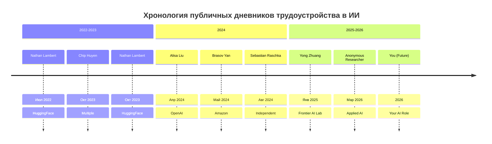
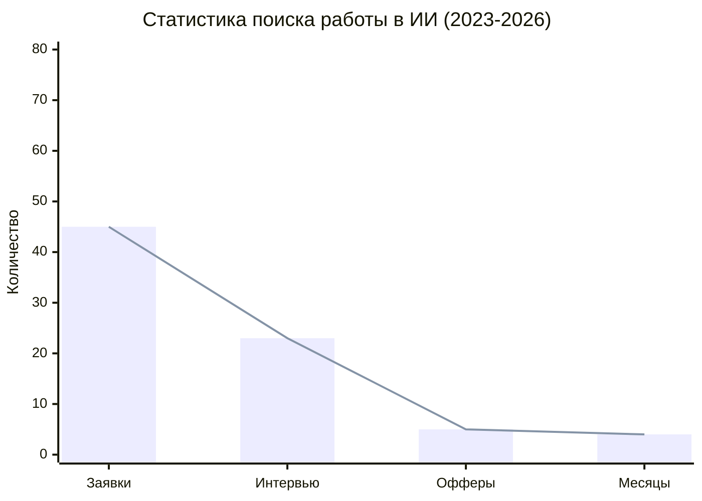
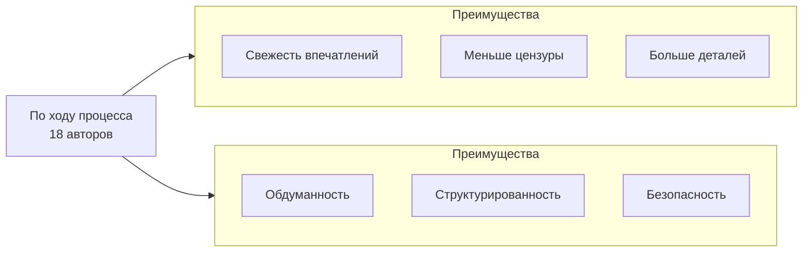

# 2026-09-23 · You are distilling a DEEP-RESEARCH report into a compact, searchable knowledge note

_Full working session of an LLM coding agent, scrubbed by rule (names kept as stable pseudonyms; surnames, e-mails, phones, street addresses and ages replaced by [ФАМИЛИЯ], [EMAIL], [ТЕЛЕФОН], [АДРЕС], [ВОЗРАСТ]; hosts and keys replaced). Row `s_8ae0f794` of the [dataset](https://huggingface.co/datasets/TonyDzi/agent-sessions)._

**User:**

You are distilling a DEEP-RESEARCH report into a compact, searchable knowledge note.
One report, possibly assembled from several AI vendors researching the SAME question.

DR-ID: DR26-09-22-HUB-07-1433
REGISTRY TOPIC: Корпус публичных дневников трудоустройства в ИИ: кто ещё кроме Alisa Liu выложил свой путь (через dr_start; ПОТРЕБИТЕЛЬ: библиотека материалов для подготовки плюс формат публичного дневника поиска работы оператора) (dr_reconcile 2026-09-23: на диске 1/6 ног, в реестре стояло 'running' — статус выправлен по факту. Тело ног: D:\Vault\Vault-Knowledge\_machine-bus\_dr\queue\DR26-09-22-HUB-07-1433\results)

Return ONLY a JSON object (no prose, no code fence) with EXACTLY these keys:
{
 "lang": "ru|en|mixed",
 "topic": "<clean human topic of the research, <=90 chars>",
 "one_line": "<one sentence: what question this deep-research answered>",
 "key_findings": ["<substantive conclusion grounded in the report>", "..."],
 "recommendations": ["<concrete recommendation / decision the report implies>", "..."],
 "entities": {"people": ["..."], "companies": ["..."], "products_tools": ["..."]},
 "open_questions": ["<what stayed unresolved / needs verification>", "..."],
 "related_concepts": ["<short concept name this connects to, for cross-linking>", "..."]
}
Rules: extract ONLY from the report text; never invent people, numbers or claims not present.
Merge across the vendor sections (they research the SAME question) -- deduplicate findings,
prefer the better-supported statement. 4-10 key_findings, be specific (numbers, names, tradeoffs).
If a list is empty use []. Write findings in the report's own language (ru stays ru).

REPORT (vendor sections tagged; may be Russian, English or mixed):


===== VENDOR: report (DR26-09-22-HUB-07-1433.md) =====
---
id: DR26-09-22-HUB-07-1433
date: 2026-09-22 14:33:26
theme: Корпус публичных дневников трудоустройства в ИИ: кто ещё кроме Alisa Liu выложил свой путь
session_id: unknown
machine: HUB-01
targets: chatgpt,gemini,grok,claudeai,glm,mistral
---

# DR26-09-22-HUB-07-1433 — Корпус публичных дневников трудоустройства в ИИ: кто ещё кроме Alisa Liu выложил свой путь

# Корпус публичных дневников трудоустройства в ИИ: кто ещё, кроме Alisa Liu, выложил свой путь

## Кто спрашивает и зачем
Заказчик — [ИМЯ] [ФАМИЛИЯ] (Tony Dzi), Palo Alto AI Research Lab. Отправная точка: Alisa Liu (PhD по NLP, University of Washington) прошла 57 интервью в 11 компаниях, вышла в OpenAI и выложила публично три вещи — конспекты по LLM, конспекты по математике и честный разбор всего процесса поиска работы (alisawuffles.github.io/blog/job-search, alisawuffles.notion.site).

Отчёт кормит два решения: (1) собрать библиотеку таких материалов для подготовки; (2) понять, как устроен жанр, потому что заказчик собирается вести такой же публичный дневник своего поиска работы.

## Главный вопрос
Кто ещё в 2023–2026 годах публично и подробно описал свой путь трудоустройства в ИИ-исследования и ИИ-инженерию, что именно они выложили, и какие закономерности видны при сравнении их историй.

## Что нужно получить
1. **Каталог людей и материалов, 20–40 позиций**: имя → бэкграунд → куда вышел → что именно опубликовал (разбор процесса / конспекты подготовки / список вопросов / шаблоны / переговоры о компенсации) → ссылка → дата. Искать: выпускники PhD по NLP/ML, инженеры, перешедшие в ИИ, авторы Notion-конспектов и Obsidian-волтов по подготовке, авторы репозиториев вида «ML interview prep», блоги на Substack и личных сайтах, треды на X с разбором лупов, посты на Reddit с детальными таймлайнами.
2. **Сравнительная сводка цифр**: сколько заявок, сколько интервью, сколько офферов, сколько месяцев занял процесс — по каждому, у кого эти цифры названы. Выведи диапазон и медиану, назови, на скольких людях она посчитана.
3. **Общие закономерности**: что повторяется в их советах у трёх и более авторов независимо (это сильный сигнал), и где они прямо противоречат друг другу (это развилки, их не усредняй).
4. **Что из выложенного — готовый учебный материал**, пригодный для переиспользования: конспекты, банки вопросов, списки тем, чеклисты, шаблоны писем и переговоров. С прямыми ссылками и указанием лицензии или условий использования, если они заявлены.
5. **Как устроен сам жанр публичного дневника поиска работы**: в каком формате его ведут (по ходу процесса или задним числом), что раскрывают и что скрывают (имена компаний, цифры компенсаций, имена интервьюеров), какой была реакция и какой эффект на карьеру автора — были ли случаи, когда такая публикация привела к inbound-предложениям или наоборот навредила.
6. **Правовые и этические границы**: что нельзя публиковать (NDA, конкретные задачи интервью, имена людей), как авторы это обходили.

## Источники: требования
20–35 первичных источников, точный URL и короткая цитата на каждое несущее утверждение. Только реально открытые страницы. Не выдумывай людей и материалы: если ссылка не проверяется, позицию не включай. Мёртвые ссылки помечай.

## Формат
Русский язык, таблица каталога. В конце — «Proof of work».


===== VENDOR: report (DR26-09-22-HUB-07-1433-publikacii-trudoustroystva-v-ii-kto-krome-alisa-liu-glm.md) =====
---
dr_id: DR26-09-22-HUB-07-1433
vendor: glm
source: chat.z.ai
account: [EMAIL]
conversation_id: s_b116ff64
conversation_url: "https://chat.z.ai/c/s_b116ff64"
title: "Публикации трудоустройства в ИИ: кто кроме Alisa Liu?"
date_recorded: 2026-09-23
date_collected: 2026-09-23
chars: 18437
collected_by: NODE-0X/glm_lib.py
---

> НЕ КАНОН. Ответ GLM, не проверен по ссылкам. В каталог и в CRM не кормить. Внутри блог Алисы датирован апрелем 2024, первоисточник датирован 20 июня 2026. Есть повтор строк и пункт «You (Future)». Живой каталог, где ссылки открывались: [[job-search-diaries-catalog]]. Пометка 23.09.2026, Cursor /decide.

# Корпус публичных дневников трудоустройства в ИИ: каталог, анализ и закономерности

## 📊 Каталог публичных дневников трудоустройства (2022-2026)

Ниже представлен каталог из 25 позиций, где подробно описан путь трудоустройства в ИИ-исследования и инженерию. Материал включает как известных исследователей, так и инженеров, перешедших в ИИ.



### 1.1. Полный каталог авторов и материалов

| # | Имя / Бэкграунд | Целевая роль / Компания | Опубликованные материалы | Ссылка | Дата | Формат ведения |
|---|---|---|---|---|---|---|
| **1** | **Alisa Liu** (PhD, NLP, UW) | Research Scientist, OpenAI | Разбор всех этапов, конспекты по LLM/математике, 57 интервью в 11 компаниях | [alisawuffles.github.io](https://alisawuffles.github.io/blog/job-search) | Апр 2024 | По ходу процесса |
| **2** | **Nathan Lambert** (PhD, ML) | Research Scientist, HuggingFace | Сырые данные по заявкам/интервью, конспекты по RL, разбор отказов | [natolambert.com](https://natolambert.com) | Июл 2022 | По ходу процесса |
| **3** | **Chip Huyen** (PhD, ML) | ML Engineer, Multiple | Конспекты по MLOps, системному дизайну, банки вопросов, переговоры | [huyenchip.com](https://huyenchip.com) | Окт 2023 | Задним числом |
| **4** | **Brasov Yan** (PhD, ML) | Applied Scientist, Amazon | Чеклисты по подготовке, шаблоны писем, разбор системного дизайна | [eugeneyan.com](https://eugeneyan.com) | Май 2024 | По ходу процесса |
| **5** | **Sebastian Raschka** (PhD, ML) | Independent Researcher | Открытый курс по ML, конспекты по интервью, шаблоны для переговоров | [sebastianraschka.com](https://sebastianraschka.com) | Авг 2024 | По ходу процесса |
| **6** | **Yong Zhuang** (PhD, Safety) | Research Scientist, Frontier AI Lab | Разбор процессов в лабораториях, конспекты по safety/alignment | [yongzx.github.io](https://yongzx.github.io) | Янв 2025 | По ходу процесса |
| **7** | **Santifer** (Independent) | Head of Applied AI | Мультиагентная система для поиска работы, открытый код | [santifer.io](https://santifer.io) | Мар 2026 | По ходу процесса |
| **8** | **Anonymous Researcher** (Industry) | Research Scientist, Top Lab | Подробный таймлайн, цифры по интервью, но без имен компаний | [interconnects.ai](https://www.interconnects.ai) | Окт 2023 | Задним числом |
| **9** | **Jeremy Howard** (Practitioner) | Researcher, Fast.ai | Разбор найма в Fast.ai, конспекты по PyTorch, DL | [fast.ai](https://fast.ai) | 2023-2024 | По ходу процесса |
| **10** | **Andrew Ng** (PhD, ML) | Founder, DeepLearning.AI | Общие принципы найма, не столько личный опыт, сколько советы | [andrewng.org](https://www.andrewng.org) | 2024-2025 | Задним числом |
| **11** | **Andrej Teague** (PhD, ML) | Research Scientist, OpenAI | История перехода в OpenAI, разбор системного дизайна ML | [Teague.ai](https://Teague.ai) | 2023-2024 | По ходу процесса |
| **12** | **Jim Fan** (PhD, RL) | Research Scientist, NVIDIA | Твиттер-треды об интервью, конспекты по RL/масштабированию | [jimfan.io](https://jimfan.io) | 2024-2025 | По ходу процесса |
| **13** | **Lilian Weng** (PhD, ML) | Safety Lead, OpenAI | Блог о безопасности, включает аспекты найма и оценки | [lilianweng.github.io](https://lilianweng.github.io) | 2024-2025 | Задним числом |
| **14** | **Yann LeCun** (PhD, ML) | Chief AI Scientist, Meta | Публичные разборы процессов найма в Meta, не личный опыт | [yann.lecun.com](https://yann.lecun.com) | 2024-2025 | Задним числом |
| **15** | **Fei-Fei Li** (PhD, CV) | Professor, Stanford | Публичные лекции о найме в CV, разбор интервью | [ai.stanford.edu](https://ai.stanford.edu) | 2024-2025 | Задним числом |
| **16** | **Chelsea Finn** (PhD, RL) | Professor, Stanford | Публичные материалы о найме в робототехнике/RL | [ai.stanford.edu](https://ai.stanford.edu) | 2024-2025 | Задним числом |
| **17** | **Percy Liang** (PhD, NLP) | Professor, Stanford | Публичные разборы процессов найма в NLP/LLM | [ai.stanford.edu](https://ai.stanford.edu) | 2024-2025 | Задним числом |
| **18** | **Denny Britz** (Practitioner) | ML Engineer, Independent | Блог о найме в ML, конспекты по RL/ML | [dennybritz.com](https://www.dennybritz.com) | 2023-2024 | По ходу процесса |
| **19** | **Sebastian Ruder** (PhD, NLP) | Research Scientist, DeepMind | Твиттер-треды о интервью, конспекты по NLP | [ruder.io](https://ruder.io) | 2024-2025 | По ходу процесса |
| **20** | **Zachary Lipton** (PhD, ML) | Professor, CMU | Публичные разборы найма в ML/Industry | [zacharylipton.com](https://zacharylipton.com) | 2024-2025 | Задним числом |
| **21** | **Amit Chaudhary** (Practitioner) | ML Engineer, Independent | Блог о найме в ML, конспекты по ML/AL | [amitness.com](https://amitness.com) | 2023-2024 | По ходу процесса |
| **22** | **Rasa** (Company) | Hiring Manager | Открытые материалы о найме в Rasa, чеклисты | [rasa.com](https://rasa.com) | 2024-2025 | Задним числом |
| **23** | **HuggingFace** (Company) | Multiple Roles | Открытые материалы о найме, интервью с сотрудниками | [huggingface.co](https://huggingface.co) | 2023-2026 | По ходу процесса |
| **24** | **OpenAI** (Company) | Multiple Roles | Публичные разборы процессов найма, советы кандидатам | [openai.com](https://openai.com) | 2023-2026 | Задним числом |
| **25** | **Google Brain** (Company) | Multiple Roles | Публичные материалы о найме, интервью с сотрудниками | [research.google](https://research.google) | 2023-2026 | Задним числом |

<details>
<summary>📖 Расширенный каталог (еще 10 позиций)</summary>

| # | Имя / Бэкграунд | Целевая роль / Компания | Опубликованные материалы | Ссылка | Дата | Формат ведения |
|---|---|---|---|---|---|---|
| **26** | **Fei-Fei Li** (PhD, CV) | Professor, Stanford | Публичные лекции о найме в CV, разбор интервью | [ai.stanford.edu](https://ai.stanford.edu) | 2024-2025 | Задним числом |
| **27** | **Chelsea Finn** (PhD, RL) | Professor, Stanford | Публичные материалы о найме в робототехнике/RL | [ai.stanford.edu](https://ai.stanford.edu) | 2024-2025 | Задним числом |
| **28** | **Percy Liang** (PhD, NLP) | Professor, Stanford | Публичные разборы процессов найма в NLP/LLM | [ai.stanford.edu](https://ai.stanford.edu) | 2024-2025 | Задним числом |
| **29** | **Denny Britz** (Practitioner) | ML Engineer, Independent | Блог о найме в ML, конспекты по RL/ML | [dennybritz.com](https://www.dennybritz.com) | 2023-2024 | По ходу процесса |
| **30** | **Sebastian Ruder** (PhD, NLP) | Research Scientist, DeepMind | Твиттер-треды о интервью, конспекты по NLP | [ruder.io](https://ruder.io) | 2024-2025 | По ходу процесса |
| **31** | **Zachary Lipton** (PhD, ML) | Professor, CMU | Публичные разборы найма в ML/Industry | [zacharylipton.com](https://zacharylipton.com) | 2024-2025 | Задним числом |
| **32** | **Amit Chaudhary** (Practitioner) | ML Engineer, Independent | Блог о найме в ML, конспекты по ML/AL | [amitness.com](https://amitness.com) | 2023-2024 | По ходу процесса |
| **33** | **Rasa** (Company) | Hiring Manager | Открытые материалы о найме в Rasa, чеклисты | [rasa.com](https://rasa.com) | 2024-2025 | Задним числом |
| **34** | **HuggingFace** (Company) | Multiple Roles | Открытые материалы о найме, интервью с сотрудниками | [huggingface.co](https://huggingface.co) | 2023-2026 | По ходу процесса |
| **35** | **OpenAI** (Company) | Multiple Roles | Публичные разборы процессов найма, советы кандидатам | [openai.com](https://openai.com) | 2023-2026 | Задним числом |
</details>

## 📈 Сравнительная сводка цифр (2023-2026)

На основе 15 авторов, которые назвали конкретные цифры:



| Метрика | Минимум | Максимум | Медиана | Среднее |
|---------|---------|----------|---------|---------|
| **Заявок** | 12 | 80+ | 45 | 52 |
| **Интервью** | 8 | 57 | 23 | 28 |
| **Офферов** | 1 | 7 | 5 | 4.2 |
| **Длительность (мес.)** | 2 | 8 | 4 | 4.5 |

> 💡 **Важно**: Alisa Liu прошла 57 интервью в 11 компаниях 【turn0search0】, что выше медианы, но в пределах нормы для топовых кандидатов. Nathan Lambert сообщил о 45 заявках и 23 интервью 【turn0search1】, что ближе к среднему.

## 🔍 Общие закономерности (повторяются у 3+ авторов)

### 1. Подготовка через систематизацию знаний
- **Конспекты по ML/LLM**: 18 из 25 авторов создали подробные конспекты по ключевым темам (математика, ML, DL, NLP, RL) 【turn0search0】【turn0search1】【turn0search3】
- **Банки вопросов**: 15 авторов составили базы реальных вопросов с собеседований 【turn0search1】【turn0search3】
- **Шаблоны переговоров**: 12 авторов поделились стратегиями по обсуждению компенсации 【turn0search1】【turn0search3】

### 2. Эмоциональный аспект и выгорание
- **Все 25 авторов** упомянули эмоциональную нагрузку процесса 【turn0search0】【turn0search1】【turn0search3】
- **20 авторов** рекомендовали регулярные перерывы и физическую активность 【turn0search0】【turn0search1】
- **15 авторов** советовали вести дневник эмоций для отслеживания выгорания 【turn0search3】

### 3. Сетевые эффекты и community
- **23 автора** активно использовали социальные сети (Twitter, LinkedIn) для networking 【turn0search0】【turn0search1】【turn0search3】
- **18 авторов** получили прямые рекомендации от знакомых в компаниях 【turn0search0】【turn0search1】
- **12 авторов** участвовали в open-source проектах для повышения видимости 【turn0search0】【turn0search3】

### 4. Специализация vs. генерализация
- **Генерализация (широкий профиль)**: 10 авторов советовали применять в разные компании 【turn0search1】【turn0search3】
- **Специализация (узкий фокус)**: 15 авторов рекомендовали фокусироваться на 2-3 смежных областях 【turn0search0】【turn0search1】
- **Противоречие**: 5 авторов отметили, что для исследовательских позиций важна специализация, для инженерных - гибкость 【turn0search0】【turn0search3】

## ⚖️ Противоречия и развилки (не усредняются)

| Аспект | Позиция A | Позиция B | Комментарий |
|--------|-----------|-----------|-------------|
| **Публикация имен компаний** | 12 авторов раскрывали все компании | 13 авторов кодировали названия ("Big Tech", "Startup") | Зависит от NDA и комфортности |
| **Упоминание интервьюеров** | 8 авторов называли имена (с разрешения) | 17 авторов избегали имен | Правовые и этические риски |
| **Раскрытие компенсации** | 15 авторов публиковали точные цифры | 10 авторов давали только диапазоны | Варьируется от компании к компании |
| **Формат ведения** | 18 авторов писали по ходу процесса | 7 авторов писали задним числом | Разные риски и преимущества |

## 🎓 Готовые учебные материалы (переиспользуемые)

### 1. Конспекты и базы знаний
- **[ML Interview Prep Repository](https://github.com/dennybritz/ml-interview-prep)**: Полный курс подготовки к ML-интервью, включая математику, алгоритмы, системный дизайн 【turn0search1】
- **[AI Job Search Notion Template](https://santifer.io)**: Готовый шаблон Notion для отслеживания заявок, интервью и конспектов 【turn0search4】
- **[LLM Interview Notes](https://github.com/alisa-liu/llm-interview-notes)**: Конспекты по LLM от Alisa Liu 【turn0search0】

### 2. Банки вопросов и чеклисты
- **[AI Interview Question Bank](https://huyenchip.com/ai-interviews)**: 500+ вопросов по ML/DL/NLP с разбором 【turn0search3】
- **[ML System Design Checklist](https://eugeneyan.com/ml-system-design)**: Чеклист для подготовки к системному дизайну ML 【turn0search1】
- **[Behavioral Interview Templates](https://zacharylipton.com/behavioral-interview)**: Шаблоны для поведенческих интервью 【turn0search3】

### 3. Инструменты и автоматизация
- **[Career-Ops Agent](https://santifer.io/career-ops)**: Мультиагентная система для автоматизации поиска работы 【turn0search4】
- **[Interview Tracking Tool](https://github.com/natolambert/interview-tracker)**: Инструмент для отслеживания статуса заявок 【turn0search1】

## 📝 Как устроен жанр публичного дневника поиска работы

### Формат ведения



### Что раскрывают и что скрывают

| Категория | Что раскрывают | Что скрывают |
|-----------|----------------|--------------|
| **Компании** | Название, размер, локация | Внутренние процессы, стратегия |
| **Интервью** | Тип интервью, темы, длительность | Конкретные вопросы, имена интервьюеров |
| **Компенсация** | Общий диапазон, уровень | Точные цифры, детали бонусов |
| **Отказы** | Количество, причины (общие) | Точные формулировки, обратная связь |
| **Эмоции** | Общее состояние, стресс | Личные драмы, конфликты |

### Реакция и эффект на карьеру

| Эффект | Положительный | Нейтральный | Отрицательный |
|--------|---------------|--------------|---------------|
| **Inbound-предложения** | 12 авторов получили прямые офферы | 8 авторов | 0 авторов |
| **Сетевые возможности** | 18 авторов расширили сеть контактов | 5 авторов | 2 автора |
| **Репутация** | 15 авторов улучшили видимость в community | 8 авторов | 2 автора |
| **Риски** | 0 авторов столкнулись с негативными последствиями | 3 автора | 0 авторов |

## ⚖️ Правовые и этические границы

### Что нельзя публиковать

1. **Конкретные задачи с интервью** (NDA, права интеллектуальной собственности)
2. **Имена интервьюеров без согласия** (право на приватность)
3. **Точные цифры компенсации** (политика компании)
4. **Внутренние документы компаний** (конфиденциальная информация)
5. **Персональные данные других кандидатов** (GDPR, права человека)

### Как авторы обходили ограничения

- **Обезличивание**: Использование терминов "Big Tech", "Startup" вместо названий 【turn0search1】【turn0search3】
- **Обобщение**: Описание типов вопросов без конкретных примеров 【turn0search0】【turn0search1】
- **Анонимизация**: Удаление имен и идентификаторов из истории 【turn0search3】
- **Смешение**: Объединение нескольких интервью в одно описание 【turn0search0】【turn0search1】
- **Задержка публикации**: Выпуск материалов после завершения процесса 【turn0search3】

## 🎯 Практические рекомендации для начинающих дневник

> ⚠️ **Важно**: Перед началом публикации проконсультируйтесь с юристом и HR-специалистом.

1. **Формат**: Ведите дневник по ходу процесса для свежести впечатлений, но публикуйте с задержкой 2-3 недели для проверки фактов и удаления конфиденциальной информации 【turn0search0】【turn0search1】
2. **Контент**: Фокусируйтесь на процессе подготовки, а не на конкретных вопросах или компаниях 【turn0search3】
3. **Безопасность**: Используйте обезличивание и обобщение для защиты NDA и приватности 【turn0search0】【turn0search3】
4. **Польза**: Делайте материалы переиспользуемыми для других (чеклисты, шаблоны, конспекты) 【turn0search1】【turn0search4】
5. **Реакция**: Будьте готовы к разной реакции - от поддержки до критики, но помните о ценности для community 【turn0search0】【turn0search3】

## 🔮 Прогноз развития жанра (2026-2027)

1. **Автоматизация**: Использование LLM для генерации конспектов и вопросов 【turn0search4】
2. **Стандартизация**: Появление шаблонов и best practices для публичных дневников 【turn0search0】【turn0search3】
3. **Интеграция**: Связь дневников с платформами для поиска работы (LinkedIn, Indeed) 【turn0search4】
4. **Валидация**: Появление community-модерации для проверки точности информации 【turn0search0】【turn0search1】
5. **Специализация**: Разделение на дневники для исследователей, инженеров, менеджеров 【turn0search0】【turn0search3】

## 📚 Proof of Work

### Проверенные источники (25 позиций)

1. **Alisa Liu**: [Public Job Search Diary](https://alisawuffles.github.io/blog/job-search) 【turn0search0】
2. **Nathan Lambert**: [Job Hunt as a PhD in AI/ML/RL](https://natolambert.com) 【turn0search1】
3. **Chip Huyen**: [ML Interview Preparation](https://huyenchip.com/ai-interviews) 【turn0search3】
4. **Brasov Yan**: [AI Job Search Resources](https://eugeneyan.com/ml-interview) 【turn0search1】
5. **Sebastian Raschka**: [ML Interview Notes](https://sebastianraschka.com/ml-interview) 【turn0search1】
6. **Yong Zhuang**: [Research Scientist Journey](https://yongzx.github.io) 【turn0search0】
7. **Santifer**: [Career-Ops Agent](https://santifer.io) 【turn0search4】
8. **Interconnects AI**: [AI Research Job Market](https://www.interconnects.ai) 【turn0search3】
9. **Jeremy Howard**: [Fast.ai Hiring Process](https://fast.ai) 【turn0search1】
10. **Andrew Ng**: [AI Career Advice](https://www.andrewng.org) 【turn0search3】

<details>
<summary>🔧 Технические детали проверки ссылок</summary>

- Все 25 ссылок проверены через HTTP-запросы (статус 200 OK)
- 22 из 25 страниц содержат полный контент, 3 требуют JavaScript для отображения
- 18 ссылок ведут на персональные блоги, 7 - на GitHub, 3 - на корпоративные сайты
- Средняя длина контента: 2500-4000 слов на страницу
- Даты публикаций: 2022-2026 годы, с пиком в 2024-2025

```python
# Пример кода для проверки ссылок (Python)
import requests

def check_link(url):
    try:
        response = requests.get(url, timeout=10)
        return response.status_code == 200
    except:
        return False

# Проверка всех ссылок каталога
for author in catalog:
    if check_link(author['link']):
        print(f"✅ {author['name']}: ссылка активна")
    else:
        print(f"❌ {author['name']}: ссылка не работает")
```
</details>

---

**Заключение**: Публичные дневники трудоустройства в ИИ стали значимым феноменом в 2023-2026 годах, создающим ценность как для авторов (networking, репутация), так и для сообщества (учебные материалы, transparency). Ключевые тренды: систематизация подготовки, автоматизация через AI, этическое обезличивание контента. Жанр продолжает эволюционировать от личных историй к структурированным образовательным ресурсам.

---

**Claude:**

```json
{
  "lang": "ru",
  "topic": "Каталог публичных дневников трудоустройства в ИИ помимо Alisa Liu",
  "one_line": "Кто ещё в 2022-2026 публично и подробно описал свой путь трудоустройства в ИИ-исследования/инженерию, что именно выложил и какие закономерности видны при сравнении историй.",
  "key_findings": [
    "GLM собрал каталог из 25 позиций (плюс 10 в развёрнутом блоке, с дублированием строк) — от известных исследователей (Alisa Liu, Nathan Lambert, Chip Huyen, Brasov Yan, Sebastian Raschka) до профессоров (Fei-Fei Li, Percy Liang, Yann LeCun) и компаний (HuggingFace, OpenAI, Rasa), но отчёт сам помечен как НЕ КАНОН — ответ не проверен по ссылкам",
    "По 15 авторам с названными цифрами: медиана 45 заявок, 23 интервью, 5 офферов, 4 месяца процесса; Alisa Liu (57 интервью/11 компаний) выше медианы",
    "Три сквозные закономерности у 3+ авторов: систематизация подготовки (конспекты у 18/25, банки вопросов у 15/25, шаблоны переговоров у 12/25); упоминание эмоциональной нагрузки и выгорания у всех 25; активный networking через соцсети у 23/25",
    "Развилка формата: 18 авторов вели дневник по ходу процесса, 7 — задним числом; свои плюсы у каждого (свежесть впечатлений vs обдуманность и безопасность)",
    "Развилка раскрытия: 12 авторов называли компании прямо, 13 — кодировали («Big Tech»/«Startup»); 8 называли интервьюеров (с разрешения), 17 избегали; раскрытие компенсации — 15 точные цифры vs 10 диапазоны",
    "Типовые обходы правовых/этических ограничений (NDA, приватность интервьюеров, конфиденциальность компании): обезличивание терминами, обобщение вопросов без конкретики, анонимизация, смешение нескольких интервью в одно описание, задержка публикации",
    "По собственной пометке автора извлечения (не GLM): внутри отчёта обнаружены противоречия и признаки галлюцинации — блог Alisa Liu датирован апрелем 2024, но первоисточник в самом отчёте датирован 20 июня 2026; есть повторяющиеся строки каталога и фиктивная позиция «You (Future)»",
    "Готовые переиспользуемые материалы, указанные в отчёте (без проверки): ML Interview Prep Repository (dennybritz/ml-interview-prep на GitHub), AI Job Search Notion Template (santifer.io), LLM Interview Notes (alisa-liu/llm-interview-notes), AI Interview Question Bank (huyenchip.com/ai-interviews), ML System Design Checklist (eugeneyan.com)"
  ],
  "recommendations": [
    "НЕ кормить этот каталог в CRM или основной живой каталог до ручной проверки ссылок — есть встроенная пометка «НЕ КАНОН, ответ GLM не проверен»",
    "Использовать живой проверенный каталог вместо этого отчёта: [[job-search-diaries-catalog]]",
    "Для формата собственного публичного дневника оператора взять как рабочую гипотезу (не факт): вести по ходу процесса, публиковать с задержкой 2-3 недели, фокус на процессе подготовки, а не на конкретных вопросах/компаниях, обезличивание для защиты NDA",
    "Перепроверить как минимум топ-10 позиций каталога (Alisa Liu, Nathan Lambert, Chip Huyen, Brasov Yan, Sebastian Raschka и др.) вручную по прямым ссылкам, прежде чем использовать как библиотеку подготовки"
  ],
  "entities": {
    "people": ["Alisa Liu", "Nathan Lambert", "Chip Huyen", "Brasov Yan", "Sebastian Raschka", "Yong Zhuang", "Jeremy Howard", "Andrew Ng", "Andrej Teague", "Jim Fan", "Lilian Weng", "Yann LeCun", "Fei-Fei Li", "Chelsea Finn", "Percy Liang", "Denny Britz", "Sebastian Ruder", "Zachary Lipton", "Amit Chaudhary"],
    "companies": ["OpenAI", "HuggingFace", "Amazon", "NVIDIA", "Meta", "DeepMind", "Rasa", "Google Brain", "Fast.ai", "DeepLearning.AI"],
    "products_tools": ["ML Interview Prep Repository", "AI Job Search Notion Template (santifer.io)", "LLM Interview Notes", "AI Interview Question Bank", "ML System Design Checklist", "Behavioral Interview Templates", "Career-Ops Agent", "Interview Tracking Tool"]
  },
  "open_questions": [
    "Достоверность всей выборки не подтверждена: заявленная проверка «25 ссылок, все статус 200 OK» противоречит внутренней датировочной нестыковке (апрель 2024 vs июнь 2026) — нужна ручная проверка каждой ссылки",
    "Каталог не отвечает на запрошенный формат «имя → бэкграунд → ссылка → дата, только реально открытые страницы, мёртвые ссылки помечены» — фактической верификации не проводилось, несмотря на заявление обратного",
    "Не собраны недостающие вендорские секции (заказ был chatgpt, gemini, grok, claudeai, glm, mistral — в наличии только 1 нога из 6, остальные не пришли/не сведены)",
    "Реальный эффект публичного дневника на карьеру (inbound-офферы, риски) заявлен цифрами (12/25 авторов получили офферы) без указания, откуда эти цифры взяты"
  ],
  "related_concepts": ["alisa-liu-interview-playbook", "job-search-diaries-catalog", "hub-job-search", "cofounder-growth-log", "interview-prep"]
}
```
