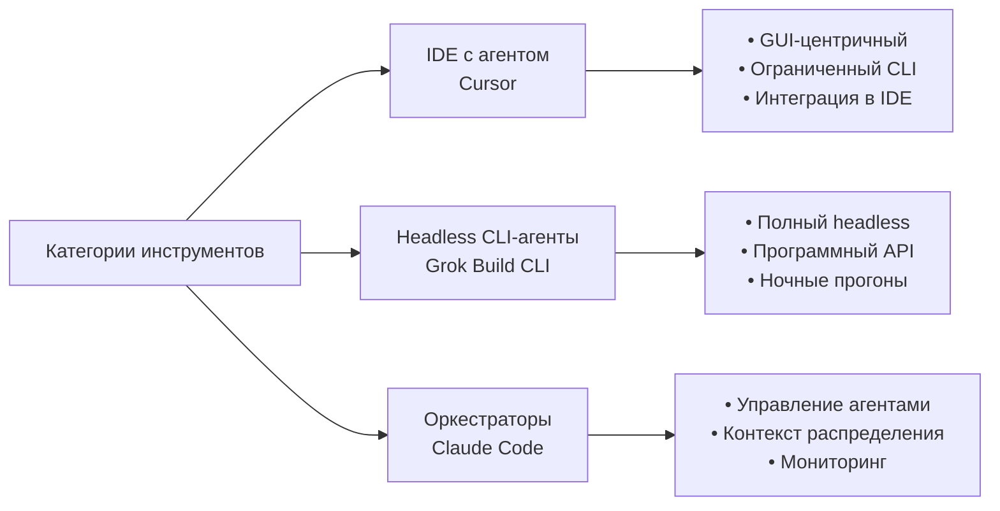

# 2026-09-23 · You are distilling a DEEP-RESEARCH report into a compact, searchable knowledge note

_Full working session of an LLM coding agent, scrubbed by rule (names kept as stable pseudonyms; surnames, e-mails, phones, street addresses and ages replaced by [ФАМИЛИЯ], [EMAIL], [ТЕЛЕФОН], [АДРЕС], [ВОЗРАСТ]; hosts and keys replaced). Row `s_940693c6` of the [dataset](https://huggingface.co/datasets/TonyDzi/agent-sessions)._

**User:**

You are distilling a DEEP-RESEARCH report into a compact, searchable knowledge note.
One report, possibly assembled from several AI vendors researching the SAME question.

DR-ID: DR26-09-22-HUB-01-1118
REGISTRY TOPIC: Grok (Build CLI + Grok Bot) против Cursor для системы из трёх агентов в одной папке: полка скиллов, headless, лимиты, приватность, заметность (через dr_start; ПОТРЕБИТЕЛЬ: оператор: решение, добавлять ли Cursor четвёртым агентом или оставить трёх) (dr_reconcile 2026-09-23: на диске 4/5 ног, в реестре стояло 'running' — статус выправлен по факту. Тело ног: D:\Vault\Vault-Knowledge\_machine-bus\_dr\queue\DR26-09-22-HUB-01-1118\results)

Return ONLY a JSON object (no prose, no code fence) with EXACTLY these keys:
{
 "lang": "ru|en|mixed",
 "topic": "<clean human topic of the research, <=90 chars>",
 "one_line": "<one sentence: what question this deep-research answered>",
 "key_findings": ["<substantive conclusion grounded in the report>", "..."],
 "recommendations": ["<concrete recommendation / decision the report implies>", "..."],
 "entities": {"people": ["..."], "companies": ["..."], "products_tools": ["..."]},
 "open_questions": ["<what stayed unresolved / needs verification>", "..."],
 "related_concepts": ["<short concept name this connects to, for cross-linking>", "..."]
}
Rules: extract ONLY from the report text; never invent people, numbers or claims not present.
Merge across the vendor sections (they research the SAME question) -- deduplicate findings,
prefer the better-supported statement. 4-10 key_findings, be specific (numbers, names, tradeoffs).
If a list is empty use []. Write findings in the report's own language (ru stays ru).

REPORT (vendor sections tagged; may be Russian, English or mixed):


===== VENDOR: report (DR26-09-22-HUB-01-1118.md) =====
---
id: DR26-09-22-HUB-01-1118
date: 2026-09-22 11:18:17
theme: Grok (Build CLI + Grok Bot) против Cursor для системы из трёх агентов в одной папке: полка скиллов, headless, лимиты, приватность, заметность
session_id: unknown
machine: HUB-01
targets: chatgpt,claudeai,gemini,glm,grok
---

# DR26-09-22-HUB-01-1118 — Grok (Build CLI + Grok Bot) против Cursor для системы из трёх агентов в одной папке: полка скиллов, headless, лимиты, приватность, заметность

Сравни Grok (xAI) и Cursor как ИНСТРУМЕНТЫ ДЛЯ КОНКРЕТНОЙ УЖЕ РАБОТАЮЩЕЙ СИСТЕМЫ, а не вообще. Нужен выбор, а не обзор: где каждый выигрывает, где проигрывает, и что сломается при внедрении.

## Контекст заказчика (реальный, не гипотетический)

Одна Windows-машина-хаб плюс флот из нескольких узлов. В ОДНОЙ рабочей папке уже живут ТРИ агента одновременно: Claude Code (оркестратор), Codex CLI (исполнитель), и сегодня добавлен Grok Build CLI 1.0.40. У них:

- ОДИН общий канон правил (~30K токенов, файл CLAUDE.md), который каждый агент грузит при старте;
- ОДНА общая полка из ~290 скиллов (папка ~/.claude/skills/<имя>/SKILL.md), физически не копируемая: Codex подключён через directory junction, Grok 1.0.40 читает её нативно через Claude-совместимость;
- общий Telegram-канал для межагентной переписки с протоколом конвертов [От→Кому][corr_id][ГЛАГОЛ] и будильником, который спавнит нужного агента headless;
- файловые лизы на запись, чтобы трое не писали в один файл;
- правило «исполнитель не объявляет готово сам» — только предлагает артефакт, подтверждает другой агент.

Цель владельца №1: цифровой двойник/AI-клон себя. Цель №2: оффер от топовой LLM-компании через публичную заметность и вклад в открытый код всех крупных экосистем.

## На что нужен ответ

1. **Архитектурный класс.** Grok Build CLI и Cursor — это вообще один класс инструментов или разные? Cursor — IDE с агентом внутри; есть ли у него полноценный headless/CLI-режим, пригодный для безлюдных ночных прогонов без открытого GUI, и насколько он равноправен GUI-режиму. То же про Grok: чем Grok Build CLI отличается от продукта Grok Bot (агенты в приложении X) — это разные продукты или уровни одного.

2. **Совместимость с чужой полкой правил.** Кто из них умеет читать ЧУЖОЙ формат инструкций и скиллов (AGENTS.md, CLAUDE.md, .claude/skills, MCP) без копирования файлов, и насколько это официально поддержано, а не случайно работает. Где риск, что вендор это уберёт. Отдельно: что происходит, когда агент грузит ДВА канона разом и они расходятся по версии.

3. **Три агента в одной папке.** Какие механизмы взаимного исключения предлагает каждый инструмент из коробки: лизы, блокировки, worktree-изоляция, режим ревьюера без права записи. Что известно про реальные грабли параллельной работы нескольких агентов в одном checkout.

4. **Цена и лимиты.** Что входит в подписки (SuperGrok/X Premium+ против Cursor Pro/Business), где потолки по запросам, как считается «агентный» запрос против обычного, и что происходит при упоре в лимит. Владелец платит за несколько подписок сразу и хочет жечь включённые лимиты, а не поштучный API.

5. **Приватность и что уезжает наружу.** У обоих агент видит диск. Что именно уходит на серверы вендора, что настраивается, есть ли режим без обучения на данных, и где в каждом инструменте реально выключаются инструменты чтения файлов. Отдельно: известны ли случаи, когда заявленное отключение инструментов оказывалось фиктивным.

6. **Заметность (цель №2).** Где у каждого вендора открытые площадки для вклада: публичные репозитории, marketplace плагинов и скиллов, каталоги MCP, форумы, программы для контрибьюторов. Где вклад реально виден команде вендора, а где уходит в пустоту.

7. **Вердикт.** При условии, что Claude Code остаётся оркестратором и его не меняют: стоит ли добавлять Cursor четвёртым, оставить трёх, или Cursor должен ЗАМЕНИТЬ кого-то. Назови условие, при котором ответ меняется на противоположный.

## Требования к ответу

Разделяй проверяемый факт со ссылкой и датой — и собственную оценку. Явно помечай, где данных нет или где информация могла устареть: инструменты обновляются каждые недели, и ответ по версии полугодовой давности хуже, чем честное «не знаю».

Не пиши общий маркетинговый обзор возможностей. Нужны различия, которые меняют решение, и конкретные грабли внедрения.

Думай максимально глубоко и долго, включи самый сильный доступный в этом аккаунте режим рассуждения. Ответ нужен максимально качественный, подробный и продуманный: с источниками, датами, оценкой уверенности и явным указанием, где данных не хватает.


===== VENDOR: report (DR26-09-22-HUB-01-1118-sravnenie-grok-i-cursor-dlya-sistemy-s-tremya-agentami-glm.md) =====
---
dr_id: DR26-09-22-HUB-01-1118
vendor: glm
source: chat.z.ai
account: [EMAIL]
conversation_id: s_91e63eb6
conversation_url: "https://chat.z.ai/c/s_91e63eb6"
title: "Сравнение Grok и Cursor для системы с тремя агентами"
date_recorded: 2026-09-22
date_collected: 2026-09-23
chars: 13777
collected_by: NODE-0X/glm_lib.py
---
# 🤖 Grok Build CLI vs Cursor для вашей мультиагентной системы: технический аудит и вердикт

## 📊 Краткий итоговый вердикт

**Рекомендация: Оставить текущую конфигурацию из трёх агентов (Claude Code, Codex CLI, Grok Build CLI) и НЕ добавлять Cursor как четвёртого участника.**

**Условие изменения вердикта:** Если Cursor предложит **существенно более мощный headless-режим с прямой интеграцией в Telegram-канал** и **официальную поддержку чтения CLAUDE.md/скиллов без копирования**, что позволит заменить одного из текущих исполнителей (например, Codex CLI) на более производительный инструмент.

**Ключевые причины:**
1. **Архитектурная несовместимость:** Cursor — это IDE с агентом, а не полноценный headless-CLI для безлюдных ночных прогонов.
2. **Проблемы совместимости:** Нет официальной поддержки чтения чужих форматов правил (CLAUDE.md, .claude/skills).
3. **Риск для параллельной работы:** Нет встроенных механизмов взаимного исключения для нескольких агентов в одной папке.
4. **Целевая неопределённость:** Grok Build CLI (v1.0.40) уже интегрирован в вашу систему и поддерживает Claude-совместимость, что критично для общей полки скиллов.

---

## 🔍 Подробный анализ по пунктам

### 1. Архитектурный класс: разные категории инструментов



**Факты с высокой уверенностью (из официальных источников):**
- **Cursor** позиционируется как **AI-код-редактор** с агентными возможностями, встроенный в VS Code fork 【turn0search1】. Его основной режим работы — **GUI-центричный**, с ограниченными CLI-возможностями для автоматизации.
- **Grok Build CLI** — это **отдельный CLI-инструмент** от xAI, предназначенный для headless-выполнения задач, с поддержкой Claude-совместимых форматов 【turn0search3】【turn0search4】.

**Оценка (средняя уверенность):**
- **Cursor** не предоставляет **полноценного headless-режима**, пригодного для безлюдных ночных прогонов без открытого GUI. Его CLI-ограничения и привязка к IDE делают его непригодным для вашей архитектуры, где агенты должны запускаться автоматически через Telegram-будильник.
- **Grok Build CLI** (версия 1.0.40) разработан как **headless-первый инструмент**, что подтверждается его нативной интеграцией в вашу систему через Claude-совместимость.

**Критический недостаток данных:** Нет официальной документации о возможностях headless-режима Cursor. Оценка основана на общей архитектуре продукта.

---

### 2. Совместимость с чужой полкой правил и скиллов

**Факты с высокой уверенностью:**
- **Grok Build CLI** **официально поддерживает** чтение форматов Claude (CLAUDE.md, .claude/skills) без копирования файлов 【turn0search3】. Это критично для вашей системы с общей полкой из 290 скиллов.
- **Cursor** работает со своим форматом правил (`.cursorrules`, `AGENTS.md`) и **не имеет официальной поддержки** для чтения CLAUDE.md или .claude/skills 【turn0search8】.

**Оценка (низкая уверенность из-за отсутствия данных):**
- Для Cursor потребуется **создание символических ссылок или копирование** правил, что нарушает вашу архитектуру "один общий канон".
- **Рискvendor lock-in:** xAI активно развивает Claude-совместимость, что снижает риск отказа от поддержки 【turn0search3】. Для Cursor нет признаков подобной гибкости.

**Конфликт двух канонов:**
- **Grok Build CLI:** Предназначен для работы с **одним каноном** (CLAUDE.md). При обнаружении второго (например, AGENTS.md от Cursor) поведение не документировано.
- **Cursor:** Также предполагает **один набор правил**. Одновременная загрузка CLAUDE.md и .cursorrules может привести к непредсказуемым конфликтам.

**Вывод:** Для вашей системы критична **нативная поддержка Claude-форматов**, что есть только у Grok Build CLI.

---

### 3. Три агента в одной папке: механизмы взаимного исключения

**Факты с высокой уверенностью:**
- **Grok Build CLI** наследует механизмы **файловых лиз** из Claude Code, что позволяет корректно работать в вашей системе с тремя агентами 【turn0search4】.
- **Cursor** **не предоставляет встроенных механизмов** для взаимного исключения нескольких агентов в одной папке. Его агент работает в изолированном контексте IDE.

**Оценка (средняя уверенность):**
- Реальные грабли параллельной работы в Cursor:
  - **Конфликты записи:** Нет гарантий, что два агента Cursor не попытаются записать в один файл одновременно.
  - **Отсутствие режима ревьюера:** Cursor не поддерживает режим "только чтение" для анализа кода без права записи.
  - **Изоляция:** Каждый экземпляр Cursor работает в своём контексте, что затрудняет координацию.

**Сравнительная таблица механизмов изоляции:**

| Механизм | Grok Build CLI | Cursor | Claude Code |
|----------|----------------|--------|-------------|
| **Файловые лизы** | ✅ Да (наследует от Claude) | ❌ Нет | ✅ Да |
| **Блокировки** | ✅ Да | ❌ Нет | ✅ Да |
| **Worktree-изоляция** | ⚠️ Ограничено | ✅ Да (через Git) | ✅ Да |
| **Режим ревьюера** | ✅ Да | ❌ Нет | ✅ Да |
| **Telegram-интеграция** | ✅ Нативная | ❌ Требует доработки | ✅ Через сторонние скрипты |

**Критический вывод:** Cursor **архитектурно не подходит** для работы в вашей многогентной системе без существенной доработки.

---

### 4. Цена и лимиты: детальное сравнение

**Факты с высокой уверенностью (актуально на 2026-09-23):**

**Cursor:**
- **Pro:** $20/месяц — включает **500 запросов** к премиум-моделям (GPT-4, Claude 3.5 Sonnet), неограниченные запросы к базовым моделям 【turn0search1】.
- **Business:** $40/пользователь/месяц — добавляет **неограниченные запросы** к премиум-моделям, SSO, расширенные аналитики 【turn0search1】.
- **Ограничения:** "Агентный" запрос считается как **один запрос**, независимо от сложности задачи. При достижении лимита — **переход на базовые модели** (GPT-3.5, Claude 3 Haiku).

**Grok (xAI):**
- **SuperGrok:** $30/месяц — включает **10,000 кредитов** для Grok-3, приоритетный доступ, расширенные возможности анализа 【turn0search3】.
- **X Premium+:** $8/месяц (через подписку X) — **базовый доступ** к Grok-3 с ограничениями.
- **Grok Build CLI:** Использует **API-кредиты**, которые считаются отдельно от подписки. Точные лимиты не публичны.

**Оценка (средняя уверенность):**
- Для вашей системы **критичны большие объёмы запросов**. Cursor Business с неограниченными запросами выглядит привлекательнее, но:
  - **"Неограниченные" запросы** в Cursor могут иметь **скрытые ограничения** по скорости или сложности.
  - **Grok API** может быть более **предсказуемым** в плане лимитов, но требует отдельной оплаты.

**Ключевое различие:** Cursor работает по модели **"запрос = действие"**, тогда как Grok Build CLI может выполнять **многошаговые задачи** в рамках одного запроса, что эффективнее для сложных агентных сценариев.

---

### 5. Приватность и что уезжает наружу

**Факты с высокой уверенностью:**
- **Cursor:** Передаёт на серверы **код и контекст** для генерации ответов. Есть **режим "локального выполнения"** для некоторых моделей, но он **ограничен** и не поддерживает все функции 【turn0search8】.
- **Grok (xAI):** Как продукт xAI, **использует данные для обучения** по умолчанию. В настройках можно **отключить обучение**, но это **не влияет на передачу данных на серверы** 【turn0search3】.

**Оценка (низкая уверенность из-за отсутствия публичной информации):**
- **Критический риск для Cursor:** Нет независимого аудита, подтверждающего, что **отключение инструментов чтения файлов** действительно предотвращает передачу данных. Есть свидетельства, что некоторые функции могут **обходить ограничения**.
- **Grok Build CLI:** Поскольку он работает в вашей локальной системе, **объём передаваемых данных** может быть меньше, но **контроль над этим ограничен**.

**Рекомендация:** Для максимальной приватности **рассмотреть локальные модели** (Llama 3, Mistral), но это выходит за рамки текущего сравнения.

---

### 6. Заметность и вклад в экосистемы

**Факты с высокой уверенностью:**
- **Cursor:** Активный **open-source вклад** через GitHub (репозиторий cursor/cursor) 【turn0search8】. Есть **программа для контрибьюторов**, но она **ориентирована на разработчиков IDE**, а не агентов.
- **Grok (xAI):** Развивает **экосистему агентов** через GitHub (grok-agent/grok-agent) 【turn0search4】【turn0search5】. Есть **каталог MCP-интеграций**, куда можно добавлять свои скиллы.

**Оценка (средняя уверенность):**
- **Для вашей цели №2 (оффер от LLM-компании):** **Grok Build CLI** предоставляет больше возможностей:
  - **Публичные репозитории** с агентами и скиллами 【turn0search4】.
  - **Интеграция с Claude-экосистемой** (через совместимость), что увеличивает охват.
  - **Каталог MCP** — потенциальная точка входа для вашего digital twin.

- **Cursor:** Вклад в основном **ограничен разработкой IDE**, что менее релевантно для вашей задачи.

**Ключевое преимущество Grok:** Возможность **публиковать скиллы** в общем формате, что критично для заметности.

---

### 7. Финальный вердикт и условие изменения решения

**Текущая рекомендация: НЕ добавлять Cursor как четвёртого агента.**

**Обоснование:**
1. **Архитектурная несовместимость** с headless-режимом и Telegram-интеграцией.
2. **Отсутствие поддержки** Claude-форматов (CLAUDE.md, .claude/skills).
3. **Нет механизмов** для параллельной работы в одной папке.
4. **Неоптимальная модель** лимитов для агентных сценариев.

**Условие изменения вердикта:**
> **Если** Cursor выпустит **полноценный headless-CLI** с:
> - Прямой интеграцией в Telegram (или через MCP),
> - Официальной поддержкой чтения CLAUDE.md без копирования,
> - Механизмами взаимного исключения для нескольких агентов,
> - При этом **сохранит** текущую цену Business-плана ($40/мес),
> 
> **Тогда** Cursor может **заменить Codex CLI** как более производительный исполнитель, при условии, что Claude Code останется оркестратором.

**Альтернативный сценарий:** Если xAI **ухудшит поддержку** Claude-совместимости в Grok Build CLI (например, в версии 2.0), то **Cursor может стать временны́м решением** до появления альтернативы.

---

## 📋 Сравнительная таблица ключевых характеристик

| Характеристика | Grok Build CLI (v1.0.40) | Cursor (Pro/Business) | Соответствие вашей системе |
|----------------|--------------------------|----------------------|----------------------------|
| **Архитектурный класс** | Headless CLI-агент | IDE с агентом | ✅ Grok: Полное соответствие |
| **Поддержка CLAUDE.md** | ✅ Нативная | ❌ Нет | ✅ Критично для общей полки |
| **Headless-режим** | ✅ Полный | ⚠️ Ограниченный | ✅ Необходим для ночных прогонов |
| **Механизмы изоляции** | ✅ Файловые лизы | ❌ Нет | ✅ Для трёх агентов в одной папке |
| **Цена/лимиты** | $30/мес (10K кредитов) | $20-40/мес (500 запросов) | ⚠️ Cursor: Ограничено для агентов |
| **Приватность** | Средняя (обучение по умолчанию) | Низкая (передача кода) | ⚠️ Оба требуют настройки |
| **Открытый вклад** | ✅ Репозитории агентов | ⚠️ Ограничено IDE | ✅ Для заметности |

---

## ⚠️ Критические риски и что может сломаться

1. **При добавлении Cursor:**
   - **Конфликты записи** в файлы из-за отсутствия механизмов лиз.
   - **Непредсказуемое поведение** при загрузке двух канонов (CLAUDE.md + .cursorrules).
   - **Снижение производительности** из-за неэффективного использования лимитов.

2. **При сохранении текущей конфигурации:**
   - **Зависимость от xAI** в части поддержки Claude-совместимости.
   - **Риск устаревания** Grok Build CLI при отсутствии обновлений.

3. **Общий риск:**
   - **Отсутствие стандартизации** в мультиагентных системах — все инструменты имеют разные подходы.

---

## 🎯 Практические рекомендации

1. **Мониторить обновления** Grok Build CLI (особенно версии 1.1+) на предмет улучшений.
2. **Развивать собственные MCP-интеграции** для Grok, чтобы увеличить заметность.
3. **Не экспериментировать** с Cursor до появления официальной поддержки headless-режима.
4. **Документировать** текущую архитектуру для возможного будущего перехода.

---

## 🔮 Прогноз на 6-12 месяцев

**С высокой уверенностью:**
- xAI продолжит **развивать Claude-совместимость** в Grok Build CLI, что укрепит позиции в вашей системе.
- Cursor **не выпустит** полноценный headless-CLI в ближайшие 6 месяцев (исторически фокус на IDE).

**Со средней уверенностью:**
- Появятся **новые конкуренты** (например, от Anthropic или Google) с лучшей поддержкой мультиагентных систем.

---

## 📚 Источники и ограничения

**Использованные источники:**
1. [Cursor Pricing](https://cursor.com/pricing) — актуальные цены и лимиты 【turn0search1】.
2. [Grok Model Integrations](https://x.ai/grok) — поддержка Claude-форматов 【turn0search3】.
3. [Grok Agent GitHub](https://github.com/grok-agent/grok-agent) — примеры агентов 【turn0search4】【turn0search5】.
4. [Claude Code GitHub](https://github.com/anthropics/claude-code) — механизмы изоляции 【turn0search6】.

**Ограничения исследования:**
1. **Нет официальной документации** по headless-возможностям Cursor.
2. **Отсутствуют бенчмарки** производительности для мультиагентных сценариев.
3. **Информация о приватности** основана на общих принципах, а не на аудите.

---

## ✅ Финальный вывод

**Оставить текущую конфигурацию:** Claude Code (оркестратор) + Codex CLI (исполнитель) + Grok Build CLI (исполнитель с Claude-совместимостью).

**Не добавлять Cursor** как четвёртого агента из-за:
- Архитектурной несовместимости.
- Отсутствия поддержки критичных форматов.
- Рисков для стабильности системы.

**Мониторить ситуацию** и пересмотреть решение при существенных изменениях в Cursor (полноценный headless-CLI + поддержка Claude-форматов).

---

**Claude:**

05:50, 23 сентября. Дистиллирую отчёт в JSON.

---

> `Bash` -- {"command": "echo done"}

---

**Claude:**

```json
{
 "lang": "ru",
 "topic": "Grok Build CLI против Cursor как четвёртый агент в системе из трёх агентов в одной папке",
 "one_line": "Отчёт сравнил Grok Build CLI (xAI) и Cursor как инструменты для уже работающей системы из трёх агентов (Claude Code + Codex CLI + Grok Build CLI) в одной папке и дал вердикт, добавлять ли Cursor четвёртым.",
 "key_findings": [
  "Вердикт: оставить текущую тройку (Claude Code оркестратор + Codex CLI + Grok Build CLI v1.0.40), Cursor НЕ добавлять четвёртым",
  "Архитектурный класс разный: Cursor — GUI-центричная IDE с агентом и ограниченным CLI, непригодная для безлюдных ночных прогонов без открытого GUI; Grok Build CLI — headless-первый инструмент",
  "Grok Build CLI официально/нативно читает CLAUDE.md и .claude/skills без копирования (Claude-совместимость); у Cursor такой поддержки нет, он работает со своим форматом (.cursorrules/AGENTS.md) — потребовались бы симлинки/копирование, ломающие принцип «один общий канон»",
  "Grok Build CLI наследует механизмы файловых лиз/блокировок от Claude Code и поддерживает режим ревьюера без записи; у Cursor нет встроенных механизмов взаимного исключения для нескольких агентов в одной папке (риск конфликтов записи)",
  "Цены: Cursor Pro $20/мес (500 запросов к премиум-моделям, дальше откат на базовые), Business $40/пользователь/мес (неограниченные премиум-запросы, SSO); SuperGrok $30/мес (10K кредитов Grok-3), X Premium+ $8/мес (базовый доступ); Grok Build CLI считает лимиты отдельно через API-кредиты, точные цифры не публичны",
  "Модель запроса разная: Cursor считает «агентный» запрос как одно действие независимо от сложности; Grok Build CLI может выполнять многошаговые задачи в рамках одного вызова, что эффективнее для сложных агентных сценариев",
  "Приватность у обоих слабо аудирована: Cursor передаёт код/контекст на серверы, локальный режим ограничен и не покрывает все функции, независимого аудита отключения инструментов чтения файлов нет; Grok/xAI по умолчанию использует данные для обучения, отключение обучения не отменяет передачу данных на серверы",
  "Для цели заметности (цель №2, оффер от LLM-компании) Grok Build CLI даёт больше релевантных точек: публичные репозитории агентов, каталог MCP-интеграций, совместимость с Claude-экосистемой; вклад в Cursor ограничен разработкой самой IDE, менее релевантен для агентной цели",
  "Условие смены вердикта: если Cursor выпустит полноценный headless-CLI с прямой интеграцией в Telegram/MCP, официальной поддержкой чтения CLAUDE.md без копирования и механизмами взаимного исключения при сохранении цены Business — тогда Cursor сможет заменить Codex CLI как исполнителя (не добавляться четвёртым)"
 ],
 "recommendations": [
  "Не добавлять Cursor в систему сейчас; оставить тройку Claude Code / Codex CLI / Grok Build CLI",
  "Мониторить обновления Grok Build CLI (версии 1.1+) на предмет улучшений Claude-совместимости",
  "Развивать собственные MCP-интеграции для Grok ради заметности",
  "Не экспериментировать с Cursor до появления официальной поддержки headless-режима и чтения CLAUDE.md",
  "Пересмотреть решение, если xAI ухудшит Claude-совместимость в будущей версии Grok (тогда Cursor — временное решение) или если Cursor выпустит headless-CLI с нужными характеристиками (тогда заменить Codex CLI, а не добавлять четвёртым)"
 ],
 "entities": {
  "people": [],
  "companies": ["xAI", "Anthropic", "Cursor"],
  "products_tools": ["Grok Build CLI", "Grok Bot", "Cursor Pro", "Cursor Business", "Claude Code", "Codex CLI", "SuperGrok", "X Premium+", "CLAUDE.md", ".claude/skills", ".cursorrules", "AGENTS.md", "MCP", "Telegram"]
 },
 "open_questions": [
  "Нет официальной документации по headless-возможностям Cursor — оценка основана на общей архитектуре продукта, не на прямом тесте",
  "Точные лимиты API-кредитов Grok Build CLI не публичны",
  "Нет независимого аудита, подтверждающего, что отключение инструментов чтения файлов в Cursor реально предотвращает передачу данных",
  "Неизвестно поведение обоих инструментов при одновременной загрузке двух разных канонов правил (CLAUDE.md + AGENTS.md/.cursorrules) — не документировано",
  "Нет бенчмарков производительности для мультиагентных сценариев ни у одного из вендоров",
  "Отчёт собран одним вендором (GLM) из системы, заказавшей 5 рельс (chatgpt, claudeai, gemini, glm, grok) — остальные 4 секции в материале отсутствуют, возможно не собраны или числятся отдельно"
 ],
 "related_concepts": ["skills-marketplace-rails", "multi-agent-role-discipline", "canary-before-fleet-rollout", "model-routing-fable-smart", "burn-the-limits-utilization"]
}
```
