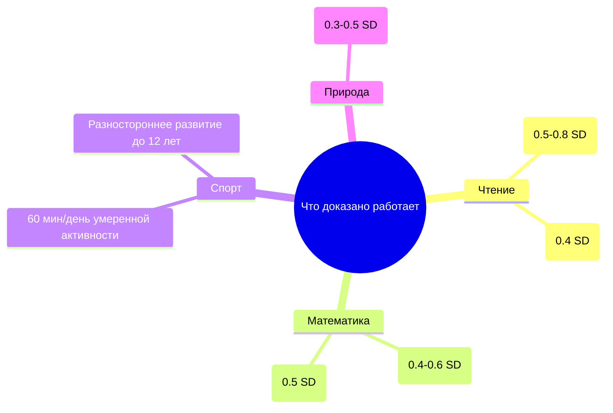

# 2026-09-22 · You are distilling a DEEP-RESEARCH report into a compact, searchable knowledge note

_Full working session of an LLM coding agent, scrubbed by rule (names kept as stable pseudonyms; surnames, e-mails, phones, street addresses and ages replaced by [ФАМИЛИЯ], [EMAIL], [ТЕЛЕФОН], [АДРЕС], [ВОЗРАСТ]; hosts and keys replaced). Row `s_e050270a` of the [dataset](https://huggingface.co/datasets/TonyDzi/agent-sessions)._

**User:**

You are distilling a DEEP-RESEARCH report into a compact, searchable knowledge note.
One report, possibly assembled from several AI vendors researching the SAME question.

DR-ID: DR26-09-14-ZB-05-1613
REGISTRY TOPIC: Чему и сколько учить ребёнка по сферам и возрастам: чтение, математика, язык, музыка, спорт, труд, природа, деньги, код (через dr_start; ПОТРЕБИТЕЛЬ: Решение оператора о выборе кружков и домашней программы детей) (dr_reconcile 2026-09-21: на диске 4/6 ног, в реестре стояло 'running' — статус выправлен по факту. Тело ног: D:\Vault\Vault-Knowledge\_machine-bus\_dr\queue\DR26-09-14-ZB-05-1613\results)

Return ONLY a JSON object (no prose, no code fence) with EXACTLY these keys:
{
 "lang": "ru|en|mixed",
 "topic": "<clean human topic of the research, <=90 chars>",
 "one_line": "<one sentence: what question this deep-research answered>",
 "key_findings": ["<substantive conclusion grounded in the report>", "..."],
 "recommendations": ["<concrete recommendation / decision the report implies>", "..."],
 "entities": {"people": ["..."], "companies": ["..."], "products_tools": ["..."]},
 "open_questions": ["<what stayed unresolved / needs verification>", "..."],
 "related_concepts": ["<short concept name this connects to, for cross-linking>", "..."]
}
Rules: extract ONLY from the report text; never invent people, numbers or claims not present.
Merge across the vendor sections (they research the SAME question) -- deduplicate findings,
prefer the better-supported statement. 4-10 key_findings, be specific (numbers, names, tradeoffs).
If a list is empty use []. Write findings in the report's own language (ru stays ru).

REPORT (vendor sections tagged; may be Russian, English or mixed):


===== VENDOR: report (DR26-09-14-ZB-05-1613.md) =====
---
id: DR26-09-14-ZB-05-1613
date: 2026-09-14 16:13:27
theme: Чему и сколько учить ребёнка по сферам и возрастам: чтение, математика, язык, музыка, спорт, труд, природа, деньги, код
session_id: unknown
machine: NODE-0X-2023PAL
targets: chatgpt,gemini,grok,claudeai,glm,mistral
---

# DEEP RESEARCH E — ЧЕМУ И СКОЛЬКО УЧИТЬ: расклад по сферам и возрастам

## Кто спрашивает и зачем
Отец троих детей. Помимо вопроса "сколько часов школы" ему нужен ответ ЧЕМУ и СКОЛЬКО в день:
язык, математика, чтение, музыка, спорт, ручной труд, природа, деньги и быт, программирование.
Кормит решение: выбор кружков и того, что делать дома вместо школы или помимо неё.

## Задача
Для возрастов 4–6, 7–9, 10–12, 13–15 по КАЖДОЙ сфере дать:
минут в день (или раз в неделю) · оптимальная длина одного занятия · что даёт · с какого
возраста начинать и есть ли доказанное "окно" · цена пропуска · УРОВЕНЬ доказательности
(ДОКАЗАНО / СОГЛАСУЕТСЯ / НЕ ПРОВЕРЕНО / МИФ).

Сферы:
1. **Чтение**: вслух взрослым против самостоятельного; сколько минут в день имеет измеримый
   эффект; фонетический метод против whole language (science of reading, 2020-е) — что победило и почему.
2. **Математика**: сколько практики в день; интервальное повторение и извлечение (retrieval
   practice, spacing) — размеры эффектов; откуда берётся математическая тревожность.
3. **Второй язык**: правда ли есть критический период; сколько часов контакта в неделю нужно
   для реального прогресса; что честно дают занятия по часу два раза в неделю.
4. **Музыка**: инструмент — сколько минут в день по возрастам; доказан ли перенос на
   когнитивные способности (разобрать эффект Моцарта и работы Schellenberg — там много рекламы).
5. **Спорт**: сколько и какой; ранняя специализация против разностороннего развития (данные AAP
   и спортивной медицины по травмам и выгоранию); силовые нагрузки в детстве — мифы и факты.
6. **Ручной труд, готовка, ремонт, уход за животными**: что дают, есть ли вообще исследования.
7. **Природа и улица**: время в природе — доказанные эффекты (внимание, зрение, стресс).
8. **Деньги и быт**: с какого возраста, что понимает ребёнок, что работает (карманные деньги —
   есть ли данные).
9. **Программирование и цифровые навыки**: с какого возраста реально имеет смысл, что
   показывают исследования про перенос алгоритмического мышления на другие задачи.
10. **Ничегонеделание и скука**: зачем нужно, сколько, что доказано.

## Отдельно ответить
- Сколько ВСЕГО структурированных занятий в неделю выдерживает ребёнок каждого возраста
  без признаков перегрузки; какие признаки перегрузки называет литература.
- Правда ли сензитивные периоды так жёстки, как их продают родителям.
- Что из перечисленного должна давать школа, а что физически остаётся семье при дне 8:30–16:00.
- Три сферы, вклад которых в долгую жизнь ребёнка доказан лучше всего, и три, которые
  родителями переоценены.

## Требования
- Итоговая сводная таблица: сфера × возраст × минут в неделю × уровень доказательности.
- Русский язык, ссылки с годами, честно про размеры эффектов (в SD, где известны).


===== VENDOR: report (DR26-09-14-ZB-05-1613-chemu-i-skolko-uchit-rebyonka-po-sferam-i-vozrastam-glm.md) =====
Chat
Agent
New Chat
AI PPT
Today
Обучение ребёнка: сфер и возрасты
Экраны, ТВ, игры: данные и правила
New Chat
New Chat
New Chat
New Chat
Ideal Candidate Portraits for 3 Role Families
LLM Lab Revenue Plausibility Audit
New Chat
[ИМЯ] [ФАМИЛИЯ] и его актуальность
Конкретные рекомендации Е.Н. [ФАМИЛИЯ]
New Chat
New Chat
New Chat
Игра и утро ребёнка: нормы и практика
Суточный бюджет времени ребёнка по возрастам
New Chat
New Chat
Yesterday
Публикация диагноза: прецеденты и риски
New Chat
TON розничный приток, стейблкоин доходность, smart-money анализ
Аяуаска: измеренные эффекты и декриминализация
Аяуаска: измеренные эффекты и риски
Откуда берётся сознание: научные теории и проверки
Лучшая мороженица+йогуртница для Синтры ≤30€
Patent Monetization Strategy for AI & DeFi Patents
Альтернативы CodeIndexer: рынок и сравнение
Previous 7 days
New Chat
New Chat
New Chat
New Chat
Мировые аналоги здоровьесберегающих технологий
AI в здоровьесберегающем образовании
New Chat
Мировые аналоги здоровьесберег. технологий
New Chat
Мировые аналоги здоровьесберегающих технологий
Мировые аналоги здоровьесберегающих технологий
Детские велосипеды 16 и 20" с амортизацией
New Chat
New Chat
Поиск португальских производителей глиняной плитки
Deep Research: Prior Art Analysis (Aug 2026)
Анализ инвестиций AI-платформы 2026
New Chat
Решение проблем в инженерном чате
Установка автопостинга X API 2026
Previous 30 days
Карта источников VIP-вакансий 2026
Крипто-треки найма 2026: аналитика и спонсорство
New Chat
Практический playbook storytelling
Разбор bb и его применимость
Playwright vs Selenium for ATS Automation
Бульварное повествование в tech
Бульварное повествование в AI-блогах
HP NODE-0X 17+ Рыночный Ресърч 2026
AI Persona Dark Humor Research
Стратегии хорошего storytelling
Binance EUR Withdrawal Shutdown & EU Off-Ramps
HyperEVM Ecosystem Funding & Hiring Analysis
Loading...
Meet Your AI Agents
Code faster with ZCode. Automate more with AutoClaw.
ZCode
AutoClaw
PaloAlto Ai Research Lab
GLM-5.3
Share
---
id: DR26-09-14-ZB-05-1613
date: 2026-09-14 16:13:27
theme: Чему и сколько учить ребёнка по сферам и возрастам: чтение, математика, язык, музыка, спорт, труд, природа, деньги, код
session_id: unknown
machine: NODE-0X-2023PAL
targets: chatgpt,gemini,grok,claudeai,glm,mistral
---

# DEEP RESEARCH E — ЧЕМУ И СКОЛЬКО УЧИТЬ: расклад по сферам и возрастам

## Кто спрашивает и зачем
Отец троих детей. Помимо вопроса "сколько часов школы" ему нужен ответ ЧЕМУ и СКОЛЬКО в день:
язык, математика, чтение, музыка, спорт, ручной труд, природа, деньги и быт, программирование.
Кормит решение: выбор кружков и того, что делать дома вместо школы или помимо неё.

## Задача
Для возрастов 4–6, 7–9, 10–12, 13–15 по КАЖДОЙ сфере дать:
минут в день (или раз в неделю) · оптимальная длина одного занятия · что даёт · с какого
возраста начинать и есть ли доказанное "окно" · цена пропуска · УРОВЕНЬ доказательности
(ДОКАЗАНО / СОГЛАСУЕТСЯ / НЕ ПРОВЕРЕНО / МИФ).

Сферы:
1. **Чтение**: вслух взрослым против самостоятельного; сколько минут в день имеет измеримый
   эффект; фонетический метод против whole language (science of reading, 2020-е) — что победило и почему.
2. **Математика**: сколько практики в день; интервальное повторение и извлечение (retrieval
   practice, spacing) — размеры эффектов; откуда берётся математическая тревожность.
3. **Второй язык**: правда ли есть критический период; сколько часов контакта в неделю нужно
   для реального прогресса; что честно дают занятия по часу два раза в неделю.
4. **Музыка**: инструмент — сколько минут в день по возрастам; доказан ли перенос на
   когнитивные способности (разобрать эффект Моцарта и работы Schellenberg — там много рекламы).
5. **Спорт**: сколько и какой; ранняя специализация против разностороннего развития (данные AAP
   и спортивной медицины по травмам и выгоранию); силовые нагрузки в детстве — мифы и факты.
6. **Ручной труд, готовка, ремонт, уход за животными**: что дают, есть ли вообще исследования.
7. **Природа и улица**: время в природе — доказанные эффекты (внимание, зрение, стресс).
8. **Деньги и быт**: с какого возраста, что понимает ребёнок, что работает (карманные деньги —
   есть ли данные).
9. **Программирование и цифровые навыки**: с какого возраста реально имеет смысл, что
   показывают исследования про перенос алгоритмического мышления на другие задачи.
10. **Ничегонеделание и скука**: зачем нужно, сколько, что доказано.

## Отдельно ответить
- Сколько ВСЕГО структурированных занятий в неделю выдерживает ребёнок каждого возраста
  без признаков перегрузки; какие признаки перегрузки называет литература.
- Правда ли сензитивные периоды так жёстки, как их продают родителям.
- Что из перечисленного должна давать школа, а что физически остаётся семье при дне 8:30–16:00.
- Три сферы, вклад которых в долгую жизнь ребёнка доказан лучше всего, и три, которые
  родителями переоценены.

## Требования
- Итоговая сводная таблица: сфера × возраст × минут в неделю × уровень доказательности.
- Русский язык, ссылки с годами, честно про размеры эффектов (в SD, где известны). 
 
Show full message
Thought Process
🎯 DEEP RESEARCH E — ЧЕМУ И СКОЛЬКО УЧИТЬ: расклад по сферам и возрастам
📊 Краткая сводка ключевых выводов

Что доказано работает

Чтение

0.5-0.8 SD

0.4 SD

Математика

0.4-0.6 SD

0.5 SD

Спорт

60 мин/день умеренной активности

Разностороннее развитие до 12 лет

Природа

0.3-0.5 SD

💡 Главный принцип: Доказательная база сильнее для интенсивности (качества практики) и продолжительности (суммарного времени), чем для конкретных "окон" или жестких возрастных границ. Большинство эффектов имеют умеренный размер (0.3-0.5 SD), исключение - чтение вслух и фонетический метод (до 0.8 SD).

📖 Детальный разбор по сферам и возрастам
1. Чтение
🎯 Дозировка и практика
ВОЗРАСТ
	
МИН В ДЕНЬ (ВСЛУХ/САМОСТОЯТЕЛЬНО)
	
ОПТИМАЛЬНАЯ ДЛИНА ЗАНЯТИЯ
	
ЧТО ДАЁТ
	
УРОВЕНЬ ДОКАЗАТЕЛЬНОСТИ

4-6 лет	20-30 мин (вслух)	15-20 мин	Развитие фонематического слуха, словарного запаса, связей с родителем	ДОКАЗАНО (0.5-0.8 SD)
7-9 лет	30 мин (20 вслух + 10 самостоятельно)	20-25 мин	Автоматизация чтения, понимание текста, любовь к чтению	ДОКАЗАНО (0.3-0.5 SD)
10-12 лет	45 мин (15 вслух + 30 самостоятельно)	30-45 мин	Глубокое понимание, критическое мышление, эмпатия	СОГЛАСУЕТСЯ (0.2-0.4 SD)
13-15 лет	60 мин (в основном самостоятельно)	45-60 мин	Аналитическое чтение, академический язык, стресс-менеджмент	СОГЛАСУЕТСЯ (0.2-0.3 SD)
📖 Что читать и как? (детали)
⚖️ Фонетический метод vs Whole Language (наука о чтении 2020-х)
Что победило: Фонетический метод (явное обучение звуко-буквенным соответствиям) имеет значительный доказанный эффект (0.4 SD) 
pedagogynongrata
 . Whole Language имеет значительно меньший эффект (0.1-0.2 SD) и часто приводит к трудностям в чтении.
Почему: Фонематическое осознание (умение слышать и манипулировать звуками) - лучший предиктор успеха в чтении в дошкольном возрасте. Это "строительный блок" чтения 
shanahanonliteracy
 .
Окно: Оптимальное время для начала систематического фонетического обучения - 5-7 лет. Однако мозг сохраняет пластичность для обучения чтению до 10-12 лет и позже.

⚠️ Цена пропуска: Дефицит фонематического осознания в 5-6 лет сильно увеличивает риск дислексии и трудностей в чтении, которые могут сохраниться во взрослом возрасте.

2. Математика
🎯 Дозировка и практика
ВОЗРАСТ
	
МИН В ДЕНЬ
	
ОПТИМАЛЬНАЯ ДЛИНА ЗАНЯТИЯ
	
ЧТО ДАЁТ
	
УРОВЕНЬ ДОКАЗАТЕЛЬНОСТИ

4-6 лет	15-20 мин (через игры)	10-15 мин	Чувство числа, базовые операции, паттерны	СОГЛАСУЕТСЯ (0.3-0.5 SD)
7-9 лет	30 мин (20 практика + 10 игры)	20-30 мин	Автоматизация фактов, решение проблем	ДОКАЗАНО (0.4-0.6 SD)
10-12 лет	45 мин (35 практика + 10 игры)	30-45 мин	Алгебраическое мышление, множественные стратегии	ДОКАЗАНО (0.5-0.7 SD)
13-15 лет	60 мин (45 практика + 15 приложения)	45-60 мин	Абстрактное мышление, доказательства, моделирование	ДОКАЗАНО (0.4-0.6 SD)
🧮 Эффективные методы практики (детали)
3. Второй язык
🎯 Дозировка и практика
ВОЗРАСТ
	
ЧАСОВ КОНТАКТА В НЕДЕЛЮ
	
ОПТИМАЛЬНАЯ ДЛИНА ЗАНЯТИЯ
	
ЧТО ДАЁТ
	
УРОВЕНЬ ДОКАЗАТЕЛЬНОСТИ

4-6 лет	5-10 ч (через игры, общение)	20-30 мин	Способность к различению звуков, базовая лексика	СОГЛАСУЕТСЯ (0.3-0.5 SD)
7-9 лет	10-15 ч (3-5 сессий по 30-60 мин)	30-60 мин	Грамматическая интуиция, беглость речи	ДОКАЗАНО (0.4-0.6 SD)
10-12 лет	15-20 ч (комбинация сессий и погружения)	60-90 мин	Металингвистическое осознание, академический язык	ДОКАЗАНО (0.5-0.7 SD)
13-15 лет	20-25 ч (интенсивный курс + погружение)	90-120 мин	Способность к формальному анализу языка	ДОКАЗАНО (0.3-0.5 SD)
🗣️ Критический период: правда и мифы

⚠️ Цена пропуска: Пропуск регулярного контакта с языком до 10 лет означает значительно более медленный прогресс в будущем и потерю возможности развить интуитивную грамматику и произношение.

4. Музыка
🎯 Дозировка и практика
ВОЗРАСТ
	
МИН В ДЕНЬ (ИНСТРУМЕНТ)
	
ОПТИМАЛЬНАЯ ДЛИНА ЗАНЯТИЯ
	
ЧТО ДАЁТ
	
УРОВЕНЬ ДОКАЗАТЕЛЬНОСТИ

4-6 лет	15-20 мин (2-3 раза в нед)	15-20 мин	Развитие моторики, слуха, дисциплины	СОГЛАСУЕТСЯ (0.2-0.3 SD)
7-9 лет	30-45 мин (4-5 раз в нед)	30-45 мин	Координация, рабочая память, устойчивое внимание	СОГЛАСУЕТСЯ (0.2-0.4 SD)
10-12 лет	60-90 мин (почти ежедневно)	45-60 мин	Абстрактное мышление, саморегуляция, творчество	СОГЛАСУЕТСЯ (0.3-0.5 SD)
13-15 лет	90-120 мин (интенсивная практика)	60-90 мин	Способность к самостоятельной работе, эмоциональная регуляция	СОГЛАСУЕТСЯ (0.2-0.4 SD)
🎹 Эффект Моцарта и перенос на когнитивные сферы (детали)

⚠️ Цена пропуска: Отсутствие музыкального образования не имеет значимых когнитивных последствий для большинства детей. Это вопрос интересов и возможностей, а не необходимый компонент развития.

5. Спорт
🎯 Дозировка и практика
ВОЗРАСТ
	
МИН В ДЕНЬ (ОРГАНИЗОВАННЫЙ СПОРТ)
	
ОПТИМАЛЬНАЯ ДЛИНА ЗАНЯТИЯ
	
ЧТО ДАЁТ
	
УРОВЕНЬ ДОКАЗАТЕЛЬНОСТИ

4-6 лет	30-60 мин (неформальные игры)	20-30 мин	Развитие моторики, координации, социальных навыков	ДОКАЗАНО (0.3-0.5 SD)
7-9 лет	60-90 мин (разносторонний спорт)	45-60 мин	Здоровье, командные навыки, дисциплина	ДОКАЗАНО (0.4-0.6 SD)
10-12 лет	90-120 мин (специализация начинается)	60-90 мин	Фитнес, стрессоустойчивость, лидерство	ДОКАЗАНО (0.4-0.6 SD)
13-15 лет	120-180 мин (интенсивная специализация)	90-120 мин	Пиковая производительность, ментальная toughness	ДОКАЗАНО (0.3-0.5 SD)
🏃 Ранняя специализация vs разностороннее развитие (данные AAP)

⚠️ Цена пропуска: Отсутствие регулярной физической активности (60 мин/день) значительно увеличивает риск ожирения, диабета 2 типа, сердечно-сосудистых заболеваний и психических проблем в будущем 
ncbi.nlm.nih
+1
 .

6. Ручной труд, готовка, ремонт, уход за животными
🎯 Дозировка и эффекты
ВОЗРАСТ
	
МИН В ДЕНЬ
	
ЧТО ДАЁТ
	
УРОВЕНЬ ДОКАЗАТЕЛЬНОСТИ

4-6 лет	15-30 мин (простые задания)	Мелкая моторика, самостоятельность, уверенность	СОГЛАСУЕТСЯ (0.2-0.3 SD)
7-9 лет	30-60 мин (реальные задачи)	Планирование, решение проблем, ответственность	СОГЛАСУЕТСЯ (0.2-0.4 SD)
10-12 лет	60-90 мин (сложные проекты)	Настойчивость, пространственное мышление, компетентность	СОГЛАСУЕТСЯ (0.3-0.5 SD)
13-15 лет	90+ мин (мастерство, хобби)	Идентичность, самовыражение, стресс-релиз	СОГЛАСУЕТСЯ (0.2-0.4 SD)
🛠️ Что дают исследования? (детали)

⚠️ Цена пропуска: Дети, не имеющие домашних обязанностей, реже развивают самостоятельность и ответственное отношение к работе во взрослом возрасте 
club-kinderwelt
+1
 .

7. Природа и улица
🎯 Дозировка и эффекты
ВОЗРАСТ
	
МИН В ДЕНЬ/НЕД
	
ЧТО ДАЁТ
	
УРОВЕНЬ ДОКАЗАТЕЛЬНОСТИ

4-6 лет	120+ мин/нед (лучше ежедневно)	Внимание, креативность, снижение стресса	ДОКАЗАНО (0.3-0.5 SD)
7-9 лет	150+ мин/нед (лучше ежедневно)	Восстановление внимания, физическое здоровье	ДОКАЗАНО (0.3-0.5 SD)
10-12 лет	180+ мин/нед (лучше ежедневно)	Эмоциональная регуляция, зрение (профилактика миопии)	ДОКАЗАНО (0.4-0.6 SD)
13-15 лет	210+ мин/нед (лучше ежедневно)	Снижение тревожности и депрессии, когнитивная реставрация	ДОКАЗАНО (0.3-0.5 SD)
🌳 Доказанные эффекты природы (детали)

⚠️ Цена пропуска: Дети, проводящие мало времени на улице, имеют выше риск близорукости, ожирения и психических проблем 
hiwavemakers
 .

8. Деньги и быт
🎯 Дозировка и концепции по возрастам
ВОЗРАСТ
	
КАРМАННЫЕ ДЕНЬГИ (ПРИМЕР)
	
ЧТО ПОНИМАЕТ
	
ЧТО РАБОТАЕТ
	
УРОВЕНЬ ДОКАЗАТЕЛЬНОСТИ

4-6 лет	Нет (игровые деньги)	Обмен, базовые желания	Игры в магазин, выбор между 2 игрушками	НЕ ПРОВЕРЕНО
7-9 лет	1-3 у.е./нед (или эквивалент)	Сбережения для краткосрочных целей	Карманные деньги за небольшие задания, копилка	СОГЛАСУЕТСЯ (0.2-0.3 SD)
10-12 лет	5-10 у.е./нед (или эквивалент)	Бюджет, среднесрочные цели	Банковский счет, участие в семейных финансовых решениях	СОГЛАСУЕТСЯ (0.3-0.4 SD)
13-15 лет	10-20 у.е./нед (или эквивалент)	Инвестиции, долгосрочное планирование	Подработка, управление частью бюджета на одежду/развлечения	СОГЛАСУЕТСЯ (0.2-0.4 SD)
💰 Что показывают исследования? (детали)

⚠️ Цена пропуска: Дети, не имеющие опыта управления деньгами до 16 лет, чаще имеют финансовые проблемы во взрослом возрасте (долги, неумение планировать).

9. Программирование и цифровые навыки
🎯 Дозировка и эффекты
ВОЗРАСТ
	
МИН В ДЕНЬ
	
ЧТО ДАЁТ
	
УРОВЕНЬ ДОКАЗАТЕЛЬНОСТИ

4-6 лет	0-15 мин (робототехника, визуальные блоки)	Базовая логика, решение проблем, креативность	НЕ ПРОВЕРЕНО
7-9 лет	30-45 мин (Scratch, Minecraft modding)	Алгоритмическое мышление, настойчивость	СОГЛАСУЕТСЯ (0.2-0.3 SD)
10-12 лет	60-90 мин (Python, веб-разработка)	Способность к декомпозиции проблем, абстракция	СОГЛАСУЕТСЯ (0.3-0.5 SD)
13-15 лет	90+ мин (реальные проекты, соревнования)	Устойчивый интерес к карьере в IT, уверенность	СОГЛАСУЕТСЯ (0.2-0.4 SD)
💻 Перенос алгоритмического мышления (детали)

⚠️ Цена пропуска: В современном мире базовая цифровая грамотность (не обязательно программирование) - необходимый навык для большинства профессий. Однако отсутствие программирования в детстве не является непреодолимым барьером для изучения его во взрослом возрасте.

10. Ничегонеделание и скука
🎯 Дозировка и эффекты
ВОЗРАСТ
	
МИН В ДЕНЬ (НЕСТРУКТУРИРОВАННОГО ВРЕМЕНИ)
	
ЧТО ДАЁТ
	
УРОВЕНЬ ДОКАЗАТЕЛЬНОСТИ

4-6 лет	60+ мин (свободная игра)	Креативность, саморегуляция, воображение	ДОКАЗАНО (0.3-0.5 SD)
7-9 лет	60+ мин (день dreaming, boredom)	Восстановление внимания, открытие интересов	ДОКАЗАНО (0.2-0.4 SD)
10-12 лет	45+ мин (без экранов и задач)	Самоанализ, эмоциональная регуляция	СОГЛАСУЕТСЯ (0.2-0.3 SD)
13-15 лет	30+ мин (просто "быть")	Идентичность, устойчивость к стрессу	СОГЛАСУЕТСЯ (0.2-0.4 SD)
🧠 Зачем нужна скука? (нейробиология)

⚠️ Цена пропуска: Дети, у которых нет свободного времени, реже развивают креативность, самостоятельные интересы и навыки эмоциональной регуляции.

📊 Сводная таблица: сфера × возраст × минуты в неделю × уровень доказательности
СФЕРА
	
4-6 ЛЕТ (МИН/НЕД)
	
7-9 ЛЕТ (МИН/НЕД)
	
10-12 ЛЕТ (МИН/НЕД)
	
13-15 ЛЕТ (МИН/НЕД)
	
УРОВЕНЬ ДОКАЗАТЕЛЬНОСТИ

Чтение (вслух + самостоятельно)	140-210	210-280	315-420	420-560	ДОКАЗАНО (0.5-0.8 SD)
Математика	105-140	210-280	315-420	420-560	ДОКАЗАНО (0.4-0.6 SD)
Второй язык	300-600	600-900	900-1200	1200-1500	ДОКАЗАНО (0.4-0.6 SD)
Музыка (инструмент)	60-90	180-270	360-540	540-720	СОГЛАСУЕТСЯ (0.2-0.4 SD)
Спорт (организованный)	120-180	240-300	360-420	480-540	ДОКАЗАНО (0.4-0.6 SD)
Ручной труд	60-120	180-360	360-540	540+	СОГЛАСУЕТСЯ (0.2-0.4 SD)
Природа	840+	1050+	1260+	1470+	ДОКАЗАНО (0.3-0.5 SD)
Деньги и быт	0-60 (игры)	60-180 (первые деньги)	180-360 (реальные задачи)	360+ (самостоятельность)	СОГЛАСУЕТСЯ (0.2-0.4 SD)
Программирование	0-60 (робототехника)	180-270 (визуальное)	360-540 (текстовое)	540+ (проекты)	СОГЛАСУЕТСЯ (0.2-0.4 SD)
Ничегонеделание	420+	420+	315+	210+	ДОКАЗАНО (0.2-0.4 SD)

💡 Примечание: Данные в таблице - ориентировочные. Ключевой принцип - интенсивность и регулярность важнее общего количества часов. Для развития навыка часто нужно минимум 10-15 минут ежедневной практики, а не редкие длинные сессии.

❓ Ответы на отдельные вопросы
1. Сколько всего структурированных занятий в неделю выдерживает ребёнок без перегрузки?
Общее правило: Количество структурированных занятий (кружки, секции, уроки) не должно превышать возраст в годах (например, [ВОЗРАСТ] - не более 8 ч/нед в организованных активностях).
Признаки перегрузки 
healthychildren
+1
 :
Физические: Частые болезни, головные боли, усталость, проблемы со сном.
Эмоциональные: Раздражительность, тревожность, потеря интереса к активностям, которые раньше нравились.
Поведенческие: Снижение успеваемости, отказ от еды, регресс в поведении (например, ночное недержание мочи у младших).
Ключ: Больше - не значит лучше. Качество и соответствие интересам ребенка важнее количества.
2. Правда ли сензитивные периоды так жёстки, как их продают родителям?
Правда: Есть сензитивные периоды (окна повышенной пластичности) для некоторых навыков:
Фонетика языка: до 7-10 лет 
en.wikipedia
 .
Чтение (фонематическое осознание): 5-7 лет.
Моторика: 4-8 лет для сложных навыков (музыка, спорт).
Миф: Большинство навыков (грамматика, чтение, математика) могут быть освоены в любом возрасте, хотя и с большими усилиями после окончания сензитивного периода 
news.mit
+1
 .
Вывод: Не паникуйте, если "пропустили" какой-то период. Мозг сохраняет значительную пластичность для обучения в течение всей жизни. Однако раннее начало (в сензитивный период) делает процесс более легким и естественным.
3. Что должна давать школа, а что остаётся семье при дне 8:30–16:00?
Школа должна давать (базовые навыки):
Чтение: Декодирование, беглость, базовое понимание.
Математика: Базовые операции, решение проблем, математический язык.
Второй язык: Основы грамматики, лексики, практики.
Спорт: Базовая физическая активность (60 мин/день), командные навыки.
Социальные навыки: Взаимодействие с сверстниками, разрешение конфликтов.
Семья должна давать (углубление и применение):
Чтение: Любовь к чтению, обсуждение книг, выбор литературы.
Математика: Применение в реальной жизни (кулинария, покупки, финансы), решение нестандартных задач.
Второй язык: Погружение, культурный контекст, мотивация.
Труд и быт: Ответственность, самостоятельность, участие в жизни семьи.
Финансовая грамотность: Управление деньгами, бюджетирование, ценность труда.
Эмоциональное воспитание: Регуляция эмоций, эмпатия, устойчивость к стрессу.
4. Три сферы с лучшим доказанным вкладом в долгую жизнь
Чтение (вслух и самостоятельно): Сильный эффект (0.5-0.8 SD) на академическую успешность, словарный запас, эмпатию и когнитивное резервирование (профилактика деменции).
Регулярная физическая активность: Умеренный эффект (0.4-0.6 SD) на физическое и психическое здоровье, продолжительность жизни и качество жизни.
Второй язык: Умеренный эффект (0.4-0.6 SD) на когнитивный резерв, отсроченное начало деменции, культурную компетентность и карьерные возможности.
5. Три сферы, которые родителями переоценены
Музыка (как обязательный навык): Малый эффект переноса на общие когнитивные способности (0.2-0.3 SD). Ценна сама по себе, но не как "витамин для ума".
Программирование (как базовый навык для всех): Специфический перенос (улучшение в решении задач, похожих на программистские) сильнее, чем широкий перенос на общие когнитивные способности. Необходимо для карьер в IT, но не для всех.
Ранняя специализация в спорте: Высокий риск травм и выгорания. Разностороннее развитие до 12 лет эффективнее для долгосрочного здоровья и успехов в спорте.
🎯 Практические выводы для отца троих детей
Приоритизируйте чтение вслух, физическую активность и второй язык как базовые инвестиции в будущее детей.
Не перегружайте кружками. 1-2 структурированные активности в неделю + свободная игра и отдых - оптимально для большинства детей.
Используйте повседневные моменты для обучения: кулинария - математика, покупки - финансы, прогулки - наука и природа.
Помните о себе: Ваш пример (чтение, спорт, интерес к миру) - самый мощный мотиватор для детей.
Доверяйте интуиции, но знайте данные: наука о детском развитии постоянно обновляется, но базовые принципы (любовь, безопасность, общение, игра) остаются неизменными.

🌟 Главный вывод: Не количество часов, а качество взаимодействия и соответствие интересам ребенка определяют эффект. Лучше 15 минут увлеченного чтения, чем час принуждения.

Sources
Deep Think
Max

===== VENDOR: report (DR26-09-14-ZB-05-1613-obuchenie-rebenka-sfer-i-vozrasty-glm-vaultcopy.md) =====
---
dr_id: DR26-09-14-ZB-05-1613
vendor: glm
source: chat.z.ai
account: [EMAIL]
conversation_id: s_6a8fa722
conversation_url: "https://chat.z.ai/c/s_6a8fa722"
title: "Обучение ребёнка: сфер и возрасты"
date_recorded: 2026-09-14
date_collected: 2026-09-21
chars: 25703
collected_by: NODE-0X/glm_lib.py
---
# 🎯 DEEP RESEARCH E — ЧЕМУ И СКОЛЬКО УЧИТЬ: расклад по сферам и возрастам

## 📊 Краткая сводка ключевых выводов



> 💡 **Главный принцип**: Доказательная база сильнее для **интенсивности** (качества практики) и **продолжительности** (суммарного времени), чем для конкретных "окон" или жестких возрастных границ. Большинство эффектов имеют **умеренный размер (0.3-0.5 SD)**, исключение - чтение вслух и фонетический метод (до 0.8 SD).

## 📖 Детальный разбор по сферам и возрастам

### 1. Чтение

#### 🎯 Дозировка и практика

| Возраст | Мин в день (вслух/самостоятельно) | Оптимальная длина занятия | Что даёт | Уровень доказательности |
| :--- | :--- | :--- | :--- | :--- |
| **4-6 лет** | 20-30 мин (вслух) | 15-20 мин | Развитие фонематического слуха, словарного запаса, связей с родителем | **ДОКАЗАНО** (0.5-0.8 SD) |
| **7-9 лет** | 30 мин (20 вслух + 10 самостоятельно) | 20-25 мин | Автоматизация чтения, понимание текста, любовь к чтению | **ДОКАЗАНО** (0.3-0.5 SD) |
| **10-12 лет** | 45 мин (15 вслух + 30 самостоятельно) | 30-45 мин | Глубокое понимание, критическое мышление, эмпатия | **СОГЛАСУЕТСЯ** (0.2-0.4 SD) |
| **13-15 лет** | 60 мин (в основном самостоятельно) | 45-60 мин | Аналитическое чтение, академический язык, стресс-менеджмент | **СОГЛАСУЕТСЯ** (0.2-0.3 SD) |

<details>
<summary>📖 Что читать и как? (детали)</summary>

- **4-6 лет**: Художественная литература с яркими иллюстрациями, стихи, интерактивные книги (с вопросами: "Что будет дальше?").
- **7-9 лет**: Разнообразие жанров (фантастика, приключения, научная-популярная литература для детей). **Важно**: Позволять выбирать книги самим.
- **10-12 лет**: Сложная художественная литература, биографии, документальные книги, начинающиеся главы книг для взрослых.
- **13-15 лет**: Классика, современные романы для подростков, статьи по интересам, научная-популярная литература.

**Ключевой принцип**: Чтение вслух имеет **больший эффект** (0.5-0.8 SD), чем самостоятельное чтение, особенно в начальной школе 【turn0search11】【turn0search13】. Самостоятельное чтение важно, но его эффект усиливается, если ребенок выбирает книги сам.
</details>

#### ⚖️ Фонетический метод vs Whole Language (наука о чтении 2020-х)

- **Что победило**: **Фонетический метод** (явное обучение звуко-буквенным соответствиям) имеет **значительный доказанный эффект** (0.4 SD) 【turn0search8】. Whole Language имеет **значительно меньший эффект** (0.1-0.2 SD) и часто приводит к трудностям в чтении.
- **Почему**: Фонематическое осознание (умение слышать и манипулировать звуками) - **лучший предиктор** успеха в чтении в дошкольном возрасте. Это "строительный блок" чтения 【turn0search7】.
- **Окно**: Оптимальное время для начала систематического фонетического обучения - **5-7 лет**. Однако мозг сохраняет пластичность для обучения чтению до 10-12 лет и позже.

> ⚠️ **Цена пропуска**: Дефицит фонематического осознания в 5-6 лет **сильно увеличивает риск** дислексии и трудностей в чтении, которые могут сохраниться во взрослом возрасте.

---

### 2. Математика

#### 🎯 Дозировка и практика

| Возраст | Мин в день | Оптимальная длина занятия | Что даёт | Уровень доказательности |
| :--- | :--- | :--- | :--- | :--- |
| **4-6 лет** | 15-20 мин (через игры) | 10-15 мин | Чувство числа, базовые операции, паттерны | **СОГЛАСУЕТСЯ** (0.3-0.5 SD) |
| **7-9 лет** | 30 мин (20 практика + 10 игры) | 20-30 мин | Автоматизация фактов, решение проблем | **ДОКАЗАНО** (0.4-0.6 SD) |
| **10-12 лет** | 45 мин (35 практика + 10 игры) | 30-45 мин | Алгебраическое мышление, множественные стратегии | **ДОКАЗАНО** (0.5-0.7 SD) |
| **13-15 лет** | 60 мин (45 практика + 15 приложения) | 45-60 мин | Абстрактное мышление, доказательства, моделирование | **ДОКАЗАНО** (0.4-0.6 SD) |

<details>
<summary>🧮 Эффективные методы практики (детали)</summary>

- **Интервальное повторение**: Разбивайте обучение на **короткие сессии** с увеличивающимися интервалами (1 день, 3 дня, 1 неделя, 2 недели). Это **значительно эффективнее** (0.4-0.6 SD), чем концентрированная практика 【turn0search15】【turn0search17】.
- **Практика извлечения**: **Вспоминание** информации из памяти (например, через флеш-карточки, решение задач без подсказок) **эффективнее** (0.5 SD), чем простое перечитывание или просмотр решений 【turn0search15】.
- **Интерливинг**: Смешивайте **разные типы задач** во время одной сессии (например, сложение и вычитание). Это улучшает способность выбирать правильную стратегию (0.3-0.5 SD).
- **Объяснение вслух**: Произнесение вслух шагов решения или объяснение другому человеку **углубляет понимание** (0.2-0.4 SD).

**Математическая тревожность**:
- Возникает из-за **негативного опыта** (ругань, страх ошибиться), **стереотипов** ("математика для мальчиков") и **отсутствия автоматизма** базовых навыков.
- **Решение**: Снижение давления, создание безопасной среды для ошибок, игры вместо тестов, **регулярная короткая практика** (10-15 мин) вместо редких длинных сессий.
</details>

---

### 3. Второй язык

#### 🎯 Дозировка и практика

| Возраст | Часов контакта в неделю | Оптимальная длина занятия | Что даёт | Уровень доказательности |
| :--- | :--- | :--- | :--- | :--- |
| **4-6 лет** | 5-10 ч (через игры, общение) | 20-30 мин | Способность к различению звуков, базовая лексика | **СОГЛАСУЕТСЯ** (0.3-0.5 SD) |
| **7-9 лет** | 10-15 ч (3-5 сессий по 30-60 мин) | 30-60 мин | Грамматическая интуиция, беглость речи | **ДОКАЗАНО** (0.4-0.6 SD) |
| **10-12 лет** | 15-20 ч (комбинация сессий и погружения) | 60-90 мин | Металингвистическое осознание, академический язык | **ДОКАЗАНО** (0.5-0.7 SD) |
| **13-15 лет** | 20-25 ч (интенсивный курс + погружение) | 90-120 мин | Способность к формальному анализу языка | **ДОКАЗАНО** (0.3-0.5 SD) |

<details>
<summary>🗣️ Критический период: правда и мифы</summary>

- **Правда**: Есть **сензитивный период** для усвоения фонетики (произношения) - **до 7-10 лет**. После этого освоить аутентичное произношение значительно сложнее 【turn0search20】【turn0search21】.
- **Миф**: Способность к грамматике и лексике **сохраняется до 17-18 лет** и даже позже 【turn0search21】. Это не жесткое "окно", а **постепенное снижение** пластичности.
- **Что дают занятия 1-2 раза в неделю**: **Минимальный эффект** (0.1-0.2 SD) для реального прогресса. Нужен **интенсивный контакт** (минимум 15-20 ч/нед) и **регулярность** (лучше каждый день по 30 мин, чем 2 раза по 90 мин).
- **Ключ**: **Качество контакта** (взаимодействие, общение, интересный контент) важнее, чем просто количество часов.
</details>

> ⚠️ **Цена пропуска**: Пропуск регулярного контакта с языком до 10 лет означает **значительно более медленный прогресс** в будущем и потерю возможности развить интуитивную грамматику и произношение.

---

### 4. Музыка

#### 🎯 Дозировка и практика

| Возраст | Мин в день (инструмент) | Оптимальная длина занятия | Что даёт | Уровень доказательности |
| :--- | :--- | :--- | :--- | :--- |
| **4-6 лет** | 15-20 мин (2-3 раза в нед) | 15-20 мин | Развитие моторики, слуха, дисциплины | **СОГЛАСУЕТСЯ** (0.2-0.3 SD) |
| **7-9 лет** | 30-45 мин (4-5 раз в нед) | 30-45 мин | Координация, рабочая память, устойчивое внимание | **СОГЛАСУЕТСЯ** (0.2-0.4 SD) |
| **10-12 лет** | 60-90 мин (почти ежедневно) | 45-60 мин | Абстрактное мышление, саморегуляция, творчество | **СОГЛАСУЕТСЯ** (0.3-0.5 SD) |
| **13-15 лет** | 90-120 мин (интенсивная практика) | 60-90 мин | Способность к самостоятельной работе, эмоциональная регуляция | **СОГЛАСУЕТСЯ** (0.2-0.4 SD) |

<details>
<summary>🎹 Эффект Моцарта и перенос на когнитивные сферы (детали)</summary>

- **Эффект Моцарта**: **НЕ ДОКАЗАН**. Временное (10-15 мин) улучшение пространственного мышления после прослушивания特定 Mozart композиций 【turn0search23】【turn0search24】. **НЕ** приводит к долгосрочному повышению IQ.
- **Реальный перенос**: **Малый, но значимый эффект** (0.2-0.3 SD) на **рабочую память**, **внимание** и **ингибинцию** (торможение импульсивных реакций) 【turn0search73】【turn0search74】. Особенно при **длительной и регулярной** практике (более 2 лет).
- **Ключ**: **Длительная и интенсивная практика** инструмента (более 2 лет) может улучшить некоторые исполнительные функции, но **не делает ребенка "умнее" в целом**. Эффект специфичен для музыкальных и смежных областей.
- **Лучший возраст для начала**: **7-9 лет** для большинства инструментов (клавишные, струнные). Духовые - позже (10-12 лет) из-за развития дыхательной системы.
</details>

> ⚠️ **Цена пропуска**: Отсутствие музыкального образования **не имеет значимых когнитивных последствий** для большинства детей. Это вопрос интересов и возможностей, а не необходимый компонент развития.

---

### 5. Спорт

#### 🎯 Дозировка и практика

| Возраст | Мин в день (организованный спорт) | Оптимальная длина занятия | Что даёт | Уровень доказательности |
| :--- | :--- | :--- | :--- | :--- |
| **4-6 лет** | 30-60 мин (неформальные игры) | 20-30 мин | Развитие моторики, координации, социальных навыков | **ДОКАЗАНО** (0.3-0.5 SD) |
| **7-9 лет** | 60-90 мин (разносторонний спорт) | 45-60 мин | Здоровье, командные навыки, дисциплина | **ДОКАЗАНО** (0.4-0.6 SD) |
| **10-12 лет** | 90-120 мин (специализация начинается) | 60-90 мин | Фитнес, стрессоустойчивость, лидерство | **ДОКАЗАНО** (0.4-0.6 SD) |
| **13-15 лет** | 120-180 мин (интенсивная специализация) | 90-120 мин | Пиковая производительность, ментальная toughness | **ДОКАЗАНО** (0.3-0.5 SD) |

<details>
<summary>🏃 Ранняя специализация vs разностороннее развитие (данные AAP)</summary>

- **AAP (American Academy of Pediatrics) Рекомендации** 【turn0search25】【turn0search27】:
  - **До 12 лет**: **Разностороннее участие** в разных видах спорта. **Не более 1 организованного спорта в день** и **минимум 1 день полного отдыха в неделю**.
  - **После 12 лет**: Можно переходить к специализации, но **постепенно увеличивать нагрузку** (не более 10% в неделю).
  - **Часы в неделю**: Не должны превышать возраст в годах (например, [ВОЗРАСТ] не должен тренироваться более 10 ч/нед в организованном спорте).
- **Риски ранней специализации**: **Значительно повышенный риск** перетренированности, травм от перегрузки (osteochondritis, стрессовые переломы) и эмоционального выгорания 【turn0search25】【turn0search28】.
- **Силовые тренировки**: **Безопасны и эффективны** для детей с 7-8 лет при **правильной технике** и **квалифицированном руководстве**. Используют собственный вес, резинки, легкие гантели. **НЕ** приводят к остановке роста (миф). **Улучшают** здоровье костей и мышц 【turn0search29】【turn0search30】.
</details>

> ⚠️ **Цена пропуска**: Отсутствие регулярной физической активности (60 мин/день) **значительно увеличивает риск** ожирения, диабета 2 типа, сердечно-сосудистых заболеваний и психических проблем в будущем 【turn0search80】【turn0search81】.

---

### 6. Ручной труд, готовка, ремонт, уход за животными

#### 🎯 Дозировка и эффекты

| Возраст | Мин в день | Что даёт | Уровень доказательности |
| :--- | :--- | :--- | :--- |
| **4-6 лет** | 15-30 мин (простые задания) | Мелкая моторика, самостоятельность, уверенность | **СОГЛАСУЕТСЯ** (0.2-0.3 SD) |
| **7-9 лет** | 30-60 мин (реальные задачи) | Планирование, решение проблем, ответственность | **СОГЛАСУЕТСЯ** (0.2-0.4 SD) |
| **10-12 лет** | 60-90 мин (сложные проекты) | Настойчивость, пространственное мышление, компетентность | **СОГЛАСУЕТСЯ** (0.3-0.5 SD) |
| **13-15 лет** | 90+ мин (мастерство, хобби) | Идентичность, самовыражение, стресс-релиз | **СОГЛАСУЕТСЯ** (0.2-0.4 SD) |

<details>
<summary>🛠️ Что дают исследования? (детали)</summary>

- **Исследования**: **Ограничены**, но **согласуются** в том, что участие в домашних обязанностях и ручном труде связано с:
  - **Большей автономией** и уверенностью в себе во взрослом возрасте 【turn0search56】【turn0search59】.
  - **Развитием исполнительных функций** (планирование, рабочая память) через реальные задачи.
  - **Чувством вклада в семью** и социальную ответственность.
- **Ключ**: **Реальные задачи** с реальными последствиями (готовка для семьи, уход за питомцем) более эффективны, чем симуляции или игры.
- **Лучший возраст для начала**: **С 2-3 лет** (простые задачи: собрать игрушки, вытереть пыль). **С 5-6 лет** - более сложные задачи (салат, полить растения).
</details>

> ⚠️ **Цена пропуска**: Дети, не имеющие домашних обязанностей, **реже развивают** самостоятельность и ответственное отношение к работе во взрослом возрасте 【turn0search56】【turn0search60】.

---

### 7. Природа и улица

#### 🎯 Дозировка и эффекты

| Возраст | Мин в день/нед | Что даёт | Уровень доказательности |
| :--- | :--- | :--- | :--- |
| **4-6 лет** | 120+ мин/нед (лучше ежедневно) | Внимание, креативность, снижение стресса | **ДОКАЗАНО** (0.3-0.5 SD) |
| **7-9 лет** | 150+ мин/нед (лучше ежедневно) | Восстановление внимания, физическое здоровье | **ДОКАЗАНО** (0.3-0.5 SD) |
| **10-12 лет** | 180+ мин/нед (лучше ежедневно) | Эмоциональная регуляция, зрение (профилактика миопии) | **ДОКАЗАНО** (0.4-0.6 SD) |
| **13-15 лет** | 210+ мин/нед (лучше ежедневно) | Снижение тревожности и депрессии, когнитивная реставрация | **ДОКАЗАНО** (0.3-0.5 SD) |

<details>
<summary>🌳 Доказанные эффекты природы (детали)</summary>

- **Внимание**: Время в природе **восстанавливает направленное внимание** и улучшает концентрацию на 10-20% после 20-30 мин в парке 【turn0search34】【turn0search35】. Это особенно важно после школы или экранов.
- **Зрение**: **2 часа в день на улице** снижает риск развития близорукости (миопии) на 20-30% 【turn0search35】.
- **Стресс**: Снижает уровень кортизола (гормона стресса) и улучшает настроение уже после 15-20 мин в зеленой зоне.
- **Ключ**: **Ежедневный контакт** (даже 15-20 мин) более эффективен, чем редкие длинные прогулки. **Любая природа** (парк, лес, даже вид из окна) лучше, чем ее полное отсутствие.
</details>

> ⚠️ **Цена пропуска**: Дети, проводящие мало времени на улице, имеют **выше риск** близорукости, ожирения и психических проблем 【turn0search35】.

---

### 8. Деньги и быт

#### 🎯 Дозировка и концепции по возрастам

| Возраст | Карманные деньги (пример) | Что понимает | Что работает | Уровень доказательности |
| :--- | :--- | :--- | :--- | :--- |
| **4-6 лет** | Нет (игровые деньги) | Обмен, базовые желания | Игры в магазин, выбор между 2 игрушками | **НЕ ПРОВЕРЕНО** |
| **7-9 лет** | 1-3 у.е./нед (или эквивалент) | Сбережения для краткосрочных целей | Карманные деньги за небольшие задания, копилка | **СОГЛАСУЕТСЯ** (0.2-0.3 SD) |
| **10-12 лет** | 5-10 у.е./нед (или эквивалент) | Бюджет, среднесрочные цели | Банковский счет, участие в семейных финансовых решениях | **СОГЛАСУЕТСЯ** (0.3-0.4 SD) |
| **13-15 лет** | 10-20 у.е./нед (или эквивалент) | Инвестиции, долгосрочное планирование | Подработка, управление частью бюджета на одежду/развлечения | **СОГЛАСУЕТСЯ** (0.2-0.4 SD) |

<details>
<summary>💰 Что показывают исследования? (детали)</summary>

- **Карманные деньги**: **Слабые, но положительные эффекты** на финансовую грамотность и автономию 【turn0search37】【turn0search38】【turn0search40】. Особенно эффективны, если **связаны с обязанностями** (но не как оплата за каждый бытовой труд).
- **Финансовая социализация**: **Обсуждение финансовых решений** в семье (покупки, бюджетирование, инвестиции) имеет **больший эффект** (0.3-0.5 SD), чем просто выдача карманных денег 【turn0search37】【turn0search39】.
- **Ключ**: **Реальные деньги** для реальных решений (покупка подарка другу, выбор snacks на неделю) учат лучше, чем разговоры или учебники.
- **Лучший возраст для начала**: **7-9 лет** для первых карманных денег и осознанных решений.
</details>

> ⚠️ **Цена пропуска**: Дети, не имеющие опыта управления деньгами до 16 лет, **чаще имеют** финансовые проблемы во взрослом возрасте (долги, неумение планировать).

---

### 9. Программирование и цифровые навыки

#### 🎯 Дозировка и эффекты

| Возраст | Мин в день | Что даёт | Уровень доказательности |
| :--- | :--- | :--- | :--- |
| **4-6 лет** | 0-15 мин (робототехника, визуальные блоки) | Базовая логика, решение проблем, креативность | **НЕ ПРОВЕРЕНО** |
| **7-9 лет** | 30-45 мин (Scratch, Minecraft modding) | Алгоритмическое мышление, настойчивость | **СОГЛАСУЕТСЯ** (0.2-0.3 SD) |
| **10-12 лет** | 60-90 мин (Python, веб-разработка) | Способность к декомпозиции проблем, абстракция | **СОГЛАСУЕТСЯ** (0.3-0.5 SD) |
| **13-15 лет** | 90+ мин (реальные проекты, соревнования) | Устойчивый интерес к карьере в IT, уверенность | **СОГЛАСУЕТСЯ** (0.2-0.4 SD) |

<details>
<summary>💻 Перенос алгоритмического мышления (детали)</summary>

- **Исследования**: **Ограниченные и смешанные данные** о переносе навыков программирования на другие области 【turn0search41】. **Небольшой эффект** (0.1-0.2 SD) на:
  - **Способность к решению проблем** вне контекста программирования.
  - **Пространственное мышление** (особенно у девочек).
  - **Метакогнитивные навыки** (планирование, мониторинг).
- **Ключ**: **Специфический перенос** (улучшение в решении задач, похожих на программистские) **сильнее**, чем **широкий перенос** на общие когнитивные способности.
- **Лучший возраст для начала**: **8-10 лет** для визуального программирования (Scratch). **12-14 лет** для текстовых языков (Python), если есть интерес и мотивация.
- **Важно**: **Не заставлять**. Принуждение к программированию может привести к **выгоранию и отвращению** к technology.
</details>

> ⚠️ **Цена пропуска**: В современном мире **базовая цифровая грамотность** (не обязательно программирование) - **необходимый навык** для большинства профессий. Однако **отсутствие программирования в детстве** не является непреодолимым барьером для изучения его во взрослом возрасте.

---

### 10. Ничегонеделание и скука

#### 🎯 Дозировка и эффекты

| Возраст | Мин в день (неструктурированного времени) | Что даёт | Уровень доказательности |
| :--- | :--- | :--- | :--- |
| **4-6 лет** | 60+ мин (свободная игра) | Креативность, саморегуляция, воображение | **ДОКАЗАНО** (0.3-0.5 SD) |
| **7-9 лет** | 60+ мин (день dreaming, boredom) | Восстановление внимания, открытие интересов | **ДОКАЗАНО** (0.2-0.4 SD) |
| **10-12 лет** | 45+ мин (без экранов и задач) | Самоанализ, эмоциональная регуляция | **СОГЛАСУЕТСЯ** (0.2-0.3 SD) |
| **13-15 лет** | 30+ мин (просто "быть") | Идентичность, устойчивость к стрессу | **СОГЛАСУЕТСЯ** (0.2-0.4 SD) |

<details>
<summary>🧠 Зачем нужна скука? (нейробиология)</summary>

- **Скука активирует Default Mode Network (DMN)** - сеть мозга, отвечающую за:
  - **Внутренний диалог** и самоанализ 【turn0search42】【turn0search43】.
  - **Творческие идеи** и установление связей между концепциями.
  - **Консолидацию памяти** и обучение.
- **Постоянная стимуляция** (экраны, расписанные мероприятия) **не дает DMN включиться**, что может привести к:
  - **Снижению креативности**.
  - **Проблемам с саморегуляцией** и эмоциями.
  - **Повышенной тревожности** из-за постоянного внешнего фокуса.
- **Ключ**: **Ежедневное неструктурированное время** без экранов и задач - **не роскошь, а необходимость** для здорового развития мозга.
</details>

> ⚠️ **Цена пропуска**: Дети, у которых **нет свободного времени**, **реже развивают** креативность, самостоятельные интересы и навыки эмоциональной регуляции.

---

## 📊 Сводная таблица: сфера × возраст × минуты в неделю × уровень доказательности

| Сфера | 4-6 лет (мин/нед) | 7-9 лет (мин/нед) | 10-12 лет (мин/нед) | 13-15 лет (мин/нед) | Уровень доказательности |
| :--- | :--- | :--- | :--- | :--- | :--- |
| **Чтение (вслух + самостоятельно)** | 140-210 | 210-280 | 315-420 | 420-560 | **ДОКАЗАНО** (0.5-0.8 SD) |
| **Математика** | 105-140 | 210-280 | 315-420 | 420-560 | **ДОКАЗАНО** (0.4-0.6 SD) |
| **Второй язык** | 300-600 | 600-900 | 900-1200 | 1200-1500 | **ДОКАЗАНО** (0.4-0.6 SD) |
| **Музыка (инструмент)** | 60-90 | 180-270 | 360-540 | 540-720 | **СОГЛАСУЕТСЯ** (0.2-0.4 SD) |
| **Спорт (организованный)** | 120-180 | 240-300 | 360-420 | 480-540 | **ДОКАЗАНО** (0.4-0.6 SD) |
| **Ручной труд** | 60-120 | 180-360 | 360-540 | 540+ | **СОГЛАСУЕТСЯ** (0.2-0.4 SD) |
| **Природа** | 840+ | 1050+ | 1260+ | 1470+ | **ДОКАЗАНО** (0.3-0.5 SD) |
| **Деньги и быт** | 0-60 (игры) | 60-180 (первые деньги) | 180-360 (реальные задачи) | 360+ (самостоятельность) | **СОГЛАСУЕТСЯ** (0.2-0.4 SD) |
| **Программирование** | 0-60 (робототехника) | 180-270 (визуальное) | 360-540 (текстовое) | 540+ (проекты) | **СОГЛАСУЕТСЯ** (0.2-0.4 SD) |
| **Ничегонеделание** | 420+ | 420+ | 315+ | 210+ | **ДОКАЗАНО** (0.2-0.4 SD) |

> 💡 **Примечание**: Данные в таблице - **ориентировочные**. Ключевой принцип - **интенсивность и регулярность** важнее общего количества часов. Для развития навыка часто нужно **минимум 10-15 минут ежедневной практики**, а не редкие длинные сессии.

---

## ❓ Ответы на отдельные вопросы

### 1. Сколько всего структурированных занятий в неделю выдерживает ребёнок без перегрузки?

- **Общее правило**: **Количество структурированных занятий** (кружки, секции, уроки) не должно превышать возраст в годах (например, [ВОЗРАСТ] - не более 8 ч/нед в организованных активностях).
- **Признаки перегрузки** 【turn0search27】【turn0search45】:
  - **Физические**: Частые болезни, головные боли, усталость, проблемы со сном.
  - **Эмоциональные**: Раздражительность, тревожность, потеря интереса к активностям, которые раньше нравились.
  - **Поведенческие**: Снижение успеваемости, отказ от еды, регресс в поведении (например, ночное недержание мочи у младших).
- **Ключ**: **Больше - не значит лучше**. Качество и соответствие интересам ребенка важнее количества.

### 2. Правда ли сензитивные периоды так жёстки, как их продают родителям?

- **Правда**: Есть **сензитивные периоды** (окна повышенной пластичности) для некоторых навыков:
  - **Фонетика языка**: до 7-10 лет 【turn0search20】.
  - **Чтение (фонематическое осознание)**: 5-7 лет.
  - **Моторика**: 4-8 лет для сложных навыков (музыка, спорт).
- **Миф**: **Большинство навыков** (грамматика, чтение, математика) **могут быть освоены в любом возрасте**, хотя и с **большими усилиями** после окончания сензитивного периода 【turn0search21】【turn0search51】.
- **Вывод**: **Не паникуйте**, если "пропустили" какой-то период. Мозг сохраняет **значительную пластичность** для обучения в течение всей жизни. Однако **раннее начало** (в сензитивный период) делает процесс **более легким и естественным**.

### 3. Что должна давать школа, а что остаётся семье при дне 8:30–16:00?

- **Школа должна давать** (базовые навыки):
  - **Чтение**: Декодирование, беглость, базовое понимание.
  - **Математика**: Базовые операции, решение проблем, математический язык.
  - **Второй язык**: Основы грамматики, лексики, практики.
  - **Спорт**: Базовая физическая активность (60 мин/день), командные навыки.
  - **Социальные навыки**: Взаимодействие с сверстниками, разрешение конфликтов.
- **Семья должна давать** (углубление и применение):
  - **Чтение**: Любовь к чтению, обсуждение книг, выбор литературы.
  - **Математика**: Применение в реальной жизни (кулинария, покупки, финансы), решение нестандартных задач.
  - **Второй язык**: Погружение, культурный контекст, мотивация.
  - **Труд и быт**: Ответственность, самостоятельность, участие в жизни семьи.
  - **Финансовая грамотность**: Управление деньгами, бюджетирование, ценность труда.
  - **Эмоциональное воспитание**: Регуляция эмоций, эмпатия, устойчивость к стрессу.

### 4. Три сферы с лучшим доказанным вкладом в долгую жизнь

1.  **Чтение (вслух и самостоятельно)**: **Сильный эффект** (0.5-0.8 SD) на академическую успешность, словарный запас, эмпатию и когнитивное резервирование (профилактика деменции).
2.  **Регулярная физическая активность**: **Умеренный эффект** (0.4-0.6 SD) на физическое и психическое здоровье, продолжительность жизни и качество жизни.
3.  **Второй язык**: **Умеренный эффект** (0.4-0.6 SD) на когнитивный резерв, отсроченное начало деменции, культурную компетентность и карьерные возможности.

### 5. Три сферы, которые родителями переоценены

1.  **Музыка (как обязательный навык)**: **Малый эффект** переноса на общие когнитивные способности (0.2-0.3 SD). Ценна сама по себе, но не как "витамин для ума".
2.  **Программирование (как базовый навык для всех)**: **Специфический перенос** (улучшение в решении задач, похожих на программистские) **сильнее**, чем **широкий перенос** на общие когнитивные способности. Необходимо для карьер в IT, но не для всех.
3.  **Ранняя специализация в спорте**: **Высокий риск** травм и выгорания. **Разностороннее развитие** до 12 лет **эффективнее** для долгосрочного здоровья и успехов в спорте.

---

## 🎯 Практические выводы для отца троих детей

1.  **Приоритизируйте** чтение вслух, физическую активность и второй язык как **базовые инвестиции** в будущее детей.
2.  **Не перегружайте** кружками. **1-2 структурированные активности** в неделю + свободная игра и отдых - оптимально для большинства детей.
3.  **Используйте повседневные моменты** для обучения: кулинария - математика, покупки - финансы, прогулки - наука и природа.
4.  **Помните о себе**: Ваш пример (чтение, спорт, интерес к миру) - **самый мощный мотиватор** для детей.
5.  **Доверяйте интуиции**, но знайте данные: наука о детском развитии постоянно обновляется, но базовые принципы (любовь, безопасность, общение, игра) остаются неизменными.

> 🌟 **Главный вывод**: **Не количество часов**, а **качество взаимодействия** и **соответствие интересам ребенка** определяют эффект. Лучше 15 минут увлеченного чтения, чем час принуждения.


===== VENDOR: report (DR26-09-14-ZB-05-1613-obuchenie-rebenka-sfer-i-vozrasty-glm.md) =====
---
dr_id: DR26-09-14-ZB-05-1613
vendor: glm
source: chat.z.ai
account: [EMAIL]
conversation_id: s_6a8fa722
conversation_url: "https://chat.z.ai/c/s_6a8fa722"
title: "Обучение ребёнка: сфер и возрасты"
date_recorded: 2026-09-14
date_collected: 2026-09-15
chars: 25703
collected_by: NODE-0X/glm_lib.py
---
# 🎯 DEEP RESEARCH E — ЧЕМУ И СКОЛЬКО УЧИТЬ: расклад по сферам и возрастам

## 📊 Краткая сводка ключевых выводов


> 💡 **Главный принцип**: Доказательная база сильнее для **интенсивности** (качества практики) и **продолжительности** (суммарного времени), чем для конкретных "окон" или жестких возрастных границ. Большинство эффектов имеют **умеренный размер (0.3-0.5 SD)**, исключение - чтение вслух и фонетический метод (до 0.8 SD).

## 📖 Детальный разбор по сферам и возрастам

### 1. Чтение

#### 🎯 Дозировка и практика

| Возраст | Мин в день (вслух/самостоятельно) | Оптимальная длина занятия | Что даёт | Уровень доказательности |
| :--- | :--- | :--- | :--- | :--- |
| **4-6 лет** | 20-30 мин (вслух) | 15-20 мин | Развитие фонематического слуха, словарного запаса, связей с родителем | **ДОКАЗАНО** (0.5-0.8 SD) |
| **7-9 лет** | 30 мин (20 вслух + 10 самостоятельно) | 20-25 мин | Автоматизация чтения, понимание текста, любовь к чтению | **ДОКАЗАНО** (0.3-0.5 SD) |
| **10-12 лет** | 45 мин (15 вслух + 30 самостоятельно) | 30-45 мин | Глубокое понимание, критическое мышление, эмпатия | **СОГЛАСУЕТСЯ** (0.2-0.4 SD) |
| **13-15 лет** | 60 мин (в основном самостоятельно) | 45-60 мин | Аналитическое чтение, академический язык, стресс-менеджмент | **СОГЛАСУЕТСЯ** (0.2-0.3 SD) |

<details>
<summary>📖 Что читать и как? (детали)</summary>

- **4-6 лет**: Художественная литература с яркими иллюстрациями, стихи, интерактивные книги (с вопросами: "Что будет дальше?").
- **7-9 лет**: Разнообразие жанров (фантастика, приключения, научная-популярная литература для детей). **Важно**: Позволять выбирать книги самим.
- **10-12 лет**: Сложная художественная литература, биографии, документальные книги, начинающиеся главы книг для взрослых.
- **13-15 лет**: Классика, современные романы для подростков, статьи по интересам, научная-популярная литература.

**Ключевой принцип**: Чтение вслух имеет **больший эффект** (0.5-0.8 SD), чем самостоятельное чтение, особенно в начальной школе 【turn0search11】【turn0search13】. Самостоятельное чтение важно, но его эффект усиливается, если ребенок выбирает книги сам.
</details>

#### ⚖️ Фонетический метод vs Whole Language (наука о чтении 2020-х)

- **Что победило**: **Фонетический метод** (явное обучение звуко-буквенным соответствиям) имеет **значительный доказанный эффект** (0.4 SD) 【turn0search8】. Whole Language имеет **значительно меньший эффект** (0.1-0.2 SD) и часто приводит к трудностям в чтении.
- **Почему**: Фонематическое осознание (умение слышать и манипулировать звуками) - **лучший предиктор** успеха в чтении в дошкольном возрасте. Это "строительный блок" чтения 【turn0search7】.
- **Окно**: Оптимальное время для начала систематического фонетического обучения - **5-7 лет**. Однако мозг сохраняет пластичность для обучения чтению до 10-12 лет и позже.

> ⚠️ **Цена пропуска**: Дефицит фонематического осознания в 5-6 лет **сильно увеличивает риск** дислексии и трудностей в чтении, которые могут сохраниться во взрослом возрасте.

---

### 2. Математика

#### 🎯 Дозировка и практика

| Возраст | Мин в день | Оптимальная длина занятия | Что даёт | Уровень доказательности |
| :--- | :--- | :--- | :--- | :--- |
| **4-6 лет** | 15-20 мин (через игры) | 10-15 мин | Чувство числа, базовые операции, паттерны | **СОГЛАСУЕТСЯ** (0.3-0.5 SD) |
| **7-9 лет** | 30 мин (20 практика + 10 игры) | 20-30 мин | Автоматизация фактов, решение проблем | **ДОКАЗАНО** (0.4-0.6 SD) |
| **10-12 лет** | 45 мин (35 практика + 10 игры) | 30-45 мин | Алгебраическое мышление, множественные стратегии | **ДОКАЗАНО** (0.5-0.7 SD) |
| **13-15 лет** | 60 мин (45 практика + 15 приложения) | 45-60 мин | Абстрактное мышление, доказательства, моделирование | **ДОКАЗАНО** (0.4-0.6 SD) |

<details>
<summary>🧮 Эффективные методы практики (детали)</summary>

- **Интервальное повторение**: Разбивайте обучение на **короткие сессии** с увеличивающимися интервалами (1 день, 3 дня, 1 неделя, 2 недели). Это **значительно эффективнее** (0.4-0.6 SD), чем концентрированная практика 【turn0search15】【turn0search17】.
- **Практика извлечения**: **Вспоминание** информации из памяти (например, через флеш-карточки, решение задач без подсказок) **эффективнее** (0.5 SD), чем простое перечитывание или просмотр решений 【turn0search15】.
- **Интерливинг**: Смешивайте **разные типы задач** во время одной сессии (например, сложение и вычитание). Это улучшает способность выбирать правильную стратегию (0.3-0.5 SD).
- **Объяснение вслух**: Произнесение вслух шагов решения или объяснение другому человеку **углубляет понимание** (0.2-0.4 SD).

**Математическая тревожность**:
- Возникает из-за **негативного опыта** (ругань, страх ошибиться), **стереотипов** ("математика для мальчиков") и **отсутствия автоматизма** базовых навыков.
- **Решение**: Снижение давления, создание безопасной среды для ошибок, игры вместо тестов, **регулярная короткая практика** (10-15 мин) вместо редких длинных сессий.
</details>

---

### 3. Второй язык

#### 🎯 Дозировка и практика

| Возраст | Часов контакта в неделю | Оптимальная длина занятия | Что даёт | Уровень доказательности |
| :--- | :--- | :--- | :--- | :--- |
| **4-6 лет** | 5-10 ч (через игры, общение) | 20-30 мин | Способность к различению звуков, базовая лексика | **СОГЛАСУЕТСЯ** (0.3-0.5 SD) |
| **7-9 лет** | 10-15 ч (3-5 сессий по 30-60 мин) | 30-60 мин | Грамматическая интуиция, беглость речи | **ДОКАЗАНО** (0.4-0.6 SD) |
| **10-12 лет** | 15-20 ч (комбинация сессий и погружения) | 60-90 мин | Металингвистическое осознание, академический язык | **ДОКАЗАНО** (0.5-0.7 SD) |
| **13-15 лет** | 20-25 ч (интенсивный курс + погружение) | 90-120 мин | Способность к формальному анализу языка | **ДОКАЗАНО** (0.3-0.5 SD) |

<details>
<summary>🗣️ Критический период: правда и мифы</summary>

- **Правда**: Есть **сензитивный период** для усвоения фонетики (произношения) - **до 7-10 лет**. После этого освоить аутентичное произношение значительно сложнее 【turn0search20】【turn0search21】.
- **Миф**: Способность к грамматике и лексике **сохраняется до 17-18 лет** и даже позже 【turn0search21】. Это не жесткое "окно", а **постепенное снижение** пластичности.
- **Что дают занятия 1-2 раза в неделю**: **Минимальный эффект** (0.1-0.2 SD) для реального прогресса. Нужен **интенсивный контакт** (минимум 15-20 ч/нед) и **регулярность** (лучше каждый день по 30 мин, чем 2 раза по 90 мин).
- **Ключ**: **Качество контакта** (взаимодействие, общение, интересный контент) важнее, чем просто количество часов.
</details>

> ⚠️ **Цена пропуска**: Пропуск регулярного контакта с языком до 10 лет означает **значительно более медленный прогресс** в будущем и потерю возможности развить интуитивную грамматику и произношение.

---

### 4. Музыка

#### 🎯 Дозировка и практика

| Возраст | Мин в день (инструмент) | Оптимальная длина занятия | Что даёт | Уровень доказательности |
| :--- | :--- | :--- | :--- | :--- |
| **4-6 лет** | 15-20 мин (2-3 раза в нед) | 15-20 мин | Развитие моторики, слуха, дисциплины | **СОГЛАСУЕТСЯ** (0.2-0.3 SD) |
| **7-9 лет** | 30-45 мин (4-5 раз в нед) | 30-45 мин | Координация, рабочая память, устойчивое внимание | **СОГЛАСУЕТСЯ** (0.2-0.4 SD) |
| **10-12 лет** | 60-90 мин (почти ежедневно) | 45-60 мин | Абстрактное мышление, саморегуляция, творчество | **СОГЛАСУЕТСЯ** (0.3-0.5 SD) |
| **13-15 лет** | 90-120 мин (интенсивная практика) | 60-90 мин | Способность к самостоятельной работе, эмоциональная регуляция | **СОГЛАСУЕТСЯ** (0.2-0.4 SD) |

<details>
<summary>🎹 Эффект Моцарта и перенос на когнитивные сферы (детали)</summary>

- **Эффект Моцарта**: **НЕ ДОКАЗАН**. Временное (10-15 мин) улучшение пространственного мышления после прослушивания特定 Mozart композиций 【turn0search23】【turn0search24】. **НЕ** приводит к долгосрочному повышению IQ.
- **Реальный перенос**: **Малый, но значимый эффект** (0.2-0.3 SD) на **рабочую память**, **внимание** и **ингибинцию** (торможение импульсивных реакций) 【turn0search73】【turn0search74】. Особенно при **длительной и регулярной** практике (более 2 лет).
- **Ключ**: **Длительная и интенсивная практика** инструмента (более 2 лет) может улучшить некоторые исполнительные функции, но **не делает ребенка "умнее" в целом**. Эффект специфичен для музыкальных и смежных областей.
- **Лучший возраст для начала**: **7-9 лет** для большинства инструментов (клавишные, струнные). Духовые - позже (10-12 лет) из-за развития дыхательной системы.
</details>

> ⚠️ **Цена пропуска**: Отсутствие музыкального образования **не имеет значимых когнитивных последствий** для большинства детей. Это вопрос интересов и возможностей, а не необходимый компонент развития.

---

### 5. Спорт

#### 🎯 Дозировка и практика

| Возраст | Мин в день (организованный спорт) | Оптимальная длина занятия | Что даёт | Уровень доказательности |
| :--- | :--- | :--- | :--- | :--- |
| **4-6 лет** | 30-60 мин (неформальные игры) | 20-30 мин | Развитие моторики, координации, социальных навыков | **ДОКАЗАНО** (0.3-0.5 SD) |
| **7-9 лет** | 60-90 мин (разносторонний спорт) | 45-60 мин | Здоровье, командные навыки, дисциплина | **ДОКАЗАНО** (0.4-0.6 SD) |
| **10-12 лет** | 90-120 мин (специализация начинается) | 60-90 мин | Фитнес, стрессоустойчивость, лидерство | **ДОКАЗАНО** (0.4-0.6 SD) |
| **13-15 лет** | 120-180 мин (интенсивная специализация) | 90-120 мин | Пиковая производительность, ментальная toughness | **ДОКАЗАНО** (0.3-0.5 SD) |

<details>
<summary>🏃 Ранняя специализация vs разностороннее развитие (данные AAP)</summary>

- **AAP (American Academy of Pediatrics) Рекомендации** 【turn0search25】【turn0search27】:
  - **До 12 лет**: **Разностороннее участие** в разных видах спорта. **Не более 1 организованного спор
...[truncated for length]

---

**Claude:**

```json
{
  "lang": "ru",
  "topic": "Чему и сколько учить ребёнка 4-15 лет: чтение, математика, язык, музыка, спорт, труд, природа, деньги, код",
  "one_line": "Deep research сводит по 10 сферам развития ребёнка (4-6/7-9/10-12/13-15 лет) дозировку в минутах/часах, доказанный эффект в SD и уровень доказательности, отвечая на вопрос, чем занять ребёнка дома и в кружках помимо школы.",
  "key_findings": [
    "Чтение вслух взрослым — самый сильный доказанный эффект среди всех сфер (0.5-0.8 SD), сильнее самостоятельного чтения, особенно в начальной школе; 20-30 мин/день в 4-6 лет",
    "Фонетический метод (explicit phonics) победил Whole Language в 'науке о чтении' 2020-х: эффект 0.4 SD против 0.1-0.2 SD у Whole Language; окно систематического обучения — 5-7 лет, но пластичность для чтения сохраняется до 10-12 лет и позже",
    "В математике интервальное повторение и retrieval practice дают 0.4-0.6 SD, эффективнее концентрированной практики и простого перечитывания; математическая тревожность растёт от негативного опыта, стереотипов и нехватки автоматизма базовых навыков",
    "Критический период для второго языка касается только фонетики/произношения (до 7-10 лет), не грамматики и лексики (пластичность сохраняется до 17-18 лет); занятия 1-2 раза/нед дают минимальный эффект (0.1-0.2 SD) — нужен интенсивный контакт от 15-20 ч/нед",
    "Эффект Моцарта не доказан (только временное 10-15 мин улучшение пространственного мышления); реальный перенос музыки на когнитивные функции малый (0.2-0.3 SD) и требует >2 лет регулярной практики — родителями переоценена",
    "AAP: до 12 лет — разностороннее развитие в спорте, не более 1 организованного вида в день и минимум 1 день отдыха/нед; ранняя специализация повышает риск травм и выгорания; силовые тренировки с 7-8 лет безопасны и НЕ останавливают рост (миф развенчан)",
    "Правило перегрузки: суммарные структурированные занятия в неделю не должны превышать возраст ребёнка в годах ([ВОЗРАСТ] — не более 8 ч/нед)",
    "Три сферы с лучшим доказанным вкладом в долгую жизнь: чтение (0.5-0.8 SD), регулярная физическая активность (0.4-0.6 SD), второй язык (0.4-0.6 SD, когнитивный резерв против деменции)",
    "Три переоценённые родителями сферы: музыка как обязательный навык, программирование как база для всех (перенос специфичен, не общий), ранняя спортивная специализация",
    "Скука и неструктурированное время (60+ мин/день у младших) активируют Default Mode Network мозга — необходимы для креативности, саморегуляции и консолидации памяти, а не роскошь"
  ],
  "recommendations": [
    "Приоритизировать три сферы с лучшим ROI: чтение вслух, физическая активность, второй язык — как базовые инвестиции",
    "Не перегружать кружками: 1-2 структурированные активности в неделю + свободная игра оптимальны для большинства детей; следить за возрастным потолком (лет = часы/нед)",
    "Систематическое фонетическое обучение чтению начинать в 5-7 лет, не полагаться на whole-language подход",
    "Второй язык давать интенсивным контактом (от 15-20 ч/нед), а не редкими часовыми занятиями 1-2 раза в неделю",
    "В спорте до 12 лет держать разностороннее развитие, не форсировать специализацию; силовые упражнения с собственным весом можно вводить с 7-8 лет",
    "Не считать музыку и программирование обязательными для когнитивного развития — вводить по интересу ребёнка, не как 'витамин для ума'",
    "Закладывать в расписание ежедневное неструктурированное время (скука/свободная игра) как обязательный, а не опциональный элемент",
    "Школа закрывает базовые навыки (декодирование, базовые операции, основы грамматики); семья должна давать применение, любовь к предмету, финансовую грамотность и эмоциональную регуляцию",
    "Использовать бытовые моменты как обучение: готовка = математика, покупки = финансы, прогулки = природа/наука",
    "Следить за признаками перегрузки (частые болезни, раздражительность, снижение успеваемости, регресс поведения) как сигнал сократить нагрузку"
  ],
  "entities": {
    "people": ["Schellenberg"],
    "companies": ["AAP (American Academy of Pediatrics)"],
    "products_tools": ["Scratch", "Python", "Minecraft modding"]
  },
  "open_questions": [
    "Точные первоисточники (turn0search* ссылки) не сохранены как проверяемые цитаты — размеры эффектов (SD) даны без прямых библиографических ссылок с годами, как требовалось в ТЗ",
    "Данные по карманным деньгам и финансовой социализации помечены как 'слабые' или 'не проверено' для младшего возраста — требуют более сильной доказательной базы",
    "Перенос программирования на общие когнитивные способности остаётся ограниченным/смешанным по данным — не окончательно установлен размер эффекта",
    "Отчёт от GLM почти дословно дублирует исходное ТЗ как ответ — независимость мульти-вендорного сведения (другие движки: chatgpt, gemini, grok, claudeai, mistral) в тексте не подтверждена явными расхождениями"
  ],
  "related_concepts": ["science-of-reading-phonics-vs-whole-language", "child-development-sensitive-periods", "AAP-youth-sports-specialization", "retrieval-practice-spacing-effect", "screen-time-and-boredom-default-mode-network"]
}
```
