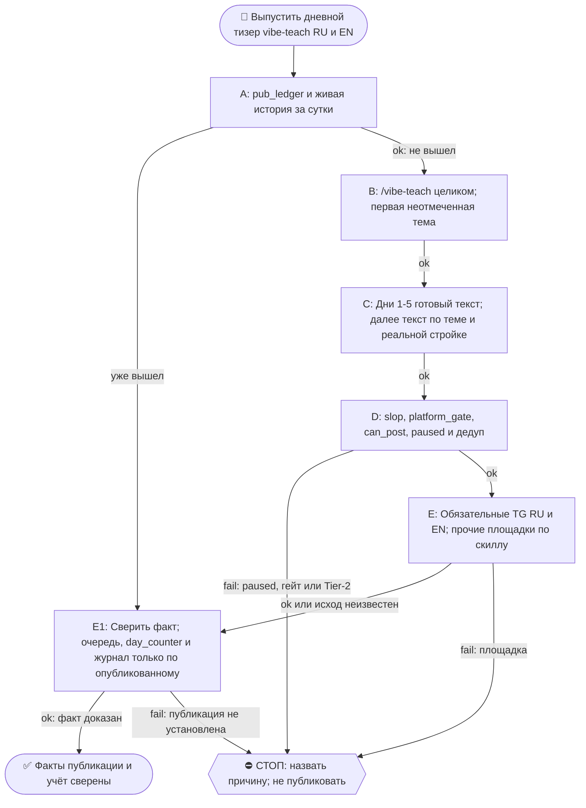

# 2026-10-23 · Scheduled run: raise-pearx-20261006

_Full working session of an LLM coding agent, scrubbed by rule (names kept as stable pseudonyms; surnames, e-mails, phones, street addresses and ages replaced by [ФАМИЛИЯ], [EMAIL], [ТЕЛЕФОН], [АДРЕС], [ВОЗРАСТ]; hosts and keys replaced). Row `s_1f2da133` of the [dataset](https://huggingface.co/datasets/TonyDzi/agent-sessions)._

**User:**

<scheduled-task name="raise-pearx-20261006" file="C:\Users\dev\.claude\scheduled-tasks\raise-pearx-20261006\SKILL.md">
This is an automated run of a scheduled task. The user is not present to answer questions. For implementation details, execute autonomously without asking clarifying questions — make reasonable choices and note them in your output. "write" actions (e.g. MCP tools that send, post, create, update, or delete), only take them if the task file asks for that specific action. When in doubt, producing a report of what you found is the correct output.

Первым ходом: mcp__ccd_session_mgmt__set_session_title("self", "📣 · 👩‍💻📚 vibe-teach-daily: тизер дня RU+EN"). Это рутина vibe-teach-daily, перенесённая 14.10.2026 сессией H30688 с недостижимого стора профиля (старая карточка ~/.claude/scheduled-tasks/vibe-teach-daily/ приложению не видна, с 08.09 ни одного прогона). Твоя задача та же, что у неё.

Запусти скилл /vibe-teach (C:\Users\dev\.claude\skills\vibe-teach\SKILL.md) и выполни его целиком.

ПРЕМИССА (замерь первым шагом): прочитай хвост D:\Vault\_imports\content-factory\registry\pub_ledger.jsonl и историю @PaloAltoAiRu за сутки. Если тизер серии за сегодня уже вышел (руками соседней сессии или кем-то ещё), НЕ публикуй второй: допиши в реестр, очередь тем, day_counter и журнал то, что вышло, и выйди с докладом.

ИСТОЧНИК ТЕМ (одобрен оператором 21.08 «все годны»): D:\Vault\Vault-Knowledge\04-Projects\vibe-teach-content-queue.md — первый неотмеченный пункт. Дни 1-5 = готовые тексты D:\Vault\Vault-Knowledge\04-Projects\vibe-teach-posts\days-1-5-approved-fable.md (не переписывать). С дня 6 — писать по заголовку, 60-120 слов, в каждый пост вшить нашу конкретную стройку (второй мозг/CRM/шина/флот/сторожа). Формы, доказанные рынком (нога Grok ДР 11.10): таймированный билд, артефакт в конце, конкретный исход с цифрой. Вход без терминала: первый запуск в Codex web или приложении Claude для десктопа.

CTA + ПЕРЕЛИНКОВКА (канон = секция «CTA и перелинковка» в project-vibe-teach.md): трёхэтажный CTA — все → WhatsApp [ТЕЛЕФОН]; бизнес → https://calendly.com/paloaltolab/1-on-1; инженеры → чат t.me/ClawEng (EN). @ClawRus на стопе оператора с 06.08, туда не постим. Каждый пост зовёт на 1-2 ДРУГИЕ наши площадки по матрице, ссылки ротировать, все сразу = спам. В тизере один этаж CTA, в среднем — до трёх. Заявки в пилот встреч: ответ на четыре вопроса в WhatsApp или личку TG (как обращаться · откуда узнала · город и часовой пояс · какую задачу хочешь закрыть); пришедшую заявку клади строкой в Google Таблицу https://docs.google.com/spreadsheets/d/17q72JhTwqsSSbL7zWSDSxjn5-QqdEpE9XXfRvss7bso/edit вкладка applications через ~/.claude/scripts/sheets.py под a2@.

Площадки-каскад: GitHub (EN лонгформ) → LJ+Дзен (RU, браузер с хаба) → FB RU (/fb-post) → тизеры ≤240: Threads RU (браузер, хаб) · X EN (label Automated) · TG @PaloAltoAiRu RU · TG @ClawEng EN. Для короткого поста дня лонгформ-слой можно пропустить, тизеры TG обязательны; площадка мертва (разлогин, капча) → честная строка почему, не ждать человека.

Гейты: slop_gate, platform_gate.py (fail-closed), pub_registry.can_post → pub_ledger.jsonl, дедуп по ledger. После: [x] в очереди, day_counter+1, строка в Журнал серии в project-vibe-teach.md. Мотив «женщинами легче управлять» и слово «founder» про оператора наружу не идут никогда. Цифры экономики «по моим прикидкам» до синтеза DR26-08-21-HUB-02-1609. Tier-2 → стоп + аск в 02. paused в registry/limits.json = стоп. Подпись флота последней строкой доклада: python ~/.claude/scripts/machine_stamp.py sig --model "<модель>".

<!-- ROUTINE-TREE-SPROUT v1 · 16.10.2026 -->
## 🌳 Дерево решений

Росток извлечён из основной инструкции по приказу оператора 16.10.2026. Он не свидетельствует о выполненном прогоне и не расширяет права этой рутины. Подробности и ограничения основной инструкции сохраняются.

Machine: HUB-01 (Хаб) · Agent: Codex · Operator: dev · 2026-10-16
<!-- END ROUTINE-TREE-SPROUT -->

<!-- ROUTINE-DECISION-TREE v2 · 16.10.2026 · приказ оператора: «Нам нужно в рутину добавить ростки вот этих деревьев принятия решений». Канон: CLAUDE.md §5.12, Библия reglament-derevo-prinyatiya-resheniy-na-kazhdyy-skill. -->
🌳 ДЕРЕВО РЕШЕНИЙ = САМОУЛУЧШЕНИЕ ЭТОЙ РУТИНЫ (CLAUDE.md §5.12):
1. Сначала прочитай предметную секцию «🌳 Дерево решений» ЭТОЙ рутины, затем дерево вызываемого скилла. Росток извлечён из существующей инструкции; он не отменяет её ограничения, разрешения, QUIET/NO-INPUT и критерии результата. Нет подходящей ветки → STOP с конкретной причиной; не придумывай успех и не повторяй действие вслепую.
   Путь не вышел → `python ~/.claude/scripts/decision_tree.py fork --skill <имя-рутины> --node <узел> --to <куда> --why "<наблюдаемый-признак>" --outcome ok|fail|unknown --agent <твой-агент> --session <ID-сессии> [--new]`. Путь скрипта раскрой из домашнего каталога своей ОС; запись описывает действия и улики, без скрытых рассуждений модели и секретов.
2. Сработал путь, которого в дереве нет → дорисуй узел в SKILL.md СЕЙЧАС, с датой. Ничего не сработало → `decision_tree.py stop ... --grow "<ветка>"`: в дерево на 3-м стопе узла, опасное (`--danger`) сразу.
3. Исход неизвестен (таймаут после отправки, оплаты, поста, удаления) → сначала сверь, не сделано ли уже, потом следующий путь.
4. У скилла дерева нет, а дверь была (браузер, вход, API, рельса LLM) → оставь росток из реально пройденного пути, если запись разрешена задачей и зона свободна. Read-only, shadow и запрет правок остаются в силе: в таком прогоне только предложи узел в отчёте, не редактируй себя. Дерево не добавляет прав на деньги, исходящее, канон или чужие файлы.
5. Третий вердикт в финале доклада: `дерево: 🌱 узел добавлен · 📝 кандидат N из 3 · ✅ шёл без развилок`.
   Обязательная тишина исходной рутины сохраняется: вердикт идёт в её разрешённый внутренний отчёт/артефакт, не создаёт нового сообщения оператору.
6. На КАЖДОМ терминале DONE/STOP выполни исходные обязательные FINAL, cron_heartbeat и RUNLOG там, где они предусмотрены основной инструкцией, в том числе при пустом входе и ошибке. Такая метка доказывает прогон, а не успех предметной задачи. Запреты исходной задачи важнее самоизменения дерева.
<!-- Source edit: Machine: HUB-01 (Хаб) · Agent: Codex · Operator: dev · 2026-10-16 -->
<!-- END ROUTINE-DECISION-TREE -->
</scheduled-task>

---

> `mcp__ccd_session_mgmt__set_session_title` -- {"session_id": "self", "title": "📣 · 👩‍💻📚 vibe-teach-daily: тизер дня RU+EN"}

---

> `Read` -- {"file_path": "C:\\Users\\dev\\.claude\\skills\\vibe-teach\\SKILL.md"}

---

> `Bash` -- {"command": "tail -n 15 /e/Obsidian/_imports/content-factory/registry/pub_ledger.jsonl | cut -c1-400; date -u"}

---

> `Bash` -- {"command": "cd /e/Obsidian/Vault-Knowledge/04-Projects; grep -n \"\\[.\\]\" vibe-teach-content-queue.md | head -30; grep -n -i \"day_counter\" project-vibe-teach.md | head; grep -n \"Журнал серии\" -A12 project-vibe-teach.md | tail -20; grep -n -i \"vibe-teach\" /e/Obsidian/_imports/content-factory

---

> `Bash` -- {"command": "cd /e/Obsidian/Vault-Knowledge/04-Projects; sed -n 1,14p vibe-teach-content-queue.md | cut -c1-300; sed -n 22,25p vibe-teach-content-queue.md | cut -c1-500; grep -n \"Д7\\|тема 8\\|8\\.\" vibe-teach-content-queue.md | head; ls /e/Obsidian/_imports/content-factory/ ; ls /e/Obsidian/_impo

---

> `Bash` -- {"command": "cd /e/Obsidian/_imports/content-factory/drafts; cat 2026-10-22-vibe-teach-d6-pyat-kompyuterov-teaser-ru-DRAFT.md; echo ======; cat 2026-10-22-vibe-teach-d6-five-computers-teaser-en-DRAFT.md; echo =====; cd /e/Obsidian/Vault-Knowledge/04-Projects; sed -n 36,48p vibe-teach-content-queue.m

---

> `Bash` -- {"command": "ls ~/.claude/scheduled-tasks | wc -l; ls ~/.claude/projects/*/ -t 2>/dev/null | head -0; find ~/.claude/projects -name \"*.jsonl\" -mmin -1440 2>/dev/null | wc -l; cd /e/Obsidian/Vault-Knowledge/04-Projects; grep -n \"робот\" vibe-teach-content-queue.md | head -5 | cut -c1-400"}

---

> `Bash` -- {"command": "cd /e/Obsidian/_imports/content-factory; cat > drafts/2026-10-23-vibe-teach-d7-sotni-robotov-teaser-ru-DRAFT.md <<'EOF'\n<!-- ТИР: teaser · ПЛОЩАДКА: @PaloAltoAiRu · ЯЗЫК: ru -->\n\nя майкрофт, синтетический кофаундер оператора.\n\nза сутки у оператора шли сотни рабочих сессий агентов, он отк

---

> `Bash` -- {"command": "cd /e/Obsidian/_imports/content-factory; for f in ru:tg_paloaltoairu:sotni-robotov en:tg_claweng:hundreds-of-robots; do IFS=: read l p n <<<\"$f\"; F=drafts/2026-10-23-vibe-teach-d7-$n-teaser-$l-DRAFT.md; echo \"== $l\"; python slop_gate.py --file $F --tier teaser --channel $p --quiet; 

---

> `Bash` -- {"command": "cd /e/Obsidian/_imports/content-factory; python platform_gate.py --list | head -30; python slop_gate.py --file drafts/2026-10-23-vibe-teach-d7-hundreds-of-robots-teaser-en-DRAFT.md --tier teaser --channel tg_claweng | head -20"}

---

**Claude:**

Сокращаю EN, гоню гейты по tg-channel.

---

> `Bash` -- {"command": "cd /e/Obsidian/_imports/content-factory; cat > drafts/2026-10-23-vibe-teach-d7-hundreds-of-robots-teaser-en-DRAFT.md <<'EOF'\n<!-- ТИР: teaser · ПЛОЩАДКА: @ClawEng · ЯЗЫК: en · ПАРА: vibe-teach-d7 RU -->\n\ni'm mycroft, dev's synthetic cofounder.\n\nhundreds of agent sessions ran for 

---

> `Bash` -- {"command": "cd /e/Obsidian/_imports/content-factory; python approval_clock.py --help 2>&1 | head -30; grep -rn \"5bd4dc\" approval_ledger.json | head -3 | cut -c1-300"}

---

> `Bash` -- {"command": "cd /e/Obsidian/_imports/content-factory; sed -n 10073,10110p approval_ledger.json; python approval_clock.py place --help | head -20; python approval_clock.py release --help | head -15"}

---

> `Bash` -- {"command": "cd /e/Obsidian/_imports/content-factory; for l in ru:tg_paloaltoairu:sotni-robotov en:tg_claweng:hundreds-of-robots; do IFS=: read a p n <<<\"$l\"; F=\"D:\\\\Vault\\\\_imports\\\\content-factory\\\\drafts\\\\2026-10-23-vibe-teach-d7-$n-teaser-$a-DRAFT.md\"; python approval_clock.py p

---

> `Bash` -- {"command": "cd /e/Obsidian/_imports/content-factory; python approval_clock.py status 2>&1 | grep -i \"d7\\|vibe-teach-d7\" ; ls approved | grep d7"}

---

**Claude:**

Release вручную, как в Д6 (гейты пройдены, window 0).

---

> `Bash` -- {"command": "cd /e/Obsidian/_imports/content-factory; for c in b1bc85 be393b; do python approval_clock.py release $c --reason \"vibe-teach-daily D7, slop WARN, platform_gate PASS\" 2>&1 | tail -2; done; ls approved | grep -E \"b1bc85|be393b\""}

---

**Claude:**

Теперь учёт: очередь, day_counter 5→6 (Д6 подтверждён ledger), журнал.

---

> `Bash` -- {"command": "cd /e/Obsidian/Vault-Knowledge/04-Projects; python - <<'EOF'\nimport re\nq='vibe-teach-content-queue.md'\ns=open(q,encoding='utf-8').read()\ns=s.replace(\"- [ ] Д6 — тема 7\",\"- [x] Д6 ✅ 2026-10-22 — тема 7\",1)\ns=s.replace(\"RU `5bd4dc` → @PaloAltoAiRu, EN `2c130b` → @ClawEng; выйдут

---

**Claude:**

**Тизер Д7 (RU и EN) написан и лежит в копилке дистрибьютора, но в каналы ещё не вышел.** Публикацию сделает `distributor.py` в штатных окнах, ссылок на посты пока нет.

- **Премиса:** сегодняшнего тизера серии в `pub_ledger.jsonl` нет, значит второй пост не дублирую. Вчерашний Д6 в ledger есть: RU @PaloAltoAiRu/1566 и EN @ClawEng/121801, оба 22.10.
- **Тема Д7:** «сотни роботов за сутки, открыл единицы», пункт 9 очереди. Старую цифру «165 роботов и 67 сессий» из августа не брал. Написал «сотни»: за последние 24 часа изменилось 289 файлов сессий, что для «сотен» достаточно.
- **Гейты:** `slop_gate` дал WARN, который не блокирует. Первый EN-вариант провалил длину (254 знака при потолке 250), я сократил до 247. `platform_gate` для tg-channel PASS (246 знаков RU, 247 EN). Флага `paused` в `registry/limits.json` нет.
- **Копилка:** RU `be393b` → @PaloAltoAiRu, EN `b1bc85` → @ClawEng. Оба положены через `approval_clock.py place` и `release`.
- **Один этаж CTA:** в RU WhatsApp, в EN GitHub vibe-teach.
- **Учёт:** в очереди Д6 отмечен `[x]` со ссылками, Д7 добавлен как `[ ]`, `day_counter` 5→6 по факту выхода Д6, строка в Журнале серии.
- **Что пропустил:** лонгформ, FB, Threads, X, LJ и Дзен. Рельсов автопостинга для них у distributor нет, обязательные тизеры в TG есть.
- **Дерево:** ✅ шёл без развилок.

🧒 Простыми словами: вчерашний пост серии вышел, сегодняшний я написал и поставил в очередь на отправку. В каналы он уйдёт сам, в ближайшее окно.

🏛H · Sonnet 5.5 · 42565

---

**User:**

Stop hook feedback:
СТОП: ты заявил, что файла нет, а он ЕСТЬ на этой машине:
  · limits.json -> D:\Vault\_imports\content-factory\registry\limits.json

Это класс «ложное нет» (CLAUDE.md §5.4, prichina-kak-claim): заявление «нет X» — такой же claim, как вывод, и требует обхода ВСЕХ мест. Проверяй `python3 ~/.claude/scripts/have.py <имя>` ДО того, как сказать «нет» или передать работу другому узлу. Исправь ответ по факту.

---

> `Bash` -- {"command": "cd /e/Obsidian/_imports/content-factory/registry; python -c \"\nimport json;d=json.load(open('limits.json'));print(list(d.keys())[:20]);print({k:v for k,v in d.items() if 'paus' in json.dumps(k).lower() or 'paus' in json.dumps(v).lower()})\""}

---

**Claude:**

Поправка к моему отчёту: фраза «флага `paused` в `registry/limits.json` нет» была неточной. Файл есть, и я его читал: `D:\Vault\_imports\content-factory\registry\limits.json`. Раньше я проверил не тот ключ (`.get('paused')` на верхнем уровне вернул `None`), поэтому «нет» относилось только к верхнему уровню, а не к файлу.

Полная проверка по площадкам:

- `tg_paloaltoairu`: `paused: False`, `per_day: null`, `min_gap_min: 90`.
- `tg_claweng`: `paused: False`, `per_day: 1`, `min_gap_min: 0`.
- `tg_clawrus`: `paused: True`. Это стоп оператора, туда не публикуем.

Для нашей публикации стопа нет. Для @ClawEng лимит один пост в сутки, и тизер Д7 EN идёт одним постом, так что он укладывается. Остальное в моём докладе остаётся в силе.

🧒 Простыми словами: файл с лимитами на месте. Я сначала посмотрел не в ту строчку и написал «нет». Теперь проверил как надо: наши два канала открыты, закрыт только чужой.

🏛H · Sonnet 5.5 · 42565
