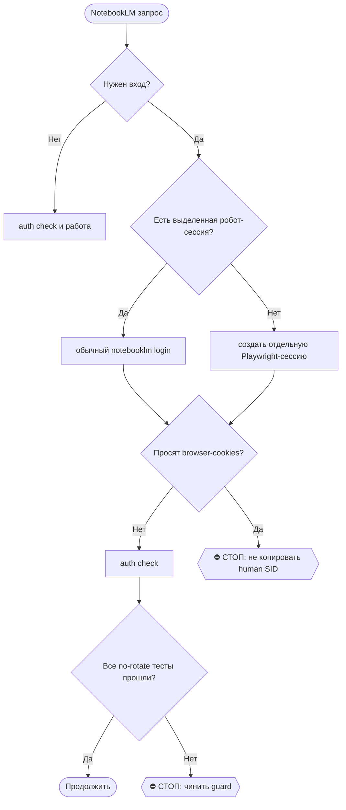
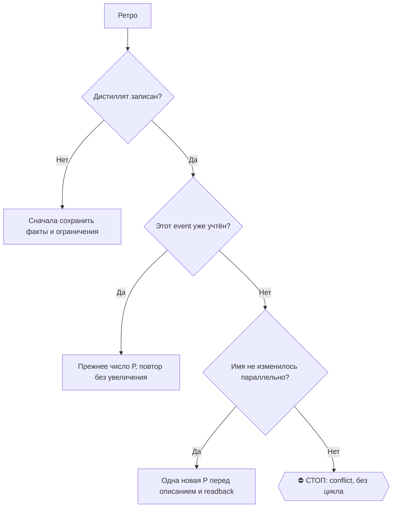

# 2026-10-29 · Нужно подготовить Илью Реткина к собеседованию в TAP Air Portugal на позицию пилота

_Full working session of an LLM coding agent, scrubbed by rule (names kept as stable pseudonyms; surnames, e-mails, phones, street addresses and ages replaced by [ФАМИЛИЯ], [EMAIL], [ТЕЛЕФОН], [АДРЕС], [ВОЗРАСТ]; hosts and keys replaced). Row `s_2b8defbd` of the [dataset](https://huggingface.co/datasets/TonyDzi/agent-sessions)._

**User:**

Нужно подготовить Илью Реткина к собеседованию в TAP Air Portugal на позицию пилота.

Илья Реткин:
- инструктор по пилотированию fixed-wing в аэропорту Cascais;
- параллельно работает инструктором для студентов в Seven Air / Seven Airways;
- мечтает устроиться в TAP Air Portugal;
- его пригласили на собеседование в пятницу / 5 ноября;
- налёт около 2 500 часов;
- есть опыт instrument flying, piston engine, jet aircraft;
- потенциально готов к переходу на Airbus;
- его главный риск — русский паспорт, так как он считает, что TAP якобы не нанимает граждан РФ, но сам факт приглашения на интервью означает, что шанс есть.

Задача:
1. Провести полный deep research по Илье Реткину:
   - кто он;
   - какой у него опыт;
   - что можно найти публично и через WhatsApp/контакты;
   - как лучше использовать его бэкграунд для подготовки к TAP.

2. Провести research по TAP Air Portugal:
   - какие интервью они проводят для пилотов;
   - как выглядит первое интервью;
   - какие бывают этапы отбора;
   - какие технические, поведенческие и HR-вопросы могут быть;
   - как они относятся к кандидатам с русским паспортом;
   - какие реальные шансы у Ильи с его профилем: Seven Air, инструктор, 2 500 часов, IFR, piston/jet experience.

3. Подготовить для Ильи 2–3 аудио/подкаст-брифинга, которые полностью готовят его к интервью:
   - поведенческое интервью;
   - техническое интервью;
   - мотивация и fit с TAP;
   - как объяснять русский паспорт и возможные ограничения;
   - как презентовать свой опыт инструктора и налёт;
   - какие сценарии развития интервью возможны;
   - какие ответы лучше подготовить заранее;
   - как говорить про переход на Airbus.

4. Сделать подготовку так же качественно, как подготовка к интервью для меня:
   - продумать структуру;
   - собрать сильные аргументы;
   - подготовить варианты ответов;
   - дать ему понятный план подготовки до интервью.

Использовать Claude и Codex совместно, сделать максимально качественно.
__Перевела: GPT-5.5 + whisper__

• • • • •

Нужно подготовить Илью Редкина к собеседованию в TAP Air Portugal на позицию пилота.

Контекст:
Илья Редкин — инструктор по пилотированию fixed wing в Cascais Airport, также работает инструктором для студентов в Seven Air. Его цель — устроиться в TAP Air Portugal. Его пригласили на собеседование в пятницу, 5 ноября.

Что нужно сделать:
1. Провести полный ресёрч/ADR по Илье Редкину:
   - кто он такой;
   - опыт, налёт, квалификации;
   - информация из доступных источников и WhatsApp, если есть доступ;
   - понять его сильные и слабые стороны для интервью.

2. Исследовать TAP Air Portugal:
   - какие интервью они проводят для пилотов;
   - как выглядит первый этап интервью;
   - какие бывают технические, поведенческие и HR-вопросы;
   - что важно для кандидата с профилем Ильи.

3. Оценить шансы Ильи:
   - опыт около 2500 часов налёта;
   - есть instrument flying;
   - опыт на piston engine и реактивных самолётах;
   - готовность к переходу на Airbus;
   - возможный риск: российский паспорт. Илья считает, что TAP не нанимает кандидатов с российским паспортом, но раз его пригласили на интервью, значит шанс есть.

4. Подготовить 2–3 подкаста для Ильи:
   - поведенческое интервью;
   - техническое интервью;
   - общая стратегия прохождения интервью в TAP;
   - возможные сценарии развития интервью;
   - как отвечать на сложные вопросы, включая вопрос про российский паспорт;
   - как правильно презентовать опыт инструктора Seven Air и общий налёт.

Нужно использовать подход подготовки к интервью, как для меня, но адаптировать полностью под Илью, авиацию и TAP. Сделать качественно, совместно с Claude и Codex.
__Перевела: GPT-5.5 + 11labs__

---

> `Skill` -- {"skill": "interview-prep", "args": "Илья Реткин/Редкин, пилот, TAP Air Portugal, интервью 5 ноября; подготовка для другого человека (не оператора)"}

---

> `Bash` -- {"command": "cd /e/Obsidian/_imports 2>/dev/null; date; python -c \"import datetime;d=datetime.date(2026,11,5);print(d.strftime('%A'));import calendar;print([ (x, datetime.date(2026,11,x).strftime('%a')) for x in range(1,8)])\"; timeout 90 python brain_ask.py \"Илья Реткин пилот TAP Air Portugal Sev

---

**User:**

Base directory for this skill: C:\Users\dev\.claude\skills\interview-prep

# /interview-prep — шпаргалка и питч к собеседованию

> 🧒 Доклад оператору кончается блоком «Простыми словами» ([[eli5-always]]). Файл шпаргалки — без ELI5, это рабочий документ.

**Родился 14.09.2026** из живого прогона: Lambda (Senior SE, рекрутер) и Nango (Founding DevRel, CTO) на 15.09.
Эталон выхода: `$OBSIDIAN_VAULT/04-Projects/Pipe-A-Batches/interview-prep-2026-09-15-lambda-nango.md`.

**Место в трубе найма:** `/apply` (подали) → `/job-inbox` (ответ пойман, записались в их календарь) → **`/interview-prep`** → `/fa`.

**Граница с соседом:** `/call-prep` = «кто этот человек» по брони лида (Calendly → CRM). Этот = работодатель:
компания + роль + как оператору продать себя. Работает для любого агента: всё ниже — `gh`, `curl`, наши скрипты;
строки «нужен Claude» помечены.

## ⛔ Закон домена «трудоустройство» (dev 14.09, голосом)
В поиске работы **Майкрофта нигде не упоминаем**: ни в анкетах, ни в письмах рекрутёрам, ни в подтверждениях,
ни в фоллоуапах. Всё пишется от первого лица оператора. Причина: работу делаем вместе, а фраза «анкету заполнил ИИ»
читается как «кандидат не соизволил сам» — это невежливо. Действует, пока оператор не отменит.
Если собеседник ПРЯМО спросит «это писал бот?» — не отрицаем, отвечает оператор. Канон: [[job-search-no-mycroft-disclosure]].

## Шаг 0. Встречи ещё нет → бронирую САМ (dev 16.09)
Письмо «дай 3–4 окна» или ссылка на запись, а брони ещё нет → не ждать оператора. Слоты из календаря a@ по приоритетам
**местного времени оператора — Лиссабон (в поездке город по календарю), НЕ PT**: ① свободно 7–21 → ② свободно 6–22 → ③ 6–22 поверх событий → ④ любое.
⭐ И обязательно слот в **07:00–22:00 у людей компании** (LA/SF для Калифорнии): 6 утра у интервьюера ⛔ (16.09, пятница Lambda 6:00 PT — «все спят»). Рекрутёр прислал окна интервьюера: оператор в сессии → варианты таблицей, выбирает он; нет/молчит → выбираю сам (dev 17.09). Процедура формы — `/job-inbox` Шаг 2.3.
Канон: `reglament-sobesedovaniya-broniruyu-sam-po-prioritetam-slotov`. Шпаргалку готовить параллельно, не после подтверждения.

## Шаг 0-бис. Подтверждение = старт ПОЛНОГО ПАКЕТА, без просьбы оператора (dev 09.10, голосом)
Бронь стала `scheduled` → в тот же заход запускаем весь пакет: Шаги 1–6 (шпаргалка) · Шаг 7 (GitHub) ·
Шаг 6-бис (сценарий по главам + роли интервьюера) · Шаг 8-бис (серия 6–10 подкастов). Не ждём «подготовь меня».
Запуск из `/job-inbox` 2.5 или сторожем: `python $IMPORTS_ROOT/jobs-watch/interview_pack_guard.py --spawn`
(каждое `scheduled` без отметки `pack:` → сид в очередь видимых сессий). Закрытие: дописать
`pack:<ссылка на блокнот NotebookLM>` в `answer` строки jobs.db на ХАБЕ, только после доставки серии.
Канон: `reglament-sobesedovanie-podtverzhdeno-srazu-polnyy-paket-podgotovki`.

## Шаг 1. Встреча — из брони, не по памяти
- Письмо-приглашение и подтверждение в ящике a@: `cd ~/CLAUDE-Mac-2019/gmail && python3 gmail_check.py search "<компания> (interview OR invitation OR confirmed)" --label a --max 10 --json` (на Windows-узлах — `$USERPROFILE/!CLAUDE-NODE-0X May26/gmail`).
- Достать: дата и время **в поясе компании**, длительность, Meet-ссылка, имя и роль интервьюера, просьбы («confirm receipt» → ответить САМОМУ в тред: `gmail_reply.py a <id> "<текст>"`).
- ⚠️ Тема Google-приглашения показывает пояс календаря оператора (14.09 стоял Брисбен) — время брать из тела письма Ashby/рекрутёра.

## Шаг 2. Текст вакансии — первоисточник
- Ashby: `curl -s "https://api.ashbyhq.com/posting-api/job-board/<slug>?includeCompensation=true"` → найти job по id из URL заявки (jobs.db `ats_jobs.url` на хабе).
- Greenhouse: `https://boards-api.greenhouse.io/v1/boards/<slug>/jobs/<id>`; Lever: `https://api.lever.co/v0/postings/<slug>/<id>`.
- Выписать: миссия · что делать · требования (обязательные / nice to have) · локация и онсайт · вилка денег.

## Шаг 3. Компания — только проверяемое
- Сайт (about / careers), YC-страница, для open source — `gh api repos/<org>/<repo>` (звёзды, язык, свежесть коммитов), CONTRIBUTING.md.
- Каждый факт с источником; вспомнил, но не проверил → пометка 🤔 «проверь до звонка». Имена фаундеров не угадываем.
- Интервьюер: роль (рекрутёр / хайринг-менеджер / фаундер) определяет, о чём звонок. Фаундер из письма — одним веб-поиском.

### Apollo (пилот до 23.11.2026)
- Когда: в Шаге 3, после сайта, YC и `gh`, до сверки с CV. Это дополнительный источник: веб-поиск и `gh` остаются.
- Компания: `apollo_organizations_lookup` (бесплатно, id) → `apollo_organizations_enrich` (1 кредит: штат, раунды и деньги, стек). Стек и рост штата подсказывают вопросы к звонку.
- Соседние вакансии: сперва бесплатный борд ATS из Шага 2 (Ashby `job-board/<slug>`, Greenhouse `boards/<slug>/jobs`, Lever `postings/<slug>`). `apollo_organizations_job_postings` (1 кредит) берём только если публичного борда нет.
- Интервьюер и фаундер из письма: `apollo_people_match` (1 кредит: должность, стаж, LinkedIn) вместо гадания по имени. Совпадение имени ≠ тот же человек: сверяем компанию и роль, иначе ставим 🤔.
- Шаг 5-бис (бывшие сотрудники): кандидатов берём, как и раньше, из экспортов, истории коммитов, X и чатов. Каждого прогоняем через `apollo_people_match`: текущий работодатель уже другой → уход подтверждён, видно, куда ушёл и ушла ли когорта одной команды. `apollo_mixed_people_api_search` по организации и отделу (бесплатно) показывает НЫНЕШНИЙ состав, а значит и то, кого из прежних имён уже нет.
- Бюджет: около 2–6 кредитов на собеседование, в мега-сид режиме Шага 5-бис до 10. В шпаргалку идут только роль и профессиональный след с пометкой «Apollo». Почты и телефоны из ответа не переносим никуда: ни в шпаргалку, ни в волт, ни в подкаст, ни в ledger (§0.15).
- После каждого вызова: `python ~/.claude/scripts/apollo_ledger.py log --skill interview-prep --action <инструмент> --credits <N> --outcome found|miss|error --value "<Имя, Компания>"`. В `--value` только имя и компания. Когда звонок состоялся, допиши ту же строку с `--outcome interview` (это делает `/interview-debrief` или сама подготовка после звонка).
- ⛔ Через Apollo нельзя: sequences, emailer_*, create_contacts/accounts, reveal телефона, waterfall, линковка ящика. Бывшим сотрудникам пишем только нашими дверями. Ответ `API_INACCESSIBLE` или Free plan → `outcome=error`, оператору одна строка «переподключи Apollo в claude.ai на аккаунт TD», дальше работаем по веб-поиску.

## Шаг 3-бис. Скоркарта интервьюера (зеркало, 19.10)
До сверки с CV строим план интервьюера этой роли скиллом `/interviewer-scorecard` (компетенции с весами из текста вакансии, вопросы, рубрика 1–4) и судим по нему именно тот CV, что ушёл в заявку (`jobs-watch/position_check.py <url>` называет файл). Компетенции с баллом 1–2 = главные вопросы шпаргалки Шага 6, к каждой готовим честный эпизод или честное «не делал». Вилка роли и торг = `/comp-analysis`.

## Шаг 4. Честная сверка с CV
- Мастер: `$OBSIDIAN_VAULT/05-Resources/External-Mirror/resume.json`.
- Таблица «требование → что есть у оператора → ✅ / ⚠️ / ❌». Дыры называем прямо и готовим честный ответ + мост к соседней роли. Выдумать опыт = провал.

## Шаг 5. Доказательства — каждое сверить живьём
- Вклады: `gh search prs --author tonydzi --merged --limit 60 --json repository,title,closedAt`.
- Любую ссылку, которую оператор произнесёт, проверить: `gh api repos/<o>/<r>/pulls/<n> --jq '{state,merged}'`. Открытый чужой PR, где было наше ревью = «reviewed», не «fixed» (случай google/adk-python#6957, 14.09).
- Выбрать 3–5 доказательств под ЭТУ роль, а не весь список.

## Шаг 5-бис. Мега-сид компания: обратная проверка рекомендаций (ДР 05.10.2026)
Включается, когда работодатель — компания 2025–2026 года рождения с мега-раундом (Prometheus, AMI Labs, Ineffable, Humans&, Reflection, Thinking Machines, Snorkel, Periodic, Lila, Xaira, SSI). Источник: Deep Research «перекачанные деньгами ИИ-компании», вложение голосовой 001 от 05.10.

**Почему шаг нужен.** У таких компаний корпуса отзывов бывших сотрудников физически ещё НЕТ: пара анонимных сообщений на Glassdoor при таком N создаёт иллюзию информации, а не информацию. ⛔ Отсутствие негатива читать как хороший знак НЕЛЬЗЯ — компании слишком новые. Замена метрики: **доля основателей и первых сотрудников, уцелевших за 12–18 месяцев**.

**Что ДР уже даёт как улику (можно нести в разговор, это публичные факты):** у Thinking Machines из 42 founding members ушли около 13, включая трёх co-founders, многие — около годового vesting cliff, при росте компании до 150+; Lilian Weng после ухода публично говорила, что за предыдущие семь месяцев болела больше, чем когда-либо прежде. У SSI в 2025 ушёл со-основатель и CEO Daniel Gross (его забрала Meta), и для компании, чья оценка почти целиком — ставка на небольшое число людей, это материальный key-person risk. ⛔ Это НЕ вывод «культура токсичная»: рынок frontier-talent сам по себе агрессивен. Это причина задавать прямые вопросы, а не обходить тему.

**Кого искать (3–5 человек):** (1) был в LinkedIn-headcount компании несколько месяцев назад и уже ушёл; (2) работал НЕПОСРЕДСТВЕННО с этим нанимающим менеджером; (3) ⛔ НЕ из тех, кого рекрутёр предложил сам как reference. ⚠️ У нас LinkedIn забанен ([[linkedin-unban-siege]]), поэтому ход идёт через восстановленные экспорты 32k контактов, GitHub-историю коммитов компании, X и общие чаты — а не через поиск по LinkedIn.

**Что спрашивать (вместо «ну как культура?»):** почему ты реально ушёл · кто ещё ушёл одновременно с тобой · насколько часто менялась стратегия · какой процент работы выбрасывался · насколько основатель принимал решения лично · насколько реальные часы отличались от обещанных · что произошло с твоими опционами · пошёл бы ты туда снова по той же цене.

**Сигнал сильнее одиночного ухода — КОГОРТНЫЙ:** три человека одной команды уходят в течение восьми недель. Это читается как проблема, а «кто-то вернулся в Google» — нет.

⛔ Границы: собранное идёт в шпаргалку оператору и в карточку компании, НАРУЖУ ничего не уходит (не пересказываем чужие слова третьим лицам, §3.4 секреты и приватность). Вопрос про чьё-то здоровье в разговоре с бывшим сотрудником не задаём — публичный факт про Weng цитируем только как её собственное публичное высказывание.

## Шаг 6. Шпаргалка
Файл `$OBSIDIAN_VAULT/04-Projects/Pipe-A-Batches/interview-prep-<дата-звонка>-<компании>.md`, по компании:
1. Когда (пояс компании + Лиссабон) · Meet · с кем · длительность.
2. Компания в 3 строках.
3. Сверка требований (Шаг 4).
4. **Питч на английском, полным текстом**, произносимый: 45 с для 15-минутного звонка, 60 с для 30-минутного. Приветствие по имени, короткие фразы, абзацы. Для фаундера — конкретная идея «что сделаю в первые 30 дней»; для рекрутёра — мотивация, логистика, виза.
5. Вероятные вопросы с ответами (Why us · слабое место · онсайт · деньги: вилка из вакансии, первым число не называть · виза: O-1 active + EU passport, sponsorship not required · другие процессы — правда без имён).
5-бис. **Банк behavioral-историй: 5 успехов + 5 провалов** (dev 21.09, голосом, под Lambda STEP 02). Этап hiring manager почти везде объявлен как «projects, work style, team dynamics» — то есть поведенческий, а не технический. Каждая история несёт: английский текст целиком · на чём акцент · сколько секунд · какую проблему решал · результат · для провала «чему научился + как изменил подход». Провалов пишем СТОЛЬКО ЖЕ, сколько успехов: один провал-заглушка = половина подготовки. Сажать на реальный опыт, выдуманные детали помечать ⚠️ прямо в тексте. Перед выдачей — прогон чужой рельсой на красные флаги (свалил вину · запретная для компании тема · чисто коммерческий провал · урок без письменного следа). Эталон: `04-Projects/Pipe-A-Batches/lambda-behavioral-10-stories-2026-09-21.md`.
5-тер. **Сценарий звонка по главам** (dev 09.10): длительность из брони → главы с минутами (знакомство · о себе · разбор опыта · их вопросы · тех/кейс · наши вопросы · следующий шаг) → сколько вопросов влезает в главу → сколько ответов готовить. 15-минутный скрин ≈ 4–6 вопросов, 45 минут ≈ 10–14.
5-кватер. **Роли интервьюера** (dev 09.10): адвокат · нападающий/скептик · технарь-проверяющий · культурный фильтр · продавец компании · переговорщик. Вес ролей по типу звонка (рекрутёр: переговорщик+продавец; хайринг-менеджер: технарь+культурный; фаундер: нападающий+продавец). На каждую роль 3–5 вопросов, у каждого **правильный ответ** полным английским текстом и **ловушка** (неправильный ответ, который хочется дать, и почему он валит). Дыра закрывается признанием + мостом, легенда ⛔.
6. 2–4 своих вопроса.
7. Логистика и «после звонка» → `/interview-debrief` в тот же день (расшифровка из screenpipe хаба → фоллоуап в тред от первого лица оператора, без Майкрофта → статус jobs.db).
8-бис. Урок в машину: после шпаргалки эпизоды по дырам ❌/⚠️ через `/teach-podcast` (dev 17.09: «чтобы утром в мозге было много нового»). ⭐ **20.09, голосом: по найму подкаст делается БЕЗ ВОПРОСА оператору** («это делаем однозначно и без вопросов»), и под целое собеседование берём **3–5 эпизодов**, а не один: один звонок = несколько дыр сверки, каждая тянет свой эпизод. Спросить разрешение = нарушить правило; отдать один эпизод на незнакомую компанию = исполнить его на четверть. Канон: `reglament-uchim-antona-podkastom-na-notebooklm`, CLAUDE.md §9.13.
   ⭐ **09.10, голосом: серия = 6–10 эпизодов, «20 не нужно»**, через `/teach-podcast` (ЗАКОН 0, ссылкой на блокнот). Состав: компания и с чем её едят · роль и первый месяц · кто интервьюер (роль + публичный проф. след, **имя в источники ⛔**, YouTube ⛔) · сценарий звонка по главам (5-тер) · по эпизоду на 1–2 роли из 5-кватер (вопрос → правильный ответ → ловушка) · дыры ❌/⚠️ · наш PR из Шага 7 одной фразой. После доставки: `pack:<ссылка>` в jobs.db (Шаг 0-бис).
8. ⛔ Факт о себе — тоже claim: «I use X API myself» только при живом доказательстве (ключ, аккаунт, вызов). 15.09 чуть не ушло в питч Lambda при PR без ключа. Питч — простой английский, короткие фразы (оператор: «like I'm five»).

## Шаг 7 (ОБЯЗАТЕЛЬНЫЙ, dev 15.09). Коммит в GitHub работодателя до звонка
Правило: **перед каждым собеседованием идём в GitHub работодателя, ищем, где у нас есть экспертиза, и коммитим**.
Прийти к интервьюеру с открытым PR в его репо = доказательство, а не резюме. Эталон 14.09: к звонку с CTO Nango —
NangoHQ/nango#7532 (OpenRouter) и #7533 (Lambda Cloud, заодно тема для звонка с Lambda в тот же день).

⭐ Голова старта (15.09, `pipe-a-github-bridge-daily`): компания уже в статусе scheduled/next-stage/
interview → загляни в `04-Projects\Pipe-A-Batches\github-audition-queue.md` ПЕРЕД Шагом 1 -- рутина
уже резолвила GitHub-org ежедневно, без брони звонка. ⚪/нет строки → это НЕ «дверей нет», просто
рутина ещё не дошла или org не резолвится по имени -- Шаг 1 всё равно обязателен руками.

1. **Найти репо:** `gh search repos org:<org> --sort stars --limit 10` (org = имя компании; нет — сайт → footer → GitHub). Нет публичного кода → вердикт «⚪ двери нет: <где искал>», дальше Шаг 8.
2. **Прочитать CONTRIBUTING.md и AGENTS.md целиком** — какие внешние PR они реально смотрят. Nango: только новые API и приватные security-фиксы; баг-фиксы от внешних не ревьюят. Не принимают наш жанр → не шлём.
3. **Замер очереди:** доля смерженных внешних PR — `gh api "repos/<o>/<r>/pulls?state=closed&per_page=100" --jq 'group_by(.author_association)|map({a:.[0].author_association,total:length,merged:(map(select(.merged_at!=null))|length)})'`. Глухая очередь → только качественный issue с воспроизведением (жанр #7266 у Nango: отчёт прогоном → их фикс за 2 дня).
4. **Матч с нашей экспертизой** (порядок): то, чем пользуемся сами (API/SDK из нашего стека) · MCP/OAuth/agents · «документация врёт — пример не собирается» · тесты, которые никогда не краснели · связь со второй компанией того же дня. Сотрудники уже делают этот issue → не лезем.
5. **Дубли с охватом:** файлы/каталог в репо + issues и PR (все статусы, заголовок И текст) + ветки + их публичный каталог/доки. Докладывать «не нашёл в <перечень>», не «этого у них нет».
6. **Сборка = фоновый агент** (не держим контекст сессии): форма по их смерженному эталонному PR, их генераторы и валидаторы, красная проверка (сломать → увидеть падение), живой вызов API если есть ключ (ключ не печатать), leak-scan, трейлеры, подпись `— [ИМЯ] [ФАМИЛИЯ] · github.com/tonydzi` в теле PR, без Майкрофта. Ключ ищем `cred_hunt.py` на хабе, не «ключа нет» после одного места. **CLA/DCO подписывает исполнитель САМ любым способом проекта (коммент, cla-assistant через GitHub-вход в Chrome, EasyCLA) — «стоп и спроси оператора» в брифе ⛔** ([[reglament-podpisi-i-nastroyki-akkaunta-delayu-sam-ne-sprashivayu]]).
7. **После:** `pr_watch.py --add`; в шпаргалку — ссылки и ОДНА фраза для интервьюера. В питч PR попадает **только если он реально открыт**. Не успели до звонка → фраза «I'm preparing a PR for X» ⛔ (обещание без факта).
8. Вердикт шага: 🟢 PR открыт · 🟡 issue с воспроизведением · ⚪ двери нет (где искал) · ⛔ не принимают внешних.

## Шаг 8. Доставка и вердикт
- SendUserFile с файлом шпаргалки; в чат — главное по каждой компании и оба питча полным текстом.
- jobs.db на хабе: статус `scheduled` уже стоит; после звонка → `/interview-debrief` ставит `next-stage` / `rejected`.
- Вердикт о скилле одной строкой: 🔧 обновляю / 📝 не сейчас / ✅ не надо — с причиной.

## Потребители
- оператор: `/interview-prep <компания>` перед любым собеседованием.
- Рутины `pipe-a-inbox-watch-NODE-0X` (NODE-0X) и `pipe-a-inbox-watch` (хаб): после перевода собеседования в `scheduled` запускают этот скилл и присылают шпаргалку.
- Сторож `interview_pack_guard.py --spawn` (09.10): бэкстоп, если `/job-inbox` 2.5 забыл поставить сид пакета.


## 📍 Места и адреса

Любое место, адрес или точку встречи даю оператору со ссылкой Google Maps по рецепту `/geo` (Библия, правило оператора 05.07.2025, повторено 28.10.2026).


ARGUMENTS: Илья Реткин/Редкин, пилот, TAP Air Portugal, интервью 5 ноября; подготовка для другого человека (не оператора)

---

> `Bash` -- {"command": "cd /e/Obsidian; timeout 60 grep -rIl -i -E \"ретк|редкин|retkin|redkin|rytkin|TAP Air\" Vault-Knowledge --include=*.md 2>/dev/null | head -30; echo ---; cd /e/Obsidian/_imports; timeout 120 python brain_ask.py \"Илья пилот инструктор Cascais Seven Air TAP\" 2>&1 | tail -40; echo rc=$?",

---

> `ToolSearch` -- {"query": "select:mcp__whatsapp__search_contacts,mcp__whatsapp2__search_contacts,mcp__whatsapp__list_messages,mcp__whatsapp2__list_messages,mcp__whatsapp__search_messages,mcp__whatsapp2__search_messages,mcp__telegram__search_contacts,WebSearch", "max_results": 10}

---

> `Bash` -- {"command": "cd /e/Obsidian; timeout 60 grep -rIl -i -E \"ретк|редкин|retkin|redkin|TAP Air\" Vault-Knowledge --include=*.md 2>/dev/null | head -30; echo ---; cd /e/Obsidian/_imports; timeout 120 python brain_ask.py \"Илья пилот инструктор Cascais Seven Air TAP\" > /tmp/ba.txt 2>&1; echo rc=$?; tail

---

> `mcp__whatsapp__search_contacts` -- {"query": "Илья"}

---

> `mcp__whatsapp2__search_contacts` -- {"query": "Ilya"}

---

> `mcp__whatsapp__search_messages` -- {"query": "TAP"}

---

> `mcp__whatsapp__search_messages` -- {"query": "Seven Air"}

---

> `mcp__whatsapp2__search_messages` -- {"query": "Seven Air"}

---

> `mcp__whatsapp__search_contacts` -- {"query": "Реткин"}

---

> `mcp__whatsapp__search_contacts` -- {"query": "пилот"}

---

> `mcp__telegram__search_contacts` -- {"query": "Реткин"}

---

> `mcp__whatsapp__search_messages` -- {"query": "пилот"}

---

> `mcp__whatsapp2__search_messages` -- {"query": "instructor"}

---

> `Read` -- {"file_path": "C:\\Users\\dev\\AppData\\Local\\Temp\\claude\\P---WORKDIR-HUB\\s_2b8defbd\\tasks\\bkvvvks23.output"}

---

> `Bash` -- {"command": "f=\"C:/Users/dev/.claude/projects/P---WORKDIR-HUB/s_2b8defbd/tool-results/mcp-whatsapp-search_messages-1793207156677.txt\"; python - \"$f\" <<'EOF'\nimport json,sys,re\nd=json.load(open(sys.argv[1],encoding='utf-8'))\nif isinstance(d,dict): d=d.g

---

> `mcp__whatsapp2__search_messages` -- {"query": "Illia"}

---

> `mcp__whatsapp__list_messages` -- {"jid": "id_615b4d99", "limit": 100}

---

> `Bash` -- {"command": "cat \"C:/Users/dev/AppData/Local/Temp/claude/P---WORKDIR-HUB/s_2b8defbd/tasks/bkvvvks23.output\" | head -50; echo ===; cat \"C:/Users/dev/.claude/projects/P---WORKDIR-HUB/memory/ilya-onboarding.md\" 2>/dev/null | head -40; ls /e/Ob

---

> `Bash` -- {"command": "cd ~/.claude/scripts; python llm_ask.py --help 2>&1 | head -40; python -c \"import json;d=json.load(open('../llm_routing.json',encoding='utf-8'));print(list(d.keys())[:20])\" 2>&1 | head", "description": "Check llm_ask usage"}

---

> `Write` -- {"file_path": "C:\\Users\\dev\\AppData\\Local\\Temp\\claude\\P---WORKDIR-HUB\\s_2b8defbd\\scratchpad\\codex_tech_prompt.md", "content": "You are a senior airline training captain and pilot-selection assessor (EASA, Airbus A320 family type rating examiner back

---

> `Bash` -- {"command": "cd ~/.claude/scripts; S=\"C:/Users/dev/AppData/Local/Temp/claude/P---WORKDIR-HUB/s_2b8defbd/scratchpad\"; python rail_plan.py declare --self \"оркестрация, синтез шпаргалки, ответы на паспорт/мотивацию, сборка NotebookLM\" --outsource \"second_op

---

> `Agent` -- {"description": "Research TAP pilot recruitment", "subagent_type": "general-purpose", "model": "sonnet", "prompt": "Web research task (read-only, do not contact anyone, do not submit forms). Today is 2026-10-28. Use WebSearch/WebFetch. Answer in Russian, with a source URL for every factual claim; ma

---

> `Agent` -- {"description": "Research Ilia Redkin public footprint", "subagent_type": "general-purpose", "model": "sonnet", "prompt": "Read-only professional-background research for interview preparation of a friend (he asked for help preparing for an airline interview). Today 2026-10-28. Use WebSearch/WebFetch

---

> `Skill` -- {"skill": "notebooklm"}

---

**User:**

Base directory for this skill: C:\Users\dev\.claude\skills\notebooklm

# /notebooklm — audio/artifact layer over the Second Brain

Machine: HUB-01 (Хаб) · Agent: Codex · Operator: dev · 2026-10-18

> 🧒 When reporting to dev end with a child-simple "Простыми словами" recap. (memory `eli5-always`)

## ⛔⛔ ЗАКОН 0 — ЛЮБОЕ АУДИО ДЕЛАЕТСЯ ЗДЕСЬ (dev 08.10.2026, дословно)

«**если я прошу подкаст или любое АУДИО — ты всегда делаешь в НОУТБУКЛМ**» · «**но скачивать ничего не надо, я слушаю с НОУТБУКЛМ**».

1. **Исполнитель один.** Просьба про подкаст · аудио · озвучку · «начитай» · «переозвучь» · «переведи подкаст» · «послушать в машине» → только эта рельса. ⛔ Свой синтез речи (edge-tts, ElevenLabs API, SAPI, любой локальный TTS) = **подмена заказа**, даже если звук безупречен: у аудио есть дом, и артефакт вне дома для оператора не существует.
2. ⛔ **НАЗВАННЫЙ оператором ДВИЖОК — НЕ РАЗРЕШЕНИЕ ДЕЛАТЬ МИМО.** Он перечисляет варианты вслух («можно через ElevenLabs», «текстом или голосом») как **варианты формата**, а не как выбор рельсы. Прочитать это как «разрешено собрать свою трубу» — ровно та ошибка, что породила ЗАКОН 0. Хочешь иной движок → спроси одной строкой, не решай сам.
3. **Доставка = ССЫЛКА на блокнот** `https://notebooklm.google.com/notebook/<id>`. Карточка файла в чате и путь в волте доставкой **НЕ являются**. ⛔ Скачивание в волт по умолчанию не делается — только по отдельной просьбе или когда файл нужен прибору (например [[youtube-publish]]).

⭐ **Аудио на дисках НЕ храним** (dev 13.10.2026, диета диска): `.m4a/.mp3/.wav` живут в облаке NotebookLM. В волт ложится только ТЕКСТ (расшифровка) → эссенция (`/podcast-essence`). Скачанный ради расшифровки звук: whisper → `.transcript.txt` → эссенция → звук удалить. На ноутах папка `05-Resources/NotebookLM/artifacts/audio` в `.stignore`; остаток держит только хаб до расшифровки.

4. **Расшарить сразу после `create`**, не дожидаясь просьбы: владелец рельсы `a2@`, а слушает оператор под личным `a@` → `"$NB" share add [EMAIL] --permission editor -n <id>`. Проверить: `share status -n <id>`.
5. **Законы генерации живут в соседнем файле.** Два языка как дефолт, `--length long`, уточняющие вопросы в промпте, сверка `artifact list` до вердикта, замер «RU long втрое короче EN» — всё это в [[teach-podcast]] §Законы. ⚠️ Открыл этот скилл и не открыл тот → половина правил мимо (замер 08.10: так и вышло, сессия объявила «шага share в скилле нет», тогда как он стоял в `/teach-podcast` строкой 239).

6. ⭐ **КАРВ-АУТ 08.10 ВЕЧЕРОМ — ВИДЕО НАРУЖУ: ЛЮБЫЕ ДВИЖКИ** (решение оператора, дословно «для видео контента наружу можно использовать любые ллм и продукты»). Граница проходит по НОСИТЕЛЮ, а не по движку: **видео** наружу (визитка, говорящий аватар, ролик, озвучка видео) — ElevenLabs, HeyGen и что угодно ещё; **аудио для оператора** — по-прежнему только здесь. ⛔ Карв-аут НЕ расширяется с видео на звук: «вытащи дорожку и выложи подкастом» — это снова аудио и снова NotebookLM. Повод: задача `auto-hub-260806-record-application-video`, где аватара NotebookLM не умеет в принципе, то есть закон этот случай не покрывал. ⚠️ Открытым остаётся раскрытие: аватар с лицом и голосом оператора в холодном контуре — артефакт его личности, строку раскрытия (§3.3) утверждает он. ⚙️ **Дверь карв-аута:** `audio_engine_gate.py` знает о нём и пропускает команду с маркером `# video-outward-ok: <что за видео>`; в счётчике это отдельная причина `BYPASS-VIDEO`, не смешанная с инженерным обходом `# audio-engine-ok:`. ⛔ Носитель дверь проверить НЕ может — она видит команду, а не то, уедет ли звук в видео; поэтому граница держится на ОТСУТСТВИИ маркера, а ложная декларация «видео» на звуковой работе остаётся осознанным нарушением и видна в счётчике поимённо. Канон: регламент §КАРВ-АУТ 08.10 ВЕЧЕРОМ.

⚠️ **Рельса недоступна** (упала авторизация · выбрана суточная квота · лёг CLI) → говорится **вслух одной строкой с причиной**, и только тогда обсуждается замена. Молча подменить движок нельзя.

Канон: `reglament-lyuboe-audio-i-podkast-delaem-v-notebooklm` · память [[audio-always-in-notebooklm]].

NotebookLM = the **artifact/explanation layer** (Audio Overview, study guide, mind map, reports) over the vault — NOT memory or RAG (that stays Obsidian + e5/rerank + SQLite). Flow: `vault → Claude Code curates a NARROW packet → NotebookLM → artifacts back into vault as Derived`. Full state = memory [[notebooklm-integration]].

## Rail = CLI (verified 2026-10-18, ADOPT — H16)
Programmatic CLI `teng-lin/notebooklm-py` (17k⭐, MIT). No Chrome window, no DOM, no truncation. Works on dev's consumer `a2@` PRO (no Enterprise API).
- **CLI binary:** `C:\Users\dev\notebooklm-cli\venv\Scripts\notebooklm.exe` (venv, v0.7.3). Set `NB="C:\Users\dev\notebooklm-cli\venv\Scripts\notebooklm.exe"`.
- **Auth:** только выделенная робот-сессия NotebookLM. Запускать `"$NB" login` без `--browser-cookies`, пройти Google-вход в отдельном Playwright Chromium и сохранить `C:\Users\dev\.notebooklm\profiles\default\storage_state.json` для `[EMAIL]`. Затем `"$NB" auth check`.
- ⛔ **Не импортировать живую сессию человека.** `login --browser-cookies firefox|chrome|edge` и прямой экспорт через `firefox_cookies.py` копируют SID человека в робота. На хабе это дважды привело к серверному разлогину Google после `RotateCookies`. Venv блокирует только CLI-флаг `--browser-cookies`; системный `firefox_cookies.py --export` технически не заблокирован и потому тоже запрещён этой инструкцией. Переменная `NOTEBOOKLM_ALLOW_HUMAN_COOKIE_EXPORT=1` существует только для отдельного расследования с явным решением, не как fallback.
- **401/auth failure:** сначала `"$NB" auth check`, затем обычный `"$NB" login` в выделенную робот-сессию. Не лечить 401 копированием cookie из Firefox/Chrome.
- **Защита от ротации:** venv `sitecustomize.py` по умолчанию блокирует Python/httpx-вызовы к `https://accounts.google.com/RotateCookies` на слоях `send`, redirect и transport, синхронно и асинхронно. Явное снятие - `NOTEBOOKLM_ALLOW_KEEPALIVE_POKE=1`, процесс печатает WARNING. Guard не покрывает Chromium внутри отдельного login, другой HTTP-клиент, иной Google-host, запуск `python -S` и чужой `sitecustomize`, стоящий раньше в `sys.path`. `sitecustomize.py` не принадлежит wheel пакета, но после любого обновления всё равно обязательны no-rotate тесты; пересоздание venv удаляет guard. После rebuild отсутствие guard обязано уронить `_test_teach_backlog_no_rotate.py`; затем восстановить `sitecustomize.py` из проверенного бэкапа/установщика. Если сломанный импорт `httpx` блокирует обычный запуск, ремонтная дверь: `venv\Scripts\python.exe -S -m pip install --force-reinstall httpx`.
- **Версия:** production остаётся на 0.7.3. 0.8.5 не установлена; любое обновление закрывается только после no-rotate приёмки на точном кандидате.
- **Anti-abuse:** run from the hub (residential IP), **no VPN**.

## 🌳 Дерево решений



## ⛔ Три дефолта генерации (приказ оператора 21.09.2026, голосом, tg:chat_REDACTED)
Действуют на ЛЮБОЙ артефакт с выбором длины/языка, не только на учебные подкасты:
1. **Длина всегда максимальная** — `--length long`. Дословно: «всегда выбирать максимальную длину
   результата». Короче — только по прямому слову оператора, и причина пишется в доклад.
2. **Два языка** — `--language ru` и `--language en`, вторым прогоном на ТОМ ЖЕ блокноте и ТОЛЬКО
   после скачивания первого (параллельные генерации ломают поллер CLI — см. /teach-podcast Шаг 5).
   Дословно: «делать это и на русском, и на английском».
3. **Уточняющие вопросы в промпте обязательны** — блок «задавайте друг другу вопросы умного новичка
   и сразу отвечайте» + блок «опирайтесь на источники, называйте, откуда факт». Дословно: «при
   генерации аудио/видео добавлять уточняющие вопросы/комментарии, чтобы NotebookLM дал более
   точный ответ». Образец: `05-Resources/NotebookLM/_packets/teach-2026-09-21-pytorch-tensorflow-v2.prompt.txt`.
4. **Источников 10-15+**, наш пакет считается за один; один источник = NotebookLM пересказывает нас
   самих. Пул URL проверять живым кодом 200 перед `source add`; добор — `source add-research "<query>"
   --import-all --cited-only --timeout 1800`.
Канон: [[teach-dev-by-podcast-default]], CLAUDE.md §9.13, скилл `/teach-podcast` Закон 2 + Шаг 3.

## digest (default) — vault → audio
1. **RECALL + curate a NARROW packet** ([[vault-data-architecture]]): `brain_ask.py`/`/ask` + grep to pull ONLY the relevant slice. Write it to a clean `.txt`/`.md` packet.
2. **Create + add source + generate (CLI):**
   ```bash
   NB="C:\\Users\\dev\\notebooklm-cli\\venv\\Scripts\\notebooklm.exe"
   "$NB" create "<Title>" --use                       # --use sets current context (don't parse --json 'id' — key differs)
   "$NB" source add "<packet.md>" --type file          # uses current context; or --type text "<inline>", or a URL. Wait for Status=ready.
   "$NB" generate audio --prompt-file <prompt.txt> --length long --language ru --wait --timeout 1800   # длина ВСЕГДА long; потом тот же прогон с --language en
   ```
   Other artifacts: `generate mind-map | report | flashcards | quiz | slide-deck | video | data-table | infographic`.
3. **Pull artifacts back:** `"$NB" download audio "05-Resources\NotebookLM\artifacts\audio\<name>.mp3"` (current context; or `--all <dir>`, `-n <id>`). Non-audio: `artifact export`. Get the notebook id for the index: `NBID=$("$NB" list --json | python -c "import sys,json;print(json.load(sys.stdin)[0]['id'])")` (newest first).
4. **Index + link:** add the notebook/artifact to `05-Resources\NotebookLM\_NotebookLM-Index.md`; link the derived note back to its source concept(s). Backup before vault write ([[vault-backup-rule]]).

## pull — Phase B
Pull existing artifacts from the top notebooks into the vault as Derived notes: `"$NB" list` → `download ... --all` per notebook → index + link.

## Fallback — Chrome-autonomy (only if CLI breaks)
If Google rotates endpoints and the CLI errors (and a re-login doesn't fix it), drive the logged-in UI via Claude-in-Chrome ([[chrome-autonomy-self-drive]]) on `a2@`: Create notebook → Add sources → Studio → generate → **Download** menu (NOT DOM-scrape, truncates ~1000 chars). This was the old primary rail; kept as backstop.

## Safety
- CLI uses undocumented Google APIs (community project) — same ToS surface as driving the logged-in UI of the same account; low-med risk for personal volumes.
- Audio/video generation has a **daily quota** — don't burn it on test runs; add `--retry` + delays for batches.
- Stay on a2 PRO (free, included — [[prefer-included-limits-before-paid-api]]).

## Идея
Мост NotebookLM ↔ Claude Code (open-source CLI поверх реверс-инжиниренных протоколов) —
идея и сам CLI: **Teng Ling**, [@ClawRus/15773](https://t.me/ClawRus/15773), взято 2026-06-30.
Спасибо. Реестр кредита: `alpha_credit.py` id `5d18022c74e3` · [[credit-inspiration-sources]].

## Наружу: YouTube (приказ оператора 21.09.2026, голосом)
Сделанный артефакт не стыдно показать миру → **строка в** `05-Resources\NotebookLM\_youtube-queue.md`
(файл · заголовок RU · заголовок EN · описание · теги · статус `ждёт`), выгрузку делает
скилл **`/youtube-publish`** на канал `@tonydzz`. Дословно: «как только появляется новый
материал из NotebookLM, его нужно выкладывать на YouTube». Контракт односторонний: мы кладём,
он вычерпывает; строку забыли — эпизод подберёт свободный скан, но уже без человеческого
заголовка. ⛔ Наружу не идёт приватное (Закон 3 `/teach-podcast`): имена из переписки, письма,
вилки денег, CRM, секреты.

## Output
Notebook created/used · artifact type + where saved · index updated. Then 🧒 recap. Routine candidate: weekly "audio digest of my brain" — see /skill-gap and [[evaluate-recurring-into-routine]]. Decision: `02-Decisions\decision-notebooklm-claude-code-artifact-layer`.

---

> `Skill` -- {"skill": "teach-podcast"}

---

**User:**

Base directory for this skill: C:\Users\dev\.claude\skills\teach-podcast

# /teach-podcast — оператор учится в машине, я готовлю уроки

⭐ **Аудио на дисках НЕ храним** (dev 13.10.2026, диета диска): `.m4a/.mp3/.wav` живут в облаке NotebookLM. В волт ложится только ТЕКСТ (расшифровка) → эссенция (`/podcast-essence`). Скачанный ради расшифровки звук: whisper → `.transcript.txt` → эссенция → звук удалить. На ноутах папка `05-Resources/NotebookLM/artifacts/audio` в `.stignore`; остаток держит только хаб до расшифровки.


> 🧒 Доклад оператору кончается блоком «Простыми словами» ([[eli5-always]]). Пакеты и промпты — без ELI5, это сырьё для диктора.

**Родился 17.09.2026** из подкаста про Lambda (блокнот `e7b1d6e9`, a2@): оператор похвалил, сам догрузил контент и
попросил скилл, «к которому ты будешь часто возвращаться». Его слова: «Люди нужно быстро загрузить информацию
в мозг… когда я за рулём, мне идеально послушать такой подкаст… Твоя задача меня обучать, так же, как я обучаю
тебя… чтобы у меня в мозге утром бывало очень много нового контента».

**Что это:** обратная петля обучения. оператор учит меня голосовыми и ДР; я учу оператора подкастами. У него
30–40 минут в день в машине. Один эпизод = одна тема, которую он должен знать к ближайшему собеседованию.

**Граница с соседями:** `/notebooklm` = общий слой артефактов над волтом (любая тема, любой формат).
Этот скилл = **учебная программа + генерация урока + доставка + учёт**. Он зовёт ту же рельсу CLI.
`/interview-prep` = шпаргалка к конкретному звонку; отсюда берём дыры сверки (❌/⚠️) как темы уроков.

## ⛔ Законы
0. **ЛЮБОЕ АУДИО ДЕЛАЕТСЯ В NOTEBOOKLM** (dev 08.10.2026, дословно: «если я прошу подкаст или любое АУДИО — ты всегда делаешь в НОУТБУКЛМ»). ⛔ Свой синтез речи (edge-tts, ElevenLabs API, локальный TTS) = подмена заказа, даже при безупречном звуке. ⛔ **Названный оператором движок — не разрешение делать мимо:** он перечисляет «можно через ElevenLabs» как вариант формата, а не как выбор рельсы; хочешь иной движок → спроси одной строкой. **Доставка = ссылка на блокнот**, карточка файла в чате доставкой не считается; скачивание в волт — только по отдельной просьбе или для прибора вроде [[youtube-publish]]. Рельса недоступна → сказать вслух одной строкой с причиной, молчаливая подмена запрещена. Замер, породивший закон: 08.10 три эпизода собраны своей трубой (whisper → перевод → edge-tts), проверены и отданы файлами; ответ оператора — «я не вижу подкастов внутри notebooklm!!», «ты забыл про скилл ??????»; цена около двух часов в день, когда до звонка оставалось три. Канон: `reglament-lyuboe-audio-i-podkast-delaem-v-notebooklm` · память [[audio-always-in-notebooklm]].
6. ⭐ **КАРВ-АУТ 08.10 ВЕЧЕРОМ — ВИДЕО НАРУЖУ: ЛЮБЫЕ ДВИЖКИ** (решение оператора, дословно «для видео контента наружу можно использовать любые ллм и продукты»). Граница проходит по НОСИТЕЛЮ, а не по движку: **видео** наружу (визитка, говорящий аватар, ролик, озвучка видео) — ElevenLabs, HeyGen и что угодно ещё; **аудио для оператора** — по-прежнему только здесь. ⛔ Карв-аут НЕ расширяется с видео на звук: «вытащи дорожку и выложи подкастом» — это снова аудио и снова NotebookLM. Повод: задача `auto-hub-260806-record-application-video`, где аватара NotebookLM не умеет в принципе, то есть закон этот случай не покрывал. ⚠️ Открытым остаётся раскрытие: аватар с лицом и голосом оператора в холодном контуре — артефакт его личности, строку раскрытия (§3.3) утверждает он. ⚙️ **Дверь карв-аута:** `audio_engine_gate.py` знает о нём и пропускает команду с маркером `# video-outward-ok: <что за видео>`; в счётчике это отдельная причина `BYPASS-VIDEO`, не смешанная с инженерным обходом `# audio-engine-ok:`. ⛔ Носитель дверь проверить НЕ может — она видит команду, а не то, уедет ли звук в видео; поэтому граница держится на ОТСУТСТВИИ маркера, а ложная декларация «видео» на звуковой работе остаётся осознанным нарушением и видна в счётчике поимённо. Канон: регламент §КАРВ-АУТ 08.10 ВЕЧЕРОМ.

1. **Ученик — инженер-программист (Python/C++) с PhD, наёмный COO/CTO, английский не родной; тема урока ему часто новая.** ⛔ Слова «фаундер/founder/основатель» и «не инженер/не-кодер» про оператора запрещены каноном §3.3 (правка 19.10.2026, P68585: шаблон ниже 21 раз унёс «фаундер» в промпты ведущих). Каждый термин новой области объясняется бытовой аналогией
   в самом промпте ведущим. Жаргон без объяснения = брак урока.
2. **По умолчанию русский, формат deep-dive, длина long.** Короткий эпизод не заполняет дорогу.
   ⭐ **Поправка 20.09.2026 (оператор голосом, урок про Kubernetes): «на английском на русском языке» —**
   **английский эпизод законен и делается ПО ЗАПРОСУ, вторым прогоном на ТОМ ЖЕ блокноте.** Русский не
   отменён и остаётся дефолтом: язык без просьбы = ru. Механика: отдельный файл промпта `<слаг>.en.prompt.txt`
   (перевод, а не копия: ведущим по-английски), затем `generate audio --language en` с явным `-n <id>`
   блокнота, второй прогон запускать ТОЛЬКО после того, как первый скачан (две генерации разом на одном
   блокноте не проверялись). Файлы получают суффикс языка: `-ru.m4a` / `-en.m4a`. В учебный план и в
   YouTube-очередь идут ДВЕ строки, по одной на язык. ⚠️ Суточная квота аудио одна на оба эпизода.

   ⭐⭐ **ПОПРАВКА 21.09.2026 (оператор голосом, урок про PyTorch, tg:chat_REDACTED) — ТРИ ДЕФОЛТА ПЕРЕВЁРНУТЫ.**
   Дословно: «сделать в NotebookLM подкаст на английском и русском языке; максимальная длительность;
   всегда выбирать максимальную длину результата; при генерации аудио/видео добавлять уточняющие
   вопросы/комментарии, чтобы NotebookLM дал более точный ответ».
   (а) **ДВА ЯЗЫКА — ДЕФОЛТ, А НЕ ПРОСЬБА.** Эпизод считается сделанным только когда есть RU **и** EN.
   Поправка 20.09 «EN по запросу» этим ОТМЕНЕНА (`superseded_by` = эта строка). Один язык законен
   только с названной причиной (квота кончилась · оператор сказал «только русский»), и причина пишется
   в доклад; молчаливый один язык = урок сделан наполовину.
   (б) **ДЛИНА ВСЕГДА МАКСИМАЛЬНАЯ.** `--length long` не обсуждается ни для аудио, ни для видео, ни
   для любого будущего формата с выбором длины. Короче — только по прямому слову оператора.

   ⚠️⚠️ **НО `long` ПО-РУССКИ ВТРОЕ КОРОЧЕ, ЧЕМ ПО-АНГЛИЙСКИ — ЗАМЕР 06.10.2026, серия calm-room.**
   Десять эпизодов, один и тот же блокнот, одни и те же 40 источников, одинаковые промпты по
   структуре, у всех `--length long`, битрейт у всех ровно 257 кбит/с (то есть разница в размере
   файла = разница в ДЛИТЕЛЬНОСТИ, а не в качестве):

   | язык | эпизодов | длительность | в среднем |
   |---|---|---|---|
   | RU | 5 | 12,0 · 15,3 · 17,1 · 17,5 · 24,7 мин | **17,3 мин** |
   | EN | 5 | 46,4 · 46,7 · 49,0 · 53,4 · 59,1 мин | **50,9 мин** |

   Согласуется с прежним замером MAT-01 RU = 16 мин 16 с. То есть **`long` — не гарантия
   заполненной дороги**: у оператора в машине 30–40 минут, и русский эпизод закрывает половину.
   Практика из этого: (1) не докладывать «сделал длинный эпизод», а называть ФАКТИЧЕСКУЮ
   длительность; (2) если задача «занять дорогу», планировать ДВА русских эпизода на поездку,
   а не один; (3) 17 минут по-русски — это и есть потолок инструмента, упрекать промпт
   бессмысленно; (4) ⛔ не судить о длине по размеру файла без проверки битрейта — здесь он
   совпал, но это везение, а не правило.
   Прибор длительности — УЖЕ существующий `probe_episode.py`: он первой строкой печатает «<файл>: N МБ, M мин» (читает контейнер через `av`, ffprobe на хабе нет). Отдельного измерителя не делать, это был мой дубль 06.10 и он снят.
   (в) **УТОЧНЯЮЩИЕ ВОПРОСЫ В ПРОМПТЕ ОБЯЗАТЕЛЬНЫ.** В каждом промпте ведущим — блок «задавайте друг
   другу вопросы умного новичка и тут же отвечайте» + блок «опирайтесь на источники, называйте, откуда
   факт, расхождение источников произносите вслух». Промпт без этих двух блоков = брак урока.
   Образец обоих блоков: `_packets/teach-2026-09-21-pytorch-tensorflow-v2.prompt.txt` (хвост файла).
3. **Публичность по умолчанию.** Всё это потом уходит на YouTube оператора («всё является контентом»). Поэтому в
   пакет и в источники НЕ идут: имена рекрутёров и интервьюеров, письма, вилки денег из приватных писем, наши
   ответы на анкеты, CRM, секреты. Идут: публичные сайты, доки, вакансии, white papers, наш обобщённый разбор.
   Сомнение → в пакет не кладу, урок остаётся полезным и без этого.
4. **Тема = дыра, не тема = «интересно».** Урок закрывает то, чего оператор НЕ знает и что спросят. Источник дыр:
   таблица сверки в шпаргалке `/interview-prep` (❌/⚠️), вопросы интервью, семьи ролей из jobs.db.
5. **Цифры в пакете только доказанные.** Пакет — наш текст, он попадёт в уши оператора и потом в мир.
6. **Квота аудио суточная.** Тестовые прогоны не жгут её; проверка рельсы = `notebooklm list` (живая проба; `auth check` врёт `valid` при истёкшей сессии — замер 05.10.2026).
7. **⭐ ГЕЙТ «спрашивать или нет» (dev 20.09.2026, голосом).** Развилка ровно одна, и она по ТЕМЕ:
   **трудоустройство** (интервью · вакансия · компания · роль · оффер · переговоры о деньгах · техническая
   планка работодателя) → урок делается **САМ, БЕЗ ВОПРОСА оператору**, дословно «это делаем однозначно и без
   вопросов оператору»; **любое другое обучение** (инструмент, рынок, наука, быт, стройка) → **одна строка
   вопроса**, сказал «да» → делаю, дословно «можно спрашивать, если он согласился, делаем подкаст».
   Сомнение «это про найм или нет» → считать найм и делать молча. ⭐ **Объём под целое собеседование =
   3–5 эпизодов**, не один: его заказ 20.09 «сделай мне там 3-5 подкастов, которые меня на все вещи
   натренируют». Один эпизод на незнакомую компанию = правило исполнено на четверть.
   Канон: `reglament-uchim-antona-podkastom-na-notebooklm` + [[teach-dev-by-podcast-default]], CLAUDE.md §9.13.

8. ⭐⭐ **ЧЕТЫРЕ ЭПИЗОДА НА КАЖДЫЙ ТОПИК (dev 26.10.2026, голосом, standing).** Дословно: «теперь всегда, когда ты мне делаешь подкасты, делай два вида подкастов, и на русском, и на английском… один нормальный, инженерный… один как для идиотов… четыре файла». Тема = 4 эпизода: **RU-инженерный · RU-для-идиотов · EN-инженерный · EN-для-идиотов**. Вариант «для идиотов» (ELI5, «как пятилетке»): те же источники и тот же блокнот, отдельный промпт `<слаг>.<lang>.eli5.prompt.txt`: ведущим говорить как с пятилеткой, только бытовые аналогии, ноль жаргона без тут же данного объяснения, короткие фразы, повторять главное, в конце «что запомнить» тремя пунктами; факты и цифры те же, упрощается форма. Файлы `-ru.m4a`, `-ru-eli5.m4a`, `-en.m4a`, `-en-eli5.m4a`; в учебный план и YouTube-очередь четыре строки; в очередь `teach_backlog.py add` четыре задания (слаг с суффиксом). Один язык или один вариант законен только с названной причиной в докладе. Заголовок ELI5-эпизода помечает «для новичков». Это дополняет Закон 2(а), не отменяет.

## Рельса (проверено 17.09.2026 на NODE-0X; на хабе с 04.07)
- **NODE-0X:** `~/.local/bin/notebooklm` (uv tool, `notebooklm-py[browser,cookies]` 0.8.2, Python 3.12 внутри).
  Хаб: `C:/Users/dev/notebooklm-cli/venv/Scripts/notebooklm.exe`. Аккаунт **a2@** (NotebookLM PRO).
- **⭐ ЭПИЗОД НЕ ГОТОВ, ПОКА ЕГО НЕ ПОСЛУШАЛА МАШИНА** (введено 06.10.2026). Размер файла ничего не
  доказывает: аудио бывает на чужом языке, с дырой или обрывом, а под видом аудио приезжает HTML страницы
  логина. Приёмка: `D:/Vault/_imports/.venv-diar/Scripts/python.exe D:/Vault/_imports/teach/probe_episode.py
  <файл> --lang ru` — карта громкости по 12 точкам ловит дыры, faster-whisper large-v3 на GPU хаба слушает
  начало, середину и финал и сверяет язык. exit 0 = принято. Бесплатно и локально, 0 токенов, минута на эпизод.
  Тест прибора рядом: `_test_probe_episode.py`, 4/4. ⛔ Писать в статус «аудио не прослушано» больше незачем.
- **⚠️ СКАЧИВАНИЕ И ГЕНЕРАЦИЯ ЖИВУТ НА РАЗНЫХ ПРОФИЛЯХ** (замер 05.10.2026, хаб). `generate` и
  `artifact wait` идут под `-p dev-a2`, а `download audio` под тем же профилем падает
  `Authentication required for lh3.googleusercontent.com -- try notebooklm login`: в storage_state профиля
  нет куков домена `googleusercontent.com`, и `--include-domains` его не умеет (labels только youtube, docs,
  myaccount, mail, all). **Качать профилем `-p default`** — он отдал оба файла с первой попытки.
  ⛔ Не чинить это curl-ом по ссылке из ошибки: без куков lh3 отдаёт HTML страницы логина с кодом **200**,
  с куками Firefox — 403. Файл 944 КБ вместо 37 МБ = это HTML, а не короткий эпизод.
- **Флаги `wait` и `download` не такие, как кажется:** `artifact wait <ID>` берёт ID позиционно (⛔ `-a`),
  а `download audio [OUTPUT_PATH]` берёт путь позиционно (⛔ `-o`); `-a` у download — это выбор артефакта.
- **⚠️ `auth check` ВРЁТ: он читает локальный storage, а не живой ответ Google** (замер 05.10.2026, хаб:
  печатал `Authentication is valid`, при этом `generate audio` падал `CSRF token not found`, а `list` —
  `Authentication expired`). **Живая проба рельсы = `notebooklm -p <профиль> list` или `source list -n <id>`**,
  и только она даёт право говорить «рельса жива/мертва». Лечение то же: `login --browser-cookies firefox --all-accounts`.
- **Auth протухает раз в несколько недель.** `notebooklm auth check` красный →
  `notebooklm login --browser-cookies firefox --account [EMAIL]`
  (Firefox должен быть залогинен в a2@; на NODE-0X профиль `default-release`). CLI подхватил не тот профиль →
  `python3 ~/.claude/scripts/_shared/firefox_cookies.py --profile <папка профиля> --domain google.com --export ~/.notebooklm/profiles/default/storage_state.json`.
- **Фолбэк:** Chrome-MCP на `notebook.google.com` под a2@: Add sources → Websites (URL построчно) → Insert →
  Studio → Audio «>» → язык русский, промпт → Generate. Так был сделан Lambda-эпизод 16.09.
- ⚠️⚠️ **ЛИМИТ = СМЕНИ БАК, А НЕ ЖДИ СУТОК (приказ оператора 21.09.2026, голосом, tg:chat_REDACTED).** Дословно: «когда у нас кончаются лимиты dev.a2 в Gmail'е… Иди на другой аккаунт, на dev.a и генери там подкасты». С 02.09 у Google лимит «вычислительный» НА АККАУНТ, обновляется каждые 5 часов; CLI отвечает `RateLimitError … Audio generation rate limited by Google`. Прослушивание готового не лимитируется. **Аккаунт = бак; баков три, и они независимы:**
  | профиль CLI | почта | состояние 21.09 |
  |---|---|---|
  | `default` (= `dev-a2`) | [EMAIL], AI Pro | рабочий, в лимите с ~08:34 |
  | `dev` | [EMAIL] | **рабочий, проверен боем 21.09 12:15** |
  | `dev-a` | [EMAIL], AI Pro | **ЖИВОЙ с 21.09 15:33** — проверен боем, вытащил урок 16 RU, когда оба соседа были в лимите |
  ⛔ **Порядок работы: блокнот принадлежит создателю, поэтому чужой бак надо впустить ПРИ РОЖДЕНИИ
  блокнота, а не когда упёрся в лимит** (замер 06.10.2026, серия calm-room: 9 эпизодов прошли на a2,
  на 10-м a2 ушёл в лимит, и оба соседних бака отбились `RPC GET_NOTEBOOK ... status code 7
  (Permission denied)` — ротация напечатала «все баки мимо», хотя баки были живы, не впущена была
  дверь. Эпизод потерян на ровном месте). Диагностический признак: Permission denied на ЛЮБОЙ
  команде чужого профиля = не впустили, а не «бак мёртв».
  `notebooklm share add <почта> --permission editor -n <id>` (шаринг лимитом не режется). Дальше
  `notebooklm -p <профиль> generate audio … -n <id>`: артефакт ложится в ТОТ ЖЕ блокнот, счёт идёт на бак того,
  кто нажал. Ссылка для телефона — с `?authuser=<почта>`.
- ⭐ **a@ СТАЛ БАКОМ 21.09 15:33 — прежняя строка «сессии у CLI нет» ОТМЕНЕНА.** Она описывала ТОЛЬКО путь через Chrome (App-Bound Encryption, `rookie-rs: CryptUnprotectData returned a null pointer`). Firefox-путь работает: `notebooklm --profile a login --browser-cookies firefox --all-accounts` → «Found 1 accounts → dev-a → [EMAIL]». Дальше `notebooklm -p dev-a generate audio ... -n <id>`.
  - ⚠️⚠️ **ИМЯ ПРОФИЛЯ = `dev-a`, НЕ `a`.** В `~/.notebooklm/profiles/` лежат пять папок, и две из них — мёртвые двойники: `a/` и `dev-a2/` держат протухшие куки и падают «Authentication expired or invalid. Redirected to accounts.google.com». Живых три: `default` (=a2@) · `dev` · `dev-a`. Перепутал имя → получишь ложное «бак мёртв» и уйдёшь ждать сутки на ровном месте.
  - ⭐ **Правило вместо вывода «все баки пусты»:** сперва прогнать `login --browser-cookies firefox --all-accounts` ЗАНОВО. Список аккаунтов в браузере меняется без нашего участия (21.09 a@ появился между 15:02 и 15:33). «Баков нет» — claim, и он протухает за полчаса ([[ban-is-a-claim-recheck-before-workaround]]).
  - Апгрейд тарифа = деньги = Tier-2, жмёт оператор.
- ⛔⭐ **СРОЧНЫЙ ЭПИЗОД ИДЁТ МИМО ОЧЕРЕДИ (замер 21.09 15:22–15:30).** `teach_backlog.py run --loop` работает строго FIFO, приоритета у него НЕТ. 21.09 он молотил баки заданиями Hugging Face и выжег bb@, пока готовился урок под звонок, до которого оставалось два часа; встань эпизод в очередь — он был бы девятым. Правило: эпизод под звонок/дедлайн сегодня гонится **напрямую** `generate audio -p <живой бак>`, очередь остаётся для фонового потока. Кто держит бак: `tail -3 ~/.claude/state/teach_backlog.log`.
  - ⭐ **12.10.2026 (H90795): у прямого пути появился закрыватель-КОМАНДА.** Эпизод, собранный мимо очереди, строку плана и индекса сам не закрывает (замер: 20 файлов hype с 07.10, 28 файлов alisa-people-v2, 36 файлов ideal-* висели в статусе «в очереди»/«pending»). Ночная рутина teach-podcast-queue при пустой очереди гонит `python ~/.claude/scripts/teach_night_finish.py --reconcile`: висячая строка -> файлы на диске (стем из строки или из задания по id блокнота) -> приёмка probe_episode -> статус с длительностями. Сессия всё равно пишет строку плана при рождении эпизода; рутина только добирает хвосты. Строки-пары (id без -ru/-en) закрываются одной формулировкой «готово; RU X мин + EN Y мин».
- ⚠️⚠️ **`artifact wait` ВРЁТ О ПРОВАЛЕ: сбой ОПРОСА это не провал ГЕНЕРАЦИИ. Класс `notebooklm-parallel-audio-killed`, 4 датированных случая (20.09 ×2, 21.09, 06.10), системный с 21.09.** CLI отдаёт `Generation incomplete: artifact was removed from the list by the server`, а сервер генерацию доделывает и через минуту-две артефакт висит в `artifact list` как `completed`. ⛔ **НЕ ПИШИ ЭТУ ПРОВЕРКУ РУКАМИ В НОВОМ ПРОГОНЩИКЕ.** Ровно так дефект и повторился 06.10: лечение лежало в этом файле прозой (см. ниже, абзац про `artifact list`), новый прогонщик серии devrel-geo его не перенёс, и ГОТОВЫЙ эпизод на 25 минут был выброшен. Дверь теперь КОДОМ: `from notebooklm_wait import wait_for_artifact` (`~/.claude/scripts/_shared/notebooklm_wait.py`, принимает твою обёртку `run(args)`), сторож рядом `_test_notebooklm_wait.py` — 10 проверок, красное на старом поведении доказано. Боевое подтверждение 06.10 02:08→02:14: функция пережила ПЯТЬ переспросов `pending` и забрала файл на шестом. Класс тот же, что у прибора, врущего о своём объекте: [[instrument-is-a-claim-too]].
- ⚠️ **ДЛИТЕЛЬНОСТЬ RU-ЭПИЗОДА НЕ УПРАВЛЯЕТСЯ НИ ФЛАГОМ, НИ ОБЪЁМОМ ПАКЕТА (замер 06.10.2026, серия devrel-geo).** Тот же блокнот, тот же `--length long`, пакет ВЕРСИИ 2 длиннее версии 1 по символам — а эпизод вышел **14,7 мин против 25,0**. По серии: RU 14,7 · 14,4 · 19,8 (сумма 48,9 мин), EN 42,4 · 32,0 · 51,0 (сумма 125,4). Вместе с замером calm-room общий диапазон RU по нашим прогонам **12,0–25,0 мин**. Практика: (1) никогда не докладывать «сделал длинный эпизод», называть ФАКТИЧЕСКУЮ длительность из `probe_episode.py`; (2) если задача «занять дорогу» 30-40 минут, планировать ДВА-ТРИ русских эпизода, а не один; (3) упрекать промпт за короткий русский эпизод бессмысленно, это потолок инструмента.
- ⛔ **ФОНОВАЯ ЦЕПОЧКА НЕ УМИРАЕТ ОТ TaskStop (грабля 21.09 15:31).** Остановил фоновую задачу харнесом — обёртка снялась, а сам `bash hm_chain.sh` остался жив и через 13 минут запустил ВТОРУЮ генерацию в тот же блокнот — ровно тот веер, от которого предостерегает грабля 20.09. Убивать надо процесс через `Get-CimInstance Win32_Process` + `Stop-Process -Force` по совпадению в CommandLine, и удалить сам .sh, иначе он переживёт сессию. Проверка, что дубля не случилось: `artifact list -n <id>` — аудио должно быть ровно столько, сколько эпизодов заказывал.
- Хаб = резидентный IP, без VPN (анти-абьюз). NODE-0X в поездке — работает, проверено из США 17.09.

## Шаг 0. ДОСКА ON AIR — ПЕРВАЯ КОМАНДА, ДО ВСЕГО ОСТАЛЬНОГО (замер 06.10.2026)

```bash
python ~/.claude/scripts/onair.py list
```

Зона `connectors` занята EXCLUSIVE чужой сессией → **стоп**: читай текст её заявки и исполняй его
буквально (у держателя 05-06.10 там стояло «аудио напрямую не генерить, добавляйте в очередь»).
Свободно → работай и повесь свою табличку на крупную партию.

⚠️ **Почему шаг стоит ПЕРВЫМ, а не рядом с генерацией.** Замер 06.10: перед прямой генерацией я
прогнал ЧЕТЫРЕ прибора — живые процессы (`Get-CimInstance` по `teach_backlog|notebooklm`), очередь
`teach_backlog.py status`, возраст её журнала и историю прогонов рутины `list_task_runs`. Все четыре
сказали «рельса свободна», и я сгенерил два эпизода напрямую. А на зоне висел активный EXCLUSIVE
сессии `HUB/768c5f42`, прямо запрещавший это. Узнал я о нём только когда сам вызвал `onair declare`
и получил `!! INTERSECTS 1 active claim(s)` — то есть после того, как нарушил. Следствие: четыре
параллельные генерации в одном блокноте и один эпизод в двух копиях, ровно тот веер, от которого
предостерегает грабля 20.09.

⛔ Корень не в забывчивости: «рельсу не занял процесс» (железо) и «рельсу никто не держит»
(договорённость между сессиями) — разные вещи. Четыре прибора мерили первое, запрет жил во втором,
и ни один из четырёх его не видел. Чем больше приборов прогнал, тем увереннее был вывод при
полностью пропущенном источнике истины. ⛔ `declare` доску не заменяет: он сообщает о пересечении
тогда, когда ущерб уже нанесён. Канон: память `onair-board-checked-before-not-after`.

## Шаг 1. Чему учить — учебный план (0 LLM сначала, потом суждение)
1. Труба: `sqlite3 ~/.claude/state/jobs-hub-snapshot.db "select company,title,status,answer from ats_jobs where status in ('interview','scheduled','next-stage','pending')"`
   (хаб: `D:/Vault/_imports/jobs-watch/jobs.db`). Ближайший звонок = урок №1.
2. Семьи ролей по поданным: `…where status='applied'` → FDE / Solutions / DevRel / GTM / PM. Что спрашивают
   в каждой семье — отдельный урок, раз и навсегда.
3. Дыры: открыть шпаргалки `$OBSIDIAN_VAULT/04-Projects/Pipe-A-Batches/interview-prep-*.md`, взять строки ❌/⚠️
   из таблиц сверки и «опасные вопросы» — это и есть темы.
4. Учебный план живёт в `$OBSIDIAN_VAULT/05-Resources/NotebookLM/_teach-curriculum.md`: строка = тема · зачем
   (какой звонок/семья) · статус (план / сгенерирован / прослушан / на YouTube) · блокнот · файл.
   Уже сгенерированное не повторяем; смотреть план ПЕРЕД выбором темы.

   ⭐ **КОЛОНКА «ЗАЧЕМ» С 25.09.2026 УЕЗЖАЕТ В ПУБЛИЧНОЕ ОПИСАНИЕ YOUTUBE.** Голосовая оператора:
   «нужно очень чётко писать, зачем ты сгенерировал это видео для оператора, что оператор пытается
   решить». Движок `/youtube-publish` берёт эту ячейку и печатает её зрителю строкой
   «Задача, которую я закрываю».
   * **Пиши её как ответ зрителю, а не как пометку себе:** одна фраза, что за дыра и почему
     её надо закрыть сейчас. «Lambda HM» без продолжения читается как шифр.
   * Кухню (имя бака, слэш-команда, номер узла, «заказ оператора голосом», роль интервьюера,
     дата назначенного звонка) движок вырежет сам — но лучше её туда и не писать.
   * Пустая ячейка = у эпизода **не будет** блока заказа: движку запрещено сочинять причину
     задним числом, он честно напишет «строки заказа нет». Это твой долг, не его.
5. Порядок: ближайший звонок → самая большая семья ролей без урока → фундамент (LLM-стек с нуля,
   GPU-рынок, американское behavioral-интервью). Один эпизод в день, не больше, чем он успеет прослушать.

## Шаг 2. Пакет — сырьё для диктора (половина качества)
Файл `$OBSIDIAN_VAULT/05-Resources/NotebookLM/_packets/teach-<дата>-<слаг>.md`, 1–3 страницы, по-русски:
- **Кому и зачем** (2 строки): ученик, к какому звонку/роли.
- **Что должен уметь после урока** — 5–7 пунктов проверяемых («объяснить, чем FDE отличается от SE»).
- **Тело:** наш разбор своими словами, факты с источником, аналогии, типичные вопросы интервью с
  правильной логикой ответа (без личных историй оператора — их он расскажет сам).
- **Словарь**: 10–15 терминов → бытовая аналогия.
- ⛔ Без имён людей из переписки, без денег из писем, без Майкрофта. Проверка глазами перед `source add`.

⭐ **СЕРИЯ ИЗ КОРПУСА ЗАМЕТОК ДЕЛИТСЯ ПО ТЕМАМ, А НЕ ПО ИСХОДНЫМ ФАЙЛАМ** (замер 26.09.2026, хаб, серия «Вспомни факт»). Заказ «собери подкаст по этим N заметкам» почти всегда несёт огромный дубль: 17 заметок синтеза CV дали **355 вопросов**, где половина повторялась от кластера к кластеру (метрика со знаменателем, инцидент, личный код, право на работу). Эпизод на каждую исходную заметку означает, что слушатель отвечает на один и тот же вопрос семнадцать раз и бросает на третьем. Порядок: выгрузить нужные секции всех заметок в ОДИН файл → прочитать корпус целиком → сгруппировать по 4-6 тем и дедуплицировать → один пакет на тему. Прибор дубля не нужен, нужен один проход глазами по сведённому корпусу.

⛔ **РЕЛЬСА NOTEBOOKLM ОДНА НА ФЛОТ — ПЕРЕД ПАРТИЕЙ ПРОВЕРЬ, НЕ ЗАНЯТА ЛИ ОНА** (замер 26.09.2026: параллельная сессия в тот же день открыла блокноты `visionaries-*` и не скачала аудио). Порядок перед постановкой партии: `teach_backlog.py status` (пуста ли очередь) → живой ли процесс `teach_backlog|notebooklm` в `Get-CimInstance Win32_Process` → `notebooklm list` на блокноты сегодняшней даты от чужой сессии. Занято → добавляешь задания в ТУ ЖЕ очередь и второго исполнителя НЕ поднимаешь. Свободно → `python ~/.claude/scripts/onair.py declare --zone connectors --mode exclusive --title "..."` с явной строкой «аудио напрямую не генерить, добавляйте в очередь», и только потом `run --loop`. Два исполнителя на одной очереди = тот самый веер, от которого предостерегает грабля 20.09.

## Шаг 3. Источники — ПОЛ 10-15, ПОТОЛКА НЕТ (приказ оператора 21.09.2026, голосом)
Дословно: «минимум 10-15 источников про PyTorch; по возможности добавлять как можно больше источников».
Правило шире PyTorch: **у любого урока пол = 10-15 источников**, считая наш пакет за один. Меньше —
только с названной причиной в докладе (тема узкая, живых ссылок физически нет). Один источник на урок,
как было у PyTorch-блокнота `a743aafb` до 21.09, = урок на песке: NotebookLM пересказывает нас самих.
- Пакет (`--type file`) + 10-25 публичных URL: официальная документация, официальные туториалы по
  каждому механизму урока, научные статьи (arXiv), инженерные блоги, репозитории, сайты соседних
  инструментов. Каждый URL сперва проверить живым кодом 200:
  `while read u; do echo "$(curl -s -o /dev/null -w '%{http_code}' -L --max-time 20 "$u")  $u"; done < urls.txt`
  Мёртвый не добавляем. Готовый пул по PyTorch/TensorFlow (25 живых ссылок, проверены 21.09):
  `_packets/teach-2026-09-21-pytorch-tensorflow-v2.sources.txt`.
- Доп. поиск самим NotebookLM: `notebooklm source add-research "<запрос по-английски>" --import-all --cited-only`
  (fast). Даёт свежие статьи, которых нет у нас. Проверить `source list`: мусорные (форумы, SEO) удалить.
- Дождаться `Status=ready` у всех: `notebooklm source list` (⚠️ `source wait` без SOURCE_ID падает, 17.09; проверять списком, URL-источники обычно ready за минуту).

## Шаг 4. Промпт ведущим — шаблон (эталон Lambda 16.09)
```
Объясни простыми словами для инженера-программиста с PhD и опытом COO/CTO, для которого эта область
новая и английский не родной; он идёт на собеседование в <компания> на роль <роль>:
1) <вопрос-дыра №1>; 2) <№2>; 3) <№3>; 4) <№4>; 5) <№5>.
Много бытовых аналогий, каждый термин объясняй сразу. Разбирай типичные вопросы интервью и логику
хорошего ответа. Не пересказывай вакансию, учи думать как <роль>.
```
Пять нумерованных пунктов = то, что он должен знать в первую очередь. Больше семи — второй эпизод.

## Шаг 5. Генерация (CLI)
```bash
export PATH="$HOME/.local/bin:$PATH"
notebooklm list >/dev/null || notebooklm login --browser-cookies firefox --all-accounts  # ⚠️ list, НЕ auth check: он врёт при истёкшей сессии
notebooklm create "Учёба: <тема>" --use
# ⛔⛔ ВПУСКАТЬ СОСЕДНИЕ БАКИ СРАЗУ ПРИ РОЖДЕНИИ БЛОКНОТА, А НЕ КОГДА УПЁРСЯ В ЛИМИТ (замер 06.10.2026, серия calm-room).
# Блокнот принадлежит создавшему аккаунту; чужой бак без share получает на ЛЮБОЙ команде
# "RPC GET_NOTEBOOK failed ... status code 7 (Permission denied)". Ротация баков при этом
# выглядит как «все баки мертвы», хотя мертва ровно одна дверь — твоя собственная.
# Замер: серия из 10 эпизодов, 9 прошли на a2, на 10-м a2 ушёл в лимит, и ОБА соседних бака
# отбились Permission denied, потому что их не впустили. Эпизод потерян на ровном месте,
# а шаринг лимитом не режется и стоит две секунды. Две строки ниже — часть создания блокнота.
notebooklm share add [EMAIL] --permission editor -n <id>
notebooklm share add [EMAIL] --permission editor -n <id>
# ⚠️ ВТОРОЙ ЗАМЕР 06.10.2026 (ночной прогон teach-podcast-queue): правило выше стоит в
# скилле с 23.09, а серия alisa-people-v2 (16 блокнотов) создана БЕЗ этих двух строк —
# и 8 заданий серии выпали в `failed` на Permission denied. Правило жило, дверь его не
# исполняла. Цена закрыта с двух сторон: шаринг этих блокнотов добит руками, а очередь
# больше не роняет задание на отказе ДОСТУПА (teach_backlog.DENY_PATTERNS -> noaccess,
# сторож `_test_teach_backlog_noaccess.py`). Если создаёшь серию — эти строки идут в
# ЦИКЛ по каждому блокноту, а не один раз на первый.
notebooklm source add "<packet.md>" --type file --title "Разбор: <тема>"
notebooklm source add "<url>"            # по одному, только живые
notebooklm source add-research "<query>" --import-all --cited-only
sleep 60; notebooklm source list       # все ready? иначе подождать ещё
notebooklm generate audio --prompt-file <prompt.txt> --language ru --format deep-dive --length long --wait --timeout 1800 --retry 2   # --length long ВСЕГДА (Закон 2в)
notebooklm download audio "$OBSIDIAN_VAULT/05-Resources/NotebookLM/artifacts/audio/teach-<дата>-<слаг>-ru.m4a"
# EN-эпизод (ОБЯЗАТЕЛЕН с 21.09, не «по запросу»; только ПОСЛЕ скачивания RU; -n обязателен, контекст мог смениться):
notebooklm generate audio --prompt-file <prompt>.en.prompt.txt --language en --format deep-dive --length long --wait --timeout 1800 --retry 2 -n <id блокнота>
notebooklm download audio "$OBSIDIAN_VAULT/05-Resources/NotebookLM/artifacts/audio/teach-<дата>-<слаг>-en.m4a"
notebooklm list --json | python3 -c "import sys,json;print(json.load(sys.stdin)['notebooks'][0]['id'])"   # id блокнота (ключ notebooks, 0.8.2)
```
Генерация 5–15 минут → запускать в фоне (`run_in_background`), не держать сессию. Готовая обёртка на один
эпизод (ждёт источники → генерит → скачивает, с уликами в логе): `bash ~/.claude/scripts/_shared/teach_gen_one.sh <id блокнота> <prompt.txt> <out.m4a> [сек ожидания]`.
⚠️ **Язык обёртка берёт ТОЛЬКО из переменной `TEACH_LANG` (дефолт `ru`), не из имени промпта.** EN-эпизод = `TEACH_LANG=en bash …teach_gen_one.sh …en.prompt.txt …-en.m4a`. Замер 12.10.2026 (H22853, урок AIUC-debrief): цепочка RU→EN без переменной выдала ВТОРОЙ русский эпизод (14,4 мин) под именем `-en.m4a`; поймала только приёмка `probe_episode.py --lang en` (язык ru в трёх точках). Файл не выбрасывать, переименовать в `-ru-b` и перегенерить EN.

⭐ **БОЛЬШЕ ОДНОГО ЭПИЗОДА → ОЧЕРЕДЬ С РОТАЦИЕЙ БАКОВ** (`teach_backlog.py`, рождён 21.09.2026 под приказ
«кончились лимиты — иди на другой аккаунт»). Она делает ровно то, что руками делать нельзя: упёрлась в
`rate limited` — ставит ЭТОТ бак остывать и отдаёт задание следующему, эпизоды идут строго по одному:
```bash
python ~/.claude/scripts/_shared/teach_backlog.py add --slug <слаг>-<ru|en> --notebook <id> \
    --prompt <prompt.txt> --out "$OBSIDIAN_VAULT/05-Resources/NotebookLM/artifacts/audio/teach-<дата>-<слаг>-<ru|en>.m4a" --lang ru
python ~/.claude/scripts/_shared/teach_backlog.py run --cooldown 45 --loop   # в фоне; порядок баков уже вшит
python ~/.claude/scripts/_shared/teach_backlog.py status    # что готово, что ждёт, какой бак остывает
```
Состояние — `~/.claude/state/teach_backlog.json`, журнал — `~/.claude/state/teach_backlog.log` (не в синкаемой
папке, §4.5-бис). Регресс: `python ~/.claude/scripts/_shared/_test_teach_backlog.py` (5 тестов; красным показан
на сломанной ветке RATE_PATTERNS).

⭐⭐ **ПРИОРИТЕТ БАКОВ НАЗВАН оператором ГОЛОСОМ 23.09.2026 И ВШИТ В ДЕФОЛТ.** Дословно: «если на одном
аккаунте закончились время, ты идёшь генерировать другой аккаунт… сначала dev.a2, потом
dev.a, потом bbplatinum». Порядок = `DEFAULT_ACCOUNTS` в `teach_backlog.py`, флаг `--accounts`
теперь можно НЕ писать:

| приоритет | профиль CLI | почта | состояние 23.09 |
|---|---|---|---|
| 1 | `default` | [EMAIL] (AI Pro) | ✅ живой |
| 2 | `dev-a` | [EMAIL] | ✅ живой |
| 3 | `dev` | [EMAIL] | ✅ живой |
| ⛔ | `a`, `dev-a2` | — | мёртвые двойники, куки протухли |

Проверено прогоном `notebooklm -p <профиль> list` 23.09; два двойника отвечают «Authentication expired
or invalid». Класть их в `--accounts` = получить ложное «бак мёртв» и уйти ждать сутки на ровном месте.

⭐⭐ **С 28.09.2026 СЕССИЯ НЕ ГЕНЕРИТ, А ЗАКАЗЫВАЕТ** (решение по вопросу оператора голосом: «сама сессия делать для меня подкаст, или она передает задачу некой рутине?»). Производителя не было вовсе: 297 задач планировщика, ни одной про подкасты, поэтому каждая сессия сама создавала блокноты и сама крутила генерацию, и 26.09 две сессии сошлись на одной рельсе за один вечер. Теперь граница жёсткая:
- **Сессия** доводит работу до `teach_backlog.py add` включительно: пакет, промпты RU и EN, блокнот, источники, строка в учебном плане с колонкой «Зачем». На этом её роль кончается, `run --loop` она НЕ зовёт.
- **Рутина `teach-podcast-queue`** (ночная, 00:00, хаб) единственная гонит очередь, скачивает, проверяет длительность ffprobe, разносит учёт и докладывает в 03.
- **Карв-аут «нужно сейчас»**: прямая просьба оператора «сгенери прямо сейчас» или эпизод под звонок сегодня идут из сессии напрямую, мимо очереди и мимо рутины. Тогда в отчёте называется причина срочности.
Канон решения: память `podcast-routine-generates-session-only-orders`. Слона (`elephant.py`) поверх этого НЕ строим: `~/.claude/state/teach_backlog.json` уже держит состояние «готово / ждёт / упало» по каждому эпизоду, вторая бухгалтерия того же нарушила бы «один источник, ноль копий» (§5.8).

⛔⛔ **ПЕРЕД `add` ДОКАЖИ, ЧТО ПРОИЗВОДИТЕЛЬ ВООБЩЕ ВООРУЖЁН** (замер 05.10.2026, хаб). Правило 28.09 «сессия заказывает, рутина генерит» имеет дыру: рутина `teach-podcast-queue` существовала папкой с полной SKILL.md от 28.09, а **в реестре планировщика её не было ни одной строкой** — ни OS-задачи, ни задачи приложения. Итог: журнал `~/.claude/state/teach_backlog.log` последний раз писался 22.09 08:44, и к 05.10 в очереди висело **32 задания pending**, старейшие с 22.09, то есть «заказал» 13 дней означало «не доставил». Последняя строка журнала при этом читается как «очередь пуста — всё сгенерировано» и врёт в самую выгодную сторону.

Порядок перед `add` теперь такой, три команды:
```bash
python ~/.claude/scripts/_shared/teach_backlog.py status     # сколько уже ждёт
# задача в реестре приложения? (list_scheduled_tasks -> ищи teach-podcast-queue, смотри lastRunAt)
powershell -c "Get-ScheduledTask | ? TaskName -match 'teach|podcast'"   # или OS-задачей
# ⛔ ОБЯЗАТЕЛЬНО третьим прибором: list_task_runs по taskId teach-podcast-queue.
#    Он показывает ИСТОРИЮ ПРОГОНОВ даже тогда, когда задачи нет ни в OS-списке, ни в list_scheduled_tasks.
tail -3 ~/.claude/state/teach_backlog.log                    # дата последней строки
```
Задачи в реестре нет ИЛИ последняя строка журнала старше трёх суток → **производитель не доставляет**. ⚠️ Это НЕ равно «производителя нет»: замер 05-06.10.2026 показал, что задача существовала и стреляла четыре раза (28.09 succeeded за 5 секунд, 29.09 exit 1, 01.10 exit 1, 05.10 23:02 session limit), просто ни один прогон ничего не произвёл. Две сессии подряд объявили «рутины нет вообще», потому что судили по МОЛЧАНИЮ листинга и не спросили `list_task_runs`. Правильный вердикт: «вооружён и умирает», класс `dead-runs`, и первое лечение — **нажать Run now** (`run_scheduled_task`), а не поднимать второго прогонщика: второй упрётся в тот же лимит и даст дубли в блокнотах. Тогда: (1) вооружи его тем же заходом, (2) свой эпизод гони **напрямую**, назвав причину срочности «производитель не вооружён», (3) не делай вид, что строка в очереди это доставка. Папка с SKILL.md существованием рутины не является; существование доказывает свежая строка в журнале и файл у потребителя ([[liveness-green-needs-access-or-output]], память `teach-podcast-producer-was-never-armed`).

⛔⛔ **АУДИО ГЕНЕРИТСЯ ТОЛЬКО ЧЕРЕЗ ОЧЕРЕДЬ.** Прямой `notebooklm generate audio` в обход `teach_backlog`
запрещён для любой партии больше одного эпизода: он сидит на ОДНОМ баке, при `rate limited` просто
падает, и ротация из приказа оператора не срабатывает вообще. ⚠️ Замер 23.09: восемь эпизодов по конспектам
Alisa Liu ушли прямым вызовом веером — и мимо ротации, и мимо запрета параллелить ниже. Прошло только
потому, что квота a2@ в то утро не кончилась; это везение, а не работающая рельса.

⚠️ **СКАЧИВАНИЕ ПАДАЕТ ПОД ПРОФИЛЕМ `dev-a2`, РАБОТАЕТ ПОД `default`** (замер 05.10.2026, серия mat-frustration). `generate audio` под профилем `dev-a2` проходит, а `download audio` следом валится «Authentication required for lh3.googleusercontent.com»: токен профиля не покрывает CDN, с которого отдаётся сам файл. Лечится сменой профиля ТОЛЬКО на скачивании: генерить можно чем угодно, качать — `default`. Артефакт при этом цел, перегенерация не нужна.

⚠️ **РУТИНА-ПРОИЗВОДИТЕЛЬ ПАДАЕТ НА ЛИМИТЕ СЕССИЙ, ЕСЛИ СТРЕЛЯЕТ ДО ЕГО СБРОСА** (замер 06.10.2026). Прогон 05.10 23:02 UTC умер с «You've hit your session limit · resets 12:10am (Europe/London)», то есть стартовал за 8 минут ДО сброса суточного лимита. Расписание сдвинуто на 00:45 локального. Если видишь у рутины `failed` с текстом про session limit — смотри не на код, а на разницу между временем старта и временем сброса.

⛔ **ГЕНЕРАЦИИ НЕ ПАРАЛЛЕЛИТЬ — ДАЖЕ В РАЗНЫХ БЛОКНОТАХ** (замер 20.09.2026, хаб, диагноз уточнён вторым заходом).
Запустил пять эпизодов веером на аккаунте a2@ — три дошли, два упали с `Artifact <id> disappeared from list
(consecutive=5 not-found polls) — treating as removed` и сообщением CLI «quota/rate limit or transient».

⚠️ **Провал был ложным, и это главное в этой грабле.** Перезапустив оба эпизода поодиночке и потом сверив
`artifact list`, нашёл в обоих блокнотах ПО ДВА completed-аудио: первый (объявленный «снятым») сервер
спокойно доделал, просто поллер CLI потерял его из списка, пока рядом шли другие генерации. То есть при
веере ты платишь дважды — генерацией и перегенерацией — и получаешь в блокноте дубли, которые потом путают
оператора. Сообщение про квоту читается как «квота кончилась», хотя квота ни при чём.

Правило: **один эпизод за раз, следующий стартует после скачивания предыдущего** (цепочка в фоне:
`until grep -qE "DONE bytes|FAIL" <лог первого>; do sleep 20; done; teach_gen_one.sh <второй>`).
И перед тем как объявить эпизод провалившимся — **сверь `artifact list -n <id>`** (не руками: дверь: `wait_for_artifact` из `_shared/notebooklm_wait.py`, см. выше): артефакт может быть
готов, а провалилось только слежение за ним. Пять эпизодов последовательно = примерно час, это нормальная цена. Ссылка для телефона:
`https://notebook.google.com/notebook/<id>?authuser=[EMAIL]` — оператор слушает в приложении
NotebookLM под a2@, файл нужен для волта и YouTube. Расширение честное: `.m4a` (внутри AAC).

## Шаг 6. Доставка и учёт (тем же заходом)
1. оператору в чат сессии: тема · зачем · ссылка на блокнот · длительность · «что проверить после прослушивания»
   (3 вопроса — он сам поймёт, усвоил ли). Нет его в сессии → строка в 03 через `bus_send.py`.
2. Строка в `_teach-curriculum.md` (статус «сгенерирован», блокнот, файл, дата) и в
   `artifacts/_NotebookLM-Audio.md` (как все аудио). Индекс `_NotebookLM-Index.md` — строка блокнота.
3. **YouTube-очередь** `$OBSIDIAN_VAULT/05-Resources/NotebookLM/_youtube-queue.md`: строка = файл · заголовок RU/EN ·
   описание (3–5 строк, «Как я готовлюсь к собеседованиям в AI-компании: урок про …») · теги · статус
   `ждёт`. Публичность обеспечена Законом 3.

   ⭐ **ВЫГРУЗКУ ДЕЛАЕТ `/youtube-publish`** (скилл родился 21.09.2026 из голосовой оператора
   «выкладывать на личный YouTube-канал... как только появляется новый материал»). Контракт
   односторонний: мы КЛАДЁМ строку, он ВЫЧЕРПЫВАЕТ. Канал `@tonydzz`, движок
   `~/.claude/scripts/youtube_publish.py`, леджер `~/.claude/state/youtube_ledger.jsonl`.
   Заголовок с номером урока («(урок 3)») ставить обязательно: по нему серия выходит
   в правильном порядке, а не по дате файла.
   Строку забыли — эпизод всё равно найдётся свободным сканом папки артефактов, но уйдёт
   с машинным заголовком из имени файла вместо человеческого. Поэтому строку пишем.
4. Шпаргалка звонка (`interview-prep-*.md`): строка «Подкаст: <ссылка>» рядом с разбором.
5. Вердикт о скилле одной строкой: 🔧 / 📝 / ✅ с причиной (§9.3-бис).

## Шаг 7. Проверка (§4.3-бис, второй заход другим методом)
- Файл на диске >1 МБ, длительность из контейнера (`python3 -c` по `mvhd` или `afinfo <файл>`), язык русский
  (первые 30 с транскрипта или `artifact list`), источники = только наши (`source list` без чужих).
- Не прослушал сам = так и пишу: «сгенерирован, не прослушан».

## Потребители
- оператор: `/teach-podcast` или «сделай подкаст про …» — перед любым собеседованием и по плану.
- `/interview-prep` Шаг 6: после шпаргалки — один урок по дырам сверки (строка-указатель туда).
- Кандидат в рутину `teach-podcast-daily` (ночное окно, следующая тема плана без статуса «сгенерирован») —
  ставится после того, как оператор прослушает первые 3 эпизода и скажет, что формат работает (§5.7 shadow-first).

---

> `Bash` -- {"command": "cd ~/.claude/scripts; python onair.py list 2>&1 | grep -i -E \"connectors|notebook|podcast|teach\" ; echo \"onair-grep-done\"; NB=\"/c/Users/dev/notebooklm-cli/venv/Scripts/notebooklm.exe\"; timeout 60 \"$NB\" list 2>&1 | head -5; python _shared/teach_backlog.py status 2>&1 | tail -5"

---

> `Bash` -- {"command": "NB=\"/c/Users/dev/notebooklm-cli/venv/Scripts/notebooklm.exe\"; timeout 60 \"$NB\" list --json 2>/dev/null | python -c \"import sys,json;d=json.load(sys.stdin);d=d.get('notebooks',d);[print(n.get('id'),n.get('title'),n.get('created_at',n.get('created'))) for n in d if 'TAP' in str(n.g

---

> `ToolSearch` -- {"query": "select:mcp__ccd_session_mgmt__search_session_transcripts,mcp__ccd_session_mgmt__list_sessions,mcp__ccd_session_mgmt__set_session_title,mcp__ccd_session_mgmt__get_session", "max_results": 4}

---

> `mcp__ccd_session_mgmt__search_session_transcripts` -- {"query": "TAP для Ильи", "limit": 10}

---

> `mcp__ccd_session_mgmt__search_session_transcripts` -- {"query": "TAP Air Portugal", "limit": 10}

---

> `Bash` -- {"command": "cat \"C:/Users/dev/AppData/Local/Temp/claude/P---WORKDIR-HUB/s_2b8defbd/tasks/bgra1qdz4.output\" 2>/dev/null | head -30", "description": "Read notebook listing output"}

---

> `mcp__ccd_session_mgmt__search_session_transcripts` -- {"query": "Отбор и документы", "limit": 5}

---

> `mcp__ccd_session_mgmt__search_session_transcripts` -- {"query": "Sevenair instructor", "limit": 5}

---

> `Bash` -- {"command": "cd ~/.claude/scripts; python dr_registry.py list 2>&1 | grep -i -E \"TAP|Ilia|Sevenair\" | head; grep -rIl -i \"Sevenair\\|TAP для Ильи\" ~/.claude/state ~/.codex/sessions 2>/dev/null | head -5", "description": "Find DR registry entry and originating session"}

---

> `Bash` -- {"command": "cat \"C:/Users/dev/AppData/Local/Temp/claude/P---WORKDIR-HUB/s_2b8defbd/tasks/bgra1qdz4.output\" | tail -15; ls -t ~/.codex/sessions/2026/10/28/ 2>/dev/null | head -5; grep -l -i \"Sevenair\\|Редкин\\|Redkin\" $(ls -t ~/.codex/sessions/2026/10/28

---

> `Bash` -- {"command": "cd ~/.codex/sessions/2026/10/28/; for f in rollout-2026-10-28T16-42-40-*.jsonl rollout-2026-10-28T16-54-00-*.jsonl; do echo \"=== $f $(wc -l <$f) lines, mtime $(date -r $f +%H:%M)\"; python - \"$f\" <<'EOF'\nimport json,sys\nL=[json.loads(l) for l in open(sys.argv[1],encoding='utf-8') i

---

> `Bash` -- {"command": "cd ~/.codex/sessions/2026/10/28/; f=$(ls rollout-2026-10-28T16-42-40-*.jsonl); grep -o -E '[A-Za-z]:\\\\\\\\[^\"\\\\ ]*([Tt][Aa][Pp]|[Ii]lia|ilya|ILIA)[^\" ]{0,80}' $f | sed 's/\\\\\\\\/\\\\/g' | sort | uniq -c | sort -rn | head -20; echo; date -r $f; tail -c 1500 $f", "description": "F

---

> `Bash` -- {"command": "cd ~/.codex/sessions/2026/10/28/; f=$(ls rollout-2026-10-28T16-42-40-*.jsonl); grep -o -E '(scratch|_packets|04-Projects|_private)[^\"]{0,120}(tap|TAP|ilia|Ilia)[^\"]{0,60}' $f | sort | uniq -c | sort -rn | head -15", "description": "Find Codex packet paths"}

---

**Claude:**

Ведущая сессия Codex (номер H70696) уже работает в `_scratch/tap-H70696`. Смотрю, что там готово.

---

> `Bash` -- {"command": "cd \"/e/!CLAUDE-HUBPC-June26/_scratch/tap-H70696\" && ls -la --time-style=+%H:%M && wc -c packet.md 0*.txt 2>/dev/null && head -c 2500 packet.md", "description": "List Codex TAP workspace and packet head"}

---

> `Bash` -- {"command": "cd \"/e/!CLAUDE-HUBPC-June26/_scratch/tap-H70696\"; for k in Lufthansa Tires Cascais \"Portugu\" nacionalid nationality \"Russian\" \"75\" Sevenair \"Airbus Flight Academy\" \"MCC\" \"ATPL\" \"idade\" \"age\"; do printf \"%-22s packet=%s\\n\" \"$k\" \"$(grep -c -i \"$k\" packet.md)

---

> `Read` -- {"file_path": "E:\\!CLAUDE-HUBPC-June26\\_scratch\\tap-H70696\\official.txt"}

---

> `Bash` -- {"command": "cd \"/e/!CLAUDE-HUBPC-June26/_scratch/tap-H70696\"; for k in \"CIE\" \"20,500\\|20.500\\|20 500\" \"December\\|dezembro\" \"three years\\|3 years\" \"0.001\\|0,001\" \"jury\\|júri\" \"Avaliação\\|written\"; do printf \"%-28s %s\\n\" \"$k\" \"$(grep -c -i \"$k\" packet.md)\"; done; 

---

> `Bash` -- {"command": "cd ~/.claude/scripts; ls aibus_lite.py workspace_write_lease.py 2>&1; python aibus_lite.py --help 2>&1 | head -25; grep -rl -i \"tap-H70696\\|H70696\" ~/.claude/state/aibus* ~/.claude/aibus* \"/e/!CLAUDE-HUBPC-June26/_aibus\" 2>/dev/null | head", "description": "Check aibus for mes

---

> `Bash` -- {"command": "cd ~/.codex/sessions/2026/10/28/; f=$(ls rollout-2026-10-28T16-42-40-*.jsonl); grep -o -E '(aibus[a-z_]*\\.py|bus_send\\.py|llm_ask\\.py|claude -p|codex_to_claude|ask_claude)[^\"]{0,200}' $f | sort | uniq -c | sort -rn | head -8; grep -o -E 'H70696[^\"]{0,100}' $f | head -3", "descripti

---

> `Bash` -- {"command": "S=\"C:/Users/dev/AppData/Local/Temp/claude/P---WORKDIR-HUB/s_2b8defbd/scratchpad\"; cat \"C:/Users/dev/AppData/Local/Temp/claude/P---WORKDIR-HUB/s_2b8defbd/tasks/bk0lo0vyw.output\"; head -3 \"$S/codex_tech

---

> `Bash` -- {"command": "cd ~/.claude/scripts; S=\"C:/Users/dev/AppData/Local/Temp/claude/P---WORKDIR-HUB/s_2b8defbd/scratchpad\"; python rail_plan.py declare --self \"оркестрация, ревью пакета Codex H70696 против регламента TAP, шпаргалка, ответы про паспорт и мотивацию

---

**Claude:**

Пока банк перегенерируется, пишу ревью-добавку для ведущей сессии Codex по первоисточнику.

---

> `Bash` -- {"command": "cd ~/.claude/scripts; python machine_stamp.py line --agent \"Claude Code\" 2>&1; python workspace_write_lease.py acquire \"E:/!CLAUDE-HUBPC-June26/_scratch/tap-H70696/claude-review-H34975.md\" 2>&1 | tail -2; date -r ~/.codex/sessions/2026/10/28/rollout-2026-10-28T16-42-40-01a18364

---

> `Bash` -- {"command": "cd ~/.claude/scripts; python workspace_write_lease.py acquire --session H34975 \"E:/!CLAUDE-HUBPC-June26/_scratch/tap-H70696/claude-review-H34975.md\" 2>&1 | tail -3", "description": "Acquire write lease for review file"}

---

> `Write` -- {"file_path": "D:\\Vault\\Vault-Knowledge\\04-Projects\\friend-ilia-tap-2026-11\\interview-prep-2026-11-05-tap-ilia.md", "content": "---\ntype: interview-prep\nstatus: active\ndate_created: 2026-10-28\nfor: Ilia Redkin (друг оператора, лётный инструктор)\ncompany: TAP Air Portugal\ncompetition: OP23

---

> `Write` -- {"file_path": "E:\\!CLAUDE-HUBPC-June26\\_scratch\\tap-H34975-claude\\review-of-H70696-packet.md", "content": "Machine: HUB-01 (Хаб) · Agent: Claude Code · Operator: dev · 2026-10-28\nrole: reviewer (Claude H34975) → author: Codex H70696 · artifact: _scratch/tap-H70696/packet.md + 0[1-

---

> `Bash` -- {"command": "cd ~/.claude/scripts; python bus_send.py --help 2>&1 | head -20", "description": "Check bus_send usage"}

---

> `Bash` -- {"command": "cd ~/.claude/scripts; FLEET_MODEL=\"Opus 5.5\" python bus_send.py HUB-01 \"Codex H70696 (TAP/Ilia): Claude H34975 = reviewer, аудио не генерю, твои блокноты и lease не трогаю. Ревью пакета (8 пунктов по тому же PDF регламента: календарь = 5.11 скорее письменный экзамен 75%, бонд 

---

> `mcp__ccd_session_mgmt__set_session_title` -- {"session_id": "self", "title": "🎯 · ✈️🎙 Илья в TAP: ревью и шпаргалка · H34975"}

---

**Claude:**

Ревью отправлено Codex по шине (TG-03 и Syncthing оба OK). Жду второй прогон технического банка.

---

> `Bash` -- {"command": "cat \"C:/Users/dev/AppData/Local/Temp/claude/P---WORKDIR-HUB/s_2b8defbd/tasks/bfunexbmz.output\" 2>/dev/null; ls -la --time-style=+%H:%M \"/e/!CLAUDE-HUBPC-June26/_scratch/tap-H70696/\" | tail -6", "description": "Check tech bank retry and C

---

> `Bash` -- {"command": "mv \"/e/!CLAUDE-HUBPC-June26/_scratch/tap-H70696/official.txt\" \"/e/!CLAUDE-HUBPC-June26/_scratch/tap-H34975-claude/official-regulamento-OP23set2026.txt\" && ls \"/e/!CLAUDE-HUBPC-June26/_scratch/tap-H34975-claude/\"; echo exit=$?", "description": "Move my stray file out

---

> `Bash` -- {"command": "sleep 240; cat \"C:/Users/dev/AppData/Local/Temp/claude/P---WORKDIR-HUB/s_2b8defbd/tasks/bfunexbmz.output\" | tail -6", "description": "Wait for tech bank retry", "timeout": 300000}

---

**Claude:**

Ведущая работа идёт в Codex-сессии, моя часть (ревью и шпаргалка) готова. Технический банк ещё генерируется в фоне: допишу его в шпаргалку, как только придёт.

**Найдено ещё до начала работы:** эту же задачу уже ведёт сессия Codex **H70696**, запущенная около 16:42. У неё есть три блокнота NotebookLM («TAP для Ильи · 1. Отбор и документы / 2. Интервью и CRM / 3. Техника и тренажёр»), пакет источников и промпты RU и EN. Аудио в блокнотах пока нет. Второй комплект подкастов делать не стал: два блокнота на одну тему только запутают Илью. Codex ведёт подкасты, я взял на себя ревью и шпаргалку с готовыми ответами.

**Кто такой Илья (по WhatsApp; публичного следа нет, субагент нашёл только однофамильцев):**
- Правильное имя **Ilia Redkin**. Он инструктор оператора на C152/C172 в Кашкайше, летали с ним в Сантарен и Понте-де-Сор.
- 15.10 он писал, что у него «реальная задача перейти в авиакомпанию».
- Его история про отмену учебного вылета по погоде пригодится как поведенческий ответ.

**Главное из официального регламента TAP (PDF конкурса OP23set2026, прочитал целиком):**
- **5 ноября 2026 года четверг, а не пятница.** Пятница выпадает на 6 ноября, Илье нужно сверить дату по письму.
- **Скорее всего, 5 ноября будет письменный авиационный экзамен с проходным баллом 75%, а не беседа.** По календарю регламента в ноябре идут экзамен, психолог и медицина. Тренажёр и жюри будут позже, курс A320 стартует 2 декабря. Поэтому главный риск этой недели теория уровня ATPL, а не паспорт.
- **Первый этап, отбор по бумагам, он уже прошёл.** На второй этап зовут только тех, кто прошёл по баллам.
- **Жюри:** директор лётных операций, директор по обучению, шеф-пилот и директор HR. Инструкторский опыт хорошо зайдёт директору по обучению.
- **Условия:** бонд 3 года, при досрочном уходе вернуть не меньше 20 500 €. От баллов на курсе A320 зависит старшинство на всю карьеру.
- **Паспорт РФ:** закона-запрета нет, EASA разрешает гражданину РФ работать по лицензии ЕС. Внутреннего запрета TAP не нашли ни я, ни Codex. Реальные риски в другом: пропуск в аэропорт и визы на рейсы. На тему паспорта есть готовый ответ на 20 секунд.

**Шансы:** по бумагам он не лидер, потому что у него нет допуска на A320, а это до 12 баллов. Но этап он прошёл, а дальше решают экзамен, психолог, тренажёр и жюри. Шанс настоящий, если за 8 дней подтянуть теорию.

**Что сделано:**
- [Шпаргалка](D:/Vault/Vault-Knowledge/04-Projects/friend-ilia-tap-2026-11/interview-prep-2026-11-05-tap-ilia.md): питч на английском, 8 трудных вопросов с правильным ответом и ловушкой, разбор паспорта, 10 заготовок историй (5 успехов, 5 провалов), роли жюри, план на 8 дней и 6 вопросов, на которые Илья должен ответить сам. Всё помеченное [VERIFY] Илья заполняет цифрами из логбука.
- [Ревью пакета Codex](_scratch/tap-H34975-claude/review-of-H70696-packet.md) из 8 пунктов (календарь, бонд, старшинство, жюри, баллы) отправлено ему по шине, TG-03 и Syncthing приняли.

**Что не так у меня:**
- `brain_ask` упал по таймауту, по волту искал только grep.
- Первый вызов Codex за технический банк упал (`codex BLIND`), повтор с запасной рельсой Grok ещё идёт.
- Текст регламента я по ошибке сохранил в папку Codex. Заметил сам и перенёс к себе.

Ссылки на подкасты дам, когда Codex сгенерирует аудио. Делиться блокнотом с Ильёй нужно по его почте, её у нас нет.

🎙 Майк: самый важный ход сейчас за оператором. Попроси Илью переслать само приглашение: если там «Avaliação Aeronáutica», всю неделю гоним теорию, а не «почему TAP».

🧒 **Простыми словами:** Илью позвали не на разговор, а скорее на экзамен, как контрольную в школе, и сдать её нужно на 75 из 100. Первый тур он уже прошёл, и это хороший знак даже с русским паспортом. Подкасты записывает Codex, а я написал Илье шпаргалку с готовыми ответами и планом на каждый день.

---

**User:**

<task-notification>
<task-id>bfunexbmz</task-id>
<tool-use-id>toolu_01GBxxYpTXogWjzcFFm7UbrT</tool-use-id>
<output-file>C:\Users\dev\AppData\Local\Temp\claude\P---WORKDIR-HUB\s_2b8defbd\tasks\bfunexbmz.output</output-file>
<status>completed</status>
<summary>Background command "Re-declare rail plan and retry technical bank" completed (exit code 0)</summary>
</task-notification>

---

> `Bash` -- {"command": "S=\"C:/Users/dev/AppData/Local/Temp/claude/P---WORKDIR-HUB/s_2b8defbd/scratchpad\"; tail -4 \"C:/Users/dev/AppData/Local/Temp/claude/P---WORKDIR-HUB/s_2b8defbd/tasks/bfunexbmz.output\"; head -2 \"$S/codex_

---

> `Edit` -- {"replace_all": false, "file_path": "D:\\Vault\\Vault-Knowledge\\04-Projects\\friend-ilia-tap-2026-11\\interview-prep-2026-11-05-tap-ilia.md", "old_string": "## Подкасты", "new_string": "## 12. Технический банк: 30 частых вопросов уровня ATPL (ответ вслух 2–4 фразы)\n\nПисал Claude (рельсы Codex 

---

> `SendUserFile` -- {"files": ["D:\\Vault\\Vault-Knowledge\\04-Projects\\friend-ilia-tap-2026-11\\interview-prep-2026-11-05-tap-ilia.md"], "caption": "Шпаргалка Ильи к TAP: готовые ответы, паспорт, план на 8 дней и 30 технических вопросов", "status": "normal"}

---

**Claude:**

Технический банк дописан, и шпаргалка теперь полная.

Со второй попытки внешние рельсы снова не ответили: Codex ушёл в таймаут через 403 секунды, Grok через 401. Третий раз жечь их не стал. Написал раздел 12 сам: 30 частых вопросов уровня ATPL с короткими ответами для произнесения вслух. Темы: аэродинамика больших скоростей, двигатели, V1/V2 и загрязнённая полоса, метео и расшифровка TAF, PBN, DA против MDA, категории ILS, топливная политика EASA, FTL, TEM и законы управления Airbus. Это общая теория EASA, а не процедуры TAP. Цифры я проверил по своим знаниям, по учебнику не сверял, поэтому Илье стоит сверить их по своему учебнику ATPL. Шпаргалку отправил тебе файлом выше.

Подкасты по-прежнему записывает сессия Codex H70696. Ссылки на три блокнота дам, когда в них появится аудио.

🧒 **Простыми словами:** к шпаргалке добавились 30 вопросов, которые обычно бывают на лётном экзамене, и к каждому короткий ответ. Помощники-роботы в этот раз не ответили, так что вопросы я написал сам. Илье стоит сверить цифры по своему учебнику.

---

**User:**

<command-message>rr</command-message>
<command-name>/rr</command-name>

---

**User:**

Base directory for this skill: C:\Users\dev\.claude\skills\rr

# /rr — алиас для /retro

**Что это:** просто короткая горячая клавиша. `/rr` = `/retro`, буква-в-букву одно и то же.
оператору быстрее набрать `rr`, чем `retro`. Никакой отдельной логики здесь НЕТ и быть не должно.

**Что делать при вызове:** сразу вызови скилл `retro` через инструмент Skill и выполняй его как обычно.
Не копируй сюда шаги ретро — единственный источник = скилл `retro` (правило «один источник, без дублей», AK-47).

**Семья дуплет-алиасов** (одна логика на каждый):
- `/tt` == `/test` — тест собранного
- `/rr` == `/retro` — ретро-завершение сессии
- `/cc` — печать готовой строки `/compact` под нашу сессию
- `/1` == `/!` — воскрешение после крэша

**Границы:** имя папки = `rr`, поэтому `/rr` работает нативно; `/рр`/`/кк` (неверная раскладка) —
текст-триггеры, узнав их, запускай этот же скилл. Регистр не важен ([[commands-case-insensitive]]).

---

> `Skill` -- {"skill": "retro"}

---

**User:**

Base directory for this skill: C:\Users\dev\.claude\skills\retro

# /retro — session retrospective (what we built · what we keep)

> 🧒 **When reporting to dev:** end with a child-simple "Простыми словами" recap in his language. His standing request (memory `eli5-always`). Reports TO dev only — not inside vault notes.

A retro = the Agile end-of-cycle ritual (**Keep / Drop / Try**) applied to a work session: look back, decide what survives. The goal is that **nothing reusable drowns in the transcript** — tools, rules, and lessons get caught and put in their right home.

## 🫸 ПОЛОСА `push3` — ретро 4-й командой после трёх толчков (dev 05.10.2026, голосом)

**Вызвана так:** `/retro push3` (так её посылает робот-проталкивалка `/push`, шаг 3б) ЛИБО
оператор говорит «сделай ретро по этой сессии». Приказ дословно: «после того как по задаче
3 раза нажимаем "продолжить сессию" и проталкиваем её дальше, 4-й командой нужно
запускать ретро... не терять содержание сессий, а сразу дистиллировать из них самое
важное: что делали, к чему пришли, какие выводы и следующие шаги. Это лучше делать сразу
после трёх продолжений, а не потом заново догонять всю сессию и пытаться восстановить
смысл».

**Это НЕ полное ретро.** Полное ретро ниже (Step 0...6) закрывает ЗАКОНЧЕННУЮ содержательную
работу и развозит durable по домам. Полоса `push3` закрывает другое: сессию протолкнули
трижды, она НЕ доделала, и её содержание вот-вот утонет в транскрипте. Цена полного
ритуала здесь не оправдана (§6.4, АК-47) — поэтому полоса короткая и кончается ОДНОЙ
строкой в журнале, который оператор читает. Полосу запускай ТОЛЬКО этим путём; пришёл простой
`/retro` без слова `push3` — делай полный ритуал.

**Ретро в этой сессии уже было → RECALL + лёгкое (dev 14.10.2026, голосом, сессия H94967).**
Дословно: «если на сессии ещё не было ретро, то мы делаем в любом случае там ретро… Если на
сессии уже было ретро, то логично сделать рекол и потом лайтовое ретро». Порядок: 1) найди в
транскрипте прошлое исполненное ретро и перечитай его; 2) дистиллируй ТОЛЬКО дельту после него
(что нового сделано · к чему пришли · выводы · следующие шаги); пересказ старого ретро = пустой
дистиллят. Толкач сам помечает такую команду словом `лёгкое`, но правило действует и без метки.
Слаг правила: `repeat-retro-is-recall-plus-light` (память).

### Шаг П1 — часы и разрыв (обязателен, та же дверь, что у полного ретро)
`get_session self` → `createdAt` / `lastActivityAt` + живые часы. Разрыв назови ЧИСЛОМ.
Метка хука `[⏰ оператор написал: …]` доказательством НЕ является (память `verify-clock-before-time-claims`).

### Шаг П2 — четыре поля оператора, и ровно они
Из СВОЕГО контекста (он горячий — в этом весь смысл полосы), без перечитывания транскрипта:
1. **что делали** — одна-две фразы по делу, без списка инструментов;
2. **к чему пришли** — результат с уликой (файл, exit-код, цитата), а не «поработали»;
3. **какие выводы** — что из этого durable; нечего — так и пиши «durable нет»;
4. **следующие шаги** — конкретный следующий ход, а не «продолжить работу».

⛔ Выдумывать нельзя: не уверен в поле — пиши «🤔 не подтверждено» (§5.4). «Готово» в поле
«к чему пришли» без улики = дефект, а не вежливость.

### Шаг П3 — ветки СРАЗУ, из дистиллята (а не потом)
«Если после ретро нужно сделать ветки/дальнейшие действия — делать их сразу на основе
дистиллированного контента». Разъехалось на слабо связанные куски → поднимаешь сессии САМ
(`/nsr`), сидом кладёшь дистиллят из Шага П2, а не «прочитай сессию такую-то». Разрешения
не спрашиваешь (§4.1). В новой сессии действует это же правило фрактально: три толчка → ретро.

### Шаг П4 — рот: строка в журнал, который оператор читает
```bash
python ~/.claude/scripts/session_retro_digest.py add --session <свой sessionId> \
  --title "<заголовок сессии>" --pushes 3 \
  --did "..." --got "..." --lessons "..." --next "..." \
  --branches "<что поднял сам, или пусто>" --dev "нет|<что именно нужно от него>"
```
Пишет в `$OBSIDIAN_VAULT/00-System/Session-Retro-Digest.md`, новые записи СВЕРХУ. Это и есть
«дальше я читаю ретро по сессии»: `--dev "нет"` = оператор идёт дальше, любой другой текст =
🙋 он подключается и дорабатывает. ⛔ Оставить дистиллят только внутри сессии = не сделать
работу: труба рождается с ртом (память `pipe-born-with-a-mouth`).

### Шаг П4-бис — долги правила (раз в заход, не чаще)
```bash
python ~/.claude/scripts/retro_rule_health.py
```
`exit 3` = есть сессии, которые выбрали три продолжения, затихли и дистиллята НЕ дали — правило сработало вхолостую. Назови их оператору строкой; доехать до них может `/push` Шаг 3в (в окне) или ночная `/retro-lost` (вне окна). `exit 1` = прибор слеп, это не «долгов нет».

### Шаг П4-бис-2 — деревья решений (§5.12, с 15.10)
```bash
python ~/.claude/scripts/decision_tree.py stats --days 7
```
Строкой в отчёт: развилок N, стопов M · узлы на 3-м стопе → ветка в дерево + 5 почему · запасной путь ok 3+ раз → кандидат в код · в этой сессии дерево выросло: да/нет. Раз в месяц `--prune --days 90`.

### Шаг П4-бис-3 — загружено только нужное (с 18.10)
Тот же вызов, что Step 3🧺 полного ретро; строка «🧺 загрузка: …» в отчёт.

### Шаг П4-тер — панель шести ломателей (обязательна и здесь)
Тот же вызов, что Step 3🔨 полного ретро, корм = дистиллят П2. Строка `🔨 панель: …` в отчёт.

### Шаг П5 — закройся
Durable правило/урок есть → Step 4 полного ретро для НЕГО одного (дом правила), остальные
шаги не нужны. Потом короткий 🧒-блок оператору и всё. ⛔ Не дрифтуй в чужие темы,
⛔ ничего наружу, ⛔ Tier-2 остаётся за оператором.

**Почему полоса живёт внутри `/retro`, а не отдельным скиллом:** один источник на слово
«ретро» (§5.8). Копия скилла под робота = второй дом, который разъедется с первым.

---

## Step 0 — RECALL & RECONCILE FIRST (situate this session in the WHOLE collaboration)
**Before any inventory, RECALL WIDE — this is the heart of the retro, not a formality (dev, 2026-07-02).** A session never happened in a vacuum: I run on multiple machines + a Cowork fleet concurrently, and this retro may be running **days/weeks/months after** the work. So recall here serves TWO jobs, not one:
- **(A) De-dupe** — a rule/skill/note I'm about to capture may already be done by a parallel session.
- **(B) Reconcile («сверить»)** — line up what THIS session did against everything the whole **hub / vault / peers** decided *since*; catch **drift, superseded decisions, contradictions**, and durable work not yet propagated. This is the RECALL-before-activity rule (`capture-rules-into-bible`) applied to retro.

⚠️ **И ДАТИРУЙ АРТЕФАКТЫ ВРЕМЕНЕМ СОБЫТИЯ, А НЕ ВРЕМЕНЕМ РЕТРО** (замер 30.09.2026, хаб: сессия начата 22.09, ретро шло 30.09; я взял часы ретро за «сейчас» и ИСПОРТИЛ верную дату в подписях 8 файлов, потом откатывал). Часы на ретро правдивы, метка хука первого захода тоже была правдива — врёт СКЛЕЙКА. Прежде чем поставить дату в подпись, заметку или леджер, спроси улику САМОГО события: `mtime` бэкапа/файла, `ts` уже записанной строки леджера, `createdAt` из `get_session self`. Правило зеркалит память `verify-clock-before-time-claims`: старый tool-вывод после резюма ≠ «сейчас», но и новые часы ≠ «когда это было сделано».

**⏳ Measure the time-gap FIRST — ДВУМЯ ПРОГОНАМИ, не суждением** (дверь от 30.09.2026; 01.10 она обнаружилась УТЕРЯННОЙ — живой SKILL.md держал ослабленную строку, а жёсткая версия лежала только в `SKILL.sync-conflict-20260930-*.md`; восстановлена 01.10):
```
python -c "import datetime; print('СЕЙЧАС', datetime.datetime.now().isoformat(timespec='seconds'))"
```
плюс `mcp__ccd_session_mgmt__get_session` с `session_id: "self"` → поля `createdAt` и `lastActivityAt`. Разница между ними И ЕСТЬ разрыв, и его надо назвать ЧИСЛОМ в отчёте.
⚠️ Метка из хука `[⏰ оператор написал: …]` доказательством НЕ является — это дата СИДА. Замер 30.09.2026 (класс `stale-context-after-resume-read-as-now`): сессию создали 16.09, возобновили 30.09, и весь заход я печатал «16 сентября» из подсказки хука, ни разу не сверив с часами. Канон: память `verify-clock-before-time-claims`.
Old session → widen every lookup below to cover *"what changed SINCE"*, и **Step 2а идёт СРАЗУ после этого замера**, до инвентаря: робот мог уже разобрать сессию, тогда всё ретро = дельта.

⚠️ **На Windows каждый прибор ниже запускай `python -X utf8 <скрипт>`** (замер 08.10.2026, NODE-0X, ретро про зависание Chrome: 5 из 9 проб потеряли первый прогон на `UnicodeEncodeError cp1252`, у `selfheal.py` падал даже свой except, у `onair.py list` обрезался список). `python -I` отключает `PYTHONIOENCODING`, поэтому переменная не спасает, флаг `-X utf8` работает и с `-I`. Прибор, упавший на кодировке, вердикта не дал: это «не измерено», а не «чисто».

**Recall stack — cheap→expensive, mostly 0 tokens (use the existing tools, don't reinvent):**
1. **This session's spine (0 tok):** `python "$IMPORTS_ROOT/turnstate/turnstate_show.py"` — the black box of what THIS session actually asked / decided / touched (facts, not memory).
2. **Recent retros:** `ls "$OBSIDIAN_VAULT/01-Conversations/Claude/Retros/"` — widen the window to span the gap; read any same-topic retro since.
2а. **Робот уже сделал ретро этой сессии? (0 tok):** `ls ~/.claude/logs/retro_lost_done/ | grep <sessionId>` — маркер есть → ночной `retro-lost` уже разобрал сессию (заметка `Retros/retro-lost-<дата>-<узел>-*.md`, единица с твоим sid). Тогда твоё ретро = ДЕЛЬТА поверх неё (живая сверка «что изменилось с тех пор» + компакт), с перекрёстной ссылкой, а не второй полный разбор. Замер 15.09.2026: сессия 07–08.09 получила лайт-ретро робота утром 15.09, живое ретро вечером чуть не переписало всё заново.
2б. **Дни целиком (0 tok):** `python "$IMPORTS_ROOT/day_ledger.py" --recall 7` — дневной леджер: коммиты, ретро, решения, ДР и посты **за каждый день окна**, включая чужие сессии и роботов. Именно он закрывает time-gap из ⏳ выше: ретро видят только ретро, леджер видит день. Дверь целиком — `/ledger`.
2в. **Рутина бежала или нет — только СЧЁТЧИК ПРОГОНОВ, НЕ наличие файлов (0 tok):**
   `python ~/.claude/scripts/routine_cost_audit.py --days <N>` -> колонка «прог.».
   Выход рутины пишется НЕ каждый прогон (у `pipe-a-inbox-watch` отчёт рождается только в дни
   с живыми письмами), поэтому «файла за 11.09 нет» не значит «11.09 не работала». Замер 15.09:
   объявил оператору 4 пропуска подряд, счётчик показал 8 прогонов за 9 дней — вывод был ложный
   и уже озвучен. Семья класса «судим по побочному следу вместо счётчика самой работы» насчитывает
   6 прежних случаев (ближайший 20.08: опись судила mtime заявленного stdout вместо факта работы),
   так что механизм тут не нужен — нужен ПОРЯДОК: счётчик первым, файлы вторыми.
   Канон: [[instrument-is-a-claim-too]], CLAUDE.md §5.4.
2в-бис. **А ЧЕМ КОНЧИЛАСЬ — отдельный вопрос, счётчик на него не отвечает (0 tok):**
   `python ~/.claude/scripts/_shared/routine_runs.py report` -> «падают СЕЙЧАС (серия)» + «молчат >7 суток».
   Точечно по одной: `routine_runs.py last "<имя задачи>"` (когда бежала, чем кончилась) и
   `routine_runs.py streak "<имя задачи>"` (сколько раз ПОДРЯД упала).
   Почему мало счётчика из 2в: `routine_cost_audit.py` считает прогоны по транскриптам СЕССИЙ
   (`~/.claude/projects/**/*.jsonl`) и про КОД ВОЗВРАТА не знает ничего — рутина, отбежавшая
   8 раз и 8 раз упавшая, в колонке «прог.» выглядит ровно как здоровая. Вопрос оператора на
   ретро — «эта рутина работает или УМЕРЛА?» — закрывается только парой «число прогонов +
   исход». Источник истины тут Планировщик Windows, а не наши логи (замер 01.10: 891 прогон,
   340 рутин с историей, 52 падают подряд прямо сейчас).
   ⚠️ Граница: история есть только у задач Планировщика; у движка `claude-task` её не
   существует нигде, и это говорится вслух, а не выводится из тишины.
   Канон: CLAUDE.md §5.5, §5.4; зеркала — `/hk` Шаг 3, `/arch`.
3. **Neighboring chats (lexical, 0 tok):** `/search <topic words>` (search_catalog.db, ~99k Telegram/FB/ChatGPT/Claude) — what did dev or another session **dictate elsewhere** about this topic?
4. **Vault meaning (RAG):** `/ask <topic>` (`$IMPORTS_ROOT/brain_ask.py`) — what does the Second Brain already hold / already decide on this?
5. **Memory + vault grep** for every rule/concept/decision this session touched — already captured? **superseded / changed** since?
6. **Peers & cross-machine:** `/inbox` + `_machine-bus` + consensus commits — "всё, о чём мы договорились" on the OTHER machines; did a peer already decide, or undo, this?
7. **Declined journal:** skill `/declined` — did we already reject something this session quietly re-did?

⚠️ **Настройку ПРИЛОЖЕНИЯ спрашивай у `ccd_settings`, а не грепом по конфигам** (замер 12.10.2026, NODE-0X, сессия «Компьютер тормозит»). оператор заказал обход флота «где у нас рутины по архивации»; я проверил `~/.claude.json` и `~/.claude/settings.json`, получил ноль и объявил «автоархивации нет». Живой архиватор стоял **On** всё это время: аккаунтная настройка `auto_archive_on_pr_close` в ТРЕТЬЕМ файле (`claude_desktop_config.json`, `preferences.ccAutoArchiveOnPrClose`) и под ДРУГИМ именем, причём аккаунтная — то есть одна на ВСЕ устройства, и обход «по узлам» её поймать не мог. Порядок: `mcp__ccd_settings__get_settings` печатает ВСЕ настройки со значениями за один вызов; grep по конфигам — только как вторая поверхность. ⛔ Правка `claude_desktop_config.json` руками не держится: приложение переписывает файл из памяти (решение волта 07.07.2026), менять только через `set_setting`. Семья `vyvod-po-odnoy-poverhnosti`, 186 случаев.

**Attribution guard:** the Step-1 inventory is machine-wide and WILL include other sessions' artifacts (skills/scripts/commits from the fleet). Treat anything NOT created in THIS conversation as **someone else's** — flag it, never claim or re-route it.

**Output of Step 0 — one tight «🔎 сверка» block up front** (checked + verdict):
- **checked:** what I actually looked at (N retros / chats / vault / peers).
- **✅ aligned** — this session's calls match the collaboration; or
- **⚠️ drift** — session did X but [[note/decision]] elsewhere says Y (superseded / contradicts / already undone) → flag for dev; or
- **🔗 to propagate** — session's durable work not yet in vault / peers / Bible → route it in Step 4.
If a parallel session already captured the durable item, **SKIP re-capturing** — just cross-link.

## Step 1 — Inventory (deterministic first; AK-47, ~free)
Ground the recap in facts, not memory alone — run the SHARED inventory script (same one the daily sweep uses, so the logic never drifts):
- `python "$IMPORTS_ROOT/retro_inventory.py" 1`  (arg = days; widen for a multi-day session)
- It prints `BUILT_ARTIFACTS <n>` and writes `$IMPORTS_ROOT/retro_candidates/digest-latest.md` — Read that digest: new/changed **skills**, **_imports scripts/sidecars**, **durable notes** (Protocols + Concepts), and recent **descriptive vault commits**.
- (⚠️ a concurrent Claude-Desktop fleet may interleave vault commits — its are descriptive; the terse `pre-intervention` ones are auto-backups.)
- **Cross-check** with what you (the agent) created/edited in THIS conversation: skills, scripts, vault notes, memory entries, `CLAUDE.md` edits, decisions made, rules captured, things flagged for dev.

## Step 1🧠 — ПАМЯТЬ СЕССИИ: сироты по worktree + машинно-невидимые опровержения (дверь §8.6; добавлена 2026-09-02)
Сессия из worktree пишет память в СВОЮ проектную папку, домашний индекс о ней не знает — замер 02.09 на NODE-0X: 20 таких заметок, одна несла вердикт, опровергнутый через девять дней в соседней папке. Два прогона, 0 LLM, 0 сети:
- `python ~/.claude/scripts/memory_harvest.py --scan` → есть ORPHAN → `python ~/.claude/scripts/memory_harvest.py --harvest` (копия домой + указатель в `MEMORY-archive.md`; оригинал НЕ трогается). Exit 3 = `NEEDS-HUMAN` (тёзки припаркованы, ничего не потеряно) → строкой оператору, не молча.
- ⚠️ **Прибор даёт ложное «чисто» (замер 10.09.2026, NODE-0X):** `--scan` напечатал «0 missing pointer(s) to repair», а указатель на свежую заметку (`zenodo-publish-rail`, дописан 07.09) из `MEMORY.md` за ночь исчез — сироту он не увидел, потому что сверяет не ту пару папок. Поэтому ПОМИМО прогона сверь руками указатели на заметки, которые ЭТА сессия и пара прошлых записали: `grep -c "<слаг>" <проектная-папка>/memory/MEMORY.md`.
  ⛔ **0 в MEMORY.md ещё НЕ значит «пропало»** (замер 24.10.2026, хаб, цена ошибки = сессия починки по уже закрытому корню + ложная строка «класс неизлечим»): ночная уборка Маяка ШТАТНО сворачивает INBOX в `MEMORY-archive.md`, и указатель живёт там. Перед словом «потерялось» список поверхностей спрашивай у РЕЕСТРА, а не перечисляй руками: `python ~/.claude/scripts/surface_sweep.py memory-index <слаг>` — он печатает «поверхностей в реестре N, прочитано N, НЕ ПРОЧИТАНО K» и `[НАШЁЛ]` с файлом и строкой. Замер 24.10: по этому же случаю реестр знал **21 поверхность**, а мой ручной список три. Гейт подсемьи — `hooks/false_no_guard.py` семья 4; правило целиком с четырьмя подсемьями — память `surface-sweep-before-saying-lost`. Нашёл в архиве = всё в порядке, строку НЕ дописывать (иначе родится дубль). Корень этого был закрыт журналом ещё 10.09.2026, но жил только в Breakage-Journal, поэтому его переоткрывали заново. Класс = `memory-index-line-lost-overnight`, 4 датированных случая, корень чинится отдельной сессией.
- `python ~/.claude/scripts/memory_inject_lint.py --scan` → анти-инъекция и секрет-паттерны memory-стора (порт bb plugins/memory, 05.09.2026): exit 1 = НОВАЯ находка против baseline — разобрать тем же заходом (чужая закладка? секрет в памяти → в secrets-стор); старый долг молчит ратчетом. Это ЕДИНСТВЕННАЯ дверь линта ([[rule-needs-a-door-quota]]).
- `python ~/.claude/scripts/memory_epistemic.py --lint` → `SELF-TOMBSTONE` (заметка сама пишет, что устарела, а машина этого не видит) закрыть тем же заходом: `--close <слаг> --superseded-by <слаг-преемника>`. Отмена закрывается ПОЛЯМИ (`status`/`valid_to`/`superseded_by`/`refuted_on`/`refuted_by`) во ВСЕХ копиях слага, а не переписыванием одной: CLAUDE.md §8.4-бис + [[memory-records-close-by-fields-not-rewrite]].
  - ⛔ **НО СНАЧАЛА ПРОЧИТАЙ НАЗВАННЫЙ МАРКЕР ГЛАЗАМИ — вердикт линта тут бывает ложным** (замер 06.10.2026, хаб). Линт мэтчит маркеры ПОДСТРОКОЙ (`MARKERS` ~строка 216, например `re.compile(r"\bSUPERSEDED\b")`), поэтому слово из предметного словаря читается как заявление заметки о себе: живая память `adopt-framework` попала в `A-BODY-ONLY` в ДВУХ копиях из-за перечисления имён состояний движка ADOPT — «терминалы DROP/CONFIRMED_EXISTING/SUPERSEDED/RETIRED». Заметка ничего про себя не отменяла. Это семья `sshivka-po-tekstu-a-ne-po-klyuchu` (58 случаев), и правило «закрой тем же заходом» без проверки прямо толкает закрыть ЖИВУЮ запись как отменённую. Порядок: `grep -inE "<маркер>" <файл>` → прочитать ВСЕ попадания → маркер стоит внутри перечисления, кодового блока или цитаты = ложное срабатывание, НЕ закрывать, а завести строку в журнал поломок на семью. Преемника тоже назови по улике: нет названного `--superseded-by` — значит закрывать нечем.
- Обоим прогонам вердикт в отчёт строкой: «🧠 память: N сирот перенесено · M опровержений закрыто» (или «чисто»). Молчание ≠ чисто.

## Step 1🩹 — ГЕЙТ ТРЕТЬЕЙ ПОЛОМКИ (дверь §5.10; добавлена 2026-08-14 после «а корни починил?»)
Зеркало гейта из `/tt` §Шаг 3 — тот стоит на СБОРКЕ, этот на ЗАКРЫТИИ сессии, потому что сессия без изменённого кода `/tt` не зовёт и до 14.08 её поломки не попадали в журнал НИКУДА (ровно этот пробел вскрылся вопросом оператора: ретро описало поломки прозой в ноте и назвало это починкой).
Перечисли поломки/уроки ЭТОЙ сессии (свои сбои, сбои рельс, «оно молчало», неверный вывод, пойманный позже). Для каждой поломки **СНАЧАЛА**, до выбора имени класса и до записи, найди смысловую семью:
```
python "$HOME/.claude/scripts/prior_art.py" class "<описание поломки своими словами>"
```
exit 0 = прежних нет, «1-й датированный» правомерен · **exit 3 = это НЕ ошибка и НЕ первый случай**: прибор печатает прежние строки, их даты и СЕМЬЮ дефекта. Если напечатана `СЕМЬЯ <slug>`, используй именно её как `<класс>`. ⭐ ВЕРДИКТ ЧИТАЙ ПО СТРОКЕ «СЕМЕЙНЫХ: N · СЛОВЕСНЫХ: M» (правка прибора 05-06.10.2026): «это НЕ 1-й случай» и счёт §5.10 держат ТОЛЬКО семейные. `СЕМЕЙНЫХ 0` при любом M = скорее всего 1-й случай; имя бери по предмету ремонта ЭТОЙ поломки, а из раздела `[словесное совпадение, в счёт §5.10 НЕ идёт]` имя НЕ брать — до правки там рядом с роднёй стояли переименование репо и врущий поиск в конфигураторе. Глазами видно одну семью → заведи её дверью `python "$HOME/.claude/scripts/prior_art.py" add-family <ключ> --phrase "<фраза>" [--phrase …] [--door "<дверь>"]` с красной пробой в обе стороны. ⛔ Не правь `FAMILIES` в `prior_art.py` руками: посылки возят этот файл целиком и стирают строки, дописанные на узле (за 08-25.10.2026 так пропало 12 семей); дверь пишет шард своего узла `$OBSIDIAN_VAULT/_machine-bus/_prior_art_families/<узел>.json`, модуль подмешивает все шарды. При `exit 0`, когда прежней строки нет, назови класс по текущему предмету ремонта/нарушенному инварианту и запиши как 1-й датированный случай; канал, код возврата, текст алерта и симптом классом не являются.

ТОЛЬКО ПОСЛЕ этого запиши ОДНУ строку через дверь `python "$HOME/.claude/scripts/selfheal.py" journal --class <класс> --what "<что>" [--conditions --parts --guess --status]`: **что · условия · сопричастные (файлы/рельсы/узлы) · гипотеза 🤔 или ✅ доказанная причина**. ⛔ НЕ править `Breakage-Journal.md` напрямую (ни Edit, ни heredoc): это общий Syncthing-файл, вид рисует один владелец из пер-узловых шардов, прямая правка отбивается хуком `breakage_write_guard` и терялась (04.09: 76 строк в 11 конфликт-копиях) — память [[breakage-journal-per-node-shards]]. Счёт бери из фактического ответа `selfheal.py`: дедуп означает, что новой строки нет.

Дальше по семье: 1-й = строка · 2-й = строка + уточнить условия · **3-й датированный = класс системный**. Внутри `/retro` причинную цепочку НЕ строй: используй ровно одну отдельную ВИДИМУЮ repair-сессию, чей первый явный вызов — `/five-whys <класс>` в Claude или `$five-whys <класс>` в Codex, с датированными строками серии. Если `selfheal.py` уже поставил её в очередь, вторую не создавай. Механизм/робота на 1-2 случае НЕ строить. Дефект новой семьи → завести её дверью `prior_art.py add-family` (шард узла, не правка `FAMILIES`), иначе следующая сессия снова назовёт его «первым».
- ⭐ **Семья доказана → её финиш = файл двери с красневшим тестом, не строка памяти** (замер 01.10.2026, NODE-0X: двери утреннего разбора не построены, вечером обе семьи повторились). На NODE-0X вердикт закрывает `python3 ~/lab/bin/door_ledger.py check` (реестр `~/lab/state/doors.tsv`; exit 1 = доказанная семья без двери → строим или `deferred:<дата>` с причиной); на других узлах прибора нет → пометка «door_ledger: нет на узле» и сверка руками.
- ⚠️ **Завёл новую семью — обязательна КРАСНАЯ проба в том же заходе** (замер 21.09.2026, NODE-0X, ошибся дважды подряд): широкие ключи (`argv`, `206`, `тело промпта`) намели 77 чужих случаев и прибор объявил «порог §5.10 пройден»; вторая редакция утащила соседнюю семью «передали ПУТЬ вместо тела» — то же лицо, другой корень. Проверка обязана идти в ОБЕ стороны: чужой симптом НЕ ловится (`grep -c` = 0) И свой ловится. Ложно раздутый счётчик хуже отсутствующего: он заказывает сессию починки, которой не нужно быть. Канон: память `class-counted-by-name-never-reaches-three` + CLAUDE.md §5.10.
- ⚠️ считая случаи, класс определяется КОРНЕМ, а не поверхностью: «двое пишут одновременно» ≠ «состояние ушло вперёд, пока мой контекст стоял» — лечения разные. Сомнение «занижаю ли счётчик, чтобы не строить?» разрешается грепом по журналу вслух, а не суждением.
- Карв-ауты «чиним сразу, не ждём третьей»: артефакт, собранный этой же сессией · KEEP-ядро (sync, бэкапы, секреты, QQQ, рельсы наружу, deadman) · потеря данных · безопасность · деньги · соврал сам прибор · fail-closed гейты. Для KEEP-ядра, потери данных, безопасности, денег и совравшего прибора та же отдельная видимая `/five-whys`/`$five-whys`-сессия запускается немедленно; анализ внутри `/retro` не вести.
- ⚠️ **Дедуп двери отбивает УТОЧНЕНИЕ к своему же классу** (замер 10.09.2026, NODE-0X, дважды за один
  заход): `selfheal.py journal` отвечает «СТРОКА НЕ ЗАПИСАНА (дедуп: этот класс уже журналился
  недавно). Поправку к своей строке правь в журнале явно» — а прямая правка `Breakage-Journal.md`
  ЗАПРЕЩЕНА хуком `breakage_write_guard` (см. абзац выше). Инструкция сама себе противоречит.
  Пока корень не починен, обход: уточнение 2-го случая (условия, свежие цифры, порог третьего)
  кладётся в **задачу реестра** класса и в **ретро-заметку**, а в отчёте пишется честно
  «дедуп отбил, уточнение легло в <адрес>». ⛔ Молча проглотить отбой нельзя — иначе
  уточнение условий теряется, и следующая сессия снова считает случай первым.
  ✅ **КОРЕНЬ ПОЧИНЕН (проверено 06.10.2026, хаб):** дверь теперь сама предлагает выход —
  `journal` при дедупе отвечает «Поправку к своей строке пиши той же дверью с флагом
  `--amend` (весит 0 случаев) или смени `--target`». Порядок: получил отбой → тот же вызов
  с `--amend` → ответ «строка 1/3» = уточнение записано. Обход через реестр/заметку больше
  не нужен; абзац выше оставлен как история класса.
- ⭐ **Очередь заявок узла (дверь repair_due, P75770 27.10.2026).** Заявка из очереди становится сессией только через живую сессию: python сессий не поднимает (§9.2). На узле без диспетчера хаба (macOS/Linux) в конце этого шага исполни `$HOME/.claude/scripts/routine_prompts/repair_door.md`: `registry_dispatch.py --repairs-only --write-seeds` → до 3 задач → `selfheal.py repairs --commit <класс>`. Пустая очередь = 0 работы. Сторож вне двери `repair_queue_watch.py` кричит в 03 при queued > 26 ч. Windows-хаб: заявки ест `registry-dispatcher-daily`, шаг пропусти.
- Поломок не было → одна строка «🩹 поломок нет» и дальше. Ноль строк в журнале при названных в отчёте поломках = ретро не закрыто.
- ⛔ **Синтаксис двери журнала НЕ проверяй через `--help` после `--class`** (замер 09.10.2026, NODE-0X, класс `cli-door-writes-row-on-help-flag`): `selfheal.py journal --class X --help` справку не печатает, а ПИШЕТ строку «не описано» и поднимает счёт класса. Так класс стал ложно 3 из 3 и породил заявку на сессию починки с карточкой в 10-Tasks; пришлось чистить шард узла руками и закрывать заявку `selfheal.py repairs --close`. Синтаксис смотри `grep -n journal selfheal.py`.
- ⭐⭐ **СЕМЬЯ НАЗВАЛА ДВЕРЬ → ПРОГОНИ ЭТУ ДВЕРЬ НА МАТЕРИАЛЕ СВОЕЙ ПОЛОМКИ, А НЕ ТОЛЬКО ЗАПИШИ СТРОКУ** (замер 25.10.2026, NODE-0X, сессия A56173). `prior_art.py` печатает «ДВЕРЬ СЕМЬИ: … → дверь уже есть: прогони ЕЁ», и шаг читался как «не строй вторую».

  Прогнать её на СВОЁМ случае инструкция не велела, и ровно этот прогон дал главную находку захода: у семьи `cifra-v-ishodyashchem-ne-u-istochnika` дверь `outbound_fact_lint.py` на моём же тексте ответила «фактов найдено 0 · ЧИСТО», и на цифровой версии («2 статьи», «7 машин») тоже ноль. Её regex `amount` требует ДВУХ цифр (принятый предел, записанный комментарием в коде) и не знает числительных словами. То есть дверь слепа ровно к тому дефекту, от которого поставлена, а я без прогона записал бы строку и ушёл, считая её рабочей.

  Порядок: дверь названа → скорми ей текст или артефакт ЭТОЙ поломки → **молчание двери на своём же случае = НАХОДКА, а не чистота**, и она идёт в отчёт отдельной строкой «дверь семьи слепа к <форма>». Починка двери — отдельная видимая сессия (флотовый сторож, нужна красная проба в обе стороны и раскатка §7.3-бис), правкой на ходу её не трогаем. ⛔ «Дверь есть» вердиктом о её работе не является: это §5.4 («прибор — такой же claim») и §5.5 («прибор не имеет права быть слепым») на шаге журнала. Канон правила: память `run-the-family-door-on-your-own-case`.
- Канон: Библия `reglament-mekhanizm-tolko-posle-tretey-polomki` + CLAUDE.md §5.10 + `reglament-pyat-pochemu-koren-po-serii-sessiy` §«Три инструмента»; проверка двери — `python ~/.claude/scripts/rule_home_guard.py mekhanizm-tolko-posle-tretey-polomki`.

## Step 2 — Summarize the arc ("сегодня мы поняли")
3–7 beats: starting idea → what got built → key realizations → what was decided. Honest, concise, his voice. This is the "Stan at the end of South Park" recap.

## Step 2🎙 — Вердикт кофаундера (Майк) — canon 2026-07-07, applied 2026-07-31
Right after the arc, Майк speaks as co-founder — 4 строки, без воды (canon `reglament-*` voice-through-line; восстановлен из потерянного сообщения шины, 23 дня в призраке; НЕ театр — работает ПОВЕРХ механики 28.07: если сессия дала стратегический выбор, мемо/адвокат-дьявола из [[cofounder-decision-artifact-gate]] главнее и уже сделаны):
- 💰 **деньги-линза** — что из сегодняшнего приближает выручку/оффер (цель №1/№2), одной строкой;
- 🔪 **что убил бы** — самая слабая трата времени сессии, которую завтра не повторяем;
- 🤺 **спарринг-аудит** — где я сегодня поддакнул вместо спора (провал роли §1.2) либо «спорил честно»;
- ❓ **вопрос** — один направляющий вопрос оператору на завтра.
Пустышку не писать: сессия чисто механическая без бизнес-среза → строка «🎙 Майк: бизнес-среза нет, чисто инфра» и дальше.

## Step 3 — Classify each artifact (Keep / Drop / Try) + tested? audit
For every thing made this session, also AUDIT a **tested? ✅/❌** column — did it pass `/tt` (=`/test`) when built? Retro does NOT do the testing itself (too late/cold at session end); it only audits the line. Any durable artifact that is **❌ or untested** → flag it + offer to run `/tt` on it NOW (per [[test-after-build-skill]]).
⭐⭐ **И ВТОРАЯ КОЛОНКА — перепроверено? ✅/❌** (dev 13.09.2026, CLAUDE.md §4.3-бис): «протестировано» и «перепроверено вторым, ДРУГИМ заходом» — разные вещи, и ложное «готово» живёт именно в зазоре между ними. Артефакт, у которого первый прогон зелёный, а второго захода не было, ретро помечает ⚠️, а НЕ ✅, и предлагает прогнать Шаг 4.9 скилла `/tt` сейчас. Замер архива 15.08→14.09: 21 раз за месяц оператор спрашивал «ты точно починил?» сразу после моего «готово». Канон: [[done-is-a-claim-recheck-twice]].
⭐ **ЗАКРЫВАЕШЬ СЛЕПУЮ ЗОНУ ПРОВЕНАНСОМ — ПРЕДЬЯВИ УЛИКУ СВЯЗИ** (замер 25.10.2026, NODE-0X, A56173). Не смог прочитать сам артефакт (PDF без распаковщика, бинарь, чужой формат) и судишь по его источнику — это законно ТОЛЬКО с уликой, что выход действительно сделан из этого источника: даты (`stat` обоих), лог сборки или хеш. Без улики это не закрытие зоны, а пересказ своей надежды. Замер: я закрыл зону «`resume.pdf` печатается из `resume.html`, там нуль»; два `stat` показали, что PDF от 04.10 СТАРШЕ html от 10.10, а сам html — транзитная копия с другого узла. Цена улики — две команды. Пара к `run-the-family-door-on-your-own-case`.
⭐ **И ТРЕТЬЯ КОЛОНКА ДЛЯ ПРИБОРОВ — покрытие N/M** (dev 01.10.2026, класс `instrument-blind-to-most-of-its-subject`): у каждого собранного или тронутого за сессию прибора (сторож, аудит, счётчик долга) ретро выписывает строку `СЛЕПАЯ ЗОНА:` из его вывода (`python3 ~/.claude/scripts/_shared/blind_zone.py --run <прибор>`). Строки нет (exit 3) → ⚠️ и правка прибора тем же заходом. Покрытие <90% → ⚠️ + задача на подъём покрытия. Число без слепой зоны в отчёте ретро не ставится.

⭐⭐ **И ЧЕТВЁРТАЯ КОЛОНКА — ЧТО ВЫНУТО ИЗ ЗНАМЕНАТЕЛЯ** (класс `gate-demands-what-the-cap-forbids`, 4 датированных случая, починка 08.10.2026): у каждого прибора, судящего по ДОЛЕ, ретро выписывает строку `ЗНАМЕНАТЕЛЬ:` из его вывода (`python3 ~/.claude/scripts/_shared/denominator_guard.py --run <прибор>`) и один раз за сессию гоняет подметальщика (`… denominator_guard.py scan ~/.claude/scripts`). Строки нет (exit 3) или границы не объявлены (exit 1) → ⚠️ и правка прибора тем же заходом; НОВОЕ место у подметальщика (exit 1) → ⚠️ и либо починка, либо `--accept-baseline` с названной причиной. Смысл: доля, в знаменателе которой лежит ЗАПРЕЩЁННОЕ правилом или НЕВОЗМОЖНОЕ физически, делает PASS недостижимым и называет ложные имена больных — такое число в отчёт ретро не ставится. Память [[denominator-holds-only-the-allowed]]. Then classify:
- 🟢 **Keep & reuse** — permanent infra or a tool you'll run again (skills, durable notes, reusable scripts).
- 🟡 **One-off** — served its purpose; if the *pattern* is worth remembering, capture the pattern (not the artifact), then let it rest.
- ⬆️ **Promote** — currently ad-hoc but should become permanent → turn into a rule / skill / memory.

## Step 3🔨 — ПАНЕЛЬ ШЕСТИ ЛОМАТЕЛЕЙ, В КАЖДОМ РЕТРО (⭐ dev 06.10.2026: «ВСЕГДА … во ВСЕХ РЕТРО»)
Без исключений: и полное ретро, и полоса `push3`, и сессия без кода. Шесть **средних** моделей
через OpenRouter: 3 Китай (GLM-5.3, DeepSeek V4 Pro, Qwen 3.7 Plus) + 1 Европа (Mistral Medium 3.5) +
2 США (GPT-6 Sol, Grok 4.3). Поправка 07.10 (оператор): «Мистраль два раза не надо», второй EU-семьи
на OpenRouter нет. ⛔ Фронтир не берём (Fable, gpt-6-astra, glm-prime, kimi-k3, gemini-pro, grok-4.7),
⛔ примитив тоже (luna, flash-lite, small, haiku). Состав живёт в одном месте:
`RETRO_FAN` в `orouter_review.py`, тест `_test_orouter_fan.py`. Имена моделей вручную
в этот skill не копировать.

**Разрешение уже дано:** оператор 06.10 потребовал платную панель в каждом ретро,
07.10 подтвердил состав, 19.10 повторил: «меньше цента — это пофиг» и «чини, чтобы
шесть панелей шести ломателей работало». В рамках согласованной панели и действующего
лимита OpenRouter выполняй её сразу. Повторный аск из-за самого факта платного API
не нужен. Это не разрешение менять лимит, подписывать новый договор или запускать
неограниченные платные задания. Цена одного GLM-ответа не является ценой всей панели.

Сначала `panel --help`, затем одна штатная команда:
```bash
python ~/.claude/scripts/cc-review/orouter_review.py panel --preset retro --role break --effort medium --task retro-<sessionId> --context-file <файл> --receipt-file ~/.claude/scripts/cc-review/reviews/retro-<уникальный-id>.json
```
До запуска возьми lease на точный свежий receipt-файл. Полные ответы остаются в
приватной папке `reviews/`; usage хранит метаданные, путь и SHA. Ошибка записи
квитанции или расходов не даёт зелёную приёмку. Повтор использует новое имя файла.
Нет `--preset` в установленной версии → `RUNNER_OUTDATED`: сверить и восстановить
рассмотренную версию runner и его тест на этом узле. Не перебирать старые `--lane`
и не подменять состав копией списка. HTTP-ошибка одной модели не означает отказ
всего OpenRouter. Доступность и старые 404 перепроверяются живым вызовом; privacy,
ключи и лимит аккаунта без отдельного разрешения не менять.

Приёмка панели: шесть содержательных **финальных** ответов, фактическая модель на
каждом месте, ошибки/finish reason/цена отдельно. Reasoning без финального ответа,
пустой ответ, молчание и ответ другой модели не считаются ответом заказанного места.
`exit 0` произвольного старого runner не доказывает 6/6. Ретро-preset имеет отдельный
лимит ответа и времени; обычные вызывающие сохраняют прежний контракт. При нехватке
лимита сначала устрани измеренную причину, не объявляй reasoning готовым ревью.
Отказ провайдера принять заказанный effort и повтор без него отмечай как downgrade:
это место не проходит исходный контракт. Поле effort подтверждает запрос, не внутреннее
мышление провайдера. Полные ответы видны в приватной квитанции и stdout; общий usage
содержит только метаданные. В сырой квитанции `content_and_cost_passed` оценивает ответы
и расходы; итоговый `passed` после записи логов находится в `RETRO_PANEL_JSON` и exit code.
**Что кормить** (файл ≥200 символов): черновик этого ретро (Keep/Drop/Try + выводы «сегодня мы
поняли») + дифф или суть собранного кода, если он был. Вопрос панели: «где выводы ретро неверны,
что сломано, что я назвал готовым без улики». Секреты и личные данные отбивает сам прибор до
сети: увидел отказ `refused-secret/private` → вычисти и повтори, а не пропускай панель.
**Отчёт одной строкой:** `🔨 панель: N из 6 ответили · $X · принято K находок (какие) · отклонено M (почему)`.
Каждая принятая находка = правка в ТОМ ЖЕ заходе или строка в Step 3⛳; несогласие называю
вслух с доводом (§1.2-бис: панель не обязывает соглашаться, обязывает ответить).
Ответили <6 из 6 → в отчёт `⚠️ панель неполная` с именами и причинами по каждому
неготовому месту. Независимая работа продолжается, а починка/добор остаются открытыми;
полную приёмку панели и «6/6» объявляй только по шести финальным ответам.
Траты пишутся в полосу `retro` (`~/.claude/_metrics/openrouter-spend.jsonl`).
🌾 **Урожай 06.11.2026:** свести траты полосы `retro` за месяц и показать оператору: оставить, урезать, выключить.
Исторические прогоны: 06.10 6 из 6 за 215 с, $0.47; 07.10 6 из 6 за 181 с, $0.31.
Свежий контроль 19.10: старый runner напечатал 6/6 при пяти финальных ответах и одном
DeepSeek reasoning-only с лимитом 4000. Это ложный зелёный результат прибора, не
поломка всего OpenRouter. Финальный исправленный прогон подтверждается своей квитанцией.

## Step 3📋 — Journal sync (реестр задач; dev's decree 2026-07-04)
Retro is the SAFETY NET of the task journal ([[task-journal-done-undone-linking]]): the in-session reflex («сформулировал → сразу в реестр») catches tasks at birth; retro catches what slipped. Two moves, both against the ONE journal ([[task-backlog-registry]] — **v2 markdown-first, SHIPPED 2026-07-07**):
- **Источник истины = markdown-заметки** `$OBSIDIAN_VAULT/10-Tasks/task-*.md` (шаблон `_Task-Template.md`, MOC `_Tasks-MOC.md`). Синкаются флоту, поэтому работают с ЛЮБОЙ машины без шины и без движка. Завести задачу = новый файл `task-ГГГГ-ММ-ДД-слаг.md`; закрыть = правка frontmatter (`state`/`status` + evidence). Схема строгая: неизвестный `state`/`prio` → `schema_errors` в аудите, а не тихий дефолт.
- **Витрину и аудит строит индексатор** `tasks_index.py` (markdown → `_Dashboards/Task-Backlog.html` + `10-Tasks/_audit/audit-latest.json`). Он крутится ночью на Маяке как ЕДИНСТВЕННЫЙ писатель — руками на хабе/ноуте его НЕ запускать (два писателя одного синкаемого дерива = sync-conflict).
- ⛔ Старый SQLite-движок task-registry (жил на ноуте NODE-0X) = **аварийный fallback, снят с вооружения**; на хабе его нет и не должно быть. Не зови его и не «восстанавливай» — v2 его заменил. (Имя намеренно без code-формата: backtick = «это надо запускать».)

Две операции ретро:
- **Сессия рождена из сида Task-Now?** (первое сообщение начинается «Продолжи задачу task-…» или «Реши СУДЬБУ задачи task-…») → обнови frontmatter ЭТОЙ задачи прямо сейчас: state/touched_at, при done — evidence+outcome; сид без обновлённого frontmatter = петля Task-Now разорвана (v4, dev 2026-08-20).
- **Closed this session** → mark `done` **with evidence** (the /tt proof, commit, counter) + link what it unblocked. Claimed-done without proof → flag, don't close.
- **Still open** (every «📌 Open item», seed prompt, deferred tail, «потом») → ensure it EXISTS in the registry with a link to where it was born + prio/type. Nothing from the open-items list may live only in the chat transcript.
- ⏱ **РАЗРЕЗ ОЖИДАНИЯ (добавлено 07.09 после того, как этот шаг сам породил долг):** у каждого открытого пункта вида «ждём замера / ещё копим / не проверено» спроси — **какая его часть НЕ требует времени?** Почти всегда внутри склеены два вопроса: УСТРОЙСТВО («работает ли конструкция») проверяется детерминированным прибором за минуты, СПРОС («пользуемся ли мы этим») действительно требует недель. Часть про устройство закрывается **в этом же заходе**, а не переносится в реестр. Замер, из-за которого пункт появился: ретро 06.09 записало «гипотеза ДР не проверена, урожай 08.09» — на деле 5 ног гипотезы закрылись прибором за пару минут 07.09, а ждать надо было только спроса. Обязательные подпорки при таком закрытии: **красный контроль** (зелёная нога пустая, пока не показано, что прибор видит поломку) и **независимая линза чужим кодом**, если вывод тебе выгоден. Канон: память [[architecture-proves-in-minutes-demand-needs-weeks]], CLAUDE.md §5.4.
Announce the delta in one line: «📋 журнал: +N новых · ✅M закрыто · без изменений K». Don't duplicate neighbor registries (DR-реестр, improvements-backlog, declined) — link, не копируй.

## Step 3🗺 — Roadmap checkpoint (dev's decree 2026-07-16: «в каждом ретро — как мы продвинулись по roadmap»)
Канон = `$OBSIDIAN_VAULT/04-Projects/ROADMAP.md` (живой публичный роадмап для фолловеров). Три движения, все против ЭТОГО файла:
- **Продвинулись** → отметить чекбоксы/статусы, веху уровня «фолловеру интересно» → строка в Ship log с датой.
- **Появилось новое направление в сессии** → добавить в NOW/NEXT/LATER (не дублируя детальные планы — ссылкой).
- **Ничего не двинулось** → честно сказать это в отчёте (тоже сигнал).
Announce одной строкой: «🗺 roadmap: ✅N продвинуто · ➕M добавлено · ⏸ без движения». Публичная проекция файла наружу — только через контент-гейт (Нора), ретро наружу не постит.

## Step 3🔗 — Connect check (построено → передано → ИСПОЛЬЗУЕТСЯ?) — dev 2026-07-04
Правило Connect ([[connect-rule-pipeline-ownership]]) на подведении итогов: для КАЖДОГО артефакта этой сессии довести цепочку до конца — **«собрали» это ещё НЕ финиш**. Финиш = построено → передано потребителю → **реально используется**. Три исхода на артефакт:
- ✅ **используется** — есть потребитель и он потребляет (скилл вызывают, рутина читает выход, поле CRM читают, дашборд открывают, данные доехали и применены). **Назвать потребителя** — иначе это не ✅.
- 🔗 **передано, потребления пока нет** — доехало, но никто ещё не читает/не применяет → на доску висячих, назначить потребителя/срок.
- ⚠️ **построено «в воздух»** — собрали и бросили, потребителя нет вовсе (dead-letter без consumer — как релинк-очередь: 29k сирот, 0 применено) → **ПОДСВЕТИТЬ оператору явно**: «построили X, но это никем не используется» → решить: подключить потребителя ИЛИ признать выброшенным.

Молчание ≠ используется. «Построили» без названного потребителя = недоделанный Connect, НЕ «done». Строкой: «🔗 Connect: ✅N используется · 🔗M передано-ждёт · ⚠️K в воздух».
⭐ **🌍 МИРОВОЙ ПОТРЕБИТЕЛЬ (dev 24.08, голосом):** у каждой закрытой за сессию починки КЛАССА — четвёртый исход Connect: раздали ли миру? Сеть-ловушка: строки Breakage-Journal этой сессии «класс закрыт» без вердикта 🌍 = долг → прогнать скилл **`/share-fix`** (порог переносимости, реверс-поиск по симптому, 3-5 лучших живых тредов, gist, вахта — вся механика там). Вердикт в отчёте обязателен: 🟢 раздал (ссылки) · ⚪ искал-пусто · ⛔ непереносимо/приватно+причина. Канон: `reglament-pochinil-u-sebya-srazu-razday-miru` + память `fixed-it-share-it-with-the-world`.
⭐ **ПРАВИЛО — ТОЖЕ АРТЕФАКТ (dev 06.08: «это же связывается с правилом коннект???» — да, связывается).** Правило, принятое за эту сессию, проходит тот же Connect-тест, только его «потребитель» — не человек и не следующая стадия, а **механизм, который правило вызовет**. Записали в канон — это «передали», не «используется». Прогон обязателен, по одной строке на правило:
`python ~/.claude/scripts/rule_home_guard.py <слаг>` → **✅ ДВЕРЬ ЕСТЬ и она ИСПОЛНИМАЯ** (потребитель назван) · **⚠️ ПОХОЖА НА ФИКТИВНУЮ** (слаг пересказан прозой, путь исполнения его не тронет — считается 🔗 «передано, потребления нет») · **⛔ БЕЗ ДВЕРИ** (= ⚠️ «в воздух», подсветить оператору явно).
Квота [[rule-needs-a-door-quota]]: дверь строится в ТОМ ЖЕ заходе (строка в существующем скилле дешевле нового робота) ЛИБО правило уходит в `~/.claude/rules-without-door.md` с датой и причиной. Замер, из-за которого пункт появился: 19 из 25 свежих правил (76%) не звал ни один скилл и ни один хук; «5 почему» пролежал в каноне 42 дня и не применился ни разу. Разбор класса: `razbor-serii-2026-08-06-pravilo-prinyato-dveri-net` (волт).
⭐⭐ **ПОЛЬЗУ НАШЛИ — ДАЛИ ФЛОТУ (dev 06.08, капсом «ВСЕГДА!! даже не спрашивай меня»).** У ОБЩЕЙ детали потребитель — не один человек, а **каждый узел флота**, поэтому Connect на ней закрывается только раскаткой. Прогон, по строке на сессию: `python ~/.claude/scripts/fleet_fix_audit.py --by-fix <id>` → кто применил, кто отстал. Исходы: ✅ **применено на всех потребителях** (доказано чтением факта на узле) · 🔗 **зарегистрировано, узел офлайн** — единственное законное ожидание · ⚠️ **осталось на одной машине** = «в воздух», подсветить. ⛔ Запрещено закрывать ретро строками «раскатать?», «жду ОК», «добью завтра» — раскатка не Tier-2 и не руки оператора, значит по §4.1 её решаю я, в ТОМ ЖЕ заходе. Раскатывается не только патч, а любая НАЙДЕННАЯ ПОЛЬЗА (приём, ожившая рельса, обнаружение что подписка идёт не в тот бак, грабли со стоимостью); тест — «пригодится другому узлу или оператору?». ⛔ `apply`, который не ДОСТАВЛЯЕТ файл, регистрировать нельзя — это корень висящих посылок (замер 06.08: 128 штук, apply был `doctor`, на Маяке лежал новый тест поверх старого движка). Живой узел по `tailscale status` → еду сам (ssh + `deploy_apply` НА УЗЛЕ), офлайн → готовые команды в шину. Канон: [[found-value-goes-to-fleet-always]], Библия `reglament-lyubaya-pochinka-raskatyvaetsya-na-ves-flot` §Поправка 06.08.
⚠️ **Грабля 10.09 (NODE-0X):** `fleet_fix_audit.py` стоит за `maintenance_gate` (§10.0, один прогон в сутки на узел) — второй заход за день отбивается. Уже гоняли сегодня → бери вывод ночной карты / `deploy_check.py`, `--force` только с названной оператору причиной. Отбитый гейтом аудит НЕ повод молчать: проверь `PENDING-<узел>` и скажи честно, что доказана РЕГИСТРАЦИЯ, а не применение.
**Исключение — R&D-пробник (грань 5 реглумента, DR26-07-04-HUB-13):** явно помеченный эксперимент с живым time-box + learning-метрикой НЕ считается ⚠️ «в воздух» — он 🧪; но пробник с ИСТЁКШИМ time-box без потребления/вывода = ⚠️ → авто-kill (архив), без sunk-cost-переговоров. «Используется» = смена состояния (применено/закрыто/записано), не «открыл» (Goodhart). Не дублирует журнал (Step 3📋) — журнал ловит «открыто/закрыто», Connect ловит «есть ли у построенного потребитель и потребляет ли он».

## Step 3🚂 — РЕЛЬСЫ: честный процент по чужим LLM + причины недобора (dev 21.09.2026, голосом)
Дословно: «я использовал такие-то LLM на какое-то количество процентов, а не использовал по каким-то причинам. То есть ты ещё называешь честные причины, почему ты не использовал. Забыл ты или какие-то другие причины. И сразу пытаешься поправить этот скилл».

Почему шаг живёт тут, а не в §6.3: правило «выгребай лимиты» стоит с 04.08, дверь `llm_ask.py` построена 06.08 — и всё равно замер 21.09 дал grok 0 вызовов на узле за 7 дней при $300/мес. Корень назвал оператор сам: **забыл**. Забывание невидимо, пока обещание не машиночитаемо.

Один прогон, 0 токенов:
`python ~/.claude/scripts/rail_plan.py verdict --session <id>` → таблица «обещано / вызовов факт / вердикт».

⛔ **`<id>` — ЭТО CLI-SID, А НЕ ТОТ, ЧТО ОТДАЁТ `get_session self`** (замер 06.10.2026, хаб, ретро сессии SMB; класс `session-has-two-ids-instrument-asked-wrong-one`, семья из 7 случаев — порог §5.10 пройден). У сессии ДВА идентификатора в разных пространствах имён:
- **CCD-шный** `local_e9daa1ed-40f5-...` — его печатает `mcp__ccd_session_mgmt__get_session`, он нужен шагам 6a-тер / 6a-кватер;
- **CLI-шный** `262f2548-373f-...` — это `CLAUDE_CODE_SESSION_ID`, то же, что **имя папки перед `scratchpad`** в системном промпте. Именно с ним `declare` связывает план.
`_plan_of()` сличает строки СТРОГО (`rec['session'] != session → continue`), поэтому вердикт по CCD-шному id печатает **«ПЛАНА НЕТ: сессия не объявила рельсы на старте — это и есть нарушение приказа 21.09»** на сессии, которая план объявила и получила «OK план записан». ⚠️ Это ложное обвинение себя, а не замер: прибор не врёт, врёт выбор id. Возьми id так (та же дверь, что у 6a-бис):
```bash
python -c "import sys,os; sys.path.insert(0,os.path.expanduser('~/.claude/scripts')); import rail_plan; print(rail_plan._env_sid())"
```
Пусто → план действительно записан без привязки (`declare` печатает про это ⚠️ своей строкой) → суди `--all-sessions` и скажи это в отчёте. ⛔ «ПЛАНА НЕТ» на первом же прогоне не объявляй нарушением, пока не пересдал вердикт с CLI-sid.

⚠️ **`--session <id>` ОБЯЗАТЕЛЕН У ОБОИХ ВЫЗОВОВ, И У `declare` ТОЖЕ** (замер 06.10.2026, ретро пресс-пасса — 6-й датированный случай, семья `rail-plan-verdict-judges-wrong-session-key`, 8 случаев с 26.09). `declare` без флага пишет план под `CLAUDE_CODE_SESSION_ID`, который в десктоп-сессии бывает чужим или протухшим, а `verdict --session <id>` читает ДРУГОЙ ключ — и второй прогон снова печатает «ПЛАНА НЕТ». Коварство в том, что `declare` отвечает **«OK план записан»**: зелёный ответ на промах по ключу. Правильно так, id берётся из `get_session self`:
```
python ~/.claude/scripts/rail_plan.py declare --session <id> --self "..." --outsource=
python ~/.claude/scripts/rail_plan.py verdict --session <id>
```
⛔ «ПЛАНА НЕТ» после успешного `declare` читать как «правило не исполнено» нельзя — сперва проверь, что в обоих вызовах стоял ОДИН id.
- **exit 0** — у каждой обещанной рельсы есть либо вызовы, либо названная причина.
- ⛔⭐ **«СВЕРКА ЗАКРЫТА» МОЖЕТ БЫТЬ ЗЕЛЁНОЙ ПРИ НУЛЕ ВЫЗОВОВ У ТВОЕЙ СЕССИИ** (замер 06.10.2026, хаб, ретро про бокс для вещей). Колонка «вызовов факт» и строка `ФАКТ за окно` считают УЗЕЛ за окно, то есть вызовы СОСЕДНИХ сессий: я обещал `web>gemini`, сам не сделал ни одного вызова (весь веб-ресёрч прошёл моими `WebSearch`/`WebFetch`), а прибор напечатал «gemini жгли, 14 вызовов» и `СВЕРКА ЗАКРЫТА`. Зелёный тут ВЫГОДЕН тебе и ложен для сессии, поэтому §5.4 («выгодный вывод требует усиленной проверки») обязывает: прежде чем принять зелёный, спроси себя, делала ли вызов ИМЕННО эта сессия — и если нет, признай недобор с кодом причины ВСЛУХ, а не прячься за узловым счётчиком. Прибор не врёт, он отвечает на другой вопрос.
- **Прибора на узле НЕТ** (`rail_plan.py: No such file`) — это НЕ повод пропустить шаг молча.
  Проверь очередь посылок (`deploy_check.py`): не применённая `rail-plan-*` применяется тут же
  (§7.5). Применить нельзя (чужая живая табличка ON AIR на зоне `fleet-code`, замер 21.09) →
  ⛔ НЕ форсить, а написать в отчёт строкой: «🚂 прибора нет, посылка <id> заблокирована
  ON AIR <узел>/<id>, применю после закрытия». Сессия СТАРШЕ самого правила (работа шла до
  21.09) → так и сказать: плана не было, потому что правила ещё не существовало, выдумывать
  задним числом проценты запрещено (§5.4 правда в цифрах).
- ⚠️ **Сессия честно всё делала сама → пустой список пиши `--outsource=` (со знаком равно).** В PowerShell 5.1 форма `--outsource ""` теряет пустой аргумент, и argparse отвечает «expected one argument»; замер 06.10 (NODE-0X), родственный корень 31.08 и 23.09 (PS 5.1 переписывает аргументы нативных команд, семья заведена в очередь на починку). Выдумывать рельсу ради принятия плана нельзя.
- **exit 1 «ПЛАНА НЕТ»** — сессия не объявила рельсы на старте. Это и есть нарушение; объявить сейчас (`rail_plan.py declare`) и сказать в отчёте честно, что план родился на ретро, а не на старте.
- **exit 1 «НЕДОБОР без причины»** — добери причины: `--reason <рельса>=<код>:<текст>`, коды `forgot · rail-dead · class-mismatch · too-small · tier2 · no-work · **own-subagent**`.
- ⭐ **`rail-dead` РУКАМИ БОЛЬШЕ НЕ ПИШЕМ, если рельсу реально звали** (правка 30.09.2026): прибор сам ставит «rail-dead (авто): N попыт., рельса упала», когда в леджере есть ПОПЫТКА. Колонка «попыток мимо» в таблице — это и есть улика. Строка «авто» = долг ПОЧИНКИ РЕЛЬСЫ (логин, квота), а не долг дисциплины: заводи задачу на рельсу, а не причину в вердикт. ГРАНИЦА: прибор доказывает попытку, а не диагноз — 401 и 429 для него одинаковы, текст ошибки вендора ищи в stderr прогона («рельса <имя> мимо: …»).
- ⭐ **Грунт сделал СУБАГЕНТ (Agent model=sonnet/opus) — это код `own-subagent`, а НЕ `forgot` и НЕ `class-mismatch`** (правка 30.09.2026). Субагент жжёт НАШ бак Anthropic, внешней рельсой не является и прибором не считается СОЗНАТЕЛЬНО; объявить его в `declare --outsource` теперь нельзя (exit 2). Замер 28–29.09: два прогона подряд весь грунт отдали субагентам, прибор напечатал ноль и заставил выдумать причину — `own-subagent` существует, чтобы подмена чужой оплаченной подписки своим баком **считалась по леджеру**, а не пряталась под «too-small».
- **Узловой срез** (что вообще этот компьютер обещал и сжёг за окно, все сессии сразу): `rail_plan.py verdict --all-sessions --days <N>`. По умолчанию сверка ПОСЕССИОННАЯ — иначе возвращается класс «вердикт судит чужой план» (8 датированных случаев 21–28.09).
- **`No such file` — прибора на узле НЕТ** (замер 21.09, NODE-0X: посылка `rail-plan-20260921` лежала непринятой, и шаг судить было нечем). Это НЕ повод пропустить шаг молча: (1) посмотреть очередь посылок `python ~/.claude/scripts/deploy_check.py` и применить её тем же заходом; (2) применение отбито правами/классификатором → строка в отчёт «🚂 сверка невозможна: прибора нет, посылка <id> не применена» + пункт в TODO. Отсутствие прибора называется вслух, а не превращается в «рельсы не жгли».

⭐ **«forgot» обязывает ПРАВИТЬ ДВЕРЬ в том же заходе**, а не объяснять. Это прямой приказ оператора («сразу пытаешься поправить этот скилл, чтобы в будущем так не ошибаться») и он смыкается с 🛠 «вердиктом о скилле» ниже: причина `forgot` = скилл/рутина пропустили рельсу, значит правится вызывающий, а не только этот файл.

Перед выводом «двери/хука нет» проверь ОБА каталога `~/.claude/scripts/` и `~/.claude/hooks/`, затем регистрацию в `~/.claude/settings.json` и фактический путь из неё. Для плана рельс на Windows проверяй `~/.claude/hooks/rail_plan_hook.cmd`. Файл есть, запись в настройках есть и хук действительно сработал в новой сессии являются тремя разными проверками. Не найдено в одном каталоге = «пока не нашёл», а не доказанное отсутствие (ошибка из ретро Multica 30.09.2026).

⚠️ **СЕССИЯ, РАСТЯНУТАЯ НА ДНИ И РЕЗЮМЫ: ПЛАН ОБЪЯВЛЯЕТСЯ ЗАНОВО ПОСЛЕ КАЖДОГО РЕЗЮМА** (замер 12.10.2026: сессия жила 4 суток 12 часов и три раза возобновлялась; вердикт на ретро ответил «ВНИМАНИЕ: плану 108 ч — он от ПРОШЛОЙ сессии» и `СВЕРКА НЕ ЗАКРЫТА: судил ЧУЖОЕ обещание», хотя план был объявлен этой же сессией, просто четыре дня назад). Прибор привязывает план к моменту, а не к `sessionId`, поэтому долгая сессия сверяет своё же старое обещание как чужое. ⛔⛔ **ПОПРАВКА 19.10.2026: СОВЕТ «ПЕРЕОБЪЯВИ И СУДИ ЗАНОВО» БЫЛ НЕВЫПОЛНИМ, НЕ ИСПОЛНЯЙ ЕГО.** Замер (сессия A56226, возраст 18 суток): `declare --session <CLI-sid>` ответил «OK план записан», записи легли в леджер с верным ключом и свежими метками — и `verdict` снова напечатал «плану 432 ч». `_plan_of` берёт ПЕРВЫЙ declare сессии **СОЗНАТЕЛЬНО**: его docstring говорит «обещание нельзя отозвать задним числом, только объяснить причиной» (правка после панели, дыру нашли Codex и Grok независимо). Переобъявление игнорируется ЗАМЫСЛОМ, значит опираться на него нельзя. **Правильный порядок на долгой сессии:** (1) `verdict --session <CLI-sid>` по ПЕРВОМУ плану, он и есть обещание; (2) недобор закрыть ПРИЧИНОЙ `--reason <рельса>=<код>:<текст>`; (3) в отчёте назвать возраст плана числом и сказать, что обещание давалось на старте, а не пересобрано. Сам прибор с 19.10 печатает это сам (посылка `railplan-stale-advice-20261019`), но если на узле старая версия — порядок всё равно этот. ⛔ Повторный `declare` объявления на старте не заменяет и недобор не отменяет.
⚠️⚠️ **НО ПОСЛЕ ПОВТОРНОГО `declare` ВЕРДИКТ СЧИТАЕТ ВЫЗОВЫ ТОЛЬКО С МОМЕНТА НОВОГО ОБЪЯВЛЕНИЯ** (замер 14.10.2026, NODE-0X, сессия ddc71972): переобъявил на ретро — и колонка «вызовов факт» показала codex 0 · grok 0 · glm 0, хотя ночью было codex 203 · grok 211 · glm 222 ок-вызовов этой же сессии. Совет выше сам рождает ложное «НЕ ЖГЛИ». Истинный счёт сессии бери из журнала использования, ключ = CLI-sid:
`python -c "import json,collections,os;c=collections.Counter();[c.update([json.loads(l)['skill']]) for l in open(os.path.expanduser('~/.claude/_metrics/part-usage/<УЗЕЛ>.jsonl'),encoding='utf-8') if '<CLI-sid>' in l and 'llm_ask:' in l and '\"ok\"' in l];print(c)"`
и пиши в отчёт ЭТИ числа с пометкой «вердикт прибора обнулён переобъявлением». Формат `--outsource` = `класс:рельса` (двоеточие); подсказка `класс>рельса` в выводе `declare` — это формат ПЕЧАТИ, не ввода.

⛔ Запрещено закрывать шаг словами «мало пользовались другими LLM» без цифр: доля считается прибором, а не на глаз (§5.4 «правда в цифрах»). ⛔ Не смешивать два числа: `rail_plan.py` считает **ВЫЗОВЫ наших рельс**, а процент выборки бака вендора живёт в `subscription_utilization.py report` — это разные величины разного происхождения.
⚠️ **ФОРМА CLI У ДВЕРИ РЕЛЬСЫ -- СПРОСИ `--help`, А НЕ УГАДЫВАЙ** (замер 08.10.2026, NODE-0X,
два потерянных прогона в одном заходе). `llm_ask.py` знает **`--prompt-file`**, а НЕ `--file`:
на `--file` он отвечает `unrecognized arguments` и exit 2, то есть ревью не уехало вовсе, а
выглядело как отправленное. Тем же заходом отбилось `orouter_review.py panel --preset retro`
(см. каветат в Step 3🔨). Правило одно на обе двери: **СПЕРВА `<дверь> --help`**, он печатает
список за секунду. Это дешевле любого перебора форм, и именно его я дважды не исполнил.

Строкой в отчёт: «🚂 рельсы: жгли <рельса=N…> · недобор <рельса:код> · правка двери: да/нет».
Канон: [[rail-plan-declared-then-verified]], [[burn-the-limits-utilization]], [[other-llm-rails-were-review-only]].

## Step 3🧺 — ЗАГРУЖЕНО ТОЛЬКО НУЖНОЕ (dev 18.10.2026, голосом: «подгружены только те скиллы, которые нам нужны, ненужное отключать»)
Плагины, коннекторы и описания скиллов полки едут в КАЖДУЮ сессию и жгут токены (замер 18.10: Sales ~3.3k tok always-on; data 868 tok и 8 мёртвых коннекторов). Шаг:
1. `mcp__ccd_connectors__session_connectors_status` → ответ в файл скретчпада `conn.json`; `ListPlugins` → имена включённых плагинов аккаунта.
2. `python3 ~/.claude/scripts/skill_load_audit.py --connectors-json <conn.json> --account-enabled <имена>` (exit 1 = есть лишнее, 2 = слепой).
3. Лишнее ≤9 объектов и обратимо → выключаю сам: `claude plugin disable <id>` / `set_session_connector_enabled false` / `disable-model-invocation: true` в SKILL.md. ≥10 или класс целиком → одна строка оператору «понял так… затронет N… откат…» (§0.7). Плагин аккаунта claude.ai → одна строка, где кликнуть (claude.ai → Customize → Plugins). Ничего не удаляю.
4. Строкой в отчёт: «🧺 загрузка: always-on ≈N tok · лишнее M (≈K tok) · выключил … · ждёт оператора …».

## Step 3🔄 — Outcome-аудит ПРОШЛЫХ правил (взято у netresearch/retro-skill «outcome mode», adopted 2026-08-26; наш обмен — issue #78 их репо)
Door-audit (Step 3🔗) судит правило при РОЖДЕНИИ; этот шаг судит СУДЬБУ уже записанных — родился с дверью ≠ живёт (замеры: 19/25 без двери, «5 почему» 42 дня без применения, Firefox-first умер тихо за 13 дней). Дёшево, ЧИТАЕМ ночные выходы, сканы руками НЕ гоняем (§10.0):
1. Возьми правила, ТЕМАТИЧЕСКИ близкие этой сессии + до 5 самых старых нетронутых из ночной карты `rule_liveness` (HTML/JSON выход ночного прогона; руками `--scan` не запускать).
2. По каждому три вопроса: применялось ли с прошлого ретро (счётчик §5.8 / упоминание в транскриптах)? нарушалось ли (Breakage-Journal)? актуально ли ещё (не superseded)?
3. Вердикт-строка в отчёт: «🔄 outcome: N проверено · M живут · K мертвы» — каждому мёртвому РЕШЕНИЕ в том же заходе: утиль (в архив с причиной) / дверь построить / отдать сессии-починке. Молча пропустить шаг нельзя; сессия без тематических правил → «🔄 outcome: чужих правил не трогал» одной строкой.

## Step 3🎙 — ON AIR check (v1.1, 2026-07-11 «+++»)
One cheap deterministic move: `python ~/.claude/scripts/onair.py list` (memory `onair-board`).
- This session's own declaration still active → `onair close <id>` — never leave a stale табличка behind.
  ⚠️ **`<id>` — это НЕ то, что печатает `list`** (замер 06.10.2026: четыре попытки закрыть свою же
  живую табличку отбились словами «no active claim», и она осталась висеть). В выводе `list` стоит
  ДРУЖЕЛЮБНАЯ метка вида `HUB/65c81288` (машина/короткий sid) — по ней `close` не ищет. `_find()`
  сличает ровно два написания: поле `id` внутри файла заявки (длинное, вида
  `2026-10-06T143143Z-HUB-01-65c81288-vault-imports-jobs-watch`) ЛИБО имя файла
  ЦЕЛИКОМ, вместе с `.json`. Возьми точное значение так:
  `python -c "import json,glob,os,sys; sys.path.insert(0,os.path.expanduser('~/.claude/scripts')); import onair; [print(json.load(open(f,encoding='utf-8')).get('id')) for f in glob.glob(os.path.join(onair.ACTIVE_DIR,'*<свой-sid>*'))]"`
  ⛔ «no active claim» на СВОЮ живую табличку читать как «её нет» нельзя: это промах по ключу.
- Session DID large structural work (canon / sync / consensus / factory redo) **without** a declaration → flag in the report: «⚠️ крупная работа шла без ON AIR-таблички» (anti-pencil-whipping; the 2026-07-08 consensus.py case).
- No claim + no large structural work → skip silently.

## Step 3⛳ — Drift-audit → сессии-детишки (dev's decree 2026-07-11: retro spawns them ITSELF, no nudges)
The retro-time CLOSURE of the drift rule ([[goal-drift-offload-to-seed-sessions]] / CLAUDE.md § «Дрифт от главной цели»): mid-flight that rule offloads weeds AS they appear; retro is the **safety net** for what slipped — the topics the session got blown into that are NOT the main goal and NOT finished.

Procedure (cheap — reuse material already in hand: Step 0 spine, Step 1 inventory, Step 3📋 journal):
1. **Name the session's MAIN goal** (turnstate spine / the first ask). One line: «⛳ цель сессии: <X>».
2. **List the drift**: topics we discussed / dug / half-built that are neither the main goal nor done. Cross-check chips already issued mid-flight — those are NOT re-spawned, only their Connect status is reported.
3. **For each REAL drifted topic retro ЗАПУСКАЕТ СЕССИЮ САМО — no asking, no waiting** (dev 2026-07-11: «команда РЕТРО активирует соседние сессии-детишки без моих пинков»; усилено 29.07: **«запрещено запускать любые сессии в чёрную»**). Запуск ТОЛЬКО видимой рельсой — `mcp__scheduled-tasks__create_scheduled_task` (`fireAt` — ТОЛЬКО из двери `python ~/.claude/scripts/_shared/fireat_now.py --in 15`, и ЕСЛИ создание отбило метку как «в прошлом» — УВЕЛИЧЬ ЗАПАС ТОЙ ЖЕ ДВЕРЬЮ (`--in 60`), руками время всё равно не пишем. Замер 01.10.2026: часы оболочки и часы приложения расходятся ~на 20 минут, а дверь берёт время из ОБОЛОЧКИ (`source local`) с маржой ровно 15 мин — то есть при перекосе больше маржи она падает по построению, руками время не писать: класс из 6 случаев 11.08-09.09, часы шелла врали до 11 ч; разносить по времени; `notifyOnCompletion: true`), чтобы сессия попала в список приложения и оператор мог её открыть, дотолкать после лимита и ответить на её вопрос. Принцип оператора дословно (29.07): **«плоди чип и САМ ЕГО НАЖИМАЙ»** — решил, что нужна сессия, значит создаёшь её УЖЕ ЗАПУЩЕННОЙ. Чип, который ждёт чужого клика, созданной сессией НЕ считается (замер: 107 из 346 чипов не нажаты никогда), а невидимый `claude -p` не считается тоже (29 сессий — в списке ноль); гейты `chip_guard.py` / `blackbox_session_guard.py` разворачивают оба случая на видимый запуск. Чип уместен только там, где нужны физические руки оператора или другая машина, с маркером `ТРЕБУЕТ РУК оператора:` / `ДРУГАЯ МАШИНА:` и немедленным пингом. Prompt = self-contained seed (Outcome · Контекст из recall · Scope · Deliverable · DoD — формат из [[decompose-into-parallel-sessions]]), сессия стартует с нуля без контекста этой. Register each launch in the task journal (Step 3📋) too — сессия AND registry entry, never either-or.
4. **Threshold & cap:** only a real weed (discussed seriously / carries value / would otherwise be lost) — not every stray thought; **≤5 запусков per retro**, the rest goes journal-only.
5. **Report line:** «⛳ дрифт-аудит: цель <X> · унесло в N тем → 🚀M сессий запущено (видимых) · ♻️K выданы по ходу · 📋J только в журнал». No drift → one word («⛳ дрифта нет»), skip the ceremony. Канон: Библия `reglament-zapreshcheno-zapuskat-sessii-v-chernuyu`.

Distinct from Step 4★ (repeats → skill) and Step 3📋 (open/closed bookkeeping): this step catches **abandoned directions** and hands each one a clean child session. Fires (data loss / security / sync down) are never «drift to defer» — they were handled in-session or escalate now.

## Step 4 — Route durable items to their home (per `operating-agreement` → "Where durable rules go")
- Reusable **tool/script** → record in **memory** (path + when to re-run) so it's findable next time.
- Behavioral **rule about how I work** → global `CLAUDE.md` (short pointer) / a skill / memory / hook.
- Team/agent **rule** (acting for dev) → the **Bible** (`reglament-*`, via skill `bible`).
- A genuinely-recurring **ritual** → its own skill.
- **Don't duplicate** — each level points down, never copies (AK-47).
- **🏠 Home-matrix audit (gate; canon `reglament-vyuchennoe-zapisyvaetsya-vo-vse-doma-matritsa`):** for EVERY rule/lesson captured this session, list all 6 homes (Bible · CLAUDE.md · memory+MEMORY.md · skill · hook/task · MOC) with an explicit ✅ written / ⛔ not-needed+reason — no silent skips — then prove by counter: `python ~/.claude/scripts/rule_home_guard.py <slug/keywords>` (exit 1 = no always-loaded trace → fix before closing the retro). ⚠️ Грабля 10.09 (NODE-0X): этот прибор ТОЖЕ стоит за `maintenance_gate` (§10.0, один прогон в сутки на узел) — на 5-м заходе за сутки он отбивается, и «доказать счётчиком» становится нечем. Тот же класс, что каветат про `fleet_fix_audit.py` в Step 3🔗. Отбило → либо `--force` с названной оператору причиной, либо честная строка в отчёте «дверь проверена глазами, счётчик отбит суточным гейтом» — молча пропускать проверку нельзя.

## Step 4🌍 — КОНТРИБЬЮТ-ТЕСТ (dev 11.08.2026: «как поймём, что это РЕШЕНИЕ тоже контрибьютим?»)
For EVERY artifact classified **Keep-&-reuse** this session, run the 3-question contribution test (canon lives in `~/.claude/skills/rep-reply/SKILL.md` § «Пополнение карты» — do not duplicate the wording, read it): (а) боль универсальная? (б) чужие живые треды есть (30-сек gh search)? (в) отдать можно без утечки? **Two «да» out of three** → write the row into the rep-reply theme→artifact map + mark the artifact as a `/release-slice` candidate; otherwise record the explicit ⛔ with which question failed. No silent skips — the verdict per artifact goes into the retro report. This is the door that turns "we built know-how" into "the world heard about it" without anyone having to remember.
**⭐ Усиление dev 01.09 (голосом ×2, канон `reglament-retro-smotrit-naruzhu-tizer-i-skill-v-mir`):** ретро = СУДЬЯ (~1 мин на артефакт), не раздатчик — замер 01.09: полный качественный проход = ~20 мин на 3 кандидата, в ретро это убивает оба. «2 да из 3» → **строка в очередь** `$OBSIDIAN_VAULT/_outreach/share_fix_queue.jsonl` (JSON-строка: added·from·artifact·queries[дословные симптом-запросы!]·numbers·status:pending) — симптом-запросы и цифры пишутся СЕЙЧАС, пока контекст горячий, именно они теряются к утру. Раздаёт рутина `share-fix-daily` (дом = NODE-0X, каждую ночь 00:20 PDT с 15.10, ≤3 кандидата за прогон, полный ритуал `/share-fix`). Раздать прямо в ретро — только если целевой тред уже известен из сессии (тогда это 2 минуты, не 20). **Совет считается**: код отдавать не обязательно — опыт словами в чужом треде тоже польза. Что можно/нельзя наружу — чек-лист в том же регламенте.
**⭐ HN-кандидат (dev «+++» 10.09):** тот же проход задаёт ВТОРОЙ вопрос ровно один раз на артефакт — «это годится в Hacker News?». Годится ТОЛЬКО жанр «мы померили и показываем цифры» (post-mortem · замер · разбор поломки) и ТОЛЬКО как самостоятельная публичная страница с данными, не пост из ежедневного девлога. Да → строка в `$OBSIDIAN_VAULT/_outreach/hn_candidates.jsonl` (added·from·artifact·title·url·numbers·genre·status:ready|needs-page·blocked_by). Нет → молча, вердикт не нужен. ⛔ Потолок лейна: **своя ссылка на HN не чаще 1 раза в 2 недели** (ежедневный поток туда = профиль спамера, теневой бан накрывает аккаунт И домен); регулярное присутствие = комментарии в ЧУЖИХ тредах 1-3/нед. ⛔ Подача идёт ТОЛЬКО с хаба, ТОЛЬКО после «+» оператора (гейт Норы снят 06.08, ОК не ждём), ноль организованного голосования. Пока нет входа в HN на хабе — очередь копится, наружу не уходит ничего.

## Step 4📓 — Growth-log Макса (persona versioning; dev «+++» 2026-07-02)
If the session was MEANINGFUL for the cofounder line (built/decided/learned something real about the business or about working with dev — not a trivial lookup): **append ONE entry** to memory `cofounder-growth-log.md` — `дата · shell · урок про работу с оператором · один апгрейд себя`; записи о споре/сбое роли несут маркер `SPAR: с-уликой | без-улики | scope-нарушение | подмена-воли` — and **review recent entries**: что оставить в характере, что докрутить. **⚔️ Weekly SPAR count** (воскресный ретро или ≥7 дней с прошлого счёта): grep маркеров за неделю → строка «⚔️ SPAR: N споров (M с-уликой) · K scope/воля-нарушений»; цель = доля улик 100%, нарушения 0; считаем качество и нарушения, НЕ число споров (анти-театр). Канон: memory `objection-sparring-to-consensus` v3 (базлайн июля-2026: 23 спора:25 поддакиваний, scope 3, воля 2). Durable character changes fold DOWN into `cofounder-identity` (memory) and/or `~/.claude/skills/cofounder/references/system-prompt.md` — the log is the journal, those are the canon. Twin of [[persona-pulse-measurement]] (that logs friction/wins about ME helping HIM; this logs MY growth). Skip silently for trivial sessions.

## Step 4🎭 — БИТЫ ДНЯ В КАНОН (закон «канон раньше контента», 2026-07-10)
Ретро = главный системный «писатель битов» (контекст горячий, факты сверены). Для каждого сюжетно-значимого события сессии (веха/провал/поворот/решение/деньги/ответ внешнего мира — словарь `beat_kind` в `_SHOW-CANON.md`): создать бит в `$OBSIDIAN_VAULT/04-Projects\show-canon\beats\` по `_TEMPLATE-beat.md` (3 оси + beat_kind обязательны; `reveal` ставить честно — незакрытое = live_hold). Затем обновить затронутые арки/петли/сезон → `python $IMPORTS_ROOT/content-factory\canon_render.py` (линт + свежие публичные реестры; push — по своим правилам, не отсюда). Рядовая сессия без сюжетных событий → пропустить молча. Идёт ПЕРЕД Step 4🎬: сначала факт в канон, потом суждение о контенте (вердикт ссылается на созданные биты как опору).

## Step 4🎬 — Content-check (dev «все наши сессии = контент», 2026-07-02)
Judge at retro-time, while context is hot: **does THIS session deserve content?** Verdict = **human-post** (route → content-factory / `/episode` / `/intention`; draft-first; dev's authorial voice = best model) · **dev-log** (machine-readable «проблема → как чинили → поправка следующего дня» for robots/future model generations → `/episode` dev-log tier, GitHub EN) · **both** · **no** (skip silently). The nightly robots (facebook-diary-auto, content-factory, intention-lane) stay as the safety net — this step is the hot-context first pass, and dev can override any moment («это заслуживает поста»). Attribution + CTA per [[cofounder-identity]] («придумано Майкрофтом и Тони, Palo Alto AI Research Lab» / "Invented by Mycroft and Tony, Palo Alto AI Research Lab") and [[cofounder-cta-public-contact]].
**⭐ Мини-тизер обязателен (dev 01.09):** every retro with a substantive arc births ≥1 mini-teaser (200-250 chars, «грабли → правило» so the READER gets use, not a status report) → `python D:\Vault\_imports\content-factory\content_miner.py capture --title "<хук>" --note "<тизер>" --tier teaser`. Verdict «no teaser» is legal ONLY with a named reason (empty routine session). Canon: `reglament-retro-smotrit-naruzhu-tizer-i-skill-v-mir`.
⚠️ **Этот тизер и X-пост шага 4🐦 — РАЗНЫЕ вещи, не дубль.** Тизер = инженерная полоса «грабли → правило», уезжает В ВОРОНКУ контент-фабрики черновиком. X-пост = внешняя полоса «что построили → кому польза», публикуется В ТОТ ЖЕ ЗАХОД. Угол «грабли → правило» для X-поста ЗАПРЕЩЁН приказом 05.10 (см. 4🐦).

## Step 4🐦 — X-ПОСТ СЕССИИ, ОБЯЗАТЕЛЬНО И С ПУБЛИКАЦИЕЙ (⭐ dev 05.10.2026, голосом, рельса 001)
Дословно: «После каждой сессии/ретро нужно генерировать короткий Twitter/X-пост. Пост должен быть не про технические проблемы, а про то, что было сделано и какую пользу это даёт внешнему читателю… чтобы обычный бизнесовый человек, не погружённый в технические детали агентов, понял ценность и захотел прочитать… Пост нужно публиковать прямо в Twitter/X после проверки.»

**Кто читатель.** Бизнесовый человек, который знает, что агенты существуют, и НЕ знает, как они устроены. Он должен (а) понять, какую штуку мы сделали, (б) увидеть, для кого и зачем она полезна, (в) почувствовать, что сам станет сильнее, если разберётся. ⛔ Это НЕ «объясни бабушке» и НЕ упрощение до детского: просто, но не примитивно. ⛔ Это НЕ для внутреннего игрока: слова «волт», «рельса», «ретро», имена наших узлов и скиллов снаружи ничего не значат.

**Угол (поправка 06.10, свежее).** Честная история с эмоцией: что пробовали, что получилось ИЛИ не получилось. Провал и слабость законны («весь наш блог про боль»). Технический жаргон по-прежнему не идёт наружу. Ниже старый текст 05.10 действует только в части «не жаргон, а польза читателю». Было 05.10: от РЕЗУЛЬТАТА, не от аварии; первая строка говорит, что теперь ВОЗМОЖНО. ⚠️ Это прямо отменяет для X-полосы привычный нам угол «грабли → правило» и часть профиля `voice-x.md` про post-mortem как высокостатусный контент: приказ оператора 05.10 свежее (§8.5 «свежее бьёт старое», оба `origin: dev`). Остальной `voice-x.md` в силе целиком: BLUF в первой строке, ноль хэштегов, ссылка в первом реплае, peer-тон, ноль AI-слопа.

⛔⭐ **CTA НЕТ. МЫ НИЧЕГО НЕ ПРОДАЁМ** (dev 06.10, голосом; отменяет «CTA можно» от 05.10): ни флот-оффера, ни GitHub-призыва, ни «звезда+фолловнуть». Блог = боль, сложности, слабости, что получилось и что нет, плюс эмоция. Черновик пишет Grok (`llm_ask.py --rails grok`), судит Claude; детали `/x-post` §1 и память `blog-never-sells`.

**Процедура, четыре хода.** Ход 0 стоит ПЕРВЫМ не случайно: 06.10 сессия написала пост, прогнала оба гейта и только потом узнала, что публиковать нечем — это 20 минут работы в пустоту и ровно та «обратная сторона горлышка», которую §4.1 велит ставить в НАЧАЛО, а не в конец.

0. **Проверь рот ДО пера — ДВУМЯ пробами, не одной.** ⚠️ Правка 08.10.2026 (наступил сам, H27595): `list_connected_browsers` вернул живой `Browser 1` — и дверь всё равно оказалась закрыта. Сам `x.com` не грузится: форма отдаёт «Something went wrong» и «Some privacy related extensions may cause issues on x.com. Please disable them and try again.» Дважды, в двух разных вкладках, плюс один раз завис рендерер (`captureScreenshot` таймаут 30 с). То есть **живое расширение ≠ живая дверь**, и 61 из 68 парковок полосы просили у оператора НЕ ТО (включить расширение), когда узкое место уже сместилось на блокирующее приватное расширение в его Chrome. Проба теперь такая: (а) `list_connected_browsers` — пусто значит «расширение отключено»; (б) `navigate` на `https://x.com/compose/post` + `find` композера — страница в состоянии ошибки значит «расширение живо, но X блокирует». Проси у оператора ровно то, что показала ВТОРАЯ проба. Исходный текст правила: пустой массив означает «расширение отключено, публиковать нечем». Тогда порядок обратный: ОДНОЙ строкой скажи оператору «включи расширение Claude in Chrome, пост готовлю», и пиши пост дальше — он уйдёт, как только расширение появится. ⛔ Не трать два гейта, не зная, откроется ли дверь. ⚠️ Проверенные 06.10 и закрытые альтернативы, заново их не перебирай: встроенный браузер (в X не залогинен, логин в X запрещён из-за checkpoint-риска) · n8n (98 воркфлоу, X-постера нет) · Publora MCP (нужен OAuth, в неинтерактивной сессии невозможен) · Publora REST (`publora_smoke.py`: ключа нет, и вендор ПРЯМО запрещает агенту проходить шаги его получения). Пятая дверь, проверенная соседней сессией: **X API отдал 403 client-not-enrolled** -- аккаунт не заведён в их программу, это тоже руки. Единственная живая дверь = расширение Chrome.
   Дверь мертва, а пост готов → **не выбрасывай его**: `retro_x_post.py park --file <черновик> --reason "<живая улика отказа, не догадка>"`. Текст ляжет в журнал и будет ВИДЕН в `status` строкой «ждут отправки»; когда дверь откроется, закрой парковку: `record --url <твит> --closes <slug>`. Механизм добавлен соседней сессией 06.10.
1. Напиши пост сам на Opus/Fable (голос оператора, EN для @Tony_Stef_), ≤280 знаков. Факты берёшь ИЗ ЭТОЙ сессии; цифра без улики в сессии не пишется (§5.4).
2. Два гейта подряд, оба обязательны:
   ```
   python -B "$HOME/.claude/scripts/retro_x_post.py" lint --file "<черновик.txt>"
   python -B "D:\Vault\_imports\content-factory\slop_gate.py" --file "<черновик.md>" --tier teaser --channel x
   ```
   `retro_x_post.py` валит только ОДНОЗНАЧНО формальное: пусто · длина по взвешенному счёту X (ссылка 23, emoji и CJK по 2, NFC) · ссылка в теле, включая голый домен · длинные тире · хэштеги. Остальное печатает ПОДСКАЗКАМИ (возможный технический уклон, наш внутренний идентификатор, какие ноги CTA видны) — подсказка вердикт не меняет и объяснений не требует. `slop_gate.py` держит AI-слоп, один источник на флот. FAIL любого = переписать СЕЙЧАС, в этом же заходе, не «отложить».
   ⚠️ **Гейт НЕ судит смысл приказа, и это записано в его слепой зоне.** Ревью Codex 06.10 выдало первой версии BLOCK с восемью воспроизведёнными уликами: словарь слов валил разрешённые посты («находит ошибки до оплаты» → FAIL на «ошибк», «fixed-price quotes» → FAIL на «fixed», «тизер» в анонсе товара → FAIL как «внутренний жаргон») и пропускал технический отчёт про deadlock и mutex, потому что этих слов в списке не было. Расширение словарей проверкой пользы не становится.
2-бис. **Поэтому вердикт о смысле даёшь ТЫ, и он идёт в отчёт двумя строками** (их не заменяет PASS гейта):
   - `адресат: <кто именно получает пользу>` — роль человека, не «все». Не можешь назвать — пост не готов.
   - `польза: <что он сможет делать иначе>` — проверяемое следствие, не «станет эффективнее».
   - `продажа: нет` — ни оффера, ни призыва, ни просьбы звезды/фолловинга (dev 06.10). Нашёл хоть один — переписать СЕЙЧАС.
   Третья строка обязательна, если подсказка про технический уклон сработала: `уклон: по делу, потому что <…>` ЛИБО перепиши. Это и есть то место, где приказ оператора исполняется; гейт лишь не даёт испортить форму.
3. ⭐ **С 23.10.2026 пост кладётся НА СКЛАД, а не публикуется сессией** (dev, «LLM не бэкенд»): `python3 ~/.claude/scripts/x_outbox.py enqueue --file <черновик.txt> --session <номер>`; публикует робот на NODE-0X, URL твита вернётся квитанцией (`x_outbox.py status`). В отчёт ретро строка «🏭 на складе id=<id>». Абзац ниже = прежний путь, только как исключение вслух.
   Прежний путь: публикуй через **`/x-post`** (живой Chrome, @Tony_Stef_, `social_guard` ≤6/день). ⛔ IP-гейт §7.2: постинг в X с хаба `HUB-01` либо с ноутов оператора NODE-0X/NODE-0X (карв-аут dev 19.10.2026); на любом другом узле пост не публикуется, а уезжает текстом на хаб, и ретро говорит это строкой. Как именно уезжает (проверено 09.10.2026, NODE-0X): `python ~/.claude/scripts/bus_send.py "TASK: <что и текст поста>" < /dev/null` -- слово `TASK` с ДВОЕТОЧИЕМ сразу после, иначе `REFUSING TO SEND: near-miss robot-invisible body`, exit 2; плюс `retro_x_post.py park` у себя, чтобы пост был виден в `status`. ⚠️ Хаб на 09.10 держал 73 парковки и ОДНУ квитанцию за всю жизнь полосы (самая старая 3.6 дня), на ноуте 8 и 0: «уехал на хаб» -- это НЕ «опубликован», а текст ложится в ту же очередь. Называй оператору три числа (сколько ждёт, старейшая, главная причина), не одну строку про свой пост. Ссылка (GitHub/лонгрид) уходит ПЕРВЫМ РЕПЛАЕМ, не в тело.
4. Зафиксируй факт, иначе полоса непроверяема:
   ```
   python -B "$HOME/.claude/scripts/retro_x_post.py" record --url "<ссылка на твит>" --retro "<путь к заметке ретро>" --closes "<slug парковки, если пост стоял в очереди>"
   # ⭐ 22.10.2026: без --closes квитанция очередь НЕ закрывает. Замер: 5 публикаций
   # 19-20.10, closes лишь у одной -> 54 открытых парковки при живой публикации.
   # Прибор теперь сам закроет парковку по --session или когда открыта ровно одна,
   # а при нескольких ответит rc=3 со списком slug -- это долг, а не сбой.
   ```
   Жива ли полоса вообще: `retro_x_post.py status --days 14`.

⚠️ **ПОТОЛОК ДЛИНЫ НА ДЕЛЕ 250, А НЕ 280** (замер 06.10, наступил сам). Два гейта спорят, и скилл раньше не говорил, кто главный: `retro_x_post` разрешает 280 по взвешенному счёту X, а `slop_gate --tier teaser` рубит FAIL на 250 (его граница настроена под RU-каналы, медиана ~800). В окне 251–280 пост проходит первый гейт и валится вторым. Пиши под **250**, и не садись на саму границу: прибор сам пишет, что у лимита длина неточна в обе стороны (память «порог судим разбросом, не точкой»).
⚠️ **Два WARN `slop_gate` на этой полосе ОЖИДАЕМЫ и дефектом не являются** — назови их вслух и иди дальше: `W7-teaser-no-way-out` требует ссылку в тизере, тогда как `retro_x_post` ссылку в теле ВАЛИТ (разрешается первым реплаем, которого slop_gate не видит); `W4-first-person` ищет русские «я/мне/мой» в англоязычном посте для @Tony_Stef_ и потому срабатывает ложно. Блокирует только FAIL.

**⭐ ДВЕРЬ В X ПРОВЕРЯЕТСЯ ЖИВОЙ ПРОБОЙ, И ОНА БЫВАЕТ МЕРТВА ЦЕЛИКОМ** (замер 06.10). Полоса показывала «опубликовано 0 при 11 прогонах гейта», и я счёл это недостатком дисциплины. Причина оказалась транспортной: в тот день отказали ВСЕ ТРИ двери подряд, каждая живой пробой, а не догадкой — (1) `list_connected_browsers` вернул `[]` при пяти живых `chrome.exe` (расширение Claude-in-Chrome к сессии не подключено); (2) `python x_post.py check` → `403 client-not-enrolled`, приложение не привязано к Project в портале разработчика; (3) `python publora_smoke.py` → ключа нет, и Publora программно запрещает агенту его завести. Порядок пробы — этот же, он от дешёвого к дорогому. ⛔ «Опубликовано 0» само по себе НЕ улика против дисциплины: сначала проба двери, потом вердикт о причине (§5.4 «причина = такой же claim»).

**Пропуск законен в ЧЕТЫРЁХ случаях, и каждый называется вслух:** (1) сессия пустая, рассказывать снаружи нечего; (2) узел не хаб и не ноут оператора (NODE-0X/NODE-0X), пост уехал на хаб задачей; (3) `social_guard` вернул лимит 6/день; (4) ⭐ **все двери в X мертвы по живой пробе** — тогда пост НЕ выбрасывается, а парkуется, иначе он умирает в скратчпаде (класс «тихая потеря задач»):
   ```
   python -B "$HOME/.claude/scripts/retro_x_post.py" park --file "<черновик.txt>" --reason "<какая дверь и как отказала>" --session "<ключ>"
   ```
   Припаркованные `status` печатает ВСЕГДА, вне окна `--days`. Открылась дверь — отправляешь и закрываешь парковку ИМЕННО её ключом: `record --url <твит> --closes <slug>`. ⛔ Квитанция без `--closes` чужую парковку не закрывает, и это прибито тестом: именно так рельса 001 уже теряла задачи, когда квитанция закрывала чужую единицу.
   ⭐ **ПАРКУЕШЬ — НАЗОВИ оператору РАЗМЕР ОЧЕРЕДИ, а не только свой пост** (замер 07.10.2026, хаб): в `~/.claude/retro_x_lane.jsonl` лежало **62 парковки и НОЛЬ квитанций `record`** — полоса не отправила ещё ни одного поста за всю свою жизнь, старейшая парковка от 06.10 02:23, и **59 из 62 держит ОДНА причина** (расширение Claude-in-Chrome не подключено). Каждая сессия честно исполняла шаг, честно парковала свой пост и честно писала оператору одну строку про расширение — и ровно поэтому он видел 62 раза «мелкую просьбу» вместо одной накопленной. Поэтому вместе с парковкой печатай ТРИ числа: сколько парковок не закрыто, какая старейшая и сколько из них держит твоя причина. Строка «один клик открывает 62 поста» — это другой разговор, чем «включи расширение». Числа берутся из полосы, а не на глаз:
   `python - <<'PY'` → читаешь `retro_x_lane.jsonl`, считаешь `op=="park"` минус закрытые через `record.closes`, группируешь по причине. ⛔ Своё «я исполнил шаг» успехом полосы НЕ является: полоса меряется квитанциями `record`, и ноль квитанций при 62 парковках — это мёртвая труба, а не дисциплинированные сессии ([[pipe-born-with-a-mouth]]). Тело замера и перепроверка причины — память [[x-lane-62-parked-zero-sent]].
⛔ «Не придумал текст» пропуском не является. ⛔ Вердикт в отчёте обязателен: 🐦 опубликовал (ссылка) · 📮 ушло на хаб · ⚪ пропуск + причина.
Выход полосы: `~/.claude/retro_x_lane.jsonl`. Канон: Библия `reglament-posle-retro-rozhdaetsya-x-post-dlya-vneshnego-chitatelya`, CLAUDE.md §9.4, память `retro-births-an-x-post-for-outsiders`.

## 🛠 ВЕРДИКТ О СКИЛЛЕ, КОТОРЫМ ПОЛЬЗОВАЛИСЬ (dev 07.09, голосом — обязателен, молчание = нарушение)
Применил в этой работе скилл — вынеси вердикт об ЕГО обновлении. Одной строкой, с причиной в обе стороны:
`🔧 обновляю /X — <что споткнулось>` (чинить В ТОМ ЖЕ заходе) · `📝 обновлю не сейчас — <причина>, строка легла в <адрес>` · `✅ /X обновлять не надо — <почему именно: прошло без заминки / заминка разовая и внешняя / правка дороже боли>`.

⭐ **ВЕРДИКТОВ ДВА, НЕ ОДИН** (dev 13.09, голосом). Второй вердикт: **собственная инструкция того, кто сейчас работал** (рутина `scheduled-tasks/<имя>/SKILL.md`, сид, хук): «не стоит ли переписать мою инструкцию на будущее, чтобы она была качественнее?». Та же тройка `🔧 обновляю` · `📝 не сейчас` · `✅ не надо`, всегда с причиной. ⚠️ Замер 13.09: рутина `devto-publish-rhythm` починила СВОЙ файл и смолчала про скилл `/comments`, где висел ПРОТИВОПОЛОЖНЫЙ гейт, правило исполнилось наполовину, и спрашивать пришлось оператору. Канон живёт в СКИЛЛЕ, рутина держит только специфику прогона: разошлись, значит правду в скилл, а из рутины указатель. Канон: [[routine-judges-its-own-instruction-too]], CLAUDE.md §9.3-бис.
Пустое «не надо» вердиктом не является. ⛔ Не путать с `/skill-gap` (тот про скилл, которого НЕТ) и не право раздувать: АК-47 в силе — правка снимает ПЕРЕЖИТУЮ боль, не гипотетическую.
Канон: Библия `reglament-polzuemsya-skillom-srazu-sudim-nado-li-ego-obnovit` · CLAUDE.md §9.3-бис · [[skill-used-judge-if-it-needs-update]].

## Step 4★ — The «repeats → make a skill» reflex (milestone closeout)
This is the step dev asked for (2026-06-18): at a finished milestone, don't just *note* a repeating action — **offer to turn it into a skill**. It's the retro-time expression of the standing rule `evaluate-recurring-into-routine` (повторяющаяся задача → оцени «на рутину?»). Mirror of [[capture-rules-into-bible]] (that catches *rules*; this catches *tasks-to-automate*).

**Trigger (catch it, don't wait to be asked):** any action that **repeated ≥2–3×** this session/milestone, OR that we'll **clearly return to** later (a manual sequence I re-typed, a multi-step procedure, a recurring check).

**Procedure — 4 cheap moves:**
1. **RECALL first — don't duplicate.** Skim the available skills + memory `automation-inventory` for an existing skill/routine/hook that already covers it. If one exists, point dev to it instead of building a twin. **⛳ И тут же второй вопрос (dev hub:5090, 2026-08-04): скилл ЕСТЬ — не проапгрейдить ли его?** «Есть» ≠ «закрыто»: назови, чего ему не хватило ИМЕННО в этой сессии (шаг, который я делал руками поверх скилла / грабли, которых в нём нет / устаревшая строка) → правка в тот же заход, и это тоже строка в 🔁→🛠 (`built/proposed/declined`). Нечего добавить — скажи это словом, молчание = проверка не сработала. Дословный текст вопроса и формат ответа — единственный источник в `/skill-gap` §⛳ (там же — вход-конец рефлекса).
2. **⚠️ AK-47 guard — a skill is just a `SKILL.md`.** One markdown file with a procedure, NOT a server / DB / webhook / external service. (This is the exact trap the Codex milestone-retro report fell into — over-engineered for a SWE team; rejected 2026-06-18.) If the thing genuinely needs more than a markdown procedure, flag it **⚠️ УСЛОЖНЕНИЕ** and let dev decide.
3. **OFFER as ДО→ПОСЛЕ** (per `show-before-after`) — one compact block:
   > **ЧТО:** собрать `/<имя-скилла>` · **ДО:** как делаю руками сейчас (на реальном примере этой сессии) · **ПОСЛЕ:** одна команда `/<имя>` · **что сломается:** ничего (надстройка) · **делаем? да/нет**
4. **On dev's «+» → build it via `skill-creator`.** Pick the right home by SHAPE (per `operating-agreement` → «Where durable rules go»):
   - on-demand ritual I run when asked → **skill** (`skill-creator`).
   - «каждый раз автоматически когда X» → **hook** (skill `update-config`), not a skill.
   - time-based «каждый понедельник / каждое утро» → **scheduled task / routine** (skill `schedule`).
   - «рутина» ≠ обязательно 24/7-робот — часто правильное = простой полуавто + напоминание.
   - ⭐ **СПИСОЧНАЯ работа на N кусков (N велико) → КОНЕЧНАЯ рутина, «слон»** (dev 23.08, §4.5-бис).
     Признак: в сессии я перебирал однотипные элементы (видео / заметки / карточки / островá графа /
     ссылки), список не кончился, и он не кончится и в следующий раз; либо задача уже месяцами
     спотыкается об участие оператора, лимиты вендора или баны. Это НЕ задача и НЕ героическая сессия —
     это слон: `python ~/.claude/scripts/elephant.py new <slug> --title T --quota N --os-task <ЗадачаWindows>`,
     дальше рабочий скрипт на каждом прогоне делает `next` → работа → `mark` → `tick`.
     `tick` сам ловит конец (выключает OS-задачу + доклад в TG-03) и затык (5 пустых прогонов → `blocked`).
     ⛔ Журнал слона НИКОГДА не кладём в синкаемую папку — затрётся, и слон не кончится никогда.
     Живой пример: [[yt-watch-history-drip]]. Канон: [[finite-routines-eat-the-elephant]].
   Then route/link it normally (Step 4) and mention it in the final report (post-hoc, not for permission).
5. **⭐ Скилл уходит в мир (dev 01.09, канон `reglament-retro-smotrit-naruzhu-tizer-i-skill-v-mir`):** любой собранный/существенно обновлённый скилл в том же заходе получает (а) тизер-пост в наши соцсети (через content-factory / каскад) и (б) публикацию самого скилла на нашем публичном GitHub (дефолт `tonydzi/clawrush` `artifacts/`) ПОСЛЕ leak-scan, с пометкой в шапке «built for dev's fleet — adapt paths/names to your setup». Заточен под оператора / сырой / «на тормозке» — публикуем всё равно, честно пометив. Скип — только с названной причиной (leak-scan red / чистая кухня CRM).

## Step 4🔥 — КАТАКЛИЗМЫ СОСЕДЕЙ (dev 01.10.2026, голосом: «сирены в 03 я не читаю, ретро читаю хорошо»)
Ретро — его единственная читаемая лента тревог. Перед Output собери пожары ВНЕ этой сессии
(детерминированно, ~0 токенов):
1. Источники: (а) `Breakage-Journal.md` / `selfheal.py` — строки за последние 3 дня не из этой
   сессии; (б) RED/stale state-файлы известных сторожей (`~/.claude/_screenpipe_watch/state.json`
   и родня: verdict=RED или ts старше 2× такта); (в) `ALERT`/`SOS`/`RED` в шине 03 и
   `_machine-bus/inbox-*` за 48ч; (г) `/arch broken`, если ночная карта свежая.
2. Отбери **топ-3-5 самых сильных** (деньги · потерянные данные · мёртвая рельса записи ·
   недоставленное исходящее · сломанный узел флота). Мелочь и уже починенное — не включать:
   засорённый блок = непрочитанный блок.
3. В Output добавь блок **«🔥 Катаклизмы»** — каждый ОДНОЙ строкой и языком ELI5 (🧒-стиль:
   бытовые слова, что сломалось → что теряем → куда бежать), ⛔ без жаргона и внутренних
   кодовых имён без расшифровки. Пример: «🔥 Голосовые с 12:11 не заливаются в чат — твои
   надиктовки копятся на диске и не доходят до роботов. Дверь: /voice-memos».
4. Пожаров нет → одна строка «🔥 катаклизмов не вижу (проверил журнал+сторожа+шину)» —
   молчание без проверки запрещено (§5.4 пусто из одного места ≠ нет).

## Step 5 — Output (tight + scannable; a review artifact, not a novel)
1. **🎬 «Сегодня мы поняли»** — the arc (Step 2).
2. **🎙 Вердикт Майка** — 💰/🔪/🤺/❓ four-liner (Step 2🎙).
3. **♻️ Reuse table** — artifact · 🟢/🟡/⬆️ · **tested? ✅/❌** · why · routed-to.
3. **🔁→🛠 Repeats → skills** — any action that repeated this milestone, offered as ДО→ПОСЛЕ (Step 4★); mark each built / proposed / declined.
4. **🔗 Connect** — «✅N используется · 🔗M передано-ждёт · ⚠️K в воздух» (Step 3🔗); каждый ⚠️ подсвечен явно + решение (подключить потребителя / выбросить).
4б. **🔄 Outcome** — «N проверено · M живут · K мертвы + решения» (Step 3🔄).
5. **⛳ Drift map** — «цель <X> · унесло в N тем → 🧷M чипов создано · ♻️K по ходу · 📋J в журнал» (Step 3⛳); chips are already created by now, listed post-hoc.
6. **📌 Open items** — anything flagged for dev's decision; each one REGISTERED in the task journal (Step 3📋), shown as «#id · задача · линк».
7. **🗺 Roadmap** — the one-line delta from Step 3🗺 («✅N продвинуто · ➕M добавлено · ⏸ без движения»).
7. **🗜 Compact handoff** — the saved-note path + the FULL enriched `/compact` block printed inline (Step 6b; указатель на файл запрещён).
7б. **🔥 Катаклизмы** — топ-3-5 чужих пожаров ELI5-строками, или «катаклизмов не вижу (проверил…)» (Step 4🔥).
7в. **🐦 X-пост** — опубликованный текст целиком + ссылка на твит, ЛИБО «📮 ушло на хаб», ЛИБО «⚪ пропуск: <причина из трёх законных>» (Step 4🐦), плюс ОБЯЗАТЕЛЬНЫЕ строки `адресат:` и `польза:` из шага 2-бис. Текст поста печатается в отчёт, указатель на файл вместо текста запрещён.
8. **🧒 Простыми словами** recap.

## Step 6 — Compact handoff (retro ⇄ compact glue; STAY in the chat, never /clear)
The retro's distilled output IS the bridge file — so close the loop without losing context. Two moves:

**6a. Auto-save the retro to the vault IN COMPACT FORMAT** (standing authorization from dev, 2026-06-12 — no per-run ask):
Reserve the final Latin filename first, acquire exact leases for that note and `01-Conversations/Claude/_Claude-Sessions-MOC.md`, and add the MOC wikilink **before the note's first write**. The no-orphan guard rejects a new note that has no incoming link; if the MOC lease is busy, wait for its owner instead of creating an orphan or overriding the lease. Then write the clean note to `$OBSIDIAN_VAULT/01-Conversations/Claude/Retros/retro-<YYYY-MM-DD>-<latin-topic-slug>.md` — filename **ALWAYS Latin** per [[vault-conventions]] (Cyrillic topic → translit slug; keep the Russian title in frontmatter `aliases:`).
- Content = frontmatter (`title`, `date`, `type: retro`, `source: claude-session`, `session_id: <cliSessionId — тот же uuid, что в 6a-бис из пути скретчпада>`, `tags`) + the arc (Step 2) + the reuse table (Step 3/4) + **the compact 7-header distillation** (РЕШЕНИЯ / TODO / СЕЙЧАС / ПУТИ И ЗНАЧЕНИЯ / СЧЁТЧИКИ / ОТКРЫТО / ИНСТРУМЕНТЫ И КОНТРАКТЫ — per `$USERPROFILE/.claude/compact-prompt.md`). **This note IS the archive** — it doubles as the compact summary, so retro and compact are never written twice.
- **NO 🧒 block in the note** — vault notes keep their own voice (the ELI5 recap is for the reply TO dev only).
- **Wikilinks: vault ≠ memory (two namespaces).** In the retro NOTE, `[[...]]` may target ONLY existing vault notes (`reglament-*`, `protocol-*`, `concept-*`, `decision-*`, another retro — verify each exists before writing); CC-memory slugs (`machine-migration`, `ak47-simplicity`…) go as plain inline code. Caught 2026-07-04 (Fable re-check): a retro shipped 7/7 broken links — all memory slugs. Canon: `deterministic-script-gotchas` → «Vault wikilinks ≠ CC-memory slugs».
- **Formal review status is a scoped receipt, not prose.** Every independent-review claim in the note MUST be one exact line: `REVIEW[<artifact-id>]: verdict=<VERIFY|ACCEPT|BLOCK|REQUEST_CHANGES>; scope=<what exact bytes/state the verdict covers>; source=<thread:<uuid>|file:<absolute-path>>; reviewer=<name>`. A partial GREEN/RED run never upgrades the formal verdict; a rollback-only VERIFY stays rollback-only and cannot verify the proposal.
  ⚠️ Три грабли формата, каждая стоила прогона линта (замер 26.09.2026): (1) `scope` — максимум **200 символов**, два sha256 туда уже не влезают, оставляй один и слово «только»; (2) **точка с запятой внутри `scope` рвёт разбор** (поле читается как `[^;]+`) — внутри только запятые; (3) `source=file:<path>` обязан лежать в корнях, которые линт обходит (`~/.claude`, волт, `_imports`, папка дока, cwd) — вывод из `Temp\claude\…\tasks\` не засчитывается, копируй улику к остальным квитанциям. Плюс проза: слова «независимый ревьюер» рядом с «accept/pass/verify» в обычном абзаце тоже требуют receipt, поэтому в тексте пиши «Codex смотрит дифф», а вердикты держи только в receipt-строках. (4) **путь в `source=file:` пиши через ПРЯМЫЕ слэши** (`D:/Vault/...`): обратный слэш съедается любым генератором строки (в Python `\R`/`\0` стали управляющими символами и линт дважды отбил receipt с «битым» путём — замер 27.09.2026).
- **Door before archive/mark-done:** immediately after drafting the note, run `python -B "$HOME/.claude/scripts/status_claim_lint.py" "<absolute-retro-note>"`. `rc=0` is required before MOC/log/`mark-done`; `rc=2` means correct the claims and rerun. Do not archive or claim verification while this door is red.
- ⚠️ **Хук `orphan_check_hook` отобьёт запись: новое ретро рождается сиротой.** Дом входящей ссылки один и он известен: `01-Conversations/Claude/_Claude-Sessions-MOC.md`, секция «Свежие ретро» (плюс на ретро ссылаются `DayLedgers/day-ledger-*.md` и `00-System/Breakage-Journal.md`). Впиши строку `- [[retro-...]] · <в чём суть>` ТУДА первой записью батча, до создания note; после появления note проверь, что ссылка ровно одна.
  ⚠️ Грабля замера 14.09.2026: искать дом грепом по всему волту НЕ надо, `grep -rl` по `D:\Vault\Vault-Knowledge` уходит в таймаут 120с. На таймауте я объявил «ретро не линкует никто» и вписал этот вывод сюда как факт; фоновый прогон досчитался и вывод ОПРОВЕРГ. Ровно [[prichina-kak-claim]]: незавершённый поиск даёт «я не нашёл», а не «этого нет».
  Вторая ссылка из содержательного дома (реглумент/концепт/решение, к которому ретро относится) полезна и закрывает заодно Step 4, но обязательной является ссылка из MOC.
- **New-file append only** — never overwrite an existing retro. It's a scoped folder (sits next to the `claude-chats-to-vault` notes), not a live concept/person note, so this is a safe write.
- Nightly Brain Reindex does NOT make this note `/ask`-searchable. `01-Conversations` is evidence, and `brain_embed_update.py` skips it. Copy the recallable facts into an essence note (`02-Decisions` or `10-Tasks`) in the same retro. The chat catalog indexes the retro file only on its own rebuild, not on the 15-minute brain tick. Proof 2026-09-25: a phrase that lives only in the retro = 0 chunks, the same facts in the decision memo = 1 chunk in `_brain_lex_e5.db`.

**6a-бис. Взять и снять сессию с очереди `/retro-lost` — ОБЯЗАТЕЛЬНО, сразу после 6a** (добавлено 2026-08-19; 4-й датированный случай класса «ночная догонялка судит сессию, у которой ретро ЕСТЬ»: партия 01 — 1 случай, партия 02 — 2, партия 03 — 8 из 10).
Сканер `retro_lost_scan.py` знает ровно один признак «закрыто» — маркер в `~/.claude/logs/retro_lost_done/`; волт он не читает и про заметку в `Retros/` не догадается. Без этой строки своя же ночная рутина через 5 суток снова читает транскрипт, снова тратит Opus и снова пишет «ретро уже есть».
- **sessionId брать из пути скретчпада** этой сессии (`…\Temp\claude\<project>\<sessionId>\scratchpad` — имя папки перед `scratchpad`), он есть в системном промпте; гадать по имени файла не нужно.
- ⛔ **НЕ брать id из `get_session self` — это ДРУГОЕ пространство имён, и `take` его отбивает** (замер 07.10.2026, хаб, сессия 737a8bed): `get_session self` отдаёт CCD-шный `local_d2c0b238-…`, и `take local_…` ответил `{"ok": false, "reason": "invalid-session-id"}`, а тот же вызов с CLI-sid `737a8bed-…` сразу выдал epoch. Та же развилка уже описана в Шаге 3🚂 («у сессии ДВА идентификатора»), но ТАМ она про `rail_plan.py`, и шаг 6a-бис её не наследует — поэтому строка стоит здесь отдельно. Соседний шаг 6a-тер работает РОВНО НАОБОРОТ: `set_session_title` понимает только `"self"`/CCD-id. Правило простое: всё, что читает транскрипт (`retro_lost_scan`, `rail_plan`, `session_continues`, `qqq_auto`), хочет CLI-sid; всё, что рисует окно приложения, хочет CCD-id. ⛔ `invalid-session-id` читать как «сессии нет» нельзя — это промах по ключу, а не отсутствие.
- До работы выбери абсолютный путь `<absolute-receipt.json>` вне репозитория и захвати сессию: `python -B "$HOME/.claude/scripts/retro_lost_scan.py" take <sessionId> --holder "<taskId>" --json --receipt-out "<absolute-receipt.json>"`.
- ⚠️ **`--receipt-out` на Windows пиши путём `C:/...`, а НЕ `/c/...` из Git Bash** (замер 12.10.2026, NODE-0X): Windows-Python понимает `/c/Users/...` как `C:\c\Users\...`, квитанция ложится не туда, и `mark-done` получает пустой `--epoch`. Спасло только то, что `take` печатает JSON в stdout: значения бери ОТТУДА дословно.
- `rc=0` доверяй только когда durable receipt exists и JSON содержит непустые `question_id`, `session_id`, `logical_file_id`, `holder` и `epoch` как positive integer. Receipt сохрани до подтверждённого DONE: он нужен для replay после crash. При отсутствующем/битом receipt остановись; DONE не ставь.
- После записи ретро передай значения **дословно из receipt**: `python -B "$HOME/.claude/scripts/retro_lost_scan.py" mark-done "<receipt.session_id>" --question-id "<receipt.question_id>" --logical-file-id "<receipt.logical_file_id>" --holder "<receipt.holder>" --epoch "<receipt.epoch>" --note "<retro-note>"`. Do not recompute identity по пути или sessionId. Wrong/missing identity обязана завершиться fail-closed без DONE/release; точный replay идемпотентен.
  ⚠️ `"$HOME/..."` буквально работает и в Windows PowerShell 5.1, и в Git Bash. `~` после `python` в PowerShell 5.1 остаётся буквальным путём, а `%USERPROFILE%` раскрывает только CMD.
- Не смог достоверно определить sessionId — так и скажи строкой в отчёте, НЕ помечай наугад чужую сессию.
- ⚠️ **`take` ответил `session-not-found` при ВЕРНОМ sessionId — это норма, а не сбой** (замер 06.10.2026, ретро живой сессии 97c50ca4). Сканер `retro_lost_scan.py` держит в очереди только БРОШЕННЫЕ сессии (молчат дольше суток); сессия, в которой ретро идёт прямо сейчас, в очередь ещё не попала, и помечать нечего. Правильное поведение: ОДНА строка в отчёт «в очереди retro-lost сессии нет, помечать нечего», `mark-done` НЕ зовём и `--force` не ищем. ⛔ Не читать это как «дверь сломана»: ночная догонялка возьмёт сессию, только если она затихнет, а к тому моменту заметка ретро уже лежит в волте и робот сам увидит её по `session_id` во frontmatter.
- ⚠️ **А вот `take` с `rc=0` -- ОБРАТНЫЙ случай, и он ОБЯЗЫВАЕТ закрыть квитанцию** (замер 06.10.2026, сессия CRM+мессенджеров: разрыв 62ч24м, сессия затихла на двое суток и в очередь попасть УСПЕЛА, `take` отдал `epoch 223` и живую квитанцию). Абзац выше описывает только ПУСТУЮ очередь, и сессия, впервые увидевшая `rc=0`, порядок выводит сама -- отсюда риск бросить захват незакрытым: держатель висит, а ночная догонялка через 5 суток снова читает транскрипт и снова тратит Opus. Порядок при `rc=0`: дочитать `question_id`, `logical_file_id`, `holder`, `epoch` из квитанции ДОСЛОВНО -> записать заметку ретро -> `mark-done` ровно этими значениями -> убедиться, что в ответе есть строка `done: <...>/logs/retro_lost_done/<sessionId>`. ⛔ Значения не пересчитывать по пути и не брать «на глаз»: неверная личность обязана падать fail-closed, и тогда DONE не ставится вовсе. ⛔ Пути в правках этого файла пиши ПРЯМЫМИ слэшами: обратный слэш перед l/r/t/0 становится управляющим символом и МОЛЧА обрезает строку (семья escape-avariya-v-patche, наступил сам 06.10 ровно в этом абзаце).

**6a-тер. Маркер каждого отдельного завершённого ретро (уточнение оператора 16.10.2026).**

Каждое НОВОЕ завершённое ретро добавляет одну русскую `Р` непосредственно перед
человеческим описанием. Два отдельных ретро = `Р Р`, три = `Р Р Р`.
Форма: `⚙️ · 🏷️🔧 Р Р Переименовать сессии по скиллу · H79507`.
В старом служебном слоте после иконки группы латинские P/R учитываются как прежние маркеры. Свободный человеческий текст вроде R vs Python не переписывается. Новые маркеры только русская Р.
Это отменяет прежний запрет второго маркера в этой инструкции.

Одна дверь: `python -X utf8 ~/.claude/scripts/session_titles.py retro --sid <UUID> --event <путь-новой-заметки-ретро>`.
`--event` = стабильная личность ЭТОГО завершённого ретро: путь к новой заметке либо ID
исходного запроса. Повторная доставка того же события использует тот же event и НЕ
добавляет новую Р. Следующее отдельное ретро получает новый event. Новый timestamp
на каждом техническом retry запрещён. Маркер добавляется после записи дистиллята.
Codex команда сама пишет полное имя через metadata RPC, сверяет его и обновляет реестр.
Claude: `session_titles.py retro-plan --sid <CLI-sid> --event <тот-же-stable-event> --text <текущее-имя> --code <код>`
учитывает маркеры в том же журнале. Применить выданный title доступным set_session_title,
перечитать и синхронизировать реестр через session_code.py title. Ни номер перед текстом,
ни сокращение имени не допускаются.
Перед записью читать текущее имя вплотную. Чужая правка = conflict и один выход, без цикла.
Сбой транспорта = один видимый error/pending; не запускать новую сессию или модель.

**6a-кватер. Проверь ИКОНКУ группы в заголовке — сразу после маркера Р** (⭐ dev 07.09.2026 «кладёшь её в нужную группу»; ⭐ dev 10.09.2026, голосом: «мало пикселей на экране, нужна иконка», и «переименовывать НА СТАРТЕ»).
- Иконка ставится НЕ здесь, а на СТАРТЕ сессии (скилл `/session-groups`). Ретро только ПЕРЕПРОВЕРЯЕТ: тема сессии за день могла уехать в другую группу.
- `get_session self` уже вызван в 6a-тер. Заголовок начинается с иконки из алфавита? 💰 $$$ (деньги/оффер/витрины/статьи наружу) · 🧠 2мозг (волт/RAG/память/клон) · ✍️ content (посты/соцсети/Майкрофт) · 🎯 Лиды-CRM · ⚙️ Инфра (скрипты/флот/синк/канон/браузеры) · 🔬 ДРы · 🏠 личное · 📥 SINK (инбокс/шина/посылки) · ❓ не понял.
- Иконки нет ЛИБО она уже не про эту сессию → `set_session_title self` через общий session_titles.py в форму `<группа> · <два значка темы> <Р за каждое ретро> <имя> · <номер>`. Веха ретро `Р ` живёт ПОСЛЕ иконки (legacy `Р+` в старых именах не переписываем). Гадать запрещено: тема не читается — ставь ❓, оператор разнесёт сам.
- Строка в отчёт: «иконка: <какая>, флаг ccd_sidebar OFF». Молчать нельзя.
- ⛔ ГРУППЫ САЙДБАРА ВЫКЛЮЧЕНЫ (dev 02.10, голосом: «класть сессию в какую-то группу не надо… не имеет смысла»): `ccd_sidebar.move_sessions` НЕ вызываем, сессию в группу не кладём. Остаётся только ИКОНКА в заголовке.
- ⛔ Правка `claude_desktop_config.json` руками НЕ рельса: приложение файл живьём не перечитывает и перепишет из памяти (замер 07.09).
- Канон: память `session-group-at-retro`; движок и алфавит — скилл `/session-groups`; публичная копия github.com/tonydzi/claude-session-icons.

**6b. PRINT the READY enriched paste-line INLINE — обязательный выход КАЖДОГО ретро (⭐ dev 26.08, голосом: «каждый раз давай готовый текст компакта; иди-в-файлик — неудобно»).**
- ⚠️ Fact base (2026-07-22): bare `/compact` does NOT read our format — 354/354 past compacts fell back to the DEFAULT English template; PreCompact hooks cannot inject (issue #14160). The 7-header format applies ONLY pasted inline: `/compact <text>`.
- **Procedure = same enrichment as `/cc` Steps 2-3** (single source of mechanics — don't duplicate, read `~/.claude/skills/cc/SKILL.md`): take the skeleton from `$USERPROFILE/.claude/compact-prompt.md` § «Готовая строка», FILL all 7 headers with THIS session's real facts — reuse the distillation already written into the 6a vault note, don't re-derive — and PRINT one fenced ```code``` block starting with `/compact `, со строкой над ним: «➤ Скопируй блок целиком и вставь следующим сообщением». Then the fork:
> **«Готово, всё в волте. Остаёшься в сессии — вставь блок ниже целиком (без него сжатие пойдёт по дефолтному английскому шаблону). Новый чат — просто уходи, всё уже заархивировано.»**
- ⛔ **Указатель вместо блока ЗАПРЕЩЁН.** «Вставь блок из `~/.claude/compact-prompt.md`» / «возьми текст в файле» = нарушение правила (ровно эта формулировка — жалоба оператора 26.08). Пустой скелет с `<...>` — тоже нарушение: блок обязан быть обогащён сессией. Канон: память `compact-dev-prefers-zero-touch` §Поправка 26.08 + `compact-format-delivery-gotcha`.
- **retro = «не уверен, пора ли»** (archives so both doors stay open, risk-free); **compact = «точно остаюсь»** → paste the block.
- I (the agent) **cannot press `/compact` myself** — it's a harness command. The archive is automatic; printing the ready line is my half, the paste is dev's.

## 🌳 Дерево решений маркера ретро



## Scope / don't-duplicate
- Internal build-retro only. NOT the public Facebook diary (`facebook-diary-daily`) and NOT the preference scanner (`preference-sweep-daily`).
- If a session built nothing durable, say so plainly — skip the ceremony (but still offer the `/compact` block if the chat got long).

## ⭐ Полнота списка потребителей (dev 10.09.2026)

Первый найденный потребитель почти никогда не единственный — он просто лежал на поверхности. Поиск закончен не когда кто-то найден, а когда **две оси подряд дали ноль новых имён**; внутренний потребитель (узел флота, робот, наш же скилл с костылём) ищется ПЕРВЫМ. Девять осей перебора и обязательный вердикт с числом («осей N/9 · адресов M · насыщение да/нет») — `/consumer-hunt` §Шаг 1-бис. ⚠️ Исчерпывающим обязан быть ПОИСК, адресация идёт по правилам двери: найденный адрес не выбрасывается, а получает статус и дату (🟢 постучались · ⏸ глухая очередь по замеру · 🪦 непереносимо). Канон: `reglament-vypustil-funkcional-naydi-potrebiteley-i-pridi-k-nim` §Поправка 10.09 + [[consumers-are-a-set-not-the-first-one]].

---

> `Bash` -- {"command": "cd ~/.claude/scripts; python -c \"import datetime;print('СЕЙЧАС',datetime.datetime.now().isoformat(timespec='seconds'))\"; SID=s_2b8defbd; ls ~/.claude/logs/retro_lost_done/ 2>/dev/null | grep -c $SID; python -X utf8 rail_plan.py verdict --session $SID 2>&1 | t

---

> `mcp__ccd_session_mgmt__get_session` -- {"session_id": "self"}

---

> `Bash` -- {"command": "cat \"C:/Users/dev/AppData/Local/Temp/claude/P---WORKDIR-HUB/s_2b8defbd/tasks/b3so5etqf.output\"", "description": "Read retro probes output"}

---

> `Bash` -- {"command": "ls -la --time-style=+%d.%m_%H:%M \"/e/!CLAUDE-HUBPC-June26/_scratch/tap-H70696/\" | tail -n +4; NB=\"/c/Users/dev/notebooklm-cli/venv/Scripts/notebooklm.exe\"; for id in s_4d72abce s_61b6bda3 s_c1cc6638

---

**Claude:**

Пока проверяется статус блокнотов, записываю поломки сессии в журнал через дверь.

---

> `Bash` -- {"command": "cd ~/.claude/scripts; python -X utf8 prior_art.py class \"один голосовой заказ ушёл и в Claude-сессию, и в Codex-сессию; обе начали одну работу параллельно, дубль найден случайно по блокноту NotebookLM через 20 минут, RECALL не смотрел сессии Codex\" 2>&1 | tail -15; echo \"rc=${PIPESTA

---

> `Bash` -- {"command": "cat \"C:/Users/dev/AppData/Local/Temp/claude/P---WORKDIR-HUB/s_2b8defbd/tasks/bb4igxupo.output\"; cd ~/.claude/scripts; python -X utf8 selfheal.py journal --class recall-blind-to-parallel-inflight-same-task --what \"28.10 хаб H34975: голосовой за

---

> `Bash` -- {"command": "cd \"/e/!CLAUDE-HUBPC-June26/_scratch/tap-H70696\"; ls -la --time-style=+%d.%m_%H:%M audio; head -c 1500 review-addendum.md; echo; cat sharing-skill-exam.md; cd ~/.claude/scripts; python -X utf8 selfheal.py journal --class recall-blind-to-parallel-inflight-same-task --target \"TAP-

---

> `Read` -- {"file_path": "C:\\Users\\dev\\AppData\\Local\\Temp\\claude\\P---WORKDIR-HUB\\s_2b8defbd\\tasks\\b6i35fb0h.output"}

---

> `Write` -- {"file_path": "D:\\Vault\\Vault-Knowledge\\01-Conversations\\Claude\\Retros\\retro-2026-10-29-ilia-tap-review-cheatsheet.md", "content": "---\ntitle: \"Ретро: Илья в TAP, ревью и шпаргалка (H34975)\"\naliases: [\"Ретро Илья TAP\"]\ndate: 2026-10-29\ntype: retro\nsource: claude-session\nsession_id

---

> `Bash` -- {"command": "M=\"/e/Obsidian/Vault-Knowledge/01-Conversations/Claude/_Claude-Sessions-MOC.md\"; grep -n \"Свежие ретро\" \"$M\" | head -2", "description": "Find MOC section line"}

---

**Claude:**

Вписываю ссылку на ретро в MOC сессий и проверяю, записалась ли строка журнала поломок.

---

> `Bash` -- {"command": "M=\"/e/Obsidian/Vault-Knowledge/01-Conversations/Claude/_Claude-Sessions-MOC.md\"; python - \"$M\" <<'EOF'\nimport sys\np=sys.argv[1];L=open(p,encoding='utf-8').read().split('\\n')\ni=next(k for k,l in enumerate(L) if l.strip()=='## Свежие ретро')\nL.insert(i+1,'- [[retro-2026-10-29-ili

---

> `Bash` -- {"command": "cd ~/.claude/scripts/cc-review; python -X utf8 orouter_review.py panel --help 2>&1 | grep -E \"preset|receipt|context\" | head -5; R=~/.claude/scripts/cc-review/reviews/retro-15756093-$(date +%s).json; python -X utf8 orouter_review.py panel --preset retro --role break --effort medium --

---

> `Bash` -- {"command": "cd ~/.claude/scripts; timeout 100 python -X utf8 session_titles.py retro-plan --sid s_2b8defbd --event \"D:/Vault/Vault-Knowledge/01-Conversations/Claude/Retros/retro-2026-10-29-ilia-tap-review-cheatsheet.md\" --text \"🎯 · ✈️🎙 Илья в TAP: ревью и шпаргалка ·

---

> `Bash` -- {"command": "tail -5 \"C:/Users/dev/AppData/Local/Temp/claude/P---WORKDIR-HUB/s_2b8defbd/tasks/bvyid2ye4.output\"", "description": "Read retro-plan output"}

---

> `Read` -- {"file_path": "C:\\Users\\dev\\AppData\\Local\\Temp\\claude\\P---WORKDIR-HUB\\s_2b8defbd\\tasks\\bc9fefrw0.output"}

---

> `Read` -- {"file_path": "C:\\Users\\dev\\AppData\\Local\\Temp\\claude\\P---WORKDIR-HUB\\s_2b8defbd\\tasks\\bvyid2ye4.output"}

---

> `Edit` -- {"replace_all": false, "file_path": "D:\\Vault\\Vault-Knowledge\\01-Conversations\\Claude\\Retros\\retro-2026-10-29-ilia-tap-review-cheatsheet.md", "old_string": "СЕЙЧАС: всё доставлено, ждём данных от Ильи.", "new_string": "СЕЙЧАС: шпаргалка и 6 аудиофайлов есть (ls 29.10: RU 42/35/34 МБ, EN 84/

---

> `Edit` -- {"replace_all": false, "file_path": "D:\\Vault\\Vault-Knowledge\\01-Conversations\\Claude\\Retros\\retro-2026-10-29-ilia-tap-review-cheatsheet.md", "old_string": "| паттерн «дубль найден → стать ревьюером, а не вторым автором» | ⬆️ | — | RECALL-дверь |", "new_string": "| паттерн «дубль найден → с

---

> `mcp__ccd_session_mgmt__set_session_title` -- {"session_id": "self", "title": "🎯 · ✈️🎙 Р Илья в TAP: ревью и шпаргалка · H34975"}

---

**Claude:**

Заголовок обновлён (маркер Р). Последний шаг: линт статусов заметки, очередь retro-lost и X-пост на склад.

---

> `Bash` -- {"command": "S=\"C:/Users/dev/AppData/Local/Temp/claude/P---WORKDIR-HUB/s_2b8defbd/scratchpad\"; printf '%s' \"A friend got invited to an airline pilot selection. Everyone said prep for the interview. We read the airline's own 7-page rulebook instead: stage o

---

> `Read` -- {"file_path": "C:\\Users\\dev\\AppData\\Local\\Temp\\claude\\P---WORKDIR-HUB\\s_2b8defbd\\tasks\\bnuoyzhxt.output"}

---

> `Bash` -- {"command": "S=\"C:/Users/dev/AppData/Local/Temp/claude/P---WORKDIR-HUB/s_2b8defbd/scratchpad\"; cp \"$S/xpost.txt\" \"$S/xpost.md\"; timeout 90 python -B -X utf8 \"D:/Vault/_imports/content-factory/slop_gate.py\" --file \"$S/xpost.md\" --tier teaser --cha

---

> `Bash` -- {"command": "until grep -q \"enq_rc\" \"C:/Users/dev/AppData/Local/Temp/claude/P---WORKDIR-HUB/s_2b8defbd/tasks/bh7lt2lzn.output\" 2>/dev/null; do sleep 5; done; cat \"C:/Users/dev/AppData/Local/Temp/claude/P---WORKDIR-HUB/15756093-cf56-42c2-90

---

**Claude:**

Ретро закрыто, но три шага не доказаны: машина сегодня очень медленная, несколько проверок упали по таймауту (подробности ниже).

**🎬 Что поняли за сессию**
- Голосовой заказ «подготовь Илью к TAP» одновременно ушёл и в эту сессию, и в Codex (сессия H70696, стартовала на 19 минут раньше). Дубль я заметил примерно через 20 минут: в NotebookLM уже были блокноты «TAP для Ильи». После этого взял роль ревьюера, второй комплект подкастов не делал.
- Чтение официального регламента TAP изменило всю подготовку. 5 ноября скорее всего письменный экзамен с проходным баллом 75%, а не беседа. Бумажный отбор Илья уже прошёл.
- За ночь Codex сделал все 6 эпизодов: 3 темы по-русски и по-английски. Часть моего ревью он принял, а бонд, жюри и даты курса оставил за рамками подкастов. Всё это есть в шпаргалке.

**🎧 Подкасты для Ильи** (сделаны в NotebookLM):
1. Отбор и документы: https://notebooklm.google.com/notebook/s_4d72abce
2. Интервью и CRM: https://notebooklm.google.com/notebook/s_61b6bda3
3. Техника и тренажёр: https://notebooklm.google.com/notebook/s_c1cc6638

Файлы на диске проверил только списком, прослушивающей проверкой не прогонял. Длительность прикидываю по размеру: русские примерно 17–22 минуты, английские 38–50 минут. Илья откроет блокноты, только если их расшарить на его почту, а почты у нас нет.

**🎙 Майк**
- 💰 Это не про деньги, а про долг дружбе. Илья твой инструктор и пригодится, если сын пойдёт в авиацию.
- 🔪 Убил бы 20 минут, которые я работал параллельно с Codex вслепую.
- 🤺 Codex со мной спорил: отклонил три моих пункта. Он прав, что подкасту не нужны бонд и жюри.
- ❓ Пришлёт ли Илья текст приглашения до выходных? От него зависит, на что тратить неделю.

**♻️ Что сохраняем**

| Артефакт | Тип | Проверено |
|---|---|---|
| [Шпаргалка](D:/Vault/Vault-Knowledge/04-Projects/friend-ilia-tap-2026-11/interview-prep-2026-11-05-tap-ilia.md) | 🟡 разовая | факты сверены с PDF регламента; 30 технических вопросов писал я один, без второй модели (⚠️) |
| Ревью пакета Codex | 🟡 разовая | Codex принял часть ✅ |
| Привычка «увидел дубль → стал ревьюером, а не вторым автором» | ⬆️ поднять в правило | ещё не закреплена дверью |

**🩹 Поломки**
- Поиск по памяти перед работой не видит живые сессии Codex. Это семья `recall-blind-to-parallel-inflight-same-task`, она уже была 27.10. Записал случай в журнал поломок. Что строка записалась, по выводу прибора не видно (🤔).
- Codex и Grok через `llm_ask` упали по таймауту оба раза. `brain_ask` тоже упал по таймауту.
- Я записал файл в папку, где у Codex была блокировка на запись. Сам заметил и перенёс к себе.

**Проверки ретро**
- 🔨 Панель: ответили 6 из 6, $0.059. Принял 4 находки и поправил заметку ретро:
  - в заметке стояло «всё доставлено», хотя доступ Ильи к блокнотам и его данные ещё не получены;
  - аудио не прослушано проверкой;
  - нет пункта Try про поиск параллельных сессий;
  - не было ссылок на разделы регламента.
- Панель, отклонил 3 находки:
  - «утечка данных паспорта»: номеров паспорта в шпаргалке нет;
  - «часы на дворе 2024»: неверно;
  - «аудио противоречит шпаргалке»: Codex просто не включил эти темы, это не противоречие.
- 🚂 Рельсы: Codex и Grok обещаны, оба упали, прибор пометил это как поломку рельсы. Сверка закрыта.
- ⚠️ Не доказано:
  - Линтер статусов заметки упал по таймауту (rc=124).
  - Отметку сессии в очереди «потерянных ретро» прибор не подтвердил, вывода не было.
  - `get_session` не ответил за 300 секунд.
- 📋 Открытые пункты: Илье нужно прислать текст приглашения, цифры логбука и почту для доступа к блокнотам.

**🐦 X-пост** (`адресат:` люди, которые готовятся к отбору в компанию по официальным правилам · `польза:` прочитать регламент компании раньше советов с форумов · `продажа:` нет):
> A friend got invited to an airline pilot selection. Everyone said prep for the interview. We read the airline's own 7-page rulebook instead: stage one is a written exam with a 75% pass mark. One hour of reading changed his whole week.

Оба гейта прошли без FAIL, только предупреждения. **На склад публикации пост не уехал**: `x_outbox enqueue` упал по таймауту (rc=124). Текст лежит в скретчпаде, отправлю следующим заходом.

➤ Скопируй блок целиком и вставь следующим сообщением:
```
/compact РЕШЕНИЯ: подкасты по TAP для Ильи делает Codex H70696 (6 эпизодов готовы в 3 блокнотах ce038c35/d67575c6/00a39a5a); Claude H34975 = ревьюер + шпаргалка; аудио не дублировать. TODO: оператор пересылает Илье 3 ссылки; Илья присылает текст приглашения, логбук (total/PIC/IFR/ME/jet), орган лицензии, ICAO, ВНЖ и почту для доступа к блокнотам; отправить X-пост из scratchpad/xpost.txt через x_outbox (enqueue упал по таймауту). СЕЙЧАС: шпаргалка D:/Vault/Vault-Knowledge/04-Projects/friend-ilia-tap-2026-11/interview-prep-2026-11-05-tap-ilia.md, ретро 01-Conversations/Claude/Retros/retro-2026-10-29-ilia-tap-review-cheatsheet.md (ссылка в MOC есть). ПУТИ И ЗНАЧЕНИЯ: регламент OP23set2026 (2-я фаза в ноябре: письменный экзамен 75% -> психолог -> медицина; тренажёр + жюри потом; CIE I 2.12.2026; бонд 3 года/20500 EUR); 5.11.2026 = четверг. СЧЁТЧИКИ: эпизодов 6, техвопросов 30, панель 6/6 $0.059. ОТКРЫТО: точный этап 5.11 по письму; допуск и визы для гражданина РФ уточнять у HR TAP; status_claim_lint и retro_lost take не дали вывода (таймаут). ИНСТРУМЕНТЫ: llm_ask codex/grok таймаутят на длинной генерации; машина медленная, команды >120 с уходят в фон.
```

🧒 **Простыми словами:** две «головы», я и Codex, получили одно задание. Я заметил это и не стал делать то же самое второй раз: проверил работу Codex и написал Илье шпаргалку с ответами. Codex за ночь записал все подкасты. Осталось переслать Илье три ссылки и попросить у него письмо-приглашение.
