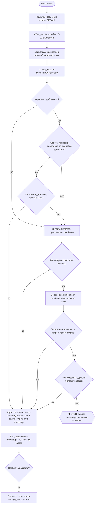

# 2026-10-25 · Найди 5-звездочную гостиницу на 4 ночи с ближайшего понедельника по пятницу: нужно 3 номер…

_Full working session of an LLM coding agent, scrubbed by rule (names kept as stable pseudonyms; surnames, e-mails, phones, street addresses and ages replaced by [ФАМИЛИЯ], [EMAIL], [ТЕЛЕФОН], [АДРЕС], [ВОЗРАСТ]; hosts and keys replaced). Row `s_3996de90` of the [dataset](https://huggingface.co/datasets/TonyDzi/agent-sessions)._

**User:**

Найди 5-звездочную гостиницу на 4 ночи с ближайшего понедельника по пятницу: нужно 3 номера.

География поиска: всё южное побережье Португалии и начало Испании до Isla Canela — Algarve, Faro и рядом.

Требования:
- 5 звезд
- максимально высокий рейтинг
- 3 свободных номера на 4 ночи
- дать 5 подходящих вариантов
- проверить, что номера реально доступны
__Перевела: GPT-5.5 + whisper__

• • • • •

Найти 5 пятизвёздочных гостиниц на 4 ночи, ориентировочно с ближайшего понедельника по пятницу, на южном побережье Португалии и в приграничной части Испании до Isla Canela: Algarve, Faro и рядом.

Требования:
- 5 звёзд
- максимальный рейтинг
- 3 номера
- проживание на 4 ночи
- проверить наличие 3 свободных номеров на эти даты
- дать 5 подходящих вариантов
__Перевела: GPT-5.5 + 11labs__

---

**Claude:**

Ближайший понедельник — 26.10.2026, заезд 26.10, выезд 30.10 (4 ночи). Для поиска жилья есть скилл `/booking`, открываю его.

---

> `Skill` -- {"skill": "booking", "args": "5-звёздочные отели, Алгарве/Фаро/до Isla Canela, 26.10.2026-30.10.2026 (4 ночи), 3 номера, макс. рейтинг, проверить реальную доступность, дать 5 вариантов"}

---

**User:**

Base directory for this skill: C:\Users\dev\.claude\skills\booking

# /booking · жильё на всех площадках, напрямую у владельца, без лишних посредников

## 0. Принцип (оператор, 24.10.2026, голосом)

> оператор не благотворительная организация и никого спонсировать не собирается. Если можно купить напрямую, он покупает напрямую, а не платит посредникам. Для этого у него есть кофаундер Майкрофт.

Как это работает:
1) Беготню делает Майкрофт: ищет, сверяет, находит владельца, считает цену под ключ, пишет черновики. оператор сам с хозяевами не переписывается (Библия `reglament-pokupki-assistenty-ne-dopuskayut-pryamogo-obscheniya-antona-s-p`, 27.11.2025): сообщения уходят от его имени после его «+» (раздел 8).
2) Посреднику платим, только если он даёт чистую выгоду: скидку больше своей комиссии или защиту, которая реально нужна. Прецеденты: риелтор 2.9% только за скидку при покупке (30.07.2026); остаток гонорара посреднику только после письменного закрытия сделки (Синтра, 31.08.2026).
3) Прямая бронь допустима по правилам площадки, только если владельца нашли через публичный канал (портал курорта, его сайт, агентство) и по этой поездке не шла переписка с ним в чате площадки. Площадка остаётся страховкой и точкой сравнения.

## 1. Шаги (рецепт)

1) **Фильтры заказа.** Даты ±1-3 дня, сверенные с календарём оператора (карта Библии 942: важные звонки не переносим, сперва спрашиваем его). **Реальный состав** сверяю с купленными билетами (24.10 выяснилось, что билеты куплены на 6 человек, а искали на 4; детали в [[trip-zurich-sled-dec-2026]]). Возраст детей. Спальни и кровати, бюджет (за всё время или за месяц: спросить, если неясно, кейс Монреаль 24.12.2025). Ключевые точки: подъёмник или санная трасса, бассейн, магазин, врач.
   Дефолт семьи: дом или вилла целиком, 4-5 настоящих спален, стиральная машина обязательна (детское стирается отдельно, Брно 16.08.2026), парковка под Mercedes Vito 5.2-5.4 м × 2 м и прицеп (Библия 28.07.2026), рядом парки, вода или горы, до хаба не больше 2 ч. Отель только если лучше ничего нет (оператор 11.08.2026). Дом и машину бронируем раньше перелётов, если билетов ещё нет (Мадейра 18.11.2024).
2) **RECALL до поиска:** `python "$IMPORTS_ROOT/brain_ask.py" "<место> жильё"`, grep `$OBSIDIAN_VAULT` по месту, имени дома и хозяину, плюс `$OBSIDIAN_VAULT/04-Projects/<trip>.md`. RAG упал → grep и говорю это вслух. Цель: не предложить снова отвергнутое (Ski cabin Valbella = Maiensäss, зимой только пешком) и найти хозяев, с которыми уже был опыт (заметки поездок и раздел 11).
3) **Обход всех площадок по разделу 2**, а не только той, что прислал оператор. Его давний стандарт: 16 площадок (06.03.2024), «использовать сайты НЕ аирбнб» (20.03.2024), и 24.10.2026: «Часто я замечал, что дома можно найти на букинге... идентичные».
4) **Склейка объектов** (раздел 3): один дом = одна строка таблицы, цены по каналам в колонках.
5) **Полное чтение листинга и отзывов** (раздел 4): зимний доступ, лестницы, потолки, настоящие спальни, санузлы, холодильник, wifi, отопление, соседи.
6) **Отбор 5-12 вариантов** (оператор 20.03.2024), таблица по разделу 4. Больше трёх → Google Таблица через `sheets.py` и ссылка (Библия 27.12.2025), топ-3 текстом в чате.
7) **Держалка:** лучший вариант с бесплатной отменой бронируем сразу, параллельно с переговорами (после «+», раздел 8). Дедлайн бесплатной отмены в календарь.
8) **Канал брони по дереву** (🌳): владелец через публичный контакт → портал курорта → самая дешёвая площадка. Окно ответа владельца кончается раньше дедлайна отмены держалки.
9) **Черновики сообщений** владельцу или хозяину по разделу 9; отправка, бронь и оплата только через гейты раздела 8.
10) **До заезда** чек-лист раздела 10; **на месте** при проблеме раздел 11.
11) **Отчёт** в чат и в волт по разделу 14.

Как сводятся карты Библии 1092 «сразу оплачивать все брони» и 1107 «проактивно и оперативно бронировать» (прочитаны в Trello 24.10.2026) с «сперва держим бесплатную отмену»: быстро и заранее закрываем место **держалкой с бесплатной отменой** (это и есть «сразу»), окончательную оплату делаем, как только выбор закреплён. Если бесплатная отмена есть, платим рано: деньги возвратны. Если её нет, сначала запрос хозяину (request to book, pay later), невозвратный тариф только при твёрдых датах и купленных билетах. Карта 958: локацию сверяю точно и даю ссылки и в Google Maps, и в Apple Maps.

## 2. Порядок обхода площадок

| # | Слой | Площадки | Примечание |
|---|---|---|---|
| 1 | Основные OTA | Airbnb, Booking.com | Booking смотрю в залогиненном Chrome (Genius, раздел 5) |
| 2 | Метапоиск | HomeToGo, Holidu, Google Hotels → Vacation rentals | 🤔 Google VR не показал Airbnb (наблюдение H35399, 24.10.2026), поэтому один метапоиск полным не считаю |
| 3 | Региональные специалисты | CH: Interhome, e-domizil, Novasol, Reka (семейные деревни, например Wildhaus и Urnäsch у Säntis). IT: casevacanza, locasun. ES: casas rurales, TusCasasRurales. PT: местные агентства | Interhome часто сидит и на Booking, и на Houfy |
| 4 | Портал курорта (DMO) | booking.<курорт>.swiss, graubuenden.ch, openbooking.ch, chalet.myswitzerland.com | Видны м², план, имя владельца, строка «direct booking with the owner» |
| 5 | Vrbo-сеть | Vrbo, FeWo-direkt, Abritel, Expedia, Hotels.com, Travelocity, trip.com | В основном дубли: склеиваю, новыми кандидатами не считаю |
| 6 | Премиум (по запросу) | Plum Guide, Onefinestay | Для короткой семейной недели пропускаю |
| 7 | Напрямую и локально | Сайт владельца, Google Maps (farmstay, Ferienhaus), Facebook и Instagram объекта, местные агентства, sabbaticalhomes | Из Facebook беру только наводки: 🤔 по FTC заметная доля арендного мошенничества идёт через соцсети (цифра не сверена) |

Вес по регионам: в США главные Airbnb и Vrbo, в ЕС и Альпах Booking, специалисты и DMO. Длинный срок: раздел 12.

## 3. Склейка объекта по площадкам и прямой путь

**Как опознать один и тот же дом:**
1) Выписываю признаки: м², спальни и санузлы, необычные удобства, вид, расстояния, имя хозяина, деревню.
2) Ищу в Google в кавычках 6-10 слов необычной фразы описания, на английском и на языке страны.
3) Прогоняю 2-3 характерных фото через Google Lens (Exact matches), TinEye (сортировка Oldest) и Yandex.
4) Ищу `"<деревня>" + признаки + Ferienhaus/Chalet`, `site:graubuenden.ch`, `site:openbooking.ch`, `site:interhome.*`.
5) Сверяю адрес DMO со спутником. Булавка Airbnb размыта на сотни метров, «рядом» ещё не доказательство.
6) Регистрационный номер как ключ: в ЕС по Regulation (EU) 2024/1028 с 20.05.2026; в Португалии номер RNAL на rnt.turismodeportugal.pt. В Швейцарии номера нет, там сверяю фото, м² и адрес.
7) Соседние квартиры одного дома не путаю: Lärchensitz 165 м² и Erlenstube 80 м² делят двор.

**Эталон (H35399, 24.10.2026):** Airbnb 19866401 «Great cottage...» = Guarda Val Müller Lärchensitz, La Pala 18, 7083 Lantsch/Lenz, владелица Lisette Müller. Тот же дом стоит на booking.arosalenzerheide.swiss (ad-100396), graubuenden.ch, Interhome ch7083.622.1, openbooking, Expedia, Travelocity и trip.com. Её сайт guardaval.casa (contacts.html) ссылается на оба её Airbnb-листинга: это доказывает, что владелица и хозяйка на Airbnb одно лицо. Публичные контакты: страница DMO и contacts.html.
Цены: прайс владелицы (guardaval.casa/prices.html) на неделю 12.12.2026-02.01.2027: CHF 2,590 плюс уборка 250, бельё 20 с человека, отопление 30, туристический налог 4 за ночь с человека от 16 лет. Формула сверена: котировка API портала на 06-13.03.2027 для 4 взрослых (CHF 2,222) совпала с прайсом до франка, наценки портала нет.
Моя оценка, не оферта: 15-25.12 для 6 человек около CHF 4,180-4,340, это ~€4,470-4,650 по курсу ~1.07 EUR за CHF (🤔 курс принят, не сверен живьём 24.10.2026), против €6,544 на Airbnb, плюс возможная доплата за неполную праздничную неделю. Календарь портала на декабрь закрыт, свободность подтверждает только владелица.

**Граница правил площадок** (Help Center Airbnb про оплату и общение вне площадки, Vrbo offline booking policy; прочитаны в H35399 24.10.2026, ссылки в [[trip-zurich-sled-dec-2026]]):
1) Через чат Airbnb или Vrbo пишем только о брони на площадке. О прямой брони, скидке за обход или обмене контактами там не пишем: так мы соблюдаем политику площадки и не подставляем ни хозяина, ни основной Airbnb-аккаунт оператора (a2).
2) **Вся поездка либо целиком на площадке, либо целиком напрямую** у владельца, найденного через публичный канал. Смешанную схему (часть через площадку, часть мимо неё на одной брони) не делаем.
3) Если хозяин сам в чате площадки предлагает уйти в WhatsApp или платить напрямую, вежливо отказываемся и остаёмся на площадке.
4) Уже существующую бронь на площадке ради прямой не отменяем (это и есть запрещённый сценарий «rebook off-platform»). Сначала проверяю, есть ли такая бронь.

**Честность с владельцем:**
1) Источник называю правдиво: «нашли ваш дом на портале курорта» или «на вашем сайте», если контакт взяли именно там.
2) Никогда не утверждаю, что листинг на Airbnb мы не видели. Спросит владелец, видели ли мы его на Airbnb, отвечаем правду.
3) Альтернативы в торге называю только реальные, снятые прибором в этой поездке (ссылка и цена в таблице). Чужих цен не выдумываю и не завышаю.

**Проверка владельца до первого франка:**
1) Контакт беру с официального портала и подтверждаю звонком на публичный номер (звонок = сообщение, гейт раздела 8).
2) Собственника проверяю по Grundbuch (ст. 970 ZGB: имя владельца выдают по запросу). Сдаёт фирма → проверяю её в Zefix и UID.
3) Спрашиваю туристический офис или общину: зарегистрирован ли объект и собирает ли он Gästetaxe.
4) Видеозвонок с показом дома и свежие фото (урок Мадрида 06.2026).
5) Имя получателя платежа совпадает с владельцем.
6) Имена, даты рождения и паспортные данные гостей даю только после этой проверки и только в договоре или регистрации гостей. В первом письме только число взрослых и детей с возрастом, без имён.

**Договор:** стороны, точный адрес, даты, итог и что в него входит (уборка, энергия, бельё, Gästetaxe), депозит не больше 1 месяца или 20-30% (правило оператора 21.04.2023), срок его возврата, отмена с обеих сторон, заезд и выезд, ключи, парковка. Отпускная аренда до 3 месяцев в Швейцарии почти не защищена нормами OR о жилье (🤔 вывод research H35399, юристом не сверен), поэтому чего нет в договоре, того нет. Подписание или акцепт договора = Tier-2 (раздел 8).

**Оплата прямой брони по предпочтению:**
1) Бронь через портал курорта или openbooking (понятная сторона договора, оплата картой).
2) Карта по ссылке владельца: платит оператор сам.
3) Перевод только после всех проверок, только на швейцарский счёт на имя собственника, остаток при заезде: делает оператор сам.

Банковский перевод непроверенному лицу, Western Union, крипту, подарочные карты и PayPal Friends&Family не используем: у них нет chargeback, и это типовой рисунок мошенничества. Это сознательная замена практики Торонто (13.01.2026, когда оператор сам предлагал хозяину перевод или крипту). Давление «срочно, иначе отдам другим» = стоп. Карта по возможности Millennium (Библия 07.01.2026). Платим в валюте объекта, DCC отклоняем.

## 4. Таблица сравнения и разбор отзывов

**Шаблон строки** (один дом, колонка на каждый канал):

| Объект (настоящее имя) | Канал | Итог для N реальных гостей (ночи + уборка + сбор + НДС + Gästetaxe минус Genius и промокод), валюта | В EUR (курс, дата) | Отмена (тир и дедлайн) | м² | Настоящие спальни (кровати по комнатам) | Санузлы | Чистота и точность (Airbnb) или балл Booking | Сводный балл (≥50 отзывов) | Ключевые точки на машине зимой | Общие зоны и соседи | Ответ хозяина (rate и time) | Минусы из отзывов | Снято (дата, прибор) |

Правила таблицы:
1) Сравниваю только итог на экране оплаты, ночную ставку не сравниваю; цену за ночь и за весь срок не путаю (Chur 2020). Победитель меняется от объекта к объекту: Ski cabin Valbella €2,471 на Booking против €2,792 на Airbnb, Casa Cresta €9,384 на Booking против €7,970 на Airbnb (Chrome, 24.10.2026).
2) Разные валюты свожу в одну с курсом и датой; курс не сверен живьём → пометка «оценка».
3) Цена снята прибором (экран оплаты, API портала), с датой. Не сняли → «цена не снята», а не догадка.
4) Цена отмены входит в стоимость. Невозвратный тариф (обычно около минус 10%) только при твёрдых датах и купленных билетах.
5) Даты сверяю со сменой в субботу и пиком Рождества (замер Codex 13.10.2026: 18-28.12 до 4 раз дороже; оператор 13.10: «чтобы не попасться на Christmas»).
6) Рядом с ценой проверяю: открыта ли сама трасса, а не только курорт, и с какого возраста пускают в бассейн или термы (H2Lai, Chavasqueira с 5 лет).
7) Время в пути: `python ~/.claude/skills/booking/scripts/osrm_drive.py <жильё lat,lon> <точка lat,lon> ...`; зимний множитель скрипта = оценка.

**Разбор отзывов** (оператор 11.08.2026: «хороший отзыв дешёвый, плохой стоит дорого»; плохие читаю первыми):
1) Звёзды Airbnb завышены (🤔 большинство объектов в диапазоне 4.5-5.0, доля не сверена). Сравниваю с медианой 5-10 соседних вариантов. Чистота или точность ниже 4.7 = красный флаг. Booking: цель 9.0+, для семейной виллы ниже 8.5 слабо.
2) Сводный балл: свежая оценка по Google, TripAdvisor, Booking, Agoda, Expedia, где есть, минимум 50 отзывов в сумме (метод Пхукета 2025). Меньше 50 → помечаю «мало данных».
3) Текст отзывов Airbnb: сперва прокрутка в браузере (Firefox, без логина). Запасной путь: `python ~/.claude/skills/booking/scripts/airbnb_reviews.py <listing_id>`: печатает отзывы ниже 5 звёзд и 5-звёздные со словами-жалобами. Это серая зона (внутренний API площадки): только чтение, без логина и аккаунта, с паузами, запуск с хаба (§7.2).
4) Слова-жалобы на всех языках: but, however, only, small, cold, heating, noise, steep, stairs, parking, smell, mould, neighbour, shared, wifi, bunk, attic, aber, leider, mais. Отзывы ниже 5 звёзд читаю целиком вместе с ответом хозяина: оборонительный ответ = флаг.
5) Свежесть важнее среднего: последние 10 отзывов против всего срока, и обязательно отзывы того же сезона (зимой отопление и подъезд по снегу).
6) Те же отзывы ищу на других площадках объекта: у Booking только проверенные проживания.
7) Чек-лист до оплаты для 4+ гостей (Библия `reglament-pri-bronirovanii-zhilya-proveryat-fakty-do-otzyv-polnym-tekstom`, 04.08.2026): реальные м² и план, парковка, размеры кроватей, реальные кухни, стиральная машина, интернет, реальное расстояние. Зимой: подъезд на машине (не «только пешком»), лестницы, потолки 1.85-1.90 м, спальня за шторкой или на галерее, «6 спален» на деле 2 квартиры, +8°C в доме при заезде (замеры Codex 13.10 и 19.10.2026). Безопасность: верхние ярусы для детей не младше 6 лет (EN 747), детекторы дыма и CO при печи. Районы США смотрю по карте преступности (оператор 21.10.2023).

**Город и соло** (SF 30.09.2026): цена в поиске часто за койку в дорме. Проверяю отдельную комнату, итог с налогами на форме оплаты, свежие отзывы про клопов и расстояние до реального расписания оператора.

## 5. Booking.com: особенности (оператор 24.10.2026)

1) **Genius по семье:** сравниваю итог в Booking-аккаунте оператора с Genius 3 и в других семейных аккаунтах (уровни и логины в реестре аккаунтов путешествий в `secrets\`). Бронирую там, где итог ниже, только в аккаунте члена семьи и с его ведома.
2) **Промокоды и кешбэк до оплаты:** проверяю действующие промокоды Booking и кешбэк-порталы перед кнопкой оплаты. Ход поиска и найденное: [[task-2026-10-24-dr-booking-promo-codes]] (`10-Tasks/task-2026-10-24-dr-booking-promo-codes.md`, отдельная сессия с ДР).
3) **Тип поездки = leisure** в форме: по наблюдению оператора хозяева на Booking охотнее берут отдых, чем командировки.
4) **Невозвратный против «сперва запрос»:** если у дома только невозвратный тариф или моментальная оплата, параллельно держу вариант с бесплатной отменой (шаг 1.7), а окно ответа хозяина ставлю внутри дедлайна бесплатной отмены. Пример: вопрос по дому в Schmitten ([АДРЕС]), можно ли оплатить после подтверждения хозяина.
5) Залогиненные цены снимаю в Chrome оператора; в аккаунте до «+» только чтение (раздел 6).

## 6. Аккаунты и вход

| Назначение | Аккаунт |
|---|---|
| Airbnb: бронь, споры, депозиты | основной Airbnb-аккаунт (a2) |
| Booking.com | Booking-аккаунт оператора с Genius 3; семейные аккаунты для сравнения Genius |
| Логины, уровни, кто владелец аккаунта | реестр аккаунтов путешествий в `secrets\` (значения в скилл и отчёты не пишу) |

1) Публичный поиск без логина в Firefox или через WebFetch (дефолт §4.8).
2) Залогиненные цены (Genius), календарь и переписку смотрю в Chrome оператора через Claude-in-Chrome и говорю причину вслух: «Chrome: там живая сессия Booking/Airbnb».
3) **В аккаунте до «+» только чтение.** Кнопки Reserve, Request, Accept offer, Cancel, Send, Change dates жму только после явного «+» на это конкретное действие, перед кликом перечитываю поле и сумму (§3.6).
4) Пароли не ввожу: харнес это запрещает, это ограничение механизма, а не отсутствие доступа, так и называю. Сессия разлогинена → шаги входа оператору на телефон одной строкой.
5) Новые аккаунты площадок на случайную почту не заводим (Библия 04.01.2025). Второй аккаунт ради обхода лимитов не используем.
6) Нашёл открытый пароль в волте: значение в отчёт не пишу, путь отдаю в существующий процесс зачистки (память `secret-value-leak-in-vault-and-indexes-2026-10-23`); старую заметку сам не правлю без ОК (§8.8).

## 7. Честный состав, страховка, отмена

**Правило: в брони и в договоре стоит реальный состав с возрастом детей.** На площадках число гостей всегда правдивое. В первом запросе цены владельцу число можно не называть (выбор оператора 24.10.2026), но сама бронь называет реальный состав. Цена честности: Lärchensitz рассчитан на 10 человек, шестеро проходят без доплаты. Цена прыгает от числа гостей → торгую доплату открыто или ищу другой дом.
Почему (улики; коды броней и претензий в заметках поездок, не здесь):
- Брно, 08.2026: в брони 2 взрослых и младенцы, хозяин заявил 7 человек (2 + помощница + 3 детей + младенец). Итог: претензия €1,358.19 за «3 extra adults» и удержанный депозит €500.
- Будапешт, 08-09.2026: претензия хозяйки €1,500 за плитку закрыта Airbnb 9.09 за недостатком улик; потом повторный запрос, и 21.09 решение около €140 в пользу хозяина. 🤔 Атрибуция €140 спорная: заметка 21.09 смешивает дела Брно и Будапешта, сверять по письмам Airbnb.
- После Будапешта в профиле оператора негативный отзыв хозяйки про число гостей, хозяева «с лупой изучают» отзывы (оператор 21.10.2026).
- В Швейцарии гостей регистрируют и берут Kurtaxe, занижение видно и на месте.

Привычка занижать повторялась (Торонто 11.01.2026, Мадрид 29.05.2026, Säntis 13.10.2026). На «скажу, что едем только я и жена» отвечаю одной строкой с уликой Брно и ценой для реального состава.

**Страховка и отмена (сверять живьём перед покупкой):**
1) Страховка Airbnb для ЕС (Europ Assistance; номер полиса и сумма в [[trip-zurich-sled-dec-2026]]). 🤔 Кого покрывает (покупателя и спутников или только гостей брони), перечитываю в условиях полиса перед оплатой. Отмену хозяином полис не покрывает. Есть 14 дней на отказ.
2) Хозяин отменил сам: Airbnb возвращает всё, включая сборы, и помогает найти замену (AirCover).
3) Отменить хотим мы: отменяем по нашему тиру отмены после «+» оператора или честно договариваемся с хозяином о взаимной отмене через Resolution Center. Подталкивать хозяина отменить ради нашего возврата не будем.
4) Прямая бронь теряет AirCover, полис Airbnb и помощь с заменой. Защиту заменяю пунктом договора об отмене владельцем и отдельной страховкой; сперва проверяю страховку карты (обычно требует оплаты этой картой, 🤔 часто от 75% стоимости).
5) Депозит вне площадки внутри брони Airbnb (Stripe-ссылка хозяина, Брно 19.07.2026) не защищён ничем. Ответ: жалоба в Airbnb (Reservation Issue, 72 часа), а не оплата. Если оператор всё же платит, квитанцию храним с первого дня.
6) Подмена после подтверждения («цена только за этаж»): изменение отклоняю (после «+»), сам не отменяю, прошу письменно «entire home at confirmed price: yes/no».

## 8. Гейты: деньги и сообщения

1) **Сам без спроса:** поиск, сравнение, склейка, проверка владельца по открытым реестрам, расчёт итога, черновики любых сообщений, таблица, заметка в волт.
2) **Tier-2, деньги и обязательства.** Показываю карточку: объект, канал, ссылка, скриншот итога, полная сумма со всеми доплатами, способ оплаты, тир отмены и дедлайн (Библия 07.10.2023). Жду явного «+» оператора на **это конкретное действие**:
   - бронь (в том числе держалка), оплата, депозит;
   - принятие специального предложения;
   - отмена брони (Библия 22.02.2026) и любое изменение брони (даты, состав, цена);
   - подписание или акцепт договора аренды, правил дома, условий площадки.
   оператора нет в чате → `approval.py ask`, соседняя работа идёт.
3) **Платёжные данные:** номер карты, IBAN, CVV, банковские реквизиты не ввожу никогда. Банковский перевод и оплату по ссылке делает оператор сам. С «+» я могу только нажать Pay сохранённой в аккаунте картой, перед этим показав итог.
4) **Сообщения хозяину или владельцу** (письмо, чат площадки, WhatsApp, звонок, видеозвонок, форма enquiry на DMO, сообщение в поддержку площадки) не Tier-2, но нужен явный «+» оператора в живом чате на это сообщение или стоящая просьба на эту поездку и этих адресатов (как 24.10.2026 «напиши им»). Черновики свободны. 10 и больше хозяев одной волной = масс-рассылка = Tier-2.
5) **Ассистенты** шлют только тексты, одобренные оператором, со своих рабочих каналов или аккаунта оператора по его поручению.
6) Режим «запрос, потом оплата» (request to book, pay later, бесплатная отмена до даты) предпочтительнее, деньги не застревают до подтверждения хозяина (оператор 24.10.2026).
7) оператор бронирует сам с телефона → до его клика перечитываю весь листинг (урок Ski cabin Valbella 21.10.2026: «Слушай, я прокосячил»).

## 9. Сообщения хозяевам и торг

1) **Голос:** сообщения по брони уходят от имени оператора так, как он их одобрил или надиктовал; он их читает. Споры тоже от первого лица оператора. Представление Майкрофтом (§3.3) только когда оператор сам просит Майкрофта написать от себя.
2) Язык хозяина. Для DACH по-немецки; перевод голосовой перепроверяю (Библия 04.08.2026).
3) **Тёплое вступление** (оператор 24.10.2026): кто едет (взрослые, няня, которая помогает с уборкой, дети с возрастом, без имён), уважение к правилам дома, вопрос «свободно? итог со всеми доплатами? депозит и отмена?», предложение созвониться. За прошлые отзывы заранее не извиняюсь. Депозит или видеозвонок предлагаю, только если хозяин спросит.
4) Отвечаю ровно на вопрос хозяина, не добавляю того, о чём оператор не просил (21.10.2026: «А зачем ты написал про 25-26 число? Не надо»).
5) Вопросы до брони: кровати по комнатам и ярусы, м² и санузлы, детекторы дыма и CO, отопление, общие зоны и соседи, парковка в снег и цепи, ski room и сушилка, стиралка и сушка, кроватка и стульчик, итог для N, заезд, стройка рядом, отмена, свежие фото и план (Мадрид).
6) Перед Send: `/outbound-gate` шаг 0-бис (кто уже писал, по всем каналам) и §3.6 (перечитать поле). Переписка идёт и в чате площадки, и в WhatsApp → дублирую в оба (оператор 04.08.2026).
7) **Торг:** если у владельца есть публичный прайс, якорь = его прайс (или прошу его ставку на неполную праздничную неделю), а не процент от площадки. Публичного прайса нет → якорь 80-85% от итога площадки. Доводы: срок, высокий сезон, без посредника, реальная альтернатива из таблицы (раздел 3, честность).
8) **Волна запросов** (длинный срок, шаблон Торонто 01.2026): обращение по имени, точные даты, помесячная оплата, просьба о special offer, время до центра, «no smoking, no pets». Ответы в таблицу: дом · ссылка · хозяин · дата отправки · ответ · итог · скидка · отмена · следующий шаг. Упёрлись в лимит сообщений → сужаю до топ-N, остальным через публичный контакт DMO, переношу на следующий день. 10+ адресатов = Tier-2.

## 10. До заезда

1) Подтвердить у хозяина: парковку под Vito и прицеп, время приезда и ранний заезд, способ получения ключей (Библия 28.07.2026).
2) Балкон или сушилка для белья, место в шкафах, стиралка работает.
3) Одна группа WhatsApp на хозяина (04.08.2026), создание группы = сообщение, гейт раздела 8.
4) Ссылки на точный адрес в Google Maps и Apple Maps (карта 958), время в пути зимой.
5) Дедлайны отмены всех держалок в календаре; лишние держалки отменить до дедлайна (после «+»).
6) Кто в составе, сверено с билетами ещё раз.

## 11. Проблема на месте и споры

1) Сразу при заезде: 30-50 фото и одно видео одним дублем, до распаковки. При выезде то же (Будапешт: без записи при выезде спор частично проигран).
2) Сообщаю в течение 72 часов, пишу **в поддержку площадки, а не хозяину**. Категории Airbnb: Safety Issue + Listing Not As Described. Опасность для ребёнка («открытая проводка + маленький ребёнок») весит больше грязи или цены (Мадрид 06.2026).
3) Сообщения короткие: до 3 сообщений по 500 символов, факты и фото. Поборы вне листинга (Мадрид: €350 за поздний заезд) прикладываю как улику.
4) Прошу переселение с понятными параметрами (Мадрид: 4 спальни, до 30 минут до центра, проверенные отзывы) или полный возврат. Мадрид: 9.06 Airbnb обещал полный возврат после выезда и снял листинг.
5) Защита от претензии хозяина (Будапешт, победа 9.09): разрыв между выездом и претензией (11 дней), нет записи о состоянии при выезде, неточности листинга, нет доказательства, что вещь была цела при заезде.
6) Тон мягкий, не категоричный, от первого лица оператора (оператор отверг жёсткий черновик, 09.2026). Отправка после «+» (раздел 8).
7) Отзыв в Google пишу спокойно и по фактам: длинный эмоциональный отзыв по Мадриду заблокировали, прошёл переписанный.

## 12. Длинный срок (месяц и больше)

1) Риелторы и объявления часто дешевле: Монреаль, CAD 6,600 в месяц у риелтора против CAD 8,714 за 28 ночей на VRBO (24.12.2025).
2) Площадки: Centris, Kijiji, Craigslist, realestate.com.au, sabbaticalhomes, плюс разделы 2.1-2.4.
3) Скидку за месяц и больше прошу всегда, для нескольких месяцев 30-50% (Торонто 12.01.2026). Спрашиваю ставку хозяина «нетто», а не итог площадки (комиссия по оценке хозяина ~15%, оператора до 30%).
4) Хозяин проверяет гостя: готовлю письмо работодателя или рекомендации (рекомендательное письмо Palo Alto 2019-22), Торонто 01.2026.
5) Хозяин сам зовёт уйти с площадки → раздел 3, правило «целиком на площадке или целиком напрямую».

## 13. Запасные инструменты (из боя)

| Пусто или заблокировано | Обход |
|---|---|
| Страницы Airbnb на JS | WebFetch на URL поиска отдаёт карточки; отзывы прокруткой в браузере, запасной путь `scripts/airbnb_reviews.py` |
| Booking и Interhome отдают 403 или пусто | Claude-in-Chrome в залогиненном Chrome оператора, только чтение. Пустой fetch не значит «объявлений нет» |
| DMO-портал на JS (DEMI/feratel) | POST `https://booking.arosalenzerheide.swiss/DemiFrontendApi/accommodationDetailProducts`, тело `{"from":"YYYY-MM-DD","to":"YYYY-MM-DD","u0":1,"a0":<взрослых>,"ca0":[],"id":<ad-id>,"documentReference":"31566_content-areas_1","durationType":"exact"}` → `minPrice.priceString` или `noResultText`. Endpoint `enquiry` = сообщение, без «+» не зову |
| Google Maps закрыт reauth | `scripts/osrm_drive.py` (публичный OSRM), зимой +30-50% как оценка |
| Встроенный браузер на перегруженном хабе даёт белый экран | Страницы по одной через WebFetch или curl, или другой узел флота |
| Не могу отменить: расширение Chrome молчит, логина нет | Шаги отмены оператору на телефон одной строкой |
| Лимит сообщений Airbnb | Сужаю до топ-N, остальным через публичный контакт DMO, перенос на следующий день (раздел 9.8) |

## 14. Выход

1) В чате: топ-3 из 5-12 с итогами под ключ в одной валюте, рекомендация кофаундера, что ждёт «+» (действие, объект, сумма), ссылки Google Maps и Apple Maps.
2) Больше трёх вариантов → Google Таблица со ссылкой.
3) В волт: датированная секция в `$OBSIDIAN_VAULT/04-Projects/<trip>.md` (кандидаты, цены с датой снятия, отвергнутые с причиной, публичные контакты владельцев, без секретов и платёжных данных), бэкап перед записью, метка `machine_stamp.py line`.
4) Строка «проверено: … · не проверено: … (почему)».
5) Блок «🧒 Простыми словами» в конце.

## 🌳 Дерево решений

Развилки: `decision_tree.py fork booking <узел> --outcome ok|fail|unknown`; застрял → `decision_tree.py stop booking --grow ...`. Тень до 29.10.2026 (§5.12).

## Судить скилл

После каждого использования одна строка: 🔧 обновляю / 📝 не сейчас / ✅ не надо, с причиной. Новый работающий канал или обход = узел дерева с уликой прогона. После правки: `skill_xvendor_run.py exam --skills booking`, затем `codex_skills_bridge.py sync`. Перед любой раздачей наружу leak-scan: в скилле не должно быть почт, кодов броней, полисов и платёжных данных.

## Не проверено

- 🤔 Отмечено по тексту: доля звёзд Airbnb, цифра FTC, Google VR без Airbnb, покрытие полиса Airbnb, порог 75% у страховки карты, вывод про OR, курс CHF/EUR. Перед использованием в письме или решении сверить живьём.
- Interhome, e-domizil и ценовой график openbooking по эталону не сняты (403 и JS, 24.10.2026).
- Исход претензии Брно €1,358.19 и возврата по Мадриду в волте не найден.

## 🧒 Простыми словами

Один и тот же дом часто продают в пяти магазинах по разной цене, а у хозяйки самой он ещё дешевле. Майкрофт обходит все магазины, понимает, что это один дом, находит хозяйку по её объявлению на сайте курорта и считает, где выйдет дешевле. Пока торгуемся, держим запасной дом с бесплатной отменой. Платим и пишем хозяевам только после «+» оператора, гостей называем честно, иначе потом прилетит счёт, как в Брно.

Machine: HUB-01 (Хаб) · Agent: Claude Code · Operator: dev · 2026-10-24

ARGUMENTS: 5-звёздочные отели, Алгарве/Фаро/до Isla Canela, 26.10.2026-30.10.2026 (4 ночи), 3 номера, макс. рейтинг, проверить реальную доступность, дать 5 вариантов

---

> `ToolSearch` -- {"query": "select:WebSearch,WebFetch", "max_results": 5}

---

> `Bash` -- {"command": "cd /e/Obsidian/_imports 2>/dev/null && timeout 60 python brain_ask.py \"Algarve 5 star hotel booking Isla Canela\" 2>&1 | head -30", "description": "RECALL по отелям Алгарве в волте", "timeout": 70000}

---

> `mcp__Claude_Browser__navigate` -- {"url": "https://www.booking.com/searchresults.html?ss=Algarve%2C+Portugal&checkin=2026-10-26&checkout=2026-10-30&group_adults=6&no_rooms=3&group_children=0&nflt=class%3D5&order=review_score_and_price&selected_currency=EUR"}

---

> `mcp__Claude_Browser__get_page_text` -- {"max_chars": 20000}

---

> `mcp__Claude_Browser__javascript_tool` -- {"action": "javascript_exec", "text": "[...document.querySelectorAll('[data-testid=\"property-card\"]')].map(c=>{const n=c.querySelector('[data-testid=\"title\"]')?.innerText;const st=c.querySelector('[data-testid=\"rating-stars\"],[data-testid=\"rating-squares\"],[data-testid=\"rating-circles\"]');

---

> `mcp__Claude_Browser__navigate` -- {"url": "https://www.booking.com/searchresults.html?ss=Isla+Canela%2C+Ayamonte%2C+Spain&checkin=2026-10-26&checkout=2026-10-30&group_adults=6&no_rooms=3&group_children=0&nflt=class%3D5&order=review_score_and_price&selected_currency=EUR"}

---

> `mcp__Claude_Browser__javascript_tool` -- {"action": "javascript_exec", "text": "[...document.querySelectorAll('[data-testid=\"property-card\"]')].map(c=>{const t=c.innerText.replace(/\\n+/g,' | ');return t.slice(0,330)}).join('\\n---\\n')"}

---

> `mcp__Claude_Browser__navigate` -- {"url": "https://www.booking.com/hotel/pt/octant-vila-monte.html?checkin=2026-10-26&checkout=2026-10-30&group_adults=6&no_rooms=3&group_children=0&selected_currency=EUR"}

---

> `mcp__Claude_Browser__javascript_tool` -- {"action": "javascript_exec", "text": "const t=document.querySelector('#hprt-table')?.innerText.replace(/\\n+/g,' | ').slice(0,1800);const h=document.querySelector('h2')?.innerText;const st=document.querySelector('[data-testid=\"rating-stars\"]')?.getAttribute('aria-label')||document.querySelector('

---

> `mcp__Claude_Browser__browser_batch` -- {"actions": [{"name": "navigate", "input": {"url": "https://www.booking.com/hotel/pt/vila-vita-parc-resort-spa.html?checkin=2026-10-26&checkout=2026-10-30&group_adults=6&no_rooms=3&group_children=0&selected_currency=EUR"}}, {"name": "javascript_tool", "input": {"action": "javascript_exec", "text": "

---

> `WebSearch` -- {"query": "Octant Vila Monte Moncarapacho 5-star hotel Algarve", "mode": "standard"}

---

> `WebSearch` -- {"query": "Wyndham Grand Carvoeiro Algarve 5-star hotel opened", "mode": "standard"}

---

> `WebSearch` -- {"query": "Palácio de Tavira Small Luxury Hotel 5 star official classification", "mode": "standard"}

---

**Claude:**

Нашёл пять 5★ отелей, в которых на 26–30.10.2026 (4 ночи) есть 3 номера. Проверял на Booking.com сегодня, 25.10. Ничего не бронировал и не оплачивал.

Состав гостей вы не указали, поэтому считал 6 взрослых, по 2 в номере. Цены за все 3 номера на 4 ночи, с налогами и сборами. Это цена на экране Booking на сегодня.

| # | Отель | Оценка | Номера и цена | Условия |
|---|---|---|---|---|
| 1 | [Octant Vila Monte](https://www.booking.com/hotel/pt/octant-vila-monte.html), Moncarapacho (у Tavira) | 9,5 (196 отзывов) | 3 × Superior Double, €4 116, завтрак включён | на странице отеля виденные тарифы невозвратные |
| 2 | [Vila Vita Parc](https://www.booking.com/hotel/pt/vila-vita-parc-resort-spa.html), Armação de Pêra | 9,5 (679) | 2 двухспальных апартамента на 4 спальни, €6 928, завтрак включён | оплата в отеле; формально это не 3 номера, см. ниже |
| 3 | [Vilalara Grand Hotel](https://www.booking.com/hotel/pt/vilalara-grand-hotel-algarve.html), Armação de Pêra | 9,3 (677) | 3 × Elegant Suite с king-кроватью, €4 589, завтрак включён | на странице отеля свободны 6 Deluxe Suite и 7 апартаментов |
| 4 | [Praia do Canal Nature Retreat](https://www.booking.com/hotel/pt/praia-do-canal-nature-resort.html), Aljezur (западное побережье) | 9,2 (725) | 3 × Premium Double с king-кроватью, €4 032, или €3 629 по цене для членов Booking | завтрак включён |
| 5 | [Wyndham Grand Carvoeiro](https://www.booking.com/hotel/pt/wyndham-grand-carvoeiro.html) | 9,1 (837) | 3 × Deluxe Room, €2 736, или €2 467 по цене для членов Booking | завтрак включён, оплата в отеле |

- **Как проверял наличие:** сам поиск Booking при запросе «3 номера, 4 ночи» показывает только отели, где эта комбинация свободна. Для Octant, Vila Vita Parc и Vilalara я дополнительно открыл страницы отелей и увидел остаток номеров. У Praia do Canal и Wyndham таблицу номеров не разобрал, их наличие подтверждено только выдачей поиска.
- **Vila Vita Parc:** отдельных трёх номеров на эти даты Booking не показал, только 2 двухспальных апартамента. Если нужны именно 3 отдельных номера, он не подходит, и вместо него лучше брать следующий в списке запасных.
- **Octant:** виденные тарифы невозвратные, а свободно по 1–3 номера каждого типа. Бронировать лучше быстро.
- **Звёзды:** Booking пометил «5 из 5» и апартаменты с B&B, поэтому я отсеял всё, что не похоже на настоящий отель. Для Octant и Wyndham 5★ подтвердили независимые источники, для Vila Vita Parc, Vilalara и Praia do Canal нет, там верю Booking. Palácio de Tavira (9,1) убрал: источники расходятся, 4★ или 5★.
- **Запасные 5★ с наличием:** [Viceroy at Ombria](https://www.booking.com/hotel/pt/viceroy-at-ombria-algarve.html) (9,1; €4 141), [Conrad Algarve](https://www.booking.com/hotel/pt/conrad-algarve.html) (9,0; €4 893, бесплатная отмена), [EPIC SANA](https://www.booking.com/hotel/pt/epic-sana-algarve.html) (9,0; €4 158).
- **Испания:** в районе Isla Canela, Ayamonte и Huelva среди 5★ с наличием лучший отель имеет оценку 8,6 (El Rompido Resort, 3 номера, €1 796 по цене для членов Booking). В топ-5 он не попал.
- **Не проверял:** сайты самих отелей, Expedia и другие площадки. На них цены или наличие могут отличаться. Цены «для членов» требуют входа в аккаунт Booking.

Скажите, какой отель брать и сколько человек едет. Бронь и оплату сделаю только после вашего «+».

🧒 **Простыми словами:** я посмотрел на сайте бронирования все пятизвёздочные отели юга Португалии и приграничной Испании. Оставил те, где на ваши даты правда есть три номера, и взял самые высокие оценки гостей. Лучшие по оценке: Octant и Vila Vita Parc (9,5). Самый дешёвый из пяти: Wyndham Grand Carvoeiro. Пока ничего не куплено.

Sources: [Octant Vila Monte (Michelin Guide)](https://guide.michelin.com/pt/pt_PT/hotels-stays/algarve/octant-hotels-vila-monte-444), [Wyndham Grand Carvoeiro (Portugal Resident)](https://www.portugalresident.com/iconic-carvoeiro-hotel-to-reopen-as-five-star-wyndham-grand-carvoeiro-algarve/), [Palácio de Tavira (Expedia)](https://www.expedia.com/h116277493.Hotel-Information)

---

**User:**

Stop hook feedback:
001-пара: эта задача ушла и тебе, и Codex (session s_fe97af64). Ты ещё не написал напарнику. До ответа оператору, один раз: (1) прочитай его сообщения по точной теме: python -X utf8 ~/.claude/scripts/tg_bus_read.py --workroom --all --peek --recipient Claude и оставь только строки с [voice001:chat_REDACTED:t1792929828]; (2) отправь ОДИН конверт [Claude→Codex][voice001:chat_REDACTED:t1792929828][VERIFY|COUNTER|PROPOSE] с session_id=s_3996de90 peer_session_id=s_fe97af64, где сверяешь свой вывод с его (цитируй его msg_id) или даёшь свой план; python -X utf8 ~/.claude/scripts/tg_bus_send.py --workroom --raw "<конверт>"; (3) впиши в ответ оператору строку «напарник: согласен / расходимся в … / молчит (NO_QUORUM)». Это блок один раз, второй Stop пройдёт.

---

> `Bash` -- {"command": "cd ~ && python -X utf8 ~/.claude/scripts/tg_bus_read.py --workroom --all --peek --recipient Claude 2>&1 | grep -F \"voice001:chat_REDACTED:t1792929828\" | head -20", "description": "Читаю сообщения напарника по теме", "timeout": 60000}

---

**Claude:**

От напарника по этой теме ничего нет. Отправляю одним конвертом свой вывод для сверки.

---

> `Bash` -- {"command": "cd ~ && python -X utf8 ~/.claude/scripts/tg_bus_send.py --workroom --raw \"[Claude→Codex][voice001:chat_REDACTED:t1792929828][PROPOSE] session_id=s_3996de90 peer_session_id=s_fe97af64 | Отели 5* Алгарве 26-30.10.2026, 3 номера, 6 взрослы

---

**Claude:**

Результат поиска не изменился, добавляю только строку про напарника.

**напарник: молчит (NO_QUORUM).** Сообщений от Codex по этой теме в рабочем чате нет. Мой конверт с топ-5 ушёл (msg_id 1987856), ответа пока нет.

Итоговый список (4 ночи, 3 номера, 6 взрослых, Booking.com на 25.10):

1. [Octant Vila Monte](https://www.booking.com/hotel/pt/octant-vila-monte.html) — оценка 9,5, €4 116 за 3 номера, завтрак включён.
2. [Vila Vita Parc](https://www.booking.com/hotel/pt/vila-vita-parc-resort-spa.html) — 9,5, €6 928. Booking показал только 2 апартамента на 4 спальни, а не 3 отдельных номера.
3. [Vilalara Grand Hotel](https://www.booking.com/hotel/pt/vilalara-grand-hotel-algarve.html) — 9,3, €4 589.
4. [Praia do Canal Nature Retreat](https://www.booking.com/hotel/pt/praia-do-canal-nature-resort.html) — 9,2, €4 032.
5. [Wyndham Grand Carvoeiro](https://www.booking.com/hotel/pt/wyndham-grand-carvoeiro.html) — 9,1, €2 736.

🧒 Простыми словами: я позвал второго помощника, Codex, сверить мой список. Он пока не ответил, поэтому список остаётся моим. Отели те же, что в прошлом сообщении. Бронь сделаю только после вашего «+».

---

**User:**

Перечитай заново задачу. И на всем протяжении нижнего южного берега Португалии, включая начало Испании, найди 5-звездочные отели, прямо которые имеют прям непрямой доступ к пляжу, которые family friendly, именно дружелюбны для детей, там есть какие-то игровые активности, детские активности и так далее. Фокус на детей. Нам же будет 3 номера.

---

**Claude:**

Перечитал задачу. Теперь нужны 5★ отели с прямым выходом к пляжу, ориентированные на детей (детский клуб, анимация, детские бассейны), 3 номера, 26–30.10. В тексте стоит «непрямой доступ», но по смыслу это опечатка расшифровки, поэтому ищу прямой выход. Иду в Booking: 5★ плюс фильтр «на берегу».

---

> `mcp__Claude_Browser__navigate` -- {"url": "https://www.booking.com/searchresults.html?ss=Algarve%2C+Portugal&checkin=2026-10-26&checkout=2026-10-30&group_adults=6&no_rooms=3&group_children=0&nflt=class%3D5%3Bht_beach%3D1&order=review_score_and_price&selected_currency=EUR"}

---

> `mcp__Claude_Browser__javascript_tool` -- {"action": "javascript_exec", "text": "const hdr=document.querySelector('h1')?.innerText;const cards=[...document.querySelectorAll('[data-testid=\"property-card\"]')].map(c=>{const t=c.innerText.replace(/\\n+/g,' | ');const u=c.querySelector('a[data-testid=\"title-link\"]')?.href.split('?')[0].repla

---

> `mcp__Claude_Browser__javascript_tool` -- {"action": "javascript_exec", "text": "const cards=[...document.querySelectorAll('[data-testid=\"property-card\"]')].map(c=>({n:c.querySelector('[data-testid=\"title\"]')?.innerText,u:c.querySelector('a[data-testid=\"title-link\"]')?.href.split('?')[0],price:(c.innerText.match(/Price € [\\d,]+/)||['

---

**Claude:**

Скрипт не уложился в 45 секунд. Запускаю его в фоне страницы и забираю результат частями.

---

> `mcp__Claude_Browser__javascript_tool` -- {"action": "javascript_exec", "text": "window._kids=[];window._done=false;(async()=>{const cards=[...document.querySelectorAll('[data-testid=\"property-card\"]')].map(c=>({n:c.querySelector('[data-testid=\"title\"]')?.innerText,u:c.querySelector('a[data-testid=\"title-link\"]')?.href.split('?')[0],p

---

> `mcp__Claude_Browser__javascript_tool` -- {"action": "javascript_exec", "text": "await new Promise(r=>setTimeout(r,30000));JSON.stringify({done:window._done,n:window._kids.length,rows:window._kids})"}

---

> `mcp__Claude_Browser__javascript_tool` -- {"action": "javascript_exec", "text": "[...document.querySelectorAll('[data-filters-item]')].map(e=>e.getAttribute('data-filters-item')+' = '+e.innerText.replace(/\\n+/g,' ')).filter(x=>/kid|child|family|play|entertain|baby/i.test(x)).join('\\n')"}

---

> `mcp__Claude_Browser__javascript_tool` -- {"action": "javascript_exec", "text": "[...document.querySelectorAll('input[type=checkbox]')].map(i=>(i.name||i.id)+' :: '+(i.closest('label')||i.parentElement).innerText.replace(/\\n+/g,' ').slice(0,60)).filter(x=>/kid|child|family|play|entertain|baby|club/i.test(x)).join('\\n')||[...document.query

---

> `mcp__Claude_Browser__javascript_tool` -- {"action": "javascript_exec", "text": "const h=await (await fetch('https://www.booking.com/hotel/pt/vila-vita-parc-resort-spa.html')).text();const d=new DOMParser().parseFromString(h,'text/html');const cands=['[data-testid=\"property-section--content\"]','[data-testid=\"facility-group-container\"]',

---

> `mcp__Claude_Browser__javascript_tool` -- {"action": "javascript_exec", "text": "window._d=[];window._dd=false;(async()=>{const cards=[...document.querySelectorAll('[data-testid=\"property-card\"]')].map(c=>({n:c.querySelector('[data-testid=\"title\"]')?.innerText,u:c.querySelector('a[data-testid=\"title-link\"]')?.href.split('?')[0]}));awa

---

> `mcp__Claude_Browser__javascript_tool` -- {"action": "javascript_exec", "text": "await new Promise(r=>setTimeout(r,25000));JSON.stringify({done:window._dd,rows:window._d})"}

---

> `WebSearch` -- {"query": "Martinhal Sagres kids club open all year baby club ages October", "mode": "standard"}

---

> `WebSearch` -- {"query": "Pine Cliffs Porto Pirata kids club opening dates year round", "mode": "standard"}

---

> `WebSearch` -- {"query": "Vila Vita Parc kids club Algarve ages open season", "mode": "standard"}

---

> `WebSearch` -- {"query": "EPIC SANA Algarve kids club seasonal dates October", "mode": "standard"}

---

> `WebSearch` -- {"query": "Grande Real Santa Eulália kids club Real Kids Club year round", "mode": "standard"}

---

**Claude:**

Детские клубы подтверждены. Осталось снять цены и состав номеров у финалистов с карточек выдачи.

---

> `mcp__Claude_Browser__javascript_tool` -- {"action": "javascript_exec", "text": "const want=/Martinhal|Pine Cliffs|Vila Vita|EPIC SANA|Santa Eulalia|Wine & Books|Crowne/;[...document.querySelectorAll('[data-testid=\"property-card\"]')].filter(c=>want.test(c.innerText)).map(c=>{const t=c.innerText.replace(/\\n+/g,' | ');const i=t.indexOf('Re

---

**Claude:**

Перепроверил по новым условиям. Нашёл пять 5★ отелей с выходом прямо на пляж и детской инфраструктурой, где на 26–30.10.2026 есть 3 номера. Проверял на Booking.com сегодня, 25.10. Ничего не бронировал.

Состав семьи и возраст детей вы не назвали, поэтому наличие проверено для 6 взрослых в 3 номерах. С детьми Booking может предложить семейные номера и другую цену.

| # | Отель | Оценка | Пляж | Для детей | 3 номера, 4 ночи |
|---|---|---|---|---|---|
| 1 | [Martinhal Sagres Beach Family Resort](https://www.booking.com/hotel/pt/martinhal-resort.html), Sagres | 8,9 (527 отзывов) | прямо на пляже Martinhal | детский курорт: ясли с 6 мес., клубы 2–5 и 6–9 лет, программы по возрасту. Летний режим клубов работает до 31.10, ваши даты попадают | 1 апартамент + 2 номера с видом на море, €5 838 |
| 2 | [Pine Cliffs Hotel, Luxury Collection](https://www.booking.com/hotel/pt/sheratonalgarve.html), у Albufeira | 8,5 (572) | прямой выход к Praia da Falésia | детская зона Porto Pirata: клуб и дневной уход за детьми 9:30–17:00, площадка открыта круглый год. В неделю британских осенних каникул добавляют программу для детей 5–12 лет | 3 Deluxe с балконом, €4 212, завтрак, оплата в отеле. Вариант с сьютами: [Ocean Suites](https://www.booking.com/hotel/pt/pine-cliffs-ocean-suites-a-luxury-collection-resort-algarve.html), 8,8, €5 148 |
| 3 | [Vila Vita Parc](https://www.booking.com/hotel/pt/vila-vita-parc-resort-spa.html), Armação de Pêra | 9,5 (679) | прямой выход к пляжу | ясли, детская площадка, 3 детских бассейна. ⚠️ Детский клуб (4–12 лет) работает «в летний сезон», в конце октября может быть закрыт | 2 двухспальных апартамента (4 спальни), €6 928, завтрак |
| 4 | [Grande Real Santa Eulália](https://www.booking.com/hotel/pt/hotelsrealsantaeulalia.html), Albufeira | 8,5 (4 053) | прямой выход к пляжу Santa Eulália | бесплатный детский клуб Realito, 3 детских бассейна, площадка. Работает ли клуб в октябре, не подтверждено | 1 апартамент + 2 студии с кухнями, €1 876 (было €2 199) |
| 5 | [EPIC SANA Algarve](https://www.booking.com/hotel/pt/epic-sana-algarve.html), у Albufeira | 9,0 (1 320) | прямой выход к Praia da Falésia | клуб Little Stars для детей 4–12 лет и детская зона. ⚠️ Клуб сезонный, работает ли в октябре, не подтверждено | 3 Deluxe, €4 158, завтрак, оплата в отеле |

**Моя рекомендация:** Martinhal, если дети маленькие и важен клуб, который точно открыт. Это единственный здесь отель, целиком построенный под детей. Минус: Sagres на западном краю, примерно 1 ч 20 мин от Фаро. Ближе к Фаро лучший выбор Pine Cliffs: клуб и площадка открыты, а ваши даты совпадают с британскими осенними каникулами, когда добавляют детскую программу.

- **Запасные:** [Wine & Books by the Sea](https://www.booking.com/hotel/pt/wine-book-by-the-sea-algarve-resort.html) (8,6; прямой выход к пляжу Salgados; детский клуб Mar Club; €2 748) и [Crowne Plaza Vilamoura](https://www.booking.com/hotel/pt/crowne-plaza-vilamoura.html) (8,8; детский клуб Peter Pan; €3 858).
- **Выбыли:** Vilalara (9,3) и Octant (9,5) из прошлого списка. У Vilalara пляж есть, но в описании нет ничего для детей. Octant стоит не у моря.
- **Испания:** от Isla Canela до Huelva 5★ отелей на берегу с детским клубом и свободными номерами на эти даты не нашлось.
- **Как проверял:**
  - Наличие 3 номеров показывает поиск Booking с фильтрами «5★» и «на берегу».
  - Пляж и детскую инфраструктуру брал из описаний отелей на Booking.
  - Сезонность клубов смотрел на сайтах отелей и в обзорах.
  - Первая автоматическая проверка удобств дала ложный результат: «всё у всех», потому что эти слова лежат в общем коде страницы. Я её выбросил и перепроверил по описаниям.
- **Не проверено:**
  - Работают ли в эти даты клубы Vila Vita, EPIC SANA и Santa Eulália.
  - Цены с детьми.
  - Сайты самих отелей и другие площадки.

Чтобы пересчитать точные номера и цены, нужно знать, сколько взрослых и детей и сколько детям лет. Работу клубов могу уточнить у отелей письмом, но это сообщение от вашего имени, поэтому только после вашего «+».

🧒 **Простыми словами:** я искал отели, где из номера можно сразу пойти на пляж и где детям не скучно: клуб, площадка, свои бассейны. Самый «детский» отель — Martinhal: он целиком сделан для семей, и клубы там точно открыты в ваши даты. Ближе к аэропорту Фаро хорош Pine Cliffs: там большая пиратская детская зона. Пока ничего не забронировано.

Sources: [Martinhal Sagres kids](https://www.martinhal.com/locations/sagres/kids-sagres), [Pine Cliffs Porto Pirata](https://www.pinecliffs.com/en/family-kids/porto-pirata/), [Vila Vita Parc family guide](https://www.littleguestcollection.com/en/magazine/best-family-hotels-algarve-portugal), [EPIC SANA factsheet](https://www.sanahotels.com/media/oayfsttx/factsheet-epic-sana-algarve-en.pdf), [Grande Real Santa Eulália (Oyster)](https://www.oyster.com/algarve/hotels/grande-real-santa-eulalia-resort-and-hotel-spa/)

---

**User:**

Чем примечателен martinhal sagres?

---

**Claude:**

Чем Martinhal Sagres отличается от остальных пяти:

**1. Он построен для семей с детьми.** Martinhal — португальская сеть «люксовых семейных курортов». У остальных отелей из списка детский клуб — дополнение к взрослому курорту, а здесь вся концепция строится вокруг детей.
- Ясли для малышей с 6 месяцев, клуб для детей 2–5 лет, клуб для детей 6–9 лет.
- Детские бассейны, площадки, детское меню.
- Снаряжение для малышей (коляски, кроватки и подобное) обычно выдают на месте, так что его не надо везти с собой. Это 🤔 по общему знанию, перед поездкой лучше уточнить у отеля.

**2. Детский клуб точно работает в ваши даты.** По данным, собранным в предыдущем поиске, летний режим клубов идёт до 31.10, с 9:30 до 17:30 и за плату. С 1 ноября клубы работают по сокращённому графику и бесплатно. В Vila Vita и EPIC SANA работу клубов в конце октября подтвердить не удалось.

**3. Пляж прямо у курорта.** Курорт стоит над бухтой Martinhal, к песку можно спуститься пешком.
- Обычно это более защищённая бухта, чем открытое западное побережье. На месте есть водные виды спорта (сёрф, каяк, SUP). 🤔 Это общее знание, в этом поиске я его не перепроверял.

**4. Есть номера на семью.** Кроме обычных номеров есть апартаменты и дома с кухней. На ваши даты Booking предложил 1 апартамент и 2 номера с видом на море за €5 838 за 4 ночи. Можно спросить отель про дом на 3 спальни вместо трёх номеров.

**5. Место.** Sagres — самый юго-западный угол Европы: мыс Сан-Висенте и заповедник Costa Vicentina, туристов мало.

**Минусы:**
- Далеко от Фаро: около 1 ч 20 мин на машине (оценка, живьём не мерил).
- Атлантика здесь холоднее и ветренее, чем в центральном Алгарве. В конце октября море прохладное, купаться в нём детям будет холодно, остаются бассейны.
- Оценка на Booking 8,9: это хорошо, но ниже, чем у Vila Vita (9,5) и EPIC SANA (9,0).
- Ресторанов и развлечений вокруг меньше, чем в Albufeira и Vilamoura, так что большую часть времени семья проведёт внутри курорта.

Могу пересчитать Martinhal под точный состав семьи и сравнить с Pine Cliffs.

🧒 **Простыми словами:** Martinhal — как детский лагерь, только пятизвёздочный и вместе с родителями. Детям там есть чем заняться весь день, а взрослые отдыхают. Минусы: от аэропорта дальше остальных, и море там прохладнее.

Sources: [Martinhal Sagres kids](https://www.martinhal.com/locations/sagres/kids-sagres), [Tiny Travelship review](https://tinytravelship.com/martinhal-sagres-portugal-a-family-friendly-review/)

---

**User:**

В каких из этих отелей есть бассейны с теплой водой индор?

---

**Claude:**

Проверяю по каждому отелю, есть ли крытый подогреваемый бассейн и пускают ли туда детей. Spa-бассейны часто только для взрослых.

---

> `WebSearch` -- {"query": "Martinhal Sagres indoor heated pool children allowed spa", "mode": "standard"}

---

> `WebSearch` -- {"query": "Pine Cliffs resort Algarve indoor heated pool children hours", "mode": "standard"}

---

> `WebSearch` -- {"query": "Vila Vita Parc indoor heated pool children allowed", "mode": "standard"}

---

> `WebSearch` -- {"query": "EPIC SANA Algarve indoor heated pool children allowed hours", "mode": "standard"}

---

> `WebSearch` -- {"query": "Grande Real Santa Eulália heated indoor pool families seasonal", "mode": "standard"}

---

**Claude:**

Крытый бассейн с подогревом есть во всех пяти отелях. Главный вопрос в другом: пускают ли туда детей. Подтвердить это удалось только у двух.

| Отель | Крытый подогреваемый бассейн | Дети |
|---|---|---|
| **Vila Vita Parc** | ✅ Подогреваемый бассейн при фитнес-клубе, наполовину крытый, наполовину открытый | ✅ Все бассейны отеля прямо описаны как семейные. Плюс 3 детских бассейна (открытых, но тоже, похоже, подогреваемых) |
| **Grande Real Santa Eulália** | ✅ Крытый подогреваемый бассейн, прямо названный «для семей» | ✅ Да. Но работает он сезонно и за доплату, открыт ли в конце октября, не подтверждено |
| **Pine Cliffs** | ✅ Подогреваемый бассейн при фитнес-клубе Pine Cliffs Goes Active, открыт круглый год, есть уроки плавания | 🤔 Пускают ли детей и в какие часы, не нашёл |
| **Martinhal Sagres** | ✅ Крытый бассейн открыт круглый год, в холодную погоду его подогревают | 🤔 В spa детей до 18 лет не пускают. Входит ли бассейн в зону spa, не выяснил |
| **EPIC SANA** | ✅ Крытый бассейн есть | 🤔 Подогрев и доступ для детей в открытых источниках не указаны |

**Вывод:** если тёплый крытый бассейн для детей обязателен, надёжнее всего Vila Vita Parc. Это важно, потому что в конце октября море и открытые бассейны уже прохладные. У Vila Vita риск в другом: детский клуб там летний и может быть закрыт.

У Martinhal, Pine Cliffs и EPIC SANA доступ детей к крытому бассейну решается одним письмом в отель. Это сообщение от вашего имени, поэтому отправлю его только после вашего «+».

🧒 **Простыми словами:** тёплый бассейн под крышей есть везде. Но в некоторых отелях он стоит в «зоне для взрослых», куда детей не пускают. Точно можно с детьми в Vila Vita Parc и, если он открыт в эти дни, в Santa Eulália. В остальных надо спросить сам отель.

Sources: [Martinhal (Hotels.com)](https://www.hotels.com/ho335212), [Pine Cliffs (Travelocity)](https://www.travelocity.com/Pine-Cliffs-Golf-Course-Hotels-Pine-Cliffs-Residence-A-Luxury-Collection-Resort-Algarve.h904328.Hotel-Information), [Vila Vita Parc (Sovereign)](https://www.sovereign.com/hotel/1355), [EPIC SANA (Travelocity)](https://www.travelocity.com/Porches-Hotels-EPIC-SANA-Algarve-Hotel.h5995034.Hotel-Information), [Grande Real Santa Eulália (Laterooms)](https://www.laterooms.com/hotel/albufeira/grande-real-santa-eulalia-resort--hotel-spa-4959195/)

---

**User:**

Какой бассейн самый тёплый из всех

---

**Claude:**

Ищу, указывают ли отели температуру воды.

---

> `WebSearch` -- {"query": "Vila Vita Parc heated pool water temperature degrees", "mode": "standard"}

---

> `WebSearch` -- {"query": "Pine Cliffs indoor pool temperature degrees Celsius", "mode": "standard"}

---

> `WebSearch` -- {"query": "Martinhal Sagres indoor pool temperature heated degrees", "mode": "standard"}

---

> `WebSearch` -- {"query": "EPIC SANA Algarve indoor pool water temperature", "mode": "standard"}

---

> `WebSearch` -- {"query": "Grande Real Santa Eulália indoor pool temperature thalasso seawater pool degrees", "mode": "standard"}

---

**Claude:**

Точно сказать нельзя: ни один из пяти отелей не публикует температуру воды. Я искал по каждому, цифр в градусах нет ни на сайтах отелей, ни у туроператоров. Нашлись только слова «heated», «подогревается в холодную погоду».

Что можно предположить, без гарантии:

- **Самая тёплая вода, скорее всего, в Grande Real Santa Eulália.** У отеля талассо-спа: бассейны с морской водой в такой зоне обычно греют до 32–34 °C. 🤔 Это типичная цифра, а не цифра этого отеля. Кроме того, талассо-зона там для взрослых. Для семей есть отдельный крытый бассейн, но он сезонный и платный, температура не указана.
- **У Vila Vita Parc, Pine Cliffs и EPIC SANA** подогреваемые бассейны при фитнес-клубах и спа. Такие обычно держат около 28–30 °C. 🤔 Тоже типичная цифра, а не их.
- **Martinhal Sagres:** у крытого бассейна у Village Square температура не указана. По общей справке подогрев поднимает воду примерно на 10 °C выше ночной температуры воздуха, но это не данные отеля.

Надёжно узнать можно только вопросом в отели. Одно короткое письмо в пять отелей: «какая температура воды в крытом бассейне в конце октября и можно ли туда детям, в какие часы». Отправлю его от вашего имени после вашего «+».

🧒 **Простыми словами:** отели пишут «бассейн тёплый», но не пишут, насколько. Самая тёплая вода обычно в лечебных бассейнах с морской водой, такой есть в Santa Eulália, но он для взрослых. Чтобы точно узнать, где теплее для детей, надо спросить сами отели.

Sources: [Real Spa Therapy, Grande Real Santa Eulália](https://www.granderealsantaeulalia.realhotelsgroup.com/real-spa-therapy/), [Martinhal Sagres (Mr & Mrs Smith)](https://www.mrandmrssmith.com/luxury-hotels/martinhal-sagres), [EPIC SANA factsheet](https://www.sanahotels.com/media/oayfsttx/factsheet-epic-sana-algarve-en.pdf)

---

**User:**

Чем хорош вила вита парк?

---

**Claude:**

Vila Vita Parc — лучший по оценке гостей из всех вариантов. Вот что известно из проверок выше.

**Плюсы**

1. **Самая высокая оценка:** 9,5 на Booking по 679 отзывам. Это выше Martinhal (8,9), Pine Cliffs (8,5) и EPIC SANA (9,0).
2. **Прямой выход к пляжу.** Курорт стоит на скалах над морем у Armação de Pêra, к пляжу можно спуститься прямо с территории.
3. **Много воды для детей.** Всего около 7 бассейнов, из них 3 детских. Есть подогреваемый бассейн при фитнес-клубе, наполовину крытый, наполовину открытый. Это единственный из пяти отелей, где источники прямо подтверждают, что детей туда пускают.
4. **Детская инфраструктура:** ясли, детская площадка, детский парк Annabella's Kids' Park (спорт, выпечка, рисование). В высокий сезон дважды в неделю вечерняя анимация.
5. **Еда:** 13 ресторанов, завтрак гости оценивают как исключительный. 🤔 Среди ресторанов, по общему знанию, ресторан Ocean с двумя звёздами Michelin. В этом поиске я это не перепроверял.
6. **Удобная дорога:** около 35 минут от аэропорта Фаро, есть трансфер. До Martinhal ехать примерно 1 ч 20 мин.
7. **Большая территория:** сады, spa, теннис. Детям есть где бегать, не выходя с курорта.

**Минусы**

1. **Детский клуб (4–12 лет) работает летом.** В конце октября он может быть закрыт. Ясли и площадка от сезона, скорее всего, не зависят, но это тоже стоит уточнить.
2. **Самый дорогой вариант:** €6 928 за 4 ночи.
3. **Отдельных трёх номеров на ваши даты нет.** Booking предложил только 2 апартамента по 2 спальни: всего 4 спальни, 2 гостиные, 2 кухни, 4 ванные, завтрак включён, оплата в отеле. Для семьи это даже удобнее трёх номеров, но если нужны именно три отдельных номера, вариант не подходит.
4. **Атмосфера скорее элитная, чем детская.** Это роскошный курорт, который хорошо принимает семьи. Martinhal устроен иначе: он построен специально под детей.

**Вывод:** если важны качество, еда, тёплый бассейн, куда пускают детей, и близость к Фаро, это лучший выбор. Если важнее детский клуб, который точно работает в эти даты, лучше Martinhal.

🧒 **Простыми словами:** Vila Vita Parc — как дорогой дворец у моря, где детям тоже рады. Тут лучше всего кормят, много бассейнов, а гости ставят ему самые высокие оценки. Но детский клуб может быть уже закрыт на зиму, и стоит он дороже всех.

Sources: [Vila Vita Parc (Sovereign)](https://www.sovereign.com/hotel/1355), [Lulu's Luxury Lifestyle](https://www.lulusluxurylifestyle.uk/travel-and-lifestyle/vila-vita-parc-algarve-4ax3m), [Little Guest Collection](https://www.littleguestcollection.com/en/magazine/best-family-hotels-algarve-portugal)

---

**User:**

Где больше всего активностей во всех этих отелей и ВОКРУГ них ? Дай мне сортировку от самый активных и почему

---

**Claude:**

Короткий ответ: больше всего занятий у Pine Cliffs, а Martinhal почти не уступает внутри курорта, но вокруг него мало что есть. Ниже рейтинг от самого насыщенного варианта.

Учитывал две вещи: что есть для детей на территории и что есть рядом на машине. Учтены и ваши даты: в конце октября часть мест уже закрыта на зиму.

| # | Отель | В отеле | Вокруг | Итог |
|---|---|---|---|---|
| 1 | **Pine Cliffs** | ⭐⭐⭐⭐⭐ | ⭐⭐⭐⭐⭐ | лучшее сочетание |
| 2 | **Vila Vita Parc** | ⭐⭐⭐⭐ | ⭐⭐⭐⭐ | много и там, и там |
| 3 | **Martinhal Sagres** | ⭐⭐⭐⭐⭐ | ⭐⭐ | внутри лучший, вокруг мало |
| 4 | **Grande Real Santa Eulália** | ⭐⭐⭐ | ⭐⭐⭐⭐ | рядом город, внутри проще |
| 5 | **EPIC SANA** | ⭐⭐ | ⭐⭐⭐⭐⭐ | место отличное, в отеле мало |

**1. Pine Cliffs: самый активный.**
- **В отеле:**
  - Детская зона Porto Pirata на 7000 м²: два деревянных корабля в натуральную величину, батут, трасса для велосипедов и самокатов, детский бассейн.
  - Клуб для детей от 6 месяцев до 12 лет и отдельная программа для подростков.
  - Мини-гольф на 18 лунок, поле для гольфа на 9 лунок, 5 теннисных кортов, футбол, водные виды спорта на пляже Falésia, 9 бассейнов, 18 ресторанов.
  - В неделю осенних каникул в Великобритании (обычно конец октября, ваши даты) добавляют программу для детей 5–12 лет.
- **Вокруг:**
  - Марина Vilamoura (около 15 минут): прогулки на лодках, наблюдение за дельфинами.
  - Albufeira, а также Zoomarine (около 20 минут). 🤔 Zoomarine обычно открыт до начала ноября, но перед поездкой это надо проверить.

**2. Vila Vita Parc.**
- **В отеле:** детский парк Annabella's Kids' Park (спорт, выпечка, рисование), ясли, площадка, 3 детских бассейна, тёплый бассейн, куда пускают детей, теннис, большие сады. Минус: детский клуб работает летом и в эти даты может быть закрыт.
- **Вокруг (🤔 расстояния примерные):**
  - Пещера Benagil: лодки и каяки, около 15 минут, в октябре ходят, если позволяет погода.
  - Деревянная тропа над морем в Carvoeiro, скалы Algar Seco.
  - Zoomarine, около 15 минут.
  - Парк песчаных скульптур Sand City в Lagoa (🤔 работает ли в конце октября, не проверял).

**3. Martinhal Sagres.**
- **В отеле:** больше всего детских программ из пяти отелей. Ясли с 6 месяцев, клубы по возрастам, которые точно работают до 31.10. Школа водного спорта на пляже (сёрф, каяк), велосипеды, теннис, детские бассейны.
- **Вокруг:** спокойные места, а не детские развлечения.
  - Крепость Sagres, маяк на мысе Сан-Висенте, прогулки по заповеднику Costa Vicentina, морские прогулки к дельфинам из Sagres.
  - Ближайшее «городское» в Lagos, около 30 минут: лодки к скалам Ponta da Piedade, зоопарк Lagos Zoo.

**4. Grande Real Santa Eulália.**
- **В отеле:** бесплатный детский клуб Realito (музыка, игры, анимация), 3 детских бассейна, площадка, сезонный тёплый бассейн для семей.
- **Вокруг:**
  - Albufeira рядом: старый город, набережная, кафе, вечерняя жизнь.
  - Zoomarine около 15 минут, лодки из марины Albufeira.

**5. EPIC SANA.**
- **Вокруг** всё то же, что у Pine Cliffs: курорты стоят по соседству, у того же пляжа Falésia.
- **В отеле** детского мало: клуб Little Stars для детей 4–12 лет сезонный, работает ли в октябре, не подтверждено. Это скорее отель для взрослых, где детям тоже рады.

**Сезонная оговорка:** аквапарки Алгарве (Aquashow, Slide & Splash) обычно закрываются в сентябре или октябре. 🤔 В ваши даты они, скорее всего, уже не работают. Поэтому в конце октября особенно важно, что есть внутри самого курорта.

**Вывод:** по количеству занятий лучший выбор Pine Cliffs. Если дети маленькие (до 5 лет) и нужен клуб, который точно открыт, берите Martinhal, но будьте готовы, что вокруг тихо.

🧒 **Простыми словами:** Pine Cliffs — как большой детский городок с пиратскими кораблями, а рядом марина, дельфины и морской парк. Vila Vita тоже хорош: рядом знаменитая пещера, куда плавают на лодке. В Martinhal детям интереснее всего внутри курорта, но вокруг только природа и маяк.

Sources: [Pine Cliffs Porto Pirata](https://www.pinecliffs.com/en/family-kids/porto-pirata/), [Pine Cliffs (Travelocity)](https://www.travelocity.com/Pine-Cliffs-Golf-Course-Hotels-Pine-Cliffs-Residence-A-Luxury-Collection-Resort-Algarve.h904328.Hotel-Information), [Vila Vita Parc (Sovereign)](https://www.sovereign.com/hotel/1355), [Martinhal Sagres kids](https://www.martinhal.com/locations/sagres/kids-sagres), [EPIC SANA factsheet](https://www.sanahotels.com/media/oayfsttx/factsheet-epic-sana-algarve-en.pdf), [Grande Real Santa Eulália (Oyster)](https://www.oyster.com/algarve/hotels/grande-real-santa-eulalia-resort-and-hotel-spa/)

---

**User:**

Где вода теплее, в Pine Cliffs или Villa Vita Park?

---

**Claude:**

Точного ответа нет: ни один из двух отелей не указывает температуру воды в бассейнах. Но разницу можно разобрать отдельно для моря и для бассейнов.

**Море: одинаковое.** Пляж Falésia у Pine Cliffs и пляж у Vila Vita Parc лежат на одном участке побережья, примерно в 15 км друг от друга. Вода там одна и та же. 🤔 В конце октября море в центральном Алгарве обычно около 19–20 °C. Это типичная цифра для этого времени года, а не замер на ваши даты.

**Бассейны: по цифрам сравнить нельзя.**
- **Vila Vita Parc:** подогреваемый бассейн при фитнес-клубе, наполовину крытый и наполовину открытый. Источники прямо описывают его как семейный, то есть дети туда, судя по всему, допускаются.
- **Pine Cliffs:** подогреваемый крытый бассейн при фитнес-клубе Goes Active, открыт круглый год. Пускают ли туда детей и в какие часы, я не нашёл.

**Вывод:** для детей тёплая вода надёжнее в Vila Vita Parc. Не потому что она там доказанно горячее, а потому что только там подтверждено, что в тёплый бассейн можно с детьми.

Точные градусы знают только сами отели. Могу спросить оба одним письмом от вашего имени после вашего «+».

🧒 **Простыми словами:** море у обоих отелей одинаковое, они почти соседи. Насколько тёплые бассейны, отели не пишут. Но в Vila Vita точно можно плавать в тёплом бассейне с детьми, а про Pine Cliffs это неизвестно.

---

**User:**

Скажи, пожалуйста, если я в Пайнклиффс не живу, могу ли я туда прийти с детьми на их детскую площадку? Могу ли я прийти на их детскую площадку? Пиратскую. И также, то есть, у них там есть и резорт, и отель. И у них отзывы очень контрастные. И там у них 5 звезд, 4 звезды и так далее. Вот только что у них там, как это у них там работает вообще?

---

**Claude:**

Ищу две вещи: пускают ли в Porto Pirata тех, кто не живёт на курорте, и как устроен Pine Cliffs.

---

> `WebSearch` -- {"query": "Pine Cliffs Porto Pirata non-resident guests day pass access playground external visitors", "mode": "standard"}

---

> `WebSearch` -- {"query": "Pine Cliffs Resort Algarve properties Hotel Ocean Suites Residence Gardens Village difference Luxury Collection", "mode": "standard"}

---

**Claude:**

**1. Можно ли прийти на пиратскую площадку, если не живёшь в Pine Cliffs.** Официального ответа я не нашёл. Все источники описывают Porto Pirata как услугу для гостей курорта: площадка, детский бассейн, батут и горки бесплатны для гостей, а присмотр в детском клубе платный. Про дневные билеты или вход для посторонних нигде ни слова.
- 🤔 Курорт закрытый, на въезде охрана, так что прийти просто «погулять» скорее всего не выйдет.
- 🤔 Возможная лазейка: забронировать обед в ресторане курорта или процедуру в spa и спросить, можно ли детям на площадку. Это моё предположение, а не подтверждённое правило.
- Точно ответит только консьерж: [EMAIL], [ТЕЛЕФОН]. Могу написать им от вашего имени после вашего «+».

**2. Как устроен Pine Cliffs.** Это один большой закрытый курорт над пляжем Falésia, а внутри него несколько отдельных объектов. Booking показывает каждый отдельной карточкой со своими отзывами. Пиратская площадка, пляж, гольф, теннис и рестораны общие, ими пользуются гости всех объектов.

| Объект | Что это | Оценка Booking |
|---|---|---|
| **Pine Cliffs Hotel** | классический отель: обычные номера и сьюты с балконами | 8,5 (572) |
| **Pine Cliffs Ocean Suites** | современные сьюты с кухней и свой spa Serenity | 8,8 (102) |
| **Pine Cliffs Residence** | апартаменты у клубного здания гольфа, тише и уединённее | 8,7 (220) |
| **Pine Cliffs Gardens** | самый новый объект: 87 апартаментов в тихой части курорта, позиционируется для семей | 8,7 (168) |
| **Pine Cliffs Village** | таунхаусы и виллы у клубного здания гольфа | на ваши даты в выдаче не было |
| **Pine Cliffs Suites** | 🤔 похоже на сдачу отдельных апартаментов внутри курорта. Отзывов всего 17, судить рано | 8,8 (17) |

**3. Почему отзывы такие разные.** Гости пишут про разные здания, хотя курорт один.
- 🤔 Hotel — самая старая часть курорта, раньше там был Sheraton. Поэтому у него оценка ниже (8,5): типичные жалобы на устаревшие номера и цены за такой уровень. Это моё предположение по общему знанию, отзывы я не разбирал.
- Ocean Suites и Gardens новее, у них оценки выше.

**4. Про звёзды.** На Booking все объекты, которые я видел, отмечены как 5★. Официальная категория у апартаментов может быть другой (4★ бывает у апарт-отелей), но я это не проверял.

**Совет для семьи:** брать Ocean Suites (сьюты с кухней, 8,8) или Gardens (новые апартаменты, тише). Площадка и пляж будут те же, что у Hotel, а жильё новее.

🧒 **Простыми словами:** Pine Cliffs — как большой закрытый городок. Внутри него несколько «домов»: старый отель, новые апартаменты, виллы. Пиратская площадка общая для всех, кто там живёт, а посторонних, скорее всего, не пускают. Отзывы разные, потому что кто-то жил в старом здании, а кто-то в новом.

Sources: [Pine Cliffs Porto Pirata](https://www.pinecliffs.com/en/family-kids/porto-pirata/), [Pine Cliffs Hotels](https://www.pinecliffs.com/en/resort-accommodation/), [Marriott: Pine Cliffs Residence experiences](https://marriott.com/en-us/hotels/faolc-pine-cliffs-residence-a-luxury-collection-resort-algarve/experiences), [The Luxury Editor review](https://theluxuryeditor.com/review/pine-cliffs-resort-algarve-review/), [Little Guest Collection](https://www.littleguestcollection.com/en/hotels/pine-cliffs-hotels-ocean-suites-residences)

---

**User:**

Хорошо, найди тогда сейчас в Pine Cliffs несколько вариантов для стея. Мне нужно 3 bedrooms. Либо дом на 3 bedrooms, либо апартаменты на 3 bedrooms, либо 3 отдельных номера. 3 отдельных комнаты. Дай мне цену на каждый из этих вариантов с завтраками включенными. И сравни, пожалуйста, вот это Порто Пирата, который там есть, с развлечениями, которые есть Вита, Вилла Вита. И с теми развлечениями, которые доступны в Сагрос, в том отеле детском, который ты выше нашел.

---

**Claude:**

Иду в Booking: на 26–30.10 ищу на курорте Pine Cliffs варианты на 3 спальни с завтраком. Затем сравню детские программы трёх курортов.

---

> `mcp__Claude_Browser__javascript_tool` -- {"action": "javascript_exec", "text": "const q='?checkin=2026-10-26&checkout=2026-10-30&group_adults=6&no_rooms=1&group_children=0&selected_currency=EUR';const h=await (await fetch('https://www.booking.com/hotel/pt/pine-cliffs-residence.html'+q)).text();const d=new DOMParser().parseFromString(h,'tex

---

> `mcp__Claude_Browser__javascript_tool` -- {"action": "javascript_exec", "text": "window._pc={};window._pcd=false;(async()=>{const q='?checkin=2026-10-26&checkout=2026-10-30&group_adults=6&no_rooms=1&group_children=0&selected_currency=EUR';const slugs=['sheratonalgarve','pine-cliffs-ocean-suites-a-luxury-collection-resort-algarve','pine-clif

---

> `mcp__Claude_Browser__javascript_tool` -- {"action": "javascript_exec", "text": "await new Promise(r=>setTimeout(r,20000));window._pcd+'\\n'+Object.entries(window._pc).map(([k,v])=>'## '+k+'\\n'+v.filter(x=>/reakfast|All-incl/.test(x)).join('\\n')).join('\\n')"}

---

> `mcp__Claude_Browser__navigate` -- {"url": "https://www.google.com/travel/search?q=Pine%20Cliffs%20Hotel%20Luxury%20Collection%20Algarve&hl=en&gl=pt&curr=EUR&ts=CAEaHBIaEhQKBwjqDxAKGBoSBwjqDxAKGB4YBDICEAAqBwoFOgNFVVI"}

---

> `mcp__Claude_Browser__get_page_text` -- {"max_chars": 8000}

---

> `mcp__Claude_Browser__find` -- {"query": "Pine Cliffs Resort - Algarve"}

---

> `mcp__Claude_Browser__computer` -- {"action": "left_click", "ref": "ref_212", "action_summary": "Opens the price comparison for Pine Cliffs Resort"}

---

> `mcp__Claude_Browser__get_page_text` -- {"max_chars": 7000}

---

> `mcp__Claude_Browser__navigate` -- {"url": "https://www.booking.com/searchresults.html?ss=Pine+Cliffs+Village%2C+Albufeira&checkin=2026-10-26&checkout=2026-10-30&group_adults=6&no_rooms=1&group_children=0&selected_currency=EUR"}

---

> `mcp__Claude_Browser__javascript_tool` -- {"action": "javascript_exec", "text": "const c=[...document.querySelectorAll('[data-testid=\"property-card\"]')].find(c=>/Pine Cliffs Village/.test(c.innerText));const u=c?.querySelector('a[data-testid=\"title-link\"]')?.href.split('?')[0];let out=[];if(u){const h=await (await fetch(u+'?checkin=2026

---

**Claude:**

В Pine Cliffs на 26–30.10 нашлись все три формата, которые вы назвали. Все цены с завтраком, за 4 ночи и за всё жильё. Сняты с Booking 25.10. Ничего не бронировал.

**Вариант 1: один дом или апартаменты на 3 спальни**

| Объект | Что внутри | Цена |
|---|---|---|
| **Pine Cliffs Village**, таунхаус с 3 спальнями | 1 двуспальная кровать + 2 спальни с двумя односпальными, гостиная, до 6 человек | **€3 288** |
| **Pine Cliffs Suites**, Deluxe 3 Bedroom Suite | 4 односпальные + 1 двуспальная, до 6 человек | **€2 408 или €2 948** (два тарифа) |

- ⚠️ **Village:** данные расходятся. На странице объекта таунхаус есть («осталось 2»), а в поиске Booking пишет, что на эти даты объект недоступен. Надо сверить на экране оплаты.
- ⚠️ **Suites:** у объекта всего 17 отзывов, и я не понял, чем отличаются два тарифа (возможно, условиями отмены). Его сайт Google показывает под пометкой Official Site, но что он принадлежит тому же оператору, что и остальной курорт, это не доказывает.

**Вариант 2: апартаменты на 2 спальни + один номер в отеле**

| Сочетание | Цена |
|---|---|
| Residence, апартаменты на 2 спальни + номер Deluxe Queen в Pine Cliffs Hotel | **€4 016** |
| Gardens, сьют на 2 спальни + номер Deluxe Queen в Hotel | **€4 070** |

Это разные здания одного курорта. Residence и Gardens новее, при отеле 8,7 и 8,5 на Booking.

**Вариант 3: три отдельных номера в Pine Cliffs Hotel**

| Номера | Цена |
|---|---|
| 3 × Deluxe Queen с балконом | **€4 212** (осталось 5) |
| 3 × Grand Deluxe с диваном-кроватью, до 3 человек в номере, удобно с ребёнком | **€5 352** |
| 3 × Junior Ocean Suite в Ocean Suites (новое здание) | **€6 723** |

**Другие сайты**

Сравнивал через Google Hotels. Он сводит цены всех продавцов, но показывает их только для базового номера на двоих и за ночь.

| Продавец | Цена за ночь |
|---|---|
| Amimir.com | €267 |
| Booking | €351 |
| Expedia и Hotels.com | €363 |
| TUI | €435 |
| Официальный сайт | €444 |
| Priceline | €486 |

- Среди известных площадок Booking дешевле всех. Официальный сайт заметно дороже.
- 🤔 Amimir.com на 24% дешевле Booking, но это незнакомый мне сайт. Пока не проверю, что это настоящий продавец, бронировать там не советую.
- **Не проверено:** цены для участников Marriott Bonvoy (Pine Cliffs входит в бренд Marriott), а также Expedia и Agoda для апартаментов и таунхауса. Google Hotels сравнивает только простой номер.

**Сравнение детских программ: Pine Cliffs, Vila Vita Parc, Martinhal Sagres**

| | **Pine Cliffs (Porto Pirata)** | **Vila Vita Parc** | **Martinhal Sagres** |
|---|---|---|---|
| Площадка | огромная, 7000 м²: два деревянных пиратских корабля, батут, горки, баскетбол, трасса для велосипедов и самокатов | детский парк Annabella's Kids' Park и площадка | площадки есть |
| Детский клуб | для детей примерно от 1 до 8 лет, 9:30–17:00, платный | для детей 4–12 лет, ⚠️ только летом, в конце октября может быть закрыт | ясли 6–23 мес., клуб 2–5 лет, клуб 6–9 лет, до 31.10 работают 9:30–17:30, платно |
| Особое в ваши даты | неделя британских осенних каникул: эйр-банджи, машинки на пульте, шоу птиц и рептилий, аквагрим, роспись футболок (5–12 лет) | вечерняя анимация только в высокий сезон | обычная программа |
| Бассейны | детский бассейн; тёплый крытый при фитнес-клубе, пускают ли детей, неизвестно | 3 детских + тёплый, куда точно можно с детьми | детские + крытый, пускают ли детей, неизвестно |
| Ещё | мини-гольф на 18 лунок, теннис, футбол, программа для подростков | теннис, большие сады | школа водного спорта, велосипеды, теннис |
| Итог | **больше всего развлечений** | **хуже всего в конце октября по организованным занятиям, лучше всего по тёплой воде** | **лучший присмотр для малышей по возрастам** |

**Моя рекомендация:**
1. **Таунхаус в Pine Cliffs Village за €3 288**, если на экране оплаты он подтвердится. Это отдельный дом на 3 спальни на том же курорте, что и Porto Pirata, причём в ваши даты там идёт усиленная детская программа.
2. Если Village не подтвердится, **3 номера Deluxe Queen в Pine Cliffs Hotel за €4 212**.

Могу:
- проверить Amimir.com и цены для участников Marriott Bonvoy;
- открыть экран оплаты Village, чтобы подтвердить наличие (без нажатия «забронировать»);
- забронировать выбранный вариант, но только после вашего «+».

🧒 **Простыми словами:** в Pine Cliffs можно взять целый домик на 3 спальни примерно за €3 300 с завтраками или 3 номера в отеле за €4 200. Я проверил и другие сайты: среди известных Booking дешевле всех. Нашёлся один незнакомый сайт ещё дешевле, но ему пока нельзя доверять. По детским развлечениям Pine Cliffs лучший: у него самая большая пиратская площадка, и как раз в ваши даты там идут детские каникулы с шоу.

Sources: [Google Hotels: Pine Cliffs](https://www.google.com/travel/search?q=Pine%20Cliffs%20Hotel%20Luxury%20Collection%20Algarve), [Pine Cliffs Porto Pirata](https://www.pinecliffs.com/en/family-kids/porto-pirata/), [Pine Cliffs Hotels](https://www.pinecliffs.com/en/resort-accommodation/), [Vila Vita Parc (Sovereign)](https://www.sovereign.com/hotel/1355), [Martinhal Sagres kids](https://www.martinhal.com/locations/sagres/kids-sagres)

---

**User:**

А какие детские каникулы с шоу там идут? Проверь еще другие гостиницы, в каких еще других гостиницах идут именно шоу для детей. Может быть, в том Саграс гостинице идет, идут какие-то шоу для детей. Да, и дай мне ссылочку для букинга этого таунхауса за 3280. Дай мне ссылочку для букинга. Где ты его нашел вообще? Дай мне ссылку, чтобы я тоже мог забукать.

---

**Claude:**

Сначала проверяю таунхаус в живом браузере: в поиске Booking он был «недоступен», а на странице объекта продавался.

---

> `mcp__Claude_Browser__navigate` -- {"url": "https://www.booking.com/hotel/pt/pine-cliffs-village.html?checkin=2026-10-26&checkout=2026-10-30&group_adults=6&no_rooms=1&group_children=0&selected_currency=EUR"}

---

> `WebSearch` -- {"query": "Pine Cliffs October half term 2026 kids activities Porto Pirata shows", "mode": "standard"}

---

> `WebSearch` -- {"query": "Martinhal Sagres October half term Halloween kids programme activities 2026", "mode": "standard"}

---

> `WebSearch` -- {"query": "England school October half term 2026 dates 26 October", "mode": "standard"}

---

> `WebFetch` -- {"url": "https://www.pinecliffs.com/en/whats-on/halloween/", "prompt": "Which year is this Halloween programme for? List every event with exact date, time, place, age and whether only for resort guests. Quote the year explicitly if shown."}

---

> `mcp__Claude_Browser__javascript_tool` -- {"action": "javascript_exec", "text": "const rows=[...document.querySelectorAll('#hprt-table tbody tr')].map(r=>r.innerText.replace(/\\s+/g,' ').slice(0,160)).filter(x=>/Three-Bedroom|€/.test(x)).slice(0,6);const un=document.body.innerText.match(/[^.]*unavailable[^.]*\\./i)?.[0];JSON.stringify({un,d

---

> `mcp__Claude_Browser__javascript_tool` -- {"action": "javascript_exec", "text": "[...document.querySelectorAll('#hprt-table tbody tr')].map(r=>r.innerText.replace(/\\s+/g,' ')).filter(x=>/Max\\. people: 6/.test(x)).map(x=>x.replace(/Total cost to cancel/,'').slice(0,200)).join('\\n')"}

---

> `WebSearch` -- {"query": "Martinhal Halloween 2026 Sagres kids programme", "mode": "standard"}

---

> `WebSearch` -- {"query": "Vila Vita Parc Halloween 2026 children activities", "mode": "standard"}

---

> `WebSearch` -- {"query": "EPIC SANA Algarve Halloween kids October 2026", "mode": "standard"}

---

> `WebSearch` -- {"query": "Grande Real Santa Eulália Halloween 2026 Realito kids club programme", "mode": "standard"}

---

> `WebFetch` -- {"url": "https://vilavitaparc.com/en/upcoming-events/programme/halloween-parc", "prompt": "Which year? List all children events with exact dates/times and whether limited to guests."}

---

> `WebFetch` -- {"url": "https://postal.pt/algarve/resort-de-luxo-em-vilamoura-prepara-cinco-dias-de-animacao-para-o-halloween/", "prompt": "Which resort, which year, exact dates, what children shows/activities, is it 5-star, open to non-guests? Give the article publication date."}

---

> `WebFetch` -- {"url": "https://postal.pt/algarve/halloween-no-zoomarine-promete-magia-sustos-e-diversao-para-todas-as-idades/", "prompt": "Publication date/year, Zoomarine Halloween dates, shows and children activities, opening days around 26-30 October."}

---

**Claude:**

**Ссылка на таунхаус (Booking.com, объект Pine Cliffs Village):**
https://www.booking.com/hotel/pt/pine-cliffs-village.html?checkin=2026-10-26&checkout=2026-10-30&group_adults=6&no_rooms=1&group_children=0

Ссылка открывается на ваших датах для 6 взрослых. Если едут дети, поменяйте состав и укажите их возраст, иначе цена может отличаться. Сам объект я нашёл в поиске Booking по курорту Pine Cliffs. Google Hotels тоже показал его среди соседних отелей.

⚠️ **Поправка по цене.** Тарифа «с завтраком за €3 288» на 6 человек сейчас на странице нет. Я перепроверил в браузере, вот что там сейчас:

| Тариф на 6 человек, таунхаус с 3 спальнями (осталось 2) | Цена за 4 ночи |
|---|---|
| Без завтрака, завтрак по €36 отдельно | €2 568 |
| Без завтрака + €50 на еду и напитки | €2 688 |
| Завтрак и ужин | €4 368 |
| На 5 человек с континентальным завтраком | €3 160 |

- Если €36 — это цена за человека в день, то с завтраком для 6 выйдет примерно €2 568 + €864 = **€3 432**. 🤔 За человека ли эта цена, на странице не уточнено.
- По всем тарифам предоплата не нужна, оплата в отеле.
- Бронировать будете сами по ссылке. Мне бронировать можно только после вашего «+».

**Почему в ваши даты особые шоу.** 26–30 октября 2026 — осенние школьные каникулы в Англии, а в Алгарве много британских семей. Плюс в эти дни Хэллоуин. Отели под это делают отдельную программу.

**Pine Cliffs: программа Хэллоуина 2026 у Porto Pirata.** На сайте опубликована программа именно на 2026 год. В ваши даты:

| Дата | Что | Где |
|---|---|---|
| Пн 26.10, 11:30 | шоу попугаев ара | Porto Pirata |
| Вт 27.10, 10:30 | «Сладость или гадость» (только для детей гостей курорта) | Porto Pirata |
| Вт 27.10, 11:30 | шоу фокусника | зал São Miguel |
| Вт 27.10, 14:30–17:00 | конкурс резьбы по тыквам | Lemon Square |
| Вт 27.10, вечер | тематический ужин на Хэллоуин | ресторан Portofino |
| Чт 29.10, 14:00–17:00 | аквагрим, в 17:00 награждение | Lemon Square |
| Пт 30.10, 11:30 | шоу рептилий | Porto Pirata |

Плюс к этому в каникулы для детей 5–12 лет: эйр-банджи, машинки на пульте, роспись футболок, стрельба по мишеням, семейная игра с гель-бластерами.

- 🤔 Даты взяты с официальной страницы. В другом источнике даты шоу были другими. Перед поездкой сверьте их у консьержа.
- 🤔 Village входит в курорт, так что его гости, скорее всего, считаются «гостями отеля». Это не проверено.

**Другие отели:**

| Отель | Шоу для детей в 26–30.10 |
|---|---|
| **Martinhal Sagres** | программы на Хэллоуин 2026 не нашёл. На каникулы у них открываются клубы Fox Club, Explorers и Adventure, есть ясли и клубы по возрастам. Шоу не объявлены, спросить можно по [EMAIL], [ТЕЛЕФОН] |
| **Vila Vita Parc** | есть программа «Halloween at the Park», но найденное событие (резьба по тыквам в детском парке) **31.10, после вашего выезда**. Полный список не прочитал: сайт отказал в доступе |
| **EPIC SANA, Grande Real Santa Eulália** | программ на Хэллоуин не нашёл |
| **Domes Lake Algarve** (5★, Vilamoura, без пляжа) | в 2025 году 27–31.10 было 5 дней детской программы: фокусник, кино, пиньята, тыквы, «сладость или гадость». На 2026 программа не опубликована |
| **Zoomarine** (морской парк, около 20 минут от Pine Cliffs) | в 2025 году Хэллоуин шёл 21.10–1.11: бесплатный аквагрим каждый день, конкурс масок, детский «туннель привидений». Открыт был со вторника по субботу. На 2026 расписание не подтверждено |

**Вывод:** из всех найденных курортов детские шоу именно на 26–30.10.2026 официально подтверждены только у Pine Cliffs. Хорошее дополнение — поездка в Zoomarine, если там повторят прошлогоднюю программу.

🧒 **Простыми словами:** в ваши даты у английских детей каникулы и Хэллоуин, поэтому в Pine Cliffs почти каждый день что-то для детей: попугаи, фокусник, тыквы, аквагрим, рептилии. В других отелях такого расписания на эти дни не нашёл. Ссылка на домик выше. Только завтрак там сейчас доплачивается отдельно, выйдет примерно €3 400.

Sources: [Pine Cliffs Halloween 2026](https://www.pinecliffs.com/en/whats-on/halloween/), [Pine Cliffs Porto Pirata](https://www.pinecliffs.com/en/family-kids/porto-pirata/), [UK October half-term 2026 dates (Wego)](https://blog.wego.com/october-half-term-dates-uk/), [Martinhal Sagres kids](https://www.martinhal.com/locations/sagres/kids-sagres), [Vila Vita Parc Halloween](https://vilavitaparc.com/en/upcoming-events/programme/halloween-parc), [Domes Lake Halloween 2025 (Postal)](https://postal.pt/algarve/resort-de-luxo-em-vilamoura-prepara-cinco-dias-de-animacao-para-o-halloween/), [Zoomarine Halloween 2025 (Postal)](https://postal.pt/algarve/halloween-no-zoomarine-promete-magia-sustos-e-diversao-para-todas-as-idades/)

---

**User:**

Я забронировал, проверь, пожалуйста. Пожалуйста, почту [ИМЯ] [ФАМИЛИЯ] А2. И посмотри. Посмотри, в общем, прошла ли бронь. Ты лучше написать в property, спроси, подвиди мне нашу бронь, и пусть он подтвердит, потому что я еще не оплачивал. Там написано pay at property. Pay at property. Зелененький попугайчик, сейчас не просто там.

---

**Claude:**

Сначала проверяю почту: пришло ли от Booking подтверждение брони.

---

> `ToolSearch` -- {"query": "select:mcp__s_8e110270__search_threads,mcp__s_8e110270__get_thread,mcp__s_8e110270__send_message,mcp__s_8e110270__reply", "max_results": 5}

---

> `mcp__s_8e110270__search_threads` -- {"query": "Pine Cliffs newer_than:2d", "pageSize": 10}

---

> `mcp__s_8e110270__get_thread` -- {"threadId": "1a1733102d70442a", "messageFormat": "PLAIN_TEXT"}

---

> `mcp__s_8e110270__get_thread` -- {"threadId": "1a173310963ecfae", "messageFormat": "PLAIN_TEXT"}

---

> `mcp__s_8e110270__reply` -- {"messageId": "1a173310963ecfae", "body": "Hello,\n\nThank you for approving our check-in time. Could you please confirm that our reservation id_58a7aaa1 (Three-Bedroom Townhouse, 26-30 October 2026, 4 adults and 3 children) is confirmed on your side, and that payment will be made at the property on 

---

**Claude:**

Бронь прошла: Booking её подтвердил, и отель уже ответил. Письмо отелю я отправил.

**Что в почте [EMAIL]:**

1. **Подтверждение от Booking, бронь id_58a7aaa1:**
   - Pine Cliffs Village, таунхаус с 3 спальнями.
   - 26.10.2026 (заезд с 16:00) – 30.10.2026 (выезд до 10:00).
   - 4 взрослых и 3 ребёнка (0, 3 и 5 лет).
   - **Итого €1 952** с НДС, туристическим налогом €32 и курортным сбором €120.
   - Платить в отеле при заселении. Бронь гарантирована картой Visa на •2109.
2. **Ответ отеля:** время заезда 18:00–19:00 одобрено, без доплаты. Значит, бронь у отеля уже есть в системе.

**Что я сделал:** ответил отелю через переписку Booking, в той же ветке, что и его письмо. Попросил подтвердить, что бронь у них действует и что оплата будет на месте, потому что вы ещё ничего не платили. Ответ придёт на ту же почту, я его проверю.

**⚠️ На что обратить внимание:**
- **Бронь невозвратная.** При отмене, изменении или неявке взимается полная стоимость. Даты поменять нельзя.
- **Завтрак не включён:** €36 с человека за ночь. На 4 взрослых за 4 ночи это €576. Если считать и детей, то до €1 008. Возьмут ли плату за детей 0–5 лет, в письме не сказано, это можно спросить у отеля.
- **Цена вышла заметно ниже**, чем мои €2 568 за 6 взрослых, потому что вы указали реальный состав с детьми.

PIN для изменения брони есть в письме Booking, я его сюда не переписываю: им можно изменить или отменить бронь.

Не разобрал фразу «зелёненький попугайчик». Если вы про шоу попугаев ара: оно в Porto Pirata в понедельник 26.10 в 11:30. Но заезд в тот же день в 18:00, так что на это шоу вы, скорее всего, не успеете.

🧒 **Простыми словами:** домик ваш, Booking и сам отель это подтвердили, а время заезда вечером отель уже одобрил. Я написал им ещё раз, чтобы подтвердили, что платить можно на месте. Отменить бронь бесплатно нельзя, и завтраки нужно доплачивать отдельно.

---

**User:**

Посмотри все те места, которые ты тоже нашел, другие отели, развлечения в других отелях. И скажи, в какие из них можно прийти с улицы и попасть на развлечения. А в какие нельзя прийти? Или ты напиши в каждое отель письмо с вопросами. Мы хотим тоже попасть в эти отели, на какие-то их развлечения. Во все отели, что ты перечислил, что ты здесь упоминал. Напиши вопрос, то есть, раз мы живем не в вашем отеле, а рядом. Можно ли прийти на какие-то развлечения? Мы знаем, что у вас есть какие-то развлечения. Можно на них ли прийти? Или, типа, мы не знаем, какие у вас развлечения. И скажите в итоге, на какие можно прийти.

---

**Claude:**

Сначала ищу публичные адреса отелей. Пишу в те 7 отелей из нашего списка, где есть детские программы:
- Vila Vita Parc
- Martinhal Sagres
- EPIC SANA
- Grande Real Santa Eulália
- Domes Lake
- Wine & Books
- Crowne Plaza Vilamoura

Zoomarine — обычный парк с билетами, туда писать не нужно.

---

> `WebSearch` -- {"query": "Vila Vita Parc reservations email contact Armação de Pêra", "mode": "standard"}

---

> `WebSearch` -- {"query": "Grande Real Santa Eulália Resort email contact reservations realhotelsgroup", "mode": "standard"}

---

> `WebSearch` -- {"query": "Domes Lake Algarve contact email Vilamoura", "mode": "standard"}

---

> `WebSearch` -- {"query": "Wine & Books by the Sea Algarve Resort contact email Salgados", "mode": "standard"}

---

> `WebSearch` -- {"query": "Crowne Plaza Vilamoura contact email reservations", "mode": "standard"}

---

> `mcp__Claude_Browser__browser_batch` -- {"actions": [{"name": "navigate", "input": {"url": "https://vilavitaparc.com/en/contacts"}}, {"name": "javascript_tool", "input": {"action": "javascript_exec", "text": "JSON.stringify({u:location.href,m:[...new Set([...document.querySelectorAll('a[href^=\"mailto:\"]')].map(a=>a.href))],t:(document.b

---

**Claude:**

Есть адреса Vila Vita, Santa Eulália и Martinhal. Добираю EPIC SANA, Domes Lake, Wine & Books и Crowne Plaza.

---

> `mcp__Claude_Browser__browser_batch` -- {"actions": [{"name": "navigate", "input": {"url": "https://www.sanahotels.com/en/hotel/epic-sana-algarve/contacts"}}, {"name": "javascript_tool", "input": {"action": "javascript_exec", "text": "JSON.stringify({u:location.href,m:[...new Set([...document.querySelectorAll('a[href^=\"mailto:\"]')].map(

---

> `mcp__s_8e110270__send_message` -- {"to": ["[EMAIL]"], "subject": "Non-resident family: can we join your kids' activities 26-30 October?", "body": "Hello,\n\nWe are a family of 4 adults and 3 children (ages 0, 3 and 5) staying nearby at Pine Cliffs from 26 to 30 October 2026, so we are not your hotel guests.\n\nCoul

---

> `mcp__s_8e110270__send_message` -- {"to": ["[EMAIL]"], "subject": "Non-resident family: can we join your kids' activities 26-30 October?", "body": "Hello,\n\nWe are a family of 4 adults and 3 children (ages 0, 3 and 5) staying nearby at Pine Cliffs from 26 to 30 October 2026, so we are not your hotel guests.\n\nCould

---

> `mcp__s_8e110270__send_message` -- {"to": ["[EMAIL]"], "subject": "Non-resident family: can we join your kids' activities 26-30 October?", "body": "Hello,\n\nWe are a family of 4 adults and 3 children (ages 0, 3 and 5) staying in the Algarve from 26 to 30 October 2026, at Pine Cliffs, so we are not your hotel g

---

> `mcp__s_8e110270__send_message` -- {"to": ["[EMAIL]"], "subject": "Non-resident family: can we join your kids' activities 26-30 October?", "body": "Hello,\n\nWe are a family of 4 adults and 3 children (ages 0, 3 and 5) staying right next to you at Pine Cliffs from 26 to 30 October 2026, so we are not your hot

---

> `mcp__s_8e110270__send_message` -- {"to": ["[EMAIL]"], "subject": "Non-resident family: can we join your Halloween / kids' activities 26-30 October?", "body": "Hello,\n\nWe are a family of 4 adults and 3 children (ages 0, 3 and 5) staying nearby at Pine Cliffs from 26 to 30 October 2026, so we are not your hotel gue

---

> `mcp__s_8e110270__send_message` -- {"to": ["[EMAIL]"], "subject": "Non-resident family: can we join your kids' activities 26-30 October?", "body": "Hello,\n\nWe are a family of 4 adults and 3 children (ages 0, 3 and 5) staying nearby at Pine Cliffs from 26 to 30 October 2026, so we are not your hotel guests.\n\nCould you 

---

> `mcp__s_8e110270__send_message` -- {"to": ["[EMAIL]"], "subject": "Non-resident family: can we join your kids' activities 26-30 October?", "body": "Hello,\n\nWe are a family of 4 adults and 3 children (ages 0, 3 and 5) staying nearby at Pine Cliffs from 26 to 30 October 2026, so we are not your hotel guests.\n\nCould yo

---

**Claude:**

Все 7 писем ушли. Проверяю, не вернулось ли какое-то с ошибкой адреса.

---

> `mcp__s_8e110270__search_threads` -- {"query": "from:mailer-daemon newer_than:1d", "pageSize": 10}

---

**Claude:**

Отправил письма в 7 отелей, возвратов нет. Ответов пока нет, так что точно сказать, куда можно прийти с улицы, сейчас нельзя.

**Что известно уже сейчас:**

| Место | Можно с улицы? | Откуда известно |
|---|---|---|
| **Zoomarine** (около 20 минут) | ✅ Да, это обычный парк с билетами. В 2025 году Хэллоуин там шёл 21.10–1.11, со вторника по субботу. | сайт парка, расписание 2026 не подтверждено |
| **Pine Cliffs** (вы там живёте) | ✅ Вам всё доступно как гостям: Porto Pirata, шоу, «сладость или гадость» | программа на сайте Pine Cliffs |
| **Pine Cliffs Halloween**, для посторонних | Шоу, тыквы и аквагрим помечены без ограничения «только для гостей». Ограничение есть только у «сладость или гадость» | та же программа. Но вас это не касается, вы гости |
| Остальные отели | ❓ Нигде не сказано, пускают ли посторонних. Ждём ответов | письма отправлены |

**Кому написал** (с [EMAIL], от вашего имени, на английском):

1. **Vila Vita Parc** — [EMAIL], адрес с официального сайта. Спросил про детский парк, детский клуб, бассейны и Хэллоуин.
2. **Grande Real Santa Eulália** — [EMAIL], с официального сайта. Про клуб Realito, детские бассейны и крытый бассейн.
3. **Martinhal Sagres** — [EMAIL], с официального сайта. Про ясли, клубы, шоу, Хэллоуин и бассейн.
4. **EPIC SANA** — [EMAIL]. Адрес взят из их буклета, а сайт показывает только общий адрес сети, поэтому возможен возврат. Спросил про клуб Little Stars, площадку, бассейн и Хэллоуин.
5. **Domes Lake** — [EMAIL], из выдачи Google. Спросил, будет ли в этом году прошлогодняя неделя Хэллоуина и пускают ли гостей со стороны.
6. **Wine & Books by the Sea** — [EMAIL], из выдачи Google. Про клуб Mar Club и бассейны.
7. **Crowne Plaza Vilamoura** — [EMAIL], из выдачи Google. Про клуб Peter Pan и Хэллоуин.

В каждом письме одни и те же вопросы:
- можно ли нам, не гостям, на их детские активности 26–30 октября;
- на какие именно, в какие дни и часы;
- сколько стоит и нужна ли запись;
- если это обязательное условие, готовы ли совместить с обедом в их ресторане.

Состав семьи указал: 4 взрослых и 3 ребёнка (0, 3 и 5 лет).

Не писал отелям без детских программ (Vilalara, Octant, Praia do Canal, Wyndham, Viceroy, Conrad и другим). Если нужно, напишу и им.

Ответы придут на ту же почту. Когда придут, соберу итог: куда можно, когда и сколько стоит. Отели обычно отвечают в течение суток, а вы заезжаете завтра, поэтому ответ может прийти уже в поездке.

🧒 **Простыми словами:** я написал в 7 отелей с вопросом «можно ли к вам прийти с детьми на развлечения, если мы живём по соседству». Точно можно в Zoomarine, это обычный парк по билетам. И у себя в Pine Cliffs вам доступно всё. Про остальные отели узнаем из их ответов.

---

**User:**

<command-message>QQQ</command-message>
<command-name>/QQQ</command-name>

---

**User:**

Base directory for this skill: C:\Users\dev\.claude\skills\QQQ

# /QQQ

Прочитай целиком [общий скилл continue](../continue/SKILL.md) и выполни его в текущем контексте. Передай все пользовательские аргументы без потерь. Это вход в ту же процедуру, не отдельная задача и не команда пересказать промпт. Если общий файл недоступен, восстанови доступ либо честно назови проблему; не выдумывай его содержимое.

**Что означает сама буква** (оператор, голосом, 06.10.2026): «QQQ означает быть как кофаундер, думать как кофаундер, быть проактивным, иметь активную жизненную позицию, [искать] корни; если проблемы не решаются в этой сессии — делать параллельные сессии». Поэтому `/QQQ` — не «сделай ещё шаг», а «веди задачу как совладелец»: сам выбирай следующий разрыв, сам чини причину, сам поднимай параллельную сессию под отдельную часть.

**Голос кофаундера, спор с ошибкой, якорь цели и правка постановки** — раздел «Роль: кофаундер и оппонент» общего скилла. Он лежит там, а не здесь, нарочно: шесть соседних входов и каждый толчок робота-проталкивалки читают только общий файл, и правило, записанное в алиас, для них молча выключено (замер 06.10.2026, сторож `_test_continue_role_shared.py`).

**Три захода за сессию идут автоматически** — раздел «0-тер» общего скилла: самозаход запускается по закрытому этапу или перед финальным ответом, считается прибором `qqq_auto.py`, и четвёртый заход уходит в ретро-дистилляцию. Толчка от оператора для этого ждать не надо.

Голое QQQ остаётся подтверждением; `/QQQ` не выдаёт согласие и не расширяет полномочия: Tier-2 (деньги, необратимое удаление, юридическая подпись, секреты третьим лицам, массовая рассылка) по-прежнему решает оператор.

---

> `Read` -- {"file_path": "C:\\Users\\dev\\.claude\\skills\\continue\\SKILL.md"}

---

> `Bash` -- {"command": "cd ~ && python ~/.claude/scripts/session_continues.py --session s_3996de90 2>&1 | tail -3; echo \"rc=$?\"; python ~/.claude/scripts/qqq_auto.py verdict --session s_3996de90 2>&1 | tail -3", "description": "Проверяю счёт продолжений сес

---

> `mcp__s_8e110270__search_threads` -- {"query": "newer_than:1d -from:me (Pine Cliffs OR vilavita OR realhotelsgroup OR martinhal OR sanahotels OR domes OR wbh OR cpvilamoura OR mailer-daemon OR booking)", "pageSize": 20}

---

**Claude:**

Martinhal уже ответил. Читаю ответ и параллельно снимаю счёт продолжений.

---

> `mcp__s_8e110270__get_thread` -- {"threadId": "1a17334f61c07ba4", "messageFormat": "PLAIN_TEXT"}

---

> `Bash` -- {"command": "cd ~ && python ~/.claude/scripts/session_continues.py --session s_3996de90 > /tmp/sc.txt 2>&1; echo \"rc=$?\"; tail -3 /tmp/sc.txt", "description": "Снимаю счёт продолжений сессии", "timeout": 60000}

---

> `mcp__Claude_Browser__navigate` -- {"url": "https://vilavitaparc.com/en/upcoming-events/programme/halloween-parc"}

---

> `WebSearch` -- {"query": "Zoomarine Halloween 2026 datas horário outubro", "mode": "standard"}

---

> `WebSearch` -- {"query": "Domes Lake Algarve Halloween 2026 programa crianças", "mode": "standard"}

---

> `mcp__Claude_Browser__get_page_text` -- {"max_chars": 5000}

---

> `Bash` -- {"command": "cd ~ && python ~/.claude/scripts/qqq_auto.py stamp --session s_3996de90 --why \"Martinhal ответил: детское только гостям; проверены публичные программы Vila Vita/Zoomarine/Domes; 6 отелей ждут ответа\" > /tmp/qa.txt 2>&1; echo \"rc=$?\"; tail -2 /tmp/qa.txt", "

---

**Claude:**

Идём верно, но пока ответил только один отель из семи. Остальные шесть молчат: письма ушли всего около получаса назад. Цель — по каждому отелю узнать, можно ли прийти с улицы на детские развлечения.

**Ответы на сейчас (почта [EMAIL]):**

| Отель | Можно с улицы? | Подробности |
|---|---|---|
| **Martinhal Sagres** | ❌ **Нет** | Детский консьерж ответил: всё на курорте, включая детское, только для живущих. Гостям со стороны можно лишь две вещи по предварительной записи: процедуры в spa Finisterra (с ними открываются сауна, хаммам и сад) и рестораны As Dunas и O Terraço. Детям в spa до 18 лет нельзя, так что с детьми ехать туда смысла нет |
| Vila Vita Parc | ⏳ ждём | Страница их программы на Хэллоуин удалена, проверить по сайту нечем |
| Grande Real Santa Eulália | ⏳ ждём | |
| EPIC SANA | ⏳ ждём | Возврата письма нет, адрес сработал |
| Domes Lake | ⏳ ждём | 🤔 Нашлась их программа на Хэллоуин 27–31.10: глиттер-бар, пиньята, «сладость или гадость», клуб KiEPOS. Но, похоже, это прошлогодняя статья, на 2026 год не подтверждено |
| Wine & Books | ⏳ ждём | |
| Crowne Plaza Vilamoura | ⏳ ждём | |
| **Zoomarine** | ✅ **Да, по билету** | 🤔 Хэллоуин, по данным поиска, идёт 20–31.10.2026: детские зоны, украшения, «маршруты страха» для старших. Расписание по часам не найдено |

**Вывод:** надёжные варианты на сейчас — Pine Cliffs (вы там гости, вся программа ваша) и Zoomarine. Martinhal отпал.

**Что дальше:** проверю почту, когда вы напишете или зайдёте в эту сессию. Сам по таймеру проверить не смогу: напоминание из этой сессии ставится только в режиме `/loop`. Ответы придут на эту же почту. Пока ответа от отеля нет, приходить туда с детьми «наудачу» не советую: охрана на въезде, скорее всего, не пустит, как и в Pine Cliffs для посторонних.

🎙 Майк: судя по Martinhal, у элитных курортов детское почти всегда только для своих гостей. Жду в основном отказов, а реальный шанс у Zoomarine и, может быть, у сетевых Crowne Plaza и Santa Eulália.

слабейшее звено: даты Хэллоуина в Zoomarine на 2026 год · проверил чем: только поисковая сводка, саму статью не открыл, поэтому 🤔.

🧒 **Простыми словами:** первый отель, Martinhal, ответил, что чужих детей на свои развлечения не пускают. Можно только поесть в их ресторане. Остальные шесть ещё не ответили. Точно можно в Zoomarine: это обычный парк, туда покупают билеты.

---

**User:**

Артуша. Спроси, да, у Мартинхова, скажи, Артуша, мы хотим останется несколько суток. Мы хотим останется несколько суток. Скажите, пожалуйста, понедельника по средам, какие планируются у вас развлечения? Видите, или со среды по пятницу. Мы хотим остановиться у вас на 2-3 ночи.

---

**Claude:**

Отвечаю Martinhal в той же ветке. В начале вашего сообщения стоит «Артуша»: скорее всего, это ошибка расшифровки голоса, поэтому в письмо это слово не идёт.

---

> `mcp__s_8e110270__reply` -- {"messageId": "1a1734c677d73aff", "body": "Dear Beatriz,\n\nThank you very much for your quick reply.\n\nIn that case we would like to stay with you for 2-3 nights: either Monday 26 to Wednesday 28 October, or Wednesday 28 to Friday 30 October 2026. We are 4 adults and 3 children (ages 0, 3 and 5).\

---

**Claude:**

Отправил письмо консьержу Martinhal в ту же ветку. Спросил:
- какие детские развлечения у них запланированы на 26–28.10 и на 28–30.10 (клубы, шоу, Хэллоуин);
- какой из двух периодов лучше для детей;
- есть ли места на 2–3 ночи для 4 взрослых и 3 детей и сколько это стоит.

Наличие и цену я добавил от себя, чтобы сразу было из чего выбирать. Ответ придёт на [EMAIL], консьерж в прошлый раз ответил примерно за полчаса.

**⚠️ Важно, прежде чем решать:**
- **Бронь Pine Cliffs Village невозвратная.** За 26–30.10 вы заплатите полные €1 952, даже если часть ночей проведёте в Martinhal. Значит, 2–3 ночи в Martinhal — это расходы поверх уже оплаченного, а не замена.
- **Дорога:** Pine Cliffs → Martinhal около 1 ч 20 мин в одну сторону.
- **Вещи:** если переезжать в середине поездки, придётся везти вещи туда и обратно или держать оба номера.

🎙 Майк: если выбирать, лучше среда–пятница. Первые дни у вас Хэллоуин и шоу в Pine Cliffs, а 30.10 в Pine Cliffs только шоу рептилий утром. Но вместе с Pine Cliffs это будет заметно дороже. Решим, когда Martinhal пришлёт цену.

🧒 **Простыми словами:** я спросил Martinhal, что у них будет для детей в начале и в конце недели и сколько стоит пожить у них 2–3 ночи. Но домик в Pine Cliffs уже оплачен без возврата, так что ночи в Martinhal будут дополнительной тратой.
