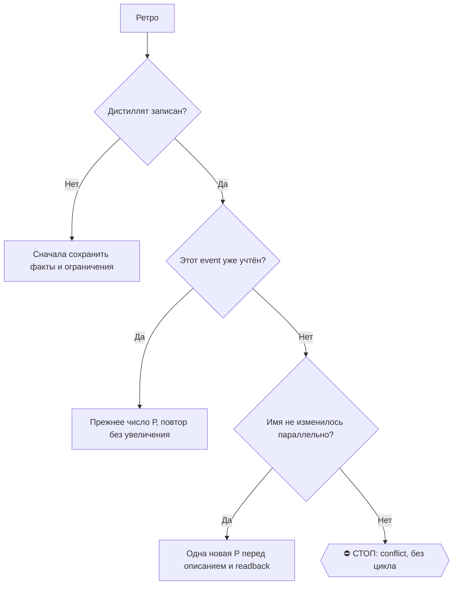

# 2026-10-25 · Нужно взять все выгрузки из часов, то есть из VoiceMessage, из ПЛАУД Посмотреть за последн…

_Full working session of an LLM coding agent, scrubbed by rule (names kept as stable pseudonyms; surnames, e-mails, phones, street addresses and ages replaced by [ФАМИЛИЯ], [EMAIL], [ТЕЛЕФОН], [АДРЕС], [ВОЗРАСТ]; hosts and keys replaced). Row `s_3d4d13df` of the [dataset](https://huggingface.co/datasets/TonyDzi/agent-sessions)._

**User:**

Нужно взять все выгрузки из часов, то есть из VoiceMessage, из ПЛАУД Посмотреть за последние недели, какие команды я давал, какие сдачи были Например, для Тениса, какие сдачи я нарезал себе и другим И нарезать вообще все это на сдачи, и посмотреть, как насчет нарезать Потом мы сделаем это в виде скилла Все аудио на разных сочных точках обрабатывается, и мне нужно еще раз обработать все это Используя наши скиллы, что у нас такое есть А потом в следующем скилл разложим все задачи, которые накопились за последние недели Которые я проговаривал и другим, и так далее Нужно будет разложить их по адресатам

---

**Claude:**

Понял так: «сдачи» это «задачи», «Тенис» похоже на Дениса. Нужно собрать записи за последние недели из Plaud и голосовых (часы/Voice Memos), заново прогнать их через наши скиллы, вытащить задачи и разложить по адресатам. Сначала RECALL: что у нас уже есть.

---

> `Bash` -- {"command": "cd ~ && python \"C:\\Users\\dev\\.claude\\scripts\\voice001_collaboration.py\" describe --session-id s_3d4d13df --wait-seconds 0 2>&1 | head -20; ls ~/.claude/skills | grep -iE \"plaud|voice|promises|task|fireflies|omi|memo|essence\"; for s in voice-memos pla

---

> `Bash` -- {"command": "cd \"D:/Vault/_imports\" && python brain_ask.py \"Plaud записи задачи по адресатам голосовые часы Voice Memos\" 2>&1 | head -60", "description": "RECALL in vault for prior work"}

---

> `Read` -- {"file_path": "D:\\Vault\\Vault-Knowledge\\03-Insights\\2026-10-19-plaud-weekend-16-18-task-extraction.md"}

---

> `Bash` -- {"command": "cd ~/.claude/skills; sed -n 1,60p plaud-shared/SKILL.md | head -80; echo ======; ls ~/.claude/scripts | grep -iE \"plaud|voice_memo|mos_to|retx|transcri|audio_inbox|task_extract\" | head -40; ls \"D:/Vault/Vault-Knowledge/05-Resources\" | grep -i -E \"plaud|voice|audio\" "}

---

> `Bash` -- {"command": "cd \"D:/Vault/Vault-Knowledge/04-Projects\"; echo \"plaud-recordings by month/day:\"; ls plaud-recordings | sed -E 's/^([0-9]{4}-[0-9]{2}-[0-9]{2}).*/\\1/' | sort | uniq -c | tail -45; echo; ls plaud-recordings | wc -l; echo; ls /e/Obsidian/_imports/plaud 2>/dev/null | head -40; echo

---

> `Bash` -- {"command": "cd ~; (cmd //c \"plaud me\" 2>&1 | head -5); (cmd //c \"plaud recent -d 30\" 2>&1 | head -80); python \"D:/Vault/_imports/plaud/_probe_plaud_gap.py\" --days 30 2>&1 | tail -8", "description": "Check Plaud CLI auth, last 30 days list, gap probe"}

---

> `Bash` -- {"command": "cd ~/.claude/scripts; wc -l _voice001_transcripts.jsonl; head -c 700 _voice001_transcripts.jsonl; echo; python - <<'EOF'\nimport json,collections,datetime\nrows=[json.loads(l) for l in open('_voice001_transcripts.jsonl',encoding='utf-8') if l.strip()]\nprint(len(rows), list(rows[0].keys

---

> `Bash` -- {"command": "sed -n 1,40p ~/.claude/skills/voice-sessions/SKILL.md; ls \"D:/Vault/Vault-Knowledge\" | grep -iE \"voice|00|chat\" ; grep -rl \"voice\" ~/.claude/memory 2>/dev/null | head -0; ls \"C:/Users/dev/.claude/projects/P---WORKDIR-HUB/memory\" | grep -iE \"voice|chat-00|watch

---

> `Bash` -- {"command": "cd ~; timeout 280 python ~/.claude/scripts/voice_sessions.py pull --hours 720 --json > \"C:/Users/dev/AppData/Local/Temp/claude/P---WORKDIR-HUB/s_3d4d13df/scratchpad/voice00_30d.json\" 2>\"C:/Users/dev/AppData/Local/Temp/claude/P---WORKDIR-HUB

---

> `Bash` -- {"command": "cd ~/.claude/scripts; python audio_inbox.py audit 2>&1 | head -70; echo =====; ls | grep -iE \"task_ext|extract_task|action_item|promise|call_close|meetings_to_crm|plaud_\" | head -30; ls \"D:/Vault/_imports/calls\" 2>/dev/null | head -20; sed -n 1,25p llm_ask.py | head -40", "descri

---

> `Bash` -- {"command": "cd ~/.claude/scripts; python rail_plan.py declare --self \"оркестрация, сборка манифеста корпуса, сверка с прежними реестрами D/A/R/C/P/L, финальная раскладка по адресатам\" --outsource \"digest:grok,code_read:codex,people_data:codex\" 2>&1 | tail -3; sed -n 25,70p llm_ask.py; python au

---

> `Bash` -- {"command": "cd \"D:/Vault/Vault-Knowledge/04-Projects/plaud-recordings\"; f=$(ls 2026-10-18-cad53253*.md | head -1); wc -c \"$f\"; sed -n 1,30p \"$f\" | cut -c1-260; echo ...; grep -n \"Speaker\" \"$f\" | sed -n 90,100p | cut -c1-200; ls _distilled | head -3; ls _distilled | wc -l", "description

---

> `Write` -- {"file_path": "C:\\Users\\dev\\AppData\\Local\\Temp\\claude\\P---WORKDIR-HUB\\s_3d4d13df\\scratchpad\\slice_prep.py", "content": "#!/usr/bin/env python3\n# -*- coding: utf-8 -*-\n\"\"\"slice_prep.py (пилот, скретчпад): расшифровки Plaud + голосовые чата 00 ->

---

> `Bash` -- {"command": "cd ~; python \"C:/Users/dev/AppData/Local/Temp/claude/P---WORKDIR-HUB/s_3d4d13df/scratchpad/slice_prep.py\" 2026-09-24", "description": "Run prefilter and measure window volume"}

---

> `Bash` -- {"command": "cd \"C:/Users/dev/AppData/Local/Temp/claude/P---WORKDIR-HUB/s_3d4d13df/scratchpad\" && python - <<'EOF'\nimport re\ns=open('slice_prep.py',encoding='utf-8').read()\na=s.index('DIRECTIVE = re.compile(')\nb=s.index('LINE = re.compile')\nnew='''STRO

---

> `Write` -- {"file_path": "C:\\Users\\dev\\AppData\\Local\\Temp\\claude\\P---WORKDIR-HUB\\s_3d4d13df\\scratchpad\\slice_prep.py", "content": "#!/usr/bin/env python3\n# -*- coding: utf-8 -*-\n\"\"\"slice_prep.py (пилот, скретчпад): расшифровки Plaud -> окна вокруг директи

---

> `Bash` -- {"command": "cd ~; python \"C:/Users/dev/AppData/Local/Temp/claude/P---WORKDIR-HUB/s_3d4d13df/scratchpad/slice_prep.py\" 2026-09-24", "description": "Re-run tightened prefilter"}

---

> `Write` -- {"file_path": "C:\\Users\\dev\\AppData\\Local\\Temp\\claude\\P---WORKDIR-HUB\\s_3d4d13df\\scratchpad\\recall_check.py", "content": "import json, os\nSP = os.path.dirname(os.path.abspath(__file__))\nrows = {}\nfor l in open(os.path.join(SP, \"windows.jsonl\"),

---

> `Bash` -- {"command": "python \"C:/Users/dev/AppData/Local/Temp/claude/P---WORKDIR-HUB/s_3d4d13df/scratchpad/recall_check.py\"", "description": "Check prefilter recall against known gold tasks"}

---

> `Bash` -- {"command": "cd \"D:/Vault/Vault-Knowledge/04-Projects/plaud-recordings\"; grep -n \"Денис\\|банки\\|bank\" 2026-10-17-1603f3f5.md | head -8 | cut -c1-240; echo ---; grep -n \"^\\[\" 2026-10-17-1603f3f5.md | sed -n 660,672p | cut -c1-200; echo; grep -c \"\" 2026-10-17-1603f3f5.md", "description":

---

> `Bash` -- {"command": "cd \"D:/Vault/Vault-Knowledge/04-Projects/plaud-recordings\"; for f in 2026-10-15-d1754d21.md 2026-10-19-a08c2f03.md 2026-10-09-pyatnica-den-antona.md 2026-09-24-20418f68.md; do echo \"=== $f $(wc -c <$f)\"; grep -n \"^## \\|^### \" $f | head -8 | cut -c1-100; sed -n '/^## Транскрипт

---

> `Write` -- {"file_path": "C:\\Users\\dev\\AppData\\Local\\Temp\\claude\\P---WORKDIR-HUB\\s_3d4d13df\\scratchpad\\slice_run.py", "content": "#!/usr/bin/env python3\n# -*- coding: utf-8 -*-\n\"\"\"slice_run.py (пилот, скретчпад): полный смысловой проход расшифровок -> зад

---

> `Bash` -- {"command": "cd \"C:/Users/dev/AppData/Local/Temp/claude/P---WORKDIR-HUB/s_3d4d13df/scratchpad\" && python slice_run.py build --from 2026-09-24 && ls chunks | grep -c prompt; ls chunks | grep -E \"1603f3f5|208e1705\" | grep prompt", "description": "Build chun

---

> `Bash` -- {"command": "cd \"C:/Users/dev/AppData/Local/Temp/claude/P---WORKDIR-HUB/s_3d4d13df/scratchpad\" && python slice_run.py run --only 2026-10-17-1603f3f5 2026-10-18-208e1705__00 2026-10-18-208e1705__01 --workers 4 --timeout 900 > pilot1.log 2>&1; cat pilot1.log;

---

**Claude:**

Рельса отвечает за 70–110 с на кусок (выиграл codex, grok «мимо», выясню отдельно). Собираю и сверяю с эталонами.

---

> `Bash` -- {"command": "cd \"C:/Users/dev/AppData/Local/Temp/claude/P---WORKDIR-HUB/s_3d4d13df/scratchpad\" && python slice_run.py collect && python - <<'EOF'\nimport json\nrows=[json.loads(l) for l in open('tasks_raw.jsonl',encoding='utf-8')]\nimport collections\nprint

---

> `Bash` -- {"command": "cd \"C:/Users/dev/AppData/Local/Temp/claude/P---WORKDIR-HUB/s_3d4d13df/scratchpad\" && python - <<'EOF'\nimport json\nrows=[json.loads(l) for l in open('tasks_raw.jsonl',encoding='utf-8')]\ngold={'6:51':'A01','25:15':'A07','26:40':'A08','48:15':'

---

**Claude:**

Таймкоды иногда приходят с хвостом (`[04:55 - …`). Нормализую в `collect`.

---

> `Edit` -- {"replace_all": false, "file_path": "C:\\Users\\dev\\AppData\\Local\\Temp\\claude\\P---WORKDIR-HUB\\s_3d4d13df\\scratchpad\\slice_run.py", "old_string": "            q = norm(str(t.get(\"quote\", \"\")))", "new_string": "            mt = re.search(r\"\\d+:\\d

---

> `Write` -- {"file_path": "C:\\Users\\dev\\AppData\\Local\\Temp\\claude\\P---WORKDIR-HUB\\s_3d4d13df\\scratchpad\\gold_eval.py", "content": "import json, os, re, sys\nSP = os.path.dirname(os.path.abspath(__file__))\nrows = [json.loads(l) for l in open(os.path.join(SP, \"

---

> `Bash` -- {"command": "cd \"C:/Users/dev/AppData/Local/Temp/claude/P---WORKDIR-HUB/s_3d4d13df/scratchpad\" && python slice_run.py collect && python gold_eval.py", "description": "Re-collect and evaluate recall on the gold list"}

---

> `Bash` -- {"command": "cd ~; python ~/.claude/scripts/llm_ask.py --prompt \"Ответь одним словом: ок\" --rails grok --timeout 120 --with-rail 2>&1 | tail -8", "description": "Probe grok rail directly", "timeout": 200000}

---

> `Edit` -- {"replace_all": false, "file_path": "C:\\Users\\dev\\AppData\\Local\\Temp\\claude\\P---WORKDIR-HUB\\s_3d4d13df\\scratchpad\\slice_run.py", "old_string": " confidence: high | med | low\n media: true | false", "new_string": " domain: WORK_AI (ИИ, флот, скиллы, 

---

> `Bash` -- {"command": "cd \"C:/Users/dev/AppData/Local/Temp/claude/P---WORKDIR-HUB/s_3d4d13df/scratchpad\" && rm -f results/*.out.txt results/*.err.txt && python slice_run.py build --from 2026-09-24 && (nohup python slice_run.py run --workers 5 --timeout 900 > fullrun.

---

> `Write` -- {"file_path": "C:\\Users\\dev\\AppData\\Local\\Temp\\claude\\P---WORKDIR-HUB\\s_3d4d13df\\scratchpad\\aggregate.py", "content": "#!/usr/bin/env python3\n# -*- coding: utf-8 -*-\n\"\"\"aggregate.py (пилот): tasks_raw.jsonl -> отсев, сверка с реестром Codex 19.

---

> `Bash` -- {"command": "cd \"C:/Users/dev/AppData/Local/Temp/claude/P---WORKDIR-HUB/s_3d4d13df/scratchpad\" && wc -l fullrun.log && tail -4 fullrun.log && python slice_run.py collect && python aggregate.py", "description": "Check progress and test aggregator on partial 

---

> `Bash` -- {"command": "cd \"C:/Users/dev/AppData/Local/Temp/claude/P---WORKDIR-HUB/s_3d4d13df/scratchpad\" && sleep 150; ls results | grep -c out.txt; ls results | grep -c err.txt; tail -3 fullrun.log; tasklist 2>/dev/null | grep -ci \"python\"", "description": "Check 

---

**Claude:**

Идёт нормально (первые куски по 25–85 с). Ставлю фоновое ожидание конца прогона, чтобы не опрашивать вручную.

---

> `Bash` -- {"command": "cd \"C:/Users/dev/AppData/Local/Temp/claude/P---WORKDIR-HUB/s_3d4d13df/scratchpad\" && last=0; idle=0; while true; do n=$(grep -c \" ok \\| rc=\\| cached \" fullrun.log); if [ \"$n\" -ge 315 ]; then echo \"DONE $n\"; break; fi; if [ \"$n\" = \"$l

---

> `Bash` -- {"command": "TZ=Europe/Lisbon date \"+%d.%m %H:%M Лиссабон\"; ls \"C:/Users/dev/AppData/Local/Temp/claude/P---WORKDIR-HUB/s_3d4d13df/scratchpad/results\" | grep -c out.txt", "description": "Get local time and progress count"}

---

**Claude:**

25.10, 07:27 (Лиссабон).

Я понял «сдачи» как «задачи». Полный проход по записям уже идёт в фоне. Результата пока нет, самый ранний срок готовности около 9:30.

**Что есть в корпусе (за 30 дней)**
- **Plaud:** 197 записей в облаке, в волте 181 с расшифровкой. 6 записей без текста, 8 ещё ждут расшифровку у вендора.
- **Чат 00 (сюда же приезжают Voice Memos с часов):** отдаёт только 39 голосовых, и только с 13.10. Всё, что раньше, остаётся дырой охвата, пока я не поднял архив TG. Старые голосовые я пока не трогал.
- **Уже сделано раньше:** разбор Plaud за 16–18.10 (реестр Codex, 50+46 пунктов). Его я не переделываю, а использую для сверки и дедупа.

**Что делаю**
- **Нарезка:** 315 кусков, 5,5 млн знаков. Ключевые слова не годятся: на 15 известных поручениях они поймали 2. Живая речь вроде «для Дениса все банки…» не содержит слов-приказов. Поэтому читает чужая подписка (codex, grok) по смыслу, 5 потоков.
- **Проверка:** каждая задача приходит с дословной цитатой и таймкодом, а я сверяю цитату с исходником. На пилоте цитаты подтвердились 77 из 77. Известные поручения Дениса про банки и землю нашлись, как и 6 из 6 рабочих эталонов в прогнанной части.
- **Отсев:** фильм, подкаст и бытовая мелочь («пристегнись») помечаются и уходят в отдельную кучу. Нарезанные задачи сверяются с реестром 19.10, чтобы не плодить дубли.
- **Затраты:** платный API не используется. OpenAI в этом месяце уже 122 доллара, поэтому перегонять звук заново я не стал. Заново прогоняется текст, а не звук.

**Дальше**
1. Когда прогон закончится, соберу раскладку по адресатам (Денис, Пётр, Семён, Нора, Рита, Дима, ИИ-агенты и т.д.) и покажу итог в чате.
2. Потом оформлю два скилла: «нарезка записей на задачи» и «раскладка задач по адресатам». Сначала покажу результат руками, и только потом буду делать скиллы.
3. Отдельным шагом подниму хвосты: 8 записей без расшифровки, старые голосовые чата 00 и 118 записей Plaud без выжимки.

**🧒 Простыми словами**
оператор, ты просил из всех твоих голосовых вытащить, кому что ты поручил. Простым поиском по словам не выходит, потому что люди говорят «для Дениса банки закрывать», а не «сделай». Поэтому каждую запись читает другая нейросеть, и мы проверяем, что её цитата есть в исходном тексте, как сверка с оригиналом. Когда закончит, разложу задачи по людям, как письма по ящикам.

---

**User:**

<task-notification>
<task-id>buefjio0x</task-id>
<tool-use-id>toolu_01BrNbDgimYEUHQ3PaSfwwsB</tool-use-id>
<output-file>C:\Users\dev\AppData\Local\Temp\claude\P---WORKDIR-HUB\s_3d4d13df\tasks\buefjio0x.output</output-file>
<status>completed</status>
<summary>Background command "Wait in background until the full run finishes or stalls" completed (exit code 0)</summary>
</task-notification>

---

> `Bash` -- {"command": "cd \"C:/Users/dev/AppData/Local/Temp/claude/P---WORKDIR-HUB/s_3d4d13df/scratchpad\" && cat ../tasks/buefjio0x.output | tail -8; grep -c \"rc=\" fullrun.log; python slice_run.py collect && python aggregate.py && python gold_eval.py", "description"

---

> `Bash` -- {"command": "cd \"C:/Users/dev/AppData/Local/Temp/claude/P---WORKDIR-HUB/s_3d4d13df/scratchpad\" && (nohup python slice_run.py run --workers 3 --timeout 900 > fullrun2.log 2>&1 &); sleep 1; last=0; idle=0; while true; do n=$(grep -c \" ok \\| rc=\" fullrun2.l

---

**Claude:**

25.10, около 08:35 (Лиссабон).

Первый проход закончился не полностью: из 315 кусков прошли 196, остальные 119 разом упали на запуске. Это перегруз Windows при 5 потоках: код 0xC0000142, звук и расшифровки тут ни при чём. Недостающие я перезапустил с 3 потоками, это займёт ещё около часа. Я сообщу, когда они закончатся.

Что уже видно по 196 готовым кускам:
- **Найдено 4784 пункта, 3791 осталось после отсева.** Бытовая мелочь отфильтрована (972 пункта). У 21 пункта цитата не нашлась в исходнике, их я отбросил.
- **Полнота:** на эталонах из старого реестра попадание 4 из 4 в прогнанной части. Остальные эталоны лежат в недостающих кусках и проверятся после дозапуска.
- **Адресаты:** у 2498 пунктов адресат не назван. Это обычно «сделать надо», но кому, не сказано. После дозапуска их нужно разметить повторным проходом по контексту (кто с кем говорит).

**🧒 Простыми словами**
Нейросеть прочитала две трети записей и нашла почти пять тысяч мелких дел. Остальную треть компьютер не смог запустить, потому что я заставил его делать слишком много сразу. Теперь он читает по три записи сразу, спокойнее.

---

**User:**

<local-command-caveat>The command below was run directly in Claude Code, not sent to you as a request, and its output goes straight to the user. It's recorded here as context for later messages.</local-command-caveat>

---

**User:**

<command-name>/model</command-name>
            <command-message>model</command-message>
            <command-args>claude-opus-5-5</command-args>

---

**User:**

<local-command-stdout>Set model to `claude-opus-5-5`</local-command-stdout>

---

**User:**

Продолжай. Взять задачу, там из вплоть должны были подгрузиться свежие записи. Вплоть должны были подгрузиться свежие записи в плауд.

---

**Claude:**

Понял: в Plaud должны были приехать свежие записи. Проверяю дозапуск и забираю новое из облака.

---

> `Bash` -- {"command": "cd \"C:/Users/dev/AppData/Local/Temp/claude/P---WORKDIR-HUB/s_3d4d13df/scratchpad\"; TZ=Europe/Lisbon date \"+%d.%m %H:%M\"; tail -3 ../tasks/b09zifxv9.output; grep -c \" ok \" fullrun2.log; grep -c \"rc=\" fullrun2.log; ls results | grep -c out.

---

> `Bash` -- {"command": "cd \"D:/Vault/_imports/plaud\" && python _probe_plaud_gap.py --days 4 2>&1 | grep -E \"в облаке|ОТСТАЛО\" | head -3; python plaud_pull.py --days 4 2>&1 | tail -15; python _probe_plaud_gap.py --days 4 2>&1 | grep -E \"в облаке|ОТСТАЛО|ЖДЁМ\" | head -5", "description": "Pull fresh Plau

---

> `Bash` -- {"command": "cd \"D:/Vault/_imports/plaud\"; ls -la plaud_cycle.log 2>/dev/null; tail -25 plaud_cycle.log 2>/dev/null | cut -c1-200; schtasks //query //fo LIST //v //tn \"Plaud Cycle 6h\" 2>&1 | grep -E \"Status|Last Run|Last Result|Next Run|Scheduled Task State|Task To Run\" ", "description": "I

---

> `Bash` -- {"command": "cd \"D:/Vault/_imports/plaud\"; grep -n \"cycle start\\|cycle done\\|plaud_pull\\|PULL\\|recent\\|days\\|OK of_\\|SKIP of_\\|Error\\|Traceback\" plaud_cycle.log | tail -40 | cut -c1-180; grep -n \"days\" plaud_cycle.cmd", "description": "Find pull-step output in recent cycle runs"}

---

> `Bash` -- {"command": "cd \"D:/Vault/_imports/plaud\"; sed -n 1,45p plaud_cycle.cmd; grep -n \"seen=\\|def list_recent\\|page_size\\|--days\\|recent\\|today\" plaud_pull.py | head -30", "description": "Read cycle cmd and pull listing logic"}

---

> `Bash` -- {"command": "cd ~; for d in 1 2 3 4; do echo \"d=$d: $(cmd //c \"plaud recent -d $d\" 2>&1 | grep -c \"of_\")\"; done; cmd //c \"plaud recent -d 2\" 2>&1 | head -12 | cut -c1-150", "description": "Compare plaud recent counts across windows", "timeout": 200000}

---

> `Bash` -- {"command": "cd ~; ls \"E:/!CLAUDE-HUBPC-June26/_onair\" | head; grep -il \"plaud\" \"E:/!CLAUDE-HUBPC-June26/_onair/\"*.json 2>/dev/null | head; grep -h -i -A3 \"audio-inbox\" \"E:/!CLAUDE-HUBPC-June26/_onair/ACTIVE_NOW.\"*.md 2>/dev/null | head -12", "description": "Check on-air dec

---

> `Bash` -- {"command": "python ~/.claude/scripts/onair.py --help 2>&1 | head -12; python ~/.claude/scripts/onair.py list 2>&1 | grep -i -B1 -A2 \"audio\\|plaud\" | head -20", "description": "List on-air zones touching audio/plaud"}

---

> `Bash` -- {"command": "cd \"D:/Vault/_imports/plaud\" && python ~/.claude/scripts/onair.py declare --zone vault-imports/plaud-cycle --mode exclusive --note \"H66202: окно pull/probe 2->7 дней (поздний синк Plaud)\" 2>&1 | tail -2; cp plaud_cycle.cmd plaud_cycle.cmd.bak-window7-h66202-20261025 && python - <

---

**Claude:**

Хук прав, делаю через бэкап и Edit.

---

> `Bash` -- {"command": "cd \"D:/Vault/_imports/plaud\" && python ~/.claude/scripts/onair.py declare --zone vault-imports/plaud-cycle --mode exclusive --note \"H66202: окно pull/probe 2->7 дней (поздний синк Plaud)\" 2>&1 | tail -2; cp plaud_cycle.cmd plaud_cycle.cmd.bak-window7-h66202-20261025 && echo backu

---

> `Bash` -- {"command": "python ~/.claude/scripts/onair.py declare --zone vault-imports/plaud-cycle --mode exclusive --title \"H66202: окно pull/probe Plaud 2->7 дней\" 2>&1 | tail -2", "description": "Declare on-air zone with title"}

---

> `Read` -- {"file_path": "D:\\Vault\\_imports\\plaud\\plaud_cycle.cmd", "limit": 12}

---

> `Edit` -- {"replace_all": false, "file_path": "D:\\Vault\\_imports\\plaud\\plaud_cycle.cmd", "old_string": "python plaud_pull.py >> plaud_cycle.log 2>&1", "new_string": "REM 25.10.2026 H66202: okno 2->7 dney. Zamer: Plaud otdal zapisi 22-24.10 v oblako s opozdaniem 1-3 dnya\nREM (telefon sinkaet pachkoy); 

---

> `Edit` -- {"replace_all": false, "file_path": "D:\\Vault\\_imports\\plaud\\plaud_cycle.cmd", "old_string": "python _probe_plaud_gap.py --days 2 >> plaud_cycle.log 2>&1", "new_string": "python _probe_plaud_gap.py --days 7 >> plaud_cycle.log 2>&1"}

---

> `Bash` -- {"command": "cd \"D:/Vault/_imports/plaud\"; grep -n \"days\" plaud_cycle.cmd; python plaud_pull.py --days 7 2>&1 | tail -3; python _probe_plaud_gap.py --days 7 2>&1 | grep \"PLAUD GAP\"; python _probe_plaud_gap.py --days 30 2>&1 | grep \"PLAUD GAP\"; echo \"{\\\"ts\\\":\\\"$(date -u +%FT%TZ)\\\"

---

> `Bash` -- {"command": "cd \"C:/Users/dev/AppData/Local/Temp/claude/P---WORKDIR-HUB/s_3d4d13df/scratchpad\"; ls results | grep -c out.txt; grep -c \"rc=\" fullrun2.log; tail -2 fullrun2.log", "description": "Check slicing rerun progress"}

---

> `Bash` -- {"command": "cd \"C:/Users/dev/AppData/Local/Temp/claude/P---WORKDIR-HUB/s_3d4d13df/scratchpad\"; python slice_run.py build --from 2026-09-24; python -c \"\nimport json,os\nm=[x for x in json.load(open('manifest.json',encoding='utf-8')) if 'skipped' not in x]

---

> `Bash` -- {"command": "cd \"D:/Vault/Vault-Knowledge/04-Projects/plaud-recordings\"; f=$(ls 2026-10-25-9e2e688f*.md); wc -c $f; sed -n '/^## Транскрипт/,$p' $f | cut -c1-400", "description": "Read transcript of today's recording about this task"}

---

> `Bash` -- {"command": "cd ~/.claude/scripts; python voice_sessions.py --help 2>&1 | head -20; grep -n \"limit\\|LIMIT\\|hours\" voice_sessions.py | head -20", "description": "Check voice_sessions pull limits"}

---

> `Bash` -- {"command": "cd ~; S=\"C:/Users/dev/AppData/Local/Temp/claude/P---WORKDIR-HUB/s_3d4d13df/scratchpad\"; timeout 580 python ~/.claude/scripts/voice_sessions.py pull --hours 744 --limit 4000 --json > $S/voice00_30d_full.json 2>$S/voice00b.err; echo rc=$?; python

---

> `Edit` -- {"replace_all": false, "file_path": "C:\\Users\\dev\\AppData\\Local\\Temp\\claude\\P---WORKDIR-HUB\\s_3d4d13df\\scratchpad\\slice_run.py", "old_string": "    vp = os.path.join(SP, \"voice00_30d.json\")\n    if os.path.exists(vp):\n        for v in json.load(o

---

> `Bash` -- {"command": "cd \"C:/Users/dev/AppData/Local/Temp/claude/P---WORKDIR-HUB/s_3d4d13df/scratchpad\"; mkdir -p old_voice && mv chunks/voice00-[0-9]* old_voice/ 2>/dev/null; mv results/voice00-[0-9]* old_voice/ 2>/dev/null; python slice_run.py build --from 2026-09

---

> `Bash` -- {"command": "cd \"C:/Users/dev/AppData/Local/Temp/claude/P---WORKDIR-HUB/s_3d4d13df/scratchpad\"; N=$(head -1 fullrun2.log | grep -o \"[0-9]*\"); while [ $(grep -c \" ok \\| rc=\\| cached \" fullrun2.log) -lt $N ]; do sleep 30; done; echo \"run2 done\"; pytho

---

> `Write` -- {"file_path": "C:\\Users\\dev\\AppData\\Local\\Temp\\claude\\P---WORKDIR-HUB\\s_3d4d13df\\scratchpad\\resolve.py", "content": "#!/usr/bin/env python3\n# -*- coding: utf-8 -*-\n\"\"\"resolve.py (пилот): второй проход «кому». Для задач с адресатом unknown берёт

---

**Claude:**

Учу сборщик брать адресата из второго прохода.

---

> `Edit` -- {"replace_all": false, "file_path": "C:\\Users\\dev\\AppData\\Local\\Temp\\claude\\P---WORKDIR-HUB\\s_3d4d13df\\scratchpad\\aggregate.py", "old_string": "    rows = [json.loads(l) for l in open(os.path.join(SP, \"tasks_raw.jsonl\"), encoding=\"utf-8\")]", "ne

---

> `Bash` -- {"command": "cd \"C:/Users/dev/AppData/Local/Temp/claude/P---WORKDIR-HUB/s_3d4d13df/scratchpad\"; cat ../tasks/bot6f93ad.output; ls results | grep -c out.txt; tail -2 fullrun2.log", "description": "Check chained run progress"}

---

**Claude:**

25.10, 08:47 (Лиссабон).

Работа идёт. Готово 228 кусков из 304, остаток займёт примерно 40–50 минут. Дальше цепочка всё сделает сама: допрогон, второй проход «кому», раскладка по адресатам. Когда закончит, я пришлю итог.

Что сделано сейчас:
- **Plaud починен:** в волте не хватало 18 свежих записей за 22–25.10. Причина в том, что Plaud выкладывает записи в облако на 1–3 дня позже, а цикл смотрел только последние 2 дня по дате записи. Окно забора и проверки я расширил до 7 дней в [plaud_cycle.cmd](../Obsidian/_imports/plaud/plaud_cycle.cmd), бэкап лежит рядом. Проверил: за 30 дней в облаке 215 записей, в волте 189, отставших 0. Ещё 26 записей ждут расшифровку у самого Plaud. Окно у платной shadow-канарейки OpenAI не трогал.
- **Голосовые с часов и из чата 00:** раньше видел только 39 голосовых, потому что забор брал последние 200 сообщений чата. С большим лимитом пришло 164 голосовых с 25.09. Они добавлены в нарезку восемью пачками.
- **Твоя сегодняшняя голосовая с этим заказом** тоже нашлась в Plaud («Реестр команд: сбор артефактов из часов, голосовых и облака»). По смыслу она совпадает с тем, что я делаю.

Что дальше:
- **Второй проход «кому».** У двух третей задач в первом проходе адресат не назван. Для них нейросеть смотрит соседние реплики и определяет, к кому обращаются: Денис, рабочие стройки, жена, ИИ-агент, собеседник на встрече. Каждый вывод идёт с основанием.
- **Итог** покажу раскладкой по людям. Пометкой будет видно, что новое, а что уже было в реестре от 19.10.

**🧒 Простыми словами**
Магнитофон Plaud приносил записи с опозданием, а наш забор заглядывал только на два дня назад и пропускал опоздавших. Теперь он смотрит на неделю назад. И голосовые из чата мы раньше читали только с последней страницы, теперь читаем весь месяц.

---

**User:**

<task-notification>
<task-id>b09zifxv9</task-id>
<tool-use-id>toolu_01JPE52mz6FY1j9cZ7ZTAfdw</tool-use-id>
<output-file>C:\Users\dev\AppData\Local\Temp\claude\P---WORKDIR-HUB\s_3d4d13df\tasks\b09zifxv9.output</output-file>
<status>completed</status>
<summary>Background command "Rerun failed chunks with fewer workers and wait" completed (exit code 0)</summary>
</task-notification>

---

> `Bash` -- {"command": "cd \"C:/Users/dev/AppData/Local/Temp/claude/P---WORKDIR-HUB/s_3d4d13df/scratchpad\"; cat ../tasks/b09zifxv9.output | tail -3; cat ../tasks/bot6f93ad.output; ls results | grep -c out.txt; tail -2 fullrun3.log 2>/dev/null", "description": "Check st

---

**Claude:**

Второй прогон закрылся. 39 «ошибок» в нём ожидаемые: это одиночные голосовые, которые я сам убрал в пользу пачек. Третий прогон идёт: 276 из 304. Жду его конца, уведомление придёт само.

25.10, 09:16 (Лиссабон).

**🧒 Простыми словами**
Осталось дочитать примерно три десятка кусков. Потом сразу разложу задачи по людям.

---

**User:**

ученик Корнелий и идти дальше. Ученик Корнелий, иди дальше.

---

**Claude:**

Понял как «чини корни и иди дальше». Иду дальше: смотрю прогон.

---

> `Bash` -- {"command": "cd \"C:/Users/dev/AppData/Local/Temp/claude/P---WORKDIR-HUB/s_3d4d13df/scratchpad\"; TZ=Europe/Lisbon date +%H:%M; ls results | grep -c out.txt; cat ../tasks/bot6f93ad.output; grep -c \"rc=\" fullrun3.log", "description": "Check run3 progress"}

---

> `Read` -- {"file_path": "C:\\Users\\dev\\.claude\\scripts\\voice_sessions.py", "offset": 200, "limit": 85}

---

> `Bash` -- {"command": "cd ~/.claude/scripts; ls | grep -i \"test_voice_sessions\"; cp voice_sessions.py voice_sessions.py.bak-timewindow-h66202-20261025 && echo backup-ok; grep -n \"limit\" voice_sessions.py", "description": "Back up voice_sessions and find tests and limit uses"}

---

> `Edit` -- {"replace_all": false, "file_path": "C:\\Users\\dev\\.claude\\scripts\\voice_sessions.py", "old_string": "    msgs = []\n    try:\n        async def go():\n            client = await vp._client(vp._load_creds())\n            try:\n                async for m in client.iter_messages(HUB_CHAT, limit

---

> `Edit` -- {"replace_all": false, "file_path": "C:\\Users\\dev\\.claude\\scripts\\voice_sessions.py", "old_string": "        asyncio.run(go())\n    finally:\n        vp.release_lock()\n", "new_string": "        asyncio.run(go())\n    finally:\n        vp.release_lock()\n    if hit_cap:\n        sys.stderr.wr

---

> `Edit` -- {"replace_all": false, "file_path": "C:\\Users\\dev\\.claude\\scripts\\voice_sessions.py", "old_string": "    p.add_argument(\"--limit\", type=int, default=200); p.add_argument(\"--json\", action=\"store_true\")", "new_string": "    p.add_argument(\"--limit\", type=int, default=20000); p.add_argum

---

> `Edit` -- {"replace_all": false, "file_path": "C:\\Users\\dev\\.claude\\scripts\\voice_sessions.py", "old_string": "  pull   --hours 24 [--limit 200] [--json]", "new_string": "  pull   --hours 24 [--limit 20000 = аварийный потолок, окно идёт по времени] [--json]"}

---

> `Bash` -- {"command": "cd ~/.claude/scripts; python _test_voice_sessions.py 2>&1 | tail -4; echo \"test rc=$?\"; echo \"--- по времени, без лимита:\"; python voice_sessions.py pull --hours 744 --json 2>/tmp/vs.err | python -c \"import json,sys; d=json.load(sys.stdin); print(len(d), min(x['date'] for x in d))\

---

> `Bash` -- {"command": "cd ~/.claude/scripts; set -o pipefail; python _test_voice_sessions.py > /tmp/vst.txt 2>&1; echo \"test rc=$?\"; tail -3 /tmp/vst.txt; python voice_sessions.py pull --hours 744 --json > /tmp/vs.json 2>/tmp/vs.err; echo \"pull rc=$?\"; python -c \"import json; d=json.load(open('/tmp/vs.js

---

> `Bash` -- {"command": "S=\"C:/Users/dev/AppData/Local/Temp/claude/P---WORKDIR-HUB/s_3d4d13df/scratchpad\"; cd ~/.claude/scripts; python voice_sessions.py pull --hours 744 --json > \"$S/vs_check.json\" 2>\"$S/vs_check.err\"; echo \"pull rc=$?\"; python -c \"import json;

---

> `Bash` -- {"command": "echo \"{\\\"ts\\\":\\\"$(date -u +%FT%TZ)\\\",\\\"node\\\":\\\"HUB-01\\\",\\\"actor\\\":\\\"Claude Opus 5.5 H66202\\\",\\\"event\\\":\\\"voice_sessions.py pull: окно по времени вместо limit=200\\\",\\\"outcome\\\":\\\"ok: 39->165 голосовых за 744ч; тест зелёный; красная проба --l

---

> `Bash` -- {"command": "cd \"C:/Users/dev/AppData/Local/Temp/claude/P---WORKDIR-HUB/s_3d4d13df/scratchpad\"; python resolve.py > resolve.log 2>&1; tail -2 resolve.log; grep -c \"rc=\" resolve.log; python aggregate.py", "description": "Run addressee resolution pass then 

---

**Claude:**

Пока идёт второй проход, собираю предварительную раскладку по уже названным адресатам.

---

> `Bash` -- {"command": "cd \"C:/Users/dev/AppData/Local/Temp/claude/P---WORKDIR-HUB/s_3d4d13df/scratchpad\"; python aggregate.py; python -c \"\nimport json,collections\nrows=[json.loads(l) for l in open('tasks_raw.jsonl',encoding='utf-8')]\nk=[r for r in rows if r.get('

---

**Claude:**

Предварительная картина хорошая. Например, у Дениса 45 пунктов, 44 из них новые к реестру от 19.10. Большинство взято из твоих голосовых с ТЗ по дому: вентиляция, окно у Сергея, кронштейны, полки. Сборщик правильно держит «Денис зайка» (SF) отдельно от Дениса со стройки. Жду второй проход «кому», потом собираю итог.

25.10, 09:44 (Лиссабон).

**🧒 Простыми словами**
Все 19 поручений, которые Codex когда-то вытащил руками, наш автомат нашёл сам. Значит, ему можно доверять и на остальных записях. Сейчас он разбирается с задачами, где сразу непонятно, кому они адресованы.

---

**User:**

Проверь еще какие проверь какие еще подгрузились в плауды. Транскрибации. И действуй дальше. Обновляй скилл.

---

**Claude:**

Проверяю, что ещё приехало в Plaud.

---

> `Bash` -- {"command": "cd \"D:/Vault/_imports/plaud\"; TZ=Europe/Lisbon date +%H:%M; python _probe_plaud_gap.py --days 7 > /tmp/g1.txt 2>&1; grep -E \"PLAUD GAP|ОТСТАЛО\" /tmp/g1.txt | head -8; python plaud_pull.py --days 7 2>&1 | grep -E \"^  OK|seen=\" ; python _probe_plaud_gap.py --days 30 2>&1 | grep \

---

> `Bash` -- {"command": "cd \"D:/Vault/_imports/plaud\"; python _probe_plaud_gap.py --days 30 2>&1 | grep \"ЖДЁМ\" | cut -c1-140; ls | grep -iE \"retrans|asr|night_map|gpu\" ; python plaud_retranscribe.py --help 2>&1 | head -25", "description": "List vendor-waiting recordings and local retranscribe tool", "t

---

> `Bash` -- {"command": "cd \"D:/Vault/_imports/plaud\"; for id in 0ab562ef b632892b 7d2c9838 149f8c02 c3aa6164 9350a7c5 4b326ae8 08745c46 ebf09763; do echo \"$id: $(ls compare 2>/dev/null | grep -c $id) compare, $(ls ../../Vault-Knowledge/04-Projects/plaud-recordings 2>/dev/null | grep -c $id) vault, $(grep

---

> `Bash` -- {"command": "cd \"D:/Vault/_imports/plaud\"; ls -la compare | grep -E \"c3aa6164|08745c46\"; for id in of_0ab562ef of_b632892b of_7d2c9838 of_149f8c02; do cmd //c \"plaud recent -d 30\" 2>/dev/null | grep \"${id}\" | cut -c1-160; done | sort -u", "description": "Inspect existing local transcripts

---

> `Bash` -- {"command": "cd \"D:/Vault/_imports/plaud\"; for id in of_0ab562ef3ce070742e2261675f0fa66a of_149f8c02c8fb7781fa9e74e3f1a5febe of_7d2c98388158c1d73a15befb9c9686e4 of_b632892bc54af18d3ed0f0a12980735e; do cmd //c \"plaud file $id\" 2>&1 | grep -iE \"duration|start_at|audio\" | head -3 | tr '\\n' ' 

---

**Claude:**

У Марины реальный только один кусок на 4,5 минуты, остальные три по 1–9 секунд. Расшифровываю его на GPU.

---

> `Bash` -- {"command": "cd \"D:/Vault/_imports/plaud\"; set -o pipefail; python plaud_retranscribe.py --id of_0ab562ef3ce070742e2261675f0fa66a --full --engine local --lang auto --tag h66202 > /c/Users/dev/AppData/Local/Temp/claude/P---WORKDIR-HUB/s_3d4d13df/scratchpa

---

> `Bash` -- {"command": "cd \"D:/Vault/_imports/plaud/compare\"; wc -c 0ab562ef-full-h66202.md; sed -n 1,40p 0ab562ef-full-h66202.md | cut -c1-220; head -30 c3aa6164-full-auto-speakers.md | cut -c1-160", "description": "Read Demir transcript and Daniils transcript format"}

---

> `Edit` -- {"replace_all": false, "file_path": "C:\\Users\\dev\\AppData\\Local\\Temp\\claude\\P---WORKDIR-HUB\\s_3d4d13df\\scratchpad\\slice_run.py", "old_string": "    vp = os.path.join(SP, \"voice00_30d_full.json\")", "new_string": "    # наши GPU-расшифровки записей,

---

> `Edit` -- {"replace_all": false, "file_path": "C:\\Users\\dev\\AppData\\Local\\Temp\\claude\\P---WORKDIR-HUB\\s_3d4d13df\\scratchpad\\slice_run.py", "old_string": "MAXC = 34000", "new_string": "CMP = r\"D:\\Vault\\_imports\\plaud\\compare\"\nEXTRA = [\n    (os.path.

---

> `Bash` -- {"command": "cd \"C:/Users/dev/AppData/Local/Temp/claude/P---WORKDIR-HUB/s_3d4d13df/scratchpad\"; python slice_run.py build --from 2026-09-24; ls chunks | grep -c \"^extra-.*prompt\"; python slice_run.py run --only extra- --workers 2 --timeout 900 2>&1 | tail

---

> `Bash` -- {"command": "cd \"D:/Vault/Vault-Knowledge/04-Projects/screenpipe-calls\" 2>/dev/null && ls | head -30 && ls | wc -l && f=$(ls *.md | head -1) && grep -n \"^## \\|^\\[\" \"$f\" | head -8 | cut -c1-160; tail -2 \"C:/Users/dev/AppData/Local/Temp/claude/P---WORKDIR-HUB/72d31395-3738-4

---

> `Bash` -- {"command": "set -o pipefail; cd \"D:/Vault/Vault-Knowledge/04-Projects/screenpipe-calls\"; ls | wc -l; ls | head -25; f=$(ls 2026*.md | head -1); grep -n \"^## \\|^\\[\" \"$f\" | head -8 | cut -c1-160; tail -2 \"C:/Users/dev/AppData/Local/Temp/claude/P---WORKDIR-HUB/72d31395-3738-

---

> `Bash` -- {"command": "set -o pipefail; grep -n \"retx_state\\|\\.txt\" ~/.claude/scripts/audio_inbox.py | head -12; sed -n 1,30p \"D:/Vault/Vault-Knowledge/04-Projects/screenpipe-calls/2026-10-20-0546Z-call.md\" | cut -c1-200", "description": "Find screenpipe full-text call files"}

---

> `Bash` -- {"command": "set -o pipefail; cd \"D:/Vault/_originals/screenpipe-calls\"; ls *.txt | wc -l; ls *.txt | head -30; head -5 2026-10-20-0546Z-call.txt | cut -c1-200; du -ch *.txt | tail -1", "description": "List screenpipe call originals"}

---

> `Bash` -- {"command": "sed -n 6,12p \"D:/Vault/_originals/screenpipe-calls/2026-10-20-0546Z-call.txt\" | cut -c1-160", "description": "Check screenpipe text line format"}

---

> `Edit` -- {"replace_all": false, "file_path": "C:\\Users\\dev\\AppData\\Local\\Temp\\claude\\P---WORKDIR-HUB\\s_3d4d13df\\scratchpad\\slice_run.py", "old_string": "    for p, pid, d, title in EXTRA:", "new_string": "    SPC = r\"D:\\Vault\\_originals\\screenpipe-cal

---

> `Bash` -- {"command": "cd \"C:/Users/dev/AppData/Local/Temp/claude/P---WORKDIR-HUB/s_3d4d13df/scratchpad\"; python slice_run.py build --from 2026-09-24; ls chunks | grep -c \"^extra-2026.*prompt\"; python slice_run.py run --only extra-2026 --workers 3 --timeout 900 > r

---

> `Bash` -- {"command": "ls ~/.claude/skills | grep -iE \"voice-task|by-addressee|tasks-by\"; grep -l \"IMPORTS_ROOT\" ~/.claude/skills/*/SKILL.md | head -3; grep -n \"IMPORTS_ROOT\\|OBSIDIAN_VAULT\" ~/.claude/machine.env 2>/dev/null; sed -n 1,12p ~/.claude/skills/plaud-digest/SKILL.md >/dev/null; grep -n \"Дер

---

> `Write` -- {"file_path": "C:\\Users\\dev\\.claude\\skills\\voice-tasks\\SKILL.md", "content": "---\nname: voice-tasks\ndescription: \"Нарезать записи на задачи: Plaud, голосовые чата 00 (Voice Memos с часов), звонки Screenpipe, каждая с дословной цитатой. Триггеры: «/voice-tasks», «какие команды я давал», «н

---

> `Write` -- {"file_path": "C:\\Users\\dev\\.claude\\skills\\tasks-by-addressee\\SKILL.md", "content": "---\nname: tasks-by-addressee\ndescription: \"Разложить накопленные задачи из записей по адресатам: Денис, рабочие, Нора, Дима, ИИ-агенты, сам оператор; второй проход «кому» по контексту, сверка с прошлыми ре

---

**Claude:**

Оба скилла записаны. Смотрю, как идут фоновые прогоны.

---

> `Bash` -- {"command": "cd \"C:/Users/dev/AppData/Local/Temp/claude/P---WORKDIR-HUB/s_3d4d13df/scratchpad\"; TZ=Europe/Lisbon date +%H:%M; tail -2 resolve.log; ls resolve | grep -c out.txt; grep -c \" ok \" run_sp.log; grep -c \"rc=\" run_sp.log; head -1 run_sp.log", "d

---

> `Bash` -- {"command": "S=\"C:/Users/dev/AppData/Local/Temp/claude/P---WORKDIR-HUB/s_3d4d13df/scratchpad\"; D=\"D:/Vault/_imports/voice-tasks\"; ls \"$D\" 2>/dev/null && echo EXISTS; mkdir -p \"$D/work\" && cp \"$S/slice_run.py\" \"$S/resolve.py\" \"$S/aggregate.py\"

---

> `Write` -- {"file_path": "D:\\Vault\\_imports\\voice-tasks\\_vt_paths.py", "content": "# -*- coding: utf-8 -*-\n\"\"\"_vt_paths.py: общие пути движка /voice-tasks и /tasks-by-addressee.\n--work <папка> снимается с argv до argparse (дефолт <этот каталог>/work); волт и _imports из env\n(OBSIDIAN_VAULT, IMPORT

---

> `Write` -- {"file_path": "C:\\Users\\dev\\AppData\\Local\\Temp\\claude\\P---WORKDIR-HUB\\s_3d4d13df\\scratchpad\\port_engine.py", "content": "# патч копий движка в $IMPORTS_ROOT/voice-tasks: рабочая папка через --work, пути из env\nimport os, re\nD = r\"D:\\Vault\\_i

---

> `Bash` -- {"command": "cd \"D:/Vault/_imports/voice-tasks\"; python \"C:/Users/dev/AppData/Local/Temp/claude/P---WORKDIR-HUB/s_3d4d13df/scratchpad/port_engine.py\"; grep -n \"E:\\\\\\\\\\|SP = \\|VAULT = \\|PRIOR = \\|SPC = \\|CMP = \" *.py | grep -v _vt_paths | cut

---

> `Bash` -- {"command": "cd \"D:/Vault/_imports/voice-tasks\"; grep -n \"work_dir()\\|voice00_30d_full\" *.py", "description": "Confirm work_dir usage and voice file name"}

---

> `Edit` -- {"replace_all": false, "file_path": "D:\\Vault\\_imports\\voice-tasks\\slice_run.py", "old_string": "    vp = os.path.join(SP, \"voice00_30d_full.json\")", "new_string": "    vp = os.path.join(SP, \"voice00.json\")  # voice_sessions.py pull --hours N --json > <work>/voice00.json"}

---

> `Edit` -- {"replace_all": false, "file_path": "D:\\Vault\\_imports\\voice-tasks\\slice_run.py", "old_string": "\"\"\"slice_run.py (пилот, скретчпад): полный смысловой проход расшифровок -> задачи с цитатой.", "new_string": "\"\"\"slice_run.py -- движок /voice-tasks: полный смысловой проход расшифровок -> з

---

> `Edit` -- {"replace_all": false, "file_path": "D:\\Vault\\_imports\\voice-tasks\\gold_eval.py", "old_string": "print(f\"recall {ok}/{n}\")", "new_string": "print(f\"recall {ok}/{n}\")\ncount(\"gold_eval\", \"ok\" if ok == n else \"miss\", recall=f\"{ok}/{n}\")\nsys.exit(0 if n and ok == n else 1)  # MISS и

---

> `Edit` -- {"replace_all": false, "file_path": "D:\\Vault\\_imports\\voice-tasks\\slice_run.py", "old_string": "    a = ap.parse_args()\n    if a.cmd == \"build\":", "new_string": "    a = ap.parse_args()\n    count(\"slice_run.\" + a.cmd, \"start\", work=SP)\n    if a.cmd == \"build\":"}

---

> `Bash` -- {"command": "S=\"C:/Users/dev/AppData/Local/Temp/claude/P---WORKDIR-HUB/s_3d4d13df/scratchpad\"; cd \"D:/Vault/_imports/voice-tasks\"; python gold_eval.py --work \"$S\" > \"$S/g_green.txt\"; echo \"green rc=$?\"; tail -1 \"$S/g_green.txt\"; mkdir -p \"$S/r

---

> `Write` -- {"file_path": "C:\\Users\\dev\\AppData\\Local\\Temp\\claude\\P---WORKDIR-HUB\\s_3d4d13df\\scratchpad\\make_red.py", "content": "import json, os, re\nSP = os.path.dirname(os.path.abspath(__file__))\nos.makedirs(os.path.join(SP, \"redwork\"), exist_ok=True)\nn 

---

> `Bash` -- {"command": "S=\"C:/Users/dev/AppData/Local/Temp/claude/P---WORKDIR-HUB/s_3d4d13df/scratchpad\"; python \"$S/make_red.py\"; cd \"D:/Vault/_imports/voice-tasks\"; python gold_eval.py --work \"$S/redwork\" > \"$S/g_red.txt\"; echo \"red rc=$?\"; grep -E \"MI

---

> `Bash` -- {"command": "S=\"C:/Users/dev/AppData/Local/Temp/claude/P---WORKDIR-HUB/s_3d4d13df/scratchpad\"; TZ=Europe/Lisbon date +%H:%M; ls \"$S/resolve\" | grep -c out.txt; grep -c \" ok \" \"$S/run_sp.log\"; grep -c \"rc=\" \"$S/run_sp.log\" \"$S/resolve.log\"", "des

---

> `Bash` -- {"command": "cd ~/.claude/scripts; python skill_desc_audit.py 2>&1 | grep -iE \"voice-tasks|tasks-by-addressee\" ; python skill_xvendor_run.py exam --skills voice-tasks,tasks-by-addressee > /tmp/exam.txt 2>&1; echo \"exam rc=$?\"; tail -25 /tmp/exam.txt", "description": "Audit skill descriptions and

---

> `Bash` -- {"command": "S=\"C:/Users/dev/AppData/Local/Temp/claude/P---WORKDIR-HUB/s_3d4d13df/scratchpad\"; tail -4 \"$S/../tasks/bg656afyx.output\"; cd ~/.claude/scripts; python codex_skills_bridge.py sync > /tmp/br.txt 2>&1; echo \"bridge rc=$?\"; tail -4 /tmp/br.txt;

---

> `Bash` -- {"command": "S=\"C:/Users/dev/AppData/Local/Temp/claude/P---WORKDIR-HUB/s_3d4d13df/scratchpad\"; head -1 \"$S/run_sp.log\"; grep -c \" ok \" \"$S/run_sp.log\"; grep -c \"rc=\" \"$S/run_sp.log\"", "description": "Screenpipe run counts"}

---

> `Read` -- {"file_path": "D:\\Vault\\_imports\\voice-tasks\\resolve.py", "offset": 68}

---

> `Edit` -- {"replace_all": false, "file_path": "D:\\Vault\\_imports\\voice-tasks\\resolve.py", "old_string": "    rows = [json.loads(l) for l in open(os.path.join(SP, \"tasks_raw.jsonl\"), encoding=\"utf-8\")]\n    for i, r in enumerate(rows):\n        r[\"_id\"] = f\"t{i:05d}\"\n    todo = [r for r in rows

---

> `Edit` -- {"replace_all": false, "file_path": "D:\\Vault\\_imports\\voice-tasks\\resolve.py", "old_string": "        for r in rows:\n            g = got.get(r[\"_id\"])\n            r[\"addr2\"] = (g or {}).get(\"addressee\") if g else None\n            r[\"addr_basis\"] = (g or {}).get(\"basis\") if g els

---

> `Edit` -- {"replace_all": false, "file_path": "D:\\Vault\\_imports\\voice-tasks\\resolve.py", "old_string": "def one(k, batch):\n    out = os.path.join(OUT, f\"b{k:04d}.out.txt\")", "new_string": "def one(k, batch):\n    k = hashlib.sha1(\"|\".join(x[\"_id\"] for x in batch).encode()).hexdigest()[:10]  # и

---

> `Bash` -- {"command": "cd \"D:/Vault/_imports/voice-tasks\"; grep -n \"^import\\|k:04d\\|prompt.txt\" resolve.py", "description": "Find import line and batch naming in resolve.py"}

---

> `Edit` -- {"replace_all": false, "file_path": "D:\\Vault\\_imports\\voice-tasks\\resolve.py", "old_string": "    pf = os.path.join(OUT, f\"b{k:04d}.prompt.txt\")", "new_string": "    pf = os.path.join(OUT, f\"b{k}.prompt.txt\")"}

---

> `Edit` -- {"replace_all": false, "file_path": "D:\\Vault\\_imports\\voice-tasks\\resolve.py", "old_string": "import json, os, re, sys, subprocess, unicodedata\n", "new_string": "import json, os, re, sys, subprocess, unicodedata, hashlib\n"}

---

> `Bash` -- {"command": "S=\"C:/Users/dev/AppData/Local/Temp/claude/P---WORKDIR-HUB/s_3d4d13df/scratchpad\"; cp \"$S/tasks_raw.jsonl\" \"$S/buildtest/\"; cd \"D:/Vault/_imports/voice-tasks\"; python resolve.py --dry --work \"$S/buildtest\"; echo rc=$?; ls \"$S/resolve

---

**Claude:**

Перенесённый движок работает (пробный прогон, код 0). Второй проход «кому» прошёл 46 из 106 пачек, уведомление о конце придёт само. Потом сделаю так:
1. Влью новые источники: Screenpipe (25 кусков), Daniils, 06.10.
2. Досчитаю «кому» только для них.
3. Соберу раскладку по людям и заметку в `10-Tasks/`.

25.10, 09:58 (Лиссабон).

**Что сделано за этот заход**
- **Plaud:** новых расшифровок нет. Одна новая запись 23.10 на 7 ч 23 мин ждёт текст у вендора. Всего ждущих 27, ценных дневных среди них три:
  - Марина Сорокина: я расшифровал её своей видеокартой, но там только шум. Plaud звонок фактически не записал.
  - Daniils Dorosenko: нашлась наша старая GPU-расшифровка, она добавлена в нарезку.
  - Luma Fast Forward и ai-PULSE: это записи чужих выступлений (12 ч и 6 ч), пока не гоняю.
- **Screenpipe** добавлен в корпус: 25 кусков звонков с компьютера, все прочитаны.
- **Твоя гипотеза о склейке:** сырые потоки по времени не склеиваю, иначе будет двойная цена за один и тот же звонок. Склеиваю уже готовые задачи по смыслу: совпадение в пределах ±15 минут считаю кандидатом в дубль, а второй источник идёт второй уликой. Это правило записано в скилл.
- **Скиллы:**
  - [voice-tasks](~/.claude/skills/voice-tasks/SKILL.md): нарезка записей на задачи.
  - [tasks-by-addressee](~/.claude/skills/tasks-by-addressee/SKILL.md): раскладка задач по людям.
  - Движок лежит в `_imports/voice-tasks/`, пути берутся из переменных.
  - Тест полноты: на настоящих данных 19 из 19, код 0. Если вырезать поручения Дениса, тест падает с кодом 1. Первая версия пробы не падала, я её ужесточил.
  - Экзамен у 5 LLM: 20 из 20. Codex и Cursor видят оба скилла.
- **Корень починен:** забор голосовых считал сообщения, а не время. Раньше было 39 голосовых, теперь 165. Тест зелёный, а при упоре в потолок забор пишет предупреждение.

**🧒 Простыми словами**
Я превратил сегодняшнюю ручную работу в два рецепта. Первый вытаскивает из записей все поручения, второй раскладывает их по людям. Рецепты проверили пять разных нейросетей, и все поняли, когда ими пользоваться.

---

**User:**

<command-message>QQQ</command-message>
<command-name>/QQQ</command-name>

---

**User:**

Base directory for this skill: C:\Users\dev\.claude\skills\QQQ

# /QQQ

Прочитай целиком [общий скилл continue](../continue/SKILL.md) и выполни его в текущем контексте. Передай все пользовательские аргументы без потерь. Это вход в ту же процедуру, не отдельная задача и не команда пересказать промпт. Если общий файл недоступен, восстанови доступ либо честно назови проблему; не выдумывай его содержимое.

**Что означает сама буква** (оператор, голосом, 06.10.2026): «QQQ означает быть как кофаундер, думать как кофаундер, быть проактивным, иметь активную жизненную позицию, [искать] корни; если проблемы не решаются в этой сессии — делать параллельные сессии». Поэтому `/QQQ` — не «сделай ещё шаг», а «веди задачу как совладелец»: сам выбирай следующий разрыв, сам чини причину, сам поднимай параллельную сессию под отдельную часть.

**Голос кофаундера, спор с ошибкой, якорь цели и правка постановки** — раздел «Роль: кофаундер и оппонент» общего скилла. Он лежит там, а не здесь, нарочно: шесть соседних входов и каждый толчок робота-проталкивалки читают только общий файл, и правило, записанное в алиас, для них молча выключено (замер 06.10.2026, сторож `_test_continue_role_shared.py`).

**Три захода за сессию идут автоматически** — раздел «0-тер» общего скилла: самозаход запускается по закрытому этапу или перед финальным ответом, считается прибором `qqq_auto.py`, и четвёртый заход уходит в ретро-дистилляцию. Толчка от оператора для этого ждать не надо.

Голое QQQ остаётся подтверждением; `/QQQ` не выдаёт согласие и не расширяет полномочия: Tier-2 (деньги, необратимое удаление, юридическая подпись, секреты третьим лицам, массовая рассылка) по-прежнему решает оператор.

---

> `Bash` -- {"command": "sed -n 1,200p ~/.claude/skills/continue/SKILL.md | head -150; python ~/.claude/scripts/session_continues.py count 2>&1 | tail -2", "description": "Read shared continue skill"}

---

> `Bash` -- {"command": "grep -n \"0-тер\\|qqq_auto\\|session_continues\\|четвёрт\" ~/.claude/skills/continue/SKILL.md | head -15", "description": "Find counting steps in continue skill"}

---

> `Bash` -- {"command": "python ~/.claude/scripts/session_continues.py --session s_3d4d13df 2>&1 | tail -3; python ~/.claude/scripts/qqq_auto.py verdict --session s_3d4d13df 2>&1 | tail -2", "description": "Count continues for this session"}

---

> `Bash` -- {"command": "cd \"D:/Vault/_imports/plaud/raw\"; ls | head -2; f=$(ls | grep 4810ecf6 | head -1); python -c \"import json;d=json.load(open('$f',encoding='utf-8'));print(list(d.keys())[:30]); print({k:d[k] for k in d if 'start' in k.lower() or 'created' in k.lower() or 'dur' in k.lower()})\"", "de

---

> `Read` -- {"file_path": "D:\\Vault\\_imports\\voice-tasks\\aggregate.py", "offset": 50, "limit": 45}

---

**Claude:**

Коротко: дописываю в сборщик склейку дублей между Plaud, Screenpipe и голосовыми по времени и смыслу.

---

> `Edit` -- {"replace_all": false, "file_path": "D:\\Vault\\_imports\\voice-tasks\\aggregate.py", "old_string": "    by = collections.defaultdict(list)\n    for r in keep:\n        by[r[\"addr\"]].append(r)", "new_string": "    keep, merged = merge_sources(keep)\n    by = collections.defaultdict(list)\n    f

---

> `Edit` -- {"replace_all": false, "file_path": "D:\\Vault\\_imports\\voice-tasks\\aggregate.py", "old_string": "def main():", "new_string": "_START = {}\n\n\ndef abs_utc(r):\n    \"\"\"Настоящее время задачи (UTC) или None. Plaud: start_at + таймкод; Screenpipe: время в реплике;\n    голосовая 00: дата сооб

---

> `Edit` -- {"replace_all": false, "file_path": "D:\\Vault\\_imports\\voice-tasks\\aggregate.py", "old_string": "    json.dump(dict(total=len(rows), kept=len(keep), dropped=dict(dropped), addressees={a: len(by[a]) for a in order}),", "new_string": "    print(f\"склейка источников: {merged} дублей влито как w

---

> `Bash` -- {"command": "cd \"D:/Vault/_imports/voice-tasks\"; grep -n \"^import\" aggregate.py", "description": "Show aggregate imports"}

---

> `Edit` -- {"replace_all": false, "file_path": "D:\\Vault\\_imports\\voice-tasks\\aggregate.py", "old_string": "import json, os, re, collections\n", "new_string": "import json, os, re, collections, glob, difflib, datetime as dt\n"}

---

> `Edit` -- {"replace_all": false, "file_path": "D:\\Vault\\_imports\\voice-tasks\\aggregate.py", "old_string": "            L.append(f\"- {mark} `{r['date']} {r['plaud_id'][3:11]} {r['ts']}` **{r['kind']}/{r.get('domain','?')}** {r['action']} ({r['confidence']}) · «{str(r['quote'])[:160]}»\")", "new_string"

---

**Claude:**

Проверяю склейку на настоящих данных: собираю все источники вместе со Screenpipe и прогоняю сборщик.

---

> `Bash` -- {"command": "S=\"C:/Users/dev/AppData/Local/Temp/claude/P---WORKDIR-HUB/s_3d4d13df/scratchpad\"; cd \"D:/Vault/_imports/voice-tasks\"; python slice_run.py collect --work \"$S\"; python aggregate.py --work \"$S\"; echo rc=$?; grep -c \"👁\" \"$S/by_addressee

---

> `Bash` -- {"command": "S=\"C:/Users/dev/AppData/Local/Temp/claude/P---WORKDIR-HUB/s_3d4d13df/scratchpad\"; ls -la \"$S\"/tasks_*.jsonl; tail -3 \"$S/resolve.log\"; cat \"$S/../tasks/biepmr4gu.output\" | tail -5", "description": "Check whether resolve finished and which

---

> `Edit` -- {"replace_all": false, "file_path": "D:\\Vault\\_imports\\voice-tasks\\aggregate.py", "old_string": "    src = \"tasks_resolved.jsonl\" if os.path.exists(os.path.join(SP, \"tasks_resolved.jsonl\")) else \"tasks_raw.jsonl\"\n    rows = [json.loads(l) for l in open(os.path.join(SP, src), encoding=\

---

> `Edit` -- {"replace_all": false, "file_path": "D:\\Vault\\_imports\\voice-tasks\\resolve.py", "old_string": "    got = {}\n    for f in os.listdir(OUT):", "new_string": "    if \"--dry\" in sys.argv:\n        return  # пробный запуск ничего не пишет (грабля 25.10)\n    got = {}\n    for f in os.listdir(OUT

---

> `Edit` -- {"replace_all": false, "file_path": "D:\\Vault\\_imports\\voice-tasks\\aggregate.py", "old_string": "            if difflib.SequenceMatcher(None, a[\"_n\"], b[\"_n\"]).ratio() >= thr:", "new_string": "            ra = difflib.SequenceMatcher(None, a[\"_n\"], b[\"_n\"]).ratio()\n            ja = s

---

> `Edit` -- {"replace_all": false, "file_path": "D:\\Vault\\_imports\\voice-tasks\\aggregate.py", "old_string": "def merge_sources(rows, win_min=15, thr=0.5):", "new_string": "DEBUG = [] if os.environ.get(\"VT_MERGE_DEBUG\") else None\nJTHR = float(os.environ.get(\"VT_MERGE_JACCARD\", \"0.5\"))\n\n\ndef stem

---

> `Edit` -- {"replace_all": false, "file_path": "D:\\Vault\\_imports\\voice-tasks\\aggregate.py", "old_string": "    print(f\"склейка источников: {merged} дублей влито как witness; без времени {sum(1 for r in keep if not r.get('_t'))}\")", "new_string": "    print(f\"склейка источников: {merged} дублей влито

---

> `Bash` -- {"command": "S=\"C:/Users/dev/AppData/Local/Temp/claude/P---WORKDIR-HUB/s_3d4d13df/scratchpad\"; cd \"D:/Vault/_imports/voice-tasks\"; VT_MERGE_DEBUG=1 VT_MERGE_JACCARD=0 VT_MERGE_RATIO=2 python aggregate.py --work \"$S\" | head -3; wc -l \"$S/merge_pairs.

---

> `Bash` -- {"command": "S=\"C:/Users/dev/AppData/Local/Temp/claude/P---WORKDIR-HUB/s_3d4d13df/scratchpad\"; awk -F'\\t' '$2>=0.34 && $2<0.6' \"$S/merge_pairs.tsv\" | head -30 | cut -c1-200; echo; awk -F'\\t' '$2>=0.5' \"$S/merge_pairs.tsv\" | wc -l; awk -F'\\t' '$2>=0.4

---

> `Bash` -- {"command": "S=\"C:/Users/dev/AppData/Local/Temp/claude/P---WORKDIR-HUB/s_3d4d13df/scratchpad\"; cd \"D:/Vault/_imports/voice-tasks\"; sed -i 's/VT_MERGE_RATIO\", \"0.5\"/VT_MERGE_RATIO\", \"0.45\"/' aggregate.py; grep -n \"VT_MERGE_RATIO\\|VT_MERGE_JACCAR

---

**Claude:**

Склеено 93 дубля, ложная пара ушла. Отмечаю этот этап как закрытый заход и вписываю замер в скилл.

---

> `Edit` -- {"replace_all": false, "file_path": "C:\\Users\\dev\\.claude\\skills\\tasks-by-addressee\\SKILL.md", "old_string": "- Прежние реестры = дедуп, не повтор работы:", "new_string": "- Склейка источников внутри `aggregate`: задача из Plaud и та же из Screenpipe/голосовой 00 в окне ±15 мин → одна строка

---

> `Bash` -- {"command": "python ~/.claude/scripts/qqq_auto.py stamp --session s_3d4d13df --why \"склейка источников по смыслу+времени: 93 дубля Plaud/Screenpipe/00, порог по замеру 14719 пар; aggregate берёт свежий raw, --dry не пишет\" 2>&1 | tail -1; ls \"C:/Users/dev/AppData/Local

---

**Claude:**

Склейка сделана, этап отмечен (самозаход 1 из 3). Второй проход «кому» прошёл 55 из 106 пачек, это ещё примерно 35 минут. Когда он закончится, придёт уведомление, и я соберу финальную раскладку с заметкой в волте.

25.10, 10:15 (Лиссабон).

**Что нового**
- **Склейка по твоей гипотезе работает на данных.** Plaud и Screenpipe правда слышат одни и те же звонки, задачи совпадают дословно: «податься на позицию в Lambda», «звонок с американским инвестором», «познакомить Катю с Виктором». Такие пары теперь становятся одной задачей с пометкой 👁, где второй источник служит уликой. Порог подобран по замеру 14 719 пар, и ложная склейка из первой версии ушла. Всего 93 склейки.
- **Корпус после склейки:** 8779 пунктов с подтверждённой цитатой. После отсева бытовой мелочи (1982) осталось 6605 рабочих задач.
- **По дороге нашёл и починил грабли в движке:**
  - пробный запуск `--dry` оставлял пустой файл адресатов;
  - сборщик предпочитал этот файл свежему корпусу.

  Теперь пробный запуск ничего не пишет, а сборщик всегда берёт свежий корпус и накладывает адресатов по ключу.

**🧒 Простыми словами**
Ты предположил, что две записывающие штуки слышат одно и то же. Так и есть: в 93 местах они записали одно поручение дважды. Теперь такое поручение показывается один раз, а запись со второго устройства прикладывается к нему как подтверждение.

---

**User:**

<task-notification>
<task-id>biepmr4gu</task-id>
<tool-use-id>toolu_01FzbPoLqcRhGiFDwbdStHNU</tool-use-id>
<output-file>C:\Users\dev\AppData\Local\Temp\claude\P---WORKDIR-HUB\s_3d4d13df\tasks\biepmr4gu.output</output-file>
<status>completed</status>
<summary>Background command "Run addressee resolution pass then aggregate" completed (exit code 0)</summary>
</task-notification>

---

**Claude:**

Второй проход «кому» закончился. Накладываю результат и досчитываю «кому» для новых источников (Screenpipe, Daniils, 06.10) перенесённым движком.

---

> `Bash` -- {"command": "S=\"C:/Users/dev/AppData/Local/Temp/claude/P---WORKDIR-HUB/s_3d4d13df/scratchpad\"; tail -4 \"$S/../tasks/biepmr4gu.output\"; grep -c \"rc=\" \"$S/resolve.log\"; cd \"D:/Vault/_imports/voice-tasks\"; python resolve.py --dry --work \"$S\"", "de

---

**Claude:**

Второй проход сократил «не назван» с 3706 до 905. Для новых источников осталось 195 задач, это 6 пачек. Запускаю.

---

> `Bash` -- {"command": "S=\"C:/Users/dev/AppData/Local/Temp/claude/P---WORKDIR-HUB/s_3d4d13df/scratchpad\"; cd \"D:/Vault/_imports/voice-tasks\"; python resolve.py --work \"$S\" 2>&1 | tail -4", "description": "Resolve addressees for new-source tasks", "timeout": 180

---

> `Edit` -- {"replace_all": false, "file_path": "D:\\Vault\\_imports\\voice-tasks\\aggregate.py", "old_string": "def canon(a):\n    k = str(a or \"\").strip().lower()\n    if k in ALIASES:\n        return ALIASES[k]", "new_string": "def canon(a):\n    k = str(a or \"\").strip().lower()\n    if k in ALIASES:\

---

> `Bash` -- {"command": "S=\"C:/Users/dev/AppData/Local/Temp/claude/P---WORKDIR-HUB/s_3d4d13df/scratchpad\"; cd \"D:/Vault/_imports/voice-tasks\"; python aggregate.py --work \"$S\"; python - <<'EOF'\nimport json\ns=json.load(open(r\"C:/Users/dev/AppData/Local/Temp/c

---

> `Write` -- {"file_path": "D:\\Vault\\_imports\\voice-tasks\\report_note.py", "content": "#!/usr/bin/env python3\n# -*- coding: utf-8 -*-\n\"\"\"report_note.py -- финал /tasks-by-addressee: заметка волта 10-Tasks/ по людям (+ полный реестр файлом рядом).\nВход: <work>/tasks_raw.jsonl + tasks_resolved.jsonl ч

---

**Claude:**

Сборщик должен отдавать `kept.jsonl` для заметки. Добавляю.

---

> `Edit` -- {"replace_all": false, "file_path": "D:\\Vault\\_imports\\voice-tasks\\aggregate.py", "old_string": "    keep, merged = merge_sources(keep)", "new_string": "    keep, merged = merge_sources(keep)\n    with open(os.path.join(SP, \"kept.jsonl\"), \"w\", encoding=\"utf-8\") as fo:\n        for r in 

---

> `Bash` -- {"command": "S=\"C:/Users/dev/AppData/Local/Temp/claude/P---WORKDIR-HUB/s_3d4d13df/scratchpad\"; W=\"D:/Vault/_imports/voice-tasks/work/2026-10-25\"; mkdir -p \"$W\"; cd \"D:/Vault/_imports/voice-tasks\"; python aggregate.py --work \"$S\" | head -2; for

---

> `Bash` -- {"command": "set -o pipefail; S=\"C:/Users/dev/AppData/Local/Temp/claude/P---WORKDIR-HUB/s_3d4d13df/scratchpad\"; W=\"D:/Vault/_imports/voice-tasks/work/2026-10-25\"; mkdir -p \"$W\"; cd \"D:/Vault/_imports/voice-tasks\"; python aggregate.py --work \"$S

---

> `Bash` -- {"command": "set -o pipefail; find \"D:/Vault/_imports\" \"C:/Users/dev/.claude/scripts\" -maxdepth 2 -name \"vault_backup*.py\" 2>/dev/null | head", "description": "Find vault_backup script"}

---

> `Bash` -- {"command": "set -o pipefail; cd \"D:/Vault/_imports\"; python vault_backup.py > /tmp/vb.txt 2>&1; echo \"backup rc=$?\"; tail -2 /tmp/vb.txt; cd voice-tasks; python report_note.py --work work/2026-10-25 \"25.09–25.10\"; echo \"note rc=$?\"", "description": "Back up vault and write the addressee 

---

**Claude:**

Заметка записана, бэкап волта сделан (HEAD d12ff075d3, код 0). Читаю, что получилось по ключевым людям.

---

> `Bash` -- {"command": "set -o pipefail; f=\"D:/Vault/Vault-Knowledge/10-Tasks/task-2026-10-25-voice-tasks-by-addressee.md\"; wc -c \"$f\"; grep -n \"^## \" \"$f\" | head -40; for a in \"Денис\" \"Рабочие стройки\" \"Пётр\" \"Дима\" \"Нора\" \"Катя\"; do echo \"=== $a\"; sed -n \"/^## $a ·/,/^## /p\" \"$f

---

> `Edit` -- {"replace_all": false, "file_path": "D:\\Vault\\_imports\\voice-tasks\\aggregate.py", "old_string": "    keep, merged = merge_sources(keep)", "new_string": "    # тёзки: одно имя в доме/стройке и в работе = разные люди (Пётр-строитель ≠ Peter из Бельгии, рабочий Дима ≠ Дима Векс);\n    # такое им

---

> `Bash` -- {"command": "set -o pipefail; cd \"D:/Vault/_imports/voice-tasks\"; python aggregate.py --work work/2026-10-25 | tail -1; python report_note.py --work work/2026-10-25 \"25.09–25.10\"; f=\"D:/Vault/Vault-Knowledge/10-Tasks/task-2026-10-25-voice-tasks-by-addressee.md\"; grep -E \"^\\| (Пётр|Pete

---

> `Bash` -- {"command": "set -o pipefail; cd \"D:/Vault/_imports/voice-tasks\"; python -c \"\nimport json,collections\nrows=[json.loads(l) for l in open('work/2026-10-25/kept.jsonl',encoding='utf-8')]\nfor a in ['Пётр · работа','Пётр · дом','Дима · дом','Дима · работа','Денис · работа']:\n    xs=[r for r in 

---

> `Edit` -- {"replace_all": false, "file_path": "C:\\Users\\dev\\.claude\\skills\\tasks-by-addressee\\SKILL.md", "old_string": "- ⛔ Тёзки не склеиваются: «Денис» со стройки ≠ «Денис Заика» (SF). Новое имя → строка в `ALIASES`, а не догадка.", "new_string": "- ⛔ Тёзки не склеиваются: имя, у которого есть задач

---

> `Edit` -- {"replace_all": false, "file_path": "C:\\Users\\dev\\.claude\\skills\\tasks-by-addressee\\SKILL.md", "old_string": "## Шаг 3. Доставка", "new_string": "## Шаг 3. Заметка\n```bash\npython $IMPORTS_ROOT/vault_backup.py                      # бэкап до записи (§8.3)\npython report_note.py --work $W \"

---

> `Bash` -- {"command": "python ~/.claude/scripts/qqq_auto.py stamp --session s_3d4d13df --why \"второй проход кому (3706->941 без адресата), тёзки делятся дом/работа, заметка 10-Tasks записана после бэкапа\" 2>&1 | tail -1; echo \"{\\\"ts\\\":\\\"$(date -u +%FT%TZ)\\\",\\\"node\\\":\\

---

**Claude:**

Записываю память, чтобы следующая сессия не начинала с нуля.

---

> `Write` -- {"file_path": "C:\\Users\\dev\\.claude\\projects\\P---WORKDIR-HUB\\memory\\voice-tasks-pipeline-2026-10-25.md", "content": "---\nname: voice-tasks-pipeline-2026-10-25\ndescription: Записи (Plaud+голосовые 00+Screenpipe) -> задачи с цитатой -> по адресатам; скиллы /voice-tasks и /tasks

---

> `Edit` -- {"replace_all": false, "file_path": "C:\\Users\\dev\\.claude\\projects\\P---WORKDIR-HUB\\memory\\MEMORY.md", "old_string": "- [surface_sweep перед словом «потерялось»]", "new_string": "- [Записи → задачи по адресатам](voice-tasks-pipeline-2026-10-25.md) — ⭐25.10 /voice-tasks + /tasks-

---

> `Bash` -- {"command": "tail -3 \"C:/Users/dev/.claude/projects/P---WORKDIR-HUB/memory/MEMORY.md\"", "description": "Read MEMORY.md tail"}

---

> `Bash` -- {"command": "printf '%s\\n' '- [Записи → задачи по адресатам](voice-tasks-pipeline-2026-10-25.md) — ⭐25.10 /voice-tasks + /tasks-by-addressee; полнота 19/19; Plaud окно 7 дн' >> \"C:/Users/dev/.claude/projects/P---WORKDIR-HUB/memory/MEMORY.md\"; tail -2 \"C:/Users/dev/.claude/projec

---

**Claude:**

25.10, 10:31 (Лиссабон).

Готово: задачи из всех записей за 25.09–25.10 нарезаны и разложены по людям. Сотрудникам я ничего не отправлял.

**Итог:** [task-2026-10-25-voice-tasks-by-addressee.md](../Obsidian/Vault-Knowledge/10-Tasks/task-2026-10-25-voice-tasks-by-addressee.md)
- **Корпус:** Plaud, голосовые чата 00 (туда приходят Voice Memos с часов), звонки Screenpipe и наши GPU-расшифровки.
- **Объём:** 8779 задач с цитатой, подтверждённой по исходнику. После отсева бытовой мелочи осталось 6605 рабочих. 93 дубля между Plaud и Screenpipe склеены в одну задачу, где вторая запись идёт подтверждением.
- **Полнота:** все 19 поручений из ручного реестра Codex за 16–18.10 найдены автоматом.

| кому | задач | пример |
|---|---|---|
| ИИ-агенты | 1272 | исследования, ДР, скиллы, воронка вакансий |
| ты сам | 796 | личные дела и обещания себе |
| рабочие стройки | 344 | электрокоробки в гараж, забор у бассейна |
| Денис · дом | 51 | вентиляция, окно Норы, забрать детей из школы |
| Александр · работа | 52 | Hilum, архитектура, фандрайзинг |
| Дима · работа | 34 | презентация, монетизация, конкуренты |
| Катя · работа | 30 | интро с Виктором, второй мозг через Telegram |
| Пётр · работа / · дом | 23 / 8 | Peter из Бельгии ≠ Пётр с опалубкой и цементом |
| Нора · работа | 14 | посты про «второй мозг и вторую память» |

**Ограничения:**
- **Без адресата:** 941 задача и ещё 417 «собеседнику» без имени. По тексту кому они, не установить.
- **Запись ≠ долг:** то, что поручение прозвучало, не значит, что оно не выполнено. Перед действием нужна сверка с перепиской.
- **Не расшифровано у Plaud:** 27 записей ждут текст у вендора. Среди них ночные, Luma и ai-PULSE. Звонок с Мариной Сорокиной Plaud фактически не записал, там только шум.

**Скиллы**
- [voice-tasks](~/.claude/skills/voice-tasks/SKILL.md): нарезка записей на задачи.
- [tasks-by-addressee](~/.claude/skills/tasks-by-addressee/SKILL.md): раскладка по людям, склейка дублей, разделение тёзок, заметка в волте.
- Движок лежит в `_imports/voice-tasks/`. Тест полноты краснеет, если из данных вырезать поручения Дениса.
- Экзамен у 5 LLM: 20 из 20.

**Починены корни:**
- **Plaud:** окно цикла расширено с 2 до 7 дней. Plaud выкладывает записи с опозданием, и 18 записей проскочили мимо.
- **Голосовые чата 00:** забор теперь считает по времени, а не по 200 сообщениям. Было 39 голосовых, стало 165.

🎙 Майк: самое ценное здесь не 6605 строк, а то, что из твоих голосовых ТЗ по дому получаются готовые пакеты для Дениса и рабочих. Следующий шаг я бы сделал такой: для Дениса и рабочих собрать проверенный пакет «что ещё не сделано» и отправить через `/task` после твоего «+».

**🧒 Простыми словами**
Я переслушал месяц твоих записей и выписал все поручения, как секретарь после совещаний. Потом разложил их по ящикам с именами: Денису, рабочим, Диме, Кате, роботам. Если два однофамильца, например Пётр со стройки и Peter из Бельгии, у них теперь разные ящики. Отправлять людям я ничего не стал: сначала ты скажешь «да».

---

**User:**

Действую сам дальше максимально проактивно. Если нужно обновить скилл, обновляй скилл. Действуй максимально проактивно. Если за чужим... Попробуй не делать дубликатов. То есть, если ты можешь избежать, например, какому-то человеку два раза одно и то же сообщение, постарайся это избежать. Действуй сам максимально проактивно.

---

**Claude:**

Понял: действую сам, дальше сам, и главное правило без дублей, никому одно и то же дважды. Сначала смотрю, как у нас устроена дверь задач сотрудникам (`/task`) и что уже было отправлено, чтобы не повториться.

---

> `Bash` -- {"command": "set -o pipefail; sed -n 1,80p ~/.claude/skills/task/SKILL.md | cut -c1-220", "description": "Read /task skill"}

---

> `Bash` -- {"command": "set -o pipefail; cd \"D:/Vault/Vault-Knowledge\"; grep -rl -i \"денис\" 07-People 2>/dev/null | head -10; grep -rli \"стройк\\|прораб\\|рабочие\" 07-People 2>/dev/null | head -8; ls 07-People | grep -iE \"denis|денис|petr|пётр|петр|semen|семён|vitali\" | head", "description": "Find p

---

**Claude:**

Грепать весь волт слишком долго, поэтому иду прямо в WhatsApp и Telegram: ищу контакты рабочих.

---

> `ToolSearch` -- {"query": "select:mcp__whatsapp__search_contacts,mcp__whatsapp__list_messages,mcp__whatsapp__list_chats,mcp__whatsapp2__search_contacts,mcp__whatsapp2__list_chats,mcp__telegram__search_contacts", "max_results": 6}

---

> `Read` -- {"file_path": "C:\\Users\\dev\\AppData\\Local\\Temp\\claude\\P---WORKDIR-HUB\\s_3d4d13df\\tasks\\b7psbs09l.output"}

---

> `mcp__whatsapp__list_chats` -- {"nameFilter": "Денис", "limit": 10}

---

> `mcp__whatsapp2__list_chats` -- {"nameFilter": "Денис", "limit": 10}

---

> `mcp__whatsapp2__list_messages` -- {"jid": "265188578169061@lid", "limit": 60}

---

> `Edit` -- {"replace_all": false, "file_path": "D:\\Vault\\_imports\\voice-tasks\\aggregate.py", "old_string": "    keep, merged = merge_sources(keep)\n    with open(", "new_string": "    keep, merged = merge_sources(keep)\n    keep, repeats = collapse_repeats(keep)\n    print(f\"повторы внутри адресата: {r

---

> `Edit` -- {"replace_all": false, "file_path": "D:\\Vault\\_imports\\voice-tasks\\aggregate.py", "old_string": "VOICE_DATES = {}", "new_string": "def collapse_repeats(rows, thr=0.45):\n    \"\"\"Одно поручение одному адресату, повторённое в разные дни/записи -> одна строка с полем repeats\n    (даты всех по

---

> `Bash` -- {"command": "set -o pipefail; cd \"D:/Vault/_imports/voice-tasks\"; python aggregate.py --work work/2026-10-25 | tail -3", "description": "Rerun aggregate with repeat collapsing"}

---

> `ToolSearch` -- {"query": "select:mcp__whatsapp2__list_messages,mcp__whatsapp2__transcribe_voice_note", "max_results": 2}

---

> `mcp__whatsapp2__transcribe_voice_note` -- {"jid": "265188578169061@lid", "messageId": "3AD619B85791C6DD8349"}

---

> `mcp__whatsapp2__transcribe_voice_note` -- {"jid": "265188578169061@lid", "messageId": "3A80B553E09B189B2EDF"}

---

> `ToolSearch` -- {"query": "select:mcp__whatsapp2__download_media", "max_results": 1}

---

> `mcp__whatsapp2__list_messages` -- {"jid": "265188578169061@lid", "limit": 100}

---

> `ToolSearch` -- {"query": "select:mcp__telegram__search_dialogs,mcp__telegram__get_history,mcp__telegram__list_chats", "max_results": 3}

---

> `mcp__telegram__search_dialogs` -- {"query": "Денис", "limit": 15}

---

> `mcp__telegram__search_dialogs` -- {"query": "строй", "limit": 15}

---

> `mcp__telegram__search_dialogs` -- {"query": "дом", "limit": 15, "chat_type": "group"}

---

> `mcp__telegram__search_dialogs` -- {"query": "ремонт", "limit": 10}

---

> `mcp__telegram__search_dialogs` -- {"query": "casa", "limit": 10}

---

> `mcp__telegram__search_dialogs` -- {"query": "Puryshev", "limit": 10}

---

> `ToolSearch` -- {"query": "select:mcp__telegram__get_common_chats", "max_results": 1}

---

> `mcp__telegram__get_common_chats` -- {"user_id": "PourDen", "account": "tonyssd"}

---

> `mcp__telegram__get_history` -- {"chat_id": chat_REDACTED, "limit": 80, "account": "tonyssd"}

---

> `Bash` -- {"command": "set -o pipefail; python -c \"\nimport json\ns=json.load(open(r'C:\\Users\\dev\\.claude\\projects\\P---WORKDIR-HUB\\s_3d4d13df\\tool-results\\mcp-telegram-get_history-1792937230692.txt',encoding='utf-8'))['result']\nprint(len(s)); print(s[:6000])\

---

> `mcp__telegram__get_history` -- {"chat_id": "chat_REDACTED", "limit": 900, "account": "tonyssd"}

---

> `Bash` -- {"command": "set -o pipefail; W=\"D:/Vault/_imports/voice-tasks/work/2026-10-25\"; python -c \"\nimport json,re,collections\ns=json.load(open(r'C:\\Users\\dev\\.claude\\projects\\P---WORKDIR-HUB\\s_3d4d13df\\tool-results\\mcp-telegram-get_history-179293726

---

> `Write` -- {"file_path": "D:\\Vault\\_imports\\voice-tasks\\crosscheck.py", "content": "#!/usr/bin/env python3\n# -*- coding: utf-8 -*-\n\"\"\"crosscheck.py -- сверка задач из записей с каналом, куда задачи уже доставляются (анти-дубль).\nПАСПОРТ. Вход: <work>/kept.jsonl (aggregate) + --delivered <json [{id

---

> `Bash` -- {"command": "set -o pipefail; cd \"D:/Vault/_imports/voice-tasks\"; W=work/2026-10-25; python crosscheck.py --work $W --delivered $W/tg777_summaries.json --tag build777 --addr-re \"^(Денис · дом|Денис|Рабочие стройки|Пётр · дом|Семён|Виталий|Валера|Олег|Дима · дом|Алик|Рита|Артур)\" --domain BUIL

---

> `Edit` -- {"replace_all": false, "file_path": "D:\\Vault\\_imports\\voice-tasks\\crosscheck.py", "old_string": "LLM_ASK = os.path.expanduser(r\"~\\.claude\\scripts\\llm_ask.py\")", "new_string": "LLM_ASK = os.environ.get(\"VT_LLM_ASK\") or os.path.expanduser(r\"~\\.claude\\scripts\\llm_ask.py\")  # VT_LLM_

---

> `Write` -- {"file_path": "D:\\Vault\\_imports\\voice-tasks\\_test_crosscheck.py", "content": "#!/usr/bin/env python3\n# -*- coding: utf-8 -*-\n\"\"\"_test_crosscheck.py -- crosscheck.py без настоящей LLM: фальшивая рельса отдаёт заданный ответ.\nПроверки: (1) статус и delivered_id доезжают до строки; (2) му

---

> `Bash` -- {"command": "cd \"D:/Vault/_imports/voice-tasks\"; python _test_crosscheck.py; echo \"rc=$?\"", "description": "Run crosscheck test"}

---

> `Bash` -- {"command": "set -o pipefail; T=$(mktemp -d); cp D:/Vault/_imports/voice-tasks/*.py \"$T/\"; sed -i 's/g.get(\"status\", \"not_judged\")/g.get(\"status\", \"delivered\")/' \"$T/crosscheck.py\"; grep -c 'g.get(\"status\", \"delivered\")' \"$T/crosscheck.py\"; python \"$T/_test_crosscheck.py\" > \"

---

> `Bash` -- {"command": "set -o pipefail; cd \"D:/Vault/_imports/voice-tasks\"; python -c \"\nimport json,collections\nrows=[json.loads(l) for l in open('work/2026-10-25/kept.jsonl',encoding='utf-8')]\npo=[r for r in rows if r['kind'] in ('PROMISE_OUT','PROMISE_IN') and r.get('domain') in ('WORK_BIZ','WORK_A

---

> `Bash` -- {"command": "set -o pipefail; sed -n 20,90p ~/.claude/skills/promises/SKILL.md | cut -c1-220; sed -n 1,30p \"D:/Vault/Vault-Knowledge/10-Tasks/task-2026-10-23-promise-dima-vex-send-recording.md\" | cut -c1-200", "description": "Read promises skill format and an example task"}

---

> `Bash` -- {"command": "set -o pipefail; cd \"D:/Vault/_imports/calls\"; python call_close.py --help 2>&1 | head -30; python -c \"\nimport sqlite3; c=sqlite3.connect('calls.db')\nprint([r[0] for r in c.execute(\\\"select name from sqlite_master where type='table'\\\")])\nfor t in ['commitments','promises']:

---

> `Bash` -- {"command": "set -o pipefail; cd \"D:/Vault/_imports/calls\"; python -c \"\nimport sqlite3; c=sqlite3.connect('calls.db')\nprint([d[1] for d in c.execute('pragma table_info(meeting_commitment)')])\nprint([d[1] for d in c.execute('pragma table_info(meetings)')])\nprint(c.execute('select count(*) f

---

> `Bash` -- {"command": "set -o pipefail; cd \"D:/Vault/_imports/calls\"; python -c \"\nimport sqlite3; c=sqlite3.connect('calls.db')\nprint(c.execute(\\\"select m.source,count(*) from meeting_commitment mc join meetings m on m.meeting_id=mc.meeting_id where m.date>='2026-09-24' group by m.source\\\").fetcha

---

> `Bash` -- {"command": "set -o pipefail; cd \"D:/Vault/_imports/calls\"; python -c \"\nimport sqlite3; c=sqlite3.connect('calls.db')\nfor s in ['plaud','screenpipe','fireflies']:\n    print(s, c.execute(\\\"select meeting_id,date,title from meetings where source=? order by date desc limit 2\\\",(s,)).fetcha

---

> `Read` -- {"file_path": "D:\\Vault\\_imports\\calls\\meetings_to_crm.py", "offset": 360, "limit": 50}

---

> `Read` -- {"file_path": "D:\\Vault\\_imports\\calls\\meetings_to_crm.py", "offset": 108, "limit": 14}

---

> `Write` -- {"file_path": "D:\\Vault\\_imports\\voice-tasks\\promises_to_calls.py", "content": "#!/usr/bin/env python3\n# -*- coding: utf-8 -*-\n\"\"\"promises_to_calls.py -- обещания из записей Plaud/Screenpipe -> calls.db.meeting_commitment (дом /promises).\nПАСПОРТ. Корень (замер 25.10): у 191 записи Plau

---

> `Bash` -- {"command": "set -o pipefail; cd \"D:/Vault/_imports/voice-tasks\"; python promises_to_calls.py --work work/2026-10-25 --dry", "description": "Dry-run promises to calls.db"}

---

> `Write` -- {"file_path": "D:\\Vault\\_imports\\voice-tasks\\_test_promises_to_calls.py", "content": "#!/usr/bin/env python3\n# -*- coding: utf-8 -*-\n\"\"\"_test_promises_to_calls.py -- на временной базе: (1) запись под встречу Plaud, side/due_date верны;\n(2) повторный прогон не плодит строк; (3) закрытое 

---

> `Bash` -- {"command": "set -o pipefail; cd \"D:/Vault/_imports/voice-tasks\"; python _test_promises_to_calls.py; echo rc=$?; T=$(mktemp -d); cp *.py \"$T/\"; sed -i 's/DO UPDATE SET quote=excluded.quote/DO UPDATE SET quote=excluded.quote, state=\"open\"/' \"$T/promises_to_calls.py\"; python \"$T/_test_prom

---

> `Bash` -- {"command": "set -o pipefail; cd \"D:/Vault/_imports/voice-tasks\"; T=$(mktemp -d); cp *.py \"$T/\"; python -c \"\np=r'$T/promises_to_calls.py'; s=open(p,encoding='utf-8').read()\ns=s.replace('DO UPDATE SET quote=excluded.quote', 'DO UPDATE SET quote=excluded.quote, state=\\'open\\'')\nopen(p,'w'

---

> `Bash` -- {"command": "set -o pipefail; cd \"D:/Vault/_imports/voice-tasks\"; T=$(mktemp -d); cp *.py \"$T/\"; TW=$(cygpath -w \"$T\"); python -c \"\nimport os; p=os.path.join(r'$TW','promises_to_calls.py'); s=open(p,encoding='utf-8').read()\ns=s.replace('DO UPDATE SET quote=excluded.quote', 'DO UPDATE SET

---

> `Bash` -- {"command": "set -o pipefail; cd \"D:/Vault/_imports/voice-tasks\"; python promises_to_calls.py --work work/2026-10-25; python promises_to_calls.py --work work/2026-10-25 | tail -1; cd ../calls; python call_close.py --promises --mine > /tmp/cc.txt 2>&1; echo \"call_close rc=$?\"; grep -c \"\" /tm

---

> `Bash` -- {"command": "set -o pipefail; head -25 /tmp/cc.txt | cut -c1-180; grep -n \"def.*promises\\|ASCII\\|translit\\|LIMIT\\|lead_slug IS\" ../calls/call_close.py 2>/dev/null | head; grep -n \"def cmd_promises\\|def promises\" -A25 \"D:/Vault/_imports/calls/call_close.py\" | grep -n \"SELECT\\|WHERE\\|

---

> `Bash` -- {"command": "set -o pipefail; cd \"D:/Vault/_imports/calls\"; grep -n \"ascii\\|encode\\|errors=\\|replace\\|def out\\|def p(\" call_close.py | head -20", "description": "Find ASCII encoding logic in call_close"}

---

> `Read` -- {"file_path": "D:\\Vault\\_imports\\calls\\call_close.py", "offset": 40, "limit": 14}

---

> `Bash` -- {"command": "cp \"D:/Vault/_imports/calls/call_close.py\" \"D:/Vault/_imports/calls/call_close.py.bak-translit-h66202-20261025\" && echo ok", "description": "Back up call_close.py"}

---

> `Edit` -- {"replace_all": false, "file_path": "D:\\Vault\\_imports\\calls\\call_close.py", "old_string": "def a(s):\n    return (s or \"\").encode(\"ascii\", \"replace\").decode()", "new_string": "_TR = dict(zip(\"абвгдеёжзийклмнопрстуфхцчшщъыьэюя\",\n               [\"a\", \"b\", \"v\", \"g\", \"d\", \"e\

---

> `Bash` -- {"command": "set -o pipefail; cd \"D:/Vault/_imports/calls\"; python _test_call_close.py > /tmp/tc.txt 2>&1; echo \"test rc=$?\"; tail -2 /tmp/tc.txt; python call_close.py --promises --mine 2>&1 | sed -n 1,8p | cut -c1-170", "description": "Run call_close tests and view readable output"}

---

> `Bash` -- {"command": "set -o pipefail; L=~/.claude/change_ledger/HUB-01.jsonl; T=$(date -u +%FT%TZ); echo \"{\\\"ts\\\":\\\"$T\\\",\\\"node\\\":\\\"HUB-01\\\",\\\"actor\\\":\\\"Claude Opus 5.5 H66202\\\",\\\"event\\\":\\\"calls.db: +322 обещания Plaud/Screenpipe в meeting_commitment (promises_t

---

> `Write` -- {"file_path": "D:\\Vault\\_imports\\voice-tasks\\ai_themes.py", "content": "#!/usr/bin/env python3\n# -*- coding: utf-8 -*-\n\"\"\"ai_themes.py -- заказы ИИ-агентам из записей -> темы (кластеры) с номерами пунктов -> <work>/ai_themes.json.\nЗачем: 1222 заказа ИИ за месяц нельзя ни исполнить постр

---

> `Bash` -- {"command": "set -o pipefail; cd \"D:/Vault/_imports/voice-tasks\"; python ai_themes.py --work work/2026-10-25", "description": "Cluster AI orders into themes", "timeout": 2400000, "run_in_background": true}

---

> `Edit` -- {"replace_all": false, "file_path": "C:\\Users\\dev\\.claude\\skills\\tasks-by-addressee\\SKILL.md", "old_string": "## Шаг 3. Заметка", "new_string": "## Шаг 2-бис. Анти-дубль: никому одно и то же дважды (приказ оператора 25.10)\nПеред любой доставкой сверяем с каналом, куда задачи УЖЕ ходят:\n- **Ра

---

> `Bash` -- {"command": "set -o pipefail; cat \"D:/Vault/_imports/voice-tasks/work/2026-10-25/crosscheck_build777.log\" | tail -4", "description": "Check crosscheck progress"}

---

**Claude:**

25.10, 10:58 (Лиссабон).

Иду дальше сам. Пока работают две фоновые задачи (сверка стройки с группой 777 и кластеризация ИИ-заказов), отчитываюсь, что уже сделано и проверено.

**Главное про дубли.** Задачи рабочим у тебя уже ходят своим каналом: группа «Denis + Assistant's tasks 777». Ты наговариваешь голосовую, а бот расшифровывает её и пишет «Делегировано: Семёну…». За месяц там 162 сводки. Поэтому рабочим я ничего не слал: это был бы почти сплошной дубль. Вместо этого сверяю 786 наших задач по стройке с этими 162 сводками. Отдельно получишь только то, что ты сказал вслух, но в 777 так и не наговорил. Денежные просьбы Дениса (USDC, обмен евро) остаются твоими: это Tier-2, и ты ему сегодня сам ответил.

**Обещания людям: заделана дыра в CRM.** У 191 записи Plaud и 21 звонка Screenpipe в `calls.db` обещаний было ноль, потому что дистиллятор читает только Fireflies и Granola.
- **Запись:** положил 322 обещания под их встречи. Было 1412, стало 1734, повторный прогон даёт +0, бэкап базы есть.
- **Видимость:** теперь их видят `call_close --promises` и `/fa`.
- **Тест:** зелёный. Красная проба точная: если запись «переоткрывает закрытое», тест падает.

**Починен корень видимости.** `call_close` печатал каждую русскую букву как «?», и обещания из Plaud были нечитаемы. Теперь там транслит, старые тесты 4 из 4.

**Повторы схлопнуты.** Одно поручение, сказанное в разные дни, теперь одна строка: 6605 → 6344.

**Скилл обновлён.** В `/tasks-by-addressee` добавлены шаг «анти-дубль» (сверка с каналом доставки), обещания в `calls.db` и темы ИИ-заказов. Новые двери движка: `crosscheck.py` и `promises_to_calls.py`, обе с тестами и доказанной красной пробой.

**🧒 Простыми словами**
Оказалось, что у тебя с рабочими уже есть свой «почтовый ящик», группа 777. Слать туда то же самое ещё раз было бы спамом. Поэтому я сравниваю, что ты говорил, с тем, что уже отправлено, и покажу только забытое. А обещания людям я записал в общую базу, где их видит робот, который пишет фоллоуапы.

---

**User:**

<task-notification>
<task-id>b8oux4702</task-id>
<tool-use-id>toolu_0199X5HN4JnK6ntbyp8ijrts</tool-use-id>
<output-file>C:\Users\dev\AppData\Local\Temp\claude\P---WORKDIR-HUB\s_3d4d13df\tasks\b8oux4702.output</output-file>
<status>failed</status>
<summary>Background command "Cluster AI orders into themes" failed with exit code 2</summary>
</task-notification>

---

> `Bash` -- {"command": "cat \"C:/Users/dev/AppData/Local/Temp/claude/P---WORKDIR-HUB/s_3d4d13df/tasks/b8oux4702.output\"", "description": "Read ai_themes failure output"}

---

> `Write` -- {"file_path": "D:\\Vault\\_imports\\voice-tasks\\ai_themes.py", "content": "#!/usr/bin/env python3\n# -*- coding: utf-8 -*-\n\"\"\"ai_themes.py -- заказы ИИ-агентам из записей -> темы -> <work>/ai_themes.json.\nЗачем: 1151 заказ ИИ за месяц нельзя ни исполнить построчно, ни сверить с уже сделанны

---

> `Bash` -- {"command": "set -o pipefail; cd \"D:/Vault/_imports/voice-tasks\"; python ai_themes.py --work work/2026-10-25", "description": "Run two-step AI theme clustering", "timeout": 3000000, "run_in_background": true}

---

**Claude:**

Кластеризация перезапущена в два шага, в фоне. Сверка стройки с 777 тоже идёт. Сообщу, когда обе закончатся.

**🧒 Простыми словами**
Я попросил нейросеть разложить тысячу задач для роботов по темам за один раз, и она запуталась. Теперь сначала придумывает темы, а потом раскладывает задачи небольшими порциями.

---

**User:**

<task-notification>
<task-id>b6sugpqd9</task-id>
<tool-use-id>toolu_015raWU4m8ieWiHpek4fVK3N</tool-use-id>
<output-file>C:\Users\dev\AppData\Local\Temp\claude\P---WORKDIR-HUB\s_3d4d13df\tasks\b6sugpqd9.output</output-file>
<status>completed</status>
<summary>Background command "Cross-check build tasks against 777 delivered summaries" completed (exit code 0)</summary>
</task-notification>

---

> `Bash` -- {"command": "set -o pipefail; W=\"D:/Vault/_imports/voice-tasks/work/2026-10-25\"; tail -2 \"$W/crosscheck_build777.log\"; python -c \"\nimport json,collections\nrows=[json.loads(l) for l in open(r'$W/crosscheck_build777.jsonl',encoding='utf-8')]\nu=[r for r in rows if r['cx_status']=='unsent']\n

---

> `Write` -- {"file_path": "D:\\Vault\\_imports\\voice-tasks\\packet_note.py", "content": "#!/usr/bin/env python3\n# -*- coding: utf-8 -*-\n\"\"\"packet_note.py -- пакет «сказано, но не доставлено» из crosscheck_<tag>.jsonl -> заметка 10-Tasks (для оператора).\nНе рассылка: оператор сам наговаривает в канал (777), 

---

> `Bash` -- {"command": "set -o pipefail; cd \"D:/Vault/_imports/voice-tasks\"; python packet_note.py --work work/2026-10-25 build777", "description": "Write unsent build packet note to vault"}

---

> `Bash` -- {"command": "set -o pipefail; cat \"C:/Users/dev/AppData/Local/Temp/claude/P---WORKDIR-HUB/s_3d4d13df/tasks/b3myj3a0u.output\"; ls \"D:/Vault/_imports/voice-tasks/work/2026-10-25/ai_themes/\"", "description": "Check AI themes progress"}

---

**Claude:**

Шаг 1 прошёл (темы получены). Шаг 2 разложил 3 пачки из 8. Жду конца, уведомление придёт само.

25.10, 11:20 (Лиссабон).

**🧒 Простыми словами**
Из почти восьмисот поручений по стройке забытых оказалось всего 70, остальное ты уже отправил голосом или сказал рабочим лично. Эти 70 я сложил в один список. Отправлять их будешь сам, потому что расшифровка может ошибиться в словах.

---

**User:**

<task-notification>
<task-id>b3myj3a0u</task-id>
<tool-use-id>toolu_01LW42754dCXjco456DmwVgc</tool-use-id>
<output-file>C:\Users\dev\AppData\Local\Temp\claude\P---WORKDIR-HUB\s_3d4d13df\tasks\b3myj3a0u.output</output-file>
<status>completed</status>
<summary>Background command "Run two-step AI theme clustering" completed (exit code 0)</summary>
</task-notification>

---

> `Bash` -- {"command": "cat \"C:/Users/dev/AppData/Local/Temp/claude/P---WORKDIR-HUB/s_3d4d13df/tasks/b3myj3a0u.output\"", "description": "Read AI themes result"}

---

> `Write` -- {"file_path": "D:\\Vault\\_imports\\voice-tasks\\recall_themes.py", "content": "#!/usr/bin/env python3\n# -*- coding: utf-8 -*-\n\"\"\"recall_themes.py -- RECALL по каждой теме ai_themes.json (§0.3): что из этого уже есть в волте.\nbrain_ask --fast (вектор+реранк, локально), топ-5 источников с да

---

> `Bash` -- {"command": "set -o pipefail; cd \"D:/Vault/_imports/voice-tasks\"; python recall_themes.py --work work/2026-10-25", "description": "Run RECALL for each AI theme", "timeout": 3600000, "run_in_background": true}

---

**Claude:**

Пока идёт RECALL, отмечаю третий закрытый этап: анти-дубль по стройке и обещания в CRM.

---

> `Bash` -- {"command": "python ~/.claude/scripts/qqq_auto.py stamp --session s_3d4d13df --why \"анти-дубль: стройка сверена с 777 (786 -> 70 unsent пакетом оператору), +322 обещания Plaud/Screenpipe в calls.db, call_close транслит, 1151 ИИ-заказ в 40 тем\" 2>&1 | tail -1; python ~/.claud

---

**Claude:**

Счётчик: 3 из 3, значит пора ретро. RECALL по темам уже идёт и закрывает последний пункт этого этапа, поэтому ретро запущу сразу после него, а не вместо него. Это займёт около 20 минут.

25.10, 11:24 (Лиссабон).

**🧒 Простыми словами**
Тысячу задач для роботов я разложил по 40 темам. Сейчас проверяю по каждой теме, не сделали ли мы её раньше. Потом подведу итоги сессии.

---

**User:**

<task-notification>
<task-id>be4fzfobu</task-id>
<tool-use-id>toolu_01DdpigMJ2jN6X4C64NbZ8tD</tool-use-id>
<output-file>C:\Users\dev\AppData\Local\Temp\claude\P---WORKDIR-HUB\s_3d4d13df\tasks\be4fzfobu.output</output-file>
<status>completed</status>
<summary>Background command "Run RECALL for each AI theme" completed (exit code 0)</summary>
</task-notification>

---

> `Bash` -- {"command": "set -o pipefail; cat \"C:/Users/dev/AppData/Local/Temp/claude/P---WORKDIR-HUB/s_3d4d13df/tasks/be4fzfobu.output\"; python -c \"\nimport json\nr=json.load(open(r'D:/Vault/_imports/voice-tasks/work/2026-10-25/ai_themes_recall.json',encoding='utf

---

> `Write` -- {"file_path": "D:\\Vault\\_imports\\voice-tasks\\themes_note.py", "content": "#!/usr/bin/env python3\n# -*- coding: utf-8 -*-\n\"\"\"themes_note.py -- ai_themes.json + ai_themes_recall.json -> заметка 10-Tasks: темы ИИ-заказов и их дома в волте.\nMachine: HUB-01 (Хаб) · Agent: Claude Opus 

---

> `Bash` -- {"command": "set -o pipefail; cd \"D:/Vault/_imports\"; python vault_backup.py > /tmp/vb2.txt 2>&1; echo \"backup rc=$?\"; tail -1 /tmp/vb2.txt; cd voice-tasks; python themes_note.py --work work/2026-10-25", "description": "Back up vault and write AI themes note", "timeout": 600000}

---

**Claude:**

Заметка записана, бэкап волта сделан (HEAD 27927ca7ec). Счётчик 3 из 3, теперь ретро.

---

> `Skill` -- {"skill": "retro", "args": "push3"}

---

**User:**

Base directory for this skill: C:\Users\dev\.claude\skills\retro

# /retro — session retrospective (what we built · what we keep)

> 🧒 **When reporting to dev:** end with a child-simple "Простыми словами" recap in his language. His standing request (memory `eli5-always`). Reports TO dev only — not inside vault notes.

A retro = the Agile end-of-cycle ritual (**Keep / Drop / Try**) applied to a work session: look back, decide what survives. The goal is that **nothing reusable drowns in the transcript** — tools, rules, and lessons get caught and put in their right home.

## 🫸 ПОЛОСА `push3` — ретро 4-й командой после трёх толчков (dev 05.10.2026, голосом)

**Вызвана так:** `/retro push3` (так её посылает робот-проталкивалка `/push`, шаг 3б) ЛИБО
оператор говорит «сделай ретро по этой сессии». Приказ дословно: «после того как по задаче
3 раза нажимаем "продолжить сессию" и проталкиваем её дальше, 4-й командой нужно
запускать ретро... не терять содержание сессий, а сразу дистиллировать из них самое
важное: что делали, к чему пришли, какие выводы и следующие шаги. Это лучше делать сразу
после трёх продолжений, а не потом заново догонять всю сессию и пытаться восстановить
смысл».

**Это НЕ полное ретро.** Полное ретро ниже (Step 0...6) закрывает ЗАКОНЧЕННУЮ содержательную
работу и развозит durable по домам. Полоса `push3` закрывает другое: сессию протолкнули
трижды, она НЕ доделала, и её содержание вот-вот утонет в транскрипте. Цена полного
ритуала здесь не оправдана (§6.4, АК-47) — поэтому полоса короткая и кончается ОДНОЙ
строкой в журнале, который оператор читает. Полосу запускай ТОЛЬКО этим путём; пришёл простой
`/retro` без слова `push3` — делай полный ритуал.

**Ретро в этой сессии уже было → RECALL + лёгкое (dev 14.10.2026, голосом, сессия H94967).**
Дословно: «если на сессии ещё не было ретро, то мы делаем в любом случае там ретро… Если на
сессии уже было ретро, то логично сделать рекол и потом лайтовое ретро». Порядок: 1) найди в
транскрипте прошлое исполненное ретро и перечитай его; 2) дистиллируй ТОЛЬКО дельту после него
(что нового сделано · к чему пришли · выводы · следующие шаги); пересказ старого ретро = пустой
дистиллят. Толкач сам помечает такую команду словом `лёгкое`, но правило действует и без метки.
Слаг правила: `repeat-retro-is-recall-plus-light` (память).

### Шаг П1 — часы и разрыв (обязателен, та же дверь, что у полного ретро)
`get_session self` → `createdAt` / `lastActivityAt` + живые часы. Разрыв назови ЧИСЛОМ.
Метка хука `[⏰ оператор написал: …]` доказательством НЕ является (память `verify-clock-before-time-claims`).

### Шаг П2 — четыре поля оператора, и ровно они
Из СВОЕГО контекста (он горячий — в этом весь смысл полосы), без перечитывания транскрипта:
1. **что делали** — одна-две фразы по делу, без списка инструментов;
2. **к чему пришли** — результат с уликой (файл, exit-код, цитата), а не «поработали»;
3. **какие выводы** — что из этого durable; нечего — так и пиши «durable нет»;
4. **следующие шаги** — конкретный следующий ход, а не «продолжить работу».

⛔ Выдумывать нельзя: не уверен в поле — пиши «🤔 не подтверждено» (§5.4). «Готово» в поле
«к чему пришли» без улики = дефект, а не вежливость.

### Шаг П3 — ветки СРАЗУ, из дистиллята (а не потом)
«Если после ретро нужно сделать ветки/дальнейшие действия — делать их сразу на основе
дистиллированного контента». Разъехалось на слабо связанные куски → поднимаешь сессии САМ
(`/nsr`), сидом кладёшь дистиллят из Шага П2, а не «прочитай сессию такую-то». Разрешения
не спрашиваешь (§4.1). В новой сессии действует это же правило фрактально: три толчка → ретро.

### Шаг П4 — рот: строка в журнал, который оператор читает
```bash
python ~/.claude/scripts/session_retro_digest.py add --session <свой sessionId> \
  --title "<заголовок сессии>" --pushes 3 \
  --did "..." --got "..." --lessons "..." --next "..." \
  --branches "<что поднял сам, или пусто>" --dev "нет|<что именно нужно от него>"
```
Пишет в `$OBSIDIAN_VAULT/00-System/Session-Retro-Digest.md`, новые записи СВЕРХУ. Это и есть
«дальше я читаю ретро по сессии»: `--dev "нет"` = оператор идёт дальше, любой другой текст =
🙋 он подключается и дорабатывает. ⛔ Оставить дистиллят только внутри сессии = не сделать
работу: труба рождается с ртом (память `pipe-born-with-a-mouth`).

### Шаг П4-бис — долги правила (раз в заход, не чаще)
```bash
python ~/.claude/scripts/retro_rule_health.py
```
`exit 3` = есть сессии, которые выбрали три продолжения, затихли и дистиллята НЕ дали — правило сработало вхолостую. Назови их оператору строкой; доехать до них может `/push` Шаг 3в (в окне) или ночная `/retro-lost` (вне окна). `exit 1` = прибор слеп, это не «долгов нет».

### Шаг П4-бис-2 — деревья решений (§5.12, с 15.10)
```bash
python ~/.claude/scripts/decision_tree.py stats --days 7
```
Строкой в отчёт: развилок N, стопов M · узлы на 3-м стопе → ветка в дерево + 5 почему · запасной путь ok 3+ раз → кандидат в код · в этой сессии дерево выросло: да/нет. Раз в месяц `--prune --days 90`.

### Шаг П4-бис-3 — загружено только нужное (с 18.10)
Тот же вызов, что Step 3🧺 полного ретро; строка «🧺 загрузка: …» в отчёт.

### Шаг П4-тер — панель шести ломателей (обязательна и здесь)
Тот же вызов, что Step 3🔨 полного ретро, корм = дистиллят П2. Строка `🔨 панель: …` в отчёт.

### Шаг П5 — закройся
Durable правило/урок есть → Step 4 полного ретро для НЕГО одного (дом правила), остальные
шаги не нужны. Потом короткий 🧒-блок оператору и всё. ⛔ Не дрифтуй в чужие темы,
⛔ ничего наружу, ⛔ Tier-2 остаётся за оператором.

**Почему полоса живёт внутри `/retro`, а не отдельным скиллом:** один источник на слово
«ретро» (§5.8). Копия скилла под робота = второй дом, который разъедется с первым.

---

## Step 0 — RECALL & RECONCILE FIRST (situate this session in the WHOLE collaboration)
**Before any inventory, RECALL WIDE — this is the heart of the retro, not a formality (dev, 2026-07-02).** A session never happened in a vacuum: I run on multiple machines + a Cowork fleet concurrently, and this retro may be running **days/weeks/months after** the work. So recall here serves TWO jobs, not one:
- **(A) De-dupe** — a rule/skill/note I'm about to capture may already be done by a parallel session.
- **(B) Reconcile («сверить»)** — line up what THIS session did against everything the whole **hub / vault / peers** decided *since*; catch **drift, superseded decisions, contradictions**, and durable work not yet propagated. This is the RECALL-before-activity rule (`capture-rules-into-bible`) applied to retro.

⚠️ **И ДАТИРУЙ АРТЕФАКТЫ ВРЕМЕНЕМ СОБЫТИЯ, А НЕ ВРЕМЕНЕМ РЕТРО** (замер 30.09.2026, хаб: сессия начата 22.09, ретро шло 30.09; я взял часы ретро за «сейчас» и ИСПОРТИЛ верную дату в подписях 8 файлов, потом откатывал). Часы на ретро правдивы, метка хука первого захода тоже была правдива — врёт СКЛЕЙКА. Прежде чем поставить дату в подпись, заметку или леджер, спроси улику САМОГО события: `mtime` бэкапа/файла, `ts` уже записанной строки леджера, `createdAt` из `get_session self`. Правило зеркалит память `verify-clock-before-time-claims`: старый tool-вывод после резюма ≠ «сейчас», но и новые часы ≠ «когда это было сделано».

**⏳ Measure the time-gap FIRST — ДВУМЯ ПРОГОНАМИ, не суждением** (дверь от 30.09.2026; 01.10 она обнаружилась УТЕРЯННОЙ — живой SKILL.md держал ослабленную строку, а жёсткая версия лежала только в `SKILL.sync-conflict-20260930-*.md`; восстановлена 01.10):
```
python -c "import datetime; print('СЕЙЧАС', datetime.datetime.now().isoformat(timespec='seconds'))"
```
плюс `mcp__ccd_session_mgmt__get_session` с `session_id: "self"` → поля `createdAt` и `lastActivityAt`. Разница между ними И ЕСТЬ разрыв, и его надо назвать ЧИСЛОМ в отчёте.
⚠️ Метка из хука `[⏰ оператор написал: …]` доказательством НЕ является — это дата СИДА. Замер 30.09.2026 (класс `stale-context-after-resume-read-as-now`): сессию создали 16.09, возобновили 30.09, и весь заход я печатал «16 сентября» из подсказки хука, ни разу не сверив с часами. Канон: память `verify-clock-before-time-claims`.
Old session → widen every lookup below to cover *"what changed SINCE"*, и **Step 2а идёт СРАЗУ после этого замера**, до инвентаря: робот мог уже разобрать сессию, тогда всё ретро = дельта.

⚠️ **На Windows каждый прибор ниже запускай `python -X utf8 <скрипт>`** (замер 08.10.2026, NODE-0X, ретро про зависание Chrome: 5 из 9 проб потеряли первый прогон на `UnicodeEncodeError cp1252`, у `selfheal.py` падал даже свой except, у `onair.py list` обрезался список). `python -I` отключает `PYTHONIOENCODING`, поэтому переменная не спасает, флаг `-X utf8` работает и с `-I`. Прибор, упавший на кодировке, вердикта не дал: это «не измерено», а не «чисто».

**Recall stack — cheap→expensive, mostly 0 tokens (use the existing tools, don't reinvent):**
1. **This session's spine (0 tok):** `python "$IMPORTS_ROOT/turnstate/turnstate_show.py"` — the black box of what THIS session actually asked / decided / touched (facts, not memory).
2. **Recent retros:** `ls "$OBSIDIAN_VAULT/01-Conversations/Claude/Retros/"` — widen the window to span the gap; read any same-topic retro since.
2а. **Робот уже сделал ретро этой сессии? (0 tok):** `ls ~/.claude/logs/retro_lost_done/ | grep <sessionId>` — маркер есть → ночной `retro-lost` уже разобрал сессию (заметка `Retros/retro-lost-<дата>-<узел>-*.md`, единица с твоим sid). Тогда твоё ретро = ДЕЛЬТА поверх неё (живая сверка «что изменилось с тех пор» + компакт), с перекрёстной ссылкой, а не второй полный разбор. Замер 15.09.2026: сессия 07–08.09 получила лайт-ретро робота утром 15.09, живое ретро вечером чуть не переписало всё заново.
2б. **Дни целиком (0 tok):** `python "$IMPORTS_ROOT/day_ledger.py" --recall 7` — дневной леджер: коммиты, ретро, решения, ДР и посты **за каждый день окна**, включая чужие сессии и роботов. Именно он закрывает time-gap из ⏳ выше: ретро видят только ретро, леджер видит день. Дверь целиком — `/ledger`.
2в. **Рутина бежала или нет — только СЧЁТЧИК ПРОГОНОВ, НЕ наличие файлов (0 tok):**
   `python ~/.claude/scripts/routine_cost_audit.py --days <N>` -> колонка «прог.».
   Выход рутины пишется НЕ каждый прогон (у `pipe-a-inbox-watch` отчёт рождается только в дни
   с живыми письмами), поэтому «файла за 11.09 нет» не значит «11.09 не работала». Замер 15.09:
   объявил оператору 4 пропуска подряд, счётчик показал 8 прогонов за 9 дней — вывод был ложный
   и уже озвучен. Семья класса «судим по побочному следу вместо счётчика самой работы» насчитывает
   6 прежних случаев (ближайший 20.08: опись судила mtime заявленного stdout вместо факта работы),
   так что механизм тут не нужен — нужен ПОРЯДОК: счётчик первым, файлы вторыми.
   Канон: [[instrument-is-a-claim-too]], CLAUDE.md §5.4.
2в-бис. **А ЧЕМ КОНЧИЛАСЬ — отдельный вопрос, счётчик на него не отвечает (0 tok):**
   `python ~/.claude/scripts/_shared/routine_runs.py report` -> «падают СЕЙЧАС (серия)» + «молчат >7 суток».
   Точечно по одной: `routine_runs.py last "<имя задачи>"` (когда бежала, чем кончилась) и
   `routine_runs.py streak "<имя задачи>"` (сколько раз ПОДРЯД упала).
   Почему мало счётчика из 2в: `routine_cost_audit.py` считает прогоны по транскриптам СЕССИЙ
   (`~/.claude/projects/**/*.jsonl`) и про КОД ВОЗВРАТА не знает ничего — рутина, отбежавшая
   8 раз и 8 раз упавшая, в колонке «прог.» выглядит ровно как здоровая. Вопрос оператора на
   ретро — «эта рутина работает или УМЕРЛА?» — закрывается только парой «число прогонов +
   исход». Источник истины тут Планировщик Windows, а не наши логи (замер 01.10: 891 прогон,
   340 рутин с историей, 52 падают подряд прямо сейчас).
   ⚠️ Граница: история есть только у задач Планировщика; у движка `claude-task` её не
   существует нигде, и это говорится вслух, а не выводится из тишины.
   Канон: CLAUDE.md §5.5, §5.4; зеркала — `/hk` Шаг 3, `/arch`.
3. **Neighboring chats (lexical, 0 tok):** `/search <topic words>` (search_catalog.db, ~99k Telegram/FB/ChatGPT/Claude) — what did dev or another session **dictate elsewhere** about this topic?
4. **Vault meaning (RAG):** `/ask <topic>` (`$IMPORTS_ROOT/brain_ask.py`) — what does the Second Brain already hold / already decide on this?
5. **Memory + vault grep** for every rule/concept/decision this session touched — already captured? **superseded / changed** since?
6. **Peers & cross-machine:** `/inbox` + `_machine-bus` + consensus commits — "всё, о чём мы договорились" on the OTHER machines; did a peer already decide, or undo, this?
7. **Declined journal:** skill `/declined` — did we already reject something this session quietly re-did?

⚠️ **Настройку ПРИЛОЖЕНИЯ спрашивай у `ccd_settings`, а не грепом по конфигам** (замер 12.10.2026, NODE-0X, сессия «Компьютер тормозит»). оператор заказал обход флота «где у нас рутины по архивации»; я проверил `~/.claude.json` и `~/.claude/settings.json`, получил ноль и объявил «автоархивации нет». Живой архиватор стоял **On** всё это время: аккаунтная настройка `auto_archive_on_pr_close` в ТРЕТЬЕМ файле (`claude_desktop_config.json`, `preferences.ccAutoArchiveOnPrClose`) и под ДРУГИМ именем, причём аккаунтная — то есть одна на ВСЕ устройства, и обход «по узлам» её поймать не мог. Порядок: `mcp__ccd_settings__get_settings` печатает ВСЕ настройки со значениями за один вызов; grep по конфигам — только как вторая поверхность. ⛔ Правка `claude_desktop_config.json` руками не держится: приложение переписывает файл из памяти (решение волта 07.07.2026), менять только через `set_setting`. Семья `vyvod-po-odnoy-poverhnosti`, 186 случаев.

**Attribution guard:** the Step-1 inventory is machine-wide and WILL include other sessions' artifacts (skills/scripts/commits from the fleet). Treat anything NOT created in THIS conversation as **someone else's** — flag it, never claim or re-route it.

**Output of Step 0 — one tight «🔎 сверка» block up front** (checked + verdict):
- **checked:** what I actually looked at (N retros / chats / vault / peers).
- **✅ aligned** — this session's calls match the collaboration; or
- **⚠️ drift** — session did X but [[note/decision]] elsewhere says Y (superseded / contradicts / already undone) → flag for dev; or
- **🔗 to propagate** — session's durable work not yet in vault / peers / Bible → route it in Step 4.
If a parallel session already captured the durable item, **SKIP re-capturing** — just cross-link.

## Step 1 — Inventory (deterministic first; AK-47, ~free)
Ground the recap in facts, not memory alone — run the SHARED inventory script (same one the daily sweep uses, so the logic never drifts):
- `python "$IMPORTS_ROOT/retro_inventory.py" 1`  (arg = days; widen for a multi-day session)
- It prints `BUILT_ARTIFACTS <n>` and writes `$IMPORTS_ROOT/retro_candidates/digest-latest.md` — Read that digest: new/changed **skills**, **_imports scripts/sidecars**, **durable notes** (Protocols + Concepts), and recent **descriptive vault commits**.
- (⚠️ a concurrent Claude-Desktop fleet may interleave vault commits — its are descriptive; the terse `pre-intervention` ones are auto-backups.)
- **Cross-check** with what you (the agent) created/edited in THIS conversation: skills, scripts, vault notes, memory entries, `CLAUDE.md` edits, decisions made, rules captured, things flagged for dev.

## Step 1🧠 — ПАМЯТЬ СЕССИИ: сироты по worktree + машинно-невидимые опровержения (дверь §8.6; добавлена 2026-09-02)
Сессия из worktree пишет память в СВОЮ проектную папку, домашний индекс о ней не знает — замер 02.09 на NODE-0X: 20 таких заметок, одна несла вердикт, опровергнутый через девять дней в соседней папке. Два прогона, 0 LLM, 0 сети:
- `python ~/.claude/scripts/memory_harvest.py --scan` → есть ORPHAN → `python ~/.claude/scripts/memory_harvest.py --harvest` (копия домой + указатель в `MEMORY-archive.md`; оригинал НЕ трогается). Exit 3 = `NEEDS-HUMAN` (тёзки припаркованы, ничего не потеряно) → строкой оператору, не молча.
- ⚠️ **Прибор даёт ложное «чисто» (замер 10.09.2026, NODE-0X):** `--scan` напечатал «0 missing pointer(s) to repair», а указатель на свежую заметку (`zenodo-publish-rail`, дописан 07.09) из `MEMORY.md` за ночь исчез — сироту он не увидел, потому что сверяет не ту пару папок. Поэтому ПОМИМО прогона сверь руками указатели на заметки, которые ЭТА сессия и пара прошлых записали: `grep -c "<слаг>" <проектная-папка>/memory/MEMORY.md`.
  ⛔ **0 в MEMORY.md ещё НЕ значит «пропало»** (замер 24.10.2026, хаб, цена ошибки = сессия починки по уже закрытому корню + ложная строка «класс неизлечим»): ночная уборка Маяка ШТАТНО сворачивает INBOX в `MEMORY-archive.md`, и указатель живёт там. Перед словом «потерялось» список поверхностей спрашивай у РЕЕСТРА, а не перечисляй руками: `python ~/.claude/scripts/surface_sweep.py memory-index <слаг>` — он печатает «поверхностей в реестре N, прочитано N, НЕ ПРОЧИТАНО K» и `[НАШЁЛ]` с файлом и строкой. Замер 24.10: по этому же случаю реестр знал **21 поверхность**, а мой ручной список три. Гейт подсемьи — `hooks/false_no_guard.py` семья 4; правило целиком с четырьмя подсемьями — память `surface-sweep-before-saying-lost`. Нашёл в архиве = всё в порядке, строку НЕ дописывать (иначе родится дубль). Корень этого был закрыт журналом ещё 10.09.2026, но жил только в Breakage-Journal, поэтому его переоткрывали заново. Класс = `memory-index-line-lost-overnight`, 4 датированных случая, корень чинится отдельной сессией.
- `python ~/.claude/scripts/memory_inject_lint.py --scan` → анти-инъекция и секрет-паттерны memory-стора (порт bb plugins/memory, 05.09.2026): exit 1 = НОВАЯ находка против baseline — разобрать тем же заходом (чужая закладка? секрет в памяти → в secrets-стор); старый долг молчит ратчетом. Это ЕДИНСТВЕННАЯ дверь линта ([[rule-needs-a-door-quota]]).
- `python ~/.claude/scripts/memory_epistemic.py --lint` → `SELF-TOMBSTONE` (заметка сама пишет, что устарела, а машина этого не видит) закрыть тем же заходом: `--close <слаг> --superseded-by <слаг-преемника>`. Отмена закрывается ПОЛЯМИ (`status`/`valid_to`/`superseded_by`/`refuted_on`/`refuted_by`) во ВСЕХ копиях слага, а не переписыванием одной: CLAUDE.md §8.4-бис + [[memory-records-close-by-fields-not-rewrite]].
  - ⛔ **НО СНАЧАЛА ПРОЧИТАЙ НАЗВАННЫЙ МАРКЕР ГЛАЗАМИ — вердикт линта тут бывает ложным** (замер 06.10.2026, хаб). Линт мэтчит маркеры ПОДСТРОКОЙ (`MARKERS` ~строка 216, например `re.compile(r"\bSUPERSEDED\b")`), поэтому слово из предметного словаря читается как заявление заметки о себе: живая память `adopt-framework` попала в `A-BODY-ONLY` в ДВУХ копиях из-за перечисления имён состояний движка ADOPT — «терминалы DROP/CONFIRMED_EXISTING/SUPERSEDED/RETIRED». Заметка ничего про себя не отменяла. Это семья `sshivka-po-tekstu-a-ne-po-klyuchu` (58 случаев), и правило «закрой тем же заходом» без проверки прямо толкает закрыть ЖИВУЮ запись как отменённую. Порядок: `grep -inE "<маркер>" <файл>` → прочитать ВСЕ попадания → маркер стоит внутри перечисления, кодового блока или цитаты = ложное срабатывание, НЕ закрывать, а завести строку в журнал поломок на семью. Преемника тоже назови по улике: нет названного `--superseded-by` — значит закрывать нечем.
- Обоим прогонам вердикт в отчёт строкой: «🧠 память: N сирот перенесено · M опровержений закрыто» (или «чисто»). Молчание ≠ чисто.

## Step 1🩹 — ГЕЙТ ТРЕТЬЕЙ ПОЛОМКИ (дверь §5.10; добавлена 2026-08-14 после «а корни починил?»)
Зеркало гейта из `/tt` §Шаг 3 — тот стоит на СБОРКЕ, этот на ЗАКРЫТИИ сессии, потому что сессия без изменённого кода `/tt` не зовёт и до 14.08 её поломки не попадали в журнал НИКУДА (ровно этот пробел вскрылся вопросом оператора: ретро описало поломки прозой в ноте и назвало это починкой).
Перечисли поломки/уроки ЭТОЙ сессии (свои сбои, сбои рельс, «оно молчало», неверный вывод, пойманный позже). Для каждой поломки **СНАЧАЛА**, до выбора имени класса и до записи, найди смысловую семью:
```
python "$HOME/.claude/scripts/prior_art.py" class "<описание поломки своими словами>"
```
exit 0 = прежних нет, «1-й датированный» правомерен · **exit 3 = это НЕ ошибка и НЕ первый случай**: прибор печатает прежние строки, их даты и СЕМЬЮ дефекта. Если напечатана `СЕМЬЯ <slug>`, используй именно её как `<класс>`. ⭐ ВЕРДИКТ ЧИТАЙ ПО СТРОКЕ «СЕМЕЙНЫХ: N · СЛОВЕСНЫХ: M» (правка прибора 05-06.10.2026): «это НЕ 1-й случай» и счёт §5.10 держат ТОЛЬКО семейные. `СЕМЕЙНЫХ 0` при любом M = скорее всего 1-й случай; имя бери по предмету ремонта ЭТОЙ поломки, а из раздела `[словесное совпадение, в счёт §5.10 НЕ идёт]` имя НЕ брать — до правки там рядом с роднёй стояли переименование репо и врущий поиск в конфигураторе. Глазами видно одну семью → заведи её дверью `python "$HOME/.claude/scripts/prior_art.py" add-family <ключ> --phrase "<фраза>" [--phrase …] [--door "<дверь>"]` с красной пробой в обе стороны. ⛔ Не правь `FAMILIES` в `prior_art.py` руками: посылки возят этот файл целиком и стирают строки, дописанные на узле (за 08-25.10.2026 так пропало 12 семей); дверь пишет шард своего узла `$OBSIDIAN_VAULT/_machine-bus/_prior_art_families/<узел>.json`, модуль подмешивает все шарды. При `exit 0`, когда прежней строки нет, назови класс по текущему предмету ремонта/нарушенному инварианту и запиши как 1-й датированный случай; канал, код возврата, текст алерта и симптом классом не являются.

ТОЛЬКО ПОСЛЕ этого запиши ОДНУ строку через дверь `python "$HOME/.claude/scripts/selfheal.py" journal --class <класс> --what "<что>" [--conditions --parts --guess --status]`: **что · условия · сопричастные (файлы/рельсы/узлы) · гипотеза 🤔 или ✅ доказанная причина**. ⛔ НЕ править `Breakage-Journal.md` напрямую (ни Edit, ни heredoc): это общий Syncthing-файл, вид рисует один владелец из пер-узловых шардов, прямая правка отбивается хуком `breakage_write_guard` и терялась (04.09: 76 строк в 11 конфликт-копиях) — память [[breakage-journal-per-node-shards]]. Счёт бери из фактического ответа `selfheal.py`: дедуп означает, что новой строки нет.

Дальше по семье: 1-й = строка · 2-й = строка + уточнить условия · **3-й датированный = класс системный**. Внутри `/retro` причинную цепочку НЕ строй: используй ровно одну отдельную ВИДИМУЮ repair-сессию, чей первый явный вызов — `/five-whys <класс>` в Claude или `$five-whys <класс>` в Codex, с датированными строками серии. Если `selfheal.py` уже поставил её в очередь, вторую не создавай. Механизм/робота на 1-2 случае НЕ строить. Дефект новой семьи → завести её дверью `prior_art.py add-family` (шард узла, не правка `FAMILIES`), иначе следующая сессия снова назовёт его «первым».
- ⭐ **Семья доказана → её финиш = файл двери с красневшим тестом, не строка памяти** (замер 01.10.2026, NODE-0X: двери утреннего разбора не построены, вечером обе семьи повторились). На NODE-0X вердикт закрывает `python3 ~/lab/bin/door_ledger.py check` (реестр `~/lab/state/doors.tsv`; exit 1 = доказанная семья без двери → строим или `deferred:<дата>` с причиной); на других узлах прибора нет → пометка «door_ledger: нет на узле» и сверка руками.
- ⚠️ **Завёл новую семью — обязательна КРАСНАЯ проба в том же заходе** (замер 21.09.2026, NODE-0X, ошибся дважды подряд): широкие ключи (`argv`, `206`, `тело промпта`) намели 77 чужих случаев и прибор объявил «порог §5.10 пройден»; вторая редакция утащила соседнюю семью «передали ПУТЬ вместо тела» — то же лицо, другой корень. Проверка обязана идти в ОБЕ стороны: чужой симптом НЕ ловится (`grep -c` = 0) И свой ловится. Ложно раздутый счётчик хуже отсутствующего: он заказывает сессию починки, которой не нужно быть. Канон: память `class-counted-by-name-never-reaches-three` + CLAUDE.md §5.10.
- ⚠️ считая случаи, класс определяется КОРНЕМ, а не поверхностью: «двое пишут одновременно» ≠ «состояние ушло вперёд, пока мой контекст стоял» — лечения разные. Сомнение «занижаю ли счётчик, чтобы не строить?» разрешается грепом по журналу вслух, а не суждением.
- Карв-ауты «чиним сразу, не ждём третьей»: артефакт, собранный этой же сессией · KEEP-ядро (sync, бэкапы, секреты, QQQ, рельсы наружу, deadman) · потеря данных · безопасность · деньги · соврал сам прибор · fail-closed гейты. Для KEEP-ядра, потери данных, безопасности, денег и совравшего прибора та же отдельная видимая `/five-whys`/`$five-whys`-сессия запускается немедленно; анализ внутри `/retro` не вести.
- ⚠️ **Дедуп двери отбивает УТОЧНЕНИЕ к своему же классу** (замер 10.09.2026, NODE-0X, дважды за один
  заход): `selfheal.py journal` отвечает «СТРОКА НЕ ЗАПИСАНА (дедуп: этот класс уже журналился
  недавно). Поправку к своей строке правь в журнале явно» — а прямая правка `Breakage-Journal.md`
  ЗАПРЕЩЕНА хуком `breakage_write_guard` (см. абзац выше). Инструкция сама себе противоречит.
  Пока корень не починен, обход: уточнение 2-го случая (условия, свежие цифры, порог третьего)
  кладётся в **задачу реестра** класса и в **ретро-заметку**, а в отчёте пишется честно
  «дедуп отбил, уточнение легло в <адрес>». ⛔ Молча проглотить отбой нельзя — иначе
  уточнение условий теряется, и следующая сессия снова считает случай первым.
  ✅ **КОРЕНЬ ПОЧИНЕН (проверено 06.10.2026, хаб):** дверь теперь сама предлагает выход —
  `journal` при дедупе отвечает «Поправку к своей строке пиши той же дверью с флагом
  `--amend` (весит 0 случаев) или смени `--target`». Порядок: получил отбой → тот же вызов
  с `--amend` → ответ «строка 1/3» = уточнение записано. Обход через реестр/заметку больше
  не нужен; абзац выше оставлен как история класса.
- Поломок не было → одна строка «🩹 поломок нет» и дальше. Ноль строк в журнале при названных в отчёте поломках = ретро не закрыто.
- ⛔ **Синтаксис двери журнала НЕ проверяй через `--help` после `--class`** (замер 09.10.2026, NODE-0X, класс `cli-door-writes-row-on-help-flag`): `selfheal.py journal --class X --help` справку не печатает, а ПИШЕТ строку «не описано» и поднимает счёт класса. Так класс стал ложно 3 из 3 и породил заявку на сессию починки с карточкой в 10-Tasks; пришлось чистить шард узла руками и закрывать заявку `selfheal.py repairs --close`. Синтаксис смотри `grep -n journal selfheal.py`.
- ⭐⭐ **СЕМЬЯ НАЗВАЛА ДВЕРЬ → ПРОГОНИ ЭТУ ДВЕРЬ НА МАТЕРИАЛЕ СВОЕЙ ПОЛОМКИ, А НЕ ТОЛЬКО ЗАПИШИ СТРОКУ** (замер 25.10.2026, NODE-0X, сессия A56173). `prior_art.py` печатает «ДВЕРЬ СЕМЬИ: … → дверь уже есть: прогони ЕЁ», и шаг читался как «не строй вторую».

  Прогнать её на СВОЁМ случае инструкция не велела, и ровно этот прогон дал главную находку захода: у семьи `cifra-v-ishodyashchem-ne-u-istochnika` дверь `outbound_fact_lint.py` на моём же тексте ответила «фактов найдено 0 · ЧИСТО», и на цифровой версии («2 статьи», «7 машин») тоже ноль. Её regex `amount` требует ДВУХ цифр (принятый предел, записанный комментарием в коде) и не знает числительных словами. То есть дверь слепа ровно к тому дефекту, от которого поставлена, а я без прогона записал бы строку и ушёл, считая её рабочей.

  Порядок: дверь названа → скорми ей текст или артефакт ЭТОЙ поломки → **молчание двери на своём же случае = НАХОДКА, а не чистота**, и она идёт в отчёт отдельной строкой «дверь семьи слепа к <форма>». Починка двери — отдельная видимая сессия (флотовый сторож, нужна красная проба в обе стороны и раскатка §7.3-бис), правкой на ходу её не трогаем. ⛔ «Дверь есть» вердиктом о её работе не является: это §5.4 («прибор — такой же claim») и §5.5 («прибор не имеет права быть слепым») на шаге журнала. Канон правила: память `run-the-family-door-on-your-own-case`.
- Канон: Библия `reglament-mekhanizm-tolko-posle-tretey-polomki` + CLAUDE.md §5.10 + `reglament-pyat-pochemu-koren-po-serii-sessiy` §«Три инструмента»; проверка двери — `python ~/.claude/scripts/rule_home_guard.py mekhanizm-tolko-posle-tretey-polomki`.

## Step 2 — Summarize the arc ("сегодня мы поняли")
3–7 beats: starting idea → what got built → key realizations → what was decided. Honest, concise, his voice. This is the "Stan at the end of South Park" recap.

## Step 2🎙 — Вердикт кофаундера (Майк) — canon 2026-07-07, applied 2026-07-31
Right after the arc, Майк speaks as co-founder — 4 строки, без воды (canon `reglament-*` voice-through-line; восстановлен из потерянного сообщения шины, 23 дня в призраке; НЕ театр — работает ПОВЕРХ механики 28.07: если сессия дала стратегический выбор, мемо/адвокат-дьявола из [[cofounder-decision-artifact-gate]] главнее и уже сделаны):
- 💰 **деньги-линза** — что из сегодняшнего приближает выручку/оффер (цель №1/№2), одной строкой;
- 🔪 **что убил бы** — самая слабая трата времени сессии, которую завтра не повторяем;
- 🤺 **спарринг-аудит** — где я сегодня поддакнул вместо спора (провал роли §1.2) либо «спорил честно»;
- ❓ **вопрос** — один направляющий вопрос оператору на завтра.
Пустышку не писать: сессия чисто механическая без бизнес-среза → строка «🎙 Майк: бизнес-среза нет, чисто инфра» и дальше.

## Step 3 — Classify each artifact (Keep / Drop / Try) + tested? audit
For every thing made this session, also AUDIT a **tested? ✅/❌** column — did it pass `/tt` (=`/test`) when built? Retro does NOT do the testing itself (too late/cold at session end); it only audits the line. Any durable artifact that is **❌ or untested** → flag it + offer to run `/tt` on it NOW (per [[test-after-build-skill]]).
⭐⭐ **И ВТОРАЯ КОЛОНКА — перепроверено? ✅/❌** (dev 13.09.2026, CLAUDE.md §4.3-бис): «протестировано» и «перепроверено вторым, ДРУГИМ заходом» — разные вещи, и ложное «готово» живёт именно в зазоре между ними. Артефакт, у которого первый прогон зелёный, а второго захода не было, ретро помечает ⚠️, а НЕ ✅, и предлагает прогнать Шаг 4.9 скилла `/tt` сейчас. Замер архива 15.08→14.09: 21 раз за месяц оператор спрашивал «ты точно починил?» сразу после моего «готово». Канон: [[done-is-a-claim-recheck-twice]].
⭐ **ЗАКРЫВАЕШЬ СЛЕПУЮ ЗОНУ ПРОВЕНАНСОМ — ПРЕДЬЯВИ УЛИКУ СВЯЗИ** (замер 25.10.2026, NODE-0X, A56173). Не смог прочитать сам артефакт (PDF без распаковщика, бинарь, чужой формат) и судишь по его источнику — это законно ТОЛЬКО с уликой, что выход действительно сделан из этого источника: даты (`stat` обоих), лог сборки или хеш. Без улики это не закрытие зоны, а пересказ своей надежды. Замер: я закрыл зону «`resume.pdf` печатается из `resume.html`, там нуль»; два `stat` показали, что PDF от 04.10 СТАРШЕ html от 10.10, а сам html — транзитная копия с другого узла. Цена улики — две команды. Пара к `run-the-family-door-on-your-own-case`.
⭐ **И ТРЕТЬЯ КОЛОНКА ДЛЯ ПРИБОРОВ — покрытие N/M** (dev 01.10.2026, класс `instrument-blind-to-most-of-its-subject`): у каждого собранного или тронутого за сессию прибора (сторож, аудит, счётчик долга) ретро выписывает строку `СЛЕПАЯ ЗОНА:` из его вывода (`python3 ~/.claude/scripts/_shared/blind_zone.py --run <прибор>`). Строки нет (exit 3) → ⚠️ и правка прибора тем же заходом. Покрытие <90% → ⚠️ + задача на подъём покрытия. Число без слепой зоны в отчёте ретро не ставится.

⭐⭐ **И ЧЕТВЁРТАЯ КОЛОНКА — ЧТО ВЫНУТО ИЗ ЗНАМЕНАТЕЛЯ** (класс `gate-demands-what-the-cap-forbids`, 4 датированных случая, починка 08.10.2026): у каждого прибора, судящего по ДОЛЕ, ретро выписывает строку `ЗНАМЕНАТЕЛЬ:` из его вывода (`python3 ~/.claude/scripts/_shared/denominator_guard.py --run <прибор>`) и один раз за сессию гоняет подметальщика (`… denominator_guard.py scan ~/.claude/scripts`). Строки нет (exit 3) или границы не объявлены (exit 1) → ⚠️ и правка прибора тем же заходом; НОВОЕ место у подметальщика (exit 1) → ⚠️ и либо починка, либо `--accept-baseline` с названной причиной. Смысл: доля, в знаменателе которой лежит ЗАПРЕЩЁННОЕ правилом или НЕВОЗМОЖНОЕ физически, делает PASS недостижимым и называет ложные имена больных — такое число в отчёт ретро не ставится. Память [[denominator-holds-only-the-allowed]]. Then classify:
- 🟢 **Keep & reuse** — permanent infra or a tool you'll run again (skills, durable notes, reusable scripts).
- 🟡 **One-off** — served its purpose; if the *pattern* is worth remembering, capture the pattern (not the artifact), then let it rest.
- ⬆️ **Promote** — currently ad-hoc but should become permanent → turn into a rule / skill / memory.

## Step 3🔨 — ПАНЕЛЬ ШЕСТИ ЛОМАТЕЛЕЙ, В КАЖДОМ РЕТРО (⭐ dev 06.10.2026: «ВСЕГДА … во ВСЕХ РЕТРО»)
Без исключений: и полное ретро, и полоса `push3`, и сессия без кода. Шесть **средних** моделей
через OpenRouter: 3 Китай (GLM-5.3, DeepSeek V4 Pro, Qwen 3.7 Plus) + 1 Европа (Mistral Medium 3.5) +
2 США (GPT-6 Sol, Grok 4.3). Поправка 07.10 (оператор): «Мистраль два раза не надо», второй EU-семьи
на OpenRouter нет. ⛔ Фронтир не берём (Fable, gpt-6-astra, glm-prime, kimi-k3, gemini-pro, grok-4.7),
⛔ примитив тоже (luna, flash-lite, small, haiku). Состав живёт в одном месте:
`RETRO_FAN` в `orouter_review.py`, тест `_test_orouter_fan.py`. Имена моделей вручную
в этот skill не копировать.

**Разрешение уже дано:** оператор 06.10 потребовал платную панель в каждом ретро,
07.10 подтвердил состав, 19.10 повторил: «меньше цента — это пофиг» и «чини, чтобы
шесть панелей шести ломателей работало». В рамках согласованной панели и действующего
лимита OpenRouter выполняй её сразу. Повторный аск из-за самого факта платного API
не нужен. Это не разрешение менять лимит, подписывать новый договор или запускать
неограниченные платные задания. Цена одного GLM-ответа не является ценой всей панели.

Сначала `panel --help`, затем одна штатная команда:
```bash
python ~/.claude/scripts/cc-review/orouter_review.py panel --preset retro --role break --effort medium --task retro-<sessionId> --context-file <файл> --receipt-file ~/.claude/scripts/cc-review/reviews/retro-<уникальный-id>.json
```
До запуска возьми lease на точный свежий receipt-файл. Полные ответы остаются в
приватной папке `reviews/`; usage хранит метаданные, путь и SHA. Ошибка записи
квитанции или расходов не даёт зелёную приёмку. Повтор использует новое имя файла.
Нет `--preset` в установленной версии → `RUNNER_OUTDATED`: сверить и восстановить
рассмотренную версию runner и его тест на этом узле. Не перебирать старые `--lane`
и не подменять состав копией списка. HTTP-ошибка одной модели не означает отказ
всего OpenRouter. Доступность и старые 404 перепроверяются живым вызовом; privacy,
ключи и лимит аккаунта без отдельного разрешения не менять.

Приёмка панели: шесть содержательных **финальных** ответов, фактическая модель на
каждом месте, ошибки/finish reason/цена отдельно. Reasoning без финального ответа,
пустой ответ, молчание и ответ другой модели не считаются ответом заказанного места.
`exit 0` произвольного старого runner не доказывает 6/6. Ретро-preset имеет отдельный
лимит ответа и времени; обычные вызывающие сохраняют прежний контракт. При нехватке
лимита сначала устрани измеренную причину, не объявляй reasoning готовым ревью.
Отказ провайдера принять заказанный effort и повтор без него отмечай как downgrade:
это место не проходит исходный контракт. Поле effort подтверждает запрос, не внутреннее
мышление провайдера. Полные ответы видны в приватной квитанции и stdout; общий usage
содержит только метаданные. В сырой квитанции `content_and_cost_passed` оценивает ответы
и расходы; итоговый `passed` после записи логов находится в `RETRO_PANEL_JSON` и exit code.
**Что кормить** (файл ≥200 символов): черновик этого ретро (Keep/Drop/Try + выводы «сегодня мы
поняли») + дифф или суть собранного кода, если он был. Вопрос панели: «где выводы ретро неверны,
что сломано, что я назвал готовым без улики». Секреты и личные данные отбивает сам прибор до
сети: увидел отказ `refused-secret/private` → вычисти и повтори, а не пропускай панель.
**Отчёт одной строкой:** `🔨 панель: N из 6 ответили · $X · принято K находок (какие) · отклонено M (почему)`.
Каждая принятая находка = правка в ТОМ ЖЕ заходе или строка в Step 3⛳; несогласие называю
вслух с доводом (§1.2-бис: панель не обязывает соглашаться, обязывает ответить).
Ответили <6 из 6 → в отчёт `⚠️ панель неполная` с именами и причинами по каждому
неготовому месту. Независимая работа продолжается, а починка/добор остаются открытыми;
полную приёмку панели и «6/6» объявляй только по шести финальным ответам.
Траты пишутся в полосу `retro` (`~/.claude/_metrics/openrouter-spend.jsonl`).
🌾 **Урожай 06.11.2026:** свести траты полосы `retro` за месяц и показать оператору: оставить, урезать, выключить.
Исторические прогоны: 06.10 6 из 6 за 215 с, push3.47; 07.10 6 из 6 за 181 с, push3.31.
Свежий контроль 19.10: старый runner напечатал 6/6 при пяти финальных ответах и одном
DeepSeek reasoning-only с лимитом 4000. Это ложный зелёный результат прибора, не
поломка всего OpenRouter. Финальный исправленный прогон подтверждается своей квитанцией.

## Step 3📋 — Journal sync (реестр задач; dev's decree 2026-07-04)
Retro is the SAFETY NET of the task journal ([[task-journal-done-undone-linking]]): the in-session reflex («сформулировал → сразу в реестр») catches tasks at birth; retro catches what slipped. Two moves, both against the ONE journal ([[task-backlog-registry]] — **v2 markdown-first, SHIPPED 2026-07-07**):
- **Источник истины = markdown-заметки** `$OBSIDIAN_VAULT/10-Tasks/task-*.md` (шаблон `_Task-Template.md`, MOC `_Tasks-MOC.md`). Синкаются флоту, поэтому работают с ЛЮБОЙ машины без шины и без движка. Завести задачу = новый файл `task-ГГГГ-ММ-ДД-слаг.md`; закрыть = правка frontmatter (`state`/`status` + evidence). Схема строгая: неизвестный `state`/`prio` → `schema_errors` в аудите, а не тихий дефолт.
- **Витрину и аудит строит индексатор** `tasks_index.py` (markdown → `_Dashboards/Task-Backlog.html` + `10-Tasks/_audit/audit-latest.json`). Он крутится ночью на Маяке как ЕДИНСТВЕННЫЙ писатель — руками на хабе/ноуте его НЕ запускать (два писателя одного синкаемого дерива = sync-conflict).
- ⛔ Старый SQLite-движок task-registry (жил на ноуте NODE-0X) = **аварийный fallback, снят с вооружения**; на хабе его нет и не должно быть. Не зови его и не «восстанавливай» — v2 его заменил. (Имя намеренно без code-формата: backtick = «это надо запускать».)

Две операции ретро:
- **Сессия рождена из сида Task-Now?** (первое сообщение начинается «Продолжи задачу task-…» или «Реши СУДЬБУ задачи task-…») → обнови frontmatter ЭТОЙ задачи прямо сейчас: state/touched_at, при done — evidence+outcome; сид без обновлённого frontmatter = петля Task-Now разорвана (v4, dev 2026-08-20).
- **Closed this session** → mark `done` **with evidence** (the /tt proof, commit, counter) + link what it unblocked. Claimed-done without proof → flag, don't close.
- **Still open** (every «📌 Open item», seed prompt, deferred tail, «потом») → ensure it EXISTS in the registry with a link to where it was born + prio/type. Nothing from the open-items list may live only in the chat transcript.
- ⏱ **РАЗРЕЗ ОЖИДАНИЯ (добавлено 07.09 после того, как этот шаг сам породил долг):** у каждого открытого пункта вида «ждём замера / ещё копим / не проверено» спроси — **какая его часть НЕ требует времени?** Почти всегда внутри склеены два вопроса: УСТРОЙСТВО («работает ли конструкция») проверяется детерминированным прибором за минуты, СПРОС («пользуемся ли мы этим») действительно требует недель. Часть про устройство закрывается **в этом же заходе**, а не переносится в реестр. Замер, из-за которого пункт появился: ретро 06.09 записало «гипотеза ДР не проверена, урожай 08.09» — на деле 5 ног гипотезы закрылись прибором за пару минут 07.09, а ждать надо было только спроса. Обязательные подпорки при таком закрытии: **красный контроль** (зелёная нога пустая, пока не показано, что прибор видит поломку) и **независимая линза чужим кодом**, если вывод тебе выгоден. Канон: память [[architecture-proves-in-minutes-demand-needs-weeks]], CLAUDE.md §5.4.
Announce the delta in one line: «📋 журнал: +N новых · ✅M закрыто · без изменений K». Don't duplicate neighbor registries (DR-реестр, improvements-backlog, declined) — link, не копируй.

## Step 3🗺 — Roadmap checkpoint (dev's decree 2026-07-16: «в каждом ретро — как мы продвинулись по roadmap»)
Канон = `$OBSIDIAN_VAULT/04-Projects/ROADMAP.md` (живой публичный роадмап для фолловеров). Три движения, все против ЭТОГО файла:
- **Продвинулись** → отметить чекбоксы/статусы, веху уровня «фолловеру интересно» → строка в Ship log с датой.
- **Появилось новое направление в сессии** → добавить в NOW/NEXT/LATER (не дублируя детальные планы — ссылкой).
- **Ничего не двинулось** → честно сказать это в отчёте (тоже сигнал).
Announce одной строкой: «🗺 roadmap: ✅N продвинуто · ➕M добавлено · ⏸ без движения». Публичная проекция файла наружу — только через контент-гейт (Нора), ретро наружу не постит.

## Step 3🔗 — Connect check (построено → передано → ИСПОЛЬЗУЕТСЯ?) — dev 2026-07-04
Правило Connect ([[connect-rule-pipeline-ownership]]) на подведении итогов: для КАЖДОГО артефакта этой сессии довести цепочку до конца — **«собрали» это ещё НЕ финиш**. Финиш = построено → передано потребителю → **реально используется**. Три исхода на артефакт:
- ✅ **используется** — есть потребитель и он потребляет (скилл вызывают, рутина читает выход, поле CRM читают, дашборд открывают, данные доехали и применены). **Назвать потребителя** — иначе это не ✅.
- 🔗 **передано, потребления пока нет** — доехало, но никто ещё не читает/не применяет → на доску висячих, назначить потребителя/срок.
- ⚠️ **построено «в воздух»** — собрали и бросили, потребителя нет вовсе (dead-letter без consumer — как релинк-очередь: 29k сирот, 0 применено) → **ПОДСВЕТИТЬ оператору явно**: «построили X, но это никем не используется» → решить: подключить потребителя ИЛИ признать выброшенным.

Молчание ≠ используется. «Построили» без названного потребителя = недоделанный Connect, НЕ «done». Строкой: «🔗 Connect: ✅N используется · 🔗M передано-ждёт · ⚠️K в воздух».
⭐ **🌍 МИРОВОЙ ПОТРЕБИТЕЛЬ (dev 24.08, голосом):** у каждой закрытой за сессию починки КЛАССА — четвёртый исход Connect: раздали ли миру? Сеть-ловушка: строки Breakage-Journal этой сессии «класс закрыт» без вердикта 🌍 = долг → прогнать скилл **`/share-fix`** (порог переносимости, реверс-поиск по симптому, 3-5 лучших живых тредов, gist, вахта — вся механика там). Вердикт в отчёте обязателен: 🟢 раздал (ссылки) · ⚪ искал-пусто · ⛔ непереносимо/приватно+причина. Канон: `reglament-pochinil-u-sebya-srazu-razday-miru` + память `fixed-it-share-it-with-the-world`.
⭐ **ПРАВИЛО — ТОЖЕ АРТЕФАКТ (dev 06.08: «это же связывается с правилом коннект???» — да, связывается).** Правило, принятое за эту сессию, проходит тот же Connect-тест, только его «потребитель» — не человек и не следующая стадия, а **механизм, который правило вызовет**. Записали в канон — это «передали», не «используется». Прогон обязателен, по одной строке на правило:
`python ~/.claude/scripts/rule_home_guard.py <слаг>` → **✅ ДВЕРЬ ЕСТЬ и она ИСПОЛНИМАЯ** (потребитель назван) · **⚠️ ПОХОЖА НА ФИКТИВНУЮ** (слаг пересказан прозой, путь исполнения его не тронет — считается 🔗 «передано, потребления нет») · **⛔ БЕЗ ДВЕРИ** (= ⚠️ «в воздух», подсветить оператору явно).
Квота [[rule-needs-a-door-quota]]: дверь строится в ТОМ ЖЕ заходе (строка в существующем скилле дешевле нового робота) ЛИБО правило уходит в `~/.claude/rules-without-door.md` с датой и причиной. Замер, из-за которого пункт появился: 19 из 25 свежих правил (76%) не звал ни один скилл и ни один хук; «5 почему» пролежал в каноне 42 дня и не применился ни разу. Разбор класса: `razbor-serii-2026-08-06-pravilo-prinyato-dveri-net` (волт).
⭐⭐ **ПОЛЬЗУ НАШЛИ — ДАЛИ ФЛОТУ (dev 06.08, капсом «ВСЕГДА!! даже не спрашивай меня»).** У ОБЩЕЙ детали потребитель — не один человек, а **каждый узел флота**, поэтому Connect на ней закрывается только раскаткой. Прогон, по строке на сессию: `python ~/.claude/scripts/fleet_fix_audit.py --by-fix <id>` → кто применил, кто отстал. Исходы: ✅ **применено на всех потребителях** (доказано чтением факта на узле) · 🔗 **зарегистрировано, узел офлайн** — единственное законное ожидание · ⚠️ **осталось на одной машине** = «в воздух», подсветить. ⛔ Запрещено закрывать ретро строками «раскатать?», «жду ОК», «добью завтра» — раскатка не Tier-2 и не руки оператора, значит по §4.1 её решаю я, в ТОМ ЖЕ заходе. Раскатывается не только патч, а любая НАЙДЕННАЯ ПОЛЬЗА (приём, ожившая рельса, обнаружение что подписка идёт не в тот бак, грабли со стоимостью); тест — «пригодится другому узлу или оператору?». ⛔ `apply`, который не ДОСТАВЛЯЕТ файл, регистрировать нельзя — это корень висящих посылок (замер 06.08: 128 штук, apply был `doctor`, на Маяке лежал новый тест поверх старого движка). Живой узел по `tailscale status` → еду сам (ssh + `deploy_apply` НА УЗЛЕ), офлайн → готовые команды в шину. Канон: [[found-value-goes-to-fleet-always]], Библия `reglament-lyubaya-pochinka-raskatyvaetsya-na-ves-flot` §Поправка 06.08.
⚠️ **Грабля 10.09 (NODE-0X):** `fleet_fix_audit.py` стоит за `maintenance_gate` (§10.0, один прогон в сутки на узел) — второй заход за день отбивается. Уже гоняли сегодня → бери вывод ночной карты / `deploy_check.py`, `--force` только с названной оператору причиной. Отбитый гейтом аудит НЕ повод молчать: проверь `PENDING-<узел>` и скажи честно, что доказана РЕГИСТРАЦИЯ, а не применение.
**Исключение — R&D-пробник (грань 5 реглумента, DR26-07-04-HUB-13):** явно помеченный эксперимент с живым time-box + learning-метрикой НЕ считается ⚠️ «в воздух» — он 🧪; но пробник с ИСТЁКШИМ time-box без потребления/вывода = ⚠️ → авто-kill (архив), без sunk-cost-переговоров. «Используется» = смена состояния (применено/закрыто/записано), не «открыл» (Goodhart). Не дублирует журнал (Step 3📋) — журнал ловит «открыто/закрыто», Connect ловит «есть ли у построенного потребитель и потребляет ли он».

## Step 3🚂 — РЕЛЬСЫ: честный процент по чужим LLM + причины недобора (dev 21.09.2026, голосом)
Дословно: «я использовал такие-то LLM на какое-то количество процентов, а не использовал по каким-то причинам. То есть ты ещё называешь честные причины, почему ты не использовал. Забыл ты или какие-то другие причины. И сразу пытаешься поправить этот скилл».

Почему шаг живёт тут, а не в §6.3: правило «выгребай лимиты» стоит с 04.08, дверь `llm_ask.py` построена 06.08 — и всё равно замер 21.09 дал grok 0 вызовов на узле за 7 дней при $300/мес. Корень назвал оператор сам: **забыл**. Забывание невидимо, пока обещание не машиночитаемо.

Один прогон, 0 токенов:
`python ~/.claude/scripts/rail_plan.py verdict --session <id>` → таблица «обещано / вызовов факт / вердикт».

⛔ **`<id>` — ЭТО CLI-SID, А НЕ ТОТ, ЧТО ОТДАЁТ `get_session self`** (замер 06.10.2026, хаб, ретро сессии SMB; класс `session-has-two-ids-instrument-asked-wrong-one`, семья из 7 случаев — порог §5.10 пройден). У сессии ДВА идентификатора в разных пространствах имён:
- **CCD-шный** `local_e9daa1ed-40f5-...` — его печатает `mcp__ccd_session_mgmt__get_session`, он нужен шагам 6a-тер / 6a-кватер;
- **CLI-шный** `262f2548-373f-...` — это `CLAUDE_CODE_SESSION_ID`, то же, что **имя папки перед `scratchpad`** в системном промпте. Именно с ним `declare` связывает план.
`_plan_of()` сличает строки СТРОГО (`rec['session'] != session → continue`), поэтому вердикт по CCD-шному id печатает **«ПЛАНА НЕТ: сессия не объявила рельсы на старте — это и есть нарушение приказа 21.09»** на сессии, которая план объявила и получила «OK план записан». ⚠️ Это ложное обвинение себя, а не замер: прибор не врёт, врёт выбор id. Возьми id так (та же дверь, что у 6a-бис):
```bash
python -c "import sys,os; sys.path.insert(0,os.path.expanduser('~/.claude/scripts')); import rail_plan; print(rail_plan._env_sid())"
```
Пусто → план действительно записан без привязки (`declare` печатает про это ⚠️ своей строкой) → суди `--all-sessions` и скажи это в отчёте. ⛔ «ПЛАНА НЕТ» на первом же прогоне не объявляй нарушением, пока не пересдал вердикт с CLI-sid.

⚠️ **`--session <id>` ОБЯЗАТЕЛЕН У ОБОИХ ВЫЗОВОВ, И У `declare` ТОЖЕ** (замер 06.10.2026, ретро пресс-пасса — 6-й датированный случай, семья `rail-plan-verdict-judges-wrong-session-key`, 8 случаев с 26.09). `declare` без флага пишет план под `CLAUDE_CODE_SESSION_ID`, который в десктоп-сессии бывает чужим или протухшим, а `verdict --session <id>` читает ДРУГОЙ ключ — и второй прогон снова печатает «ПЛАНА НЕТ». Коварство в том, что `declare` отвечает **«OK план записан»**: зелёный ответ на промах по ключу. Правильно так, id берётся из `get_session self`:
```
python ~/.claude/scripts/rail_plan.py declare --session <id> --self "..." --outsource=
python ~/.claude/scripts/rail_plan.py verdict --session <id>
```
⛔ «ПЛАНА НЕТ» после успешного `declare` читать как «правило не исполнено» нельзя — сперва проверь, что в обоих вызовах стоял ОДИН id.
- **exit 0** — у каждой обещанной рельсы есть либо вызовы, либо названная причина.
- ⛔⭐ **«СВЕРКА ЗАКРЫТА» МОЖЕТ БЫТЬ ЗЕЛЁНОЙ ПРИ НУЛЕ ВЫЗОВОВ У ТВОЕЙ СЕССИИ** (замер 06.10.2026, хаб, ретро про бокс для вещей). Колонка «вызовов факт» и строка `ФАКТ за окно` считают УЗЕЛ за окно, то есть вызовы СОСЕДНИХ сессий: я обещал `web>gemini`, сам не сделал ни одного вызова (весь веб-ресёрч прошёл моими `WebSearch`/`WebFetch`), а прибор напечатал «gemini жгли, 14 вызовов» и `СВЕРКА ЗАКРЫТА`. Зелёный тут ВЫГОДЕН тебе и ложен для сессии, поэтому §5.4 («выгодный вывод требует усиленной проверки») обязывает: прежде чем принять зелёный, спроси себя, делала ли вызов ИМЕННО эта сессия — и если нет, признай недобор с кодом причины ВСЛУХ, а не прячься за узловым счётчиком. Прибор не врёт, он отвечает на другой вопрос.
- **Прибора на узле НЕТ** (`rail_plan.py: No such file`) — это НЕ повод пропустить шаг молча.
  Проверь очередь посылок (`deploy_check.py`): не применённая `rail-plan-*` применяется тут же
  (§7.5). Применить нельзя (чужая живая табличка ON AIR на зоне `fleet-code`, замер 21.09) →
  ⛔ НЕ форсить, а написать в отчёт строкой: «🚂 прибора нет, посылка <id> заблокирована
  ON AIR <узел>/<id>, применю после закрытия». Сессия СТАРШЕ самого правила (работа шла до
  21.09) → так и сказать: плана не было, потому что правила ещё не существовало, выдумывать
  задним числом проценты запрещено (§5.4 правда в цифрах).
- ⚠️ **Сессия честно всё делала сама → пустой список пиши `--outsource=` (со знаком равно).** В PowerShell 5.1 форма `--outsource ""` теряет пустой аргумент, и argparse отвечает «expected one argument»; замер 06.10 (NODE-0X), родственный корень 31.08 и 23.09 (PS 5.1 переписывает аргументы нативных команд, семья заведена в очередь на починку). Выдумывать рельсу ради принятия плана нельзя.
- **exit 1 «ПЛАНА НЕТ»** — сессия не объявила рельсы на старте. Это и есть нарушение; объявить сейчас (`rail_plan.py declare`) и сказать в отчёте честно, что план родился на ретро, а не на старте.
- **exit 1 «НЕДОБОР без причины»** — добери причины: `--reason <рельса>=<код>:<текст>`, коды `forgot · rail-dead · class-mismatch · too-small · tier2 · no-work · **own-subagent**`.
- ⭐ **`rail-dead` РУКАМИ БОЛЬШЕ НЕ ПИШЕМ, если рельсу реально звали** (правка 30.09.2026): прибор сам ставит «rail-dead (авто): N попыт., рельса упала», когда в леджере есть ПОПЫТКА. Колонка «попыток мимо» в таблице — это и есть улика. Строка «авто» = долг ПОЧИНКИ РЕЛЬСЫ (логин, квота), а не долг дисциплины: заводи задачу на рельсу, а не причину в вердикт. ГРАНИЦА: прибор доказывает попытку, а не диагноз — 401 и 429 для него одинаковы, текст ошибки вендора ищи в stderr прогона («рельса <имя> мимо: …»).
- ⭐ **Грунт сделал СУБАГЕНТ (Agent model=sonnet/opus) — это код `own-subagent`, а НЕ `forgot` и НЕ `class-mismatch`** (правка 30.09.2026). Субагент жжёт НАШ бак Anthropic, внешней рельсой не является и прибором не считается СОЗНАТЕЛЬНО; объявить его в `declare --outsource` теперь нельзя (exit 2). Замер 28–29.09: два прогона подряд весь грунт отдали субагентам, прибор напечатал ноль и заставил выдумать причину — `own-subagent` существует, чтобы подмена чужой оплаченной подписки своим баком **считалась по леджеру**, а не пряталась под «too-small».
- **Узловой срез** (что вообще этот компьютер обещал и сжёг за окно, все сессии сразу): `rail_plan.py verdict --all-sessions --days <N>`. По умолчанию сверка ПОСЕССИОННАЯ — иначе возвращается класс «вердикт судит чужой план» (8 датированных случаев 21–28.09).
- **`No such file` — прибора на узле НЕТ** (замер 21.09, NODE-0X: посылка `rail-plan-20260921` лежала непринятой, и шаг судить было нечем). Это НЕ повод пропустить шаг молча: (1) посмотреть очередь посылок `python ~/.claude/scripts/deploy_check.py` и применить её тем же заходом; (2) применение отбито правами/классификатором → строка в отчёт «🚂 сверка невозможна: прибора нет, посылка <id> не применена» + пункт в TODO. Отсутствие прибора называется вслух, а не превращается в «рельсы не жгли».

⭐ **«forgot» обязывает ПРАВИТЬ ДВЕРЬ в том же заходе**, а не объяснять. Это прямой приказ оператора («сразу пытаешься поправить этот скилл, чтобы в будущем так не ошибаться») и он смыкается с 🛠 «вердиктом о скилле» ниже: причина `forgot` = скилл/рутина пропустили рельсу, значит правится вызывающий, а не только этот файл.

Перед выводом «двери/хука нет» проверь ОБА каталога `~/.claude/scripts/` и `~/.claude/hooks/`, затем регистрацию в `~/.claude/settings.json` и фактический путь из неё. Для плана рельс на Windows проверяй `~/.claude/hooks/rail_plan_hook.cmd`. Файл есть, запись в настройках есть и хук действительно сработал в новой сессии являются тремя разными проверками. Не найдено в одном каталоге = «пока не нашёл», а не доказанное отсутствие (ошибка из ретро Multica 30.09.2026).

⚠️ **СЕССИЯ, РАСТЯНУТАЯ НА ДНИ И РЕЗЮМЫ: ПЛАН ОБЪЯВЛЯЕТСЯ ЗАНОВО ПОСЛЕ КАЖДОГО РЕЗЮМА** (замер 12.10.2026: сессия жила 4 суток 12 часов и три раза возобновлялась; вердикт на ретро ответил «ВНИМАНИЕ: плану 108 ч — он от ПРОШЛОЙ сессии» и `СВЕРКА НЕ ЗАКРЫТА: судил ЧУЖОЕ обещание», хотя план был объявлен этой же сессией, просто четыре дня назад). Прибор привязывает план к моменту, а не к `sessionId`, поэтому долгая сессия сверяет своё же старое обещание как чужое. ⛔⛔ **ПОПРАВКА 19.10.2026: СОВЕТ «ПЕРЕОБЪЯВИ И СУДИ ЗАНОВО» БЫЛ НЕВЫПОЛНИМ, НЕ ИСПОЛНЯЙ ЕГО.** Замер (сессия A56226, возраст 18 суток): `declare --session <CLI-sid>` ответил «OK план записан», записи легли в леджер с верным ключом и свежими метками — и `verdict` снова напечатал «плану 432 ч». `_plan_of` берёт ПЕРВЫЙ declare сессии **СОЗНАТЕЛЬНО**: его docstring говорит «обещание нельзя отозвать задним числом, только объяснить причиной» (правка после панели, дыру нашли Codex и Grok независимо). Переобъявление игнорируется ЗАМЫСЛОМ, значит опираться на него нельзя. **Правильный порядок на долгой сессии:** (1) `verdict --session <CLI-sid>` по ПЕРВОМУ плану, он и есть обещание; (2) недобор закрыть ПРИЧИНОЙ `--reason <рельса>=<код>:<текст>`; (3) в отчёте назвать возраст плана числом и сказать, что обещание давалось на старте, а не пересобрано. Сам прибор с 19.10 печатает это сам (посылка `railplan-stale-advice-20261019`), но если на узле старая версия — порядок всё равно этот. ⛔ Повторный `declare` объявления на старте не заменяет и недобор не отменяет.
⚠️⚠️ **НО ПОСЛЕ ПОВТОРНОГО `declare` ВЕРДИКТ СЧИТАЕТ ВЫЗОВЫ ТОЛЬКО С МОМЕНТА НОВОГО ОБЪЯВЛЕНИЯ** (замер 14.10.2026, NODE-0X, сессия ddc71972): переобъявил на ретро — и колонка «вызовов факт» показала codex 0 · grok 0 · glm 0, хотя ночью было codex 203 · grok 211 · glm 222 ок-вызовов этой же сессии. Совет выше сам рождает ложное «НЕ ЖГЛИ». Истинный счёт сессии бери из журнала использования, ключ = CLI-sid:
`python -c "import json,collections,os;c=collections.Counter();[c.update([json.loads(l)['skill']]) for l in open(os.path.expanduser('~/.claude/_metrics/part-usage/<УЗЕЛ>.jsonl'),encoding='utf-8') if '<CLI-sid>' in l and 'llm_ask:' in l and '\"ok\"' in l];print(c)"`
и пиши в отчёт ЭТИ числа с пометкой «вердикт прибора обнулён переобъявлением». Формат `--outsource` = `класс:рельса` (двоеточие); подсказка `класс>рельса` в выводе `declare` — это формат ПЕЧАТИ, не ввода.

⛔ Запрещено закрывать шаг словами «мало пользовались другими LLM» без цифр: доля считается прибором, а не на глаз (§5.4 «правда в цифрах»). ⛔ Не смешивать два числа: `rail_plan.py` считает **ВЫЗОВЫ наших рельс**, а процент выборки бака вендора живёт в `subscription_utilization.py report` — это разные величины разного происхождения.
⚠️ **ФОРМА CLI У ДВЕРИ РЕЛЬСЫ -- СПРОСИ `--help`, А НЕ УГАДЫВАЙ** (замер 08.10.2026, NODE-0X,
два потерянных прогона в одном заходе). `llm_ask.py` знает **`--prompt-file`**, а НЕ `--file`:
на `--file` он отвечает `unrecognized arguments` и exit 2, то есть ревью не уехало вовсе, а
выглядело как отправленное. Тем же заходом отбилось `orouter_review.py panel --preset retro`
(см. каветат в Step 3🔨). Правило одно на обе двери: **СПЕРВА `<дверь> --help`**, он печатает
список за секунду. Это дешевле любого перебора форм, и именно его я дважды не исполнил.

Строкой в отчёт: «🚂 рельсы: жгли <рельса=N…> · недобор <рельса:код> · правка двери: да/нет».
Канон: [[rail-plan-declared-then-verified]], [[burn-the-limits-utilization]], [[other-llm-rails-were-review-only]].

## Step 3🧺 — ЗАГРУЖЕНО ТОЛЬКО НУЖНОЕ (dev 18.10.2026, голосом: «подгружены только те скиллы, которые нам нужны, ненужное отключать»)
Плагины, коннекторы и описания скиллов полки едут в КАЖДУЮ сессию и жгут токены (замер 18.10: Sales ~3.3k tok always-on; data 868 tok и 8 мёртвых коннекторов). Шаг:
1. `mcp__ccd_connectors__session_connectors_status` → ответ в файл скретчпада `conn.json`; `ListPlugins` → имена включённых плагинов аккаунта.
2. `python3 ~/.claude/scripts/skill_load_audit.py --connectors-json <conn.json> --account-enabled <имена>` (exit 1 = есть лишнее, 2 = слепой).
3. Лишнее ≤9 объектов и обратимо → выключаю сам: `claude plugin disable <id>` / `set_session_connector_enabled false` / `disable-model-invocation: true` в SKILL.md. ≥10 или класс целиком → одна строка оператору «понял так… затронет N… откат…» (§0.7). Плагин аккаунта claude.ai → одна строка, где кликнуть (claude.ai → Customize → Plugins). Ничего не удаляю.
4. Строкой в отчёт: «🧺 загрузка: always-on ≈N tok · лишнее M (≈K tok) · выключил … · ждёт оператора …».

## Step 3🔄 — Outcome-аудит ПРОШЛЫХ правил (взято у netresearch/retro-skill «outcome mode», adopted 2026-08-26; наш обмен — issue #78 их репо)
Door-audit (Step 3🔗) судит правило при РОЖДЕНИИ; этот шаг судит СУДЬБУ уже записанных — родился с дверью ≠ живёт (замеры: 19/25 без двери, «5 почему» 42 дня без применения, Firefox-first умер тихо за 13 дней). Дёшево, ЧИТАЕМ ночные выходы, сканы руками НЕ гоняем (§10.0):
1. Возьми правила, ТЕМАТИЧЕСКИ близкие этой сессии + до 5 самых старых нетронутых из ночной карты `rule_liveness` (HTML/JSON выход ночного прогона; руками `--scan` не запускать).
2. По каждому три вопроса: применялось ли с прошлого ретро (счётчик §5.8 / упоминание в транскриптах)? нарушалось ли (Breakage-Journal)? актуально ли ещё (не superseded)?
3. Вердикт-строка в отчёт: «🔄 outcome: N проверено · M живут · K мертвы» — каждому мёртвому РЕШЕНИЕ в том же заходе: утиль (в архив с причиной) / дверь построить / отдать сессии-починке. Молча пропустить шаг нельзя; сессия без тематических правил → «🔄 outcome: чужих правил не трогал» одной строкой.

## Step 3🎙 — ON AIR check (v1.1, 2026-07-11 «+++»)
One cheap deterministic move: `python ~/.claude/scripts/onair.py list` (memory `onair-board`).
- This session's own declaration still active → `onair close <id>` — never leave a stale табличка behind.
  ⚠️ **`<id>` — это НЕ то, что печатает `list`** (замер 06.10.2026: четыре попытки закрыть свою же
  живую табличку отбились словами «no active claim», и она осталась висеть). В выводе `list` стоит
  ДРУЖЕЛЮБНАЯ метка вида `HUB/65c81288` (машина/короткий sid) — по ней `close` не ищет. `_find()`
  сличает ровно два написания: поле `id` внутри файла заявки (длинное, вида
  `2026-10-06T143143Z-HUB-01-65c81288-vault-imports-jobs-watch`) ЛИБО имя файла
  ЦЕЛИКОМ, вместе с `.json`. Возьми точное значение так:
  `python -c "import json,glob,os,sys; sys.path.insert(0,os.path.expanduser('~/.claude/scripts')); import onair; [print(json.load(open(f,encoding='utf-8')).get('id')) for f in glob.glob(os.path.join(onair.ACTIVE_DIR,'*<свой-sid>*'))]"`
  ⛔ «no active claim» на СВОЮ живую табличку читать как «её нет» нельзя: это промах по ключу.
- Session DID large structural work (canon / sync / consensus / factory redo) **without** a declaration → flag in the report: «⚠️ крупная работа шла без ON AIR-таблички» (anti-pencil-whipping; the 2026-07-08 consensus.py case).
- No claim + no large structural work → skip silently.

## Step 3⛳ — Drift-audit → сессии-детишки (dev's decree 2026-07-11: retro spawns them ITSELF, no nudges)
The retro-time CLOSURE of the drift rule ([[goal-drift-offload-to-seed-sessions]] / CLAUDE.md § «Дрифт от главной цели»): mid-flight that rule offloads weeds AS they appear; retro is the **safety net** for what slipped — the topics the session got blown into that are NOT the main goal and NOT finished.

Procedure (cheap — reuse material already in hand: Step 0 spine, Step 1 inventory, Step 3📋 journal):
1. **Name the session's MAIN goal** (turnstate spine / the first ask). One line: «⛳ цель сессии: <X>».
2. **List the drift**: topics we discussed / dug / half-built that are neither the main goal nor done. Cross-check chips already issued mid-flight — those are NOT re-spawned, only their Connect status is reported.
3. **For each REAL drifted topic retro ЗАПУСКАЕТ СЕССИЮ САМО — no asking, no waiting** (dev 2026-07-11: «команда РЕТРО активирует соседние сессии-детишки без моих пинков»; усилено 29.07: **«запрещено запускать любые сессии в чёрную»**). Запуск ТОЛЬКО видимой рельсой — `mcp__scheduled-tasks__create_scheduled_task` (`fireAt` — ТОЛЬКО из двери `python ~/.claude/scripts/_shared/fireat_now.py --in 15`, и ЕСЛИ создание отбило метку как «в прошлом» — УВЕЛИЧЬ ЗАПАС ТОЙ ЖЕ ДВЕРЬЮ (`--in 60`), руками время всё равно не пишем. Замер 01.10.2026: часы оболочки и часы приложения расходятся ~на 20 минут, а дверь берёт время из ОБОЛОЧКИ (`source local`) с маржой ровно 15 мин — то есть при перекосе больше маржи она падает по построению, руками время не писать: класс из 6 случаев 11.08-09.09, часы шелла врали до 11 ч; разносить по времени; `notifyOnCompletion: true`), чтобы сессия попала в список приложения и оператор мог её открыть, дотолкать после лимита и ответить на её вопрос. Принцип оператора дословно (29.07): **«плоди чип и САМ ЕГО НАЖИМАЙ»** — решил, что нужна сессия, значит создаёшь её УЖЕ ЗАПУЩЕННОЙ. Чип, который ждёт чужого клика, созданной сессией НЕ считается (замер: 107 из 346 чипов не нажаты никогда), а невидимый `claude -p` не считается тоже (29 сессий — в списке ноль); гейты `chip_guard.py` / `blackbox_session_guard.py` разворачивают оба случая на видимый запуск. Чип уместен только там, где нужны физические руки оператора или другая машина, с маркером `ТРЕБУЕТ РУК оператора:` / `ДРУГАЯ МАШИНА:` и немедленным пингом. Prompt = self-contained seed (Outcome · Контекст из recall · Scope · Deliverable · DoD — формат из [[decompose-into-parallel-sessions]]), сессия стартует с нуля без контекста этой. Register each launch in the task journal (Step 3📋) too — сессия AND registry entry, never either-or.
4. **Threshold & cap:** only a real weed (discussed seriously / carries value / would otherwise be lost) — not every stray thought; **≤5 запусков per retro**, the rest goes journal-only.
5. **Report line:** «⛳ дрифт-аудит: цель <X> · унесло в N тем → 🚀M сессий запущено (видимых) · ♻️K выданы по ходу · 📋J только в журнал». No drift → one word («⛳ дрифта нет»), skip the ceremony. Канон: Библия `reglament-zapreshcheno-zapuskat-sessii-v-chernuyu`.

Distinct from Step 4★ (repeats → skill) and Step 3📋 (open/closed bookkeeping): this step catches **abandoned directions** and hands each one a clean child session. Fires (data loss / security / sync down) are never «drift to defer» — they were handled in-session or escalate now.

## Step 4 — Route durable items to their home (per `operating-agreement` → "Where durable rules go")
- Reusable **tool/script** → record in **memory** (path + when to re-run) so it's findable next time.
- Behavioral **rule about how I work** → global `CLAUDE.md` (short pointer) / a skill / memory / hook.
- Team/agent **rule** (acting for dev) → the **Bible** (`reglament-*`, via skill `bible`).
- A genuinely-recurring **ritual** → its own skill.
- **Don't duplicate** — each level points down, never copies (AK-47).
- **🏠 Home-matrix audit (gate; canon `reglament-vyuchennoe-zapisyvaetsya-vo-vse-doma-matritsa`):** for EVERY rule/lesson captured this session, list all 6 homes (Bible · CLAUDE.md · memory+MEMORY.md · skill · hook/task · MOC) with an explicit ✅ written / ⛔ not-needed+reason — no silent skips — then prove by counter: `python ~/.claude/scripts/rule_home_guard.py <slug/keywords>` (exit 1 = no always-loaded trace → fix before closing the retro). ⚠️ Грабля 10.09 (NODE-0X): этот прибор ТОЖЕ стоит за `maintenance_gate` (§10.0, один прогон в сутки на узел) — на 5-м заходе за сутки он отбивается, и «доказать счётчиком» становится нечем. Тот же класс, что каветат про `fleet_fix_audit.py` в Step 3🔗. Отбило → либо `--force` с названной оператору причиной, либо честная строка в отчёте «дверь проверена глазами, счётчик отбит суточным гейтом» — молча пропускать проверку нельзя.

## Step 4🌍 — КОНТРИБЬЮТ-ТЕСТ (dev 11.08.2026: «как поймём, что это РЕШЕНИЕ тоже контрибьютим?»)
For EVERY artifact classified **Keep-&-reuse** this session, run the 3-question contribution test (canon lives in `~/.claude/skills/rep-reply/SKILL.md` § «Пополнение карты» — do not duplicate the wording, read it): (а) боль универсальная? (б) чужие живые треды есть (30-сек gh search)? (в) отдать можно без утечки? **Two «да» out of three** → write the row into the rep-reply theme→artifact map + mark the artifact as a `/release-slice` candidate; otherwise record the explicit ⛔ with which question failed. No silent skips — the verdict per artifact goes into the retro report. This is the door that turns "we built know-how" into "the world heard about it" without anyone having to remember.
**⭐ Усиление dev 01.09 (голосом ×2, канон `reglament-retro-smotrit-naruzhu-tizer-i-skill-v-mir`):** ретро = СУДЬЯ (~1 мин на артефакт), не раздатчик — замер 01.09: полный качественный проход = ~20 мин на 3 кандидата, в ретро это убивает оба. «2 да из 3» → **строка в очередь** `$OBSIDIAN_VAULT/_outreach/share_fix_queue.jsonl` (JSON-строка: added·from·artifact·queries[дословные симптом-запросы!]·numbers·status:pending) — симптом-запросы и цифры пишутся СЕЙЧАС, пока контекст горячий, именно они теряются к утру. Раздаёт рутина `share-fix-daily` (дом = NODE-0X, каждую ночь 00:20 PDT с 15.10, ≤3 кандидата за прогон, полный ритуал `/share-fix`). Раздать прямо в ретро — только если целевой тред уже известен из сессии (тогда это 2 минуты, не 20). **Совет считается**: код отдавать не обязательно — опыт словами в чужом треде тоже польза. Что можно/нельзя наружу — чек-лист в том же регламенте.
**⭐ HN-кандидат (dev «+++» 10.09):** тот же проход задаёт ВТОРОЙ вопрос ровно один раз на артефакт — «это годится в Hacker News?». Годится ТОЛЬКО жанр «мы померили и показываем цифры» (post-mortem · замер · разбор поломки) и ТОЛЬКО как самостоятельная публичная страница с данными, не пост из ежедневного девлога. Да → строка в `$OBSIDIAN_VAULT/_outreach/hn_candidates.jsonl` (added·from·artifact·title·url·numbers·genre·status:ready|needs-page·blocked_by). Нет → молча, вердикт не нужен. ⛔ Потолок лейна: **своя ссылка на HN не чаще 1 раза в 2 недели** (ежедневный поток туда = профиль спамера, теневой бан накрывает аккаунт И домен); регулярное присутствие = комментарии в ЧУЖИХ тредах 1-3/нед. ⛔ Подача идёт ТОЛЬКО с хаба, ТОЛЬКО после «+» оператора (гейт Норы снят 06.08, ОК не ждём), ноль организованного голосования. Пока нет входа в HN на хабе — очередь копится, наружу не уходит ничего.

## Step 4📓 — Growth-log Макса (persona versioning; dev «+++» 2026-07-02)
If the session was MEANINGFUL for the cofounder line (built/decided/learned something real about the business or about working with dev — not a trivial lookup): **append ONE entry** to memory `cofounder-growth-log.md` — `дата · shell · урок про работу с оператором · один апгрейд себя`; записи о споре/сбое роли несут маркер `SPAR: с-уликой | без-улики | scope-нарушение | подмена-воли` — and **review recent entries**: что оставить в характере, что докрутить. **⚔️ Weekly SPAR count** (воскресный ретро или ≥7 дней с прошлого счёта): grep маркеров за неделю → строка «⚔️ SPAR: N споров (M с-уликой) · K scope/воля-нарушений»; цель = доля улик 100%, нарушения 0; считаем качество и нарушения, НЕ число споров (анти-театр). Канон: memory `objection-sparring-to-consensus` v3 (базлайн июля-2026: 23 спора:25 поддакиваний, scope 3, воля 2). Durable character changes fold DOWN into `cofounder-identity` (memory) and/or `~/.claude/skills/cofounder/references/system-prompt.md` — the log is the journal, those are the canon. Twin of [[persona-pulse-measurement]] (that logs friction/wins about ME helping HIM; this logs MY growth). Skip silently for trivial sessions.

## Step 4🎭 — БИТЫ ДНЯ В КАНОН (закон «канон раньше контента», 2026-07-10)
Ретро = главный системный «писатель битов» (контекст горячий, факты сверены). Для каждого сюжетно-значимого события сессии (веха/провал/поворот/решение/деньги/ответ внешнего мира — словарь `beat_kind` в `_SHOW-CANON.md`): создать бит в `$OBSIDIAN_VAULT/04-Projects\show-canon\beats\` по `_TEMPLATE-beat.md` (3 оси + beat_kind обязательны; `reveal` ставить честно — незакрытое = live_hold). Затем обновить затронутые арки/петли/сезон → `python $IMPORTS_ROOT/content-factory\canon_render.py` (линт + свежие публичные реестры; push — по своим правилам, не отсюда). Рядовая сессия без сюжетных событий → пропустить молча. Идёт ПЕРЕД Step 4🎬: сначала факт в канон, потом суждение о контенте (вердикт ссылается на созданные биты как опору).

## Step 4🎬 — Content-check (dev «все наши сессии = контент», 2026-07-02)
Judge at retro-time, while context is hot: **does THIS session deserve content?** Verdict = **human-post** (route → content-factory / `/episode` / `/intention`; draft-first; dev's authorial voice = best model) · **dev-log** (machine-readable «проблема → как чинили → поправка следующего дня» for robots/future model generations → `/episode` dev-log tier, GitHub EN) · **both** · **no** (skip silently). The nightly robots (facebook-diary-auto, content-factory, intention-lane) stay as the safety net — this step is the hot-context first pass, and dev can override any moment («это заслуживает поста»). Attribution + CTA per [[cofounder-identity]] («придумано Майкрофтом и Тони, Palo Alto AI Research Lab» / "Invented by Mycroft and Tony, Palo Alto AI Research Lab") and [[cofounder-cta-public-contact]].
**⭐ Мини-тизер обязателен (dev 01.09):** every retro with a substantive arc births ≥1 mini-teaser (200-250 chars, «грабли → правило» so the READER gets use, not a status report) → `python D:\Vault\_imports\content-factory\content_miner.py capture --title "<хук>" --note "<тизер>" --tier teaser`. Verdict «no teaser» is legal ONLY with a named reason (empty routine session). Canon: `reglament-retro-smotrit-naruzhu-tizer-i-skill-v-mir`.
⚠️ **Этот тизер и X-пост шага 4🐦 — РАЗНЫЕ вещи, не дубль.** Тизер = инженерная полоса «грабли → правило», уезжает В ВОРОНКУ контент-фабрики черновиком. X-пост = внешняя полоса «что построили → кому польза», публикуется В ТОТ ЖЕ ЗАХОД. Угол «грабли → правило» для X-поста ЗАПРЕЩЁН приказом 05.10 (см. 4🐦).

## Step 4🐦 — X-ПОСТ СЕССИИ, ОБЯЗАТЕЛЬНО И С ПУБЛИКАЦИЕЙ (⭐ dev 05.10.2026, голосом, рельса 001)
Дословно: «После каждой сессии/ретро нужно генерировать короткий Twitter/X-пост. Пост должен быть не про технические проблемы, а про то, что было сделано и какую пользу это даёт внешнему читателю… чтобы обычный бизнесовый человек, не погружённый в технические детали агентов, понял ценность и захотел прочитать… Пост нужно публиковать прямо в Twitter/X после проверки.»

**Кто читатель.** Бизнесовый человек, который знает, что агенты существуют, и НЕ знает, как они устроены. Он должен (а) понять, какую штуку мы сделали, (б) увидеть, для кого и зачем она полезна, (в) почувствовать, что сам станет сильнее, если разберётся. ⛔ Это НЕ «объясни бабушке» и НЕ упрощение до детского: просто, но не примитивно. ⛔ Это НЕ для внутреннего игрока: слова «волт», «рельса», «ретро», имена наших узлов и скиллов снаружи ничего не значат.

**Угол (поправка 06.10, свежее).** Честная история с эмоцией: что пробовали, что получилось ИЛИ не получилось. Провал и слабость законны («весь наш блог про боль»). Технический жаргон по-прежнему не идёт наружу. Ниже старый текст 05.10 действует только в части «не жаргон, а польза читателю». Было 05.10: от РЕЗУЛЬТАТА, не от аварии; первая строка говорит, что теперь ВОЗМОЖНО. ⚠️ Это прямо отменяет для X-полосы привычный нам угол «грабли → правило» и часть профиля `voice-x.md` про post-mortem как высокостатусный контент: приказ оператора 05.10 свежее (§8.5 «свежее бьёт старое», оба `origin: dev`). Остальной `voice-x.md` в силе целиком: BLUF в первой строке, ноль хэштегов, ссылка в первом реплае, peer-тон, ноль AI-слопа.

⛔⭐ **CTA НЕТ. МЫ НИЧЕГО НЕ ПРОДАЁМ** (dev 06.10, голосом; отменяет «CTA можно» от 05.10): ни флот-оффера, ни GitHub-призыва, ни «звезда+фолловнуть». Блог = боль, сложности, слабости, что получилось и что нет, плюс эмоция. Черновик пишет Grok (`llm_ask.py --rails grok`), судит Claude; детали `/x-post` §1 и память `blog-never-sells`.

**Процедура, четыре хода.** Ход 0 стоит ПЕРВЫМ не случайно: 06.10 сессия написала пост, прогнала оба гейта и только потом узнала, что публиковать нечем — это 20 минут работы в пустоту и ровно та «обратная сторона горлышка», которую §4.1 велит ставить в НАЧАЛО, а не в конец.

0. **Проверь рот ДО пера — ДВУМЯ пробами, не одной.** ⚠️ Правка 08.10.2026 (наступил сам, H27595): `list_connected_browsers` вернул живой `Browser 1` — и дверь всё равно оказалась закрыта. Сам `x.com` не грузится: форма отдаёт «Something went wrong» и «Some privacy related extensions may cause issues on x.com. Please disable them and try again.» Дважды, в двух разных вкладках, плюс один раз завис рендерер (`captureScreenshot` таймаут 30 с). То есть **живое расширение ≠ живая дверь**, и 61 из 68 парковок полосы просили у оператора НЕ ТО (включить расширение), когда узкое место уже сместилось на блокирующее приватное расширение в его Chrome. Проба теперь такая: (а) `list_connected_browsers` — пусто значит «расширение отключено»; (б) `navigate` на `https://x.com/compose/post` + `find` композера — страница в состоянии ошибки значит «расширение живо, но X блокирует». Проси у оператора ровно то, что показала ВТОРАЯ проба. Исходный текст правила: пустой массив означает «расширение отключено, публиковать нечем». Тогда порядок обратный: ОДНОЙ строкой скажи оператору «включи расширение Claude in Chrome, пост готовлю», и пиши пост дальше — он уйдёт, как только расширение появится. ⛔ Не трать два гейта, не зная, откроется ли дверь. ⚠️ Проверенные 06.10 и закрытые альтернативы, заново их не перебирай: встроенный браузер (в X не залогинен, логин в X запрещён из-за checkpoint-риска) · n8n (98 воркфлоу, X-постера нет) · Publora MCP (нужен OAuth, в неинтерактивной сессии невозможен) · Publora REST (`publora_smoke.py`: ключа нет, и вендор ПРЯМО запрещает агенту проходить шаги его получения). Пятая дверь, проверенная соседней сессией: **X API отдал 403 client-not-enrolled** -- аккаунт не заведён в их программу, это тоже руки. Единственная живая дверь = расширение Chrome.
   Дверь мертва, а пост готов → **не выбрасывай его**: `retro_x_post.py park --file <черновик> --reason "<живая улика отказа, не догадка>"`. Текст ляжет в журнал и будет ВИДЕН в `status` строкой «ждут отправки»; когда дверь откроется, закрой парковку: `record --url <твит> --closes <slug>`. Механизм добавлен соседней сессией 06.10.
1. Напиши пост сам на Opus/Fable (голос оператора, EN для @Tony_Stef_), ≤280 знаков. Факты берёшь ИЗ ЭТОЙ сессии; цифра без улики в сессии не пишется (§5.4).
2. Два гейта подряд, оба обязательны:
   ```
   python -B "$HOME/.claude/scripts/retro_x_post.py" lint --file "<черновик.txt>"
   python -B "D:\Vault\_imports\content-factory\slop_gate.py" --file "<черновик.md>" --tier teaser --channel x
   ```
   `retro_x_post.py` валит только ОДНОЗНАЧНО формальное: пусто · длина по взвешенному счёту X (ссылка 23, emoji и CJK по 2, NFC) · ссылка в теле, включая голый домен · длинные тире · хэштеги. Остальное печатает ПОДСКАЗКАМИ (возможный технический уклон, наш внутренний идентификатор, какие ноги CTA видны) — подсказка вердикт не меняет и объяснений не требует. `slop_gate.py` держит AI-слоп, один источник на флот. FAIL любого = переписать СЕЙЧАС, в этом же заходе, не «отложить».
   ⚠️ **Гейт НЕ судит смысл приказа, и это записано в его слепой зоне.** Ревью Codex 06.10 выдало первой версии BLOCK с восемью воспроизведёнными уликами: словарь слов валил разрешённые посты («находит ошибки до оплаты» → FAIL на «ошибк», «fixed-price quotes» → FAIL на «fixed», «тизер» в анонсе товара → FAIL как «внутренний жаргон») и пропускал технический отчёт про deadlock и mutex, потому что этих слов в списке не было. Расширение словарей проверкой пользы не становится.
2-бис. **Поэтому вердикт о смысле даёшь ТЫ, и он идёт в отчёт двумя строками** (их не заменяет PASS гейта):
   - `адресат: <кто именно получает пользу>` — роль человека, не «все». Не можешь назвать — пост не готов.
   - `польза: <что он сможет делать иначе>` — проверяемое следствие, не «станет эффективнее».
   - `продажа: нет` — ни оффера, ни призыва, ни просьбы звезды/фолловинга (dev 06.10). Нашёл хоть один — переписать СЕЙЧАС.
   Третья строка обязательна, если подсказка про технический уклон сработала: `уклон: по делу, потому что <…>` ЛИБО перепиши. Это и есть то место, где приказ оператора исполняется; гейт лишь не даёт испортить форму.
3. ⭐ **С 23.10.2026 пост кладётся НА СКЛАД, а не публикуется сессией** (dev, «LLM не бэкенд»): `python3 ~/.claude/scripts/x_outbox.py enqueue --file <черновик.txt> --session <номер>`; публикует робот на NODE-0X, URL твита вернётся квитанцией (`x_outbox.py status`). В отчёт ретро строка «🏭 на складе id=<id>». Абзац ниже = прежний путь, только как исключение вслух.
   Прежний путь: публикуй через **`/x-post`** (живой Chrome, @Tony_Stef_, `social_guard` ≤6/день). ⛔ IP-гейт §7.2: постинг в X с хаба `HUB-01` либо с ноутов оператора NODE-0X/NODE-0X (карв-аут dev 19.10.2026); на любом другом узле пост не публикуется, а уезжает текстом на хаб, и ретро говорит это строкой. Как именно уезжает (проверено 09.10.2026, NODE-0X): `python ~/.claude/scripts/bus_send.py "TASK: <что и текст поста>" < /dev/null` -- слово `TASK` с ДВОЕТОЧИЕМ сразу после, иначе `REFUSING TO SEND: near-miss robot-invisible body`, exit 2; плюс `retro_x_post.py park` у себя, чтобы пост был виден в `status`. ⚠️ Хаб на 09.10 держал 73 парковки и ОДНУ квитанцию за всю жизнь полосы (самая старая 3.6 дня), на ноуте 8 и 0: «уехал на хаб» -- это НЕ «опубликован», а текст ложится в ту же очередь. Называй оператору три числа (сколько ждёт, старейшая, главная причина), не одну строку про свой пост. Ссылка (GitHub/лонгрид) уходит ПЕРВЫМ РЕПЛАЕМ, не в тело.
4. Зафиксируй факт, иначе полоса непроверяема:
   ```
   python -B "$HOME/.claude/scripts/retro_x_post.py" record --url "<ссылка на твит>" --retro "<путь к заметке ретро>" --closes "<slug парковки, если пост стоял в очереди>"
   # ⭐ 22.10.2026: без --closes квитанция очередь НЕ закрывает. Замер: 5 публикаций
   # 19-20.10, closes лишь у одной -> 54 открытых парковки при живой публикации.
   # Прибор теперь сам закроет парковку по --session или когда открыта ровно одна,
   # а при нескольких ответит rc=3 со списком slug -- это долг, а не сбой.
   ```
   Жива ли полоса вообще: `retro_x_post.py status --days 14`.

⚠️ **ПОТОЛОК ДЛИНЫ НА ДЕЛЕ 250, А НЕ 280** (замер 06.10, наступил сам). Два гейта спорят, и скилл раньше не говорил, кто главный: `retro_x_post` разрешает 280 по взвешенному счёту X, а `slop_gate --tier teaser` рубит FAIL на 250 (его граница настроена под RU-каналы, медиана ~800). В окне 251–280 пост проходит первый гейт и валится вторым. Пиши под **250**, и не садись на саму границу: прибор сам пишет, что у лимита длина неточна в обе стороны (память «порог судим разбросом, не точкой»).
⚠️ **Два WARN `slop_gate` на этой полосе ОЖИДАЕМЫ и дефектом не являются** — назови их вслух и иди дальше: `W7-teaser-no-way-out` требует ссылку в тизере, тогда как `retro_x_post` ссылку в теле ВАЛИТ (разрешается первым реплаем, которого slop_gate не видит); `W4-first-person` ищет русские «я/мне/мой» в англоязычном посте для @Tony_Stef_ и потому срабатывает ложно. Блокирует только FAIL.

**⭐ ДВЕРЬ В X ПРОВЕРЯЕТСЯ ЖИВОЙ ПРОБОЙ, И ОНА БЫВАЕТ МЕРТВА ЦЕЛИКОМ** (замер 06.10). Полоса показывала «опубликовано 0 при 11 прогонах гейта», и я счёл это недостатком дисциплины. Причина оказалась транспортной: в тот день отказали ВСЕ ТРИ двери подряд, каждая живой пробой, а не догадкой — (1) `list_connected_browsers` вернул `[]` при пяти живых `chrome.exe` (расширение Claude-in-Chrome к сессии не подключено); (2) `python x_post.py check` → `403 client-not-enrolled`, приложение не привязано к Project в портале разработчика; (3) `python publora_smoke.py` → ключа нет, и Publora программно запрещает агенту его завести. Порядок пробы — этот же, он от дешёвого к дорогому. ⛔ «Опубликовано 0» само по себе НЕ улика против дисциплины: сначала проба двери, потом вердикт о причине (§5.4 «причина = такой же claim»).

**Пропуск законен в ЧЕТЫРЁХ случаях, и каждый называется вслух:** (1) сессия пустая, рассказывать снаружи нечего; (2) узел не хаб и не ноут оператора (NODE-0X/NODE-0X), пост уехал на хаб задачей; (3) `social_guard` вернул лимит 6/день; (4) ⭐ **все двери в X мертвы по живой пробе** — тогда пост НЕ выбрасывается, а парkуется, иначе он умирает в скратчпаде (класс «тихая потеря задач»):
   ```
   python -B "$HOME/.claude/scripts/retro_x_post.py" park --file "<черновик.txt>" --reason "<какая дверь и как отказала>" --session "<ключ>"
   ```
   Припаркованные `status` печатает ВСЕГДА, вне окна `--days`. Открылась дверь — отправляешь и закрываешь парковку ИМЕННО её ключом: `record --url <твит> --closes <slug>`. ⛔ Квитанция без `--closes` чужую парковку не закрывает, и это прибито тестом: именно так рельса 001 уже теряла задачи, когда квитанция закрывала чужую единицу.
   ⭐ **ПАРКУЕШЬ — НАЗОВИ оператору РАЗМЕР ОЧЕРЕДИ, а не только свой пост** (замер 07.10.2026, хаб): в `~/.claude/retro_x_lane.jsonl` лежало **62 парковки и НОЛЬ квитанций `record`** — полоса не отправила ещё ни одного поста за всю свою жизнь, старейшая парковка от 06.10 02:23, и **59 из 62 держит ОДНА причина** (расширение Claude-in-Chrome не подключено). Каждая сессия честно исполняла шаг, честно парковала свой пост и честно писала оператору одну строку про расширение — и ровно поэтому он видел 62 раза «мелкую просьбу» вместо одной накопленной. Поэтому вместе с парковкой печатай ТРИ числа: сколько парковок не закрыто, какая старейшая и сколько из них держит твоя причина. Строка «один клик открывает 62 поста» — это другой разговор, чем «включи расширение». Числа берутся из полосы, а не на глаз:
   `python - <<'PY'` → читаешь `retro_x_lane.jsonl`, считаешь `op=="park"` минус закрытые через `record.closes`, группируешь по причине. ⛔ Своё «я исполнил шаг» успехом полосы НЕ является: полоса меряется квитанциями `record`, и ноль квитанций при 62 парковках — это мёртвая труба, а не дисциплинированные сессии ([[pipe-born-with-a-mouth]]). Тело замера и перепроверка причины — память [[x-lane-62-parked-zero-sent]].
⛔ «Не придумал текст» пропуском не является. ⛔ Вердикт в отчёте обязателен: 🐦 опубликовал (ссылка) · 📮 ушло на хаб · ⚪ пропуск + причина.
Выход полосы: `~/.claude/retro_x_lane.jsonl`. Канон: Библия `reglament-posle-retro-rozhdaetsya-x-post-dlya-vneshnego-chitatelya`, CLAUDE.md §9.4, память `retro-births-an-x-post-for-outsiders`.

## 🛠 ВЕРДИКТ О СКИЛЛЕ, КОТОРЫМ ПОЛЬЗОВАЛИСЬ (dev 07.09, голосом — обязателен, молчание = нарушение)
Применил в этой работе скилл — вынеси вердикт об ЕГО обновлении. Одной строкой, с причиной в обе стороны:
`🔧 обновляю /X — <что споткнулось>` (чинить В ТОМ ЖЕ заходе) · `📝 обновлю не сейчас — <причина>, строка легла в <адрес>` · `✅ /X обновлять не надо — <почему именно: прошло без заминки / заминка разовая и внешняя / правка дороже боли>`.

⭐ **ВЕРДИКТОВ ДВА, НЕ ОДИН** (dev 13.09, голосом). Второй вердикт: **собственная инструкция того, кто сейчас работал** (рутина `scheduled-tasks/<имя>/SKILL.md`, сид, хук): «не стоит ли переписать мою инструкцию на будущее, чтобы она была качественнее?». Та же тройка `🔧 обновляю` · `📝 не сейчас` · `✅ не надо`, всегда с причиной. ⚠️ Замер 13.09: рутина `devto-publish-rhythm` починила СВОЙ файл и смолчала про скилл `/comments`, где висел ПРОТИВОПОЛОЖНЫЙ гейт, правило исполнилось наполовину, и спрашивать пришлось оператору. Канон живёт в СКИЛЛЕ, рутина держит только специфику прогона: разошлись, значит правду в скилл, а из рутины указатель. Канон: [[routine-judges-its-own-instruction-too]], CLAUDE.md §9.3-бис.
Пустое «не надо» вердиктом не является. ⛔ Не путать с `/skill-gap` (тот про скилл, которого НЕТ) и не право раздувать: АК-47 в силе — правка снимает ПЕРЕЖИТУЮ боль, не гипотетическую.
Канон: Библия `reglament-polzuemsya-skillom-srazu-sudim-nado-li-ego-obnovit` · CLAUDE.md §9.3-бис · [[skill-used-judge-if-it-needs-update]].

## Step 4★ — The «repeats → make a skill» reflex (milestone closeout)
This is the step dev asked for (2026-06-18): at a finished milestone, don't just *note* a repeating action — **offer to turn it into a skill**. It's the retro-time expression of the standing rule `evaluate-recurring-into-routine` (повторяющаяся задача → оцени «на рутину?»). Mirror of [[capture-rules-into-bible]] (that catches *rules*; this catches *tasks-to-automate*).

**Trigger (catch it, don't wait to be asked):** any action that **repeated ≥2–3×** this session/milestone, OR that we'll **clearly return to** later (a manual sequence I re-typed, a multi-step procedure, a recurring check).

**Procedure — 4 cheap moves:**
1. **RECALL first — don't duplicate.** Skim the available skills + memory `automation-inventory` for an existing skill/routine/hook that already covers it. If one exists, point dev to it instead of building a twin. **⛳ И тут же второй вопрос (dev hub:5090, 2026-08-04): скилл ЕСТЬ — не проапгрейдить ли его?** «Есть» ≠ «закрыто»: назови, чего ему не хватило ИМЕННО в этой сессии (шаг, который я делал руками поверх скилла / грабли, которых в нём нет / устаревшая строка) → правка в тот же заход, и это тоже строка в 🔁→🛠 (`built/proposed/declined`). Нечего добавить — скажи это словом, молчание = проверка не сработала. Дословный текст вопроса и формат ответа — единственный источник в `/skill-gap` §⛳ (там же — вход-конец рефлекса).
2. **⚠️ AK-47 guard — a skill is just a `SKILL.md`.** One markdown file with a procedure, NOT a server / DB / webhook / external service. (This is the exact trap the Codex milestone-retro report fell into — over-engineered for a SWE team; rejected 2026-06-18.) If the thing genuinely needs more than a markdown procedure, flag it **⚠️ УСЛОЖНЕНИЕ** and let dev decide.
3. **OFFER as ДО→ПОСЛЕ** (per `show-before-after`) — one compact block:
   > **ЧТО:** собрать `/<имя-скилла>` · **ДО:** как делаю руками сейчас (на реальном примере этой сессии) · **ПОСЛЕ:** одна команда `/<имя>` · **что сломается:** ничего (надстройка) · **делаем? да/нет**
4. **On dev's «+» → build it via `skill-creator`.** Pick the right home by SHAPE (per `operating-agreement` → «Where durable rules go»):
   - on-demand ritual I run when asked → **skill** (`skill-creator`).
   - «каждый раз автоматически когда X» → **hook** (skill `update-config`), not a skill.
   - time-based «каждый понедельник / каждое утро» → **scheduled task / routine** (skill `schedule`).
   - «рутина» ≠ обязательно 24/7-робот — часто правильное = простой полуавто + напоминание.
   - ⭐ **СПИСОЧНАЯ работа на N кусков (N велико) → КОНЕЧНАЯ рутина, «слон»** (dev 23.08, §4.5-бис).
     Признак: в сессии я перебирал однотипные элементы (видео / заметки / карточки / островá графа /
     ссылки), список не кончился, и он не кончится и в следующий раз; либо задача уже месяцами
     спотыкается об участие оператора, лимиты вендора или баны. Это НЕ задача и НЕ героическая сессия —
     это слон: `python ~/.claude/scripts/elephant.py new <slug> --title T --quota N --os-task <ЗадачаWindows>`,
     дальше рабочий скрипт на каждом прогоне делает `next` → работа → `mark` → `tick`.
     `tick` сам ловит конец (выключает OS-задачу + доклад в TG-03) и затык (5 пустых прогонов → `blocked`).
     ⛔ Журнал слона НИКОГДА не кладём в синкаемую папку — затрётся, и слон не кончится никогда.
     Живой пример: [[yt-watch-history-drip]]. Канон: [[finite-routines-eat-the-elephant]].
   Then route/link it normally (Step 4) and mention it in the final report (post-hoc, not for permission).
5. **⭐ Скилл уходит в мир (dev 01.09, канон `reglament-retro-smotrit-naruzhu-tizer-i-skill-v-mir`):** любой собранный/существенно обновлённый скилл в том же заходе получает (а) тизер-пост в наши соцсети (через content-factory / каскад) и (б) публикацию самого скилла на нашем публичном GitHub (дефолт `tonydzi/clawrush` `artifacts/`) ПОСЛЕ leak-scan, с пометкой в шапке «built for dev's fleet — adapt paths/names to your setup». Заточен под оператора / сырой / «на тормозке» — публикуем всё равно, честно пометив. Скип — только с названной причиной (leak-scan red / чистая кухня CRM).

## Step 4🔥 — КАТАКЛИЗМЫ СОСЕДЕЙ (dev 01.10.2026, голосом: «сирены в 03 я не читаю, ретро читаю хорошо»)
Ретро — его единственная читаемая лента тревог. Перед Output собери пожары ВНЕ этой сессии
(детерминированно, ~0 токенов):
1. Источники: (а) `Breakage-Journal.md` / `selfheal.py` — строки за последние 3 дня не из этой
   сессии; (б) RED/stale state-файлы известных сторожей (`~/.claude/_screenpipe_watch/state.json`
   и родня: verdict=RED или ts старше 2× такта); (в) `ALERT`/`SOS`/`RED` в шине 03 и
   `_machine-bus/inbox-*` за 48ч; (г) `/arch broken`, если ночная карта свежая.
2. Отбери **топ-3-5 самых сильных** (деньги · потерянные данные · мёртвая рельса записи ·
   недоставленное исходящее · сломанный узел флота). Мелочь и уже починенное — не включать:
   засорённый блок = непрочитанный блок.
3. В Output добавь блок **«🔥 Катаклизмы»** — каждый ОДНОЙ строкой и языком ELI5 (🧒-стиль:
   бытовые слова, что сломалось → что теряем → куда бежать), ⛔ без жаргона и внутренних
   кодовых имён без расшифровки. Пример: «🔥 Голосовые с 12:11 не заливаются в чат — твои
   надиктовки копятся на диске и не доходят до роботов. Дверь: /voice-memos».
4. Пожаров нет → одна строка «🔥 катаклизмов не вижу (проверил журнал+сторожа+шину)» —
   молчание без проверки запрещено (§5.4 пусто из одного места ≠ нет).

## Step 5 — Output (tight + scannable; a review artifact, not a novel)
1. **🎬 «Сегодня мы поняли»** — the arc (Step 2).
2. **🎙 Вердикт Майка** — 💰/🔪/🤺/❓ four-liner (Step 2🎙).
3. **♻️ Reuse table** — artifact · 🟢/🟡/⬆️ · **tested? ✅/❌** · why · routed-to.
3. **🔁→🛠 Repeats → skills** — any action that repeated this milestone, offered as ДО→ПОСЛЕ (Step 4★); mark each built / proposed / declined.
4. **🔗 Connect** — «✅N используется · 🔗M передано-ждёт · ⚠️K в воздух» (Step 3🔗); каждый ⚠️ подсвечен явно + решение (подключить потребителя / выбросить).
4б. **🔄 Outcome** — «N проверено · M живут · K мертвы + решения» (Step 3🔄).
5. **⛳ Drift map** — «цель <X> · унесло в N тем → 🧷M чипов создано · ♻️K по ходу · 📋J в журнал» (Step 3⛳); chips are already created by now, listed post-hoc.
6. **📌 Open items** — anything flagged for dev's decision; each one REGISTERED in the task journal (Step 3📋), shown as «#id · задача · линк».
7. **🗺 Roadmap** — the one-line delta from Step 3🗺 («✅N продвинуто · ➕M добавлено · ⏸ без движения»).
7. **🗜 Compact handoff** — the saved-note path + the FULL enriched `/compact` block printed inline (Step 6b; указатель на файл запрещён).
7б. **🔥 Катаклизмы** — топ-3-5 чужих пожаров ELI5-строками, или «катаклизмов не вижу (проверил…)» (Step 4🔥).
7в. **🐦 X-пост** — опубликованный текст целиком + ссылка на твит, ЛИБО «📮 ушло на хаб», ЛИБО «⚪ пропуск: <причина из трёх законных>» (Step 4🐦), плюс ОБЯЗАТЕЛЬНЫЕ строки `адресат:` и `польза:` из шага 2-бис. Текст поста печатается в отчёт, указатель на файл вместо текста запрещён.
8. **🧒 Простыми словами** recap.

## Step 6 — Compact handoff (retro ⇄ compact glue; STAY in the chat, never /clear)
The retro's distilled output IS the bridge file — so close the loop without losing context. Two moves:

**6a. Auto-save the retro to the vault IN COMPACT FORMAT** (standing authorization from dev, 2026-06-12 — no per-run ask):
Reserve the final Latin filename first, acquire exact leases for that note and `01-Conversations/Claude/_Claude-Sessions-MOC.md`, and add the MOC wikilink **before the note's first write**. The no-orphan guard rejects a new note that has no incoming link; if the MOC lease is busy, wait for its owner instead of creating an orphan or overriding the lease. Then write the clean note to `$OBSIDIAN_VAULT/01-Conversations/Claude/Retros/retro-<YYYY-MM-DD>-<latin-topic-slug>.md` — filename **ALWAYS Latin** per [[vault-conventions]] (Cyrillic topic → translit slug; keep the Russian title in frontmatter `aliases:`).
- Content = frontmatter (`title`, `date`, `type: retro`, `source: claude-session`, `session_id: <cliSessionId — тот же uuid, что в 6a-бис из пути скретчпада>`, `tags`) + the arc (Step 2) + the reuse table (Step 3/4) + **the compact 7-header distillation** (РЕШЕНИЯ / TODO / СЕЙЧАС / ПУТИ И ЗНАЧЕНИЯ / СЧЁТЧИКИ / ОТКРЫТО / ИНСТРУМЕНТЫ И КОНТРАКТЫ — per `$USERPROFILE/.claude/compact-prompt.md`). **This note IS the archive** — it doubles as the compact summary, so retro and compact are never written twice.
- **NO 🧒 block in the note** — vault notes keep their own voice (the ELI5 recap is for the reply TO dev only).
- **Wikilinks: vault ≠ memory (two namespaces).** In the retro NOTE, `[[...]]` may target ONLY existing vault notes (`reglament-*`, `protocol-*`, `concept-*`, `decision-*`, another retro — verify each exists before writing); CC-memory slugs (`machine-migration`, `ak47-simplicity`…) go as plain inline code. Caught 2026-07-04 (Fable re-check): a retro shipped 7/7 broken links — all memory slugs. Canon: `deterministic-script-gotchas` → «Vault wikilinks ≠ CC-memory slugs».
- **Formal review status is a scoped receipt, not prose.** Every independent-review claim in the note MUST be one exact line: `REVIEW[<artifact-id>]: verdict=<VERIFY|ACCEPT|BLOCK|REQUEST_CHANGES>; scope=<what exact bytes/state the verdict covers>; source=<thread:<uuid>|file:<absolute-path>>; reviewer=<name>`. A partial GREEN/RED run never upgrades the formal verdict; a rollback-only VERIFY stays rollback-only and cannot verify the proposal.
  ⚠️ Три грабли формата, каждая стоила прогона линта (замер 26.09.2026): (1) `scope` — максимум **200 символов**, два sha256 туда уже не влезают, оставляй один и слово «только»; (2) **точка с запятой внутри `scope` рвёт разбор** (поле читается как `[^;]+`) — внутри только запятые; (3) `source=file:<path>` обязан лежать в корнях, которые линт обходит (`~/.claude`, волт, `_imports`, папка дока, cwd) — вывод из `Temp\claude\…\tasks\` не засчитывается, копируй улику к остальным квитанциям. Плюс проза: слова «независимый ревьюер» рядом с «accept/pass/verify» в обычном абзаце тоже требуют receipt, поэтому в тексте пиши «Codex смотрит дифф», а вердикты держи только в receipt-строках. (4) **путь в `source=file:` пиши через ПРЯМЫЕ слэши** (`D:/Vault/...`): обратный слэш съедается любым генератором строки (в Python `\R`/`\0` стали управляющими символами и линт дважды отбил receipt с «битым» путём — замер 27.09.2026).
- **Door before archive/mark-done:** immediately after drafting the note, run `python -B "$HOME/.claude/scripts/status_claim_lint.py" "<absolute-retro-note>"`. `rc=0` is required before MOC/log/`mark-done`; `rc=2` means correct the claims and rerun. Do not archive or claim verification while this door is red.
- ⚠️ **Хук `orphan_check_hook` отобьёт запись: новое ретро рождается сиротой.** Дом входящей ссылки один и он известен: `01-Conversations/Claude/_Claude-Sessions-MOC.md`, секция «Свежие ретро» (плюс на ретро ссылаются `DayLedgers/day-ledger-*.md` и `00-System/Breakage-Journal.md`). Впиши строку `- [[retro-...]] · <в чём суть>` ТУДА первой записью батча, до создания note; после появления note проверь, что ссылка ровно одна.
  ⚠️ Грабля замера 14.09.2026: искать дом грепом по всему волту НЕ надо, `grep -rl` по `D:\Vault\Vault-Knowledge` уходит в таймаут 120с. На таймауте я объявил «ретро не линкует никто» и вписал этот вывод сюда как факт; фоновый прогон досчитался и вывод ОПРОВЕРГ. Ровно [[prichina-kak-claim]]: незавершённый поиск даёт «я не нашёл», а не «этого нет».
  Вторая ссылка из содержательного дома (реглумент/концепт/решение, к которому ретро относится) полезна и закрывает заодно Step 4, но обязательной является ссылка из MOC.
- **New-file append only** — never overwrite an existing retro. It's a scoped folder (sits next to the `claude-chats-to-vault` notes), not a live concept/person note, so this is a safe write.
- Nightly Brain Reindex does NOT make this note `/ask`-searchable. `01-Conversations` is evidence, and `brain_embed_update.py` skips it. Copy the recallable facts into an essence note (`02-Decisions` or `10-Tasks`) in the same retro. The chat catalog indexes the retro file only on its own rebuild, not on the 15-minute brain tick. Proof 2026-09-25: a phrase that lives only in the retro = 0 chunks, the same facts in the decision memo = 1 chunk in `_brain_lex_e5.db`.

**6a-бис. Взять и снять сессию с очереди `/retro-lost` — ОБЯЗАТЕЛЬНО, сразу после 6a** (добавлено 2026-08-19; 4-й датированный случай класса «ночная догонялка судит сессию, у которой ретро ЕСТЬ»: партия 01 — 1 случай, партия 02 — 2, партия 03 — 8 из 10).
Сканер `retro_lost_scan.py` знает ровно один признак «закрыто» — маркер в `~/.claude/logs/retro_lost_done/`; волт он не читает и про заметку в `Retros/` не догадается. Без этой строки своя же ночная рутина через 5 суток снова читает транскрипт, снова тратит Opus и снова пишет «ретро уже есть».
- **sessionId брать из пути скретчпада** этой сессии (`…\Temp\claude\<project>\<sessionId>\scratchpad` — имя папки перед `scratchpad`), он есть в системном промпте; гадать по имени файла не нужно.
- ⛔ **НЕ брать id из `get_session self` — это ДРУГОЕ пространство имён, и `take` его отбивает** (замер 07.10.2026, хаб, сессия 737a8bed): `get_session self` отдаёт CCD-шный `local_d2c0b238-…`, и `take local_…` ответил `{"ok": false, "reason": "invalid-session-id"}`, а тот же вызов с CLI-sid `737a8bed-…` сразу выдал epoch. Та же развилка уже описана в Шаге 3🚂 («у сессии ДВА идентификатора»), но ТАМ она про `rail_plan.py`, и шаг 6a-бис её не наследует — поэтому строка стоит здесь отдельно. Соседний шаг 6a-тер работает РОВНО НАОБОРОТ: `set_session_title` понимает только `"self"`/CCD-id. Правило простое: всё, что читает транскрипт (`retro_lost_scan`, `rail_plan`, `session_continues`, `qqq_auto`), хочет CLI-sid; всё, что рисует окно приложения, хочет CCD-id. ⛔ `invalid-session-id` читать как «сессии нет» нельзя — это промах по ключу, а не отсутствие.
- До работы выбери абсолютный путь `<absolute-receipt.json>` вне репозитория и захвати сессию: `python -B "$HOME/.claude/scripts/retro_lost_scan.py" take <sessionId> --holder "<taskId>" --json --receipt-out "<absolute-receipt.json>"`.
- ⚠️ **`--receipt-out` на Windows пиши путём `C:/...`, а НЕ `/c/...` из Git Bash** (замер 12.10.2026, NODE-0X): Windows-Python понимает `/c/Users/...` как `C:\c\Users\...`, квитанция ложится не туда, и `mark-done` получает пустой `--epoch`. Спасло только то, что `take` печатает JSON в stdout: значения бери ОТТУДА дословно.
- `rc=0` доверяй только когда durable receipt exists и JSON содержит непустые `question_id`, `session_id`, `logical_file_id`, `holder` и `epoch` как positive integer. Receipt сохрани до подтверждённого DONE: он нужен для replay после crash. При отсутствующем/битом receipt остановись; DONE не ставь.
- После записи ретро передай значения **дословно из receipt**: `python -B "$HOME/.claude/scripts/retro_lost_scan.py" mark-done "<receipt.session_id>" --question-id "<receipt.question_id>" --logical-file-id "<receipt.logical_file_id>" --holder "<receipt.holder>" --epoch "<receipt.epoch>" --note "<retro-note>"`. Do not recompute identity по пути или sessionId. Wrong/missing identity обязана завершиться fail-closed без DONE/release; точный replay идемпотентен.
  ⚠️ `"$HOME/..."` буквально работает и в Windows PowerShell 5.1, и в Git Bash. `~` после `python` в PowerShell 5.1 остаётся буквальным путём, а `%USERPROFILE%` раскрывает только CMD.
- Не смог достоверно определить sessionId — так и скажи строкой в отчёте, НЕ помечай наугад чужую сессию.
- ⚠️ **`take` ответил `session-not-found` при ВЕРНОМ sessionId — это норма, а не сбой** (замер 06.10.2026, ретро живой сессии 97c50ca4). Сканер `retro_lost_scan.py` держит в очереди только БРОШЕННЫЕ сессии (молчат дольше суток); сессия, в которой ретро идёт прямо сейчас, в очередь ещё не попала, и помечать нечего. Правильное поведение: ОДНА строка в отчёт «в очереди retro-lost сессии нет, помечать нечего», `mark-done` НЕ зовём и `--force` не ищем. ⛔ Не читать это как «дверь сломана»: ночная догонялка возьмёт сессию, только если она затихнет, а к тому моменту заметка ретро уже лежит в волте и робот сам увидит её по `session_id` во frontmatter.
- ⚠️ **А вот `take` с `rc=0` -- ОБРАТНЫЙ случай, и он ОБЯЗЫВАЕТ закрыть квитанцию** (замер 06.10.2026, сессия CRM+мессенджеров: разрыв 62ч24м, сессия затихла на двое суток и в очередь попасть УСПЕЛА, `take` отдал `epoch 223` и живую квитанцию). Абзац выше описывает только ПУСТУЮ очередь, и сессия, впервые увидевшая `rc=0`, порядок выводит сама -- отсюда риск бросить захват незакрытым: держатель висит, а ночная догонялка через 5 суток снова читает транскрипт и снова тратит Opus. Порядок при `rc=0`: дочитать `question_id`, `logical_file_id`, `holder`, `epoch` из квитанции ДОСЛОВНО -> записать заметку ретро -> `mark-done` ровно этими значениями -> убедиться, что в ответе есть строка `done: <...>/logs/retro_lost_done/<sessionId>`. ⛔ Значения не пересчитывать по пути и не брать «на глаз»: неверная личность обязана падать fail-closed, и тогда DONE не ставится вовсе. ⛔ Пути в правках этого файла пиши ПРЯМЫМИ слэшами: обратный слэш перед l/r/t/0 становится управляющим символом и МОЛЧА обрезает строку (семья escape-avariya-v-patche, наступил сам 06.10 ровно в этом абзаце).

**6a-тер. Маркер каждого отдельного завершённого ретро (уточнение оператора 16.10.2026).**

Каждое НОВОЕ завершённое ретро добавляет одну русскую `Р` непосредственно перед
человеческим описанием. Два отдельных ретро = `Р Р`, три = `Р Р Р`.
Форма: `⚙️ · 🏷️🔧 Р Р Переименовать сессии по скиллу · H79507`.
В старом служебном слоте после иконки группы латинские P/R учитываются как прежние маркеры. Свободный человеческий текст вроде R vs Python не переписывается. Новые маркеры только русская Р.
Это отменяет прежний запрет второго маркера в этой инструкции.

Одна дверь: `python -X utf8 ~/.claude/scripts/session_titles.py retro --sid <UUID> --event <путь-новой-заметки-ретро>`.
`--event` = стабильная личность ЭТОГО завершённого ретро: путь к новой заметке либо ID
исходного запроса. Повторная доставка того же события использует тот же event и НЕ
добавляет новую Р. Следующее отдельное ретро получает новый event. Новый timestamp
на каждом техническом retry запрещён. Маркер добавляется после записи дистиллята.
Codex команда сама пишет полное имя через metadata RPC, сверяет его и обновляет реестр.
Claude: `session_titles.py retro-plan --sid <CLI-sid> --event <тот-же-stable-event> --text <текущее-имя> --code <код>`
учитывает маркеры в том же журнале. Применить выданный title доступным set_session_title,
перечитать и синхронизировать реестр через session_code.py title. Ни номер перед текстом,
ни сокращение имени не допускаются.
Перед записью читать текущее имя вплотную. Чужая правка = conflict и один выход, без цикла.
Сбой транспорта = один видимый error/pending; не запускать новую сессию или модель.

**6a-кватер. Проверь ИКОНКУ группы в заголовке — сразу после маркера Р** (⭐ dev 07.09.2026 «кладёшь её в нужную группу»; ⭐ dev 10.09.2026, голосом: «мало пикселей на экране, нужна иконка», и «переименовывать НА СТАРТЕ»).
- Иконка ставится НЕ здесь, а на СТАРТЕ сессии (скилл `/session-groups`). Ретро только ПЕРЕПРОВЕРЯЕТ: тема сессии за день могла уехать в другую группу.
- `get_session self` уже вызван в 6a-тер. Заголовок начинается с иконки из алфавита? 💰 $$$ (деньги/оффер/витрины/статьи наружу) · 🧠 2мозг (волт/RAG/память/клон) · ✍️ content (посты/соцсети/Майкрофт) · 🎯 Лиды-CRM · ⚙️ Инфра (скрипты/флот/синк/канон/браузеры) · 🔬 ДРы · 🏠 личное · 📥 SINK (инбокс/шина/посылки) · ❓ не понял.
- Иконки нет ЛИБО она уже не про эту сессию → `set_session_title self` через общий session_titles.py в форму `<группа> · <два значка темы> <Р за каждое ретро> <имя> · <номер>`. Веха ретро `Р ` живёт ПОСЛЕ иконки (legacy `Р+` в старых именах не переписываем). Гадать запрещено: тема не читается — ставь ❓, оператор разнесёт сам.
- Строка в отчёт: «иконка: <какая>, флаг ccd_sidebar OFF». Молчать нельзя.
- ⛔ ГРУППЫ САЙДБАРА ВЫКЛЮЧЕНЫ (dev 02.10, голосом: «класть сессию в какую-то группу не надо… не имеет смысла»): `ccd_sidebar.move_sessions` НЕ вызываем, сессию в группу не кладём. Остаётся только ИКОНКА в заголовке.
- ⛔ Правка `claude_desktop_config.json` руками НЕ рельса: приложение файл живьём не перечитывает и перепишет из памяти (замер 07.09).
- Канон: память `session-group-at-retro`; движок и алфавит — скилл `/session-groups`; публичная копия github.com/tonydzi/claude-session-icons.

**6b. PRINT the READY enriched paste-line INLINE — обязательный выход КАЖДОГО ретро (⭐ dev 26.08, голосом: «каждый раз давай готовый текст компакта; иди-в-файлик — неудобно»).**
- ⚠️ Fact base (2026-07-22): bare `/compact` does NOT read our format — 354/354 past compacts fell back to the DEFAULT English template; PreCompact hooks cannot inject (issue #14160). The 7-header format applies ONLY pasted inline: `/compact <text>`.
- **Procedure = same enrichment as `/cc` Steps 2-3** (single source of mechanics — don't duplicate, read `~/.claude/skills/cc/SKILL.md`): take the skeleton from `$USERPROFILE/.claude/compact-prompt.md` § «Готовая строка», FILL all 7 headers with THIS session's real facts — reuse the distillation already written into the 6a vault note, don't re-derive — and PRINT one fenced ```code``` block starting with `/compact `, со строкой над ним: «➤ Скопируй блок целиком и вставь следующим сообщением». Then the fork:
> **«Готово, всё в волте. Остаёшься в сессии — вставь блок ниже целиком (без него сжатие пойдёт по дефолтному английскому шаблону). Новый чат — просто уходи, всё уже заархивировано.»**
- ⛔ **Указатель вместо блока ЗАПРЕЩЁН.** «Вставь блок из `~/.claude/compact-prompt.md`» / «возьми текст в файле» = нарушение правила (ровно эта формулировка — жалоба оператора 26.08). Пустой скелет с `<...>` — тоже нарушение: блок обязан быть обогащён сессией. Канон: память `compact-dev-prefers-zero-touch` §Поправка 26.08 + `compact-format-delivery-gotcha`.
- **retro = «не уверен, пора ли»** (archives so both doors stay open, risk-free); **compact = «точно остаюсь»** → paste the block.
- I (the agent) **cannot press `/compact` myself** — it's a harness command. The archive is automatic; printing the ready line is my half, the paste is dev's.

## 🌳 Дерево решений маркера ретро



## Scope / don't-duplicate
- Internal build-retro only. NOT the public Facebook diary (`facebook-diary-daily`) and NOT the preference scanner (`preference-sweep-daily`).
- If a session built nothing durable, say so plainly — skip the ceremony (but still offer the `/compact` block if the chat got long).

## ⭐ Полнота списка потребителей (dev 10.09.2026)

Первый найденный потребитель почти никогда не единственный — он просто лежал на поверхности. Поиск закончен не когда кто-то найден, а когда **две оси подряд дали ноль новых имён**; внутренний потребитель (узел флота, робот, наш же скилл с костылём) ищется ПЕРВЫМ. Девять осей перебора и обязательный вердикт с числом («осей N/9 · адресов M · насыщение да/нет») — `/consumer-hunt` §Шаг 1-бис. ⚠️ Исчерпывающим обязан быть ПОИСК, адресация идёт по правилам двери: найденный адрес не выбрасывается, а получает статус и дату (🟢 постучались · ⏸ глухая очередь по замеру · 🪦 непереносимо). Канон: `reglament-vypustil-funkcional-naydi-potrebiteley-i-pridi-k-nim` §Поправка 10.09 + [[consumers-are-a-set-not-the-first-one]].

---

**Claude:**

Полоса `push3`, короткое ретро. Шаг П1: часы и разрыв.

---

> `ToolSearch` -- {"query": "select:mcp__ccd_session_mgmt__get_session,mcp__ccd_session_mgmt__set_session_title", "max_results": 2}

---

> `mcp__ccd_session_mgmt__get_session` -- {"session_id": "self"}

---

> `Bash` -- {"command": "python -c \"import datetime; print('СЕЙЧАС', datetime.datetime.now().isoformat(timespec='seconds'))\"; python -X utf8 ~/.claude/scripts/retro_rule_health.py 2>&1 | tail -3; echo \"rrh=$?\"; python -X utf8 ~/.claude/scripts/decision_tree.py stats --days 7 2>&1 | tail -4", "description": 

---

> `Bash` -- {"command": "set -o pipefail; python -c \"import datetime; print('СЕЙЧАС', datetime.datetime.now().isoformat(timespec='seconds'))\"; python -X utf8 ~/.claude/scripts/retro_rule_health.py > /tmp/rrh.txt 2>&1; echo \"rrh rc=$?\"; tail -3 /tmp/rrh.txt; python -X utf8 ~/.claude/scripts/decision_tree.py 

---

> `Bash` -- {"command": "set -o pipefail; python -X utf8 ~/.claude/scripts/cc-review/orouter_review.py panel --help 2>&1 | head -30", "description": "Check panel CLI flags"}

---

> `Write` -- {"file_path": "C:\\Users\\dev\\AppData\\Local\\Temp\\claude\\P---WORKDIR-HUB\\s_3d4d13df\\scratchpad\\retro_ctx.md", "content": "# Ретро-черновик сессии H66202 (25.10.2026, 07:15–15:04, хаб)\n\n## Что делали\nПо голосовому заказу оператора собрали конвейер «запи

---

> `Bash` -- {"command": "set -o pipefail; R=\"C:/Users/dev/.claude/scripts/cc-review/reviews/retro-h66202-$(date +%H%M%S).json\"; python -X utf8 ~/.claude/scripts/workspace_write_lease.py acquire \"$R\" > /dev/null 2>&1; python -X utf8 ~/.claude/scripts/cc-review/orouter_review.py panel --preset retro --role 

---

> `Bash` -- {"command": "set -o pipefail; P=\"C:/Users/dev/AppData/Local/Temp/claude/P---WORKDIR-HUB/s_3d4d13df/scratchpad/panel.txt\"; python -X utf8 -c \"\nimport json,re\ns=open(r'$P',encoding='utf-8').read()\nj=json.loads(s.split('RETRO_PANEL_JSON=')[1].splitlines()[

---

> `Edit` -- {"replace_all": false, "file_path": "D:\\Vault\\_imports\\voice-tasks\\slice_run.py", "old_string": "        src = norm(open(os.path.join(CH, m[\"cid\"] + \".src.txt\"), encoding=\"utf-8\").read())\n        for t in arr:\n            if not isinstance(t, dict):\n                continue\n        

---

> `Edit` -- {"replace_all": false, "file_path": "D:\\Vault\\_imports\\voice-tasks\\slice_run.py", "old_string": "def transcript_of(path):", "new_string": "MARK = re.compile(r\"\\[[^\\]]{1,40}\\]\\s*(?:Speaker\\s*\\d+:|[^:\\n]{1,30}:)?|^=== .*?===$\", re.M)\n\n\ndef strip_marks(s):\n    \"\"\"убрать таймкоды 

---

> `Bash` -- {"command": "set -o pipefail; cd \"D:/Vault/_imports/voice-tasks\"; W=work/2026-10-25; cp $W/tasks_raw.jsonl $W/tasks_raw.before-quotefix.jsonl; python slice_run.py collect --work $W; python gold_eval.py --work $W | tail -1; python -c \"\nimport sys; sys.argv=['x','--work','work/2026-10-25']\nimp

---

> `Write` -- {"file_path": "D:\\Vault\\_imports\\voice-tasks\\_test_quote_check.py", "content": "#!/usr/bin/env python3\n# -*- coding: utf-8 -*-\n\"\"\"_test_quote_check.py -- проверка цитат slice_run.quote_in: выдумка с чужим вступлением НЕ проходит,\nцитата из двух реплик через таймкод проходит. Красное: ве

---

> `Bash` -- {"command": "set -o pipefail; cd \"D:/Vault/_imports/voice-tasks\"; python _test_quote_check.py; echo \"green rc=$?\"; T=$(mktemp -d); cp *.py \"$T/\"; TW=$(cygpath -w \"$T\"); python -c \"\nimport os; p=os.path.join(r'$TW','slice_run.py'); s=open(p,encoding='utf-8').read()\ns=s.replace('return l

---

> `Edit` -- {"replace_all": false, "file_path": "D:\\Vault\\_imports\\voice-tasks\\_test_quote_check.py", "old_string": "mod = types.ModuleType(\"sr\")\nexec(", "new_string": "mod = types.ModuleType(\"sr\")\nmod.__dict__[\"__file__\"] = os.path.join(HERE, \"slice_run.py\")\nexec("}

---

> `Bash` -- {"command": "set -o pipefail; cd \"D:/Vault/_imports/voice-tasks\"; python _test_quote_check.py; echo \"green rc=$?\"; T=$(mktemp -d); cp *.py \"$T/\"; TW=$(cygpath -w \"$T\"); python -c \"\nimport os; p=os.path.join(r'$TW','slice_run.py'); s=open(p,encoding='utf-8').read()\ns=s.replace('return l

---

> `Edit` -- {"replace_all": false, "file_path": "D:\\Vault\\_imports\\voice-tasks\\packet_note.py", "old_string": "     \"Ниже только `unsent`. Это НЕ рассылка: перед голосовой в 777 проверь, не сделано ли уже; формулировки из ASR. \"\n     \"Решение о каждом пункте за оператором. Рабочим ничего не отправлялось

---

> `Edit` -- {"replace_all": false, "file_path": "D:\\Vault\\_imports\\voice-tasks\\themes_note.py", "old_string": "     f\"{sum(len(t['items']) for t in th)} заказов (25.09–25.10, повторы схлопнуты) → {len(th)} тем. RECALL по каждой теме: \"\n     \"дом в волте найден у всех. Значит работа = дописать существ

---

> `Bash` -- {"command": "set -o pipefail; cd \"D:/Vault/_imports/voice-tasks\"; W=work/2026-10-25; python aggregate.py --work $W | tail -2; python report_note.py --work $W \"25.09–25.10\" > /dev/null; python packet_note.py --work $W build777 > /dev/null; python themes_note.py --work $W > /dev/null; python pr

---

> `Bash` -- {"command": "set -o pipefail; python -X utf8 ~/.claude/scripts/session_retro_digest.py add --session s_3d4d13df --title \"Выгрузки из часов и задачи · H66202\" --pushes 3 --did \"Записи Plaud+голосовые 00 (Voice Memos с часов)+Screenpipe за 25.09–25.10 нарезаны на задачи с 

---

> `Bash` -- {"command": "set -o pipefail; python ~/.claude/scripts/llm_ask.py --help 2>&1 | grep -A4 -- \"--mode\"", "description": "Check llm_ask mode semantics"}

---

> `Bash` -- {"command": "set -o pipefail; cd \"D:/Vault/_imports/voice-tasks\"; for f in slice_run.py resolve.py crosscheck.py ai_themes.py; do cp $f $f.bak-race-20261025; sed -i 's/\"--rails\", rails,/\"--rails\", rails, \"--mode\", \"first\",/; s/\"--rails\", \"codex,grok\",/\"--rails\", \"codex,grok\", \"

---

> `Edit` -- {"replace_all": false, "file_path": "C:\\Users\\dev\\.claude\\skills\\voice-tasks\\SKILL.md", "old_string": "- Люди и семья идут только на оплаченные подписки", "new_string": "- Рельсы зовутся `--mode first` (по очереди), не гонкой: замер 25.10 в режиме race grok проиграл 437 раз при 37 победах, т

---

> `Bash` -- {"command": "set -o pipefail; python -X utf8 ~/.claude/scripts/session_titles.py retro-plan --sid s_3d4d13df --event \"retro-push3-h66202-20261025\" --text \"Выгрузки из часов и сдачи\" --code H66202 2>&1 | tail -4", "description": "Plan session title with retro marker"}

---

> `mcp__ccd_session_mgmt__set_session_title` -- {"session_id": "self", "title": "🧠 · 🎙️📋 Р Выгрузки из часов и сдачи · H66202"}

---

> `Bash` -- {"command": "set -o pipefail; python -X utf8 ~/.claude/scripts/session_code.py title H66202 \"🧠 · 🎙️📋 Р Выгрузки из часов и сдачи · H66202\" 2>&1 | tail -1; python ~/.claude/scripts/qqq_auto.py close --session s_3d4d13df --why \"ретро push3 исполнено: дистиллят в Session-Re

---

> `Bash` -- {"command": "set -o pipefail; python -X utf8 ~/.claude/scripts/session_code.py title --sid s_3d4d13df --title \"🧠 · 🎙️📋 Р Выгрузки из часов и сдачи · H66202\" 2>&1 | tail -1; python -X utf8 ~/.claude/scripts/onair.py list 2>&1 | grep -i \"plaud-cycle\" | head -2", "descript

---

> `mcp__whatsapp2__download_media` -- {"jid": "265188578169061@lid", "messageId": "3AD619B85791C6DD8349"}

---

> `mcp__whatsapp2__download_media` -- {"jid": "265188578169061@lid", "messageId": "3A80B553E09B189B2EDF"}

---

> `mcp__whatsapp2__list_chats` -- {"nameFilter": "Gab", "limit": 5}

---

**Claude:**

Скачано две голосовых Денису. Расшифровываю их локально (large-v3 на GPU) и забираю чат с Габриэлем.

---

> `Write` -- {"file_path": "C:\\Users\\dev\\AppData\\Local\\Temp\\claude\\P---WORKDIR-HUB\\s_3d4d13df\\scratchpad\\asr_two.py", "content": "import json, sys\nfrom faster_whisper import WhisperModel\nm = WhisperModel(\"large-v3\", device=\"cuda\", compute_type=\"float16\")

---

> `Bash` -- {"command": "set -o pipefail; cd \"C:/Users/dev/AppData/Local/Temp/claude/P---WORKDIR-HUB/s_3d4d13df/scratchpad\"; python asr_two.py \"C:/Users/dev/.local/share/wa-wa2/whatsapp-mcp/downloads/3AD619B85791C6DD8349.ogg\" \"C:/Users/dev/.local/share/wa-wa2/wh

---

> `mcp__whatsapp2__list_messages` -- {"jid": "[EMAIL]", "limit": 40}

---

> `Bash` -- {"command": "set -o pipefail; S=\"C:/Users/dev/AppData/Local/Temp/claude/P---WORKDIR-HUB/s_3d4d13df/scratchpad\"; D=\"C:/Users/dev/.local/share/wa-wa2/whatsapp-mcp/downloads\"; for id in 3AD619B85791C6DD8349 3A80B553E09B189B2EDF; do ffmpeg -y -loglevel erro

---

> `Bash` -- {"command": "set -o pipefail; grep -n \"ffmpeg\\|decode_audio\\|imageio\\|def load_audio\\|import av\" \"D:/Vault/_imports/plaud/plaud_retranscribe.py\" | head -8", "description": "Find audio decoder used by plaud_retranscribe"}

---

> `Write` -- {"file_path": "C:\\Users\\dev\\AppData\\Local\\Temp\\claude\\P---WORKDIR-HUB\\s_3d4d13df\\scratchpad\\asr_two.py", "content": "import json, os, sys\nimport numpy as np, soundfile as sf\nfrom faster_whisper import WhisperModel\nm = WhisperModel(\"large-v3\", d

---

> `Bash` -- {"command": "set -o pipefail; S=\"C:/Users/dev/AppData/Local/Temp/claude/P---WORKDIR-HUB/s_3d4d13df/scratchpad\"; D=\"C:/Users/dev/.local/share/wa-wa2/whatsapp-mcp/downloads\"; python \"$S/asr_two.py\" \"$D/3AD619B85791C6DD8349.ogg\" \"$D/3A80B553E09B189B2E

---

> `Bash` -- {"command": "set -o pipefail; grep -rn \"add_dll_directory\\|cublas\" \"D:/Vault/_imports/plaud/plaud_retranscribe.py\" \"D:/Vault/_imports/plaud/\"*.py 2>/dev/null | head -5", "description": "Find CUDA DLL setup used by local ASR"}

---

> `Read` -- {"file_path": "D:\\Vault\\_imports\\plaud\\plaud_retranscribe.py", "offset": 265, "limit": 12}

---

> `Edit` -- {"replace_all": false, "file_path": "C:\\Users\\dev\\AppData\\Local\\Temp\\claude\\P---WORKDIR-HUB\\s_3d4d13df\\scratchpad\\asr_two.py", "old_string": "from faster_whisper import WhisperModel", "new_string": "sys.path.insert(0, r\"D:\\Vault\\_imports\\plau

---

> `Bash` -- {"command": "set -o pipefail; S=\"C:/Users/dev/AppData/Local/Temp/claude/P---WORKDIR-HUB/s_3d4d13df/scratchpad\"; D=\"C:/Users/dev/.local/share/wa-wa2/whatsapp-mcp/downloads\"; python \"$S/asr_two.py\" \"$D/3AD619B85791C6DD8349.ogg\" \"$D/3A80B553E09B189B2E

---

> `Write` -- {"file_path": "C:\\Users\\dev\\AppData\\Local\\Temp\\claude\\P---WORKDIR-HUB\\s_3d4d13df\\scratchpad\\build_delivered2.py", "content": "import json, os\nSP = os.path.dirname(os.path.abspath(__file__))\nW = r\"D:\\Vault\\_imports\\voice-tasks\\work\\2026-10

---

> `Bash` -- {"command": "set -o pipefail; python \"C:/Users/dev/AppData/Local/Temp/claude/P---WORKDIR-HUB/s_3d4d13df/scratchpad/build_delivered2.py\"; cd \"D:/Vault/_imports/voice-tasks\"; W=work/2026-10-25; python crosscheck.py --work $W/recheck --delivered $W/delive

---

> `Bash` -- {"command": "set -o pipefail; cd \"D:/Vault/_imports/voice-tasks\"; python - <<'PYEOF'\np=\"packet_note.py\"; s=open(p,encoding=\"utf-8\").read()\ns=s.replace('tag = _s.argv[1] if len(_s.argv) > 1 else \"build777\"',\n 'tag = _s.argv[1] if len(_s.argv) > 1 else \"build777\"\\nCHANNELS = _s.argv[2

---

**Claude:**

Хук прав, правлю файл инструментом.

---

> `Read` -- {"file_path": "D:\\Vault\\_imports\\voice-tasks\\packet_note.py", "offset": 8, "limit": 22}

---

> `Edit` -- {"replace_all": false, "file_path": "D:\\Vault\\_imports\\voice-tasks\\packet_note.py", "old_string": "tag = _s.argv[1] if len(_s.argv) > 1 else \"build777\"\nrows", "new_string": "tag = _s.argv[1] if len(_s.argv) > 1 else \"build777\"\nCHANNELS = _s.argv[2] if len(_s.argv) > 2 else \"группа 777\

---

> `Edit` -- {"replace_all": false, "file_path": "D:\\Vault\\_imports\\voice-tasks\\packet_note.py", "old_string": "     f\"Сверка {len(rows)} задач стройки из записей с {len(json.load(open(os.path.join(SP, 'tg777_summaries.json'), encoding='utf-8')))} \"\n     f\"сводками группы «Denis + Assistant's tasks 77

---

> `Edit` -- {"replace_all": false, "file_path": "D:\\Vault\\_imports\\voice-tasks\\packet_note.py", "old_string": "     \"⚠️ Границы сверки (панель ретро 25.10, 6 из 6): сверено ТОЛЬКО с группой 777. WhatsApp, личка и звонки не проверены, \"\n     \"поэтому часть пунктов уже ушла другим каналом (пример: Габр

---

> `Bash` -- {"command": "set -o pipefail; cd \"D:/Vault/_imports/voice-tasks\"; W=work/2026-10-25; python packet_note.py --work $W/recheck all2 \"группа 777 + WhatsApp Денис (тексты и голосовые) + WhatsApp Габриэль\" \"$W/delivered_all.json\"; sed -n 1,12p \"D:/Vault/Vault-Knowledge/10-Tasks/task-2026-10-

---

> `Edit` -- {"replace_all": false, "file_path": "C:\\Users\\dev\\.claude\\skills\\tasks-by-addressee\\SKILL.md", "old_string": "  Статусы: delivered (id сообщения 777)", "new_string": "  ⚠️ Один канал = недосверка (панель ретро 25.10, 6/6): после 777 добавь WhatsApp адресатов (тексты + голосовые оператора, расши

---

> `Edit` -- {"replace_all": false, "file_path": "C:\\Users\\dev\\.claude\\projects\\P---WORKDIR-HUB\\memory\\voice-tasks-pipeline-2026-10-25.md", "old_string": "- Задачи сотрудникам не отправлены", "new_string": "- Анти-дубль (приказ 25.10 «одному человеку одно и то же дважды не слать»): рабочим 

---

> `Bash` -- {"command": "set -o pipefail; python ~/.claude/scripts/codex_skills_bridge.py sync > /dev/null 2>&1; echo bridge=$?; echo \"{\\\"ts\\\":\\\"$(date -u +%FT%TZ)\\\",\\\"node\\\":\\\"HUB-01\\\",\\\"actor\\\":\\\"Claude Opus 5.5 H66202\\\",\\\"event\\\":\\\"voice-tasks: пересверка unsent с WhatsA

---

**Claude:**

25.10, 15:13 (Лиссабон).

Ретро по сессии сделано, работа продолжена: список поручений по стройке, которые ты так и не отправил, сократился до 55, и на этот раз сверен с тремя каналами, а не с одним. Рабочим и Габриэлю я ничего не отправлял, решение по пакету за тобой.

**Ретро (короткое, после трёх заходов)**
- **Длительность:** сессия шла 7 ч 48 мин, с 07:15 до 15:04. Итог записан в журнал ретро в волте.
- **Панель шести ломателей:** ответили 6 из 6. Принял две находки:
  - **Проверка цитат была мягкой.** Подтверждением считалось совпадение первых 7 слов, и так проходила выдумка с чужим вступлением. Теперь цитата сверяется без таймкодов, а для длинной должны совпасть и начало, и конец. Тест зелёный, а если вернуть старое правило, он падает. Неожиданно новая проверка вернула 92 цитаты, которые раньше выбрасывались зря. Полнота на эталонах 19/19.
  - **Пакет «не отправлено» был сверен только с 777.** Это я и чинил дальше.
- **Отклонил две находки, обе с проверкой:**
  - «Транслит портит данные»: нет, он меняет только печать на экран, база не тронута.
  - «Склеит "купить цемент" и "купить песок"»: нет, у них общая только основа «купит», доля совпадения 0,2 при пороге 0,5.
- **Урок про рельсы:** обе подписки вызывались гонкой на каждом куске, grok проиграл 437 раз впустую. Теперь рельсы зовутся по очереди.

**Что сделано после ретро**
- **Пересверка с WhatsApp.**
  - Расшифровал твои голосовые Денису своей видеокартой. Одна про бетон на 10 см ниже, вторая про деньги: её не трогаю, это твоё.
  - Подтянул чат с Габриэлем.
  - Из 70 пунктов 15 оказались уже отправленными или сказанными лично. Осталось 55: [пакет](../Obsidian/Vault-Knowledge/10-Tasks/task-2026-10-25-build-unsent-777-packet.md).
- **Габриэль.** 1 октября он прямо написал: «Stop sending messages… nobody pays my wasting my time». Твоё правило «без дублей» уже имело живую цену. Ему можно писать только одним пакетным сообщением, это записано в скилл и память.

**Обновлённые скиллы:** `/voice-tasks` и `/tasks-by-addressee`. Codex и Cursor их видят.

**🧒 Простыми словами**
Шесть разных нейросетей проверили мою работу и нашли две дыры. Обе я залатал. Потом я перечитал твою переписку с Денисом и Габриэлем: часть «забытого» ты уже отправил там, и список стал короче. Габриэль когда-то просил не засыпать его сообщениями, поэтому впредь ему одно письмо, а не десять.
