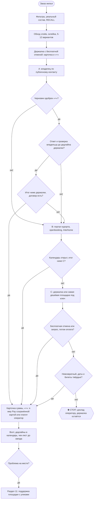

# 2026-10-25 · Найди мне на четыре ночи, с понедельника по пятницу, примерно, например, да, со следующего…

_Full working session of an LLM coding agent, scrubbed by rule (names kept as stable pseudonyms; surnames, e-mails, phones, street addresses and ages replaced by [ФАМИЛИЯ], [EMAIL], [ТЕЛЕФОН], [АДРЕС], [ВОЗРАСТ]; hosts and keys replaced). Row `s_4d1e525a` of the [dataset](https://huggingface.co/datasets/TonyDzi/agent-sessions)._

**User:**

Найди мне на четыре ночи, с понедельника по пятницу, примерно, например, да, со следующего, ближайшего понедельника по пятницу, гостиницу на протяжении всего южного побережья Португалии и начала Испании, до Исла Канела. В общем, Олигархово, Фара, часть Португалии, часть Испании, Кроничи. Гостиница уже на пять звезд, нам нужно три номера на четыре ночи, примерно, гостиница должна быть максимальным рейтингом. Дай мне пять таких гостиниц, направляй, что у них есть номера, нужно три номера.

---

> `Skill` -- {"skill": "booking", "args": "5-звёздочные отели, южное побережье Португалии (Алгарве, Фару, Олья...) до Испании (Исла-Кристина, Исла-Канела, Уэльва), 3 номера, 4 ночи 26.10 - 30.10.2026, максимальный рейтинг, топ-5 с наличием"}

---

**User:**

Base directory for this skill: C:\Users\dev\.claude\skills\booking

# /booking · жильё на всех площадках, напрямую у владельца, без лишних посредников

## 0. Принцип (оператор, 24.10.2026, голосом)

> оператор не благотворительная организация и никого спонсировать не собирается. Если можно купить напрямую, он покупает напрямую, а не платит посредникам. Для этого у него есть кофаундер Майкрофт.

Как это работает:
1) Беготню делает Майкрофт: ищет, сверяет, находит владельца, считает цену под ключ, пишет черновики. оператор сам с хозяевами не переписывается (Библия `reglament-pokupki-assistenty-ne-dopuskayut-pryamogo-obscheniya-antona-s-p`, 27.11.2025): сообщения уходят от его имени после его «+» (раздел 8).
2) Посреднику платим, только если он даёт чистую выгоду: скидку больше своей комиссии или защиту, которая реально нужна. Прецеденты: риелтор 2.9% только за скидку при покупке (30.07.2026); остаток гонорара посреднику только после письменного закрытия сделки (Синтра, 31.08.2026).
3) Прямая бронь допустима по правилам площадки, только если владельца нашли через публичный канал (портал курорта, его сайт, агентство) и по этой поездке не шла переписка с ним в чате площадки. Площадка остаётся страховкой и точкой сравнения.

## 1. Шаги (рецепт)

1) **Фильтры заказа.** Даты ±1-3 дня, сверенные с календарём оператора (карта Библии 942: важные звонки не переносим, сперва спрашиваем его). **Реальный состав** сверяю с купленными билетами (24.10 выяснилось, что билеты куплены на 6 человек, а искали на 4; детали в [[trip-zurich-sled-dec-2026]]). Возраст детей. Спальни и кровати, бюджет (за всё время или за месяц: спросить, если неясно, кейс Монреаль 24.12.2025). Ключевые точки: подъёмник или санная трасса, бассейн, магазин, врач.
   [СКРЫТО], стиральная машина обязательна ([СКРЫТО]), парковка под Mercedes Vito 5.2-5.4 м × 2 м и прицеп (Библия 28.07.2026), рядом парки, вода или горы, до хаба не больше 2 ч. Отель только если лучше ничего нет (оператор 11.08.2026). Дом и машину бронируем раньше перелётов, если билетов ещё нет (Мадейра 18.11.2024).
2) **RECALL до поиска:** `python "$IMPORTS_ROOT/brain_ask.py" "<место> жильё"`, grep `$OBSIDIAN_VAULT` по месту, имени дома и хозяину, плюс `$OBSIDIAN_VAULT/04-Projects/<trip>.md`. RAG упал → grep и говорю это вслух. Цель: не предложить снова отвергнутое (Ski cabin Valbella = Maiensäss, зимой только пешком) и найти хозяев, с которыми уже был опыт (заметки поездок и раздел 11).
3) **Обход всех площадок по разделу 2**, а не только той, что прислал оператор. Его давний стандарт: 16 площадок (06.03.2024), «использовать сайты НЕ аирбнб» (20.03.2024), и 24.10.2026: «Часто я замечал, что дома можно найти на букинге... идентичные».
4) **Склейка объектов** (раздел 3): один дом = одна строка таблицы, цены по каналам в колонках.
5) **Полное чтение листинга и отзывов** (раздел 4): зимний доступ, лестницы, потолки, настоящие спальни, санузлы, холодильник, wifi, отопление, соседи.
6) **Отбор 5-12 вариантов** (оператор 20.03.2024), таблица по разделу 4. Больше трёх → Google Таблица через `sheets.py` и ссылка (Библия 27.12.2025), топ-3 текстом в чате.
7) **Держалка:** лучший вариант с бесплатной отменой бронируем сразу, параллельно с переговорами (после «+», раздел 8). Дедлайн бесплатной отмены в календарь.
8) **Канал брони по дереву** (🌳): владелец через публичный контакт → портал курорта → самая дешёвая площадка. Окно ответа владельца кончается раньше дедлайна отмены держалки.
9) **Черновики сообщений** владельцу или хозяину по разделу 9; отправка, бронь и оплата только через гейты раздела 8.
10) **До заезда** чек-лист раздела 10; **на месте** при проблеме раздел 11.
11) **Отчёт** в чат и в волт по разделу 14.

Как сводятся карты Библии 1092 «сразу оплачивать все брони» и 1107 «проактивно и оперативно бронировать» (прочитаны в Trello 24.10.2026) с «сперва держим бесплатную отмену»: быстро и заранее закрываем место **держалкой с бесплатной отменой** (это и есть «сразу»), окончательную оплату делаем, как только выбор закреплён. Если бесплатная отмена есть, платим рано: деньги возвратны. Если её нет, сначала запрос хозяину (request to book, pay later), невозвратный тариф только при твёрдых датах и купленных билетах. Карта 958: локацию сверяю точно и даю ссылки и в Google Maps, и в Apple Maps.

## 2. Порядок обхода площадок

| # | Слой | Площадки | Примечание |
|---|---|---|---|
| 1 | Основные OTA | Airbnb, Booking.com | Booking смотрю в залогиненном Chrome (Genius, раздел 5) |
| 2 | Метапоиск | HomeToGo, Holidu, Google Hotels → Vacation rentals | 🤔 Google VR не показал Airbnb (наблюдение H35399, 24.10.2026), поэтому один метапоиск полным не считаю |
| 3 | Региональные специалисты | CH: Interhome, e-domizil, Novasol, Reka (семейные деревни, например Wildhaus и Urnäsch у Säntis). IT: casevacanza, locasun. ES: casas rurales, TusCasasRurales. PT: местные агентства | Interhome часто сидит и на Booking, и на Houfy |
| 4 | Портал курорта (DMO) | booking.<курорт>.swiss, graubuenden.ch, openbooking.ch, chalet.myswitzerland.com | Видны м², план, имя владельца, строка «direct booking with the owner» |
| 5 | Vrbo-сеть | Vrbo, FeWo-direkt, Abritel, Expedia, Hotels.com, Travelocity, trip.com | В основном дубли: склеиваю, новыми кандидатами не считаю |
| 6 | Премиум (по запросу) | Plum Guide, Onefinestay | Для короткой семейной недели пропускаю |
| 7 | Напрямую и локально | Сайт владельца, Google Maps (farmstay, Ferienhaus), Facebook и Instagram объекта, местные агентства, sabbaticalhomes | Из Facebook беру только наводки: 🤔 по FTC заметная доля арендного мошенничества идёт через соцсети (цифра не сверена) |

Вес по регионам: в США главные Airbnb и Vrbo, в ЕС и Альпах Booking, специалисты и DMO. Длинный срок: раздел 12.

## 3. Склейка объекта по площадкам и прямой путь

**Как опознать один и тот же дом:**
1) Выписываю признаки: м², спальни и санузлы, необычные удобства, вид, расстояния, имя хозяина, деревню.
2) Ищу в Google в кавычках 6-10 слов необычной фразы описания, на английском и на языке страны.
3) Прогоняю 2-3 характерных фото через Google Lens (Exact matches), TinEye (сортировка Oldest) и Yandex.
4) Ищу `"<деревня>" + признаки + Ferienhaus/Chalet`, `site:graubuenden.ch`, `site:openbooking.ch`, `site:interhome.*`.
5) Сверяю адрес DMO со спутником. Булавка Airbnb размыта на сотни метров, «рядом» ещё не доказательство.
6) Регистрационный номер как ключ: в ЕС по Regulation (EU) 2024/1028 с 20.05.2026; в Португалии номер RNAL на rnt.turismodeportugal.pt. В Швейцарии номера нет, там сверяю фото, м² и адрес.
7) Соседние квартиры одного дома не путаю: Lärchensitz 165 м² и Erlenstube 80 м² делят двор.

**Эталон (H35399, 24.10.2026):** Airbnb 19866401 «Great cottage...» = [ИМЯ] [ИМЯ] Müller Lärchensitz, [СКРЫТО], владелица [ИМЯ] Müller. Тот же дом стоит на booking.arosalenzerheide.swiss (ad-100396), graubuenden.ch, Interhome ch7083.622.1, openbooking, Expedia, Travelocity и trip.com. [СКРЫТО]: это доказывает, что владелица и хозяйка на Airbnb одно лицо. Публичные контакты: страница DMO и contacts.html.
Цены: прайс владелицы (guardaval.casa/prices.html) на неделю 12.12.2026-02.01.2027: CHF 2,590 плюс уборка 250, бельё 20 с человека, отопление 30, туристический налог 4 за ночь с человека от 16 лет. Формула сверена: котировка API портала на 06-13.03.2027 для 4 взрослых (CHF 2,222) совпала с прайсом до франка, наценки портала нет.
Моя оценка, не оферта: 15-25.12 для 6 человек около CHF 4,180-4,340, это ~€4,470-4,650 по курсу ~1.07 EUR за CHF (🤔 курс принят, не сверен живьём 24.10.2026), против €6,544 на Airbnb, плюс возможная доплата за неполную праздничную неделю. Календарь портала на декабрь закрыт, свободность подтверждает только владелица.

**Граница правил площадок** (Help Center Airbnb про оплату и общение вне площадки, Vrbo offline booking policy; прочитаны в H35399 24.10.2026, ссылки в [[trip-zurich-sled-dec-2026]]):
1) Через чат Airbnb или Vrbo пишем только о брони на площадке. О прямой брони, скидке за обход или обмене контактами там не пишем: так мы соблюдаем политику площадки и не подставляем ни хозяина, ни основной Airbnb-аккаунт оператора (a2).
2) **Вся поездка либо целиком на площадке, либо целиком напрямую** у владельца, найденного через публичный канал. Смешанную схему (часть через площадку, часть мимо неё на одной брони) не делаем.
3) Если хозяин сам в чате площадки предлагает уйти в WhatsApp или платить напрямую, вежливо отказываемся и остаёмся на площадке.
4) Уже существующую бронь на площадке ради прямой не отменяем (это и есть запрещённый сценарий «rebook off-platform»). Сначала проверяю, есть ли такая бронь.

**Честность с владельцем:**
1) Источник называю правдиво: «нашли ваш дом на портале курорта» или «на вашем сайте», если контакт взяли именно там.
2) Никогда не утверждаю, что листинг на Airbnb мы не видели. Спросит владелец, видели ли мы его на Airbnb, отвечаем правду.
3) Альтернативы в торге называю только реальные, снятые прибором в этой поездке (ссылка и цена в таблице). Чужих цен не выдумываю и не завышаю.

**Проверка владельца до первого франка:**
1) Контакт беру с официального портала и подтверждаю звонком на публичный номер (звонок = сообщение, гейт раздела 8).
2) Собственника проверяю по Grundbuch (ст. 970 ZGB: имя владельца выдают по запросу). Сдаёт фирма → проверяю её в Zefix и UID.
3) Спрашиваю туристический офис или общину: зарегистрирован ли объект и собирает ли он Gästetaxe.
4) Видеозвонок с показом дома и свежие фото (урок Мадрида 06.2026).
5) Имя получателя платежа совпадает с владельцем.
6) Имена, даты рождения и паспортные данные гостей даю только после этой проверки и только в договоре или регистрации гостей. В первом письме только число взрослых и детей с возрастом, без имён.

**Договор:** стороны, точный адрес, даты, итог и что в него входит (уборка, энергия, бельё, Gästetaxe), депозит не больше 1 месяца или 20-30% (правило оператора 21.04.2023), срок его возврата, отмена с обеих сторон, заезд и выезд, ключи, парковка. Отпускная аренда до 3 месяцев в Швейцарии почти не защищена нормами OR о жилье (🤔 вывод research H35399, юристом не сверен), поэтому чего нет в договоре, того нет. Подписание или акцепт договора = Tier-2 (раздел 8).

**Оплата прямой брони по предпочтению:**
1) Бронь через портал курорта или openbooking (понятная сторона договора, оплата картой).
2) Карта по ссылке владельца: платит оператор сам.
3) Перевод только после всех проверок, только на швейцарский счёт на имя собственника, остаток при заезде: делает оператор сам.

Банковский перевод непроверенному лицу, Western Union, крипту, подарочные карты и PayPal Friends&Family не используем: у них нет chargeback, и это типовой рисунок мошенничества. Это сознательная замена практики Торонто (13.01.2026, когда оператор сам предлагал хозяину перевод или крипту). Давление «срочно, иначе отдам другим» = стоп. Карта по возможности Millennium (Библия 07.01.2026). Платим в валюте объекта, DCC отклоняем.

## 4. Таблица сравнения и разбор отзывов

**Шаблон строки** (один дом, колонка на каждый канал):

| Объект (настоящее имя) | Канал | Итог для N реальных гостей (ночи + уборка + сбор + НДС + Gästetaxe минус Genius и промокод), валюта | В EUR (курс, дата) | Отмена (тир и дедлайн) | м² | Настоящие спальни (кровати по комнатам) | Санузлы | Чистота и точность (Airbnb) или балл Booking | Сводный балл (≥50 отзывов) | Ключевые точки на машине зимой | Общие зоны и соседи | Ответ хозяина (rate и time) | Минусы из отзывов | Снято (дата, прибор) |

Правила таблицы:
1) Сравниваю только итог на экране оплаты, ночную ставку не сравниваю; цену за ночь и за весь срок не путаю (Chur 2020). Победитель меняется от объекта к объекту: Ski cabin Valbella €2,471 на Booking против €2,792 на Airbnb, Casa Cresta €9,384 на Booking против €7,970 на Airbnb (Chrome, 24.10.2026).
2) Разные валюты свожу в одну с курсом и датой; курс не сверен живьём → пометка «оценка».
3) Цена снята прибором (экран оплаты, API портала), с датой. Не сняли → «цена не снята», а не догадка.
4) Цена отмены входит в стоимость. Невозвратный тариф (обычно около минус 10%) только при твёрдых датах и купленных билетах.
5) Даты сверяю со сменой в субботу и пиком Рождества (замер Codex 13.10.2026: 18-28.12 до 4 раз дороже; оператор 13.10: «чтобы не попасться на Christmas»).
6) Рядом с ценой проверяю: открыта ли сама трасса, а не только курорт, и с какого возраста пускают в бассейн или термы (H2Lai, Chavasqueira с 5 лет).
7) Время в пути: `python ~/.claude/skills/booking/scripts/osrm_drive.py <жильё lat,lon> <точка lat,lon> ...`; зимний множитель скрипта = оценка.

**Разбор отзывов** (оператор 11.08.2026: «хороший отзыв дешёвый, плохой стоит дорого»; плохие читаю первыми):
1) Звёзды Airbnb завышены (🤔 большинство объектов в диапазоне 4.5-5.0, доля не сверена). Сравниваю с медианой 5-10 соседних вариантов. Чистота или точность ниже 4.7 = красный флаг. Booking: цель 9.0+, для семейной виллы ниже 8.5 слабо.
2) Сводный балл: свежая оценка по Google, TripAdvisor, Booking, Agoda, Expedia, где есть, минимум 50 отзывов в сумме (метод Пхукета 2025). Меньше 50 → помечаю «мало данных».
3) Текст отзывов Airbnb: сперва прокрутка в браузере (Firefox, без логина). Запасной путь: `python ~/.claude/skills/booking/scripts/airbnb_reviews.py <listing_id>`: печатает отзывы ниже 5 звёзд и 5-звёздные со словами-жалобами. Это серая зона (внутренний API площадки): только чтение, без логина и аккаунта, с паузами, запуск с хаба (§7.2).
4) Слова-жалобы на всех языках: but, however, only, small, cold, heating, noise, steep, stairs, parking, smell, mould, neighbour, shared, wifi, bunk, attic, aber, leider, mais. Отзывы ниже 5 звёзд читаю целиком вместе с ответом хозяина: оборонительный ответ = флаг.
5) Свежесть важнее среднего: последние 10 отзывов против всего срока, и обязательно отзывы того же сезона (зимой отопление и подъезд по снегу).
6) Те же отзывы ищу на других площадках объекта: у Booking только проверенные проживания.
7) Чек-лист до оплаты для 4+ гостей (Библия `reglament-pri-bronirovanii-zhilya-proveryat-fakty-do-otzyv-polnym-tekstom`, 04.08.2026): реальные м² и план, парковка, размеры кроватей, реальные кухни, стиральная машина, интернет, реальное расстояние. Зимой: подъезд на машине (не «только пешком»), лестницы, потолки 1.85-1.90 м, спальня за шторкой или на галерее, «6 спален» на деле 2 квартиры, +8°C в доме при заезде (замеры Codex 13.10 и 19.10.2026). Безопасность: верхние ярусы для детей не младше 6 лет (EN 747), детекторы дыма и CO при печи. Районы США смотрю по карте преступности (оператор 21.10.2023).

**Город и соло** (SF 30.09.2026): цена в поиске часто за койку в дорме. Проверяю отдельную комнату, итог с налогами на форме оплаты, свежие отзывы про клопов и расстояние до реального расписания оператора.

## 5. Booking.com: особенности (оператор 24.10.2026)

1) **Genius по семье:** сравниваю итог в Booking-аккаунте оператора с Genius 3 и в других семейных аккаунтах (уровни и логины в реестре аккаунтов путешествий в `secrets\`). Бронирую там, где итог ниже, только в аккаунте члена семьи и с его ведома.
2) **Промокоды и кешбэк до оплаты:** проверяю действующие промокоды Booking и кешбэк-порталы перед кнопкой оплаты. Ход поиска и найденное: [[task-2026-10-24-dr-booking-promo-codes]] (`10-Tasks/task-2026-10-24-dr-booking-promo-codes.md`, отдельная сессия с ДР).
3) **Тип поездки = leisure** в форме: по наблюдению оператора хозяева на Booking охотнее берут отдых, чем командировки.
4) **Невозвратный против «сперва запрос»:** если у дома только невозвратный тариф или моментальная оплата, параллельно держу вариант с бесплатной отменой (шаг 1.7), а окно ответа хозяина ставлю внутри дедлайна бесплатной отмены. Пример: вопрос по дому в Schmitten ([АДРЕС]), можно ли оплатить после подтверждения хозяина.
5) Залогиненные цены снимаю в Chrome оператора; в аккаунте до «+» только чтение (раздел 6).

## 6. Аккаунты и вход

| Назначение | Аккаунт |
|---|---|
| Airbnb: бронь, споры, депозиты | основной Airbnb-аккаунт (a2) |
| Booking.com | Booking-аккаунт оператора с Genius 3; семейные аккаунты для сравнения Genius |
| Логины, уровни, кто владелец аккаунта | реестр аккаунтов путешествий в `secrets\` (значения в скилл и отчёты не пишу) |

1) Публичный поиск без логина в Firefox или через WebFetch (дефолт §4.8).
2) Залогиненные цены (Genius), календарь и переписку смотрю в Chrome оператора через Claude-in-Chrome и говорю причину вслух: «Chrome: там живая сессия Booking/Airbnb».
3) **В аккаунте до «+» только чтение.** Кнопки Reserve, Request, Accept offer, Cancel, Send, Change dates жму только после явного «+» на это конкретное действие, перед кликом перечитываю поле и сумму (§3.6).
4) Пароли не ввожу: харнес это запрещает, это ограничение механизма, а не отсутствие доступа, так и называю. Сессия разлогинена → шаги входа оператору на телефон одной строкой.
5) Новые аккаунты площадок на случайную почту не заводим (Библия 04.01.2025). Второй аккаунт ради обхода лимитов не используем.
6) Нашёл открытый пароль в волте: значение в отчёт не пишу, путь отдаю в существующий процесс зачистки (память `secret-value-leak-in-vault-and-indexes-2026-10-23`); старую заметку сам не правлю без ОК (§8.8).

## 7. Честный состав, страховка, отмена

**Правило: в брони и в договоре стоит реальный состав с возрастом детей.** На площадках число гостей всегда правдивое. В первом запросе цены владельцу число можно не называть (выбор оператора 24.10.2026), но сама бронь называет реальный состав. Цена честности: Lärchensitz рассчитан на 10 человек, шестеро проходят без доплаты. Цена прыгает от числа гостей → торгую доплату открыто или ищу другой дом.
Почему (улики; коды броней и претензий в заметках поездок, не здесь):
- Брно, 08.2026: в брони 2 взрослых и младенцы, хозяин заявил 7 человек (2 + помощница + 3 детей + младенец). Итог: претензия €1,358.19 за «3 extra adults» и удержанный депозит €500.
- Будапешт, 08-09.2026: претензия хозяйки €1,500 за плитку закрыта Airbnb 9.09 за недостатком улик; потом повторный запрос, и 21.09 решение около €140 в пользу хозяина. 🤔 Атрибуция €140 спорная: заметка 21.09 смешивает дела Брно и Будапешта, сверять по письмам Airbnb.
- После Будапешта в профиле оператора негативный отзыв хозяйки про число гостей, хозяева «с лупой изучают» отзывы (оператор 21.10.2026).
- В Швейцарии гостей регистрируют и берут Kurtaxe, занижение видно и на месте.

Привычка занижать повторялась (Торонто 11.01.2026, Мадрид 29.05.2026, Säntis 13.10.2026). На «скажу, что едем только я и жена» отвечаю одной строкой с уликой Брно и ценой для реального состава.

**Страховка и отмена (сверять живьём перед покупкой):**
1) Страховка Airbnb для ЕС (Europ Assistance; номер полиса и сумма в [[trip-zurich-sled-dec-2026]]). 🤔 Кого покрывает (покупателя и спутников или только гостей брони), перечитываю в условиях полиса перед оплатой. Отмену хозяином полис не покрывает. Есть 14 дней на отказ.
2) Хозяин отменил сам: Airbnb возвращает всё, включая сборы, и помогает найти замену (AirCover).
3) Отменить хотим мы: отменяем по нашему тиру отмены после «+» оператора или честно договариваемся с хозяином о взаимной отмене через Resolution Center. Подталкивать хозяина отменить ради нашего возврата не будем.
4) Прямая бронь теряет AirCover, полис Airbnb и помощь с заменой. Защиту заменяю пунктом договора об отмене владельцем и отдельной страховкой; сперва проверяю страховку карты (обычно требует оплаты этой картой, 🤔 часто от 75% стоимости).
5) Депозит вне площадки внутри брони Airbnb (Stripe-ссылка хозяина, Брно 19.07.2026) не защищён ничем. Ответ: жалоба в Airbnb (Reservation Issue, 72 часа), а не оплата. Если оператор всё же платит, квитанцию храним с первого дня.
6) Подмена после подтверждения («цена только за этаж»): изменение отклоняю (после «+»), сам не отменяю, прошу письменно «entire home at confirmed price: yes/no».

## 8. Гейты: деньги и сообщения

1) **Сам без спроса:** поиск, сравнение, склейка, проверка владельца по открытым реестрам, расчёт итога, черновики любых сообщений, таблица, заметка в волт.
2) **Tier-2, деньги и обязательства.** Показываю карточку: объект, канал, ссылка, скриншот итога, полная сумма со всеми доплатами, способ оплаты, тир отмены и дедлайн (Библия 07.10.2023). Жду явного «+» оператора на **это конкретное действие**:
   - бронь (в том числе держалка), оплата, депозит;
   - принятие специального предложения;
   - отмена брони (Библия 22.02.2026) и любое изменение брони (даты, состав, цена);
   - подписание или акцепт договора аренды, правил дома, условий площадки.
   оператора нет в чате → `approval.py ask`, соседняя работа идёт.
3) **Платёжные данные:** номер карты, IBAN, CVV, банковские реквизиты не ввожу никогда. Банковский перевод и оплату по ссылке делает оператор сам. С «+» я могу только нажать Pay сохранённой в аккаунте картой, перед этим показав итог.
4) **Сообщения хозяину или владельцу** (письмо, чат площадки, WhatsApp, звонок, видеозвонок, форма enquiry на DMO, сообщение в поддержку площадки) не Tier-2, но нужен явный «+» оператора в живом чате на это сообщение или стоящая просьба на эту поездку и этих адресатов (как 24.10.2026 «напиши им»). Черновики свободны. 10 и больше хозяев одной волной = масс-рассылка = Tier-2.
5) **Ассистенты** шлют только тексты, одобренные оператором, со своих рабочих каналов или аккаунта оператора по его поручению.
6) Режим «запрос, потом оплата» (request to book, pay later, бесплатная отмена до даты) предпочтительнее, деньги не застревают до подтверждения хозяина (оператор 24.10.2026).
7) оператор бронирует сам с телефона → до его клика перечитываю весь листинг (урок Ski cabin Valbella 21.10.2026: «Слушай, я прокосячил»).

## 9. Сообщения хозяевам и торг

1) **Голос:** сообщения по брони уходят от имени оператора так, как он их одобрил или надиктовал; он их читает. Споры тоже от первого лица оператора. Представление Майкрофтом (§3.3) только когда оператор сам просит Майкрофта написать от себя.
2) Язык хозяина. Для DACH по-немецки; перевод голосовой перепроверяю (Библия 04.08.2026).
3) **Тёплое вступление** (оператор 24.10.2026): кто едет (взрослые, няня, которая помогает с уборкой, дети с возрастом, без имён), уважение к правилам дома, вопрос «свободно? итог со всеми доплатами? депозит и отмена?», предложение созвониться. За прошлые отзывы заранее не извиняюсь. Депозит или видеозвонок предлагаю, только если хозяин спросит.
4) Отвечаю ровно на вопрос хозяина, не добавляю того, о чём оператор не просил (21.10.2026: «А зачем ты написал про 25-26 число? Не надо»).
5) Вопросы до брони: кровати по комнатам и ярусы, м² и санузлы, детекторы дыма и CO, отопление, общие зоны и соседи, парковка в снег и цепи, ski room и сушилка, стиралка и сушка, кроватка и стульчик, итог для N, заезд, стройка рядом, отмена, свежие фото и план (Мадрид).
6) Перед Send: `/outbound-gate` шаг 0-бис (кто уже писал, по всем каналам) и §3.6 (перечитать поле). Переписка идёт и в чате площадки, и в WhatsApp → дублирую в оба (оператор 04.08.2026).
7) **Торг:** если у владельца есть публичный прайс, якорь = его прайс (или прошу его ставку на неполную праздничную неделю), а не процент от площадки. Публичного прайса нет → якорь 80-85% от итога площадки. Доводы: срок, высокий сезон, без посредника, реальная альтернатива из таблицы (раздел 3, честность).
8) **Волна запросов** (длинный срок, шаблон Торонто 01.2026): обращение по имени, точные даты, помесячная оплата, просьба о special offer, время до центра, «no smoking, no pets». Ответы в таблицу: дом · ссылка · хозяин · дата отправки · ответ · итог · скидка · отмена · следующий шаг. Упёрлись в лимит сообщений → сужаю до топ-N, остальным через публичный контакт DMO, переношу на следующий день. 10+ адресатов = Tier-2.

## 10. До заезда

1) Подтвердить у хозяина: парковку под Vito и прицеп, время приезда и ранний заезд, способ получения ключей (Библия 28.07.2026).
2) Балкон или сушилка для белья, место в шкафах, стиралка работает.
3) Одна группа WhatsApp на хозяина (04.08.2026), создание группы = сообщение, гейт раздела 8.
4) Ссылки на точный адрес в Google Maps и Apple Maps (карта 958), время в пути зимой.
5) Дедлайны отмены всех держалок в календаре; лишние держалки отменить до дедлайна (после «+»).
6) Кто в составе, сверено с билетами ещё раз.

## 11. Проблема на месте и споры

1) Сразу при заезде: 30-50 фото и одно видео одним дублем, до распаковки. При выезде то же (Будапешт: без записи при выезде спор частично проигран).
2) Сообщаю в течение 72 часов, пишу **в поддержку площадки, а не хозяину**. Категории Airbnb: Safety Issue + Listing Not As Described. Опасность для ребёнка («открытая проводка + маленький ребёнок») весит больше грязи или цены (Мадрид 06.2026).
3) Сообщения короткие: до 3 сообщений по 500 символов, факты и фото. Поборы вне листинга (Мадрид: €350 за поздний заезд) прикладываю как улику.
4) Прошу переселение с понятными параметрами (Мадрид: 4 спальни, до 30 минут до центра, проверенные отзывы) или полный возврат. Мадрид: 9.06 Airbnb обещал полный возврат после выезда и снял листинг.
5) Защита от претензии хозяина (Будапешт, победа 9.09): разрыв между выездом и претензией (11 дней), нет записи о состоянии при выезде, неточности листинга, нет доказательства, что вещь была цела при заезде.
6) Тон мягкий, не категоричный, от первого лица оператора (оператор отверг жёсткий черновик, 09.2026). Отправка после «+» (раздел 8).
7) Отзыв в Google пишу спокойно и по фактам: длинный эмоциональный отзыв по Мадриду заблокировали, прошёл переписанный.

## 12. Длинный срок (месяц и больше)

1) Риелторы и объявления часто дешевле: Монреаль, CAD 6,600 в месяц у риелтора против CAD 8,714 за 28 ночей на VRBO (24.12.2025).
2) Площадки: Centris, Kijiji, Craigslist, realestate.com.au, sabbaticalhomes, плюс разделы 2.1-2.4.
3) Скидку за месяц и больше прошу всегда, для нескольких месяцев 30-50% (Торонто 12.01.2026). Спрашиваю ставку хозяина «нетто», а не итог площадки (комиссия по оценке хозяина ~15%, оператора до 30%).
4) Хозяин проверяет гостя: готовлю письмо работодателя или рекомендации (рекомендательное письмо Palo Alto 2019-22), Торонто 01.2026.
5) Хозяин сам зовёт уйти с площадки → раздел 3, правило «целиком на площадке или целиком напрямую».

## 13. Запасные инструменты (из боя)

| Пусто или заблокировано | Обход |
|---|---|
| Страницы Airbnb на JS | WebFetch на URL поиска отдаёт карточки; отзывы прокруткой в браузере, запасной путь `scripts/airbnb_reviews.py` |
| Booking и Interhome отдают 403 или пусто | Claude-in-Chrome в залогиненном Chrome оператора, только чтение. Пустой fetch не значит «объявлений нет» |
| DMO-портал на JS (DEMI/feratel) | POST `https://booking.arosalenzerheide.swiss/DemiFrontendApi/accommodationDetailProducts`, тело `{"from":"YYYY-MM-DD","to":"YYYY-MM-DD","u0":1,"a0":<взрослых>,"ca0":[],"id":<ad-id>,"documentReference":"31566_content-areas_1","durationType":"exact"}` → `minPrice.priceString` или `noResultText`. Endpoint `enquiry` = сообщение, без «+» не зову |
| Google Maps закрыт reauth | `scripts/osrm_drive.py` (публичный OSRM), зимой +30-50% как оценка |
| Встроенный браузер на перегруженном хабе даёт белый экран | Страницы по одной через WebFetch или curl, или другой узел флота |
| Не могу отменить: расширение Chrome молчит, логина нет | Шаги отмены оператору на телефон одной строкой |
| Лимит сообщений Airbnb | Сужаю до топ-N, остальным через публичный контакт DMO, перенос на следующий день (раздел 9.8) |

## 14. Выход

1) В чате: топ-3 из 5-12 с итогами под ключ в одной валюте, рекомендация кофаундера, что ждёт «+» (действие, объект, сумма), ссылки Google Maps и Apple Maps.
2) Больше трёх вариантов → Google Таблица со ссылкой.
3) В волт: датированная секция в `$OBSIDIAN_VAULT/04-Projects/<trip>.md` (кандидаты, цены с датой снятия, отвергнутые с причиной, публичные контакты владельцев, без секретов и платёжных данных), бэкап перед записью, метка `machine_stamp.py line`.
4) Строка «проверено: … · не проверено: … (почему)».
5) Блок «🧒 Простыми словами» в конце.

## 🌳 Дерево решений

Развилки: `decision_tree.py fork booking <узел> --outcome ok|fail|unknown`; застрял → `decision_tree.py stop booking --grow ...`. Тень до 29.10.2026 (§5.12).

## Судить скилл

После каждого использования одна строка: 🔧 обновляю / 📝 не сейчас / ✅ не надо, с причиной. Новый работающий канал или обход = узел дерева с уликой прогона. После правки: `skill_xvendor_run.py exam --skills booking`, затем `codex_skills_bridge.py sync`. Перед любой раздачей наружу leak-scan: в скилле не должно быть почт, кодов броней, полисов и платёжных данных.

## Не проверено

- 🤔 Отмечено по тексту: доля звёзд Airbnb, цифра FTC, Google VR без Airbnb, покрытие полиса Airbnb, порог 75% у страховки карты, вывод про OR, курс CHF/EUR. Перед использованием в письме или решении сверить живьём.
- Interhome, e-domizil и ценовой график openbooking по эталону не сняты (403 и JS, 24.10.2026).
- Исход претензии Брно €1,358.19 и возврата по Мадриду в волте не найден.

## 🧒 Простыми словами

Один и тот же дом часто продают в пяти магазинах по разной цене, а у хозяйки самой он ещё дешевле. Майкрофт обходит все магазины, понимает, что это один дом, находит хозяйку по её объявлению на сайте курорта и считает, где выйдет дешевле. Пока торгуемся, держим запасной дом с бесплатной отменой. Платим и пишем хозяевам только после «+» оператора, гостей называем честно, иначе потом прилетит счёт, как в Брно.

Machine: HUB-01 (Хаб) · Agent: Claude Code · Operator: dev · 2026-10-24

ARGUMENTS: 5-звёздочные отели, южное побережье Португалии (Алгарве, Фару, Олья...) до Испании (Исла-Кристина, Исла-Канела, Уэльва), 3 номера, 4 ночи 26.10 - 30.10.2026, максимальный рейтинг, топ-5 с наличием

---

> `ToolSearch` -- {"query": "select:WebSearch,WebFetch", "max_results": 5}

---

> `Bash` -- {"command": "cd \"D:/Vault/_imports\" && timeout 60 python brain_ask.py \"Алгарве отель 5 звёзд Португалия Исла Кристина\" 2>&1 | head -40", "description": "RECALL по прошлым поискам отелей Алгарве"}

---

> `WebSearch` -- {"query": "best 5-star hotels Algarve highest rated Booking.com 9+ Vilamoura Lagos Tavira Faro", "mode": "standard"}

---

> `WebSearch` -- {"query": "best 5-star luxury hotels Huelva Costa de la Luz Isla Canela Isla Cristina Islantilla top rated", "mode": "standard"}

---

> `mcp__Claude_Browser__navigate` -- {"url": "https://www.booking.com/searchresults.html?ss=Algarve&checkin=2026-10-26&checkout=2026-10-30&group_adults=6&no_rooms=3&group_children=0&nflt=class%3D5&order=review_score_and_price&selected_currency=EUR"}

---

> `mcp__Claude_Browser__get_page_text` -- {"max_chars": 12000}

---

> `mcp__Claude_Browser__computer` -- {"action": "screenshot", "scale": 0.5}

---

> `mcp__Claude_Browser__find` -- {"query": "Decline"}

---

> `mcp__Claude_Browser__computer` -- {"action": "left_click", "ref": "ref_1888", "action_summary": "Declines non-essential cookies on Booking.com"}

---

> `mcp__Claude_Browser__get_page_text` -- {"max_chars": 25000}

---

> `mcp__Claude_Browser__navigate` -- {"url": "https://www.booking.com/searchresults.html?ss=Huelva+Province&checkin=2026-10-26&checkout=2026-10-30&group_adults=6&no_rooms=3&group_children=0&nflt=class%3D5&order=review_score_and_price&selected_currency=EUR"}

---

> `mcp__Claude_Browser__get_page_text` -- {"max_chars": 14000}

---

**Claude:**

Нашёл 5 отелей на 26–30 октября, в каждом свободны 3 номера на 4 ночи. Я считал, что вас 6 человек по двое в номере. Если состав другой, поправьте, и я пересчитаю.

В Испании на эти даты у Booking только два 5-звёздочных отеля с рейтингом 8.6, поэтому в топ-5 их нет.

| # | Отель | Где | Рейтинг Booking | 3 номера, 4 ночи, с налогами |
|---|---|---|---|---|
| 1 | **3HB Faro** | центр Фару | 9.5 (2588 отзывов) | €3,888, €3,504 для залогиненных. Оплата в отеле |
| 2 | **Octant Vila Monte** | Монкарапашу, рядом с Олян | 9.5 (196) | €4,116, завтрак включён |
| 3 | **Vilalara Grand Hotel** | Армасан-де-Пера | 9.3 (677), локация 9.6 | €4,589, 3 люкса, завтрак включён |
| 4 | **Verdelago Resort** | Прайя-Верде, 15 минут до испанской границы | 9.3 (419), локация 9.7 | €4,334, три апартамента, завтрак включён |
| 5 | **3HB Falésia Beach** | Ольюш-де-Агуа | 9.2 (267), локация 9.3 | €3,744, €3,374 для залогиненных. Завтрак включён, оплата в отеле |

Что стоит знать:
- **3HB Faro** лучший по соотношению цены и рейтинга, но это городской отель, не у пляжа.
- **Verdelago** ближе всех к Испании, но вместо обычных номеров там три отдельных апартамента.
- **Vila Vita Parc** тоже 9.5, но вместо 3 номеров у него 2 двухспальных апартамента за €6,928, поэтому в список не вошёл.
- Рядом по рейтингу идут **Palácio de Tavira** (9.1, €2,941) и **Pousada Convento de Tavira** (9.0, €2,976).
- В Испании это **El Rompido Resort** (8.6, €2,245, бесплатная отмена) и **TUI Blue Isla Cristina Palace** (8.6, €2,000). Если нужна именно Исла-Кристина или Исла-Канела, это единственные 5 звёзд.
- Правила отмены для первых четырёх отелей я не смотрел, кроме оплаты в отеле у №1 и №5. Всё это снято с публичных цен Booking, без входа в аккаунт.

Ничего не бронировал. Если выберете отель, пришлю карточку с суммой и правилами отмены, и после вашего «+» можно бронировать. Дешевле может выйти напрямую у отеля или через Genius в вашем аккаунте, это тоже проверю.

Sources: [Booking, Алгарве, 5★](https://www.booking.com/searchresults.html?ss=Algarve&checkin=2026-10-26&checkout=2026-10-30&group_adults=6&no_rooms=3&nflt=class%3D5&order=review_score_and_price&selected_currency=EUR) · [Booking, Уэльва, 5★](https://www.booking.com/searchresults.html?ss=Huelva+Province&checkin=2026-10-26&checkout=2026-10-30&group_adults=6&no_rooms=3&nflt=class%3D5&order=review_score_and_price&selected_currency=EUR)

Проверено: цены и рейтинги с экрана Booking на момент поиска. Не проверено: правила отмены у №2–4, цены у самих отелей и в других каналах, настоящий состав гостей.

🧒 **Простыми словами:** я зашёл на сайт бронирования и отфильтровал только пятизвёздочные отели с тремя свободными номерами на эти даты. Выбрал пять с лучшими оценками гостей. Дальше выбираете вы, а я проверю, нет ли того же отеля дешевле.

---

**User:**

Stop hook feedback:
001-пара: эта задача ушла и тебе, и Codex (session s_c4dc9584). Ты ещё не написал напарнику. До ответа оператору, один раз: (1) прочитай его сообщения по точной теме: python -X utf8 ~/.claude/scripts/tg_bus_read.py --workroom --all --peek --recipient Claude и оставь только строки с [voice001:chat_REDACTED:t1792929829]; (2) отправь ОДИН конверт [Claude→Codex][voice001:chat_REDACTED:t1792929829][VERIFY|COUNTER|PROPOSE] с session_id=s_4d1e525a peer_session_id=s_c4dc9584, где сверяешь свой вывод с его (цитируй его msg_id) или даёшь свой план; python -X utf8 ~/.claude/scripts/tg_bus_send.py --workroom --raw "<конверт>"; (3) впиши в ответ оператору строку «напарник: согласен / расходимся в … / молчит (NO_QUORUM)». Это блок один раз, второй Stop пройдёт.

---

> `Bash` -- {"command": "cd ~ && python -X utf8 ~/.claude/scripts/tg_bus_read.py --workroom --all --peek --recipient Claude 2>&1 | grep -F \"voice001:chat_REDACTED:t1792929829\" | head -20", "description": "Читаю сообщения напарника по теме"}

---

> `Bash` -- {"command": "cd ~ && python -X utf8 ~/.claude/scripts/tg_bus_read.py --workroom --all --peek --recipient Claude 2>&1 | grep -F -A25 \"[Codex→Claude][voice001:chat_REDACTED:t1792929829]\" | head -50", "description": "Читаю тело предложения Codex"}

---

> `Bash` -- {"command": "cd ~ && python -X utf8 ~/.claude/scripts/tg_bus_send.py --workroom --raw \"[Claude→Codex][voice001:chat_REDACTED:t1792929829][VERIFY]\nsession_id=s_4d1e525a\npeer_session_id=s_c4dc9584\ntopic=voice001:chat_REDACTED:t1792929829\ncorr_id=voi

---

**Claude:**

Напарник Codex предложил разделить работу: он проверяет цены и наличие на Booking, а я независимо сверяю географию, звёзды и доступность. Больше он ничего не прислал. Я отправил ему мой список с ценами (сообщение 1987839) и попросил назвать расхождения, но его ответа ещё нет.

напарник: молчит (NO_QUORUM), его предложение получено, ответа на мою сверку пока нет.

Список из прошлого ответа остаётся в силе.

| # | Отель | Рейтинг | 3 номера, 4 ночи |
|---|---|---|---|
| 1 | 3HB Faro | 9.5 | €3,888, €3,504 для залогиненных |
| 2 | Octant Vila Monte | 9.5 | €4,116 |
| 3 | Vilalara Grand Hotel | 9.3 | €4,589 |
| 4 | Verdelago Resort | 9.3 | €4,334 |
| 5 | 3HB Falésia Beach | 9.2 | €3,744, €3,374 для залогиненных |

Это цены для 6 человек по двое в номере. Скажите, если состав другой, и я пересчитаю. Ничего не бронировал.

🧒 **Простыми словами:** я написал напарнику: «вот мои пять отелей, сверь цены у себя». Он пока не ответил, поэтому список мой, и я его не подтверждал вторым источником.
