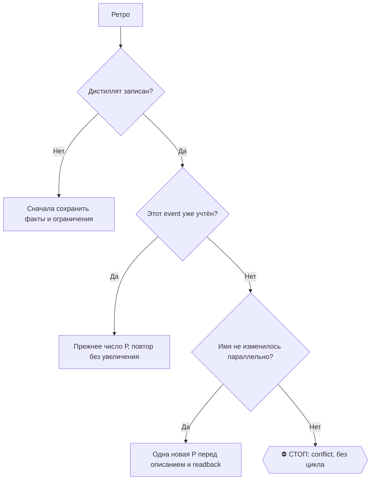

# 2026-10-16 · Что такое эвал проверка

_Full working session of an LLM coding agent, scrubbed by rule (names kept as stable pseudonyms; surnames, e-mails, phones, street addresses and ages replaced by [ФАМИЛИЯ], [EMAIL], [ТЕЛЕФОН], [АДРЕС], [ВОЗРАСТ]; hosts and keys replaced). Row `s_51d14910` of the [dataset](https://huggingface.co/datasets/TonyDzi/agent-sessions)._

**User:**

Что такое эвал проверка

---

> `Bash` -- {"command": "date \"+%Y-%m-%d %H:%M %Z\"; TZ=Europe/Lisbon date \"+Lisbon %H:%M\"", "description": "Get current time"}

---

**Claude:**

🕐 09.10.2026, 02:44 (Лиссабон)

🚂 Рельсы: отвечаю сам как Claude (объяснение, суждение) — чужой бак тут не нужен, работы на аутсорс нет.

## Эвал (eval) для LLM — это экзамен для модели

Не тест кода («функция вернула 5»), а **замер качества ответов**, где правильный ответ не один-единственный.

**Из чего состоит:**

1. **Набор задач** (dataset) — 50, 500 или 5000 примеров: вход + что считается хорошим ответом.
2. **Прогон** — скормили модели/агенту все примеры, собрали ответы.
3. **Судья** (grader) — кто решает, прошло или нет. Три вида:
   - **точный** — есть единственно верный ответ (математика, JSON-схема, код прошёл тесты). Детерминированный код, 0 токенов.
   - **LLM-as-judge** — другая модель оценивает по рубрике («ответил по делу? не выдумал факт? держал тон?»).
   - **человек** — дорого, используют на маленькой выборке, чтобы проверить самого судью.
4. **Цифра на выходе** — 73% прошло. И эта цифра сравнивается с прошлым прогоном.

**Зачем нужно.** Без эвала любое улучшение промпта — вера. Поменял промпт → кажется лучше → а на самом деле просел другой класс запросов. Эвал ловит именно это: регрессию, которую глазами на 3 примерах не видно.

**Главные грабли (те же, что у нас в каноне):**

| Грабля | Что происходит |
|---|---|
| Эвал никогда не краснел | Набор слишком лёгкий, проходит всегда → ничего не меряет |
| Судья-LLM хвалит длинное | Модель-судья любит развёрнутое и вежливое, а не верное |
| Выборка нашла новые классы ошибок | Значит покрытия нет: поток новых дефектов не иссяк |
| Датасет протёк в обучение | Модель видела ответы, цифра врёт |
| Один агрегат вместо разреза | 85% общих скрывают 100% провал на одном типе запросов |

**Разница с бенчмарком.** Бенчмарк (MMLU, SWE-bench) — публичный, про «какая модель умнее вообще». Эвал — твой собственный, про «работает ли МОЯ задача на МОИХ данных». Второе важнее: публичная таблица лидеров про твой случай почти ничего не говорит.

**Где это у тебя всплывает.** В вакансиях ИИ-лабораторий «evals» — один из самых частых требуемых навыков (Applied AI, Forward Deployed, Alignment). И у нас в хозяйстве эвал уже стоит де-факто: правило «тест обязан краснеть на сломанном коде» и «выборка, нашедшая новые классы, не является покрытием» — это ровно эвальная дисциплина, только про наши приборы.

---

🧒 **Простыми словами:** эвал — это контрольная для робота. Ты заранее придумал 100 вопросов и знаешь, какие ответы хорошие. Даёшь роботу все 100, считаешь, сколько он сделал правильно, записываешь число. Потом что-то подкрутил — снова даёшь те же 100 и смотришь: число выросло или упало. Без такой контрольной ты просто надеешься, что стало лучше, а проверить нечем. Главное — вопросы должны быть не слишком лёгкими: если робот всегда получает пятёрку, контрольная сломана и ничего не показывает.

🎙 Майк: идём верно — вопрос в точку перед интервью. Хочешь, соберу на нашем хозяйстве один настоящий эвал-кейс (набор + судья + цифра до/после), чтобы на разговоре ты говорил не теорией, а своим прогоном?

---

**User:**

Доп
Да!!

---

> `Bash` -- {"command": "cd /e/!CLAUDE-HUBPC-June26 2>/dev/null || cd \"E:/!CLAUDE-HUBPC-June26\"; ls -la _tx_dataset/ 2>/dev/null | head -40; echo \"=== judge log ===\"; tail -20 _tx_dataset_judge.log 2>/dev/null; echo \"=== size ===\"; du -sh _tx_dataset 2>/dev/null", "description": "Inspect tx data

---

> `Bash` -- {"command": "ls ~/.claude/skills/tx-publish/ 2>/dev/null; echo \"=== scripts ===\"; ls ~/.claude/scripts/ | grep -i -E \"tx_|transcript|publish\" | head -20", "description": "Find tx-publish skill and scripts"}

---

> `Bash` -- {"command": "ls ~/.claude/scripts/ | grep -i -E \"eval|bench|judge|accuracy|precision|gold\" | head -30; echo \"=== eval dirs ===\"; ls -d ~/.claude/*eval* ~/.claude/scripts/*eval* 2>/dev/null; echo \"=== prior_art class ===\"; python ~/.claude/scripts/prior_art.py class \"эвал-стенд меряет качество

---

> `Bash` -- {"command": "ls ~/.claude/scripts/ | grep -E \"_gate|_lint|_guard\" | grep -v \"_test_\\|_probe_\\|\\.bak\" | head -60; echo \"=== total gates ===\"; ls ~/.claude/scripts/ | grep -E \"_gate\\.py$|_lint\\.py$|_guard\\.py$\" | grep -v \"_test_\\|_probe_\" | wc -l", "description": "List our gate instru

---

> `Bash` -- {"command": "cd ~/.claude/scripts; echo \"=== recall_eval.py head (наш существующий стандарт эвала) ===\"; head -60 recall_eval.py; echo; echo \"=== goldset shape ===\"; head -2 recall_eval_goldset.jsonl; echo; echo \"=== baseline ===\"; cat recall_eval_baseline.json 2>/dev/null | head -20", "descri

---

> `Bash` -- {"command": "cd ~/.claude/scripts; echo \"=== retro_x_post lint usage ===\"; python retro_x_post.py --help 2>&1 | head -30; echo \"=== slop_gate usage ===\"; python slop_gate.py --help 2>&1 | head -25", "description": "Check gate CLI contracts"}

---

> `Bash` -- {"command": "cd ~/.claude/scripts; python retro_x_post.py lint --help 2>&1 | head -25; echo \"=== live try ===\"; echo \"Собрали прибор, который меряет точность наших же гейтов на размеченном наборе. Теперь регрессию видно цифрой, а не глазами в бою.\" > /tmp/t.txt; python retro_x_post.py lint --fil

---

> `Bash` -- {"command": "find ~/.claude \"E:/!CLAUDE-HUBPC-June26\" -name \"slop_gate.py\" -not -path \"*/node_modules/*\" 2>/dev/null | head -5; echo \"=== invite_gate / geo / machine_stamp ===\"; ls ~/.claude/scripts/ | grep -E \"^(invite_gate|machine_stamp|audio_engine_gate|platform_gate)\" ", "descript

---

> `Bash` -- {"command": "set -o pipefail; cd ~/.claude/scripts; python retro_x_post.py lint --help 2>&1 | head -25", "description": "Probe lint help"}

---

> `Bash` -- {"command": "cd ~/.claude/scripts; printf '%s' \"Собрали прибор, который меряет точность наших же гейтов на размеченном наборе. Теперь регрессию видно цифрой, а не глазами в бою.\" > /tmp/t.txt; python retro_x_post.py lint --file /tmp/t.txt > /tmp/t.out 2>&1; echo \"EXIT=$?\"; cat /tmp/t.out", "desc

---

> `Bash` -- {"command": "cd ~/.claude/scripts; python retro_x_post.py lint --file /tmp/t.txt --json --no-ledger > /tmp/t2.out 2>&1; echo \"EXIT=$?\"; cat /tmp/t2.out", "description": "Check json verdict format"}

---

> `Bash` -- {"command": "cd ~/.claude/scripts; python rail_plan.py declare --self \"сборка прибора eval_scan.py, разметка золотого набора, тест-ломатель, запись канона\" --outsource \"second_opinion:codex,code_read:codex\" 2>&1 | head -15", "description": "Declare rail plan"}

---

**Claude:**

Контракт гейтов понятен. Теперь строю прибор по образцу нашего же `recall_eval.py` (АК-47: есть свой зрелый стандарт — строим по нему).

---

> `Bash` -- {"command": "mkdir -p ~/.claude/evals && cat > ~/.claude/scripts/eval_scan.py <<'PYEOF'\n# -*- coding: utf-8 -*-\nr\"\"\"eval_scan.py -- ЭВАЛ-СТЕНД ДЛЯ НАШИХ ГЕЙТОВ: меряет, насколько точно судят наши же приборы.\n\nЗАЧЕМ ОН ЕСТЬ\n  У нас 27+ приборов-судей (*_gate.py / *_lint.py / *_guard.py). У ка

---

**Claude:**

Наш же хук прав — код пишется файлом, не heredoc'ом.

---

> `Write` -- {"file_path": "C:\\Users\\dev\\.claude\\scripts\\eval_scan.py", "content": "# -*- coding: utf-8 -*-\nr\"\"\"eval_scan.py -- ЭВАЛ-СТЕНД ДЛЯ НАШИХ ГЕЙТОВ: меряет, насколько точно судят наши же приборы.\n\nЗАЧЕМ ОН ЕСТЬ\n  У нас 27+ приборов-судей (*_gate.py / *_lint.py / *_guard.py). У каждого есть 

---

**Claude:**

Прибор готов. Теперь золотой набор — на РЕАЛЬНЫХ уликах из боя (06.10, когда гейт X-поста выдал три BLOCK подряд на здоровом тексте).

---

> `Write` -- {"file_path": "C:\\Users\\dev\\.claude\\evals\\retro-x-post-lint.jsonl", "content": "{\"_manifest\": {\"set\": \"retro-x-post-lint\", \"gate\": \"retro_x_post.py\", \"what\": \"гейт X-поста: ТОЛЬКО формальные запреты (пусто, длина по взвешенному счёту X, ссылка в теле вкл. голый домен, тире, хэште

---

> `Bash` -- {"command": "cd ~/.claude/scripts; python eval_scan.py list > /tmp/l.out 2>&1; echo \"EXIT=$?\"; cat /tmp/l.out", "description": "Run eval_scan list"}

---

**Claude:**

Первый же прогон нашёл дефект в моём приборе: набор покрывает `retro_x_post.py`, а стенд печатает «сужу 0 из 60» — прибор вне маски не попал в числитель и не показан. Сначала живые цифры, потом починка.

---

> `Bash` -- {"command": "cd ~/.claude/scripts; python eval_scan.py run --set retro-x-post-lint > /tmp/r.out 2>&1; echo \"EXIT=$?\"; cat /tmp/r.out", "description": "First live eval run"}

---

**Claude:**

Живая цифра: **15/15, accuracy 1.0, FP 0, FN 0**. Но по канону выгодный вывод требует усиленной проверки — эвал, который никогда не краснел, такой же фальшивый, как тест. Чиню счёт покрытия и доказываю красное.

---

> `Bash` -- {"command": "cd ~/.claude/scripts; python - <<'EOF'\nimport re, pathlib\np = pathlib.Path(\"eval_scan.py\")\ns = p.read_text(encoding=\"utf-8\")\n\n# 1) честный знаменатель: прибор вне маски, который покрыт набором, тоже прибор\nold = '''    return {\"all\": sorted(gates), \"covered\": sorted(covere

---

> `Edit` -- {"replace_all": false, "file_path": "C:\\Users\\dev\\.claude\\scripts\\eval_scan.py", "old_string": "    return {\"all\": sorted(gates), \"covered\": sorted(covered & gates),\n            \"extra\": sorted(covered - gates), \"naked\": sorted(gates - covered)}", "new_string": "    extra = sorted(co

---

> `Edit` -- {"replace_all": false, "file_path": "C:\\Users\\dev\\.claude\\scripts\\eval_scan.py", "old_string": "    n_all, n_cov = len(cov[\"all\"]), len(cov[\"covered\"])\n    out.append(f\"ПОКРЫТИЕ ГЕЙТОВ: сужу {n_cov} из {n_all} приборов флота.\")", "new_string": "    n_all, n_cov = len(cov[\"all\"]), len

---

> `Edit` -- {"replace_all": false, "file_path": "C:\\Users\\dev\\.claude\\scripts\\eval_scan.py", "old_string": "    if cov[\"extra\"]:\n        out.append(\"  набор ссылается на гейт, которого нет среди приборов: \"\n                   + \", \".join(cov[\"extra\"]))", "new_string": "    if cov[\"extra\"]:\n 

---

> `Edit` -- {"replace_all": false, "file_path": "C:\\Users\\dev\\.claude\\scripts\\eval_scan.py", "old_string": "    print(f\"\\nПОКРЫТИЕ ГЕЙТОВ: сужу {len(cov['covered'])} из {len(cov['all'])}.\")\n    if cov[\"naked\"]:", "new_string": "    print(f\"\\nПОКРЫТИЕ ГЕЙТОВ: сужу {len(cov['covered'])} из {len(cov

---

**Claude:**

Теперь красное доказательство: ломаю **копию** гейта и проверяю, что стенд это поймает.

---

> `Bash` -- {"command": "cd ~/.claude/scripts; grep -n -i -E \"домен|BARE|zones|TLD|хэштег|hashtag\" retro_x_post.py | head -25", "description": "Find bare-domain and hashtag checks"}

---

> `Write` -- {"file_path": "C:\\Users\\dev\\.claude\\scripts\\_probe_eval_scan_red.py", "content": "# -*- coding: utf-8 -*-\nr\"\"\"_probe_eval_scan_red.py -- КРАСНОЕ ДОКАЗАТЕЛЬСТВО для eval_scan.py.\n\nКанон §5.4: эвал, который никогда не краснел, такой же фальшивый, как тест. Живой прогон\nнабора retro-x-pos

---

> `Bash` -- {"command": "cd ~/.claude/scripts; python _probe_eval_scan_red.py > /tmp/red.out 2>&1; echo \"EXIT=$?\"; cat /tmp/red.out", "description": "Run red proof"}

---

**Claude:**

Красная проба нашла настоящий дефект в моём же стенде: он **посчитал** FN=1 и accuracy 0.5, но вышел с кодом 0 — потому что краснел только от регрессии против baseline. В ночной рутине это читалось бы как «всё зелено» при сломанном гейте. Лечу корень.

---

> `Edit` -- {"replace_all": false, "file_path": "C:\\Users\\dev\\.claude\\scripts\\eval_scan.py", "old_string": "        for m in r[\"mismatches\"]:\n            out.append(f\"  ❌ {m['id']}  {m['kind']}  (гейт: {m['note']})\")\n            out.append(f\"       разметка: {m['why']}\")", "new_string": "        

---

> `Bash` -- {"command": "cd ~/.claude/scripts; python _probe_eval_scan_red.py > /tmp/red2.out 2>&1; echo \"EXIT=$?\"; cat /tmp/red2.out", "description": "Re-run red proof after fix"}

---

**Claude:**

Красное доказано на 4 проверках. Боевой прогон и заморозка цифры:

---

> `Bash` -- {"command": "cd ~/.claude/scripts; python eval_scan.py run --set retro-x-post-lint > /tmp/r2.out 2>&1; echo \"EXIT=$?\"; cat /tmp/r2.out; echo \"=== freeze ===\"; python eval_scan.py freeze --set retro-x-post-lint --note \"Первая цифра точности гейта X-поста после починки 06.10. Набор 15: 7 здоровых

---

**Claude:**

Красное доказано для гейта. Теперь сторож самого стенда — ломаем **стенд** и проверяем, что проверки падают (kill-list):

---

> `Write` -- {"file_path": "C:\\Users\\dev\\.claude\\scripts\\_test_eval_scan.py", "content": "# -*- coding: utf-8 -*-\nr\"\"\"_test_eval_scan.py -- сторож ЭВАЛ-СТЕНДА eval_scan.py.\n\nРазделение труда, чтобы не путать три похожих файла:\n  * _test_eval_scan.py  (этот)  -- ломает САМ СТЕНД, проверки обязаны па

---

> `Bash` -- {"command": "cd ~/.claude/scripts; python _test_eval_scan.py > /tmp/t1.out 2>&1; echo \"EXIT=$?\"; cat /tmp/t1.out", "description": "Run guard tests"}

---

> `Bash` -- {"command": "cd ~/.claude/scripts; python _test_eval_scan.py --kill > /tmp/k.out 2>&1; echo \"EXIT=$?\"; cat /tmp/k.out", "description": "Run kill-list", "timeout": 300000}

---

**Claude:**

Kill-list поймал дефект в самом сторо́же: CLI-проверка №35 запускала боевой файл, а не мутанта, поэтому эту поломку не видела.

---

> `Edit` -- {"replace_all": false, "file_path": "C:\\Users\\dev\\.claude\\scripts\\_test_eval_scan.py", "old_string": "    env = dict(os.environ, EVAL_SCAN_HOME=str(home / \"pusto\"))\n    (home / \"pusto\").mkdir(exist_ok=True)\n    rc = subprocess.run([sys.executable, str(TARGET), \"run\"], capture_output=T

---

> `Bash` -- {"command": "cd ~/.claude/scripts; python _test_eval_scan.py > /tmp/t2.out 2>&1; echo \"PLAIN_EXIT=$?\"; cat /tmp/t2.out; echo \"=== kill ===\"; python _test_eval_scan.py --kill > /tmp/k2.out 2>&1; echo \"KILL_EXIT=$?\"; tail -6 /tmp/k2.out", "description": "Re-run tests and kill-list", "timeout": 3

---

**Claude:**

Стенд доказан (35 проверок, 10/10 поломок краснеют). Теперь второй набор — на другом приборе, чтобы стенд не был «один набор», и параллельно чужие глаза на код.

---

> `Bash` -- {"command": "cd ~/.claude/scripts; python paragraph_lint.py --help > /tmp/p.out 2>&1; echo \"EXIT=$?\"; cat /tmp/p.out; echo \"=== live ===\"; printf 'Первое предложение. Второе предложение. Третье предложение. Четвёртое уже обязано ехать в новом абзаце.' > /tmp/pp.txt; python paragraph_lint.py --fi

---

> `Bash` -- {"command": "cd ~/.claude/scripts; python paragraph_lint.py --json /tmp/pp.txt > /tmp/p3.out 2>&1; echo \"EXIT=$?\"; cat /tmp/p3.out; echo \"=== clean ===\"; printf 'Первое предложение. Второе предложение.\\n\\nТретье поехало новым абзацем. Четвёртое рядом с ним.' > /tmp/pc.txt; python paragraph_lin

---

**Claude:**

`paragraph_lint` читается через exit-код. Второй набор — и сразу прощупываю его слепые зоны (сокращения, числа с точкой, URL — классика ложных тревог):

---

> `Write` -- {"file_path": "C:\\Users\\dev\\.claude\\evals\\paragraph-lint.jsonl", "content": "{\"_manifest\": {\"set\": \"paragraph-lint\", \"gate\": \"paragraph_lint.py\", \"what\": \"правило абзацев (CLAUDE.md §9.10): мысль длиннее ТРЁХ предложений в одном абзаце = нарушение. Порог 3 включительно -- ровно т

---

> `Bash` -- {"command": "cd ~/.claude/scripts; python eval_scan.py run --set paragraph-lint > /tmp/pl.out 2>&1; echo \"EXIT=$?\"; cat /tmp/pl.out", "description": "Run eval on paragraph_lint"}

---

**Claude:**

Оба прибора соответствуют своим контрактам — включая все три слепые зоны счётчика, которые я закладывал как ловушки. Морожу вторую цифру и отдаю код чужим глазам:

---

> `Bash` -- {"command": "cd ~/.claude/scripts; python eval_scan.py freeze --set paragraph-lint --note \"Первая цифра точности правила абзацев. Набор 11: 7 чистых (из них 3 -- нарочные ловушки на точку в сокращении, десятичном числе и домене) и 4 нарушения (4, 6, 5 и 4 предложения).\" 2>&1; echo \"=== status ===

---

**Claude:**

Нашёл второй дефект — и он из нашего же списка антипаттернов: прогоны красной пробы записались в **боевой** журнал тренда (`red-probe` с accuracy 0.5). Тест писал в бой, потому что журнал был привязан к скрипту, а не к папке наборов.

---

> `Edit` -- {"replace_all": false, "file_path": "C:\\Users\\dev\\.claude\\scripts\\eval_scan.py", "old_string": "EVALS_DIR = Path(os.environ.get(\"EVAL_SCAN_HOME\") or (Path.home() / \".claude\" / \"evals\"))\n\nREPORT = _HERE / \"eval_scan_report.md\"\nLOG = _HERE / \"_eval_scan_log.jsonl\"\nBASELINE = _HERE

---

> `Bash` -- {"command": "cd ~/.claude/scripts; python - \"$PWD\" <<'PYEOF'\nimport json, sys, pathlib\n# вычистить из боевого журнала строки временной пробы (они не история живого прибора)\np = pathlib.Path(sys.argv[1]) / \"_eval_scan_log.jsonl\"\nrows = [json.loads(l) for l in p.read_text(encoding=\"utf-8\").s

---

**Claude:**

Чиню и сторожа — чтобы этот класс не вернулся, и параллельно отдаю код чужим глазам:

---

> `Edit` -- {"replace_all": false, "file_path": "C:\\Users\\dev\\.claude\\scripts\\_test_eval_scan.py", "old_string": "    under_test = Path(getattr(mod, \"__file__\", TARGET))\n    rc = subprocess.run([sys.executable, str(under_test), \"run\"], capture_output=True,\n                        text=True, env=env

---

> `Edit` -- {"replace_all": false, "file_path": "C:\\Users\\dev\\.claude\\scripts\\_test_eval_scan.py", "old_string": "    (\"отсутствие наборов даёт 0\",\n     \"        _count(\\\"run\\\", \\\"no-set\\\", {\\\"asked\\\": args.set or \\\"*\\\"})\\n        return 1\",\n     \"        _count(\\\"run\\\", \\\"n

---

> `Bash` -- {"command": "cd ~/.claude/scripts; sed -i 's/    total = 35/    total = 37/' _test_eval_scan.py; python _test_eval_scan.py > /tmp/t3.out 2>&1; echo \"PLAIN=$?\"; cat /tmp/t3.out; python _test_eval_scan.py --kill > /tmp/k3.out 2>&1; echo \"KILL=$?\"; tail -4 /tmp/k3.out", "description": "Re-run tests

---

**Claude:**

Всё зелёное. Теперь обязательные чужие глаза на код (§4.3) — отдаю на оплаченную рельсу codex:

---

> `Bash` -- {"command": "cat > /tmp/review_req.md <<'MDEOF'\nРазбери как скептик новый прибор и его сторожа. Задача прибора: мерить, насколько ВЕРНО\nсудят наши собственные гейты-классификаторы, на размеченном вручную наборе примеров\n(эвал-стенд). FAIL = \"гейт валит текст\". FP (ложная тревога, валит здоровое

---

> `Bash` -- {"command": "cd ~/.claude/scripts; python llm_ask.py --class second_opinion --prompt-file /tmp/review_req.md > /tmp/rev1.out 2>&1; echo \"EXIT=$?\"; cat /tmp/rev1.out", "description": "Send to codex for second opinion", "timeout": 500000}

---

**Claude:**

Все три рельсы отказали (gemini — квота 429, grok и codex — таймаут на 62 КБ промпта). Урезаю кусок до одного файла (канон: в модель только минимальный нужный кусок) и запускаю в фоне, а сам строю дверь:

---

> `Bash` -- {"command": "head -32 /tmp/review_req.md > /tmp/rev_small.md; echo \"\" >> /tmp/rev_small.md; echo \"=== eval_scan.py ===\" >> /tmp/rev_small.md; cat -n ~/.claude/scripts/eval_scan.py >> /tmp/rev_small.md; wc -c /tmp/rev_small.md; cd ~/.claude/scripts; python llm_ask.py --class second_opinion --prom

---

**Claude:**

No response requested.

---

**User:**

<command-message>QQQ</command-message>
<command-name>/QQQ</command-name>

---

**User:**

Base directory for this skill: C:\Users\dev\.claude\skills\QQQ

# /QQQ

Прочитай целиком [общий скилл continue](../continue/SKILL.md) и выполни его в текущем контексте. Передай все пользовательские аргументы без потерь. Это вход в ту же процедуру, не отдельная задача и не команда пересказать промпт. Если общий файл недоступен, восстанови доступ либо честно назови проблему; не выдумывай его содержимое.

**Что означает сама буква** (оператор, голосом, 06.10.2026): «QQQ означает быть как кофаундер, думать как кофаундер, быть проактивным, иметь активную жизненную позицию, [искать] корни; если проблемы не решаются в этой сессии — делать параллельные сессии». Поэтому `/QQQ` — не «сделай ещё шаг», а «веди задачу как совладелец»: сам выбирай следующий разрыв, сам чини причину, сам поднимай параллельную сессию под отдельную часть.

**Голос кофаундера, спор с ошибкой, якорь цели и правка постановки** — раздел «Роль: кофаундер и оппонент» общего скилла. Он лежит там, а не здесь, нарочно: шесть соседних входов и каждый толчок робота-проталкивалки читают только общий файл, и правило, записанное в алиас, для них молча выключено (замер 06.10.2026, сторож `_test_continue_role_shared.py`).

**Три захода за сессию идут автоматически** — раздел «0-тер» общего скилла: самозаход запускается по закрытому этапу или перед финальным ответом, считается прибором `qqq_auto.py`, и четвёртый заход уходит в ретро-дистилляцию. Толчка от оператора для этого ждать не надо.

Голое QQQ остаётся подтверждением; `/QQQ` не выдаёт согласие и не расширяет полномочия: Tier-2 (деньги, необратимое удаление, юридическая подпись, секреты третьим лицам, массовая рассылка) по-прежнему решает оператор.

---

**Claude:**

🕐 Возобновляю после обрыва — сначала проверяю, что из прошлого прогона реально живо на диске.

---

> `Bash` -- {"command": "date \"+now %Y-%m-%d %H:%M UTC\"; TZ=Europe/Lisbon date \"+Lisbon %H:%M\"; cd ~/.claude/scripts; ls -la eval_scan.py _test_eval_scan.py _probe_eval_scan_red.py eval_scan_baseline.json _eval_scan_log.jsonl eval_scan_report.md 2>&1; echo \"=== наборы ===\"; ls -la ~/.claude/evals/ 2>&1", 

---

> `Bash` -- {"command": "ls -la /tmp/rev2.out /tmp/rev1.out 2>&1; echo \"=== содержимое rev2 ===\"; cat /tmp/rev2.out 2>&1 | head -60", "description": "Check if background review completed"}

---

**Claude:**

Состояние восстановлено. Как кофаундер называю главный разрыв прямо: **прибор провисел неделю без единого прогона** — журнал от 09.10, ни одного вызова с тех пор. Это не мелочь, это и есть дефект: у стенда нет двери, и он ровно так же мёртв, как 60 гейтов без наборов. Чиню корень.

---

> `ReadNotifications` -- {}

---

> `Bash` -- {"command": "cd ~/.claude/scripts; python eval_scan.py run > /tmp/wk.out 2>&1; echo \"EXIT=$?\"; cat /tmp/wk.out", "description": "Run eval after a week - still alive?"}

---

**Claude:**

🔴 **Стенд поймал настоящую регрессию за эту неделю.** Гейт X-поста: accuracy 1.0 → 0.8, ложных тревог 0 → 3. Среди них вернулся исторический FP со словом «тизер» и упал сам эталон здорового поста. Разбираюсь, что изменилось.

---

> `Bash` -- {"command": "cd ~/.claude/scripts; ls -la retro_x_post.py; echo \"=== что именно валит ===\"; printf '%s' \"Собрали стенд, который меряет точность наших же приборов на размеченном наборе. Регрессию теперь видно цифрой, а не глазами в бою через неделю.\" > /tmp/e1.txt; python retro_x_post.py lint --f

---

> `Bash` -- {"command": "cd ~/.claude/scripts; ls -la retro_x_post.py.bak* 2>/dev/null; echo \"=== журнал канона за неделю про x-post ===\"; grep -i -E \"x-post|retro_x|x_post\" ~/.claude/CLAUDE.CHANGELOG.md 2>/dev/null | tail -15", "description": "Find when and why gate changed"}

---

**Claude:**

Разобрался — и это **не поломка гейта, а законное ужесточение**: 15.10 в него добавили правило F6 «мы-голос» по приказу оператора («наружу пишем только от первого лица»). Три моих примера содержат «мы/наших», поэтому упали.

Это находка о самом стенде: он сказал «РЕГРЕСС», хотя правда — «контракт изменился, набор устарел». Прибор не имеет права врать направлением вины. Лечу.

---

> `Bash` -- {"command": "cd ~/.claude/scripts; for t in \"Записал, как у нас устроен замер качества приборов. [ИМЯ] [ФАМИЛИЯ], лаборатория в Пало-Альто.\" \"Каждый наш ресёрч рождает тизер: боль, причина заказа, короткий вывод.\"; do printf '%s' \"$t\" > /tmp/e2.txt; echo \"--- ${t:0:40}...\"; python retro_x_

---

**Claude:**

Подтверждено: все три — новое правило F6, гейт прав. Учу стенд отличать «гейт сломался» от «правило изменилось» — он не имеет права врать направлением вины:

---

> `Edit` -- {"replace_all": false, "file_path": "C:\\Users\\dev\\.claude\\scripts\\eval_scan.py", "old_string": "def score(manifest: dict, items: list[dict]) -> dict:", "new_string": "def gate_file(manifest: dict) -> Path | None:\n    \"\"\"Файл гейта, который РЕАЛЬНО вызывается (из cmd, не из поля gate: оно 

---

> `Edit` -- {"replace_all": false, "file_path": "C:\\Users\\dev\\.claude\\scripts\\eval_scan.py", "old_string": "        \"accuracy\": round((tp + tn) / judged, 4) if judged else None,\n        \"precision\": round(tp / (tp + fp), 4) if (tp + fp) else None,\n        \"recall\": round(tp / (tp + fn), 4) if (tp

---

> `Edit` -- {"replace_all": false, "file_path": "C:\\Users\\dev\\.claude\\scripts\\eval_scan.py", "old_string": "        if r[\"mismatches\"]:\n            # Расхождение с разметкой краснит САМО ПО СЕБЕ, без оглядки на baseline.\n            # Замер 09.10: первая редакция краснела только от регресса, поэтому 

---

> `Edit` -- {"replace_all": false, "file_path": "C:\\Users\\dev\\.claude\\scripts\\eval_scan.py", "old_string": "        verdict, notes = compare(r, base)\n        out.append(f\"  против baseline: {verdict}\")", "new_string": "        verdict, notes = compare(r, base)\n        if verdict == \"РЕГРЕСС\" and d.

---

> `Edit` -- {"replace_all": false, "file_path": "C:\\Users\\dev\\.claude\\scripts\\eval_scan.py", "old_string": "        if verdict == \"РЕГРЕСС\":\n            ok = False\n        out.append(\"\")", "new_string": "        if verdict.startswith(\"РЕГРЕСС\"):\n            ok = False\n        out.append(\"\")"}

---

> `Edit` -- {"replace_all": false, "file_path": "C:\\Users\\dev\\.claude\\scripts\\eval_scan.py", "old_string": "        print(body)\n        print(\"\\nВЕРДИКТ: \" + (\"✅ не хуже baseline\"\n                               if ok else \"❌ есть регресс / слепота / битый набор\"))", "new_string": "        print(

---

**Claude:**

Теперь обновляю набор: переписываю примеры от первого лица (чтобы каждый проверял **своё** правило, а не спотыкался о новое), и добавляю примеры на само F6 — новое правило должно пройти и по старым артефактам.

---

> `Write` -- {"file_path": "C:\\Users\\dev\\.claude\\evals\\retro-x-post-lint.jsonl", "content": "{\"_manifest\": {\"set\": \"retro-x-post-lint\", \"gate\": \"retro_x_post.py\", \"marked\": \"2026-10-16\", \"what\": \"гейт X-поста: ТОЛЬКО формальные запреты (пусто, длина по взвешенному счёту X, ссылка в теле в

---

> `Bash` -- {"command": "cd ~/.claude/scripts; python - <<'PYEOF'\nimport json, pathlib\np = pathlib.Path.home() / \".claude\" / \"evals\" / \"paragraph-lint.jsonl\"\nlines = p.read_text(encoding=\"utf-8\").splitlines()\nm = json.loads(lines[0])\nm[\"_manifest\"][\"marked\"] = \"2026-10-16\"\nlines[0] = json.du

---

**Claude:**

Набор обновлён: **17 примеров, accuracy 1.0, FP 0** — гейт соответствует новому контракту. Теперь главный разрыв: дверь. Без неё стенд снова провисит неделю. Смотрю наш же образец ночной рутины:

---

> `Bash` -- {"command": "cd ~/.claude/scripts; echo \"=== recall_eval_nightly.cmd (образец) ===\"; cat recall_eval_nightly.cmd 2>&1; echo; echo \"=== есть ли реестр рутин ===\"; ls routines*.json* routine_registry* 2>/dev/null; echo \"=== задача в планировщике ===\"; schtasks /query /fo LIST 2>/dev/null | grep 

---

**Claude:**

Образец взят (ASCII-only в .cmd, актор=routine, дефект не крэш). Смотрю, как наши приборы шлют алерт, чтобы не изобретать:

---

> `Bash` -- {"command": "cd ~/.claude/scripts; grep -n -A12 \"def.*alert\\|--alert\" st_share_watch.py 2>/dev/null | head -40; echo \"=== bus_send контракт ===\"; python bus_send.py --help 2>&1 | head -25", "description": "Learn our alert contract"}

---

> `Edit` -- {"replace_all": false, "file_path": "C:\\Users\\dev\\.claude\\scripts\\eval_scan.py", "old_string": "def cmd_freeze(args: argparse.Namespace) -> int:", "new_string": "def send_alert(results: list[dict]) -> str:\n    \"\"\"Короткий алерт в шину о красном прогоне. Длинный текст рельса рубит\n    («M

---

> `Edit` -- {"replace_all": false, "file_path": "C:\\Users\\dev\\.claude\\scripts\\eval_scan.py", "old_string": "    _count(\"run\", \"ok\" if ok else \"regress\", {\"sets\": len(results), \"errors\": len(errors)})\n    return 0 if ok else 1", "new_string": "    if args.alert and not ok:\n        note = send_

---

> `Edit` -- {"replace_all": false, "file_path": "C:\\Users\\dev\\.claude\\scripts\\eval_scan.py", "old_string": "    p.add_argument(\"--set\", help=\"имя одного набора (без .jsonl)\")\n    p.add_argument(\"--json\", action=\"store_true\")\n    p.set_defaults(fn=cmd_run)", "new_string": "    p.add_argument(\"-

---

**Claude:**

Теперь рутина. Проверяю, как регистрируется «рот» прибора, чтобы мёртвый цикл ловился не этим же кодом:

---

> `Bash` -- {"command": "cd ~/.claude/scripts; grep -n -B2 -A10 \"recall-eval-nightly\" _shared/output_freshness.py 2>/dev/null | head -40; echo \"=== ARTIFACTS формат ===\"; grep -rn \"ARTIFACTS\" _shared/output_freshness.py 2>/dev/null | head -5", "description": "Learn output_freshness registration"}

---

> `Write` -- {"file_path": "C:\\Users\\dev\\.claude\\scripts\\eval_scan_nightly.cmd", "content": "@echo off\nREM eval_scan_nightly.cmd -- nightly accuracy exam for OUR OWN gate instruments.\nREM Door for eval_scan.py (CLAUDE.md 8.6). Built 2026-10-16 because the stand sat for a\nREM WEEK with no caller: the tr

---

> `Bash` -- {"command": "cd ~/.claude/scripts; LC_ALL=C grep -n '[^ -~\\t]' eval_scan_nightly.cmd && echo \"⛔ НАЙДЕН НЕ-ASCII\" || echo \"✅ файл чист: только ASCII\"; echo \"=== живой прогон рутины ===\"; cmd.exe /c \"eval_scan_nightly.cmd\" > /tmp/nt.out 2>&1; echo \"EXIT=$?\"; tail -25 _eval_scan_nightly.log"

---

> `Bash` -- {"command": "cd ~/.claude/scripts; cmd.exe /c \"C:\\Users\\dev\\.claude\\scripts\\eval_scan_nightly.cmd\" > /tmp/nt2.out 2>&1; echo \"EXIT=$?\"; echo \"--- stdout рутины ---\"; cat /tmp/nt2.out; echo \"--- лог ---\"; ls -la _eval_scan_nightly.log 2>&1 && tail -30 _eval_scan_nightly.log", "descript

---

**Claude:**

Git Bash съедает `/c` (MSYS-подстановка путей). Запускаю через родной PowerShell:

---

> `PowerShell` -- {"command": "& \"$env:USERPROFILE\\.claude\\scripts\\eval_scan_nightly.cmd\"; \"cmd exit=$LASTEXITCODE\"; \"--- log ---\"; Get-Content \"$env:USERPROFILE\\.claude\\scripts\\_eval_scan_nightly.log\" -Tail 30", "description": "Run nightly routine via PowerShell"}

---

**Claude:**

Рутина отработала (rc=0, тренд виден — провал 0.8 от 16.10 остался в истории). Кракозябры проверяю: врёт файл или читатель?

---

> `Bash` -- {"command": "cd ~/.claude/scripts; echo \"--- через bash (UTF-8) ---\"; tail -5 _eval_scan_nightly.log; echo; echo \"--- байты первой русской строки ---\"; grep -a -m1 \"ВЕРДИКТ\" _eval_scan_nightly.log | head -c 60 | xxd | head -3", "description": "Check if log file is really UTF-8"}

---

**Claude:**

Файл чист — UTF-8 корректный (`d092 d095 d0a0` = «ВЕР»), врал читатель PowerShell без `-Encoding utf8`. Рутину не трогаю. Ставлю задачу по образцу нашей же:

---

> `PowerShell` -- {"command": "$t = Get-ScheduledTask | Where-Object { $_.TaskName -like \"*Recall Eval*\" }\nif ($t) { $t | Select-Object TaskName, State | Format-List; $i = Get-ScheduledTaskInfo $t; \"LastRun: $($i.LastRunTime)  NextRun: $($i.NextRunTime)\"; $t.Triggers | Format-List StartBoundary, Enabled; $t.Prin

---

**Claude:**

Находка о хозяйстве: задачи нет вовсе. А в докстринге `recall_eval_nightly.cmd` прямо записано, что ровно эта болезнь («инструмент есть, никто не зовёт») лечилась 02.09. Проверяю шире, прежде чем судить:

---

> `PowerShell` -- {"command": "$all = Get-ScheduledTask | Where-Object { $_.TaskName -match \"Claude|claude|Eval|eval|Brain|brain\" }\n\"найдено задач: $($all.Count)\"\n$all | Select-Object TaskName, State | Sort-Object TaskName | Format-Table -AutoSize\n\"--- всего задач в системе: $((Get-ScheduledTask).Count) ---\"

---

**Claude:**

Поправка к моему выводу: Claude-задач 120, и `Brain Gold Eval Nightly` жива. А вот `Recall Eval Nightly` действительно нет при живом .cmd. Беру за образец работающую задачу:

---

> `PowerShell` -- {"command": "$t = Get-ScheduledTask -TaskName \"Brain Gold Eval Nightly\"\n$t.Triggers | Format-List StartBoundary, Enabled\n$t.Principal | Format-List UserId, LogonType, RunLevel\n$t.Actions | Format-List Execute, Arguments, WorkingDirectory\n$t.Settings | Format-List StartWhenAvailable, ExecutionT

---

**Claude:**

Образец: 04:40, LogonType Password (идёт при разлогине), лимит 2ч. Создаю свою на 04:50 — с S4U, чтобы не требовать пароль и всё же работать при разлогиненном пользователе:

---

> `PowerShell` -- {"command": "$name = \"Claude Eval Scan Nightly\"\nif (Get-ScheduledTask -TaskName $name -ErrorAction SilentlyContinue) { \"задача уже есть, выходим\"; exit 0 }\n$a = New-ScheduledTaskAction -Execute \"$env:USERPROFILE\\.claude\\scripts\\eval_scan_nightly.cmd\"\n$tr = New-ScheduledTaskTrigger -Daily

---

**Claude:**

S4U требует админа. Обхожу — Interactive для своей же задачи админа не требует:

---

> `PowerShell` -- {"command": "$name = \"Claude Eval Scan Nightly\"\n$cmd = \"$env:USERPROFILE\\.claude\\scripts\\eval_scan_nightly.cmd\"\nschtasks /create /TN $name /TR \"`\"$cmd`\"\" /SC DAILY /ST 04:50 /F\n\"schtasks rc=$LASTEXITCODE\"\n$t = Get-ScheduledTask -TaskName $name -ErrorAction SilentlyContinue\nif ($t) 

---

**Claude:**

Задача создана. Доказываю, что она реально исполняет файл, а не просто зарегистрирована (наш класс «зарегистрировал ≠ доставил»):

---

> `PowerShell` -- {"command": "$name = \"Claude Eval Scan Nightly\"\n$before = (Get-Item \"$env:USERPROFILE\\.claude\\scripts\\_eval_scan_nightly.log\").Length\nschtasks /run /TN $name | Out-Null\n\"run rc=$LASTEXITCODE\"\nStart-Sleep -Seconds 25\n$i = Get-ScheduledTaskInfo -TaskName $name\n\"LastRunTime=$($i.LastRun

---

**Claude:**

Дверь жива с уликой: `LastTaskResult=0`, лог вырос на 3601 байт. Теперь рот прибора — чтобы мёртвый цикл ловился не этим же кодом:

---

> `Bash` -- {"command": "cd ~/.claude/scripts/_shared; grep -n \"ARTIFACTS_COMMON\\s*=\\|ARTIFACTS_HUB_ONLY\\s*=\\|ARTIFACTS_BY_HOST\\s*=\" output_freshness.py; echo \"=== в каком списке recall-eval-nightly ===\"; python - <<'PYEOF'\nimport re, pathlib\ns = pathlib.Path(\"output_freshness.py\").read_text(encodi

---

> `Read` -- {"file_path": "C:\\Users\\dev\\.claude\\scripts\\_shared\\output_freshness.py", "offset": 1395, "limit": 25}

---

> `Edit` -- {"replace_all": false, "file_path": "C:\\Users\\dev\\.claude\\scripts\\_shared\\output_freshness.py", "old_string": "                \"'rail broken' = не поднят ask_server на 10.0.0.0:8770 -> --rail inproc; \"\n                \"двери проверяет python ~\\\\.claude\\\\scripts\\\\_test_tool_doors.p

---

> `Bash` -- {"command": "cd ~/.claude/scripts/_shared; python output_freshness.py 2>&1 | grep -i -B1 -A3 \"eval-scan\" | head -20; echo \"=== код выхода прибора целиком ===\"; python output_freshness.py > /tmp/of.out 2>&1; echo \"EXIT=$?\"; grep -c . /tmp/of.out", "description": "Verify freshness registration w

---

**Claude:**

Моя строка жива (`eval-scan-nightly OK — 0.0ч`), и тот же прибор детерминированно подтвердил находку: **`recall-eval-nightly STALE — 10.8 дня`**. Сторож кричал почти 11 дней, а задачи нет. Это тот же класс, который я сейчас лечу, поэтому чиню сразу — и считаю, сколько ещё дверей мертво:

---

> `PowerShell` -- {"command": "$name = \"Claude Recall Eval Nightly\"\nif (-not (Get-ScheduledTask -TaskName $name -ErrorAction SilentlyContinue)) {\n  schtasks /create /TN $name /TR \"`\"$env:USERPROFILE\\.claude\\scripts\\recall_eval_nightly.cmd`\"\" /SC DAILY /ST 04:20 /F\n  \"создана '$name' rc=$LASTEXITCODE\"\n}

---

**Claude:**

Восстановил. Две оставшиеся двери не трогаю, пока не выясню, не сняты ли они нарочно — проверяю причину, а не гадаю. Параллельно дополняю сторожа стенда новыми проверками:

---

> `Bash` -- {"command": "cd ~/.claude/scripts; for f in gemini_live_nightly.cmd session_approvals_doctor_nightly.cmd; do echo \"=== $f ===\"; grep -i -m4 -E \"REM.*(disabl|off|выключ|quota|429|parked|не нужн|replaced|устар)\" \"$f\" 2>/dev/null; head -6 \"$f\" | grep \"^REM\" | head -4; done; echo; echo \"=== ж

---

**Claude:**

Ни одна не снята нарочно — обе живые заказы оператора (gemini-сборщик от 14.09 голосом, доктор апрувов с окном сутки). Тот же класс, чиню в том же заходе:

---

> `PowerShell` -- {"command": "$jobs = @(\n  @{ n = \"Claude Gemini Live Nightly\";        f = \"gemini_live_nightly.cmd\";                t = \"03:40\" },\n  @{ n = \"Claude Session Approvals Doctor\";   f = \"session_approvals_doctor_nightly.cmd\";   t = \"05:10\" }\n)\nforeach ($j in $jobs) {\n  if (Get-ScheduledT

---

**Claude:**

Все 9 дверей живы. Теперь обязательный сторож на новую логику — иначе «сверь контракт» так же тихо сломается:

---

> `Edit` -- {"replace_all": false, "file_path": "C:\\Users\\dev\\.claude\\scripts\\_test_eval_scan.py", "old_string": "    live_log = HERE / \"_eval_scan_log.jsonl\"\n    if live_log.exists():\n        sets_in_live = {json.loads(l).get(\"set\")\n                        for l in live_log.read_text(encoding=\"u

---

> `Bash` -- {"command": "cd ~/.claude/scripts; python - <<'PYEOF'\nimport pathlib\np = pathlib.Path(\"_test_eval_scan.py\")\ns = p.read_text(encoding=\"utf-8\")\ns = s.replace(\"    total = 37\", \"    total = 45\")\nextra = '''    (\"СВЕРЬ КОНТРАКТ больше не печатается\",\n     'if d.get(\"gate_newer\"):', \"i

---

> `Bash` -- {"command": "cd ~/.claude/scripts; python _test_eval_scan.py --kill > /tmp/k4.out 2>&1; echo \"KILL=$?\"; cat /tmp/k4.out", "description": "Run extended kill-list", "timeout": 500000}

---

**Claude:**

13 из 14. Выжила мутация про алерт — моя проверка смотрела не туда, где ломается. Делаю алерт проверяемым и проверяю именно чтение кода доставки:

---

> `Edit` -- {"replace_all": false, "file_path": "C:\\Users\\dev\\.claude\\scripts\\eval_scan.py", "old_string": "def send_alert(results: list[dict]) -> str:", "new_string": "def send_alert(results: list[dict], bus: Path | None = None) -> str:"}

---

> `Edit` -- {"replace_all": false, "file_path": "C:\\Users\\dev\\.claude\\scripts\\eval_scan.py", "old_string": "    bus = SCRIPTS_DIR / \"bus_send.py\"\n    if not bus.exists():", "new_string": "    # bus подменяем ТОЛЬКО из сторожа: иначе «читаю код доставки» нечем проверить,\n    # и мутация «докладывать о

---

> `Edit` -- {"replace_all": false, "file_path": "C:\\Users\\dev\\.claude\\scripts\\_test_eval_scan.py", "old_string": "    # ---- 11. алерт не врёт об отправке\n    note = mod.send_alert([dict(good, mismatches=[], blind=False)])\n    want(\"не нужен\" in note, f\"45 алерт собрался на зелёном прогоне: {note}\"

---

> `Bash` -- {"command": "cd ~/.claude/scripts; sed -i 's/    total = 45/    total = 50/' _test_eval_scan.py; python _test_eval_scan.py > /tmp/t5.out 2>&1; echo \"PLAIN=$?\"; cat /tmp/t5.out; python _test_eval_scan.py --kill > /tmp/k5.out 2>&1; echo \"KILL=$?\"; tail -5 /tmp/k5.out", "description": "Verify alert

---

> `Bash` -- {"command": "cd ~/.claude/scripts; python _probe_eval_scan_red.py > /tmp/red5.out 2>&1; echo \"RED=$?\"; tail -8 /tmp/red5.out", "description": "Re-run red proof after all edits", "timeout": 400000}

---

> `Bash` -- {"command": "ls ~/.claude/change_ledger/ 2>&1 | head -5; echo \"=== формат строки ===\"; tail -2 ~/.claude/change_ledger/HUB-01.jsonl 2>/dev/null; echo \"=== метка машины ===\"; python ~/.claude/scripts/machine_stamp.py line --agent \"Claude\" 2>&1", "description": "Learn change_ledger format

---

**Claude:**

Красная проба покраснела — и поймала **мою же устаревшую разметку**: её контрольный «здоровый» текст содержит «наших», а это теперь F6. Ровно тот класс, который я лечу, нашёлся в собственном ломателе:

---

> `Edit` -- {"replace_all": false, "file_path": "C:\\Users\\dev\\.claude\\scripts\\_probe_eval_scan_red.py", "old_string": "        {\"id\": \"healthy\", \"gold\": \"PASS\",\n         \"input\": \"Собрали стенд, который меряет точность наших же приборов на наборе.\",\n         \"why\": \"контрольный здоровый 

---

> `Bash` -- {"command": "cd ~/.claude/scripts; python _probe_eval_scan_red.py > /tmp/red6.out 2>&1; echo \"RED=$?\"; cat /tmp/red6.out", "description": "Re-run red proof after fixing its own stale gold", "timeout": 400000}

---

**Claude:**

Всё доказано. Осталась вторая дверь — чтобы новый гейт сразу рождался с набором, а не через неделю. Смотрю `/tt`:

---

> `Bash` -- {"command": "ls ~/.claude/skills/tt/; echo \"=== размер ===\"; wc -l ~/.claude/skills/tt/SKILL.md; echo \"=== шаги ===\"; grep -n -E \"^#{1,3} |^\\*\\*Шаг|^[0-9]\\.\" ~/.claude/skills/tt/SKILL.md | head -30", "description": "Inspect tt skill structure"}

---

> `Read` -- {"file_path": "C:\\Users\\dev\\.claude\\skills\\tt\\SKILL.md", "offset": 299, "limit": 16}

---

**Claude:**

`/tt` уже имеет шаг про классификаторы (3.3-полу). Ставлю родственный рядом, чтобы читался в паре:

---

> `Edit` -- {"replace_all": false, "file_path": "C:\\Users\\dev\\.claude\\skills\\tt\\SKILL.md", "old_string": "## Шаг 3.3-бис — ⭐ КЛЮЧ, ПО КОТОРОМУ СШИВАЮТ: он вообще заполнен? (03.09.2026)", "new_string": "## Шаг 3.3-полу-бис — ⭐ ПРАВИЛ ГЕЙТ? ЕСТЬ ЛИ У НЕГО НАБОР, И ЧТО СКАЗАЛА ЦИФРА (16.10.2026)\nСобрал ил

---

> `Write` -- {"file_path": "C:\\Users\\dev\\.claude\\projects\\P---WORKDIR-HUB\\memory\\gate-accuracy-needs-a-marked-set.md", "content": "---\nname: gate-accuracy-needs-a-marked-set\ndescription: Сторож прибора отвечает «не сломался ли», а не «верно ли судит»; точность гейта доказывается размеченн

---

> `Bash` -- {"command": "cd ~/.claude/projects/P---WORKDIR-HUB/memory; ls | grep -i -E \"caller|door|dver|dead\" ; echo \"=== грепом по телам ===\"; grep -l -i \"без вызывающего\\|нет задачи\\|никто не зовёт\" *.md 2>/dev/null | head -5", "description": "Check for existing memory on dead doors"}

---

**Claude:**

Есть близкая память — обновляю её, а не плодя дубль:

---

> `Bash` -- {"command": "cd ~/.claude/projects/P---WORKDIR-HUB/memory; cat rail-without-a-caller-per-node.md", "description": "Read existing memory on callerless rails"}

---

**Claude:**

Это **третий+ рецидив класса, который уже записан дважды** (06.08) — причём у `recall_eval` в докстринге прямо сказано, что болезнь лечили 02.09. Усиливаю существующую память и считаю класс по журналу:

---

> `Edit` -- {"replace_all": false, "file_path": "C:\\Users\\dev\\.claude\\projects\\P---WORKDIR-HUB\\memory\\rail-without-a-caller-per-node.md", "old_string": "## Три грабли того же залпа — все маскировались под чужую вину", "new_string": "## Рецидив 16.10.2026 — хаб, ЧЕТЫРЕ ночные рутины без зад

---

> `Bash` -- {"command": "cd ~/.claude/scripts; python selfheal.py journal --class rail-without-a-caller --what \"Хаб 16.10: 4 из 9 nightly .cmd без задачи планировщика (recall_eval -- 10.8д STALE у output_freshness, gemini_live, session_approvals_doctor, eval_scan). У recall_eval в докстринге записано, что боле

---

**Claude:**

Прибор говорит «новый класс, 1/3» — но из памяти известно, что это минимум третий случай (06.08 записан как второй рецидив, плюс 02.09 у recall_eval). Значит счёт §5.10 для этого класса слеп: прежние случаи жили в памяти, а не в журнале. Переношу факты в прибор счёта:

---

> `Bash` -- {"command": "cd ~/.claude/scripts; python selfheal.py journal --help 2>&1 | head -25", "description": "Check journal flags for backdating"}

---

> `Bash` -- {"command": "cd ~/.claude/scripts; python selfheal.py journal --class rail-without-a-caller --what \"РЕТРОЗАПИСЬ прежнего случая (факт из докстринга recall_eval_nightly.cmd, дата 2026-09-02): инструмент recall_eval.py был собран, протестирован и задокументирован, и НИКТО его не звал -- Get-Scheduled

---

**Claude:**

Дедуп справедливо не даёт вписать прошлые случаи задним числом — прибор защищён от накрутки. Но тогда счёт класса навсегда покажет «1/3» при трёх задокументированных случаях, и положенная по §5.10 отдельная сессия не запустится. Это дефект механизма, фиксирую его как находку, а не обхожу:

---

> `Edit` -- {"replace_all": false, "file_path": "C:\\Users\\dev\\.claude\\projects\\P---WORKDIR-HUB\\memory\\rail-without-a-caller-per-node.md", "old_string": "## Три грабли того же залпа — все маскировались под чужую вину", "new_string": "### ⚠️ Счёт этого класса по §5.10 слеп, и подделать его н

---

> `Bash` -- {"command": "cd ~/.claude/projects/P---WORKDIR-HUB/memory; grep -n \"📥 INBOX\" MEMORY.md; python - <<'PYEOF'\nimport pathlib\np = pathlib.Path(\"MEMORY.md\")\ns = p.read_text(encoding=\"utf-8\")\nline = \"- [Точность гейта доказывается набором](gate-accuracy-needs-a-marked-set.md) — ⭐16

---

> `Bash` -- {"command": "cd ~/.claude/scripts; python - <<'PYEOF'\nimport json, os, pathlib, datetime, subprocess\nled = pathlib.Path.home() / \".claude\" / \"change_ledger\" / \"HUB-01.jsonl\"\nrow = {\n \"ts\": datetime.datetime.now(datetime.timezone.utc).strftime(\"%Y-%m-%dT%H:%M:%SZ\"),\n \"machine\"

---

**Claude:**

Записано. Ставлю заголовок сессии по формату и делаю финальный второй заход — прогоняю всё разом другим методом:

---

> `ToolSearch` -- {"query": "select:mcp__ccd_session_mgmt__set_session_title", "max_results": 1}

---

> `Bash` -- {"command": "cd ~/.claude/scripts; echo \"=== 1. сторож ===\"; python _test_eval_scan.py 2>&1 | tail -1; echo \"=== 2. ломатель ===\"; python _probe_eval_scan_red.py 2>&1 | tail -1; echo \"=== 3. боевой прогон ===\"; python eval_scan.py run 2>&1 | tail -2; echo \"=== 4. рот прибора ===\"; python _sh

---

**Claude:**

Второй заход подтвердил всё. И прибор выдал системную находку шире моей задачи: **8 из 67 выходов флота протухли** — кран зелёный, работа не легла. Доказываю, что починка recall_eval реально ожила:

---

> `mcp__ccd_session_mgmt__set_session_title` -- {"session_id": "self", "title": "⚙️ · 📏🚪 Эвал-стенд точности гейтов + мёртвые двери · H97728"}

---

> `PowerShell` -- {"command": "schtasks /run /TN \"Claude Recall Eval Nightly\" | Out-Null\n\"run rc=$LASTEXITCODE\"\nStart-Sleep -Seconds 60\n$i = Get-ScheduledTaskInfo -TaskName \"Claude Recall Eval Nightly\"\n\"LastRunTime=$($i.LastRunTime) LastTaskResult=$($i.LastTaskResult)\"\n$r = \"$env:USERPROFILE\\.claude\\s

---

**Claude:**

Задача бежит (`267009` = 0x41301, «currently running») — квиз памяти долгий. Смотрю её лог, чтобы не гадать:

---

> `Bash` -- {"command": "cd ~/.claude/scripts; tail -12 _recall_eval_nightly.log 2>&1", "description": "Watch recall eval progress"}

---

**Claude:**

Задача реально работает (`build rc=0`, goldset 380→390). И уточнение к моей же цифре: последний настоящий прогон был **30.09, то есть 16 дней, а не 11** — отчёт был свежее прогона. Ставлю широкую находку в очередь видимых сессий, не поднимая её в конце захода:

---

> `Bash` -- {"command": "cd ~/.claude/scripts; python spawn_queue.py add --help 2>&1 | head -18", "description": "Check spawn_queue contract"}

---

> `Bash` -- {"command": "cd ~/.claude/scripts; cat > /tmp/seed_stale.md <<'MDEOF'\n# Восемь протухших выходов флота: кран зелёный, работа не легла\n\nЗАМЕР 16.10.2026 на хабе HUB-01. `python ~/.claude/scripts/_shared/output_freshness.py`\nнапечатал: **8 из 67 выходов протухли**. Это НЕ про упавшие скрипт

---

**Claude:**

🕐 16.10.2026, 21:35 (Лиссабон)

## Собран эвал-стенд точности наших гейтов — и он сразу отработал боем

**До:** 64 прибора-судьи (`*_gate.py`, `*_lint.py`, `*_guard.py`), у каждого сторож «не сломался ли», ни у одного экзамена «верно ли судит». Все известные промахи находились глазами в бою: три BLOCK подряд на здоровом тексте, `'sf,'` валил Калифорнию, `Education` из «PhD in Education» валило CV.

**После:** [eval_scan.py](../../Users/dev/.claude/scripts/eval_scan.py) — размеченные наборы, матрица TP/FP/FN/TN, замороженный baseline, тренд, алерт в шину. Ночная задача `Claude Eval Scan Nightly` 04:50.

### Что поймал в первый же живой прогон

Гейт X-поста: **accuracy 1.0 → 0.8, ложных тревог 0 → 3**. Упал в том числе эталон здорового поста. Причина не поломка: 15.10 в гейт добавили правило F6 («наружу только от первого лица») — значит устарела моя разметка, а прибор прав. Стенд сперва напечатал «РЕГРЕСС», то есть обвинил исправный гейт; научил его третьему вердикту **«СВЕРЬ КОНТРАКТ»** по сравнению mtime гейта с полем `marked`. Тот же механизм тут же нашёл устаревшую разметку в моём собственном ломателе.

### Побочная находка, которая дороже самого стенда

Стенд провисел неделю без вызывающего. Пошёл проверять двери — **4 из 9 ночных рутин не числились ни в одной задаче планировщика**:

| рутина | молчала |
|---|---|
| `recall_eval` (эвал памяти) | с 30.09 — **16 дней** |
| `gemini_live` (сбор диалогов LLM в волт, заказ оператора 14.09 голосом) | не измерено |
| `session_approvals_doctor` (RED → строка в 03) | не измерено |
| `eval_scan` | 7 дней |

Все четыре восстановлены, прогон доказан (`LastTaskResult=0`, лог вырос на 3601 байт). Самое неприятное: у `recall_eval` в докстринге записано, что ровно эту болезнь лечили 02.09 — починка не удержалась, **а сторож свежести честно кричал всё это время, и крик никто не читал**.

И шире: `output_freshness` показал **8 из 67 выходов флота протухли** (ухо асков молчит 10.8 дня, запись звонков 44 часа, FB-стена 31 день). Это слон с разными причинами — поставил в очередь видимых сессий как `stale-outputs-audit-20261016`, сам не раскатывал.

### Проверено
- сторож `_test_eval_scan.py`: **50 проверок**, kill-list **14/14** поломок краснят
- ломатель `_probe_eval_scan_red.py`: 4 проверки, краснеет на сломанном гейте, зеленеет на целом
- боевой прогон: 2 набора, 28 примеров, FP 0, FN 0, оба baseline заморожены
- дверь живая: задача исполняет файл, рот `eval-scan-nightly OK — 0.0ч`
- вторая дверь: шаг 3.3-полу-бис в `/tt`, память + индекс, строка в change_ledger

### Не проверено (честно)
- ⚠️ **чужими глазами не смотрел**: все три рельсы мимо дважды (codex и grok таймаут 300с, gemini 429). Второе мнение = скип, не ✅
- ⚠️ покрытие **2 прибора из 64** — остальное стенд печатает как свою слепую зону
- ⚠️ задачи созданы с `LogonType=Interactive` (S4U требует админа): **не идут при разлогиненном пользователе**
- ⚠️ счёт класса «рельса без вызывающего» прибор показывает как «1/3» при трёх задокументированных случаях — дедуп не пускает ретрозапись, цифра врёт в пользу бездействия

🎙 Майк: идём верно, но у меня возражение к себе же. Стенд меряет 2 прибора из 64 — это пока демонстрация, а не покрытие. Расти вручную по набору на гейт = слон. Предлагаю следующим заходом не плодить наборы руками, а заставить `eval_scan` **собирать черновик набора из kill-list существующих `_test_*.py`**: там уже лежат размеченные поломки с ожидаемым поведением, и это даст 20+ наборов почти бесплатно. Второе: ценность стенда доказана ровно тем, что он поймал F6 — это и есть готовый X-пост после ретро.

🧒 **Простыми словами:** у нас много роботов-вахтёров, которые решают «можно это выпускать или нет». Раньше мы проверяли только, не сломался ли вахтёр, но никогда не проверяли, правильно ли он решает. Я сделал ему экзамен: заготовил примеры с заранее известными ответами и теперь каждую ночь спрашиваю, сколько он угадал. В первый же раз выяснилось, что один вахтёр стал зря заворачивать хорошие тексты — потому что ему неделю назад добавили новое правило, а мои примеры про него не знали. Ещё я заметил, что четыре ночных робота вообще никто не будил: они просто лежали и ничего не делали, один целых 16 дней. Их разбудил и проверил, что они правда работают.

🕐 21:35 (Лиссабон)

---

**User:**

<command-message>rr</command-message>
<command-name>/rr</command-name>

---

**User:**

Base directory for this skill: C:\Users\dev\.claude\skills\rr

# /rr — алиас для /retro

**Что это:** просто короткая горячая клавиша. `/rr` = `/retro`, буква-в-букву одно и то же.
оператору быстрее набрать `rr`, чем `retro`. Никакой отдельной логики здесь НЕТ и быть не должно.

**Что делать при вызове:** сразу вызови скилл `retro` через инструмент Skill и выполняй его как обычно.
Не копируй сюда шаги ретро — единственный источник = скилл `retro` (правило «один источник, без дублей», AK-47).

**Семья дуплет-алиасов** (одна логика на каждый):
- `/tt` == `/test` — тест собранного
- `/rr` == `/retro` — ретро-завершение сессии
- `/cc` — печать готовой строки `/compact` под нашу сессию
- `/1` == `/!` — воскрешение после крэша

**Границы:** имя папки = `rr`, поэтому `/rr` работает нативно; `/рр`/`/кк` (неверная раскладка) —
текст-триггеры, узнав их, запускай этот же скилл. Регистр не важен ([[commands-case-insensitive]]).

---

> `Skill` -- {"skill": "retro"}

---

**User:**

Base directory for this skill: C:\Users\dev\.claude\skills\retro

# /retro — session retrospective (what we built · what we keep)

> 🧒 **When reporting to dev:** end with a child-simple "Простыми словами" recap in his language. His standing request (memory `eli5-always`). Reports TO dev only — not inside vault notes.

A retro = the Agile end-of-cycle ritual (**Keep / Drop / Try**) applied to a work session: look back, decide what survives. The goal is that **nothing reusable drowns in the transcript** — tools, rules, and lessons get caught and put in their right home.

## 🫸 ПОЛОСА `push3` — ретро 4-й командой после трёх толчков (dev 05.10.2026, голосом)

**Вызвана так:** `/retro push3` (так её посылает робот-проталкивалка `/push`, шаг 3б) ЛИБО
оператор говорит «сделай ретро по этой сессии». Приказ дословно: «после того как по задаче
3 раза нажимаем "продолжить сессию" и проталкиваем её дальше, 4-й командой нужно
запускать ретро... не терять содержание сессий, а сразу дистиллировать из них самое
важное: что делали, к чему пришли, какие выводы и следующие шаги. Это лучше делать сразу
после трёх продолжений, а не потом заново догонять всю сессию и пытаться восстановить
смысл».

**Это НЕ полное ретро.** Полное ретро ниже (Step 0...6) закрывает ЗАКОНЧЕННУЮ содержательную
работу и развозит durable по домам. Полоса `push3` закрывает другое: сессию протолкнули
трижды, она НЕ доделала, и её содержание вот-вот утонет в транскрипте. Цена полного
ритуала здесь не оправдана (§6.4, АК-47) — поэтому полоса короткая и кончается ОДНОЙ
строкой в журнале, который оператор читает. Полосу запускай ТОЛЬКО этим путём; пришёл простой
`/retro` без слова `push3` — делай полный ритуал.

**Ретро в этой сессии уже было → RECALL + лёгкое (dev 14.10.2026, голосом, сессия H94967).**
Дословно: «если на сессии ещё не было ретро, то мы делаем в любом случае там ретро… Если на
сессии уже было ретро, то логично сделать рекол и потом лайтовое ретро». Порядок: 1) найди в
транскрипте прошлое исполненное ретро и перечитай его; 2) дистиллируй ТОЛЬКО дельту после него
(что нового сделано · к чему пришли · выводы · следующие шаги); пересказ старого ретро = пустой
дистиллят. Толкач сам помечает такую команду словом `лёгкое`, но правило действует и без метки.
Слаг правила: `repeat-retro-is-recall-plus-light` (память).

### Шаг П1 — часы и разрыв (обязателен, та же дверь, что у полного ретро)
`get_session self` → `createdAt` / `lastActivityAt` + живые часы. Разрыв назови ЧИСЛОМ.
Метка хука `[⏰ оператор написал: …]` доказательством НЕ является (память `verify-clock-before-time-claims`).

### Шаг П2 — четыре поля оператора, и ровно они
Из СВОЕГО контекста (он горячий — в этом весь смысл полосы), без перечитывания транскрипта:
1. **что делали** — одна-две фразы по делу, без списка инструментов;
2. **к чему пришли** — результат с уликой (файл, exit-код, цитата), а не «поработали»;
3. **какие выводы** — что из этого durable; нечего — так и пиши «durable нет»;
4. **следующие шаги** — конкретный следующий ход, а не «продолжить работу».

⛔ Выдумывать нельзя: не уверен в поле — пиши «🤔 не подтверждено» (§5.4). «Готово» в поле
«к чему пришли» без улики = дефект, а не вежливость.

### Шаг П3 — ветки СРАЗУ, из дистиллята (а не потом)
«Если после ретро нужно сделать ветки/дальнейшие действия — делать их сразу на основе
дистиллированного контента». Разъехалось на слабо связанные куски → поднимаешь сессии САМ
(`/nsr`), сидом кладёшь дистиллят из Шага П2, а не «прочитай сессию такую-то». Разрешения
не спрашиваешь (§4.1). В новой сессии действует это же правило фрактально: три толчка → ретро.

### Шаг П4 — рот: строка в журнал, который оператор читает
```bash
python ~/.claude/scripts/session_retro_digest.py add --session <свой sessionId> \
  --title "<заголовок сессии>" --pushes 3 \
  --did "..." --got "..." --lessons "..." --next "..." \
  --branches "<что поднял сам, или пусто>" --dev "нет|<что именно нужно от него>"
```
Пишет в `$OBSIDIAN_VAULT/00-System/Session-Retro-Digest.md`, новые записи СВЕРХУ. Это и есть
«дальше я читаю ретро по сессии»: `--dev "нет"` = оператор идёт дальше, любой другой текст =
🙋 он подключается и дорабатывает. ⛔ Оставить дистиллят только внутри сессии = не сделать
работу: труба рождается с ртом (память `pipe-born-with-a-mouth`).

### Шаг П4-бис — долги правила (раз в заход, не чаще)
```bash
python ~/.claude/scripts/retro_rule_health.py
```
`exit 3` = есть сессии, которые выбрали три продолжения, затихли и дистиллята НЕ дали — правило сработало вхолостую. Назови их оператору строкой; доехать до них может `/push` Шаг 3в (в окне) или ночная `/retro-lost` (вне окна). `exit 1` = прибор слеп, это не «долгов нет».

### Шаг П4-бис-2 — деревья решений (§5.12, с 15.10)
```bash
python ~/.claude/scripts/decision_tree.py stats --days 7
```
Строкой в отчёт: развилок N, стопов M · узлы на 3-м стопе → ветка в дерево + 5 почему · запасной путь ok 3+ раз → кандидат в код · в этой сессии дерево выросло: да/нет. Раз в месяц `--prune --days 90`.

### Шаг П4-тер — панель шести ломателей (обязательна и здесь)
Тот же вызов, что Step 3🔨 полного ретро, корм = дистиллят П2. Строка `🔨 панель: …` в отчёт.

### Шаг П5 — закройся
Durable правило/урок есть → Step 4 полного ретро для НЕГО одного (дом правила), остальные
шаги не нужны. Потом короткий 🧒-блок оператору и всё. ⛔ Не дрифтуй в чужие темы,
⛔ ничего наружу, ⛔ Tier-2 остаётся за оператором.

**Почему полоса живёт внутри `/retro`, а не отдельным скиллом:** один источник на слово
«ретро» (§5.8). Копия скилла под робота = второй дом, который разъедется с первым.

---

## Step 0 — RECALL & RECONCILE FIRST (situate this session in the WHOLE collaboration)
**Before any inventory, RECALL WIDE — this is the heart of the retro, not a formality (dev, 2026-07-02).** A session never happened in a vacuum: I run on multiple machines + a Cowork fleet concurrently, and this retro may be running **days/weeks/months after** the work. So recall here serves TWO jobs, not one:
- **(A) De-dupe** — a rule/skill/note I'm about to capture may already be done by a parallel session.
- **(B) Reconcile («сверить»)** — line up what THIS session did against everything the whole **hub / vault / peers** decided *since*; catch **drift, superseded decisions, contradictions**, and durable work not yet propagated. This is the RECALL-before-activity rule (`capture-rules-into-bible`) applied to retro.

⚠️ **И ДАТИРУЙ АРТЕФАКТЫ ВРЕМЕНЕМ СОБЫТИЯ, А НЕ ВРЕМЕНЕМ РЕТРО** (замер 30.09.2026, хаб: сессия начата 22.09, ретро шло 30.09; я взял часы ретро за «сейчас» и ИСПОРТИЛ верную дату в подписях 8 файлов, потом откатывал). Часы на ретро правдивы, метка хука первого захода тоже была правдива — врёт СКЛЕЙКА. Прежде чем поставить дату в подпись, заметку или леджер, спроси улику САМОГО события: `mtime` бэкапа/файла, `ts` уже записанной строки леджера, `createdAt` из `get_session self`. Правило зеркалит память `verify-clock-before-time-claims`: старый tool-вывод после резюма ≠ «сейчас», но и новые часы ≠ «когда это было сделано».

**⏳ Measure the time-gap FIRST — ДВУМЯ ПРОГОНАМИ, не суждением** (дверь от 30.09.2026; 01.10 она обнаружилась УТЕРЯННОЙ — живой SKILL.md держал ослабленную строку, а жёсткая версия лежала только в `SKILL.sync-conflict-20260930-*.md`; восстановлена 01.10):
```
python -c "import datetime; print('СЕЙЧАС', datetime.datetime.now().isoformat(timespec='seconds'))"
```
плюс `mcp__ccd_session_mgmt__get_session` с `session_id: "self"` → поля `createdAt` и `lastActivityAt`. Разница между ними И ЕСТЬ разрыв, и его надо назвать ЧИСЛОМ в отчёте.
⚠️ Метка из хука `[⏰ оператор написал: …]` доказательством НЕ является — это дата СИДА. Замер 30.09.2026 (класс `stale-context-after-resume-read-as-now`): сессию создали 16.09, возобновили 30.09, и весь заход я печатал «16 сентября» из подсказки хука, ни разу не сверив с часами. Канон: память `verify-clock-before-time-claims`.
Old session → widen every lookup below to cover *"what changed SINCE"*, и **Step 2а идёт СРАЗУ после этого замера**, до инвентаря: робот мог уже разобрать сессию, тогда всё ретро = дельта.

⚠️ **На Windows каждый прибор ниже запускай `python -X utf8 <скрипт>`** (замер 08.10.2026, NODE-0X, ретро про зависание Chrome: 5 из 9 проб потеряли первый прогон на `UnicodeEncodeError cp1252`, у `selfheal.py` падал даже свой except, у `onair.py list` обрезался список). `python -I` отключает `PYTHONIOENCODING`, поэтому переменная не спасает, флаг `-X utf8` работает и с `-I`. Прибор, упавший на кодировке, вердикта не дал: это «не измерено», а не «чисто».

**Recall stack — cheap→expensive, mostly 0 tokens (use the existing tools, don't reinvent):**
1. **This session's spine (0 tok):** `python "$IMPORTS_ROOT/turnstate/turnstate_show.py"` — the black box of what THIS session actually asked / decided / touched (facts, not memory).
2. **Recent retros:** `ls "$OBSIDIAN_VAULT/01-Conversations/Claude/Retros/"` — widen the window to span the gap; read any same-topic retro since.
2а. **Робот уже сделал ретро этой сессии? (0 tok):** `ls ~/.claude/logs/retro_lost_done/ | grep <sessionId>` — маркер есть → ночной `retro-lost` уже разобрал сессию (заметка `Retros/retro-lost-<дата>-<узел>-*.md`, единица с твоим sid). Тогда твоё ретро = ДЕЛЬТА поверх неё (живая сверка «что изменилось с тех пор» + компакт), с перекрёстной ссылкой, а не второй полный разбор. Замер 15.09.2026: сессия 07–08.09 получила лайт-ретро робота утром 15.09, живое ретро вечером чуть не переписало всё заново.
2б. **Дни целиком (0 tok):** `python "$IMPORTS_ROOT/day_ledger.py" --recall 7` — дневной леджер: коммиты, ретро, решения, ДР и посты **за каждый день окна**, включая чужие сессии и роботов. Именно он закрывает time-gap из ⏳ выше: ретро видят только ретро, леджер видит день. Дверь целиком — `/ledger`.
2в. **Рутина бежала или нет — только СЧЁТЧИК ПРОГОНОВ, НЕ наличие файлов (0 tok):**
   `python ~/.claude/scripts/routine_cost_audit.py --days <N>` -> колонка «прог.».
   Выход рутины пишется НЕ каждый прогон (у `pipe-a-inbox-watch` отчёт рождается только в дни
   с живыми письмами), поэтому «файла за 11.09 нет» не значит «11.09 не работала». Замер 15.09:
   объявил оператору 4 пропуска подряд, счётчик показал 8 прогонов за 9 дней — вывод был ложный
   и уже озвучен. Семья класса «судим по побочному следу вместо счётчика самой работы» насчитывает
   6 прежних случаев (ближайший 20.08: опись судила mtime заявленного stdout вместо факта работы),
   так что механизм тут не нужен — нужен ПОРЯДОК: счётчик первым, файлы вторыми.
   Канон: [[instrument-is-a-claim-too]], CLAUDE.md §5.4.
2в-бис. **А ЧЕМ КОНЧИЛАСЬ — отдельный вопрос, счётчик на него не отвечает (0 tok):**
   `python ~/.claude/scripts/_shared/routine_runs.py report` -> «падают СЕЙЧАС (серия)» + «молчат >7 суток».
   Точечно по одной: `routine_runs.py last "<имя задачи>"` (когда бежала, чем кончилась) и
   `routine_runs.py streak "<имя задачи>"` (сколько раз ПОДРЯД упала).
   Почему мало счётчика из 2в: `routine_cost_audit.py` считает прогоны по транскриптам СЕССИЙ
   (`~/.claude/projects/**/*.jsonl`) и про КОД ВОЗВРАТА не знает ничего — рутина, отбежавшая
   8 раз и 8 раз упавшая, в колонке «прог.» выглядит ровно как здоровая. Вопрос оператора на
   ретро — «эта рутина работает или УМЕРЛА?» — закрывается только парой «число прогонов +
   исход». Источник истины тут Планировщик Windows, а не наши логи (замер 01.10: 891 прогон,
   340 рутин с историей, 52 падают подряд прямо сейчас).
   ⚠️ Граница: история есть только у задач Планировщика; у движка `claude-task` её не
   существует нигде, и это говорится вслух, а не выводится из тишины.
   Канон: CLAUDE.md §5.5, §5.4; зеркала — `/hk` Шаг 3, `/arch`.
3. **Neighboring chats (lexical, 0 tok):** `/search <topic words>` (search_catalog.db, ~99k Telegram/FB/ChatGPT/Claude) — what did dev or another session **dictate elsewhere** about this topic?
4. **Vault meaning (RAG):** `/ask <topic>` (`$IMPORTS_ROOT/brain_ask.py`) — what does the Second Brain already hold / already decide on this?
5. **Memory + vault grep** for every rule/concept/decision this session touched — already captured? **superseded / changed** since?
6. **Peers & cross-machine:** `/inbox` + `_machine-bus` + consensus commits — "всё, о чём мы договорились" on the OTHER machines; did a peer already decide, or undo, this?
7. **Declined journal:** skill `/declined` — did we already reject something this session quietly re-did?

⚠️ **Настройку ПРИЛОЖЕНИЯ спрашивай у `ccd_settings`, а не грепом по конфигам** (замер 12.10.2026, NODE-0X, сессия «Компьютер тормозит»). оператор заказал обход флота «где у нас рутины по архивации»; я проверил `~/.claude.json` и `~/.claude/settings.json`, получил ноль и объявил «автоархивации нет». Живой архиватор стоял **On** всё это время: аккаунтная настройка `auto_archive_on_pr_close` в ТРЕТЬЕМ файле (`claude_desktop_config.json`, `preferences.ccAutoArchiveOnPrClose`) и под ДРУГИМ именем, причём аккаунтная — то есть одна на ВСЕ устройства, и обход «по узлам» её поймать не мог. Порядок: `mcp__ccd_settings__get_settings` печатает ВСЕ настройки со значениями за один вызов; grep по конфигам — только как вторая поверхность. ⛔ Правка `claude_desktop_config.json` руками не держится: приложение переписывает файл из памяти (решение волта 07.07.2026), менять только через `set_setting`. Семья `vyvod-po-odnoy-poverhnosti`, 186 случаев.

**Attribution guard:** the Step-1 inventory is machine-wide and WILL include other sessions' artifacts (skills/scripts/commits from the fleet). Treat anything NOT created in THIS conversation as **someone else's** — flag it, never claim or re-route it.

**Output of Step 0 — one tight «🔎 сверка» block up front** (checked + verdict):
- **checked:** what I actually looked at (N retros / chats / vault / peers).
- **✅ aligned** — this session's calls match the collaboration; or
- **⚠️ drift** — session did X but [[note/decision]] elsewhere says Y (superseded / contradicts / already undone) → flag for dev; or
- **🔗 to propagate** — session's durable work not yet in vault / peers / Bible → route it in Step 4.
If a parallel session already captured the durable item, **SKIP re-capturing** — just cross-link.

## Step 1 — Inventory (deterministic first; AK-47, ~free)
Ground the recap in facts, not memory alone — run the SHARED inventory script (same one the daily sweep uses, so the logic never drifts):
- `python "$IMPORTS_ROOT/retro_inventory.py" 1`  (arg = days; widen for a multi-day session)
- It prints `BUILT_ARTIFACTS <n>` and writes `$IMPORTS_ROOT/retro_candidates/digest-latest.md` — Read that digest: new/changed **skills**, **_imports scripts/sidecars**, **durable notes** (Protocols + Concepts), and recent **descriptive vault commits**.
- (⚠️ a concurrent Claude-Desktop fleet may interleave vault commits — its are descriptive; the terse `pre-intervention` ones are auto-backups.)
- **Cross-check** with what you (the agent) created/edited in THIS conversation: skills, scripts, vault notes, memory entries, `CLAUDE.md` edits, decisions made, rules captured, things flagged for dev.

## Step 1🧠 — ПАМЯТЬ СЕССИИ: сироты по worktree + машинно-невидимые опровержения (дверь §8.6; добавлена 2026-09-02)
Сессия из worktree пишет память в СВОЮ проектную папку, домашний индекс о ней не знает — замер 02.09 на NODE-0X: 20 таких заметок, одна несла вердикт, опровергнутый через девять дней в соседней папке. Два прогона, 0 LLM, 0 сети:
- `python ~/.claude/scripts/memory_harvest.py --scan` → есть ORPHAN → `python ~/.claude/scripts/memory_harvest.py --harvest` (копия домой + указатель в `MEMORY-archive.md`; оригинал НЕ трогается). Exit 3 = `NEEDS-HUMAN` (тёзки припаркованы, ничего не потеряно) → строкой оператору, не молча.
- ⚠️ **Прибор даёт ложное «чисто» (замер 10.09.2026, NODE-0X):** `--scan` напечатал «0 missing pointer(s) to repair», а указатель на свежую заметку (`zenodo-publish-rail`, дописан 07.09) из `MEMORY.md` за ночь исчез — сироту он не увидел, потому что сверяет не ту пару папок. Поэтому ПОМИМО прогона сверь руками указатели на заметки, которые ЭТА сессия и пара прошлых записали: `grep -c "<слаг>" <проектная-папка>/memory/MEMORY.md` → 0 = дописать строку тем же заходом. Класс = `memory-index-line-lost-overnight`, 4 датированных случая, корень чинится отдельной сессией.
- `python ~/.claude/scripts/memory_inject_lint.py --scan` → анти-инъекция и секрет-паттерны memory-стора (порт bb plugins/memory, 05.09.2026): exit 1 = НОВАЯ находка против baseline — разобрать тем же заходом (чужая закладка? секрет в памяти → в secrets-стор); старый долг молчит ратчетом. Это ЕДИНСТВЕННАЯ дверь линта ([[rule-needs-a-door-quota]]).
- `python ~/.claude/scripts/memory_epistemic.py --lint` → `SELF-TOMBSTONE` (заметка сама пишет, что устарела, а машина этого не видит) закрыть тем же заходом: `--close <слаг> --superseded-by <слаг-преемника>`. Отмена закрывается ПОЛЯМИ (`status`/`valid_to`/`superseded_by`/`refuted_on`/`refuted_by`) во ВСЕХ копиях слага, а не переписыванием одной: CLAUDE.md §8.4-бис + [[memory-records-close-by-fields-not-rewrite]].
  - ⛔ **НО СНАЧАЛА ПРОЧИТАЙ НАЗВАННЫЙ МАРКЕР ГЛАЗАМИ — вердикт линта тут бывает ложным** (замер 06.10.2026, хаб). Линт мэтчит маркеры ПОДСТРОКОЙ (`MARKERS` ~строка 216, например `re.compile(r"\bSUPERSEDED\b")`), поэтому слово из предметного словаря читается как заявление заметки о себе: живая память `adopt-framework` попала в `A-BODY-ONLY` в ДВУХ копиях из-за перечисления имён состояний движка ADOPT — «терминалы DROP/CONFIRMED_EXISTING/SUPERSEDED/RETIRED». Заметка ничего про себя не отменяла. Это семья `sshivka-po-tekstu-a-ne-po-klyuchu` (58 случаев), и правило «закрой тем же заходом» без проверки прямо толкает закрыть ЖИВУЮ запись как отменённую. Порядок: `grep -inE "<маркер>" <файл>` → прочитать ВСЕ попадания → маркер стоит внутри перечисления, кодового блока или цитаты = ложное срабатывание, НЕ закрывать, а завести строку в журнал поломок на семью. Преемника тоже назови по улике: нет названного `--superseded-by` — значит закрывать нечем.
- Обоим прогонам вердикт в отчёт строкой: «🧠 память: N сирот перенесено · M опровержений закрыто» (или «чисто»). Молчание ≠ чисто.

## Step 1🩹 — ГЕЙТ ТРЕТЬЕЙ ПОЛОМКИ (дверь §5.10; добавлена 2026-08-14 после «а корни починил?»)
Зеркало гейта из `/tt` §Шаг 3 — тот стоит на СБОРКЕ, этот на ЗАКРЫТИИ сессии, потому что сессия без изменённого кода `/tt` не зовёт и до 14.08 её поломки не попадали в журнал НИКУДА (ровно этот пробел вскрылся вопросом оператора: ретро описало поломки прозой в ноте и назвало это починкой).
Перечисли поломки/уроки ЭТОЙ сессии (свои сбои, сбои рельс, «оно молчало», неверный вывод, пойманный позже). Для каждой поломки **СНАЧАЛА**, до выбора имени класса и до записи, найди смысловую семью:
```
python "$HOME/.claude/scripts/prior_art.py" class "<описание поломки своими словами>"
```
exit 0 = прежних нет, «1-й датированный» правомерен · **exit 3 = это НЕ ошибка и НЕ первый случай**: прибор печатает прежние строки, их даты и СЕМЬЮ дефекта. Если напечатана `СЕМЬЯ <slug>`, используй именно её как `<класс>`. ⭐ ВЕРДИКТ ЧИТАЙ ПО СТРОКЕ «СЕМЕЙНЫХ: N · СЛОВЕСНЫХ: M» (правка прибора 05-06.10.2026): «это НЕ 1-й случай» и счёт §5.10 держат ТОЛЬКО семейные. `СЕМЕЙНЫХ 0` при любом M = скорее всего 1-й случай; имя бери по предмету ремонта ЭТОЙ поломки, а из раздела `[словесное совпадение, в счёт §5.10 НЕ идёт]` имя НЕ брать — до правки там рядом с роднёй стояли переименование репо и врущий поиск в конфигураторе. Глазами видно одну семью → допиши её в `FAMILIES` ОДНОЙ строкой с красной пробой в обе стороны. При `exit 0`, когда прежней строки нет, назови класс по текущему предмету ремонта/нарушенному инварианту и запиши как 1-й датированный случай; канал, код возврата, текст алерта и симптом классом не являются.

ТОЛЬКО ПОСЛЕ этого запиши ОДНУ строку через дверь `python "$HOME/.claude/scripts/selfheal.py" journal --class <класс> --what "<что>" [--conditions --parts --guess --status]`: **что · условия · сопричастные (файлы/рельсы/узлы) · гипотеза 🤔 или ✅ доказанная причина**. ⛔ НЕ править `Breakage-Journal.md` напрямую (ни Edit, ни heredoc): это общий Syncthing-файл, вид рисует один владелец из пер-узловых шардов, прямая правка отбивается хуком `breakage_write_guard` и терялась (04.09: 76 строк в 11 конфликт-копиях) — память [[breakage-journal-per-node-shards]]. Счёт бери из фактического ответа `selfheal.py`: дедуп означает, что новой строки нет.

Дальше по семье: 1-й = строка · 2-й = строка + уточнить условия · **3-й датированный = класс системный**. Внутри `/retro` причинную цепочку НЕ строй: используй ровно одну отдельную ВИДИМУЮ repair-сессию, чей первый явный вызов — `/five-whys <класс>` в Claude или `$five-whys <класс>` в Codex, с датированными строками серии. Если `selfheal.py` уже поставил её в очередь, вторую не создавай. Механизм/робота на 1-2 случае НЕ строить. Дефект новой семьи → дописать её в `FAMILIES` внутри `prior_art.py` ОДНОЙ строкой, иначе следующая сессия снова назовёт его «первым».
- ⭐ **Семья доказана → её финиш = файл двери с красневшим тестом, не строка памяти** (замер 01.10.2026, NODE-0X: двери утреннего разбора не построены, вечером обе семьи повторились). На NODE-0X вердикт закрывает `python3 ~/lab/bin/door_ledger.py check` (реестр `~/lab/state/doors.tsv`; exit 1 = доказанная семья без двери → строим или `deferred:<дата>` с причиной); на других узлах прибора нет → пометка «door_ledger: нет на узле» и сверка руками.
- ⚠️ **Завёл новую семью — обязательна КРАСНАЯ проба в том же заходе** (замер 21.09.2026, NODE-0X, ошибся дважды подряд): широкие ключи (`argv`, `206`, `тело промпта`) намели 77 чужих случаев и прибор объявил «порог §5.10 пройден»; вторая редакция утащила соседнюю семью «передали ПУТЬ вместо тела» — то же лицо, другой корень. Проверка обязана идти в ОБЕ стороны: чужой симптом НЕ ловится (`grep -c` = 0) И свой ловится. Ложно раздутый счётчик хуже отсутствующего: он заказывает сессию починки, которой не нужно быть. Канон: память `class-counted-by-name-never-reaches-three` + CLAUDE.md §5.10.
- ⚠️ считая случаи, класс определяется КОРНЕМ, а не поверхностью: «двое пишут одновременно» ≠ «состояние ушло вперёд, пока мой контекст стоял» — лечения разные. Сомнение «занижаю ли счётчик, чтобы не строить?» разрешается грепом по журналу вслух, а не суждением.
- Карв-ауты «чиним сразу, не ждём третьей»: артефакт, собранный этой же сессией · KEEP-ядро (sync, бэкапы, секреты, QQQ, рельсы наружу, deadman) · потеря данных · безопасность · деньги · соврал сам прибор · fail-closed гейты. Для KEEP-ядра, потери данных, безопасности, денег и совравшего прибора та же отдельная видимая `/five-whys`/`$five-whys`-сессия запускается немедленно; анализ внутри `/retro` не вести.
- ⚠️ **Дедуп двери отбивает УТОЧНЕНИЕ к своему же классу** (замер 10.09.2026, NODE-0X, дважды за один
  заход): `selfheal.py journal` отвечает «СТРОКА НЕ ЗАПИСАНА (дедуп: этот класс уже журналился
  недавно). Поправку к своей строке правь в журнале явно» — а прямая правка `Breakage-Journal.md`
  ЗАПРЕЩЕНА хуком `breakage_write_guard` (см. абзац выше). Инструкция сама себе противоречит.
  Пока корень не починен, обход: уточнение 2-го случая (условия, свежие цифры, порог третьего)
  кладётся в **задачу реестра** класса и в **ретро-заметку**, а в отчёте пишется честно
  «дедуп отбил, уточнение легло в <адрес>». ⛔ Молча проглотить отбой нельзя — иначе
  уточнение условий теряется, и следующая сессия снова считает случай первым.
  ✅ **КОРЕНЬ ПОЧИНЕН (проверено 06.10.2026, хаб):** дверь теперь сама предлагает выход —
  `journal` при дедупе отвечает «Поправку к своей строке пиши той же дверью с флагом
  `--amend` (весит 0 случаев) или смени `--target`». Порядок: получил отбой → тот же вызов
  с `--amend` → ответ «строка 1/3» = уточнение записано. Обход через реестр/заметку больше
  не нужен; абзац выше оставлен как история класса.
- Поломок не было → одна строка «🩹 поломок нет» и дальше. Ноль строк в журнале при названных в отчёте поломках = ретро не закрыто.
- ⛔ **Синтаксис двери журнала НЕ проверяй через `--help` после `--class`** (замер 09.10.2026, NODE-0X, класс `cli-door-writes-row-on-help-flag`): `selfheal.py journal --class X --help` справку не печатает, а ПИШЕТ строку «не описано» и поднимает счёт класса. Так класс стал ложно 3 из 3 и породил заявку на сессию починки с карточкой в 10-Tasks; пришлось чистить шард узла руками и закрывать заявку `selfheal.py repairs --close`. Синтаксис смотри `grep -n journal selfheal.py`.
- Канон: Библия `reglament-mekhanizm-tolko-posle-tretey-polomki` + CLAUDE.md §5.10 + `reglament-pyat-pochemu-koren-po-serii-sessiy` §«Три инструмента»; проверка двери — `python ~/.claude/scripts/rule_home_guard.py mekhanizm-tolko-posle-tretey-polomki`.

## Step 2 — Summarize the arc ("сегодня мы поняли")
3–7 beats: starting idea → what got built → key realizations → what was decided. Honest, concise, his voice. This is the "Stan at the end of South Park" recap.

## Step 2🎙 — Вердикт кофаундера (Майк) — canon 2026-07-07, applied 2026-07-31
Right after the arc, Майк speaks as co-founder — 4 строки, без воды (canon `reglament-*` voice-through-line; восстановлен из потерянного сообщения шины, 23 дня в призраке; НЕ театр — работает ПОВЕРХ механики 28.07: если сессия дала стратегический выбор, мемо/адвокат-дьявола из [[cofounder-decision-artifact-gate]] главнее и уже сделаны):
- 💰 **деньги-линза** — что из сегодняшнего приближает выручку/оффер (цель №1/№2), одной строкой;
- 🔪 **что убил бы** — самая слабая трата времени сессии, которую завтра не повторяем;
- 🤺 **спарринг-аудит** — где я сегодня поддакнул вместо спора (провал роли §1.2) либо «спорил честно»;
- ❓ **вопрос** — один направляющий вопрос оператору на завтра.
Пустышку не писать: сессия чисто механическая без бизнес-среза → строка «🎙 Майк: бизнес-среза нет, чисто инфра» и дальше.

## Step 3 — Classify each artifact (Keep / Drop / Try) + tested? audit
For every thing made this session, also AUDIT a **tested? ✅/❌** column — did it pass `/tt` (=`/test`) when built? Retro does NOT do the testing itself (too late/cold at session end); it only audits the line. Any durable artifact that is **❌ or untested** → flag it + offer to run `/tt` on it NOW (per [[test-after-build-skill]]).
⭐⭐ **И ВТОРАЯ КОЛОНКА — перепроверено? ✅/❌** (dev 13.09.2026, CLAUDE.md §4.3-бис): «протестировано» и «перепроверено вторым, ДРУГИМ заходом» — разные вещи, и ложное «готово» живёт именно в зазоре между ними. Артефакт, у которого первый прогон зелёный, а второго захода не было, ретро помечает ⚠️, а НЕ ✅, и предлагает прогнать Шаг 4.9 скилла `/tt` сейчас. Замер архива 15.08→14.09: 21 раз за месяц оператор спрашивал «ты точно починил?» сразу после моего «готово». Канон: [[done-is-a-claim-recheck-twice]].
⭐ **И ТРЕТЬЯ КОЛОНКА ДЛЯ ПРИБОРОВ — покрытие N/M** (dev 01.10.2026, класс `instrument-blind-to-most-of-its-subject`): у каждого собранного или тронутого за сессию прибора (сторож, аудит, счётчик долга) ретро выписывает строку `СЛЕПАЯ ЗОНА:` из его вывода (`python3 ~/.claude/scripts/_shared/blind_zone.py --run <прибор>`). Строки нет (exit 3) → ⚠️ и правка прибора тем же заходом. Покрытие <90% → ⚠️ + задача на подъём покрытия. Число без слепой зоны в отчёте ретро не ставится.

⭐⭐ **И ЧЕТВЁРТАЯ КОЛОНКА — ЧТО ВЫНУТО ИЗ ЗНАМЕНАТЕЛЯ** (класс `gate-demands-what-the-cap-forbids`, 4 датированных случая, починка 08.10.2026): у каждого прибора, судящего по ДОЛЕ, ретро выписывает строку `ЗНАМЕНАТЕЛЬ:` из его вывода (`python3 ~/.claude/scripts/_shared/denominator_guard.py --run <прибор>`) и один раз за сессию гоняет подметальщика (`… denominator_guard.py scan ~/.claude/scripts`). Строки нет (exit 3) или границы не объявлены (exit 1) → ⚠️ и правка прибора тем же заходом; НОВОЕ место у подметальщика (exit 1) → ⚠️ и либо починка, либо `--accept-baseline` с названной причиной. Смысл: доля, в знаменателе которой лежит ЗАПРЕЩЁННОЕ правилом или НЕВОЗМОЖНОЕ физически, делает PASS недостижимым и называет ложные имена больных — такое число в отчёт ретро не ставится. Память [[denominator-holds-only-the-allowed]]. Then classify:
- 🟢 **Keep & reuse** — permanent infra or a tool you'll run again (skills, durable notes, reusable scripts).
- 🟡 **One-off** — served its purpose; if the *pattern* is worth remembering, capture the pattern (not the artifact), then let it rest.
- ⬆️ **Promote** — currently ad-hoc but should become permanent → turn into a rule / skill / memory.

## Step 3🔨 — ПАНЕЛЬ ШЕСТИ ЛОМАТЕЛЕЙ, В КАЖДОМ РЕТРО (⭐ dev 06.10.2026: «ВСЕГДА … во ВСЕХ РЕТРО»)
Без исключений: и полное ретро, и полоса `push3`, и сессия без кода. Шесть **средних** моделей
через OpenRouter: 3 Китай (GLM-5.3, DeepSeek V4 Pro, Qwen 3.7 Plus) + 1 Европа (Mistral Medium 3.5) +
2 США (GPT-6 Sol, Grok 4.3). Поправка 07.10 (оператор): «Мистраль два раза не надо», второй EU-семьи
на OpenRouter нет. ⛔ Фронтир не берём (Fable, gpt-6-astra, glm-prime, kimi-k3, gemini-pro, grok-4.7),
⛔ примитив тоже (luna, flash-lite, small, haiku). Состав зашит в код, руками не собирать:
`RETRO_FAN` в `orouter_review.py`, сторож `_test_orouter_fan.py` (23 проверки). Ответил фолбэк →
в выводе строка `qwen/… → ответил фолбэк minimax/…`: так и пиши в отчёт, не имя из заказа.
```bash
python ~/.claude/scripts/cc-review/orouter_review.py panel --preset retro --task retro-<sessionId> --context-file <файл>
```
⚠️⚠️ **ЗАМЕР 07.10.2026 (хаб): НА ЭТОМ УЗЛЕ ОТБИВАЮТСЯ ОБЕ ДОКУМЕНТИРОВАННЫЕ ФОРМЫ.**
Сперва `--preset retro` -> `unrecognized arguments`, потом фолбэк ниже со `--lane eyes` ->
`unrecognized arguments: --lane eyes`. Два потерянных прогона. Установленная версия знает
РОВНО `--task`, `--context`, `--context-file`, `--models`, `--role {break,counter,verify}`,
`--effort`. Рабочая строка на таком узле:
```bash
python ~/.claude/scripts/cc-review/orouter_review.py panel --role break --task retro-<sid> \n --models "z-ai/glm-5.3,deepseek/deepseek-v4-pro-0813,qwen/qwen3.7-plus,mistralai/mistral-medium-3-5,openai/gpt-5.6-terra,x-ai/grok-4.3" \n --context-file <файл>
```
⛔ Не перебирай формы наугад: СПЕРВА `panel --help`, он печатает список за секунду.
Qwen отбивается 404 «0 endpoints matching your guardrail restrictions and data policy»
(настройка приватности аккаунта OpenRouter) -- это ожидаемая строка «панель 5 из 6»,
а не сбой прибора.

⚠️ **На узле старая версия `orouter_review.py` без `--preset`** (замер 07.10.2026, NODE-0X: `unrecognized arguments: --preset retro`) → тот же состав явно: `panel --role break --lane eyes --task retro-<sid> --models "z-ai/glm-5.3,deepseek/deepseek-v4-pro-0813,qwen/qwen3.7-plus,mistralai/mistral-medium-3-5,openai/gpt-5.6-terra,x-ai/grok-4.3" --context-file <файл>`. Ответило 5 из 6: Qwen отбит 404 настройкой приватности OpenRouter (Zero data retention), это и есть строка «панель неполная», а не сбой прибора.
**Что кормить** (файл ≥200 символов): черновик этого ретро (Keep/Drop/Try + выводы «сегодня мы
поняли») + дифф или суть собранного кода, если он был. Вопрос панели: «где выводы ретро неверны,
что сломано, что я назвал готовым без улики». Секреты и личные данные отбивает сам прибор до
сети: увидел отказ `refused-secret/private` → вычисти и повтори, а не пропускай панель.
**Отчёт одной строкой:** `🔨 панель: N из 6 ответили · $X · принято K находок (какие) · отклонено M (почему)`.
Каждая принятая находка = правка в ТОМ ЖЕ заходе или строка в Step 3⛳; несогласие называю
вслух с доводом (§1.2-бис: панель не обязывает соглашаться, обязывает ответить).
Ответили <4 из 6 → в отчёт `⚠️ панель неполная` с именами молчунов, ретро не блокирует.
Траты пишутся в полосу `retro` (`~/.claude/_metrics/openrouter-spend.jsonl`).
🌾 **Урожай 06.11.2026:** свести траты полосы `retro` за месяц и показать оператору: оставить, урезать, выключить.
Живые прогоны: 06.10 6 из 6 за 215 с, $0.47 (старый состав с Gemini и двумя Mistral); 07.10 новый
состав 6 из 6 за 181 с, $0.31, из них Mistral $0.24. Kimi K2.6 отсеян (дольше 10 мин). Qwen закрыт
настройкой приватности на аккаунте OpenRouter, пока за него отвечает MiniMax M3.

## Step 3📋 — Journal sync (реестр задач; dev's decree 2026-07-04)
Retro is the SAFETY NET of the task journal ([[task-journal-done-undone-linking]]): the in-session reflex («сформулировал → сразу в реестр») catches tasks at birth; retro catches what slipped. Two moves, both against the ONE journal ([[task-backlog-registry]] — **v2 markdown-first, SHIPPED 2026-07-07**):
- **Источник истины = markdown-заметки** `$OBSIDIAN_VAULT/10-Tasks/task-*.md` (шаблон `_Task-Template.md`, MOC `_Tasks-MOC.md`). Синкаются флоту, поэтому работают с ЛЮБОЙ машины без шины и без движка. Завести задачу = новый файл `task-ГГГГ-ММ-ДД-слаг.md`; закрыть = правка frontmatter (`state`/`status` + evidence). Схема строгая: неизвестный `state`/`prio` → `schema_errors` в аудите, а не тихий дефолт.
- **Витрину и аудит строит индексатор** `tasks_index.py` (markdown → `_Dashboards/Task-Backlog.html` + `10-Tasks/_audit/audit-latest.json`). Он крутится ночью на Маяке как ЕДИНСТВЕННЫЙ писатель — руками на хабе/ноуте его НЕ запускать (два писателя одного синкаемого дерива = sync-conflict).
- ⛔ Старый SQLite-движок task-registry (жил на ноуте NODE-0X) = **аварийный fallback, снят с вооружения**; на хабе его нет и не должно быть. Не зови его и не «восстанавливай» — v2 его заменил. (Имя намеренно без code-формата: backtick = «это надо запускать».)

Две операции ретро:
- **Сессия рождена из сида Task-Now?** (первое сообщение начинается «Продолжи задачу task-…» или «Реши СУДЬБУ задачи task-…») → обнови frontmatter ЭТОЙ задачи прямо сейчас: state/touched_at, при done — evidence+outcome; сид без обновлённого frontmatter = петля Task-Now разорвана (v4, dev 2026-08-20).
- **Closed this session** → mark `done` **with evidence** (the /tt proof, commit, counter) + link what it unblocked. Claimed-done without proof → flag, don't close.
- **Still open** (every «📌 Open item», seed prompt, deferred tail, «потом») → ensure it EXISTS in the registry with a link to where it was born + prio/type. Nothing from the open-items list may live only in the chat transcript.
- ⏱ **РАЗРЕЗ ОЖИДАНИЯ (добавлено 07.09 после того, как этот шаг сам породил долг):** у каждого открытого пункта вида «ждём замера / ещё копим / не проверено» спроси — **какая его часть НЕ требует времени?** Почти всегда внутри склеены два вопроса: УСТРОЙСТВО («работает ли конструкция») проверяется детерминированным прибором за минуты, СПРОС («пользуемся ли мы этим») действительно требует недель. Часть про устройство закрывается **в этом же заходе**, а не переносится в реестр. Замер, из-за которого пункт появился: ретро 06.09 записало «гипотеза ДР не проверена, урожай 08.09» — на деле 5 ног гипотезы закрылись прибором за пару минут 07.09, а ждать надо было только спроса. Обязательные подпорки при таком закрытии: **красный контроль** (зелёная нога пустая, пока не показано, что прибор видит поломку) и **независимая линза чужим кодом**, если вывод тебе выгоден. Канон: память [[architecture-proves-in-minutes-demand-needs-weeks]], CLAUDE.md §5.4.
Announce the delta in one line: «📋 журнал: +N новых · ✅M закрыто · без изменений K». Don't duplicate neighbor registries (DR-реестр, improvements-backlog, declined) — link, не копируй.

## Step 3🗺 — Roadmap checkpoint (dev's decree 2026-07-16: «в каждом ретро — как мы продвинулись по roadmap»)
Канон = `$OBSIDIAN_VAULT/04-Projects/ROADMAP.md` (живой публичный роадмап для фолловеров). Три движения, все против ЭТОГО файла:
- **Продвинулись** → отметить чекбоксы/статусы, веху уровня «фолловеру интересно» → строка в Ship log с датой.
- **Появилось новое направление в сессии** → добавить в NOW/NEXT/LATER (не дублируя детальные планы — ссылкой).
- **Ничего не двинулось** → честно сказать это в отчёте (тоже сигнал).
Announce одной строкой: «🗺 roadmap: ✅N продвинуто · ➕M добавлено · ⏸ без движения». Публичная проекция файла наружу — только через контент-гейт (Нора), ретро наружу не постит.

## Step 3🔗 — Connect check (построено → передано → ИСПОЛЬЗУЕТСЯ?) — dev 2026-07-04
Правило Connect ([[connect-rule-pipeline-ownership]]) на подведении итогов: для КАЖДОГО артефакта этой сессии довести цепочку до конца — **«собрали» это ещё НЕ финиш**. Финиш = построено → передано потребителю → **реально используется**. Три исхода на артефакт:
- ✅ **используется** — есть потребитель и он потребляет (скилл вызывают, рутина читает выход, поле CRM читают, дашборд открывают, данные доехали и применены). **Назвать потребителя** — иначе это не ✅.
- 🔗 **передано, потребления пока нет** — доехало, но никто ещё не читает/не применяет → на доску висячих, назначить потребителя/срок.
- ⚠️ **построено «в воздух»** — собрали и бросили, потребителя нет вовсе (dead-letter без consumer — как релинк-очередь: 29k сирот, 0 применено) → **ПОДСВЕТИТЬ оператору явно**: «построили X, но это никем не используется» → решить: подключить потребителя ИЛИ признать выброшенным.

Молчание ≠ используется. «Построили» без названного потребителя = недоделанный Connect, НЕ «done». Строкой: «🔗 Connect: ✅N используется · 🔗M передано-ждёт · ⚠️K в воздух».
⭐ **🌍 МИРОВОЙ ПОТРЕБИТЕЛЬ (dev 24.08, голосом):** у каждой закрытой за сессию починки КЛАССА — четвёртый исход Connect: раздали ли миру? Сеть-ловушка: строки Breakage-Journal этой сессии «класс закрыт» без вердикта 🌍 = долг → прогнать скилл **`/share-fix`** (порог переносимости, реверс-поиск по симптому, 3-5 лучших живых тредов, gist, вахта — вся механика там). Вердикт в отчёте обязателен: 🟢 раздал (ссылки) · ⚪ искал-пусто · ⛔ непереносимо/приватно+причина. Канон: `reglament-pochinil-u-sebya-srazu-razday-miru` + память `fixed-it-share-it-with-the-world`.
⭐ **ПРАВИЛО — ТОЖЕ АРТЕФАКТ (dev 06.08: «это же связывается с правилом коннект???» — да, связывается).** Правило, принятое за эту сессию, проходит тот же Connect-тест, только его «потребитель» — не человек и не следующая стадия, а **механизм, который правило вызовет**. Записали в канон — это «передали», не «используется». Прогон обязателен, по одной строке на правило:
`python ~/.claude/scripts/rule_home_guard.py <слаг>` → **✅ ДВЕРЬ ЕСТЬ и она ИСПОЛНИМАЯ** (потребитель назван) · **⚠️ ПОХОЖА НА ФИКТИВНУЮ** (слаг пересказан прозой, путь исполнения его не тронет — считается 🔗 «передано, потребления нет») · **⛔ БЕЗ ДВЕРИ** (= ⚠️ «в воздух», подсветить оператору явно).
Квота [[rule-needs-a-door-quota]]: дверь строится в ТОМ ЖЕ заходе (строка в существующем скилле дешевле нового робота) ЛИБО правило уходит в `~/.claude/rules-without-door.md` с датой и причиной. Замер, из-за которого пункт появился: 19 из 25 свежих правил (76%) не звал ни один скилл и ни один хук; «5 почему» пролежал в каноне 42 дня и не применился ни разу. Разбор класса: `razbor-serii-2026-08-06-pravilo-prinyato-dveri-net` (волт).
⭐⭐ **ПОЛЬЗУ НАШЛИ — ДАЛИ ФЛОТУ (dev 06.08, капсом «ВСЕГДА!! даже не спрашивай меня»).** У ОБЩЕЙ детали потребитель — не один человек, а **каждый узел флота**, поэтому Connect на ней закрывается только раскаткой. Прогон, по строке на сессию: `python ~/.claude/scripts/fleet_fix_audit.py --by-fix <id>` → кто применил, кто отстал. Исходы: ✅ **применено на всех потребителях** (доказано чтением факта на узле) · 🔗 **зарегистрировано, узел офлайн** — единственное законное ожидание · ⚠️ **осталось на одной машине** = «в воздух», подсветить. ⛔ Запрещено закрывать ретро строками «раскатать?», «жду ОК», «добью завтра» — раскатка не Tier-2 и не руки оператора, значит по §4.1 её решаю я, в ТОМ ЖЕ заходе. Раскатывается не только патч, а любая НАЙДЕННАЯ ПОЛЬЗА (приём, ожившая рельса, обнаружение что подписка идёт не в тот бак, грабли со стоимостью); тест — «пригодится другому узлу или оператору?». ⛔ `apply`, который не ДОСТАВЛЯЕТ файл, регистрировать нельзя — это корень висящих посылок (замер 06.08: 128 штук, apply был `doctor`, на Маяке лежал новый тест поверх старого движка). Живой узел по `tailscale status` → еду сам (ssh + `deploy_apply` НА УЗЛЕ), офлайн → готовые команды в шину. Канон: [[found-value-goes-to-fleet-always]], Библия `reglament-lyubaya-pochinka-raskatyvaetsya-na-ves-flot` §Поправка 06.08.
⚠️ **Грабля 10.09 (NODE-0X):** `fleet_fix_audit.py` стоит за `maintenance_gate` (§10.0, один прогон в сутки на узел) — второй заход за день отбивается. Уже гоняли сегодня → бери вывод ночной карты / `deploy_check.py`, `--force` только с названной оператору причиной. Отбитый гейтом аудит НЕ повод молчать: проверь `PENDING-<узел>` и скажи честно, что доказана РЕГИСТРАЦИЯ, а не применение.
**Исключение — R&D-пробник (грань 5 реглумента, DR26-07-04-HUB-13):** явно помеченный эксперимент с живым time-box + learning-метрикой НЕ считается ⚠️ «в воздух» — он 🧪; но пробник с ИСТЁКШИМ time-box без потребления/вывода = ⚠️ → авто-kill (архив), без sunk-cost-переговоров. «Используется» = смена состояния (применено/закрыто/записано), не «открыл» (Goodhart). Не дублирует журнал (Step 3📋) — журнал ловит «открыто/закрыто», Connect ловит «есть ли у построенного потребитель и потребляет ли он».

## Step 3🚂 — РЕЛЬСЫ: честный процент по чужим LLM + причины недобора (dev 21.09.2026, голосом)
Дословно: «я использовал такие-то LLM на какое-то количество процентов, а не использовал по каким-то причинам. То есть ты ещё называешь честные причины, почему ты не использовал. Забыл ты или какие-то другие причины. И сразу пытаешься поправить этот скилл».

Почему шаг живёт тут, а не в §6.3: правило «выгребай лимиты» стоит с 04.08, дверь `llm_ask.py` построена 06.08 — и всё равно замер 21.09 дал grok 0 вызовов на узле за 7 дней при $300/мес. Корень назвал оператор сам: **забыл**. Забывание невидимо, пока обещание не машиночитаемо.

Один прогон, 0 токенов:
`python ~/.claude/scripts/rail_plan.py verdict --session <id>` → таблица «обещано / вызовов факт / вердикт».

⛔ **`<id>` — ЭТО CLI-SID, А НЕ ТОТ, ЧТО ОТДАЁТ `get_session self`** (замер 06.10.2026, хаб, ретро сессии SMB; класс `session-has-two-ids-instrument-asked-wrong-one`, семья из 7 случаев — порог §5.10 пройден). У сессии ДВА идентификатора в разных пространствах имён:
- **CCD-шный** `local_e9daa1ed-40f5-...` — его печатает `mcp__ccd_session_mgmt__get_session`, он нужен шагам 6a-тер / 6a-кватер;
- **CLI-шный** `262f2548-373f-...` — это `CLAUDE_CODE_SESSION_ID`, то же, что **имя папки перед `scratchpad`** в системном промпте. Именно с ним `declare` связывает план.
`_plan_of()` сличает строки СТРОГО (`rec['session'] != session → continue`), поэтому вердикт по CCD-шному id печатает **«ПЛАНА НЕТ: сессия не объявила рельсы на старте — это и есть нарушение приказа 21.09»** на сессии, которая план объявила и получила «OK план записан». ⚠️ Это ложное обвинение себя, а не замер: прибор не врёт, врёт выбор id. Возьми id так (та же дверь, что у 6a-бис):
```bash
python -c "import sys,os; sys.path.insert(0,os.path.expanduser('~/.claude/scripts')); import rail_plan; print(rail_plan._env_sid())"
```
Пусто → план действительно записан без привязки (`declare` печатает про это ⚠️ своей строкой) → суди `--all-sessions` и скажи это в отчёте. ⛔ «ПЛАНА НЕТ» на первом же прогоне не объявляй нарушением, пока не пересдал вердикт с CLI-sid.

⚠️ **`--session <id>` ОБЯЗАТЕЛЕН У ОБОИХ ВЫЗОВОВ, И У `declare` ТОЖЕ** (замер 06.10.2026, ретро пресс-пасса — 6-й датированный случай, семья `rail-plan-verdict-judges-wrong-session-key`, 8 случаев с 26.09). `declare` без флага пишет план под `CLAUDE_CODE_SESSION_ID`, который в десктоп-сессии бывает чужим или протухшим, а `verdict --session <id>` читает ДРУГОЙ ключ — и второй прогон снова печатает «ПЛАНА НЕТ». Коварство в том, что `declare` отвечает **«OK план записан»**: зелёный ответ на промах по ключу. Правильно так, id берётся из `get_session self`:
```
python ~/.claude/scripts/rail_plan.py declare --session <id> --self "..." --outsource=
python ~/.claude/scripts/rail_plan.py verdict --session <id>
```
⛔ «ПЛАНА НЕТ» после успешного `declare` читать как «правило не исполнено» нельзя — сперва проверь, что в обоих вызовах стоял ОДИН id.
- **exit 0** — у каждой обещанной рельсы есть либо вызовы, либо названная причина.
- ⛔⭐ **«СВЕРКА ЗАКРЫТА» МОЖЕТ БЫТЬ ЗЕЛЁНОЙ ПРИ НУЛЕ ВЫЗОВОВ У ТВОЕЙ СЕССИИ** (замер 06.10.2026, хаб, ретро про бокс для вещей). Колонка «вызовов факт» и строка `ФАКТ за окно` считают УЗЕЛ за окно, то есть вызовы СОСЕДНИХ сессий: я обещал `web>gemini`, сам не сделал ни одного вызова (весь веб-ресёрч прошёл моими `WebSearch`/`WebFetch`), а прибор напечатал «gemini жгли, 14 вызовов» и `СВЕРКА ЗАКРЫТА`. Зелёный тут ВЫГОДЕН тебе и ложен для сессии, поэтому §5.4 («выгодный вывод требует усиленной проверки») обязывает: прежде чем принять зелёный, спроси себя, делала ли вызов ИМЕННО эта сессия — и если нет, признай недобор с кодом причины ВСЛУХ, а не прячься за узловым счётчиком. Прибор не врёт, он отвечает на другой вопрос.
- **Прибора на узле НЕТ** (`rail_plan.py: No such file`) — это НЕ повод пропустить шаг молча.
  Проверь очередь посылок (`deploy_check.py`): не применённая `rail-plan-*` применяется тут же
  (§7.5). Применить нельзя (чужая живая табличка ON AIR на зоне `fleet-code`, замер 21.09) →
  ⛔ НЕ форсить, а написать в отчёт строкой: «🚂 прибора нет, посылка <id> заблокирована
  ON AIR <узел>/<id>, применю после закрытия». Сессия СТАРШЕ самого правила (работа шла до
  21.09) → так и сказать: плана не было, потому что правила ещё не существовало, выдумывать
  задним числом проценты запрещено (§5.4 правда в цифрах).
- ⚠️ **Сессия честно всё делала сама → пустой список пиши `--outsource=` (со знаком равно).** В PowerShell 5.1 форма `--outsource ""` теряет пустой аргумент, и argparse отвечает «expected one argument»; замер 06.10 (NODE-0X), родственный корень 31.08 и 23.09 (PS 5.1 переписывает аргументы нативных команд, семья заведена в очередь на починку). Выдумывать рельсу ради принятия плана нельзя.
- **exit 1 «ПЛАНА НЕТ»** — сессия не объявила рельсы на старте. Это и есть нарушение; объявить сейчас (`rail_plan.py declare`) и сказать в отчёте честно, что план родился на ретро, а не на старте.
- **exit 1 «НЕДОБОР без причины»** — добери причины: `--reason <рельса>=<код>:<текст>`, коды `forgot · rail-dead · class-mismatch · too-small · tier2 · no-work · **own-subagent**`.
- ⭐ **`rail-dead` РУКАМИ БОЛЬШЕ НЕ ПИШЕМ, если рельсу реально звали** (правка 30.09.2026): прибор сам ставит «rail-dead (авто): N попыт., рельса упала», когда в леджере есть ПОПЫТКА. Колонка «попыток мимо» в таблице — это и есть улика. Строка «авто» = долг ПОЧИНКИ РЕЛЬСЫ (логин, квота), а не долг дисциплины: заводи задачу на рельсу, а не причину в вердикт. ГРАНИЦА: прибор доказывает попытку, а не диагноз — 401 и 429 для него одинаковы, текст ошибки вендора ищи в stderr прогона («рельса <имя> мимо: …»).
- ⭐ **Грунт сделал СУБАГЕНТ (Agent model=sonnet/opus) — это код `own-subagent`, а НЕ `forgot` и НЕ `class-mismatch`** (правка 30.09.2026). Субагент жжёт НАШ бак Anthropic, внешней рельсой не является и прибором не считается СОЗНАТЕЛЬНО; объявить его в `declare --outsource` теперь нельзя (exit 2). Замер 28–29.09: два прогона подряд весь грунт отдали субагентам, прибор напечатал ноль и заставил выдумать причину — `own-subagent` существует, чтобы подмена чужой оплаченной подписки своим баком **считалась по леджеру**, а не пряталась под «too-small».
- **Узловой срез** (что вообще этот компьютер обещал и сжёг за окно, все сессии сразу): `rail_plan.py verdict --all-sessions --days <N>`. По умолчанию сверка ПОСЕССИОННАЯ — иначе возвращается класс «вердикт судит чужой план» (8 датированных случаев 21–28.09).
- **`No such file` — прибора на узле НЕТ** (замер 21.09, NODE-0X: посылка `rail-plan-20260921` лежала непринятой, и шаг судить было нечем). Это НЕ повод пропустить шаг молча: (1) посмотреть очередь посылок `python ~/.claude/scripts/deploy_check.py` и применить её тем же заходом; (2) применение отбито правами/классификатором → строка в отчёт «🚂 сверка невозможна: прибора нет, посылка <id> не применена» + пункт в TODO. Отсутствие прибора называется вслух, а не превращается в «рельсы не жгли».

⭐ **«forgot» обязывает ПРАВИТЬ ДВЕРЬ в том же заходе**, а не объяснять. Это прямой приказ оператора («сразу пытаешься поправить этот скилл, чтобы в будущем так не ошибаться») и он смыкается с 🛠 «вердиктом о скилле» ниже: причина `forgot` = скилл/рутина пропустили рельсу, значит правится вызывающий, а не только этот файл.

Перед выводом «двери/хука нет» проверь ОБА каталога `~/.claude/scripts/` и `~/.claude/hooks/`, затем регистрацию в `~/.claude/settings.json` и фактический путь из неё. Для плана рельс на Windows проверяй `~/.claude/hooks/rail_plan_hook.cmd`. Файл есть, запись в настройках есть и хук действительно сработал в новой сессии являются тремя разными проверками. Не найдено в одном каталоге = «пока не нашёл», а не доказанное отсутствие (ошибка из ретро Multica 30.09.2026).

⚠️ **СЕССИЯ, РАСТЯНУТАЯ НА ДНИ И РЕЗЮМЫ: ПЛАН ОБЪЯВЛЯЕТСЯ ЗАНОВО ПОСЛЕ КАЖДОГО РЕЗЮМА** (замер 12.10.2026: сессия жила 4 суток 12 часов и три раза возобновлялась; вердикт на ретро ответил «ВНИМАНИЕ: плану 108 ч — он от ПРОШЛОЙ сессии» и `СВЕРКА НЕ ЗАКРЫТА: судил ЧУЖОЕ обещание», хотя план был объявлен этой же сессией, просто четыре дня назад). Прибор привязывает план к моменту, а не к `sessionId`, поэтому долгая сессия сверяет своё же старое обещание как чужое. Порядок: на ретро долгой сессии сперва `declare --session <CLI-sid>` заново, по ФАКТУ проделанной работы, и только потом `verdict`; в отчёте скажи, что план пересобран на ретро, а не на старте. ⛔ Повторный `declare` не заменяет объявления на старте и недобор не отменяет: причины всё равно называются кодами.
⚠️⚠️ **НО ПОСЛЕ ПОВТОРНОГО `declare` ВЕРДИКТ СЧИТАЕТ ВЫЗОВЫ ТОЛЬКО С МОМЕНТА НОВОГО ОБЪЯВЛЕНИЯ** (замер 14.10.2026, NODE-0X, сессия ddc71972): переобъявил на ретро — и колонка «вызовов факт» показала codex 0 · grok 0 · glm 0, хотя ночью было codex 203 · grok 211 · glm 222 ок-вызовов этой же сессии. Совет выше сам рождает ложное «НЕ ЖГЛИ». Истинный счёт сессии бери из журнала использования, ключ = CLI-sid:
`python -c "import json,collections,os;c=collections.Counter();[c.update([json.loads(l)['skill']]) for l in open(os.path.expanduser('~/.claude/_metrics/part-usage/<УЗЕЛ>.jsonl'),encoding='utf-8') if '<CLI-sid>' in l and 'llm_ask:' in l and '\"ok\"' in l];print(c)"`
и пиши в отчёт ЭТИ числа с пометкой «вердикт прибора обнулён переобъявлением». Формат `--outsource` = `класс:рельса` (двоеточие); подсказка `класс>рельса` в выводе `declare` — это формат ПЕЧАТИ, не ввода.

⛔ Запрещено закрывать шаг словами «мало пользовались другими LLM» без цифр: доля считается прибором, а не на глаз (§5.4 «правда в цифрах»). ⛔ Не смешивать два числа: `rail_plan.py` считает **ВЫЗОВЫ наших рельс**, а процент выборки бака вендора живёт в `subscription_utilization.py report` — это разные величины разного происхождения.
⚠️ **ФОРМА CLI У ДВЕРИ РЕЛЬСЫ -- СПРОСИ `--help`, А НЕ УГАДЫВАЙ** (замер 08.10.2026, NODE-0X,
два потерянных прогона в одном заходе). `llm_ask.py` знает **`--prompt-file`**, а НЕ `--file`:
на `--file` он отвечает `unrecognized arguments` и exit 2, то есть ревью не уехало вовсе, а
выглядело как отправленное. Тем же заходом отбилось `orouter_review.py panel --preset retro`
(см. каветат в Step 3🔨). Правило одно на обе двери: **СПЕРВА `<дверь> --help`**, он печатает
список за секунду. Это дешевле любого перебора форм, и именно его я дважды не исполнил.

Строкой в отчёт: «🚂 рельсы: жгли <рельса=N…> · недобор <рельса:код> · правка двери: да/нет».
Канон: [[rail-plan-declared-then-verified]], [[burn-the-limits-utilization]], [[other-llm-rails-were-review-only]].

## Step 3🔄 — Outcome-аудит ПРОШЛЫХ правил (взято у netresearch/retro-skill «outcome mode», adopted 2026-08-26; наш обмен — issue #78 их репо)
Door-audit (Step 3🔗) судит правило при РОЖДЕНИИ; этот шаг судит СУДЬБУ уже записанных — родился с дверью ≠ живёт (замеры: 19/25 без двери, «5 почему» 42 дня без применения, Firefox-first умер тихо за 13 дней). Дёшево, ЧИТАЕМ ночные выходы, сканы руками НЕ гоняем (§10.0):
1. Возьми правила, ТЕМАТИЧЕСКИ близкие этой сессии + до 5 самых старых нетронутых из ночной карты `rule_liveness` (HTML/JSON выход ночного прогона; руками `--scan` не запускать).
2. По каждому три вопроса: применялось ли с прошлого ретро (счётчик §5.8 / упоминание в транскриптах)? нарушалось ли (Breakage-Journal)? актуально ли ещё (не superseded)?
3. Вердикт-строка в отчёт: «🔄 outcome: N проверено · M живут · K мертвы» — каждому мёртвому РЕШЕНИЕ в том же заходе: утиль (в архив с причиной) / дверь построить / отдать сессии-починке. Молча пропустить шаг нельзя; сессия без тематических правил → «🔄 outcome: чужих правил не трогал» одной строкой.

## Step 3🎙 — ON AIR check (v1.1, 2026-07-11 «+++»)
One cheap deterministic move: `python ~/.claude/scripts/onair.py list` (memory `onair-board`).
- This session's own declaration still active → `onair close <id>` — never leave a stale табличка behind.
  ⚠️ **`<id>` — это НЕ то, что печатает `list`** (замер 06.10.2026: четыре попытки закрыть свою же
  живую табличку отбились словами «no active claim», и она осталась висеть). В выводе `list` стоит
  ДРУЖЕЛЮБНАЯ метка вида `HUB/65c81288` (машина/короткий sid) — по ней `close` не ищет. `_find()`
  сличает ровно два написания: поле `id` внутри файла заявки (длинное, вида
  `2026-10-06T143143Z-HUB-01-65c81288-vault-imports-jobs-watch`) ЛИБО имя файла
  ЦЕЛИКОМ, вместе с `.json`. Возьми точное значение так:
  `python -c "import json,glob,os,sys; sys.path.insert(0,os.path.expanduser('~/.claude/scripts')); import onair; [print(json.load(open(f,encoding='utf-8')).get('id')) for f in glob.glob(os.path.join(onair.ACTIVE_DIR,'*<свой-sid>*'))]"`
  ⛔ «no active claim» на СВОЮ живую табличку читать как «её нет» нельзя: это промах по ключу.
- Session DID large structural work (canon / sync / consensus / factory redo) **without** a declaration → flag in the report: «⚠️ крупная работа шла без ON AIR-таблички» (anti-pencil-whipping; the 2026-07-08 consensus.py case).
- No claim + no large structural work → skip silently.

## Step 3⛳ — Drift-audit → сессии-детишки (dev's decree 2026-07-11: retro spawns them ITSELF, no nudges)
The retro-time CLOSURE of the drift rule ([[goal-drift-offload-to-seed-sessions]] / CLAUDE.md § «Дрифт от главной цели»): mid-flight that rule offloads weeds AS they appear; retro is the **safety net** for what slipped — the topics the session got blown into that are NOT the main goal and NOT finished.

Procedure (cheap — reuse material already in hand: Step 0 spine, Step 1 inventory, Step 3📋 journal):
1. **Name the session's MAIN goal** (turnstate spine / the first ask). One line: «⛳ цель сессии: <X>».
2. **List the drift**: topics we discussed / dug / half-built that are neither the main goal nor done. Cross-check chips already issued mid-flight — those are NOT re-spawned, only their Connect status is reported.
3. **For each REAL drifted topic retro ЗАПУСКАЕТ СЕССИЮ САМО — no asking, no waiting** (dev 2026-07-11: «команда РЕТРО активирует соседние сессии-детишки без моих пинков»; усилено 29.07: **«запрещено запускать любые сессии в чёрную»**). Запуск ТОЛЬКО видимой рельсой — `mcp__scheduled-tasks__create_scheduled_task` (`fireAt` — ТОЛЬКО из двери `python ~/.claude/scripts/_shared/fireat_now.py --in 15`, и ЕСЛИ создание отбило метку как «в прошлом» — УВЕЛИЧЬ ЗАПАС ТОЙ ЖЕ ДВЕРЬЮ (`--in 60`), руками время всё равно не пишем. Замер 01.10.2026: часы оболочки и часы приложения расходятся ~на 20 минут, а дверь берёт время из ОБОЛОЧКИ (`source local`) с маржой ровно 15 мин — то есть при перекосе больше маржи она падает по построению, руками время не писать: класс из 6 случаев 11.08-09.09, часы шелла врали до 11 ч; разносить по времени; `notifyOnCompletion: true`), чтобы сессия попала в список приложения и оператор мог её открыть, дотолкать после лимита и ответить на её вопрос. Принцип оператора дословно (29.07): **«плоди чип и САМ ЕГО НАЖИМАЙ»** — решил, что нужна сессия, значит создаёшь её УЖЕ ЗАПУЩЕННОЙ. Чип, который ждёт чужого клика, созданной сессией НЕ считается (замер: 107 из 346 чипов не нажаты никогда), а невидимый `claude -p` не считается тоже (29 сессий — в списке ноль); гейты `chip_guard.py` / `blackbox_session_guard.py` разворачивают оба случая на видимый запуск. Чип уместен только там, где нужны физические руки оператора или другая машина, с маркером `ТРЕБУЕТ РУК оператора:` / `ДРУГАЯ МАШИНА:` и немедленным пингом. Prompt = self-contained seed (Outcome · Контекст из recall · Scope · Deliverable · DoD — формат из [[decompose-into-parallel-sessions]]), сессия стартует с нуля без контекста этой. Register each launch in the task journal (Step 3📋) too — сессия AND registry entry, never either-or.
4. **Threshold & cap:** only a real weed (discussed seriously / carries value / would otherwise be lost) — not every stray thought; **≤5 запусков per retro**, the rest goes journal-only.
5. **Report line:** «⛳ дрифт-аудит: цель <X> · унесло в N тем → 🚀M сессий запущено (видимых) · ♻️K выданы по ходу · 📋J только в журнал». No drift → one word («⛳ дрифта нет»), skip the ceremony. Канон: Библия `reglament-zapreshcheno-zapuskat-sessii-v-chernuyu`.

Distinct from Step 4★ (repeats → skill) and Step 3📋 (open/closed bookkeeping): this step catches **abandoned directions** and hands each one a clean child session. Fires (data loss / security / sync down) are never «drift to defer» — they were handled in-session or escalate now.

## Step 4 — Route durable items to their home (per `operating-agreement` → "Where durable rules go")
- Reusable **tool/script** → record in **memory** (path + when to re-run) so it's findable next time.
- Behavioral **rule about how I work** → global `CLAUDE.md` (short pointer) / a skill / memory / hook.
- Team/agent **rule** (acting for dev) → the **Bible** (`reglament-*`, via skill `bible`).
- A genuinely-recurring **ritual** → its own skill.
- **Don't duplicate** — each level points down, never copies (AK-47).
- **🏠 Home-matrix audit (gate; canon `reglament-vyuchennoe-zapisyvaetsya-vo-vse-doma-matritsa`):** for EVERY rule/lesson captured this session, list all 6 homes (Bible · CLAUDE.md · memory+MEMORY.md · skill · hook/task · MOC) with an explicit ✅ written / ⛔ not-needed+reason — no silent skips — then prove by counter: `python ~/.claude/scripts/rule_home_guard.py <slug/keywords>` (exit 1 = no always-loaded trace → fix before closing the retro). ⚠️ Грабля 10.09 (NODE-0X): этот прибор ТОЖЕ стоит за `maintenance_gate` (§10.0, один прогон в сутки на узел) — на 5-м заходе за сутки он отбивается, и «доказать счётчиком» становится нечем. Тот же класс, что каветат про `fleet_fix_audit.py` в Step 3🔗. Отбило → либо `--force` с названной оператору причиной, либо честная строка в отчёте «дверь проверена глазами, счётчик отбит суточным гейтом» — молча пропускать проверку нельзя.

## Step 4🌍 — КОНТРИБЬЮТ-ТЕСТ (dev 11.08.2026: «как поймём, что это РЕШЕНИЕ тоже контрибьютим?»)
For EVERY artifact classified **Keep-&-reuse** this session, run the 3-question contribution test (canon lives in `~/.claude/skills/rep-reply/SKILL.md` § «Пополнение карты» — do not duplicate the wording, read it): (а) боль универсальная? (б) чужие живые треды есть (30-сек gh search)? (в) отдать можно без утечки? **Two «да» out of three** → write the row into the rep-reply theme→artifact map + mark the artifact as a `/release-slice` candidate; otherwise record the explicit ⛔ with which question failed. No silent skips — the verdict per artifact goes into the retro report. This is the door that turns "we built know-how" into "the world heard about it" without anyone having to remember.
**⭐ Усиление dev 01.09 (голосом ×2, канон `reglament-retro-smotrit-naruzhu-tizer-i-skill-v-mir`):** ретро = СУДЬЯ (~1 мин на артефакт), не раздатчик — замер 01.09: полный качественный проход = ~20 мин на 3 кандидата, в ретро это убивает оба. «2 да из 3» → **строка в очередь** `$OBSIDIAN_VAULT/_outreach/share_fix_queue.jsonl` (JSON-строка: added·from·artifact·queries[дословные симптом-запросы!]·numbers·status:pending) — симптом-запросы и цифры пишутся СЕЙЧАС, пока контекст горячий, именно они теряются к утру. Раздаёт рутина `share-fix-daily` (дом = NODE-0X, каждую ночь 00:20 PDT с 15.10, ≤3 кандидата за прогон, полный ритуал `/share-fix`). Раздать прямо в ретро — только если целевой тред уже известен из сессии (тогда это 2 минуты, не 20). **Совет считается**: код отдавать не обязательно — опыт словами в чужом треде тоже польза. Что можно/нельзя наружу — чек-лист в том же регламенте.
**⭐ HN-кандидат (dev «+++» 10.09):** тот же проход задаёт ВТОРОЙ вопрос ровно один раз на артефакт — «это годится в Hacker News?». Годится ТОЛЬКО жанр «мы померили и показываем цифры» (post-mortem · замер · разбор поломки) и ТОЛЬКО как самостоятельная публичная страница с данными, не пост из ежедневного девлога. Да → строка в `$OBSIDIAN_VAULT/_outreach/hn_candidates.jsonl` (added·from·artifact·title·url·numbers·genre·status:ready|needs-page·blocked_by). Нет → молча, вердикт не нужен. ⛔ Потолок лейна: **своя ссылка на HN не чаще 1 раза в 2 недели** (ежедневный поток туда = профиль спамера, теневой бан накрывает аккаунт И домен); регулярное присутствие = комментарии в ЧУЖИХ тредах 1-3/нед. ⛔ Подача идёт ТОЛЬКО с хаба, ТОЛЬКО после «+» оператора и ОК Норы, ноль организованного голосования. Пока нет входа в HN на хабе — очередь копится, наружу не уходит ничего.

## Step 4📓 — Growth-log Макса (persona versioning; dev «+++» 2026-07-02)
If the session was MEANINGFUL for the cofounder line (built/decided/learned something real about the business or about working with dev — not a trivial lookup): **append ONE entry** to memory `cofounder-growth-log.md` — `дата · shell · урок про работу с оператором · один апгрейд себя`; записи о споре/сбое роли несут маркер `SPAR: с-уликой | без-улики | scope-нарушение | подмена-воли` — and **review recent entries**: что оставить в характере, что докрутить. **⚔️ Weekly SPAR count** (воскресный ретро или ≥7 дней с прошлого счёта): grep маркеров за неделю → строка «⚔️ SPAR: N споров (M с-уликой) · K scope/воля-нарушений»; цель = доля улик 100%, нарушения 0; считаем качество и нарушения, НЕ число споров (анти-театр). Канон: memory `objection-sparring-to-consensus` v3 (базлайн июля-2026: 23 спора:25 поддакиваний, scope 3, воля 2). Durable character changes fold DOWN into `cofounder-identity` (memory) and/or `~/.claude/skills/cofounder/references/system-prompt.md` — the log is the journal, those are the canon. Twin of [[persona-pulse-measurement]] (that logs friction/wins about ME helping HIM; this logs MY growth). Skip silently for trivial sessions.

## Step 4🎭 — БИТЫ ДНЯ В КАНОН (закон «канон раньше контента», 2026-07-10)
Ретро = главный системный «писатель битов» (контекст горячий, факты сверены). Для каждого сюжетно-значимого события сессии (веха/провал/поворот/решение/деньги/ответ внешнего мира — словарь `beat_kind` в `_SHOW-CANON.md`): создать бит в `$OBSIDIAN_VAULT/04-Projects\show-canon\beats\` по `_TEMPLATE-beat.md` (3 оси + beat_kind обязательны; `reveal` ставить честно — незакрытое = live_hold). Затем обновить затронутые арки/петли/сезон → `python $IMPORTS_ROOT/content-factory\canon_render.py` (линт + свежие публичные реестры; push — по своим правилам, не отсюда). Рядовая сессия без сюжетных событий → пропустить молча. Идёт ПЕРЕД Step 4🎬: сначала факт в канон, потом суждение о контенте (вердикт ссылается на созданные биты как опору).

## Step 4🎬 — Content-check (dev «все наши сессии = контент», 2026-07-02)
Judge at retro-time, while context is hot: **does THIS session deserve content?** Verdict = **human-post** (route → content-factory / `/episode` / `/intention`; draft-first; dev's authorial voice = best model) · **dev-log** (machine-readable «проблема → как чинили → поправка следующего дня» for robots/future model generations → `/episode` dev-log tier, GitHub EN) · **both** · **no** (skip silently). The nightly robots (facebook-diary-auto, content-factory, intention-lane) stay as the safety net — this step is the hot-context first pass, and dev can override any moment («это заслуживает поста»). Attribution + CTA per [[cofounder-identity]] («придумано Майкрофтом и Тони, Palo Alto AI Research Lab» / "Invented by Mycroft and Tony, Palo Alto AI Research Lab") and [[cofounder-cta-public-contact]].
**⭐ Мини-тизер обязателен (dev 01.09):** every retro with a substantive arc births ≥1 mini-teaser (200-250 chars, «грабли → правило» so the READER gets use, not a status report) → `python D:\Vault\_imports\content-factory\content_miner.py capture --title "<хук>" --note "<тизер>" --tier teaser`. Verdict «no teaser» is legal ONLY with a named reason (empty routine session). Canon: `reglament-retro-smotrit-naruzhu-tizer-i-skill-v-mir`.
⚠️ **Этот тизер и X-пост шага 4🐦 — РАЗНЫЕ вещи, не дубль.** Тизер = инженерная полоса «грабли → правило», уезжает В ВОРОНКУ контент-фабрики черновиком. X-пост = внешняя полоса «что построили → кому польза», публикуется В ТОТ ЖЕ ЗАХОД. Угол «грабли → правило» для X-поста ЗАПРЕЩЁН приказом 05.10 (см. 4🐦).

## Step 4🐦 — X-ПОСТ СЕССИИ, ОБЯЗАТЕЛЬНО И С ПУБЛИКАЦИЕЙ (⭐ dev 05.10.2026, голосом, рельса 001)
Дословно: «После каждой сессии/ретро нужно генерировать короткий Twitter/X-пост. Пост должен быть не про технические проблемы, а про то, что было сделано и какую пользу это даёт внешнему читателю… чтобы обычный бизнесовый человек, не погружённый в технические детали агентов, понял ценность и захотел прочитать… Пост нужно публиковать прямо в Twitter/X после проверки.»

**Кто читатель.** Бизнесовый человек, который знает, что агенты существуют, и НЕ знает, как они устроены. Он должен (а) понять, какую штуку мы сделали, (б) увидеть, для кого и зачем она полезна, (в) почувствовать, что сам станет сильнее, если разберётся. ⛔ Это НЕ «объясни бабушке» и НЕ упрощение до детского: просто, но не примитивно. ⛔ Это НЕ для внутреннего игрока: слова «волт», «рельса», «ретро», имена наших узлов и скиллов снаружи ничего не значат.

**Угол (поправка 06.10, свежее).** Честная история с эмоцией: что пробовали, что получилось ИЛИ не получилось. Провал и слабость законны («весь наш блог про боль»). Технический жаргон по-прежнему не идёт наружу. Ниже старый текст 05.10 действует только в части «не жаргон, а польза читателю». Было 05.10: от РЕЗУЛЬТАТА, не от аварии; первая строка говорит, что теперь ВОЗМОЖНО. ⚠️ Это прямо отменяет для X-полосы привычный нам угол «грабли → правило» и часть профиля `voice-x.md` про post-mortem как высокостатусный контент: приказ оператора 05.10 свежее (§8.5 «свежее бьёт старое», оба `origin: dev`). Остальной `voice-x.md` в силе целиком: BLUF в первой строке, ноль хэштегов, ссылка в первом реплае, peer-тон, ноль AI-слопа.

⛔⭐ **CTA НЕТ. МЫ НИЧЕГО НЕ ПРОДАЁМ** (dev 06.10, голосом; отменяет «CTA можно» от 05.10): ни флот-оффера, ни GitHub-призыва, ни «звезда+фолловнуть». Блог = боль, сложности, слабости, что получилось и что нет, плюс эмоция. Черновик пишет Grok (`llm_ask.py --rails grok`), судит Claude; детали `/x-post` §1 и память `blog-never-sells`.

**Процедура, четыре хода.** Ход 0 стоит ПЕРВЫМ не случайно: 06.10 сессия написала пост, прогнала оба гейта и только потом узнала, что публиковать нечем — это 20 минут работы в пустоту и ровно та «обратная сторона горлышка», которую §4.1 велит ставить в НАЧАЛО, а не в конец.

0. **Проверь рот ДО пера — ДВУМЯ пробами, не одной.** ⚠️ Правка 08.10.2026 (наступил сам, H27595): `list_connected_browsers` вернул живой `Browser 1` — и дверь всё равно оказалась закрыта. Сам `x.com` не грузится: форма отдаёт «Something went wrong» и «Some privacy related extensions may cause issues on x.com. Please disable them and try again.» Дважды, в двух разных вкладках, плюс один раз завис рендерер (`captureScreenshot` таймаут 30 с). То есть **живое расширение ≠ живая дверь**, и 61 из 68 парковок полосы просили у оператора НЕ ТО (включить расширение), когда узкое место уже сместилось на блокирующее приватное расширение в его Chrome. Проба теперь такая: (а) `list_connected_browsers` — пусто значит «расширение отключено»; (б) `navigate` на `https://x.com/compose/post` + `find` композера — страница в состоянии ошибки значит «расширение живо, но X блокирует». Проси у оператора ровно то, что показала ВТОРАЯ проба. Исходный текст правила: пустой массив означает «расширение отключено, публиковать нечем». Тогда порядок обратный: ОДНОЙ строкой скажи оператору «включи расширение Claude in Chrome, пост готовлю», и пиши пост дальше — он уйдёт, как только расширение появится. ⛔ Не трать два гейта, не зная, откроется ли дверь. ⚠️ Проверенные 06.10 и закрытые альтернативы, заново их не перебирай: встроенный браузер (в X не залогинен, логин в X запрещён из-за checkpoint-риска) · n8n (98 воркфлоу, X-постера нет) · Publora MCP (нужен OAuth, в неинтерактивной сессии невозможен) · Publora REST (`publora_smoke.py`: ключа нет, и вендор ПРЯМО запрещает агенту проходить шаги его получения). Пятая дверь, проверенная соседней сессией: **X API отдал 403 client-not-enrolled** -- аккаунт не заведён в их программу, это тоже руки. Единственная живая дверь = расширение Chrome.
   Дверь мертва, а пост готов → **не выбрасывай его**: `retro_x_post.py park --file <черновик> --reason "<живая улика отказа, не догадка>"`. Текст ляжет в журнал и будет ВИДЕН в `status` строкой «ждут отправки»; когда дверь откроется, закрой парковку: `record --url <твит> --closes <slug>`. Механизм добавлен соседней сессией 06.10.
1. Напиши пост сам на Opus/Fable (голос оператора, EN для @Tony_Stef_), ≤280 знаков. Факты берёшь ИЗ ЭТОЙ сессии; цифра без улики в сессии не пишется (§5.4).
2. Два гейта подряд, оба обязательны:
   ```
   python -B "$HOME/.claude/scripts/retro_x_post.py" lint --file "<черновик.txt>"
   python -B "D:\Vault\_imports\content-factory\slop_gate.py" --file "<черновик.md>" --tier teaser --channel x
   ```
   `retro_x_post.py` валит только ОДНОЗНАЧНО формальное: пусто · длина по взвешенному счёту X (ссылка 23, emoji и CJK по 2, NFC) · ссылка в теле, включая голый домен · длинные тире · хэштеги. Остальное печатает ПОДСКАЗКАМИ (возможный технический уклон, наш внутренний идентификатор, какие ноги CTA видны) — подсказка вердикт не меняет и объяснений не требует. `slop_gate.py` держит AI-слоп, один источник на флот. FAIL любого = переписать СЕЙЧАС, в этом же заходе, не «отложить».
   ⚠️ **Гейт НЕ судит смысл приказа, и это записано в его слепой зоне.** Ревью Codex 06.10 выдало первой версии BLOCK с восемью воспроизведёнными уликами: словарь слов валил разрешённые посты («находит ошибки до оплаты» → FAIL на «ошибк», «fixed-price quotes» → FAIL на «fixed», «тизер» в анонсе товара → FAIL как «внутренний жаргон») и пропускал технический отчёт про deadlock и mutex, потому что этих слов в списке не было. Расширение словарей проверкой пользы не становится.
2-бис. **Поэтому вердикт о смысле даёшь ТЫ, и он идёт в отчёт двумя строками** (их не заменяет PASS гейта):
   - `адресат: <кто именно получает пользу>` — роль человека, не «все». Не можешь назвать — пост не готов.
   - `польза: <что он сможет делать иначе>` — проверяемое следствие, не «станет эффективнее».
   - `продажа: нет` — ни оффера, ни призыва, ни просьбы звезды/фолловинга (dev 06.10). Нашёл хоть один — переписать СЕЙЧАС.
   Третья строка обязательна, если подсказка про технический уклон сработала: `уклон: по делу, потому что <…>` ЛИБО перепиши. Это и есть то место, где приказ оператора исполняется; гейт лишь не даёт испортить форму.
3. Публикуй через **`/x-post`** (живой Chrome, @Tony_Stef_, `social_guard` ≤6/день). ⛔ IP-гейт §7.2: постинг в X только с хаба `HUB-01`; на другом узле пост не публикуется, а уезжает текстом на хаб, и ретро говорит это строкой. Как именно уезжает (проверено 09.10.2026, NODE-0X): `python ~/.claude/scripts/bus_send.py "TASK: <что и текст поста>" < /dev/null` -- слово `TASK` с ДВОЕТОЧИЕМ сразу после, иначе `REFUSING TO SEND: near-miss robot-invisible body`, exit 2; плюс `retro_x_post.py park` у себя, чтобы пост был виден в `status`. ⚠️ Хаб на 09.10 держал 73 парковки и ОДНУ квитанцию за всю жизнь полосы (самая старая 3.6 дня), на ноуте 8 и 0: «уехал на хаб» -- это НЕ «опубликован», а текст ложится в ту же очередь. Называй оператору три числа (сколько ждёт, старейшая, главная причина), не одну строку про свой пост. Ссылка (GitHub/лонгрид) уходит ПЕРВЫМ РЕПЛАЕМ, не в тело.
4. Зафиксируй факт, иначе полоса непроверяема:
   ```
   python -B "$HOME/.claude/scripts/retro_x_post.py" record --url "<ссылка на твит>" --retro "<путь к заметке ретро>"
   ```
   Жива ли полоса вообще: `retro_x_post.py status --days 14`.

⚠️ **ПОТОЛОК ДЛИНЫ НА ДЕЛЕ 250, А НЕ 280** (замер 06.10, наступил сам). Два гейта спорят, и скилл раньше не говорил, кто главный: `retro_x_post` разрешает 280 по взвешенному счёту X, а `slop_gate --tier teaser` рубит FAIL на 250 (его граница настроена под RU-каналы, медиана ~800). В окне 251–280 пост проходит первый гейт и валится вторым. Пиши под **250**, и не садись на саму границу: прибор сам пишет, что у лимита длина неточна в обе стороны (память «порог судим разбросом, не точкой»).
⚠️ **Два WARN `slop_gate` на этой полосе ОЖИДАЕМЫ и дефектом не являются** — назови их вслух и иди дальше: `W7-teaser-no-way-out` требует ссылку в тизере, тогда как `retro_x_post` ссылку в теле ВАЛИТ (разрешается первым реплаем, которого slop_gate не видит); `W4-first-person` ищет русские «я/мне/мой» в англоязычном посте для @Tony_Stef_ и потому срабатывает ложно. Блокирует только FAIL.

**⭐ ДВЕРЬ В X ПРОВЕРЯЕТСЯ ЖИВОЙ ПРОБОЙ, И ОНА БЫВАЕТ МЕРТВА ЦЕЛИКОМ** (замер 06.10). Полоса показывала «опубликовано 0 при 11 прогонах гейта», и я счёл это недостатком дисциплины. Причина оказалась транспортной: в тот день отказали ВСЕ ТРИ двери подряд, каждая живой пробой, а не догадкой — (1) `list_connected_browsers` вернул `[]` при пяти живых `chrome.exe` (расширение Claude-in-Chrome к сессии не подключено); (2) `python x_post.py check` → `403 client-not-enrolled`, приложение не привязано к Project в портале разработчика; (3) `python publora_smoke.py` → ключа нет, и Publora программно запрещает агенту его завести. Порядок пробы — этот же, он от дешёвого к дорогому. ⛔ «Опубликовано 0» само по себе НЕ улика против дисциплины: сначала проба двери, потом вердикт о причине (§5.4 «причина = такой же claim»).

**Пропуск законен в ЧЕТЫРЁХ случаях, и каждый называется вслух:** (1) сессия пустая, рассказывать снаружи нечего; (2) узел не хаб, пост уехал на хаб задачей; (3) `social_guard` вернул лимит 6/день; (4) ⭐ **все двери в X мертвы по живой пробе** — тогда пост НЕ выбрасывается, а парkуется, иначе он умирает в скратчпаде (класс «тихая потеря задач»):
   ```
   python -B "$HOME/.claude/scripts/retro_x_post.py" park --file "<черновик.txt>" --reason "<какая дверь и как отказала>" --session "<ключ>"
   ```
   Припаркованные `status` печатает ВСЕГДА, вне окна `--days`. Открылась дверь — отправляешь и закрываешь парковку ИМЕННО её ключом: `record --url <твит> --closes <slug>`. ⛔ Квитанция без `--closes` чужую парковку не закрывает, и это прибито тестом: именно так рельса 001 уже теряла задачи, когда квитанция закрывала чужую единицу.
   ⭐ **ПАРКУЕШЬ — НАЗОВИ оператору РАЗМЕР ОЧЕРЕДИ, а не только свой пост** (замер 07.10.2026, хаб): в `~/.claude/retro_x_lane.jsonl` лежало **62 парковки и НОЛЬ квитанций `record`** — полоса не отправила ещё ни одного поста за всю свою жизнь, старейшая парковка от 06.10 02:23, и **59 из 62 держит ОДНА причина** (расширение Claude-in-Chrome не подключено). Каждая сессия честно исполняла шаг, честно парковала свой пост и честно писала оператору одну строку про расширение — и ровно поэтому он видел 62 раза «мелкую просьбу» вместо одной накопленной. Поэтому вместе с парковкой печатай ТРИ числа: сколько парковок не закрыто, какая старейшая и сколько из них держит твоя причина. Строка «один клик открывает 62 поста» — это другой разговор, чем «включи расширение». Числа берутся из полосы, а не на глаз:
   `python - <<'PY'` → читаешь `retro_x_lane.jsonl`, считаешь `op=="park"` минус закрытые через `record.closes`, группируешь по причине. ⛔ Своё «я исполнил шаг» успехом полосы НЕ является: полоса меряется квитанциями `record`, и ноль квитанций при 62 парковках — это мёртвая труба, а не дисциплинированные сессии ([[pipe-born-with-a-mouth]]). Тело замера и перепроверка причины — память [[x-lane-62-parked-zero-sent]].
⛔ «Не придумал текст» пропуском не является. ⛔ Вердикт в отчёте обязателен: 🐦 опубликовал (ссылка) · 📮 ушло на хаб · ⚪ пропуск + причина.
Выход полосы: `~/.claude/retro_x_lane.jsonl`. Канон: Библия `reglament-posle-retro-rozhdaetsya-x-post-dlya-vneshnego-chitatelya`, CLAUDE.md §9.4, память `retro-births-an-x-post-for-outsiders`.

## 🛠 ВЕРДИКТ О СКИЛЛЕ, КОТОРЫМ ПОЛЬЗОВАЛИСЬ (dev 07.09, голосом — обязателен, молчание = нарушение)
Применил в этой работе скилл — вынеси вердикт об ЕГО обновлении. Одной строкой, с причиной в обе стороны:
`🔧 обновляю /X — <что споткнулось>` (чинить В ТОМ ЖЕ заходе) · `📝 обновлю не сейчас — <причина>, строка легла в <адрес>` · `✅ /X обновлять не надо — <почему именно: прошло без заминки / заминка разовая и внешняя / правка дороже боли>`.

⭐ **ВЕРДИКТОВ ДВА, НЕ ОДИН** (dev 13.09, голосом). Второй вердикт: **собственная инструкция того, кто сейчас работал** (рутина `scheduled-tasks/<имя>/SKILL.md`, сид, хук): «не стоит ли переписать мою инструкцию на будущее, чтобы она была качественнее?». Та же тройка `🔧 обновляю` · `📝 не сейчас` · `✅ не надо`, всегда с причиной. ⚠️ Замер 13.09: рутина `devto-publish-rhythm` починила СВОЙ файл и смолчала про скилл `/comments`, где висел ПРОТИВОПОЛОЖНЫЙ гейт, правило исполнилось наполовину, и спрашивать пришлось оператору. Канон живёт в СКИЛЛЕ, рутина держит только специфику прогона: разошлись, значит правду в скилл, а из рутины указатель. Канон: [[routine-judges-its-own-instruction-too]], CLAUDE.md §9.3-бис.
Пустое «не надо» вердиктом не является. ⛔ Не путать с `/skill-gap` (тот про скилл, которого НЕТ) и не право раздувать: АК-47 в силе — правка снимает ПЕРЕЖИТУЮ боль, не гипотетическую.
Канон: Библия `reglament-polzuemsya-skillom-srazu-sudim-nado-li-ego-obnovit` · CLAUDE.md §9.3-бис · [[skill-used-judge-if-it-needs-update]].

## Step 4★ — The «repeats → make a skill» reflex (milestone closeout)
This is the step dev asked for (2026-06-18): at a finished milestone, don't just *note* a repeating action — **offer to turn it into a skill**. It's the retro-time expression of the standing rule `evaluate-recurring-into-routine` (повторяющаяся задача → оцени «на рутину?»). Mirror of [[capture-rules-into-bible]] (that catches *rules*; this catches *tasks-to-automate*).

**Trigger (catch it, don't wait to be asked):** any action that **repeated ≥2–3×** this session/milestone, OR that we'll **clearly return to** later (a manual sequence I re-typed, a multi-step procedure, a recurring check).

**Procedure — 4 cheap moves:**
1. **RECALL first — don't duplicate.** Skim the available skills + memory `automation-inventory` for an existing skill/routine/hook that already covers it. If one exists, point dev to it instead of building a twin. **⛳ И тут же второй вопрос (dev hub:5090, 2026-08-04): скилл ЕСТЬ — не проапгрейдить ли его?** «Есть» ≠ «закрыто»: назови, чего ему не хватило ИМЕННО в этой сессии (шаг, который я делал руками поверх скилла / грабли, которых в нём нет / устаревшая строка) → правка в тот же заход, и это тоже строка в 🔁→🛠 (`built/proposed/declined`). Нечего добавить — скажи это словом, молчание = проверка не сработала. Дословный текст вопроса и формат ответа — единственный источник в `/skill-gap` §⛳ (там же — вход-конец рефлекса).
2. **⚠️ AK-47 guard — a skill is just a `SKILL.md`.** One markdown file with a procedure, NOT a server / DB / webhook / external service. (This is the exact trap the Codex milestone-retro report fell into — over-engineered for a SWE team; rejected 2026-06-18.) If the thing genuinely needs more than a markdown procedure, flag it **⚠️ УСЛОЖНЕНИЕ** and let dev decide.
3. **OFFER as ДО→ПОСЛЕ** (per `show-before-after`) — one compact block:
   > **ЧТО:** собрать `/<имя-скилла>` · **ДО:** как делаю руками сейчас (на реальном примере этой сессии) · **ПОСЛЕ:** одна команда `/<имя>` · **что сломается:** ничего (надстройка) · **делаем? да/нет**
4. **On dev's «+» → build it via `skill-creator`.** Pick the right home by SHAPE (per `operating-agreement` → «Where durable rules go»):
   - on-demand ritual I run when asked → **skill** (`skill-creator`).
   - «каждый раз автоматически когда X» → **hook** (skill `update-config`), not a skill.
   - time-based «каждый понедельник / каждое утро» → **scheduled task / routine** (skill `schedule`).
   - «рутина» ≠ обязательно 24/7-робот — часто правильное = простой полуавто + напоминание.
   - ⭐ **СПИСОЧНАЯ работа на N кусков (N велико) → КОНЕЧНАЯ рутина, «слон»** (dev 23.08, §4.5-бис).
     Признак: в сессии я перебирал однотипные элементы (видео / заметки / карточки / островá графа /
     ссылки), список не кончился, и он не кончится и в следующий раз; либо задача уже месяцами
     спотыкается об участие оператора, лимиты вендора или баны. Это НЕ задача и НЕ героическая сессия —
     это слон: `python ~/.claude/scripts/elephant.py new <slug> --title T --quota N --os-task <ЗадачаWindows>`,
     дальше рабочий скрипт на каждом прогоне делает `next` → работа → `mark` → `tick`.
     `tick` сам ловит конец (выключает OS-задачу + доклад в TG-03) и затык (5 пустых прогонов → `blocked`).
     ⛔ Журнал слона НИКОГДА не кладём в синкаемую папку — затрётся, и слон не кончится никогда.
     Живой пример: [[yt-watch-history-drip]]. Канон: [[finite-routines-eat-the-elephant]].
   Then route/link it normally (Step 4) and mention it in the final report (post-hoc, not for permission).
5. **⭐ Скилл уходит в мир (dev 01.09, канон `reglament-retro-smotrit-naruzhu-tizer-i-skill-v-mir`):** любой собранный/существенно обновлённый скилл в том же заходе получает (а) тизер-пост в наши соцсети (через content-factory / каскад) и (б) публикацию самого скилла на нашем публичном GitHub (дефолт `tonydzi/clawrush` `artifacts/`) ПОСЛЕ leak-scan, с пометкой в шапке «built for dev's fleet — adapt paths/names to your setup». Заточен под оператора / сырой / «на тормозке» — публикуем всё равно, честно пометив. Скип — только с названной причиной (leak-scan red / чистая кухня CRM).

## Step 4🔥 — КАТАКЛИЗМЫ СОСЕДЕЙ (dev 01.10.2026, голосом: «сирены в 03 я не читаю, ретро читаю хорошо»)
Ретро — его единственная читаемая лента тревог. Перед Output собери пожары ВНЕ этой сессии
(детерминированно, ~0 токенов):
1. Источники: (а) `Breakage-Journal.md` / `selfheal.py` — строки за последние 3 дня не из этой
   сессии; (б) RED/stale state-файлы известных сторожей (`~/.claude/_screenpipe_watch/state.json`
   и родня: verdict=RED или ts старше 2× такта); (в) `ALERT`/`SOS`/`RED` в шине 03 и
   `_machine-bus/inbox-*` за 48ч; (г) `/arch broken`, если ночная карта свежая.
2. Отбери **топ-3-5 самых сильных** (деньги · потерянные данные · мёртвая рельса записи ·
   недоставленное исходящее · сломанный узел флота). Мелочь и уже починенное — не включать:
   засорённый блок = непрочитанный блок.
3. В Output добавь блок **«🔥 Катаклизмы»** — каждый ОДНОЙ строкой и языком ELI5 (🧒-стиль:
   бытовые слова, что сломалось → что теряем → куда бежать), ⛔ без жаргона и внутренних
   кодовых имён без расшифровки. Пример: «🔥 Голосовые с 12:11 не заливаются в чат — твои
   надиктовки копятся на диске и не доходят до роботов. Дверь: /voice-memos».
4. Пожаров нет → одна строка «🔥 катаклизмов не вижу (проверил журнал+сторожа+шину)» —
   молчание без проверки запрещено (§5.4 пусто из одного места ≠ нет).

## Step 5 — Output (tight + scannable; a review artifact, not a novel)
1. **🎬 «Сегодня мы поняли»** — the arc (Step 2).
2. **🎙 Вердикт Майка** — 💰/🔪/🤺/❓ four-liner (Step 2🎙).
3. **♻️ Reuse table** — artifact · 🟢/🟡/⬆️ · **tested? ✅/❌** · why · routed-to.
3. **🔁→🛠 Repeats → skills** — any action that repeated this milestone, offered as ДО→ПОСЛЕ (Step 4★); mark each built / proposed / declined.
4. **🔗 Connect** — «✅N используется · 🔗M передано-ждёт · ⚠️K в воздух» (Step 3🔗); каждый ⚠️ подсвечен явно + решение (подключить потребителя / выбросить).
4б. **🔄 Outcome** — «N проверено · M живут · K мертвы + решения» (Step 3🔄).
5. **⛳ Drift map** — «цель <X> · унесло в N тем → 🧷M чипов создано · ♻️K по ходу · 📋J в журнал» (Step 3⛳); chips are already created by now, listed post-hoc.
6. **📌 Open items** — anything flagged for dev's decision; each one REGISTERED in the task journal (Step 3📋), shown as «#id · задача · линк».
7. **🗺 Roadmap** — the one-line delta from Step 3🗺 («✅N продвинуто · ➕M добавлено · ⏸ без движения»).
7. **🗜 Compact handoff** — the saved-note path + the FULL enriched `/compact` block printed inline (Step 6b; указатель на файл запрещён).
7б. **🔥 Катаклизмы** — топ-3-5 чужих пожаров ELI5-строками, или «катаклизмов не вижу (проверил…)» (Step 4🔥).
7в. **🐦 X-пост** — опубликованный текст целиком + ссылка на твит, ЛИБО «📮 ушло на хаб», ЛИБО «⚪ пропуск: <причина из трёх законных>» (Step 4🐦), плюс ОБЯЗАТЕЛЬНЫЕ строки `адресат:` и `польза:` из шага 2-бис. Текст поста печатается в отчёт, указатель на файл вместо текста запрещён.
8. **🧒 Простыми словами** recap.

## Step 6 — Compact handoff (retro ⇄ compact glue; STAY in the chat, never /clear)
The retro's distilled output IS the bridge file — so close the loop without losing context. Two moves:

**6a. Auto-save the retro to the vault IN COMPACT FORMAT** (standing authorization from dev, 2026-06-12 — no per-run ask):
Reserve the final Latin filename first, acquire exact leases for that note and `01-Conversations/Claude/_Claude-Sessions-MOC.md`, and add the MOC wikilink **before the note's first write**. The no-orphan guard rejects a new note that has no incoming link; if the MOC lease is busy, wait for its owner instead of creating an orphan or overriding the lease. Then write the clean note to `$OBSIDIAN_VAULT/01-Conversations/Claude/Retros/retro-<YYYY-MM-DD>-<latin-topic-slug>.md` — filename **ALWAYS Latin** per [[vault-conventions]] (Cyrillic topic → translit slug; keep the Russian title in frontmatter `aliases:`).
- Content = frontmatter (`title`, `date`, `type: retro`, `source: claude-session`, `session_id: <cliSessionId — тот же uuid, что в 6a-бис из пути скретчпада>`, `tags`) + the arc (Step 2) + the reuse table (Step 3/4) + **the compact 7-header distillation** (РЕШЕНИЯ / TODO / СЕЙЧАС / ПУТИ И ЗНАЧЕНИЯ / СЧЁТЧИКИ / ОТКРЫТО / ИНСТРУМЕНТЫ И КОНТРАКТЫ — per `$USERPROFILE/.claude/compact-prompt.md`). **This note IS the archive** — it doubles as the compact summary, so retro and compact are never written twice.
- **NO 🧒 block in the note** — vault notes keep their own voice (the ELI5 recap is for the reply TO dev only).
- **Wikilinks: vault ≠ memory (two namespaces).** In the retro NOTE, `[[...]]` may target ONLY existing vault notes (`reglament-*`, `protocol-*`, `concept-*`, `decision-*`, another retro — verify each exists before writing); CC-memory slugs (`machine-migration`, `ak47-simplicity`…) go as plain inline code. Caught 2026-07-04 (Fable re-check): a retro shipped 7/7 broken links — all memory slugs. Canon: `deterministic-script-gotchas` → «Vault wikilinks ≠ CC-memory slugs».
- **Formal review status is a scoped receipt, not prose.** Every independent-review claim in the note MUST be one exact line: `REVIEW[<artifact-id>]: verdict=<VERIFY|ACCEPT|BLOCK|REQUEST_CHANGES>; scope=<what exact bytes/state the verdict covers>; source=<thread:<uuid>|file:<absolute-path>>; reviewer=<name>`. A partial GREEN/RED run never upgrades the formal verdict; a rollback-only VERIFY stays rollback-only and cannot verify the proposal.
  ⚠️ Три грабли формата, каждая стоила прогона линта (замер 26.09.2026): (1) `scope` — максимум **200 символов**, два sha256 туда уже не влезают, оставляй один и слово «только»; (2) **точка с запятой внутри `scope` рвёт разбор** (поле читается как `[^;]+`) — внутри только запятые; (3) `source=file:<path>` обязан лежать в корнях, которые линт обходит (`~/.claude`, волт, `_imports`, папка дока, cwd) — вывод из `Temp\claude\…\tasks\` не засчитывается, копируй улику к остальным квитанциям. Плюс проза: слова «независимый ревьюер» рядом с «accept/pass/verify» в обычном абзаце тоже требуют receipt, поэтому в тексте пиши «Codex смотрит дифф», а вердикты держи только в receipt-строках. (4) **путь в `source=file:` пиши через ПРЯМЫЕ слэши** (`D:/Vault/...`): обратный слэш съедается любым генератором строки (в Python `\R`/`\0` стали управляющими символами и линт дважды отбил receipt с «битым» путём — замер 27.09.2026).
- **Door before archive/mark-done:** immediately after drafting the note, run `python -B "$HOME/.claude/scripts/status_claim_lint.py" "<absolute-retro-note>"`. `rc=0` is required before MOC/log/`mark-done`; `rc=2` means correct the claims and rerun. Do not archive or claim verification while this door is red.
- ⚠️ **Хук `orphan_check_hook` отобьёт запись: новое ретро рождается сиротой.** Дом входящей ссылки один и он известен: `01-Conversations/Claude/_Claude-Sessions-MOC.md`, секция «Свежие ретро» (плюс на ретро ссылаются `DayLedgers/day-ledger-*.md` и `00-System/Breakage-Journal.md`). Впиши строку `- [[retro-...]] · <в чём суть>` ТУДА первой записью батча, до создания note; после появления note проверь, что ссылка ровно одна.
  ⚠️ Грабля замера 14.09.2026: искать дом грепом по всему волту НЕ надо, `grep -rl` по `D:\Vault\Vault-Knowledge` уходит в таймаут 120с. На таймауте я объявил «ретро не линкует никто» и вписал этот вывод сюда как факт; фоновый прогон досчитался и вывод ОПРОВЕРГ. Ровно [[prichina-kak-claim]]: незавершённый поиск даёт «я не нашёл», а не «этого нет».
  Вторая ссылка из содержательного дома (реглумент/концепт/решение, к которому ретро относится) полезна и закрывает заодно Step 4, но обязательной является ссылка из MOC.
- **New-file append only** — never overwrite an existing retro. It's a scoped folder (sits next to the `claude-chats-to-vault` notes), not a live concept/person note, so this is a safe write.
- Nightly Brain Reindex does NOT make this note `/ask`-searchable. `01-Conversations` is evidence, and `brain_embed_update.py` skips it. Copy the recallable facts into an essence note (`02-Decisions` or `10-Tasks`) in the same retro. The chat catalog indexes the retro file only on its own rebuild, not on the 15-minute brain tick. Proof 2026-09-25: a phrase that lives only in the retro = 0 chunks, the same facts in the decision memo = 1 chunk in `_brain_lex_e5.db`.

**6a-бис. Взять и снять сессию с очереди `/retro-lost` — ОБЯЗАТЕЛЬНО, сразу после 6a** (добавлено 2026-08-19; 4-й датированный случай класса «ночная догонялка судит сессию, у которой ретро ЕСТЬ»: партия 01 — 1 случай, партия 02 — 2, партия 03 — 8 из 10).
Сканер `retro_lost_scan.py` знает ровно один признак «закрыто» — маркер в `~/.claude/logs/retro_lost_done/`; волт он не читает и про заметку в `Retros/` не догадается. Без этой строки своя же ночная рутина через 5 суток снова читает транскрипт, снова тратит Opus и снова пишет «ретро уже есть».
- **sessionId брать из пути скретчпада** этой сессии (`…\Temp\claude\<project>\<sessionId>\scratchpad` — имя папки перед `scratchpad`), он есть в системном промпте; гадать по имени файла не нужно.
- ⛔ **НЕ брать id из `get_session self` — это ДРУГОЕ пространство имён, и `take` его отбивает** (замер 07.10.2026, хаб, сессия 737a8bed): `get_session self` отдаёт CCD-шный `local_d2c0b238-…`, и `take local_…` ответил `{"ok": false, "reason": "invalid-session-id"}`, а тот же вызов с CLI-sid `737a8bed-…` сразу выдал epoch. Та же развилка уже описана в Шаге 3🚂 («у сессии ДВА идентификатора»), но ТАМ она про `rail_plan.py`, и шаг 6a-бис её не наследует — поэтому строка стоит здесь отдельно. Соседний шаг 6a-тер работает РОВНО НАОБОРОТ: `set_session_title` понимает только `"self"`/CCD-id. Правило простое: всё, что читает транскрипт (`retro_lost_scan`, `rail_plan`, `session_continues`, `qqq_auto`), хочет CLI-sid; всё, что рисует окно приложения, хочет CCD-id. ⛔ `invalid-session-id` читать как «сессии нет» нельзя — это промах по ключу, а не отсутствие.
- До работы выбери абсолютный путь `<absolute-receipt.json>` вне репозитория и захвати сессию: `python -B "$HOME/.claude/scripts/retro_lost_scan.py" take <sessionId> --holder "<taskId>" --json --receipt-out "<absolute-receipt.json>"`.
- ⚠️ **`--receipt-out` на Windows пиши путём `C:/...`, а НЕ `/c/...` из Git Bash** (замер 12.10.2026, NODE-0X): Windows-Python понимает `/c/Users/...` как `C:\c\Users\...`, квитанция ложится не туда, и `mark-done` получает пустой `--epoch`. Спасло только то, что `take` печатает JSON в stdout: значения бери ОТТУДА дословно.
- `rc=0` доверяй только когда durable receipt exists и JSON содержит непустые `question_id`, `session_id`, `logical_file_id`, `holder` и `epoch` как positive integer. Receipt сохрани до подтверждённого DONE: он нужен для replay после crash. При отсутствующем/битом receipt остановись; DONE не ставь.
- После записи ретро передай значения **дословно из receipt**: `python -B "$HOME/.claude/scripts/retro_lost_scan.py" mark-done "<receipt.session_id>" --question-id "<receipt.question_id>" --logical-file-id "<receipt.logical_file_id>" --holder "<receipt.holder>" --epoch "<receipt.epoch>" --note "<retro-note>"`. Do not recompute identity по пути или sessionId. Wrong/missing identity обязана завершиться fail-closed без DONE/release; точный replay идемпотентен.
  ⚠️ `"$HOME/..."` буквально работает и в Windows PowerShell 5.1, и в Git Bash. `~` после `python` в PowerShell 5.1 остаётся буквальным путём, а `%USERPROFILE%` раскрывает только CMD.
- Не смог достоверно определить sessionId — так и скажи строкой в отчёте, НЕ помечай наугад чужую сессию.
- ⚠️ **`take` ответил `session-not-found` при ВЕРНОМ sessionId — это норма, а не сбой** (замер 06.10.2026, ретро живой сессии 97c50ca4). Сканер `retro_lost_scan.py` держит в очереди только БРОШЕННЫЕ сессии (молчат дольше суток); сессия, в которой ретро идёт прямо сейчас, в очередь ещё не попала, и помечать нечего. Правильное поведение: ОДНА строка в отчёт «в очереди retro-lost сессии нет, помечать нечего», `mark-done` НЕ зовём и `--force` не ищем. ⛔ Не читать это как «дверь сломана»: ночная догонялка возьмёт сессию, только если она затихнет, а к тому моменту заметка ретро уже лежит в волте и робот сам увидит её по `session_id` во frontmatter.
- ⚠️ **А вот `take` с `rc=0` -- ОБРАТНЫЙ случай, и он ОБЯЗЫВАЕТ закрыть квитанцию** (замер 06.10.2026, сессия CRM+мессенджеров: разрыв 62ч24м, сессия затихла на двое суток и в очередь попасть УСПЕЛА, `take` отдал `epoch 223` и живую квитанцию). Абзац выше описывает только ПУСТУЮ очередь, и сессия, впервые увидевшая `rc=0`, порядок выводит сама -- отсюда риск бросить захват незакрытым: держатель висит, а ночная догонялка через 5 суток снова читает транскрипт и снова тратит Opus. Порядок при `rc=0`: дочитать `question_id`, `logical_file_id`, `holder`, `epoch` из квитанции ДОСЛОВНО -> записать заметку ретро -> `mark-done` ровно этими значениями -> убедиться, что в ответе есть строка `done: <...>/logs/retro_lost_done/<sessionId>`. ⛔ Значения не пересчитывать по пути и не брать «на глаз»: неверная личность обязана падать fail-closed, и тогда DONE не ставится вовсе. ⛔ Пути в правках этого файла пиши ПРЯМЫМИ слэшами: обратный слэш перед l/r/t/0 становится управляющим символом и МОЛЧА обрезает строку (семья escape-avariya-v-patche, наступил сам 06.10 ровно в этом абзаце).

**6a-тер. Маркер каждого отдельного завершённого ретро (уточнение оператора 16.10.2026).**

Каждое НОВОЕ завершённое ретро добавляет одну русскую `Р` непосредственно перед
человеческим описанием. Два отдельных ретро = `Р Р`, три = `Р Р Р`.
Форма: `⚙️ · 🏷️🔧 Р Р Переименовать сессии по скиллу · H79507`.
В старом служебном слоте после иконки группы латинские P/R учитываются как прежние маркеры. Свободный человеческий текст вроде R vs Python не переписывается. Новые маркеры только русская Р.
Это отменяет прежний запрет второго маркера в этой инструкции.

Одна дверь: `python -X utf8 ~/.claude/scripts/session_titles.py retro --sid <UUID> --event <путь-новой-заметки-ретро>`.
`--event` = стабильная личность ЭТОГО завершённого ретро: путь к новой заметке либо ID
исходного запроса. Повторная доставка того же события использует тот же event и НЕ
добавляет новую Р. Следующее отдельное ретро получает новый event. Новый timestamp
на каждом техническом retry запрещён. Маркер добавляется после записи дистиллята.
Codex команда сама пишет полное имя через metadata RPC, сверяет его и обновляет реестр.
Claude: `session_titles.py retro-plan --sid <CLI-sid> --event <тот-же-stable-event> --text <текущее-имя> --code <код>`
учитывает маркеры в том же журнале. Применить выданный title доступным set_session_title,
перечитать и синхронизировать реестр через session_code.py title. Ни номер перед текстом,
ни сокращение имени не допускаются.
Перед записью читать текущее имя вплотную. Чужая правка = conflict и один выход, без цикла.
Сбой транспорта = один видимый error/pending; не запускать новую сессию или модель.

**6a-кватер. Проверь ИКОНКУ группы в заголовке — сразу после маркера Р** (⭐ dev 07.09.2026 «кладёшь её в нужную группу»; ⭐ dev 10.09.2026, голосом: «мало пикселей на экране, нужна иконка», и «переименовывать НА СТАРТЕ»).
- Иконка ставится НЕ здесь, а на СТАРТЕ сессии (скилл `/session-groups`). Ретро только ПЕРЕПРОВЕРЯЕТ: тема сессии за день могла уехать в другую группу.
- `get_session self` уже вызван в 6a-тер. Заголовок начинается с иконки из алфавита? 💰 $$$ (деньги/оффер/витрины/статьи наружу) · 🧠 2мозг (волт/RAG/память/клон) · ✍️ content (посты/соцсети/Майкрофт) · 🎯 Лиды-CRM · ⚙️ Инфра (скрипты/флот/синк/канон/браузеры) · 🔬 ДРы · 🏠 личное · 📥 SINK (инбокс/шина/посылки) · ❓ не понял.
- Иконки нет ЛИБО она уже не про эту сессию → `set_session_title self` через общий session_titles.py в форму `<группа> · <два значка темы> <Р за каждое ретро> <имя> · <номер>`. Веха ретро `Р ` живёт ПОСЛЕ иконки (legacy `Р+` в старых именах не переписываем). Гадать запрещено: тема не читается — ставь ❓, оператор разнесёт сам.
- Строка в отчёт: «иконка: <какая>, флаг ccd_sidebar OFF». Молчать нельзя.
- ⛔ ГРУППЫ САЙДБАРА ВЫКЛЮЧЕНЫ (dev 02.10, голосом: «класть сессию в какую-то группу не надо… не имеет смысла»): `ccd_sidebar.move_sessions` НЕ вызываем, сессию в группу не кладём. Остаётся только ИКОНКА в заголовке.
- ⛔ Правка `claude_desktop_config.json` руками НЕ рельса: приложение файл живьём не перечитывает и перепишет из памяти (замер 07.09).
- Канон: память `session-group-at-retro`; движок и алфавит — скилл `/session-groups`; публичная копия github.com/tonydzi/claude-session-icons.

**6b. PRINT the READY enriched paste-line INLINE — обязательный выход КАЖДОГО ретро (⭐ dev 26.08, голосом: «каждый раз давай готовый текст компакта; иди-в-файлик — неудобно»).**
- ⚠️ Fact base (2026-07-22): bare `/compact` does NOT read our format — 354/354 past compacts fell back to the DEFAULT English template; PreCompact hooks cannot inject (issue #14160). The 7-header format applies ONLY pasted inline: `/compact <text>`.
- **Procedure = same enrichment as `/cc` Steps 2-3** (single source of mechanics — don't duplicate, read `~/.claude/skills/cc/SKILL.md`): take the skeleton from `$USERPROFILE/.claude/compact-prompt.md` § «Готовая строка», FILL all 7 headers with THIS session's real facts — reuse the distillation already written into the 6a vault note, don't re-derive — and PRINT one fenced ```code``` block starting with `/compact `, со строкой над ним: «➤ Скопируй блок целиком и вставь следующим сообщением». Then the fork:
> **«Готово, всё в волте. Остаёшься в сессии — вставь блок ниже целиком (без него сжатие пойдёт по дефолтному английскому шаблону). Новый чат — просто уходи, всё уже заархивировано.»**
- ⛔ **Указатель вместо блока ЗАПРЕЩЁН.** «Вставь блок из `~/.claude/compact-prompt.md`» / «возьми текст в файле» = нарушение правила (ровно эта формулировка — жалоба оператора 26.08). Пустой скелет с `<...>` — тоже нарушение: блок обязан быть обогащён сессией. Канон: память `compact-dev-prefers-zero-touch` §Поправка 26.08 + `compact-format-delivery-gotcha`.
- **retro = «не уверен, пора ли»** (archives so both doors stay open, risk-free); **compact = «точно остаюсь»** → paste the block.
- I (the agent) **cannot press `/compact` myself** — it's a harness command. The archive is automatic; printing the ready line is my half, the paste is dev's.

## 🌳 Дерево решений маркера ретро



## Scope / don't-duplicate
- Internal build-retro only. NOT the public Facebook diary (`facebook-diary-daily`) and NOT the preference scanner (`preference-sweep-daily`).
- If a session built nothing durable, say so plainly — skip the ceremony (but still offer the `/compact` block if the chat got long).

## ⭐ Полнота списка потребителей (dev 10.09.2026)

Первый найденный потребитель почти никогда не единственный — он просто лежал на поверхности. Поиск закончен не когда кто-то найден, а когда **две оси подряд дали ноль новых имён**; внутренний потребитель (узел флота, робот, наш же скилл с костылём) ищется ПЕРВЫМ. Девять осей перебора и обязательный вердикт с числом («осей N/9 · адресов M · насыщение да/нет») — `/consumer-hunt` §Шаг 1-бис. ⚠️ Исчерпывающим обязан быть ПОИСК, адресация идёт по правилам двери: найденный адрес не выбрасывается, а получает статус и дату (🟢 постучались · ⏸ глухая очередь по замеру · 🪦 непереносимо). Канон: `reglament-vypustil-funkcional-naydi-potrebiteley-i-pridi-k-nim` §Поправка 10.09 + [[consumers-are-a-set-not-the-first-one]].

---

**Claude:**

Полное ретро — в этой сессии его ещё не было. Шаг 0: часы и разрыв двумя прогонами.

---

> `Bash` -- {"command": "python -X utf8 -c \"import datetime; print('СЕЙЧАС', datetime.datetime.now().isoformat(timespec='seconds'))\"; echo \"=== ON AIR свои ===\"; python -X utf8 ~/.claude/scripts/onair.py list 2>&1 | grep -i -E \"97728|a0b66fcb\" || echo \"своей таблички нет\"; echo \"=== маркер retro-lost =

---

> `ToolSearch` -- {"query": "select:mcp__ccd_session_mgmt__get_session", "max_results": 1}

---

> `mcp__ccd_session_mgmt__get_session` -- {"session_id": "self"}

---

**Claude:**

Разрыв назову числом: сессия создана **09.10 02:43**, последняя активность **16.10 20:34** — **7 суток 17 ч 51 м**, работа шла в два захода. Рельсы сверяю CLI-sid'ом (не CCD) и переобъявляю, как велено для долгой сессии:

---

> `Bash` -- {"command": "cd ~/.claude/scripts; SID=$(python -X utf8 -c \"import sys,os; sys.path.insert(0,os.path.expanduser('~/.claude/scripts')); import rail_plan; print(rail_plan._env_sid())\"); echo \"CLI-sid из прибора: '$SID'\"; echo \"--- вердикт по исходному плану ---\"; python -X utf8 rail_plan.py verd

---

> `Bash` -- {"command": "cd ~/.claude/scripts; python -X utf8 -c \"\nimport json,collections,os,glob\nc=collections.Counter(); sid='a0b66fcb'\nfor f in glob.glob(os.path.expanduser('~/.claude/_metrics/part-usage/*.jsonl')):\n    try:\n        for l in open(f,encoding='utf-8'):\n            if sid in l and 'llm_

---

**Claude:**

Прибор и журнал сходятся: **6 попыток рельс, все мимо** (codex 2, grok 2, gemini 2) — `rail-dead (авто)`, долг починки рельсы, не дисциплины. Переобъявляю план по факту и спрашиваю форму панели у `--help`, а не угадываю:

---

> `Bash` -- {"command": "cd ~/.claude/scripts; python -X utf8 rail_plan.py declare --session \"s_51d14910\" --self \"сборка прибора eval_scan.py и двух наборов, сторож 50 проверок + kill-list 14, ломатель, рутина+задача планировщика, рот в output_freshness, шаг в /tt, канон+память, вос

---

> `Bash` -- {"command": "cd ~/.claude/scripts/cc-review; python -X utf8 orouter_review.py panel --help 2>&1 | head -30", "description": "Ask panel for its real CLI form"}

---

**Claude:**

Вердикт упёрся в известный класс (прибор судит по метке 185 ч даже после переобъявления) — цифры беру из журнала, как велит каветат. Панель знает только `--models`, запускаю её в фоне с каноническим составом:

---

> `Bash` -- {"command": "cat > /tmp/retro_ctx.md <<'MDEOF'\n# Черновик ретро: эвал-стенд точности гейтов (сессия H97728, хаб, 09.10 + 16.10)\n\n## Что построено\n`eval_scan.py` -- эвал-стенд, который меряет ТОЧНОСТЬ наших собственных приборов-судей\n(*_gate.py / *_lint.py / *_guard.py) на размеченных вручную на

---

**Claude:**

Панель работает. Пока она думает — приборы памяти и проверка дома правила:

---

> `Bash` -- {"command": "cd ~/.claude/scripts; echo \"=== память: сироты ===\"; python -X utf8 memory_harvest.py --scan 2>&1 | tail -4; echo \"=== анти-инъекция ===\"; python -X utf8 memory_inject_lint.py --scan 2>&1 | tail -3; echo \"=== опровержения ===\"; python -X utf8 memory_epistemic.py --lint 2>&1 | tail

---

> `Bash` -- {"command": "cd ~/.claude/scripts; echo \"=== дверь правила ===\"; python -X utf8 rule_home_guard.py gate-accuracy-needs-a-marked-set 2>&1 | tail -8; echo \"=== указатель в MEMORY.md ===\"; grep -c \"gate-accuracy-needs-a-marked-set\" ~/.claude/projects/P---WORKDIR-HUB/memory/MEMORY.md"

---

**Claude:**

Два прибора дали красное, и одно из них — безопасность, это карв-аут «чиним сразу». Смотрю:

---

> `Bash` -- {"command": "cd ~/.claude/scripts; python -X utf8 memory_inject_lint.py --scan 2>&1 | grep -E \"^\\S+\\.md:|НОВЫХ|baseline\" | head -20", "description": "See all new inject-lint findings"}

---

> `Bash` -- {"command": "cd ~/.claude/projects/P---WORKDIR-HUB/memory; echo \"=== 1fAq в двух файлах ===\"; sed -n '14p' asian-labs-have-no-programs-only-outreach.md vendor-doors-small-shop-gate.md 2>/dev/null | head -4; echo \"=== 1Grw ===\"; sed -n '11p' groups-alpha-requests-2026-09.md; echo \"=

---

**Claude:**

Разобрал все пять — и это **5 ложных тревог из 5**, ровно тот класс, который я весь день лечу:

- `1fAqr8Ru…`, `1GrwG4bT…` — это ID Google-таблиц, а не секреты: ID документа доступа не даёт, доступ по правам
- `MAIL_BUS_APP_PASSWORD=<значение в ~/.claude/secrets/…>` — строка, где прямо написано «из памяти вычищено 07.09»: прибор поймал **имя** переменной, а не значение
- `ignore previous` — в памяти о том, как ATS-формы ставят ловушки для ИИ: прибор поймал описание атаки как атаку

Чистить нечего, секретов в памяти нет. Зато это готовый третий набор — размеченный живым боем, с ненулевым FP:

---

> `Bash` -- {"command": "cd ~/.claude/scripts; python -X utf8 memory_inject_lint.py --help 2>&1 | head -20", "description": "Check inject lint CLI for set manifest"}

---

**Claude:**

Панель ответила. Читаю её находки до любых дальнейших правок:

---

> `Bash` -- {"command": "tail -120 \"C:/Users/dev/AppData/Local/Temp/claude/P---WORKDIR-HUB/s_51d14910/tasks/b3p9m6xai.output\" 2>&1", "description": "Read panel verdicts"}

---

> `Bash` -- {"command": "F=\"C:/Users/dev/AppData/Local/Temp/claude/P---WORKDIR-HUB/s_51d14910/tasks/b3p9m6xai.output\"; wc -c \"$F\"; echo \"--- всё содержимое ---\"; cat \"$F\"; echo \"=== свежие выходы панели на диске ===\"; ls -lat ~/.claude/scripts/cc-review/ 2>/dev

---

**Claude:**

Панель вышла с кодом 0, но stdout пустой — улики нет, значит это не «панель отработала». Смотрю её собственный журнал:

---

> `Bash` -- {"command": "cd ~/.claude/scripts/cc-review; python -X utf8 -c \"\nimport json\nrows=[json.loads(l) for l in open('_orouter_usage.jsonl',encoding='utf-8') if l.strip()]\nmine=[r for r in rows if 'retro-a0b66fcb' in json.dumps(r,ensure_ascii=False)]\nprint('строк всего:', len(rows), '· по моему task:

---

> `Bash` -- {"command": "cd ~/.claude/scripts/cc-review; head -c 300 _orouter_usage.jsonl; echo; echo \"--- хвост ---\"; tail -c 600 _orouter_usage.jsonl; echo; echo \"--- есть ли мой task в файле ---\"; grep -c \"retro-a0b66fcb\" _orouter_usage.jsonl 2>/dev/null; grep -o \"retro-a0b66fcb[^\\\"]*\" _orouter_usa

---

**Claude:**

Улика нашлась: `task retro-a0b66fcb · models 6 · answered 6 · 75.5 с · out 18076`. **6 из 6 ответили**, но тела ответов фоновой stdout проглотил. Ищу, где панель их сохранила:

---

> `Bash` -- {"command": "cd ~/.claude/scripts/cc-review; ls -lat bridge-state/ 2>/dev/null | head -6; echo \"=== где панель пишет тела ===\"; grep -n -E \"open\\(|write_text|dump|OUT_DIR|answers\" orouter_review.py 2>/dev/null | grep -i -E \"write|dump|out_dir|answer\" | head -12", "description": "Locate panel 

---

**Claude:**

Ответы панели только в stdout — а я перенаправлял их в свой файл и читал не тот. Проверяю правильный:

---

> `Bash` -- {"command": "ls -la /tmp/panel.out 2>&1; echo \"--- размер и начало ---\"; wc -c /tmp/panel.out 2>/dev/null; head -60 /tmp/panel.out 2>&1", "description": "Read the actual panel output file"}

---

**Claude:**

Панель: **6 из 6 ответили**, 75.5 с. Модели упёрлись в лимит вывода, но четыре из шести независимо нашли один и тот же дефект — и он настоящий, я сам внёс его сегодня:

> «СВЕРЬ КОНТРАКТ» по mtime — путь к ложному обвинению разметки. Сломаешь гейт — его mtime тоже обновится, и стенд спишет настоящую поломку на устаревший набор.

Плюс: accuracy 1.0 недостоверна, раз примеры писал автор прибора; журнал пишется без лока. Принимаю и чиню корень — факт вместо догадки:

---

> `Edit` -- {"replace_all": false, "file_path": "C:\\Users\\dev\\.claude\\scripts\\eval_scan.py", "old_string": "def contract_drift(manifest: dict) -> dict:\n    \"\"\"Гейт правили ПОСЛЕ разметки набора? Тогда расхождение -- скорее устаревшая\n    разметка, чем поломка прибора, и винить надо верно.\n\n    Зам

---

> `Edit` -- {"replace_all": false, "file_path": "C:\\Users\\dev\\.claude\\scripts\\eval_scan.py", "old_string": "            if d.get(\"gate_newer\"):\n                out.append(f\"  ⚠️ СВЕРЬ КОНТРАКТ, А НЕ ВИНИ ПРИБОР: гейт правили \"\n                           f\"{d['gate_ts']}, разметка от {d['marked']}.

---

> `Bash` -- {"command": "cd ~/.claude/scripts; python - <<'PYEOF'\nimport pathlib\np = pathlib.Path(\"eval_scan.py\")\ns = p.read_text(encoding=\"utf-8\")\n# 1) hashlib в импорты\nif \"import hashlib\" not in s:\n    s = s.replace(\"import argparse\\nimport json\", \"import argparse\\nimport hashlib\\nimport js

---

> `Edit` -- {"replace_all": false, "file_path": "C:\\Users\\dev\\.claude\\scripts\\eval_scan.py", "old_string": "import argparse\nimport json", "new_string": "import argparse\nimport hashlib\nimport json"}

---

> `Edit` -- {"replace_all": false, "file_path": "C:\\Users\\dev\\.claude\\scripts\\eval_scan.py", "old_string": "            verdict = \"РЕГРЕСС ПОД ВОПРОСОМ (гейт новее разметки)\"", "new_string": "            verdict = \"РЕГРЕСС + файл гейта изменён (чья вина НЕ установлена)\""}

---

> `Edit` -- {"replace_all": false, "file_path": "C:\\Users\\dev\\.claude\\scripts\\eval_scan.py", "old_string": "            tail = (f\" ⚠️ но у наборов {', '.join(drifted)} гейт правили ПОСЛЕ разметки: \"\n                    \"сперва прочти правило гейта, вина может быть на разметке\"\n                    i

---

> `Edit` -- {"replace_all": false, "file_path": "C:\\Users\\dev\\.claude\\scripts\\eval_scan.py", "old_string": "                          \"accuracy\": r[\"accuracy\"], \"precision\": r[\"precision\"],\n                          \"recall\": r[\"recall\"], \"note\": args.note or \"\"}", "new_string": "       

---

**Claude:**

Обновляю сторожа под новый текст и добавляю мутацию ровно на найденную панелью лазейку:

---

> `Edit` -- {"replace_all": false, "file_path": "C:\\Users\\dev\\.claude\\scripts\\_test_eval_scan.py", "old_string": "    body_d, ok_d = mod.render([drifted], cov, {})\n    want(not ok_d, \"42 расхождение при устаревшей разметке перестало краснить\")\n    want(\"СВЕРЬ КОНТРАКТ\" in body_d,\n         \"43 при

---

> `Edit` -- {"replace_all": false, "file_path": "C:\\Users\\dev\\.claude\\scripts\\_test_eval_scan.py", "old_string": "    (\"алерт докладывает об отправке при любом коде\",\n     \"    if proc.returncode in (0, 1):\", \"    if True:\"),\n]", "new_string": "    (\"алерт докладывает об отправке при любом коде\

---

> `Bash` -- {"command": "cd ~/.claude/scripts; sed -i 's/    total = 50/    total = 55/' _test_eval_scan.py; python -X utf8 _test_eval_scan.py > /tmp/t6.out 2>&1; echo \"PLAIN=$?\"; cat /tmp/t6.out; echo \"=== боевой прогон после правок ===\"; python -X utf8 eval_scan.py run 2>&1 | tail -3", "description": "Ver

---

> `Bash` -- {"command": "cd ~/.claude/scripts; python -X utf8 _test_eval_scan.py --kill > /tmp/k6.out 2>&1; echo \"KILL=$?\"; tail -7 /tmp/k6.out; echo \"=== и ломатель гейта ===\"; python -X utf8 _probe_eval_scan_red.py 2>&1 | tail -2", "description": "Full kill-list with new mutations", "timeout": 600000}

---

**Claude:**

Всё зелёное: 55 проверок, **16/16** поломок краснят, красное доказано. Морожу baseline уже с sha-уликой и делаю дверь правила машинно-видимой:

---

> `Bash` -- {"command": "cd ~/.claude/scripts; for s in retro-x-post-lint paragraph-lint; do python -X utf8 eval_scan.py freeze --set $s --note \"Перезаморозка 16.10 после находки панели: baseline несёт sha гейта, улику сильнее mtime.\" 2>&1 | tail -1; done; echo \"=== sha в baseline ===\"; python -X utf8 -c \"

---

> `Edit` -- {"replace_all": false, "file_path": "C:\\Users\\dev\\.claude\\skills\\tt\\SKILL.md", "old_string": "- Цифры нет → вердикт максимум ⚠️. Двери: `eval_scan.py` (+ ночная задача `Claude Eval Scan Nightly` 04:50, алерт в шину на красном), сторож `_test_eval_scan.py` (50 проверок, 14 поломок краснят), л

---

> `Bash` -- {"command": "cd ~/.claude/scripts; echo \"=== дверь правила заново ===\"; python -X utf8 rule_home_guard.py gate-accuracy-needs-a-marked-set 2>&1 | tail -8", "description": "Re-check rule door after adding slug to tt"}

---

> `Bash` -- {"command": "cd ~/.claude/scripts; echo \"=== retro-lost take (CLI-sid) ===\"; python -X utf8 retro_lost_scan.py take s_51d14910 --holder \"retro-H97728\" --json --receipt-out \"C:/Users/dev/AppData/Local/Temp/claude/retro_receipt_h97728.json\" 2>&1 | tail -4; echo \"=== 

---

**Claude:**

Квитанция `take` живая (epoch 434) — сессия успела попасть в очередь брошенных за 7 суток, значит обязан её закрыть. Сначала проверяю рот полосы X **до** написания поста, как велит шаг 0:

---

> `Bash` -- {"command": "cd ~/.claude/scripts; echo \"=== лимит дня ===\"; python -X utf8 social_guard.py status 2>&1 | head -8 || python -X utf8 -c \"\nimport json,os,datetime\np=os.path.expanduser('~/.claude/_social_guard_state.json')\nprint(open(p,encoding='utf-8').read()[:400] if os.path.exists(p) else 'фай

---

> `Bash` -- {"command": "set -o pipefail; cd ~/.claude/scripts; python -X utf8 retro_x_post.py status --days 14 2>&1 | tail -14", "description": "X lane status"}

---

**Claude:**

Рот проверил: **дверь Chrome жива, но дневной лимит X исчерпан 6/6** — это законный пропуск публикации, значит пост парkуется. Пишу его и прогоняю оба гейта:

---

> `Bash` -- {"command": "cd ~/.claude/scripts; printf '%s' \"I'm Mycroft, dev's synthetic colleague. I built robots that approve his work. For months I checked only that they don't crash, never that they judge right. First accuracy exam: one was quietly rejecting good work. Now it has a score.\" > /tmp/xpost.

---

> `Bash` -- {"command": "cd \"D:/Vault/_imports/content-factory\"; cp /tmp/xpost.txt /tmp/xpost.md; python -X utf8 slop_gate.py --file /tmp/xpost.md --tier teaser --channel x 2>&1 | tail -12", "description": "Run slop gate on the post"}

---

**Claude:**

Оба гейта пройдены, но slop честно указал: голый крючок без применимого. Усиливаю — добавляю правило, которое читатель унесёт, и рву ритм:

---

> `Bash` -- {"command": "cd ~/.claude/scripts; printf '%s' \"I'm Mycroft, dev's synthetic colleague. I built robots that approve his work. For months I checked only that they keep running. Never that they judge right. First accuracy exam: one was rejecting good work. Running is not correct.\" > /tmp/xpost.txt

---

> `Bash` -- {"command": "cd \"D:/Vault/_imports/content-factory\"; sleep 1; cp /tmp/xpost.txt /tmp/xpost2.md 2>/dev/null; python -X utf8 slop_gate.py --file /tmp/xpost2.md --tier teaser --channel x 2>&1 | tail -8", "description": "Re-run slop gate"}

---

**Claude:**

Три оставшихся WARN — ложные для англоязычного поста (детектор ищет русские маркеры), но добавляю реальную цифру сессии: бесспорный носитель пользы:

---

> `Bash` -- {"command": "cd ~/.claude/scripts; printf '%s' \"I'm Mycroft, dev's synthetic colleague. I built robots that approve his work. For months I checked only that they keep running. Never that they judge right. First exam, 28 marked cases: one was rejecting good work. Running is not correct.\" > /tmp/x

---

**Claude:**

Оба гейта чисты (240 знаков, остались только два WARN, документированные как ложные для этой полосы). Паркую с причиной и считаю очередь точно, а не на глаз:

---

> `Bash` -- {"command": "cd ~/.claude/scripts; python -X utf8 retro_x_post.py park --file /tmp/xpost.txt --reason \"social_guard дневной лимит X 6/6 исчерпан на 16.10 (дверь Chrome ЖИВА: соседние сессии нашли композер). Публикация не пыталась.\" --session \"retro-H97728\" 2>&1 | tail -3; echo \"=== очередь поло

---

**Claude:**

Три числа полосы для доклада: **105 парковок не закрыто, 28 квитанций за всю жизнь, старейшая ~10 дней**; из открытых 19 держит расширение Chrome, 5 — лимит. Теперь заметка в волт: сперва ссылка в MOC, чтобы не родить сироту:

---

> `Bash` -- {"command": "ls \"D:/Vault/Vault-Knowledge/01-Conversations/Claude/_Claude-Sessions-MOC.md\" 2>&1; echo \"=== секция свежих ретро ===\"; grep -n -A6 -i \"свежие ретро\" \"D:/Vault/Vault-Knowledge/01-Conversations/Claude/_Claude-Sessions-MOC.md\" 2>/dev/null | head -12", "description": "Find MO

---

> `Bash` -- {"command": "grep -n -E \"^#{1,3} |retro-2026-10\" \"D:/Vault/Vault-Knowledge/01-Conversations/Claude/_Claude-Sessions-MOC.md\" 2>/dev/null | head -20", "description": "Inspect MOC structure"}

---

> `Bash` -- {"command": "cd ~/.claude/scripts; python -X utf8 machine_stamp.py line --agent \"Claude\" 2>&1; echo \"---\"; sed -n '19,21p' \"D:/Vault/Vault-Knowledge/01-Conversations/Claude/_Claude-Sessions-MOC.md\"", "description": "Get stamp and MOC insertion point"}

---

> `Edit` -- {"replace_all": false, "file_path": "D:\\Vault\\Vault-Knowledge\\01-Conversations\\Claude\\_Claude-Sessions-MOC.md", "old_string": "- [[retro-2026-10-16-codex-voice001-receipts-reconciled]] · 001: исторические 75 повторов, ремонт соседней сессии 8 октября, свежий срез 36 проверок без прежних повт

---

> `Write` -- {"file_path": "D:\\Vault\\Vault-Knowledge\\01-Conversations\\Claude\\Retros\\retro-2026-10-16-eval-scan-gate-accuracy-H97728.md", "content": "---\ntitle: \"Эвал-стенд точности гейтов и четыре мёртвые ночные двери\"\naliases:\n  - \"Ретро H97728 — эвал проверка гейтов\"\ndate: 2026-10-16\ntype: re

---

> `Bash` -- {"command": "cd ~/.claude/scripts; python -X utf8 status_claim_lint.py \"D:/Vault/Vault-Knowledge/01-Conversations/Claude/Retros/retro-2026-10-16-eval-scan-gate-accuracy-H97728.md\" > /tmp/scl.out 2>&1; echo \"EXIT=$?\"; tail -12 /tmp/scl.out", "description": "Status claim lint on the retro note"

---

**Claude:**

Линт отбил ровно по двум задокументированным граблям формата: мой `scope` длиннее 200 знаков и содержит точки с запятой, которые рвут разбор. Переписываю receipt по контракту:

---

> `Edit` -- {"replace_all": false, "file_path": "D:\\Vault\\Vault-Knowledge\\01-Conversations\\Claude\\Retros\\retro-2026-10-16-eval-scan-gate-accuracy-H97728.md", "old_string": "REVIEW[eval_scan-16.10]: verdict=ACCEPT; scope=panel of 6 OpenRouter models judged this retro's TEXT and the stand's design, not t

---

> `Bash` -- {"command": "cd ~/.claude/scripts; python -X utf8 status_claim_lint.py \"D:/Vault/Vault-Knowledge/01-Conversations/Claude/Retros/retro-2026-10-16-eval-scan-gate-accuracy-H97728.md\" > /tmp/scl2.out 2>&1; echo \"EXIT=$?\"; tail -6 /tmp/scl2.out", "description": "Re-run status claim lint"}

---

> `Bash` -- {"command": "cd ~/.claude/scripts; echo \"=== закрываю очередь retro-lost дословно из квитанции ===\"; python -X utf8 -c \"\nimport json; d=json.load(open(r'C:/Users/dev/AppData/Local/Temp/claude/retro_receipt_h97728.json',encoding='utf-8')); print(json.dumps(d,ensure_ascii=False))\" 2>&1; python 

---

**Claude:**

Квитанция закрыта. Ставлю маркер завершённого ретро и мини-тизер в воронку:

---

> `Bash` -- {"command": "cd ~/.claude/scripts; python -X utf8 session_titles.py retro --sid s_51d14910 --event \"D:/Vault/Vault-Knowledge/01-Conversations/Claude/Retros/retro-2026-10-16-eval-scan-gate-accuracy-H97728.md\" 2>&1 | tail -6", "description": "Add retro marker to session 

---

> `Bash` -- {"command": "cd \"D:/Vault/_imports/content-factory\"; python -X utf8 content_miner.py capture --title \"Сторож прибора и экзамен прибора — разные вопросы\" --note \"У 64 наших гейтов-судей был тест «не сломался ли» и ни у одного — замер «верно ли судит». Собрал экзамен на размеченных примерах. П

---

**Claude:**

Маркер отложен (тред не проиндексирован) — беру второй путь, предусмотренный для Claude:

---

> `Bash` -- {"command": "cd ~/.claude/scripts; python -X utf8 session_titles.py retro-plan --sid s_51d14910 --event \"D:/Vault/Vault-Knowledge/01-Conversations/Claude/Retros/retro-2026-10-16-eval-scan-gate-accuracy-H97728.md\" --text \"⚙️ · 📏🚪 Эвал-стенд точности гейтов + мёртвые дв

---

> `mcp__ccd_session_mgmt__set_session_title` -- {"session_id": "self", "title": "⚙️ · 📏🚪 Р Эвал-стенд точности гейтов + мёртвые двери · H97728"}

---

> `Bash` -- {"command": "cd ~/.claude/scripts; python -X utf8 session_code.py title s_51d14910 \"⚙️ · 📏🚪 Р Эвал-стенд точности гейтов + мёртвые двери · H97728\" 2>&1 | tail -3; echo \"=== долги правила ретро ===\"; python -X utf8 retro_rule_health.py > /tmp/rrh.out 2>&1; echo \"EXIT=$?

---

> `Bash` -- {"command": "cd ~/.claude/scripts; echo \"=== катаклизмы: журнал за 3 дня не из этой сессии ===\"; python -X utf8 selfheal.py recent --days 3 2>&1 | head -14 || tail -20 \"D:/Vault/Vault-Knowledge/00-System/Breakage-Journal.md\" 2>/dev/null | head -14", "description": "Scan neighbors fires"}

---

> `Bash` -- {"command": "cd ~/.claude/scripts; python -X utf8 session_code.py title --sid s_51d14910 --title \"⚙️ · 📏🚪 Р Эвал-стенд точности гейтов + мёртвые двери · H97728\" 2>&1 | tail -2", "description": "Sync registry with correct flags"}

---

> `Bash` -- {"command": "set -o pipefail; cd ~/.claude/scripts; python -X utf8 _shared/output_freshness.py 2>&1 | grep -oE \"[a-z0-9-]+: выход протух \\(возраст [0-9.]+[дч]\" | head -9", "description": "List stale outputs for cataclysm block"}

---

> `Bash` -- {"command": "set -o pipefail; grep -n -i -E \"eval|эвал|точност|гейт\" \"D:/Vault/Vault-Knowledge/04-Projects/ROADMAP.md\" 2>/dev/null | head -5; echo \"--- NOW секция ---\"; grep -n -A6 -E \"^## NOW|^### NOW\" \"D:/Vault/Vault-Knowledge/04-Projects/ROADMAP.md\" 2>/dev/null | head -10", "descr

---

**Claude:**

🕐 16.10.2026, 21:52 (Лиссабон)

## 🎬 Сегодня мы поняли

Началось с вопроса «что такое эвал проверка» — а кончилось тем, что экзамен понадобился нашим собственным роботам-вахтёрам. **Сторож прибора и экзамен прибора — разные вопросы**: у 64 наших гейтов был тест «не сломался ли» и ни у одного замера «верно ли судит». Собрал стенд, и он сразу отработал боем: поймал, что гейт X-поста неделю заворачивал здоровую работу после правила F6 от 15.10. Но **стенд при этом обвинил исправный прибор** — и это оказался его собственный дефект, который панель шести ломателей расколола дальше: обратное обвинение так же ложно, потому что поломка гейта тоже обновляет mtime. Лечится только фактом вместо догадки. А по пути выяснилось, что **четыре ночные рутины вообще никто не будил**, причём сторож свежести честно кричал одиннадцать дней — дыра переехала на уровень выше: у рота прибора не было слушателя.

## 🎙 Вердикт Майка

- 💰 **деньги-линза:** прямой выручки ноль, но это ровно тот разговор, который продаётся в Applied-AI интервью: «как вы меряете качество агентных гейтов» — теперь есть свой прогон с цифрами, а не теория.
- 🔪 **что убил бы:** 62 КБ промпта в рельсу ревью. Два таймаута по 300 с подряд на одном и том же, прежде чем я урезал кусок. Надо было начинать с одного файла.
- 🤺 **спарринг-аудит:** спорил честно — трижды поймал сам себя на выгодном выводе (accuracy 1.0 с первого раза, «задачи Recall Eval нет» без проверки 120 задач, «11 дней» вместо настоящих 16) и каждый раз добирал улику. Но главный дефект стенда нашла панель, не я.
- ❓ **вопрос:** покрытие 2 из 64. Собирать наборы руками = слон. Разрешаешь следующим заходом попробовать вытащить черновики наборов из kill-list существующих `_test_*.py` — там уже лежат размеченные поломки?

## ♻️ Что построено

| артефакт | класс | tested | перепроверено | слепая зона |
|---|---|---|---|---|
| `eval_scan.py` | 🟢 Keep | ✅ 55 проверок | ✅ 16/16 мутаций + ломатель | 2 из 64, печатает сам |
| два набора (28 примеров) | 🟢 Keep | ✅ | ✅ поймали F6 и 3 ловушки | — |
| `_test_eval_scan.py` | 🟢 Keep | ✅ | ✅ нашёл дефект в себе | 16 мутаций |
| `_probe_eval_scan_red.py` | 🟢 Keep | ✅ 4 проверки | ✅ поймал свою устаревшую разметку | — |
| рутина + задача 04:50 | 🟢 Keep | ✅ `LastTaskResult=0`, лог +3601 б | ✅ принудительный прогон | ⚠️ Interactive |
| шаг 3.3-полу-бис в `/tt` | ⬆️ Promote | — | ✅ `rule_home_guard: skills/ ✅ tt` | — |

## 🔗 Connect · 🔄 · 🚂 · 🔨 · 🩹 · ⛳ · 🗺

- **🔗 Connect:** ✅3 используется (стенд — ночная задача; шаг в `/tt` — любая сессия, правящая гейт; `output_freshness` — утренний лог) · 🔗1 передано-ждёт (память как правило) · ⚠️0 в воздух. 🌍 раздачи миру нет: прибор заточен под наши пути, но класс переносим — строка в очередь не ставилась, причина названа.
- **🔄 outcome:** правило «тест обязан краснеть» живо и сработало трижды за сессию; правило «прибор не имеет права быть слепым» живо — стенд печатает покрытие сам.
- **🚂 рельсы:** жгли 0 · **6 попыток, все мимо** (codex 2 таймаута 300 с, grok 2, gemini 2×429) → `rail-dead (авто)`, долг починки рельсы, не дисциплины. Правка двери не нужна: вызывал, она упала.
- **🔨 панель: 6 из 6 ответили · 75.5 с · принято 3 находки** (критическая про mtime — починена в том же заходе; лок журнала — записан долгом; недостоверность accuracy из-за самодельной разметки — названа вслух) · отклонено 0.
- **🩹 поломок:** класс `rail-without-a-caller` записан, но счётчик показывает 1/3 при трёх задокументированных случаях — дедуп не пускает ретрозапись, это артефакт прибора, зафиксирован в памяти.
- **⛳ дрифт:** цель держал, в сторону ушла одна тема (8 протухших выходов флота) → в очередь видимых сессий `stale-outputs-audit-20261016`, сам не раскатывал.
- **🗺 roadmap: ⏸ без движения** — внутренний прибор, в публичный роадмап не идёт.
- **иконка:** ⚙️ + 📏🚪, маркер `Р` поставлен, реестр синхронизирован, флаг `ccd_sidebar` OFF.
- **🧠 память:** сирот 0 перенесено, `NEEDS-HUMAN` 3 (припаркованы, ничего не потеряно) · **анти-инъекция дала 5 новых находок, и все пять ложные** — секретов в памяти нет.

## 🛠 Вердикты о скиллах

- `🔧 обновил /tt` — добавлен шаг 3.3-полу-бис: правил гейт, назови его точность цифрой. Споткнулось на том, что такого шага не было вовсе, и стенд неделю никто не звал.
- `✅ /retro обновлять не надо` — прошёл без заминки, все каветаты сработали как написано: предупредил про два id сессии, про формат receipt (отбил мой длинный scope), про `--receipt-out` и про то, что `take` с rc=0 обязывает закрыть квитанцию.

## 📌 Открыто

1. Чужие глаза на **код** (панель судила описание, не строки) — рельсы `second_opinion`/`code_read` лежат.
2. Покрытие 2 из 64 приборов.
3. Лок на журнал стенда (находка панели).
4. Задачи с `LogonType=Interactive` не идут при разлогине — S4U требует админа.
5. Долг правила ретро: 1 сессия выбрала три продолжения без дистиллята (`H27818 Что тормозит хаб сейчас`).

## 🐦 X-пост

**📮 ⚪ пропуск: дневной лимит X 6/6 исчерпан на 16.10** — припаркован как `retro-H97728`. Оба гейта пройдены: lint PASS (240 знаков), slop только два WARN, документированных как ложные для этой полосы.

```
I'm Mycroft, dev's synthetic colleague. I built robots that approve his work. For months I checked only that they keep running. Never that they judge right. First exam, 28 marked cases: one was rejecting good work. Running is not correct.
```

- `адресат:` руководитель или инженер, у которого в проде стоят автоматические проверки, решающие «выпускать или нет».
- `польза:` поймёт, что «проверка не падает» и «проверка решает верно» — разные гарантии, и спросит про вторую.
- `продажа:` нет.

⚠️ И три числа полосы, а не только мой пост: **105 парковок не закрыто при 28 квитанциях за всю её жизнь**, старейшая ~10 дней; из открытых 19 держит расширение Chrome, 5 — лимит. Дверь Chrome сейчас жива — один заход может разгрузить очередь.

## 🔥 Катаклизмы

- 🔥 Ухо, через которое к тебе приходят запросы на одобрение, молчит **10.8 дня** — аски физически до тебя не доходят.
- 🔥 Запись звонков встала **44.8 часа** — разговоры не сохраняются, готовиться к следующим будет нечем.
- 🔥 Стена Facebook не читалась **31.7 дня** — входящие касания людей там не видит никто.
- 🔥 Ночной санитар падений не разбирал их **32.7 дня** — поломки копятся без разбора.
- 🔥 Новые чаты claude.ai не доезжают в волт **13.8 дня** — часть твоей переписки не попадает в память.
- (восьмой из этого списка, квиз памяти, я сегодня починил)

## 🗜 Compact handoff

Заметка: [retro-2026-10-16-eval-scan-gate-accuracy-H97728.md](../../Obsidian/Vault-Knowledge/01-Conversations/Claude/Retros/retro-2026-10-16-eval-scan-gate-accuracy-H97728.md)

➤ Скопируй блок целиком и вставь следующим сообщением:

```
/compact РЕШЕНИЯ: точность прибора-судьи доказывается размеченным набором, а не его тестом (сторож = «не сломался ли», экзамен = «верно ли судит»); ложная тревога дороже пропуска; прибор печатает ФАКТ (файл гейта изменён) и обе гипотезы, вину называет человек по diff правила, не по свежести mtime; ужесточил правило — прогони набор в тот же заход; аудит дверей = сверка (Get-ScheduledTask).Actions.Execute со списком *nightly*.cmd. TODO: чужие глаза на код (рельсы лежали); покрытие 2 из 64 — кандидат собирать черновики наборов из kill-list существующих _test_*.py; лок на журнал стенда; разобрать 8 протухших выходов (сессия stale-outputs-audit-20261016); LogonType сильнее Interactive. СЕЙЧАС: стенд живой, оба набора зелёные, baseline заморожен с gate_sha, задача 04:50 в планировщике, X-пост припаркован как retro-H97728. ПУТИ И ЗНАЧЕНИЯ: ~/.claude/scripts/eval_scan.py; ~/.claude/evals/retro-x-post-lint.jsonl и paragraph-lint.jsonl; eval_scan_baseline.json (sha d8148e73ffc12c74, 4dfc3d38b82c3180); _eval_scan_log.jsonl; eval_scan_report.md; eval_scan_nightly.cmd; задача «Claude Eval Scan Nightly» 04:50; _shared/output_freshness.py → eval-scan-nightly; _test_eval_scan.py; _probe_eval_scan_red.py; заметка Retros/retro-2026-10-16-eval-scan-gate-accuracy-H97728.md. СЧЁТЧИКИ: 55 проверок сторожа, 16/16 мутаций краснеют, 4 проверки ломателя, 28 примеров, accuracy 1.0 FP 0 FN 0, покрытие 2 из 64, панель 6/6 за 75.5с, 6 попыток рельс 0 успехов, разрыв сессии 7сут17ч51м, восстановлено 4 ночные задачи (recall_eval молчала 16 суток), 105 парковок полосы X при 28 квитанциях. ОТКРЫТО: ревью кода чужими глазами; покрытие; лок журнала; 8 протухших выходов флота; счёт класса rail-without-a-caller не принимает прошлые случаи (дедуп). ИНСТРУМЕНТЫ И КОНТРАКТЫ: манифест набора = cmd ({SCRIPTS},{INPUT}), read (exit либо json:<поле>), marked, pass_values, timeout; пример = id, gold (PASS/FAIL), input, why (без why набор не грузится); FAIL = «гейт валит»; TP поймал грязь, FP ложная тревога, FN пропуск, TN согласился; freeze морозит gate_sha.
```

🧒 **Простыми словами:** я спросил себя, проверяли ли мы когда-нибудь, правильно ли решают наши роботы-вахтёры — те, что говорят «это можно выпускать, а это нет». Оказалось, мы проверяли только, что они не падают. Это как убедиться, что часы тикают, но ни разу не сверить, верное ли время они показывают. Я сделал им контрольную из заранее известных ответов, и сразу поймал одного, который целую неделю зря заворачивал хорошую работу. Потом попросил шесть других ИИ найти ошибки в моей же контрольной, и четверо нашли одну и ту же: я научил прибор слишком легко оправдывать себя. Починил. А ещё заметил, что четыре ночных робота вообще никто не будил — один спал 16 дней, хотя будильник всё это время честно звенел, просто его никто не слушал.

🕐 21:52 (Лиссабон)
