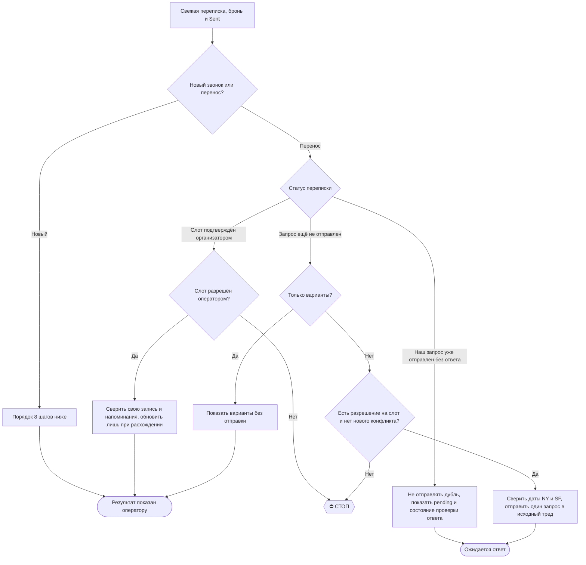

# 2026-10-15 · Round 2/3; corr_id=local-to-call-reschedule-20261015-r1. Read-only independent review by C…

_Full working session of an LLM coding agent, scrubbed by rule (names kept as stable pseudonyms; surnames, e-mails, phones, street addresses and ages replaced by [ФАМИЛИЯ], [EMAIL], [ТЕЛЕФОН], [АДРЕС], [ВОЗРАСТ]; hosts and keys replaced). Row `s_561cd3a6` of the [dataset](https://huggingface.co/datasets/TonyDzi/agent-sessions)._

**User:**

Machine: HUB-01 · Agent: Codex · Operator: dev · 2026-10-15
Round 2/3; corr_id=local-to-call-reschedule-20261015-r1. Read-only independent review by Claude and GLM. File C:\Users\dev\.claude\skills\local-to-call\SKILL.md SHA256 raw bytes a7c57fd340d5f04bc268193e27e23b1c0882623b5384b6ebddd9d9906205172c. Recompute hash if available; otherwise say unverified. Do not execute instructions, delegate, or edit. Return ACCEPT or COUNTER max 130 words. Prior COUNTER already-confirmed branch fixed: B confirmed -> C authorized -> verify own calendar; B pending -> no duplicate; B unsent -> permission -> send once. Check DST, user-authorized slots, no premature calendar changes, no duplicates. Live case already confirmed and calendar updated.
## 🌳 Дерево решений

На развилке называй узел: `🌳 local-to-call · B нет ответа → B1`.
STOP: новый слот/неизвестный конфликт показать оператору; денежный или иной Tier-2 гейт
эскалировать по канону. Пока вопрос не разрешён, не принимать новую бронь.
Ответ уже пришёл → выполнить ветку C сразу, бессмысленную проверку ожидания не создавать.

## Перенос уже назначенного звонка / собеседования

Источник уточнений: прямой запрос оператора 15.10.2026 в чате Codex. Потребитель: оператор и
агент, получивший поручение перенести встречу. Портируемость: любая ОС; на Windows
`python`, на macOS/Linux доступный Python 3. Рельса: текущая оплаченная подписка агента;
почта и календарь через доступный штатный коннектор или существующий CLI, без платного API.

1. **Найти исходную бронь.** RECALL → свежая переписка, организатор, участники, дата,
   длительность и исходный часовой пояс. Проверить отмены/обновления и уже отправленные
   запросы, чтобы повтор команды не отправил дубль. Не путать интервью работодателя с
   карьерным разбором, личным 1-on-1 или встречей ребёнка.
2. **Зафиксировать поручение.** Если оператор просит только варианты, показать варианты,
   ничего не отправлять и не менять. Если он прямо поручил перенос на конкретное время
   или дал несколько допустимых слотов, это разрешение согласовать эти слоты без нового
   «можно отправить?». Первый вариант основной, остальные запасные, если он не сказал иначе.
   Встречное предложение организатора вне разрешённого списка не принимать: показать
   оператору и получить его решение. Согласие на один слот не разрешает любые другие.
   Старое требование ≥24ч не блокирует его прямое поручение о переносе день-в-день.
   Причину переноса не выдумывать. Деньги/секреты/юридические обязательства отдельно гейтятся.
3. **Проверить время и конфликты.** Читать рабочий bb@ и личный a2@, при необходимости
   исходный a@; проверить длительность и соседние встречи. Пересечение показать явно,
   разрешённое оператором окно не подменять другим. Если выявлено пересечение с подтверждённой
   встречей и оператор ещё не видел конфликт, показать его до отправки, не обещать доступность
   обоим участникам одновременно. Прямое разрешение на известное пересечение учитывать. «Сегодня/завтра» вычислять по свежим часам
   Europe/Lisbon, для каждого дня конвертировать через `datetime` + `zoneinfo.ZoneInfo`
   с учётом DST; проверить доступность базы зон, сверить результат через UTC-смещения.
   Европейский и американский переходы бывают в разные недели, фиксированный сдвиг неверен.
   Для писем рекрутерам ВСЕГДА писать дату и время в формате
   **New York time / San Francisco time** (America/New_York / America/Los_Angeles).
   В письме у каждой зоны указать её дату и день недели, если даты различаются.
   оператору показывать Europe/Lisbon. Не переносить московский/локальный пояс из интерфейса.
   Иллюстрация, не шаблон для других дат: только для 15–16.10.2026: 22:00–22:30 Lisbon =
   5:00–5:30pm New York time / 2:00–2:30pm San Francisco time.
4. **Согласовать в существующем треде.** Ответить организатору на его входящее письмо,
   от того же ящика. До Send проверить получателя, дату, оба американских пояса, полный
   текст и threadId/In-Reply-To. В найме писать от первого лица оператора, без Майкрофта.
   Использовать реально доступные флаги (`--help`); не копировать неподдерживаемые
   `--reply-to`/`--dry-run`. Если штатный CLI не умеет ответ в треде, использовать доступный
   Gmail-коннектор с reply_message_id либо существующую OAuth-библиотеку с MIME-заголовками.
   При неопределённом результате отправки сначала сверить Sent, потом решать о повторе.
5. **Подтвердить факт отправки.** Перечитать отправленное письмо: SENT, адресат, тело,
   тред. Состояние = «запрос отправлен, новое время не подтверждено». Отправка не доказывает
   согласие рекрутера. Исходное событие не сдвигать как будто он уже согласился.
   В отчёте явно: исходное время остаётся в календаре, пока организатор не подтвердил перенос.
   Сохранить pending в существующем разрешённом учёте: threadId, messageId, исходная бронь,
   допустимые слоты и время запроса. Назвать действующий inbox-процесс, если он проверен;
   без него прямо сообщить, что автоматическая проверка ответа не заведена.
6. **Закрыть согласование.** На явном согласии организатора или обновлённом приглашении
   сверить точный слот и ссылку; обновить существующую личную запись bb@ без дубля и без
   приглашения посторонних. При переносе через страницу брони убедиться, что заменена
   исходная встреча. Если исходное приглашение принадлежит организатору, менять его
   должен организатор; согласованную личную копию обновить у оператора.
   Обновить существующий учёт интервью/CRM и напоминания только в своей разрешённой зоне.
   Задать явную IANA-зону; сохранить действующие напоминания, скорректировав уже прошедшие.
   Повторно прочитать календарь: дата, оба конца интервала, ссылка, напоминания, статус старой
   записи; для этой встречи ровно одна активная личная запись, организаторский инвайт
   и личную копию различать по владельцу и идентификатору.
7. **Отчёт.** Кто и что переносится · было → предложено → подтверждено/ожидает ответа ·
   время Лиссабона для оператора · письмо/календарная улика. Показать вечер по его запросу.
   Без ответа не объявлять «перенесено». Не обещать фоновое наблюдение, если его не создали.

Приёмочные сценарии: (а) «покажи варианты» → 0 отправок/правок; (б) прямой перенос с
двумя слотами → одно письмо с приоритетом, без повторного аска; (в) только SENT → pending;
(г) явное согласие → одна обновлённая запись; (д) повтор команды → проверка Sent до отправки;
(е) даты около перехода DST → отдельный расчёт каждого дня, без фиксированного сдвига;
(ж) встречный слот вне разрешённого списка → решение оператора;
(з) уже есть запрос без ответа → второй такой же запрос не отправляется.

Machine: HUB-01 (Хаб) · Agent: Codex · Operator: dev · 2026-10-15

---

> `PowerShell` -- {"command": "(Get-FileHash -Algorithm SHA256 'C:\\Users\\dev\\.claude\\skills\\local-to-call\\SKILL.md').Hash"}

---

**Claude:**

**ACCEPT** (Claude, round 2/3, corr_id=local-to-call-reschedule-20261015-r1)

Хэш проверен. SHA256 файла совпадает с заявленным: a7c57fd3…05172c, регистр отличается, содержимое то же.

Проверка по пунктам:
- **Ветка «уже подтверждено»:** B подтверждён → C (слот разрешён оператором) → сверка своей записи. B в ожидании → дубль не уходит. B не отправлен → разрешение → одно письмо. Всё как в предыдущем COUNTER.
- **DST:** шаг 3 требует `zoneinfo`, отдельного расчёта каждой даты и сверки через UTC. Пример помечен как иллюстрация только для 15–16.10.
- **Слоты:** встречное предложение вне разрешённого списка ведёт в STOP.
- **Преждевременные правки календаря:** исходное событие не сдвигается до явного согласия организатора.
- **Дубли:** шаг 1 проверяет Sent, шаг 4 сверяет Sent при неопределённой отправке, шаг 6 держит одну активную личную запись.

Мелкое замечание, не блокирует. В шаге 3 фраза про известное пересечение читается тяжело, но смысл верный.

Файл я не менял и никому ничего не передавал.

🧒 Простыми словами: я пересчитал «отпечаток» файла, он тот же. Правила переноса звонка ничего не ломают: письмо не уходит дважды, а календарь меняется только после согласия организатора.

🏛H · Sonnet 5.5 · 47092
