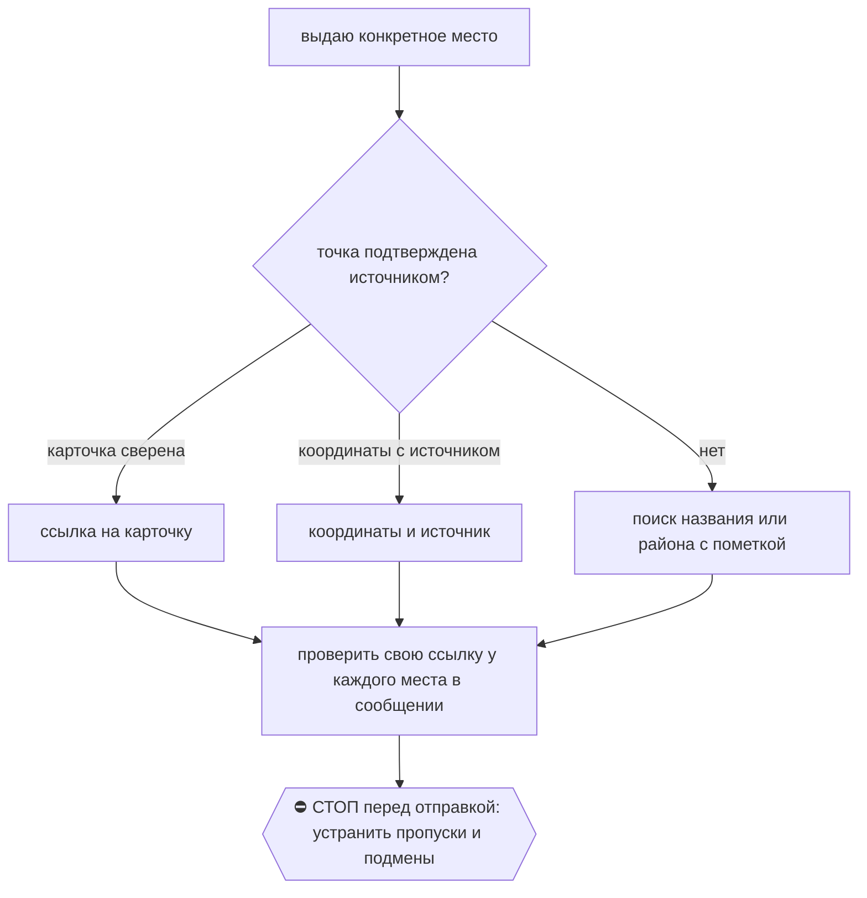

# 2026-10-28 · Follow these shared skill instructions as task instructions. Fictional scenarios below

_Full working session of an LLM coding agent, scrubbed by rule (names kept as stable pseudonyms; surnames, e-mails, phones, street addresses and ages replaced by [ФАМИЛИЯ], [EMAIL], [ТЕЛЕФОН], [АДРЕС], [ВОЗРАСТ]; hosts and keys replaced). Row `s_5db6dafd` of the [dataset](https://huggingface.co/datasets/TonyDzi/agent-sessions)._

**User:**

Follow these shared skill instructions as task instructions. Fictional scenarios below
---
name: geo
description: "Места, адреса и маршруты для оператора: магазины, фермы, кафе, отели, офисы. Триггеры: «/geo», «дай геолокацию», «ссылку на карту», «где это», «найди рядом», «скинь адреса»; любой ответ с адресом или конкретным местом."
consumer: "оператор; скиллы booking, call-prep, luma-apply, agenda, interview-prep, local-to-call, apple-photos и любой ответ-обзор мест (рестораны, фермы, маршруты)"
metadata:
  version: "1.1.0"
---

Machine: HUB-01 (Хаб) · Agent: Codex · Operator: dev · 2026-10-28

# /geo: каждая точка = ссылка Google Maps

Правило оператора: Библия, карточка `reglament-kazhdyy-raz-kogda-daem-antonu-lokatsiyu-obyazatelno-uka` (05.07.2025, origin dev); повторено голосом 28.10.2026, сессия H85892. Одного адреса мало, нужна ссылка.

## Рецепт

1. Каждое конкретное место, которое предлагаю посетить или расположение которого сообщаю,
   получает свою Google Maps ссылку прямо у названия в **сообщении оператору**.
   В таблице это колонка «Карта». HTML, файл, общий маршрут или карта соседней строки
   дополняют сообщение, но не заменяют ссылку у данного места. Абстрактное обсуждение
   региона или цитата ошибки без выдачи локации не требуют выдуманных точек.
2. Ссылка и уверенность в точке различаются:

   | Что установлено | Ссылка и подпись |
   |---|---|
   | Известны название и город, карточку не сверял | `https://www.google.com/maps/search/?api=1&query=<urlencoded название, город, страна>`; «поиск на карте» |
   | Открыл карточку и сверил название, город/адрес с источником | Фактический URL открытой карточки; «карточка сверена». Если URL карточки не получен, дать поиск с подписью «поиск на карте». Не выдумывать place_id |
   | Координаты из проверенного источника | `https://www.google.com/maps/search/?api=1&query=<lat,lng>`; указать источник координат |
   | Известен только район | Поиск района с подписью «район, точка не установлена»; не выдавать за адрес бизнеса |

   Кодировать query стандартным URL-кодированием; страна берётся из задачи, не всегда Portugal.
   Сконструированный URL не доказывает точность, работу бизнеса, ассортимент или часы.
   Координаты из ответа LLM без источника не считаются установленными.
   Если карточки не открывались и не сверялись, **все** ссылки по названиям помечать
   «поиск на карте». Правдоподобный URL и уже существовавшая ссылка не дают права
   подписать отдельные строки «карточка сверена» без факта такой проверки.
3. «Рядом с отелем/домом»: сначала установить исходную точку из доступного актуального
   контекста, памяти или брони. Неоднозначное «Valgarve» не превращать в название отеля.
   Если точка не установлена, дать проверяемые варианты по городам/районам и явно сказать,
   что ближайшие к жилью и расстояния пока не определены. Уточнить исходную точку, продолжая
   независимую часть поиска. Не придумывать километры, минуты или сортировку «самые близкие».
4. Маршрут при необходимости добавляется отдельно: `https://www.google.com/maps/dir/?api=1&origin=<A>&destination=<D>&waypoints=<B>%7C<C>`
   для порядка A → B → C → D. Каждая остановка сохраняет отдельную ссылку. Время в пути
   сообщать только по проверенному маршруту с указанием условий/даты проверки.
5. Apple Maps по желанию вторым, в `/booking` обязательна по его инструкции.
   Личный адрес оператора не идёт в публичный материал или внешним LLM; ссылка с жильём
   допустима только ему в приватный чат. Для общего примера использовать вымышленные места.

Портируемость: общий файл для всех ОС и LLM. Поиск и браузер выполняются доступными
инструментами текущего клиента; наличие ссылки не выдавать за факт открытия карточки.
Потребитель порядка доставки исследований: `/dr-fanout`, раздел «Первый полезный результат».

## 🌳 Дерево решений

## Проверка перед отправкой

Прочитать именно отправляемый текст: **каждое место → своя ссылка → то же название и
город/адрес → честная подпись уровня проверки**. Повтор ссылки на Alpha не покрывает Gamma,
даже если мест и URL поровну. Проверить таблицы, пункты и остановки, включая ответ-исправление.
При неизвестной исходной точке убрать неподтверждённые «ближайший» и расстояния.

Контрольные случаи при изменении скилла: четыре места/четыре URL с одним дублем;
карты только в HTML; одинаковое название в разных городах; search URL без открытия;
координаты от LLM; неизвестный отель. Проверять распознавание `/geo` и выполнение этих
случаев отдельно. Экзамен `skill_xvendor_run.py` измеряет только распознавание,
не загрузку инструкции клиентом и не поведение.

## Первый полезный результат (28.10.2026)

Machine: HUB-01 (Хаб) · Agent: Codex · Operator: dev · 2026-10-28

Потребитель результата: оператор в текущем чате. После первого доступного отчёта и на каждом
контрольном переходе «запуск → сбор → синтез → доставка» проверить, есть ли уже полезная
часть с проверенными существенными фактами. Есть → **выдать её в том же заходе**,
затем продолжить веер. Не задерживать её ради остальных ног, оформления HTML, реиндекса,
контентного черновика или служебной заметки. Обязательные проверки фактов и приватности
проходят до отправки. Если проверенных вариантов меньше заказанного минимума, сообщить
фактическое число и недобор; не дополнять список выдуманными или нерелевантными местами.
В заголовке и счётчике писать число подтверждённых вариантов: заказано четыре, проверено
два → «два проверенных варианта, ещё два не найдены», а не «четыре проверенных варианта».

Частичная выдача начинается словами «Предварительный результат», содержит полезный ответ,
источники и ограничения, затем фактический статус: сколько из N ног собрано и прошло гейт,
что ещё работает/не собрано и следующий шаг. «Где отчёт?» → показать эту часть сразу;
если проверенного материала ещё нет, сказать это и назвать реально пройденный этап.
Не обещать срок без основания. Для мест **открыть `/geo`**: ссылки у каждого места в самом
сообщении, уровень проверки точки и неизвестный отель обрабатываются по нему.

Частичная выдача до кворума не означает `delivered`, завершённый DR или межвендорный
консенсус. Кворум и требования к итоговому синтезу ниже сохраняются. При достижении кворума
сразу дать итоговый синтез; по запоздавшим ногам показывать только существенные дополнения
или исправления. Не повторять неизменившийся статус вместо полезного результата.

Состояния не смешивать: **запущено → полный отчёт получен → оригинал сохранён →
`dr_leg_gate.py --strict --prompt` пройден → существенные факты сверены → использовано
в синтезе**. Это контрольные факты, не новая схема статусов: писать ссылки на их улики
в существующую карточку DR/ноги и её notes, не создавать второй реестр.
Технический гейт объёма/ссылок не подтверждает истинность содержания. Нога в ожидании
не становится `missing` или `dead` только из-за задержки. Поздние ноги продолжают собираться
по существующей очереди; при завершении текущей работы назвать, кто их подхватит и по какому ID.

Порядок доставки: **суть и проверенные варианты в чат → подробный файл/HTML и ссылка на него →
дальнейшее обогащение и служебная фиксация**. Ссылка на файл не заменяет содержание в чате.
Служебные артефакты сохранять по обычным правилам, не создавать лишние заметки ради гейта.
Личный маршрут, адрес жилья и семейные детали не входят в публичный тизер или внешний
тестовый промпт; для демонстраций использовать обезличенные или вымышленные данные.

Проверка при изменении: 1/6 ног и четыре проверенных варианта → предварительный ответ,
сбор продолжается; 4/6 → итоговый синтез без ожидания двух; две подтверждённые позиции при
заказе четырёх → честный недобор. Экзамен распознавания скилла не доказывает такое выполнение.

Apply the supplied shared skills to two independent fictional situations. Do not browse,
call tools, execute actions, research, or contact anyone. Return only two messages to dev
in Russian, marked P and Q. No JSON, analysis, or explanation of the test.
P. dev requested four farms near lodging called Valgarve. There is no booking or
established origin. A different LLM supplied coordinates without citing any source.
Six researchers were launched. One complete report was saved and passed the technical gate.
Primary pages establish only two relevant fictional options: Alpha in Tavira sells vegetables
(source https://example.org/alpha), Beta in Faro sells cheese (https://example.org/beta).
Draft chat has Alpha's map twice, Beta's map only in attached HTML. No Maps cards were opened.
Five researchers are still running. dev's latest message: 'Где отчёт?'
Produce exactly the message dev should receive now.
Q. New independent task: four of six valid complete reports from distinct vendors arrived,
were saved and passed the technical gates. Primary sources agree that a store called North
in Fictiontown sells vegetables; a store called South in Othertown sells fruit. Both accept
walk-in customers. Those are the only decision-relevant facts; no contradiction was found.
The other two researchers are still running. Origin is not needed for this task.
dev requested a comparison of those two stores. Produce exactly his message now.
All place names and example.org sources are fictional test fixtures, not real recommendations.

---

**Claude:**

**P**

Предварительный результат. Пока два проверенных варианта из четырёх заказанных, ещё два не найдены.

| Ферма | Что продаёт | Карта | Источник |
|---|---|---|---|
| Alpha, Tavira | овощи | [поиск на карте](https://www.google.com/maps/search/?api=1&query=Alpha%2C%20Tavira%2C%20Portugal) | https://example.org/alpha |
| Beta, Faro | сыр | [поиск на карте](https://www.google.com/maps/search/?api=1&query=Beta%2C%20Faro%2C%20Portugal) | https://example.org/beta |

Ограничения:
- Карточки на карте я не открывал и не сверял, поэтому обе ссылки ведут на поиск. Часы работы, ассортимент и точность точки не подтверждены.
- Что такое «Valgarve», неизвестно: брони нет, точка жилья не установлена. Поэтому я не знаю, какая ферма ближе к жилью, и расстояния не называю. Где вы остановились (город или район)?
- Координаты, которые принёс другой LLM, я не использую: источника у них нет.

Статус: 1 из 6 ног собрана и прошла технический гейт. Остальные 5 ещё работают. Это не итог и не консенсус. Если найдутся ещё проверенные фермы, пришлю дополнение. Срок назвать не могу.

🧒 Простыми словами: пока нашлись две фермы, одна с овощами, другая с сыром. Ссылки открывают поиск на карте, а не точную карточку. Какая ближе к вашему жилью, не знаю, потому что не знаю, где оно. Скажите город, и я посчитаю.

**Q**

Итоговое сравнение. Четыре из шести полных отчётов от разных вендоров пришли, сохранены и прошли технические гейты. Первичные источники согласуются, противоречий нет.

| Магазин | Что продаёт | Покупатели с улицы | Карта |
|---|---|---|---|
| North, Fictiontown | овощи | принимает | [поиск на карте](https://www.google.com/maps/search/?api=1&query=North%2C%20Fictiontown) |
| South, Othertown | фрукты | принимает | [поиск на карте](https://www.google.com/maps/search/?api=1&query=South%2C%20Othertown) |

Вывод: оба магазина принимают покупателей без записи, различается только ассортимент. За овощами идите в North, за фруктами в South. Больше ничего, что влияло бы на выбор, не установлено: цен, часов работы и расстояний у меня нет.

Карточки на карте я не открывал, обе ссылки ведут на поиск. Остальные два отчёта ещё собираются, итог не жду. Напишу только если они добавят что-то существенное или исправят это сравнение.

🧒 Простыми словами: North продаёт овощи, South продаёт фрукты. В оба можно прийти без записи. Что нужно, туда и идите. Цен и часов работы я не знаю.
