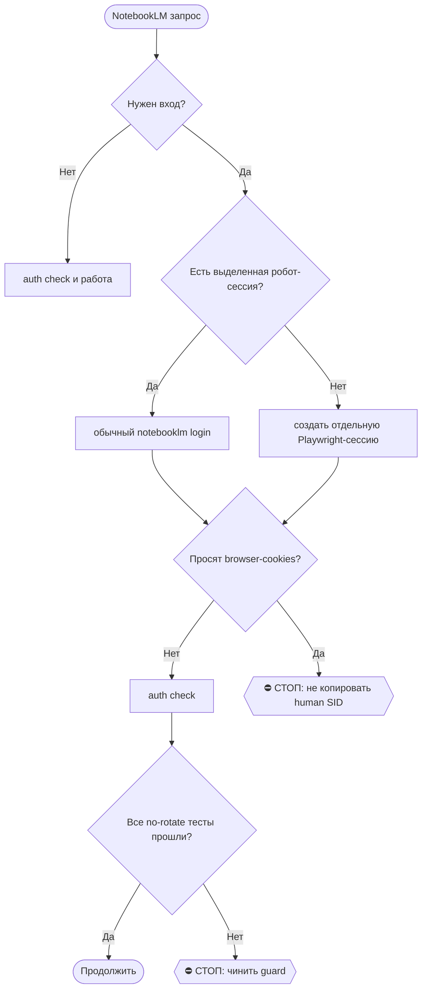

# 2026-10-23 · Мы с тобой недавно, приведи рекорд, делали несколько, не несколько, а 15-20 синтетических…

_Full working session of an LLM coding agent, scrubbed by rule (names kept as stable pseudonyms; surnames, e-mails, phones, street addresses and ages replaced by [ФАМИЛИЯ], [EMAIL], [ТЕЛЕФОН], [АДРЕС], [ВОЗРАСТ]; hosts and keys replaced). Row `s_70eef11f` of the [dataset](https://huggingface.co/datasets/TonyDzi/agent-sessions)._

**User:**

Мы с тобой недавно, приведи рекорд, делали несколько, не несколько, а 15-20 синтетических резюмешек. Мы пытались придумать с тобой синтетических людей, которые идеальны для найма на каждую из вакансий. У нас с тобой там, условно говоря, 20 версий моего резюме под 20 видов вакансий. И для того, чтобы мне лучше свой резюме переписать мы с тобой придумали условно говоря около 20 синтетических персон который идеально подходит на эти вакансии вспомни пожалуйста что на эту тему мы с тобой проводили если мы подкасты на эту тему уже делали то дай им список этих подкастов если каких-то подкастов хватает то сделаем именно убедить что внутри внутри заметки в ноутбук лами голосовой отказ существует английский русский и я буду слушать подкасты и править свою резюме по образу и подобию идеальных кандидатур, я буду пытаться вспомнить факты из своей жизни, чтобы тоже мои резюме как-то были похожи на то, как должны выглядеть качественные резюме от качественных людей на эти вакансии.

---

**Claude:**

Начинаю с RECALL: читаю заметку памяти про серию подкастов по идеальным кандидатам.

---

> `Read` -- {"file_path": "C:\\Users\\dev\\.claude\\projects\\P---WORKDIR-HUB\\memory\\ideal-candidate-19-podcast-series.md"}

---

> `Grep` -- {"pattern": "ideal-candidate|идеальн\\w+ кандидат|ideal candidate", "path": "D:\\Vault\\Vault-Knowledge", "output_mode": "files_with_matches", "head_limit": 40}

---

> `Grep` -- {"pattern": "ideal", "path": "D:\\Vault\\Vault-Knowledge\\05-Resources\\NotebookLM\\artifacts\\_NotebookLM-Audio.md", "output_mode": "content", "-n": true, "head_limit": 80}

---

> `Grep` -- {"pattern": "ideal|Идеальн", "path": "D:\\Vault\\Vault-Knowledge\\05-Resources\\NotebookLM\\_teach-curriculum.md", "output_mode": "content", "-n": true, "head_limit": 60}

---

> `Glob` -- {"pattern": "05-Resources/NotebookLM/_packets/teach-2026-10-02-ideal-*", "path": "D:\\Vault\\Vault-Knowledge"}

---

> `Read` -- {"file_path": "D:\\Vault\\Vault-Knowledge\\05-Resources\\NotebookLM\\_teach-curriculum.md", "offset": 219, "limit": 30}

---

> `Bash` -- {"command": "cd \"D:/Vault/Vault-Knowledge/05-Resources/NotebookLM/artifacts/audio\" && ls -la teach-2026-10-02-ideal-* 2>&1 | awk '{print $5, $9}' | head -50; echo ---; ls teach-2026-10-02-ideal-* | wc -l", "description": "Check ideal-candidate audio files on disk"}

---

> `Skill` -- {"skill": "notebooklm"}

---

**User:**

Base directory for this skill: C:\Users\dev\.claude\skills\notebooklm

# /notebooklm — audio/artifact layer over the Second Brain

Machine: HUB-01 (Хаб) · Agent: Codex · Operator: dev · 2026-10-18

> 🧒 When reporting to dev end with a child-simple "Простыми словами" recap. (memory `eli5-always`)

## ⛔⛔ ЗАКОН 0 — ЛЮБОЕ АУДИО ДЕЛАЕТСЯ ЗДЕСЬ (dev 08.10.2026, дословно)

«**если я прошу подкаст или любое АУДИО — ты всегда делаешь в НОУТБУКЛМ**» · «**но скачивать ничего не надо, я слушаю с НОУТБУКЛМ**».

1. **Исполнитель один.** Просьба про подкаст · аудио · озвучку · «начитай» · «переозвучь» · «переведи подкаст» · «послушать в машине» → только эта рельса. ⛔ Свой синтез речи (edge-tts, ElevenLabs API, SAPI, любой локальный TTS) = **подмена заказа**, даже если звук безупречен: у аудио есть дом, и артефакт вне дома для оператора не существует.
2. ⛔ **НАЗВАННЫЙ оператором ДВИЖОК — НЕ РАЗРЕШЕНИЕ ДЕЛАТЬ МИМО.** Он перечисляет варианты вслух («можно через ElevenLabs», «текстом или голосом») как **варианты формата**, а не как выбор рельсы. Прочитать это как «разрешено собрать свою трубу» — ровно та ошибка, что породила ЗАКОН 0. Хочешь иной движок → спроси одной строкой, не решай сам.
3. **Доставка = ССЫЛКА на блокнот** `https://notebooklm.google.com/notebook/<id>`. Карточка файла в чате и путь в волте доставкой **НЕ являются**. ⛔ Скачивание в волт по умолчанию не делается — только по отдельной просьбе или когда файл нужен прибору (например [[youtube-publish]]).

⭐ **Аудио на дисках НЕ храним** (dev 13.10.2026, диета диска): `.m4a/.mp3/.wav` живут в облаке NotebookLM. В волт ложится только ТЕКСТ (расшифровка) → эссенция (`/podcast-essence`). Скачанный ради расшифровки звук: whisper → `.transcript.txt` → эссенция → звук удалить. На ноутах папка `05-Resources/NotebookLM/artifacts/audio` в `.stignore`; остаток держит только хаб до расшифровки.

4. **Расшарить сразу после `create`**, не дожидаясь просьбы: владелец рельсы `a2@`, а слушает оператор под личным `a@` → `"$NB" share add [EMAIL] --permission editor -n <id>`. Проверить: `share status -n <id>`.
5. **Законы генерации живут в соседнем файле.** Два языка как дефолт, `--length long`, уточняющие вопросы в промпте, сверка `artifact list` до вердикта, замер «RU long втрое короче EN» — всё это в [[teach-podcast]] §Законы. ⚠️ Открыл этот скилл и не открыл тот → половина правил мимо (замер 08.10: так и вышло, сессия объявила «шага share в скилле нет», тогда как он стоял в `/teach-podcast` строкой 239).

6. ⭐ **КАРВ-АУТ 08.10 ВЕЧЕРОМ — ВИДЕО НАРУЖУ: ЛЮБЫЕ ДВИЖКИ** (решение оператора, дословно «для видео контента наружу можно использовать любые ллм и продукты»). Граница проходит по НОСИТЕЛЮ, а не по движку: **видео** наружу (визитка, говорящий аватар, ролик, озвучка видео) — ElevenLabs, HeyGen и что угодно ещё; **аудио для оператора** — по-прежнему только здесь. ⛔ Карв-аут НЕ расширяется с видео на звук: «вытащи дорожку и выложи подкастом» — это снова аудио и снова NotebookLM. Повод: задача `auto-hub-260806-record-application-video`, где аватара NotebookLM не умеет в принципе, то есть закон этот случай не покрывал. ⚠️ Открытым остаётся раскрытие: аватар с лицом и голосом оператора в холодном контуре — артефакт его личности, строку раскрытия (§3.3) утверждает он. ⚙️ **Дверь карв-аута:** `audio_engine_gate.py` знает о нём и пропускает команду с маркером `# video-outward-ok: <что за видео>`; в счётчике это отдельная причина `BYPASS-VIDEO`, не смешанная с инженерным обходом `# audio-engine-ok:`. ⛔ Носитель дверь проверить НЕ может — она видит команду, а не то, уедет ли звук в видео; поэтому граница держится на ОТСУТСТВИИ маркера, а ложная декларация «видео» на звуковой работе остаётся осознанным нарушением и видна в счётчике поимённо. Канон: регламент §КАРВ-АУТ 08.10 ВЕЧЕРОМ.

⚠️ **Рельса недоступна** (упала авторизация · выбрана суточная квота · лёг CLI) → говорится **вслух одной строкой с причиной**, и только тогда обсуждается замена. Молча подменить движок нельзя.

Канон: `reglament-lyuboe-audio-i-podkast-delaem-v-notebooklm` · память [[audio-always-in-notebooklm]].

NotebookLM = the **artifact/explanation layer** (Audio Overview, study guide, mind map, reports) over the vault — NOT memory or RAG (that stays Obsidian + e5/rerank + SQLite). Flow: `vault → Claude Code curates a NARROW packet → NotebookLM → artifacts back into vault as Derived`. Full state = memory [[notebooklm-integration]].

## Rail = CLI (verified 2026-10-18, ADOPT — H16)
Programmatic CLI `teng-lin/notebooklm-py` (17k⭐, MIT). No Chrome window, no DOM, no truncation. Works on dev's consumer `a2@` PRO (no Enterprise API).
- **CLI binary:** `C:\Users\dev\notebooklm-cli\venv\Scripts\notebooklm.exe` (venv, v0.7.3). Set `NB="C:\Users\dev\notebooklm-cli\venv\Scripts\notebooklm.exe"`.
- **Auth:** только выделенная робот-сессия NotebookLM. Запускать `"$NB" login` без `--browser-cookies`, пройти Google-вход в отдельном Playwright Chromium и сохранить `C:\Users\dev\.notebooklm\profiles\default\storage_state.json` для `[EMAIL]`. Затем `"$NB" auth check`.
- ⛔ **Не импортировать живую сессию человека.** `login --browser-cookies firefox|chrome|edge` и прямой экспорт через `firefox_cookies.py` копируют SID человека в робота. На хабе это дважды привело к серверному разлогину Google после `RotateCookies`. Venv блокирует только CLI-флаг `--browser-cookies`; системный `firefox_cookies.py --export` технически не заблокирован и потому тоже запрещён этой инструкцией. Переменная `NOTEBOOKLM_ALLOW_HUMAN_COOKIE_EXPORT=1` существует только для отдельного расследования с явным решением, не как fallback.
- **401/auth failure:** сначала `"$NB" auth check`, затем обычный `"$NB" login` в выделенную робот-сессию. Не лечить 401 копированием cookie из Firefox/Chrome.
- **Защита от ротации:** venv `sitecustomize.py` по умолчанию блокирует Python/httpx-вызовы к `https://accounts.google.com/RotateCookies` на слоях `send`, redirect и transport, синхронно и асинхронно. Явное снятие - `NOTEBOOKLM_ALLOW_KEEPALIVE_POKE=1`, процесс печатает WARNING. Guard не покрывает Chromium внутри отдельного login, другой HTTP-клиент, иной Google-host, запуск `python -S` и чужой `sitecustomize`, стоящий раньше в `sys.path`. `sitecustomize.py` не принадлежит wheel пакета, но после любого обновления всё равно обязательны no-rotate тесты; пересоздание venv удаляет guard. После rebuild отсутствие guard обязано уронить `_test_teach_backlog_no_rotate.py`; затем восстановить `sitecustomize.py` из проверенного бэкапа/установщика. Если сломанный импорт `httpx` блокирует обычный запуск, ремонтная дверь: `venv\Scripts\python.exe -S -m pip install --force-reinstall httpx`.
- **Версия:** production остаётся на 0.7.3. 0.8.5 не установлена; любое обновление закрывается только после no-rotate приёмки на точном кандидате.
- **Anti-abuse:** run from the hub (residential IP), **no VPN**.

## 🌳 Дерево решений



## ⛔ Три дефолта генерации (приказ оператора 21.09.2026, голосом, tg:chat_REDACTED)
Действуют на ЛЮБОЙ артефакт с выбором длины/языка, не только на учебные подкасты:
1. **Длина всегда максимальная** — `--length long`. Дословно: «всегда выбирать максимальную длину
   результата». Короче — только по прямому слову оператора, и причина пишется в доклад.
2. **Два языка** — `--language ru` и `--language en`, вторым прогоном на ТОМ ЖЕ блокноте и ТОЛЬКО
   после скачивания первого (параллельные генерации ломают поллер CLI — см. /teach-podcast Шаг 5).
   Дословно: «делать это и на русском, и на английском».
3. **Уточняющие вопросы в промпте обязательны** — блок «задавайте друг другу вопросы умного новичка
   и сразу отвечайте» + блок «опирайтесь на источники, называйте, откуда факт». Дословно: «при
   генерации аудио/видео добавлять уточняющие вопросы/комментарии, чтобы NotebookLM дал более
   точный ответ». Образец: `05-Resources/NotebookLM/_packets/teach-2026-09-21-pytorch-tensorflow-v2.prompt.txt`.
4. **Источников 10-15+**, наш пакет считается за один; один источник = NotebookLM пересказывает нас
   самих. Пул URL проверять живым кодом 200 перед `source add`; добор — `source add-research "<query>"
   --import-all --cited-only --timeout 1800`.
Канон: [[teach-dev-by-podcast-default]], CLAUDE.md §9.13, скилл `/teach-podcast` Закон 2 + Шаг 3.

## digest (default) — vault → audio
1. **RECALL + curate a NARROW packet** ([[vault-data-architecture]]): `brain_ask.py`/`/ask` + grep to pull ONLY the relevant slice. Write it to a clean `.txt`/`.md` packet.
2. **Create + add source + generate (CLI):**
   ```bash
   NB="C:\\Users\\dev\\notebooklm-cli\\venv\\Scripts\\notebooklm.exe"
   "$NB" create "<Title>" --use                       # --use sets current context (don't parse --json 'id' — key differs)
   "$NB" source add "<packet.md>" --type file          # uses current context; or --type text "<inline>", or a URL. Wait for Status=ready.
   "$NB" generate audio --prompt-file <prompt.txt> --length long --language ru --wait --timeout 1800   # длина ВСЕГДА long; потом тот же прогон с --language en
   ```
   Other artifacts: `generate mind-map | report | flashcards | quiz | slide-deck | video | data-table | infographic`.
3. **Pull artifacts back:** `"$NB" download audio "05-Resources\NotebookLM\artifacts\audio\<name>.mp3"` (current context; or `--all <dir>`, `-n <id>`). Non-audio: `artifact export`. Get the notebook id for the index: `NBID=$("$NB" list --json | python -c "import sys,json;print(json.load(sys.stdin)[0]['id'])")` (newest first).
4. **Index + link:** add the notebook/artifact to `05-Resources\NotebookLM\_NotebookLM-Index.md`; link the derived note back to its source concept(s). Backup before vault write ([[vault-backup-rule]]).

## pull — Phase B
Pull existing artifacts from the top notebooks into the vault as Derived notes: `"$NB" list` → `download ... --all` per notebook → index + link.

## Fallback — Chrome-autonomy (only if CLI breaks)
If Google rotates endpoints and the CLI errors (and a re-login doesn't fix it), drive the logged-in UI via Claude-in-Chrome ([[chrome-autonomy-self-drive]]) on `a2@`: Create notebook → Add sources → Studio → generate → **Download** menu (NOT DOM-scrape, truncates ~1000 chars). This was the old primary rail; kept as backstop.

## Safety
- CLI uses undocumented Google APIs (community project) — same ToS surface as driving the logged-in UI of the same account; low-med risk for personal volumes.
- Audio/video generation has a **daily quota** — don't burn it on test runs; add `--retry` + delays for batches.
- Stay on a2 PRO (free, included — [[prefer-included-limits-before-paid-api]]).

## Идея
Мост NotebookLM ↔ Claude Code (open-source CLI поверх реверс-инжиниренных протоколов) —
идея и сам CLI: **Teng Ling**, [@ClawRus/15773](https://t.me/ClawRus/15773), взято 2026-06-30.
Спасибо. Реестр кредита: `alpha_credit.py` id `5d18022c74e3` · [[credit-inspiration-sources]].

## Наружу: YouTube (приказ оператора 21.09.2026, голосом)
Сделанный артефакт не стыдно показать миру → **строка в** `05-Resources\NotebookLM\_youtube-queue.md`
(файл · заголовок RU · заголовок EN · описание · теги · статус `ждёт`), выгрузку делает
скилл **`/youtube-publish`** на канал `@tonydzz`. Дословно: «как только появляется новый
материал из NotebookLM, его нужно выкладывать на YouTube». Контракт односторонний: мы кладём,
он вычерпывает; строку забыли — эпизод подберёт свободный скан, но уже без человеческого
заголовка. ⛔ Наружу не идёт приватное (Закон 3 `/teach-podcast`): имена из переписки, письма,
вилки денег, CRM, секреты.

## Output
Notebook created/used · artifact type + where saved · index updated. Then 🧒 recap. Routine candidate: weekly "audio digest of my brain" — see /skill-gap and [[evaluate-recurring-into-routine]]. Decision: `02-Decisions\decision-notebooklm-claude-code-artifact-layer`.

---

**Claude:**

Проверяю прибором, что аудио лежит внутри блокнотов (а не только на диске). Сначала один блокнот.

---

> `Bash` -- {"command": "NB=\"/c/Users/dev/notebooklm-cli/venv/Scripts/notebooklm.exe\"; \"$NB\" --help 2>&1 | head -30; echo ----; ls /c/Users/dev/.notebooklm/profiles/ 2>&1", "description": "Show CLI help and available auth profiles"}

---

> `Bash` -- {"command": "NB=\"/c/Users/dev/notebooklm-cli/venv/Scripts/notebooklm.exe\"; \"$NB\" -p dev-a auth check 2>&1 | head -15; echo ----; \"$NB\" -p dev-a artifact list -n c6143135 2>&1 | head -30", "description": "Check auth and list artifacts of notebook 1", "timeout": 90000}

---

**Claude:**

Профиль a@ на этом узле без сессии. Блокноты расшарены на a2@, пробую его профиль.

---

> `Bash` -- {"command": "NB=\"/c/Users/dev/notebooklm-cli/venv/Scripts/notebooklm.exe\"; for p in dev-a2 default; do echo \"== $p\"; \"$NB\" -p $p auth check --test 2>&1 | tail -8; done", "description": "Auth check for a2 and default profiles", "timeout": 90000}

---

**Claude:**

Профиль `default` рабочий. Проверяю, видит ли он все 19 блокнотов и какие аудио внутри.

---

> `Bash` -- {"command": "NB=\"/c/Users/dev/notebooklm-cli/venv/Scripts/notebooklm.exe\"; export PYTHONIOENCODING=utf-8\nfor id in c6143135 620f1e05 3c69a5f3 e86943bb 331e4c20 b48b4544 b1adeec3 2a86bc66 1682c253 11b0e572 16db561b b298a62c 3cebe4da f710f8b3 ef6cb16a 8683723e 34938af7 157cc8ea f4e5d1ff; do\n ech

---

**Claude:**

Формат JSON другой у большинства блокнотов. Смотрю сырой вывод одного.

---

> `Bash` -- {"command": "NB=\"/c/Users/dev/notebooklm-cli/venv/Scripts/notebooklm.exe\"; export PYTHONIOENCODING=utf-8; \"$NB\" artifact list -n c6143135 --json 2>&1 | head -c 1500", "description": "Raw artifact list JSON for notebook 1", "timeout": 60000}

---

> `Bash` -- {"command": "NB=\"/c/Users/dev/notebooklm-cli/venv/Scripts/notebooklm.exe\"; export PYTHONIOENCODING=utf-8; \"$NB\" auth check 2>&1 | grep -i -E \"account|email\" ; \"$NB\" list --json 2>/dev/null | python -c \"\nimport sys,json\nd=json.load(sys.stdin); n=d.get('notebooks',d)\nprint(len(n))\nfor x

---

**Claude:**

23.10, ~10:00.

Подкасты есть, новые делать не надо. Серия называется «Идеальный кандидат: 19 историй» (заказана 02.10), по одному выпуску на каждую ветку резюме. У каждого выпуска есть русская и английская версии, всего 38 эпизодов.

Что проверено, а что нет:
- **На диске:** все 38 файлов `.m4a` на месте.
- **В журнале:** по учебному плану приёмка всех выпусков пройдена 12.10, статус у каждого «не прослушан».
- **Живьём в NotebookLM:** я проверил только блокнот 7/19. В нём есть завершённые аудио, но они названы по-разному и язык у них не указан. Я не определил, какое из них русское, какое английское.
- **Остальные 18 блокнотов:** сегодня я их не открывал. Профиль a@ на этом узле без живой сессии, а профиль a2@ видит только блокнот 7. Хотя по записи в памяти все блокноты расшарены на a2@ и bb@.
- Если в каком-то блокноте не окажется RU или EN, дам знать после вашего захода.

Блокноты на аккаунте a@. Минуты указаны как RU / EN:

| # | Роль (герой выпуска) | RU / EN, мин | Блокнот |
|---|---|---|---|
| 1 | Forward Deployed Engineer (Йонас Берг) | 17 / 20 | [открыть](https://notebooklm.google.com/notebook/s_4350bcce?authuser=[EMAIL]) |
| 2 | COO / Head of Operations / Chief of Staff (Марек Сольский) | 15 / 20 | [открыть](https://notebooklm.google.com/notebook/s_50f53487?authuser=[EMAIL]) |
| 3 | AI Deployment Strategist (Мартин Ковач) | 15 / 40 | [открыть](https://notebooklm.google.com/notebook/s_d3a5c720?authuser=[EMAIL]) |
| 4 | AI Product Manager / Founding PM (Даниил Орехов) | 13 / 40 | [открыть](https://notebooklm.google.com/notebook/s_53d74cf0?authuser=[EMAIL]) |
| 5 | AI Agent Security / Red Team (Егор Савин) | 13 / 30 | [открыть](https://notebooklm.google.com/notebook/s_506946de?authuser=[EMAIL]) |
| 6 | AI Research Engineer / MTS (Даниэль Ремер) | 16 / 35 | [открыть](https://notebooklm.google.com/notebook/s_ce5574ee?authuser=[EMAIL]) |
| 7 | Docs Engineer / Technical Writer (Даниэль Варга) | 14 / 17 | [открыть](https://notebooklm.google.com/notebook/s_7a5b9f48?authuser=[EMAIL]) |
| 8 | DevRel / Developer Advocate (Глеб Сомов) | 13 / 33 | [открыть](https://notebooklm.google.com/notebook/s_085223f2?authuser=[EMAIL]) |
| 9 | Capital Formation / Investor Relations (Лукас Вебер) | 15 / 23 | [открыть](https://notebooklm.google.com/notebook/s_08990910?authuser=[EMAIL]) |
| 10 | Фонд: Platform / Portfolio Ops (Глеб Ветлугин) | 12 / 34 | [открыть](https://notebooklm.google.com/notebook/s_7383e3d3?authuser=[EMAIL]) |
| 11 | Хедж- и крипто-фонд, не-квантовые роли (Глеб Ветров) | 18 / 29 | [открыть](https://notebooklm.google.com/notebook/s_f106c2df?authuser=[EMAIL]) |
| 12 | Hyperliquid и ончейн-биржи, институциональный BD (Илья Ветров) | 15 / 37 | [открыть](https://notebooklm.google.com/notebook/s_e3035b0f?authuser=[EMAIL]) |
| 13 | Централизованные биржи и трейдинг-инфраструктура (Марк Соколов) | 16 / 22 | [открыть](https://notebooklm.google.com/notebook/s_8f68b092?authuser=[EMAIL]) |
| 14 | Стейблкоины и платёжная инфраструктура (Лукас Брандт) | 19 / 18 | [открыть](https://notebooklm.google.com/notebook/s_beef1f8a?authuser=[EMAIL]) |
| 15 | Head of Ecosystem (Матвей Ольхов) | 21 / 31 | [открыть](https://notebooklm.google.com/notebook/s_f7e0b865?authuser=[EMAIL]) |
| 16 | Startup Ecosystem: акселераторы и инкубаторы (Глеб Суханов) | 17 / 19 | [открыть](https://notebooklm.google.com/notebook/s_3190ea78?authuser=[EMAIL]) |
| 17 | BD и партнёрства в AI-компании (Илья Северов) | 16 / 49 | [открыть](https://notebooklm.google.com/notebook/s_dfb8afdd?authuser=[EMAIL]) |
| 18 | Compute и GPU-ёмкость, enterprise-продажи (Томаш Ковалик) | 14 / 19 | [открыть](https://notebooklm.google.com/notebook/s_5b9a61a3?authuser=[EMAIL]) |
| 19 | Silicon Valley landing (Йонас Келлер) | 14 / 31 | [открыть](https://notebooklm.google.com/notebook/s_5d257cab?authuser=[EMAIL]) |

Как использовать при правке резюме:
- **Слушать:** герой выпуска показывает планку рынка. Цифры героя придуманы как эталон и в ваше резюме не едут. Берите из них только форму: какие числа, ссылки и глаголы ищет рекрутёр.
- **Вспоминать:** после каждого выпуска выписывайте свои факты под те же строки.
- **Читать текстом:** тексты историй лежат в `05-Resources/NotebookLM/_packets/teach-2026-10-02-ideal-NN-<slug>.md`. Скелеты резюме берутся из `Role-Portraits/ideal-candidate-templates-2026-09-26.md`.
- **Ещё по теме:** есть пара выпусков про идеального DevRel по городам, «Сан-Франциско» и «европейский город» (06.10). Оба в учебном плане `_teach-curriculum.md`.

Предлагаю, если захотите: на каждую ветку подготовить короткий лист «что вспомнить из жизни» с вопросами к вам. Он собирается из этих же пакетов, новое аудио для него не нужно.

🧒 **Простыми словами**
- Мы уже сделали 19 историй про «идеальных людей» для 19 видов резюме, каждую на русском и английском.
- Файлы на компьютере есть, и в журнале всё записано как готовое.
- Я заглянул внутрь только одного блокнота из 19: там аудио есть. Остальные не открывал, поэтому ссылки выше открывайте и слушайте там.
- Слушаете историю, потом вспоминаете, что похожее было у вас, и вписываете это в резюме.

23.10, ~10:05.
