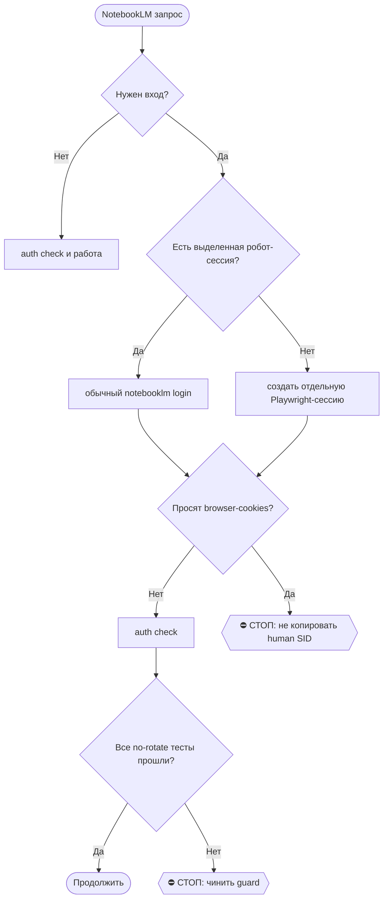

# 2026-10-26 · Нужно срочно подготовиться к интервью в Turing

_Full working session of an LLM coding agent, scrubbed by rule (names kept as stable pseudonyms; surnames, e-mails, phones, street addresses and ages replaced by [ФАМИЛИЯ], [EMAIL], [ТЕЛЕФОН], [АДРЕС], [ВОЗРАСТ]; hosts and keys replaced). Row `s_875e56b1` of the [dataset](https://huggingface.co/datasets/TonyDzi/agent-sessions)._

**User:**

Нужно срочно подготовиться к интервью в Turing.

Задача: провести recall по всему, что уже делали для подготовки к этому интервью: прошлые материалы, подкасты, разборы, опыт, релевантные проекты.

Нужно сделать 2 подкаста/аудиосценария:

1. **Идеальная кандидатура для Turing**
   Описать гипотетического кандидата, который почти гарантированно проходит собеседование:
   - какой у него опыт;
   - какие проекты;
   - какие навыки;
   - как он рассказывает о себе;
   - какие кейсы звучат максимально релевантно для вакансии;
   - как выглядит его профессиональная история.

2. **“Я как идеальный кандидат”**
   Сделать версию, где мой реальный опыт упакован так, как будто я максимально релевантен этой вакансии.
   Нужно построить мостик между:
   - моим прошлым опытом;
   - работой в инкубаторе;
   - проектами, которые я инкубировал;
   - опытом с AI/ML, обучением моделей и похожими направлениями;
   - тем, что требуется для Turing.

Цель: помочь мне вспомнить из большого количества проектов именно те, которые лучше всего зайдут на собеседовании. Можно сделать это гипотетически/понарошку: описать, какие проекты и какой опыт стоило бы подсветить, а я потом сам выберу, что из этого действительно использовать.

Важно: не просто перечислить опыт, а показать, какой конкретно опыт лучше вспоминать и как его привязать к вакансии.

Сделать ASAP, интервью сегодня.
__Перевела: GPT-5.5 + whisper__

• • • • •

Готовлюсь к интервью в Turing сегодня. Нужно ASAP вспомнить и собрать всё, что уже готовили по этой теме: подготовка к интервью, подкасты, материалы и т.д.

Нужно сделать 2 подкаста/сценария:

1. **Идеальная кандидатура для Turing**
   Описать гипотетического кандидата, который точно проходит собеседование:
   - какой у него опыт;
   - какие проекты;
   - какие навыки;
   - как он себя презентует;
   - что именно говорит на интервью.

2. **Я как “идеальный кандидат”**
   Описать, как мой реальный опыт можно упаковать под эту идеальную кандидатуру:
   - связать мой прошлый опыт с вакансией;
   - вспомнить работу в инкубаторе;
   - выбрать из всех инкубированных проектов самые релевантные для Turing;
   - особенно выделить проекты, связанные с AI, обучением моделей, ML/LLM, продуктами, автоматизацией и т.п.;
   - показать мостик: что я делал → какой опыт получил → почему это релевантно вакансии.

Важно: не выдумывать финально за меня, а сделать “понарошку” — предложить, какой опыт мне стоит вспомнить и о каких проектах лучше говорить на собеседовании. Я потом сам выберу, что использовать.

Сделать срочно, ASAP.
__Перевела: GPT-5.5 + 11labs__

---

**Claude:**

Начинаю с RECALL по Turing и открываю скиллы для аудио.

---

> `Skill` -- {"skill": "notebooklm"}

---

**User:**

Base directory for this skill: C:\Users\dev\.claude\skills\notebooklm

# /notebooklm — audio/artifact layer over the Second Brain

Machine: HUB-01 (Хаб) · Agent: Codex · Operator: dev · 2026-10-18

> 🧒 When reporting to dev end with a child-simple "Простыми словами" recap. (memory `eli5-always`)

## ⛔⛔ ЗАКОН 0 — ЛЮБОЕ АУДИО ДЕЛАЕТСЯ ЗДЕСЬ (dev 08.10.2026, дословно)

«**если я прошу подкаст или любое АУДИО — ты всегда делаешь в НОУТБУКЛМ**» · «**но скачивать ничего не надо, я слушаю с НОУТБУКЛМ**».

1. **Исполнитель один.** Просьба про подкаст · аудио · озвучку · «начитай» · «переозвучь» · «переведи подкаст» · «послушать в машине» → только эта рельса. ⛔ Свой синтез речи (edge-tts, ElevenLabs API, SAPI, любой локальный TTS) = **подмена заказа**, даже если звук безупречен: у аудио есть дом, и артефакт вне дома для оператора не существует.
2. ⛔ **НАЗВАННЫЙ оператором ДВИЖОК — НЕ РАЗРЕШЕНИЕ ДЕЛАТЬ МИМО.** Он перечисляет варианты вслух («можно через ElevenLabs», «текстом или голосом») как **варианты формата**, а не как выбор рельсы. Прочитать это как «разрешено собрать свою трубу» — ровно та ошибка, что породила ЗАКОН 0. Хочешь иной движок → спроси одной строкой, не решай сам.
3. **Доставка = ССЫЛКА на блокнот** `https://notebooklm.google.com/notebook/<id>`. Карточка файла в чате и путь в волте доставкой **НЕ являются**. ⛔ Скачивание в волт по умолчанию не делается — только по отдельной просьбе или когда файл нужен прибору (например [[youtube-publish]]).

⭐ **Аудио на дисках НЕ храним** (dev 13.10.2026, диета диска): `.m4a/.mp3/.wav` живут в облаке NotebookLM. В волт ложится только ТЕКСТ (расшифровка) → эссенция (`/podcast-essence`). Скачанный ради расшифровки звук: whisper → `.transcript.txt` → эссенция → звук удалить. На ноутах папка `05-Resources/NotebookLM/artifacts/audio` в `.stignore`; остаток держит только хаб до расшифровки.

4. **Расшарить сразу после `create`**, не дожидаясь просьбы: владелец рельсы `a2@`, а слушает оператор под личным `a@` → `"$NB" share add [EMAIL] --permission editor -n <id>`. Проверить: `share status -n <id>`.
5. **Законы генерации живут в соседнем файле.** Два языка как дефолт, `--length long`, уточняющие вопросы в промпте, сверка `artifact list` до вердикта, замер «RU long втрое короче EN» — всё это в [[teach-podcast]] §Законы. ⚠️ Открыл этот скилл и не открыл тот → половина правил мимо (замер 08.10: так и вышло, сессия объявила «шага share в скилле нет», тогда как он стоял в `/teach-podcast` строкой 239).

6. ⭐ **КАРВ-АУТ 08.10 ВЕЧЕРОМ — ВИДЕО НАРУЖУ: ЛЮБЫЕ ДВИЖКИ** (решение оператора, дословно «для видео контента наружу можно использовать любые ллм и продукты»). Граница проходит по НОСИТЕЛЮ, а не по движку: **видео** наружу (визитка, говорящий аватар, ролик, озвучка видео) — ElevenLabs, HeyGen и что угодно ещё; **аудио для оператора** — по-прежнему только здесь. ⛔ Карв-аут НЕ расширяется с видео на звук: «вытащи дорожку и выложи подкастом» — это снова аудио и снова NotebookLM. Повод: задача `auto-hub-260806-record-application-video`, где аватара NotebookLM не умеет в принципе, то есть закон этот случай не покрывал. ⚠️ Открытым остаётся раскрытие: аватар с лицом и голосом оператора в холодном контуре — артефакт его личности, строку раскрытия (§3.3) утверждает он. ⚙️ **Дверь карв-аута:** `audio_engine_gate.py` знает о нём и пропускает команду с маркером `# video-outward-ok: <что за видео>`; в счётчике это отдельная причина `BYPASS-VIDEO`, не смешанная с инженерным обходом `# audio-engine-ok:`. ⛔ Носитель дверь проверить НЕ может — она видит команду, а не то, уедет ли звук в видео; поэтому граница держится на ОТСУТСТВИИ маркера, а ложная декларация «видео» на звуковой работе остаётся осознанным нарушением и видна в счётчике поимённо. Канон: регламент §КАРВ-АУТ 08.10 ВЕЧЕРОМ.

⚠️ **Рельса недоступна** (упала авторизация · выбрана суточная квота · лёг CLI) → говорится **вслух одной строкой с причиной**, и только тогда обсуждается замена. Молча подменить движок нельзя.

Канон: `reglament-lyuboe-audio-i-podkast-delaem-v-notebooklm` · память [[audio-always-in-notebooklm]].

NotebookLM = the **artifact/explanation layer** (Audio Overview, study guide, mind map, reports) over the vault — NOT memory or RAG (that stays Obsidian + e5/rerank + SQLite). Flow: `vault → Claude Code curates a NARROW packet → NotebookLM → artifacts back into vault as Derived`. Full state = memory [[notebooklm-integration]].

## Rail = CLI (verified 2026-10-18, ADOPT — H16)
Programmatic CLI `teng-lin/notebooklm-py` (17k⭐, MIT). No Chrome window, no DOM, no truncation. Works on dev's consumer `a2@` PRO (no Enterprise API).
- **CLI binary:** `C:\Users\dev\notebooklm-cli\venv\Scripts\notebooklm.exe` (venv, v0.7.3). Set `NB="C:\Users\dev\notebooklm-cli\venv\Scripts\notebooklm.exe"`.
- **Auth:** только выделенная робот-сессия NotebookLM. Запускать `"$NB" login` без `--browser-cookies`, пройти Google-вход в отдельном Playwright Chromium и сохранить `C:\Users\dev\.notebooklm\profiles\default\storage_state.json` для `[EMAIL]`. Затем `"$NB" auth check`.
- ⛔ **Не импортировать живую сессию человека.** `login --browser-cookies firefox|chrome|edge` и прямой экспорт через `firefox_cookies.py` копируют SID человека в робота. На хабе это дважды привело к серверному разлогину Google после `RotateCookies`. Venv блокирует только CLI-флаг `--browser-cookies`; системный `firefox_cookies.py --export` технически не заблокирован и потому тоже запрещён этой инструкцией. Переменная `NOTEBOOKLM_ALLOW_HUMAN_COOKIE_EXPORT=1` существует только для отдельного расследования с явным решением, не как fallback.
- **401/auth failure:** сначала `"$NB" auth check`, затем обычный `"$NB" login` в выделенную робот-сессию. Не лечить 401 копированием cookie из Firefox/Chrome.
- **Защита от ротации:** venv `sitecustomize.py` по умолчанию блокирует Python/httpx-вызовы к `https://accounts.google.com/RotateCookies` на слоях `send`, redirect и transport, синхронно и асинхронно. Явное снятие - `NOTEBOOKLM_ALLOW_KEEPALIVE_POKE=1`, процесс печатает WARNING. Guard не покрывает Chromium внутри отдельного login, другой HTTP-клиент, иной Google-host, запуск `python -S` и чужой `sitecustomize`, стоящий раньше в `sys.path`. `sitecustomize.py` не принадлежит wheel пакета, но после любого обновления всё равно обязательны no-rotate тесты; пересоздание venv удаляет guard. После rebuild отсутствие guard обязано уронить `_test_teach_backlog_no_rotate.py`; затем восстановить `sitecustomize.py` из проверенного бэкапа/установщика. Если сломанный импорт `httpx` блокирует обычный запуск, ремонтная дверь: `venv\Scripts\python.exe -S -m pip install --force-reinstall httpx`.
- **Версия:** production остаётся на 0.7.3. 0.8.5 не установлена; любое обновление закрывается только после no-rotate приёмки на точном кандидате.
- **Anti-abuse:** run from the hub (residential IP), **no VPN**.

## 🌳 Дерево решений



## ⛔ Три дефолта генерации (приказ оператора 21.09.2026, голосом, tg:chat_REDACTED)
Действуют на ЛЮБОЙ артефакт с выбором длины/языка, не только на учебные подкасты:
1. **Длина всегда максимальная** — `--length long`. Дословно: «всегда выбирать максимальную длину
   результата». Короче — только по прямому слову оператора, и причина пишется в доклад.
2. **Два языка** — `--language ru` и `--language en`, вторым прогоном на ТОМ ЖЕ блокноте и ТОЛЬКО
   после скачивания первого (параллельные генерации ломают поллер CLI — см. /teach-podcast Шаг 5).
   Дословно: «делать это и на русском, и на английском».
3. **Уточняющие вопросы в промпте обязательны** — блок «задавайте друг другу вопросы умного новичка
   и сразу отвечайте» + блок «опирайтесь на источники, называйте, откуда факт». Дословно: «при
   генерации аудио/видео добавлять уточняющие вопросы/комментарии, чтобы NotebookLM дал более
   точный ответ». Образец: `05-Resources/NotebookLM/_packets/teach-2026-09-21-pytorch-tensorflow-v2.prompt.txt`.
4. **Источников 10-15+**, наш пакет считается за один; один источник = NotebookLM пересказывает нас
   самих. Пул URL проверять живым кодом 200 перед `source add`; добор — `source add-research "<query>"
   --import-all --cited-only --timeout 1800`.
Канон: [[teach-dev-by-podcast-default]], CLAUDE.md §9.13, скилл `/teach-podcast` Закон 2 + Шаг 3.

## digest (default) — vault → audio
1. **RECALL + curate a NARROW packet** ([[vault-data-architecture]]): `brain_ask.py`/`/ask` + grep to pull ONLY the relevant slice. Write it to a clean `.txt`/`.md` packet.
2. **Create + add source + generate (CLI):**
   ```bash
   NB="C:\\Users\\dev\\notebooklm-cli\\venv\\Scripts\\notebooklm.exe"
   "$NB" create "<Title>" --use                       # --use sets current context (don't parse --json 'id' — key differs)
   "$NB" source add "<packet.md>" --type file          # uses current context; or --type text "<inline>", or a URL. Wait for Status=ready.
   "$NB" generate audio --prompt-file <prompt.txt> --length long --language ru --wait --timeout 1800   # длина ВСЕГДА long; потом тот же прогон с --language en
   ```
   Other artifacts: `generate mind-map | report | flashcards | quiz | slide-deck | video | data-table | infographic`.
3. **Pull artifacts back:** `"$NB" download audio "05-Resources\NotebookLM\artifacts\audio\<name>.mp3"` (current context; or `--all <dir>`, `-n <id>`). Non-audio: `artifact export`. Get the notebook id for the index: `NBID=$("$NB" list --json | python -c "import sys,json;print(json.load(sys.stdin)[0]['id'])")` (newest first).
4. **Index + link:** add the notebook/artifact to `05-Resources\NotebookLM\_NotebookLM-Index.md`; link the derived note back to its source concept(s). Backup before vault write ([[vault-backup-rule]]).

## pull — Phase B
Pull existing artifacts from the top notebooks into the vault as Derived notes: `"$NB" list` → `download ... --all` per notebook → index + link.

## Fallback — Chrome-autonomy (only if CLI breaks)
If Google rotates endpoints and the CLI errors (and a re-login doesn't fix it), drive the logged-in UI via Claude-in-Chrome ([[chrome-autonomy-self-drive]]) on `a2@`: Create notebook → Add sources → Studio → generate → **Download** menu (NOT DOM-scrape, truncates ~1000 chars). This was the old primary rail; kept as backstop.

## Safety
- CLI uses undocumented Google APIs (community project) — same ToS surface as driving the logged-in UI of the same account; low-med risk for personal volumes.
- Audio/video generation has a **daily quota** — don't burn it on test runs; add `--retry` + delays for batches.
- Stay on a2 PRO (free, included — [[prefer-included-limits-before-paid-api]]).

## Идея
Мост NotebookLM ↔ Claude Code (open-source CLI поверх реверс-инжиниренных протоколов) —
идея и сам CLI: **Teng Ling**, [@ClawRus/15773](https://t.me/ClawRus/15773), взято 2026-06-30.
Спасибо. Реестр кредита: `alpha_credit.py` id `5d18022c74e3` · [[credit-inspiration-sources]].

## Наружу: YouTube (приказ оператора 21.09.2026, голосом)
Сделанный артефакт не стыдно показать миру → **строка в** `05-Resources\NotebookLM\_youtube-queue.md`
(файл · заголовок RU · заголовок EN · описание · теги · статус `ждёт`), выгрузку делает
скилл **`/youtube-publish`** на канал `@tonydzz`. Дословно: «как только появляется новый
материал из NotebookLM, его нужно выкладывать на YouTube». Контракт односторонний: мы кладём,
он вычерпывает; строку забыли — эпизод подберёт свободный скан, но уже без человеческого
заголовка. ⛔ Наружу не идёт приватное (Закон 3 `/teach-podcast`): имена из переписки, письма,
вилки денег, CRM, секреты.

## Output
Notebook created/used · artifact type + where saved · index updated. Then 🧒 recap. Routine candidate: weekly "audio digest of my brain" — see /skill-gap and [[evaluate-recurring-into-routine]]. Decision: `02-Decisions\decision-notebooklm-claude-code-artifact-layer`.

---

> `Skill` -- {"skill": "teach-podcast"}

---

**User:**

Base directory for this skill: C:\Users\dev\.claude\skills\teach-podcast

# /teach-podcast — оператор учится в машине, я готовлю уроки

⭐ **Аудио на дисках НЕ храним** (dev 13.10.2026, диета диска): `.m4a/.mp3/.wav` живут в облаке NotebookLM. В волт ложится только ТЕКСТ (расшифровка) → эссенция (`/podcast-essence`). Скачанный ради расшифровки звук: whisper → `.transcript.txt` → эссенция → звук удалить. На ноутах папка `05-Resources/NotebookLM/artifacts/audio` в `.stignore`; остаток держит только хаб до расшифровки.


> 🧒 Доклад оператору кончается блоком «Простыми словами» ([[eli5-always]]). Пакеты и промпты — без ELI5, это сырьё для диктора.

**Родился 17.09.2026** из подкаста про Lambda (блокнот `e7b1d6e9`, a2@): оператор похвалил, сам догрузил контент и
попросил скилл, «к которому ты будешь часто возвращаться». Его слова: «Люди нужно быстро загрузить информацию
в мозг… когда я за рулём, мне идеально послушать такой подкаст… Твоя задача меня обучать, так же, как я обучаю
тебя… чтобы у меня в мозге утром бывало очень много нового контента».

**Что это:** обратная петля обучения. оператор учит меня голосовыми и ДР; я учу оператора подкастами. У него
30–40 минут в день в машине. Один эпизод = одна тема, которую он должен знать к ближайшему собеседованию.

**Граница с соседями:** `/notebooklm` = общий слой артефактов над волтом (любая тема, любой формат).
Этот скилл = **учебная программа + генерация урока + доставка + учёт**. Он зовёт ту же рельсу CLI.
`/interview-prep` = шпаргалка к конкретному звонку; отсюда берём дыры сверки (❌/⚠️) как темы уроков.

## ⛔ Законы
0. **ЛЮБОЕ АУДИО ДЕЛАЕТСЯ В NOTEBOOKLM** (dev 08.10.2026, дословно: «если я прошу подкаст или любое АУДИО — ты всегда делаешь в НОУТБУКЛМ»). ⛔ Свой синтез речи (edge-tts, ElevenLabs API, локальный TTS) = подмена заказа, даже при безупречном звуке. ⛔ **Названный оператором движок — не разрешение делать мимо:** он перечисляет «можно через ElevenLabs» как вариант формата, а не как выбор рельсы; хочешь иной движок → спроси одной строкой. **Доставка = ссылка на блокнот**, карточка файла в чате доставкой не считается; скачивание в волт — только по отдельной просьбе или для прибора вроде [[youtube-publish]]. Рельса недоступна → сказать вслух одной строкой с причиной, молчаливая подмена запрещена. Замер, породивший закон: 08.10 три эпизода собраны своей трубой (whisper → перевод → edge-tts), проверены и отданы файлами; ответ оператора — «я не вижу подкастов внутри notebooklm!!», «ты забыл про скилл ??????»; цена около двух часов в день, когда до звонка оставалось три. Канон: `reglament-lyuboe-audio-i-podkast-delaem-v-notebooklm` · память [[audio-always-in-notebooklm]].
6. ⭐ **КАРВ-АУТ 08.10 ВЕЧЕРОМ — ВИДЕО НАРУЖУ: ЛЮБЫЕ ДВИЖКИ** (решение оператора, дословно «для видео контента наружу можно использовать любые ллм и продукты»). Граница проходит по НОСИТЕЛЮ, а не по движку: **видео** наружу (визитка, говорящий аватар, ролик, озвучка видео) — ElevenLabs, HeyGen и что угодно ещё; **аудио для оператора** — по-прежнему только здесь. ⛔ Карв-аут НЕ расширяется с видео на звук: «вытащи дорожку и выложи подкастом» — это снова аудио и снова NotebookLM. Повод: задача `auto-hub-260806-record-application-video`, где аватара NotebookLM не умеет в принципе, то есть закон этот случай не покрывал. ⚠️ Открытым остаётся раскрытие: аватар с лицом и голосом оператора в холодном контуре — артефакт его личности, строку раскрытия (§3.3) утверждает он. ⚙️ **Дверь карв-аута:** `audio_engine_gate.py` знает о нём и пропускает команду с маркером `# video-outward-ok: <что за видео>`; в счётчике это отдельная причина `BYPASS-VIDEO`, не смешанная с инженерным обходом `# audio-engine-ok:`. ⛔ Носитель дверь проверить НЕ может — она видит команду, а не то, уедет ли звук в видео; поэтому граница держится на ОТСУТСТВИИ маркера, а ложная декларация «видео» на звуковой работе остаётся осознанным нарушением и видна в счётчике поимённо. Канон: регламент §КАРВ-АУТ 08.10 ВЕЧЕРОМ.

1. **Ученик — инженер-программист (Python/C++) с PhD, наёмный COO/CTO, английский не родной; тема урока ему часто новая.** ⛔ Слова «фаундер/founder/основатель» и «не инженер/не-кодер» про оператора запрещены каноном §3.3 (правка 19.10.2026, P68585: шаблон ниже 21 раз унёс «фаундер» в промпты ведущих). Каждый термин новой области объясняется бытовой аналогией
   в самом промпте ведущим. Жаргон без объяснения = брак урока.
2. **По умолчанию русский, формат deep-dive, длина long.** Короткий эпизод не заполняет дорогу.
   ⭐ **Поправка 20.09.2026 (оператор голосом, урок про Kubernetes): «на английском на русском языке» —**
   **английский эпизод законен и делается ПО ЗАПРОСУ, вторым прогоном на ТОМ ЖЕ блокноте.** Русский не
   отменён и остаётся дефолтом: язык без просьбы = ru. Механика: отдельный файл промпта `<слаг>.en.prompt.txt`
   (перевод, а не копия: ведущим по-английски), затем `generate audio --language en` с явным `-n <id>`
   блокнота, второй прогон запускать ТОЛЬКО после того, как первый скачан (две генерации разом на одном
   блокноте не проверялись). Файлы получают суффикс языка: `-ru.m4a` / `-en.m4a`. В учебный план и в
   YouTube-очередь идут ДВЕ строки, по одной на язык. ⚠️ Суточная квота аудио одна на оба эпизода.

   ⭐⭐ **ПОПРАВКА 21.09.2026 (оператор голосом, урок про PyTorch, tg:chat_REDACTED) — ТРИ ДЕФОЛТА ПЕРЕВЁРНУТЫ.**
   Дословно: «сделать в NotebookLM подкаст на английском и русском языке; максимальная длительность;
   всегда выбирать максимальную длину результата; при генерации аудио/видео добавлять уточняющие
   вопросы/комментарии, чтобы NotebookLM дал более точный ответ».
   (а) **ДВА ЯЗЫКА — ДЕФОЛТ, А НЕ ПРОСЬБА.** Эпизод считается сделанным только когда есть RU **и** EN.
   Поправка 20.09 «EN по запросу» этим ОТМЕНЕНА (`superseded_by` = эта строка). Один язык законен
   только с названной причиной (квота кончилась · оператор сказал «только русский»), и причина пишется
   в доклад; молчаливый один язык = урок сделан наполовину.
   (б) **ДЛИНА ВСЕГДА МАКСИМАЛЬНАЯ.** `--length long` не обсуждается ни для аудио, ни для видео, ни
   для любого будущего формата с выбором длины. Короче — только по прямому слову оператора.

   ⚠️⚠️ **НО `long` ПО-РУССКИ ВТРОЕ КОРОЧЕ, ЧЕМ ПО-АНГЛИЙСКИ — ЗАМЕР 06.10.2026, серия calm-room.**
   Десять эпизодов, один и тот же блокнот, одни и те же 40 источников, одинаковые промпты по
   структуре, у всех `--length long`, битрейт у всех ровно 257 кбит/с (то есть разница в размере
   файла = разница в ДЛИТЕЛЬНОСТИ, а не в качестве):

   | язык | эпизодов | длительность | в среднем |
   |---|---|---|---|
   | RU | 5 | 12,0 · 15,3 · 17,1 · 17,5 · 24,7 мин | **17,3 мин** |
   | EN | 5 | 46,4 · 46,7 · 49,0 · 53,4 · 59,1 мин | **50,9 мин** |

   Согласуется с прежним замером MAT-01 RU = 16 мин 16 с. То есть **`long` — не гарантия
   заполненной дороги**: у оператора в машине 30–40 минут, и русский эпизод закрывает половину.
   Практика из этого: (1) не докладывать «сделал длинный эпизод», а называть ФАКТИЧЕСКУЮ
   длительность; (2) если задача «занять дорогу», планировать ДВА русских эпизода на поездку,
   а не один; (3) 17 минут по-русски — это и есть потолок инструмента, упрекать промпт
   бессмысленно; (4) ⛔ не судить о длине по размеру файла без проверки битрейта — здесь он
   совпал, но это везение, а не правило.
   Прибор длительности — УЖЕ существующий `probe_episode.py`: он первой строкой печатает «<файл>: N МБ, M мин» (читает контейнер через `av`, ffprobe на хабе нет). Отдельного измерителя не делать, это был мой дубль 06.10 и он снят.
   (в) **УТОЧНЯЮЩИЕ ВОПРОСЫ В ПРОМПТЕ ОБЯЗАТЕЛЬНЫ.** В каждом промпте ведущим — блок «задавайте друг
   другу вопросы умного новичка и тут же отвечайте» + блок «опирайтесь на источники, называйте, откуда
   факт, расхождение источников произносите вслух». Промпт без этих двух блоков = брак урока.
   Образец обоих блоков: `_packets/teach-2026-09-21-pytorch-tensorflow-v2.prompt.txt` (хвост файла).
3. **Публичность по умолчанию.** Всё это потом уходит на YouTube оператора («всё является контентом»). Поэтому в
   пакет и в источники НЕ идут: имена рекрутёров и интервьюеров, письма, вилки денег из приватных писем, наши
   ответы на анкеты, CRM, секреты. Идут: публичные сайты, доки, вакансии, white papers, наш обобщённый разбор.
   Сомнение → в пакет не кладу, урок остаётся полезным и без этого.
4. **Тема = дыра, не тема = «интересно».** Урок закрывает то, чего оператор НЕ знает и что спросят. Источник дыр:
   таблица сверки в шпаргалке `/interview-prep` (❌/⚠️), вопросы интервью, семьи ролей из jobs.db.
5. **Цифры в пакете только доказанные.** Пакет — наш текст, он попадёт в уши оператора и потом в мир.
6. **Квота аудио суточная.** Тестовые прогоны не жгут её; проверка рельсы = `notebooklm list` (живая проба; `auth check` врёт `valid` при истёкшей сессии — замер 05.10.2026).
7. **⭐ ГЕЙТ «спрашивать или нет» (dev 20.09.2026, голосом).** Развилка ровно одна, и она по ТЕМЕ:
   **трудоустройство** (интервью · вакансия · компания · роль · оффер · переговоры о деньгах · техническая
   планка работодателя) → урок делается **САМ, БЕЗ ВОПРОСА оператору**, дословно «это делаем однозначно и без
   вопросов оператору»; **любое другое обучение** (инструмент, рынок, наука, быт, стройка) → **одна строка
   вопроса**, сказал «да» → делаю, дословно «можно спрашивать, если он согласился, делаем подкаст».
   Сомнение «это про найм или нет» → считать найм и делать молча. ⭐ **Объём под целое собеседование =
   3–5 эпизодов**, не один: его заказ 20.09 «сделай мне там 3-5 подкастов, которые меня на все вещи
   натренируют». Один эпизод на незнакомую компанию = правило исполнено на четверть.
   Канон: `reglament-uchim-antona-podkastom-na-notebooklm` + [[teach-dev-by-podcast-default]], CLAUDE.md §9.13.

## Рельса (проверено 17.09.2026 на NODE-0X; на хабе с 04.07)
- **NODE-0X:** `~/.local/bin/notebooklm` (uv tool, `notebooklm-py[browser,cookies]` 0.8.2, Python 3.12 внутри).
  Хаб: `C:/Users/dev/notebooklm-cli/venv/Scripts/notebooklm.exe`. Аккаунт **a2@** (NotebookLM PRO).
- **⭐ ЭПИЗОД НЕ ГОТОВ, ПОКА ЕГО НЕ ПОСЛУШАЛА МАШИНА** (введено 06.10.2026). Размер файла ничего не
  доказывает: аудио бывает на чужом языке, с дырой или обрывом, а под видом аудио приезжает HTML страницы
  логина. Приёмка: `D:/Vault/_imports/.venv-diar/Scripts/python.exe D:/Vault/_imports/teach/probe_episode.py
  <файл> --lang ru` — карта громкости по 12 точкам ловит дыры, faster-whisper large-v3 на GPU хаба слушает
  начало, середину и финал и сверяет язык. exit 0 = принято. Бесплатно и локально, 0 токенов, минута на эпизод.
  Тест прибора рядом: `_test_probe_episode.py`, 4/4. ⛔ Писать в статус «аудио не прослушано» больше незачем.
- **⚠️ СКАЧИВАНИЕ И ГЕНЕРАЦИЯ ЖИВУТ НА РАЗНЫХ ПРОФИЛЯХ** (замер 05.10.2026, хаб). `generate` и
  `artifact wait` идут под `-p dev-a2`, а `download audio` под тем же профилем падает
  `Authentication required for lh3.googleusercontent.com -- try notebooklm login`: в storage_state профиля
  нет куков домена `googleusercontent.com`, и `--include-domains` его не умеет (labels только youtube, docs,
  myaccount, mail, all). **Качать профилем `-p default`** — он отдал оба файла с первой попытки.
  ⛔ Не чинить это curl-ом по ссылке из ошибки: без куков lh3 отдаёт HTML страницы логина с кодом **200**,
  с куками Firefox — 403. Файл 944 КБ вместо 37 МБ = это HTML, а не короткий эпизод.
- **Флаги `wait` и `download` не такие, как кажется:** `artifact wait <ID>` берёт ID позиционно (⛔ `-a`),
  а `download audio [OUTPUT_PATH]` берёт путь позиционно (⛔ `-o`); `-a` у download — это выбор артефакта.
- **⚠️ `auth check` ВРЁТ: он читает локальный storage, а не живой ответ Google** (замер 05.10.2026, хаб:
  печатал `Authentication is valid`, при этом `generate audio` падал `CSRF token not found`, а `list` —
  `Authentication expired`). **Живая проба рельсы = `notebooklm -p <профиль> list` или `source list -n <id>`**,
  и только она даёт право говорить «рельса жива/мертва». Лечение то же: `login --browser-cookies firefox --all-accounts`.
- **Auth протухает раз в несколько недель.** `notebooklm auth check` красный →
  `notebooklm login --browser-cookies firefox --account [EMAIL]`
  (Firefox должен быть залогинен в a2@; на NODE-0X профиль `default-release`). CLI подхватил не тот профиль →
  `python3 ~/.claude/scripts/_shared/firefox_cookies.py --profile <папка профиля> --domain google.com --export ~/.notebooklm/profiles/default/storage_state.json`.
- **Фолбэк:** Chrome-MCP на `notebook.google.com` под a2@: Add sources → Websites (URL построчно) → Insert →
  Studio → Audio «>» → язык русский, промпт → Generate. Так был сделан Lambda-эпизод 16.09.
- ⚠️⚠️ **ЛИМИТ = СМЕНИ БАК, А НЕ ЖДИ СУТОК (приказ оператора 21.09.2026, голосом, tg:chat_REDACTED).** Дословно: «когда у нас кончаются лимиты dev.a2 в Gmail'е… Иди на другой аккаунт, на dev.a и генери там подкасты». С 02.09 у Google лимит «вычислительный» НА АККАУНТ, обновляется каждые 5 часов; CLI отвечает `RateLimitError … Audio generation rate limited by Google`. Прослушивание готового не лимитируется. **Аккаунт = бак; баков три, и они независимы:**
  | профиль CLI | почта | состояние 21.09 |
  |---|---|---|
  | `default` (= `dev-a2`) | [EMAIL], AI Pro | рабочий, в лимите с ~08:34 |
  | `dev` | [EMAIL] | **рабочий, проверен боем 21.09 12:15** |
  | `dev-a` | [EMAIL], AI Pro | **ЖИВОЙ с 21.09 15:33** — проверен боем, вытащил урок 16 RU, когда оба соседа были в лимите |
  ⛔ **Порядок работы: блокнот принадлежит создателю, поэтому чужой бак надо впустить ПРИ РОЖДЕНИИ
  блокнота, а не когда упёрся в лимит** (замер 06.10.2026, серия calm-room: 9 эпизодов прошли на a2,
  на 10-м a2 ушёл в лимит, и оба соседних бака отбились `RPC GET_NOTEBOOK ... status code 7
  (Permission denied)` — ротация напечатала «все баки мимо», хотя баки были живы, не впущена была
  дверь. Эпизод потерян на ровном месте). Диагностический признак: Permission denied на ЛЮБОЙ
  команде чужого профиля = не впустили, а не «бак мёртв».
  `notebooklm share add <почта> --permission editor -n <id>` (шаринг лимитом не режется). Дальше
  `notebooklm -p <профиль> generate audio … -n <id>`: артефакт ложится в ТОТ ЖЕ блокнот, счёт идёт на бак того,
  кто нажал. Ссылка для телефона — с `?authuser=<почта>`.
- ⭐ **a@ СТАЛ БАКОМ 21.09 15:33 — прежняя строка «сессии у CLI нет» ОТМЕНЕНА.** Она описывала ТОЛЬКО путь через Chrome (App-Bound Encryption, `rookie-rs: CryptUnprotectData returned a null pointer`). Firefox-путь работает: `notebooklm --profile a login --browser-cookies firefox --all-accounts` → «Found 1 accounts → dev-a → [EMAIL]». Дальше `notebooklm -p dev-a generate audio ... -n <id>`.
  - ⚠️⚠️ **ИМЯ ПРОФИЛЯ = `dev-a`, НЕ `a`.** В `~/.notebooklm/profiles/` лежат пять папок, и две из них — мёртвые двойники: `a/` и `dev-a2/` держат протухшие куки и падают «Authentication expired or invalid. Redirected to accounts.google.com». Живых три: `default` (=a2@) · `dev` · `dev-a`. Перепутал имя → получишь ложное «бак мёртв» и уйдёшь ждать сутки на ровном месте.
  - ⭐ **Правило вместо вывода «все баки пусты»:** сперва прогнать `login --browser-cookies firefox --all-accounts` ЗАНОВО. Список аккаунтов в браузере меняется без нашего участия (21.09 a@ появился между 15:02 и 15:33). «Баков нет» — claim, и он протухает за полчаса ([[ban-is-a-claim-recheck-before-workaround]]).
  - Апгрейд тарифа = деньги = Tier-2, жмёт оператор.
- ⛔⭐ **СРОЧНЫЙ ЭПИЗОД ИДЁТ МИМО ОЧЕРЕДИ (замер 21.09 15:22–15:30).** `teach_backlog.py run --loop` работает строго FIFO, приоритета у него НЕТ. 21.09 он молотил баки заданиями Hugging Face и выжег bb@, пока готовился урок под звонок, до которого оставалось два часа; встань эпизод в очередь — он был бы девятым. Правило: эпизод под звонок/дедлайн сегодня гонится **напрямую** `generate audio -p <живой бак>`, очередь остаётся для фонового потока. Кто держит бак: `tail -3 ~/.claude/state/teach_backlog.log`.
  - ⭐ **12.10.2026 (H90795): у прямого пути появился закрыватель-КОМАНДА.** Эпизод, собранный мимо очереди, строку плана и индекса сам не закрывает (замер: 20 файлов hype с 07.10, 28 файлов alisa-people-v2, 36 файлов ideal-* висели в статусе «в очереди»/«pending»). Ночная рутина teach-podcast-queue при пустой очереди гонит `python ~/.claude/scripts/teach_night_finish.py --reconcile`: висячая строка -> файлы на диске (стем из строки или из задания по id блокнота) -> приёмка probe_episode -> статус с длительностями. Сессия всё равно пишет строку плана при рождении эпизода; рутина только добирает хвосты. Строки-пары (id без -ru/-en) закрываются одной формулировкой «готово; RU X мин + EN Y мин».
- ⚠️⚠️ **`artifact wait` ВРЁТ О ПРОВАЛЕ: сбой ОПРОСА это не провал ГЕНЕРАЦИИ. Класс `notebooklm-parallel-audio-killed`, 4 датированных случая (20.09 ×2, 21.09, 06.10), системный с 21.09.** CLI отдаёт `Generation incomplete: artifact was removed from the list by the server`, а сервер генерацию доделывает и через минуту-две артефакт висит в `artifact list` как `completed`. ⛔ **НЕ ПИШИ ЭТУ ПРОВЕРКУ РУКАМИ В НОВОМ ПРОГОНЩИКЕ.** Ровно так дефект и повторился 06.10: лечение лежало в этом файле прозой (см. ниже, абзац про `artifact list`), новый прогонщик серии devrel-geo его не перенёс, и ГОТОВЫЙ эпизод на 25 минут был выброшен. Дверь теперь КОДОМ: `from notebooklm_wait import wait_for_artifact` (`~/.claude/scripts/_shared/notebooklm_wait.py`, принимает твою обёртку `run(args)`), сторож рядом `_test_notebooklm_wait.py` — 10 проверок, красное на старом поведении доказано. Боевое подтверждение 06.10 02:08→02:14: функция пережила ПЯТЬ переспросов `pending` и забрала файл на шестом. Класс тот же, что у прибора, врущего о своём объекте: [[instrument-is-a-claim-too]].
- ⚠️ **ДЛИТЕЛЬНОСТЬ RU-ЭПИЗОДА НЕ УПРАВЛЯЕТСЯ НИ ФЛАГОМ, НИ ОБЪЁМОМ ПАКЕТА (замер 06.10.2026, серия devrel-geo).** Тот же блокнот, тот же `--length long`, пакет ВЕРСИИ 2 длиннее версии 1 по символам — а эпизод вышел **14,7 мин против 25,0**. По серии: RU 14,7 · 14,4 · 19,8 (сумма 48,9 мин), EN 42,4 · 32,0 · 51,0 (сумма 125,4). Вместе с замером calm-room общий диапазон RU по нашим прогонам **12,0–25,0 мин**. Практика: (1) никогда не докладывать «сделал длинный эпизод», называть ФАКТИЧЕСКУЮ длительность из `probe_episode.py`; (2) если задача «занять дорогу» 30-40 минут, планировать ДВА-ТРИ русских эпизода, а не один; (3) упрекать промпт за короткий русский эпизод бессмысленно, это потолок инструмента.
- ⛔ **ФОНОВАЯ ЦЕПОЧКА НЕ УМИРАЕТ ОТ TaskStop (грабля 21.09 15:31).** Остановил фоновую задачу харнесом — обёртка снялась, а сам `bash hm_chain.sh` остался жив и через 13 минут запустил ВТОРУЮ генерацию в тот же блокнот — ровно тот веер, от которого предостерегает грабля 20.09. Убивать надо процесс через `Get-CimInstance Win32_Process` + `Stop-Process -Force` по совпадению в CommandLine, и удалить сам .sh, иначе он переживёт сессию. Проверка, что дубля не случилось: `artifact list -n <id>` — аудио должно быть ровно столько, сколько эпизодов заказывал.
- Хаб = резидентный IP, без VPN (анти-абьюз). NODE-0X в поездке — работает, проверено из США 17.09.

## Шаг 0. ДОСКА ON AIR — ПЕРВАЯ КОМАНДА, ДО ВСЕГО ОСТАЛЬНОГО (замер 06.10.2026)

```bash
python ~/.claude/scripts/onair.py list
```

Зона `connectors` занята EXCLUSIVE чужой сессией → **стоп**: читай текст её заявки и исполняй его
буквально (у держателя 05-06.10 там стояло «аудио напрямую не генерить, добавляйте в очередь»).
Свободно → работай и повесь свою табличку на крупную партию.

⚠️ **Почему шаг стоит ПЕРВЫМ, а не рядом с генерацией.** Замер 06.10: перед прямой генерацией я
прогнал ЧЕТЫРЕ прибора — живые процессы (`Get-CimInstance` по `teach_backlog|notebooklm`), очередь
`teach_backlog.py status`, возраст её журнала и историю прогонов рутины `list_task_runs`. Все четыре
сказали «рельса свободна», и я сгенерил два эпизода напрямую. А на зоне висел активный EXCLUSIVE
сессии `HUB/768c5f42`, прямо запрещавший это. Узнал я о нём только когда сам вызвал `onair declare`
и получил `!! INTERSECTS 1 active claim(s)` — то есть после того, как нарушил. Следствие: четыре
параллельные генерации в одном блокноте и один эпизод в двух копиях, ровно тот веер, от которого
предостерегает грабля 20.09.

⛔ Корень не в забывчивости: «рельсу не занял процесс» (железо) и «рельсу никто не держит»
(договорённость между сессиями) — разные вещи. Четыре прибора мерили первое, запрет жил во втором,
и ни один из четырёх его не видел. Чем больше приборов прогнал, тем увереннее был вывод при
полностью пропущенном источнике истины. ⛔ `declare` доску не заменяет: он сообщает о пересечении
тогда, когда ущерб уже нанесён. Канон: память `onair-board-checked-before-not-after`.

## Шаг 1. Чему учить — учебный план (0 LLM сначала, потом суждение)
1. Труба: `sqlite3 ~/.claude/state/jobs-hub-snapshot.db "select company,title,status,answer from ats_jobs where status in ('interview','scheduled','next-stage','pending')"`
   (хаб: `D:/Vault/_imports/jobs-watch/jobs.db`). Ближайший звонок = урок №1.
2. Семьи ролей по поданным: `…where status='applied'` → FDE / Solutions / DevRel / GTM / PM. Что спрашивают
   в каждой семье — отдельный урок, раз и навсегда.
3. Дыры: открыть шпаргалки `$OBSIDIAN_VAULT/04-Projects/Pipe-A-Batches/interview-prep-*.md`, взять строки ❌/⚠️
   из таблиц сверки и «опасные вопросы» — это и есть темы.
4. Учебный план живёт в `$OBSIDIAN_VAULT/05-Resources/NotebookLM/_teach-curriculum.md`: строка = тема · зачем
   (какой звонок/семья) · статус (план / сгенерирован / прослушан / на YouTube) · блокнот · файл.
   Уже сгенерированное не повторяем; смотреть план ПЕРЕД выбором темы.

   ⭐ **КОЛОНКА «ЗАЧЕМ» С 25.09.2026 УЕЗЖАЕТ В ПУБЛИЧНОЕ ОПИСАНИЕ YOUTUBE.** Голосовая оператора:
   «нужно очень чётко писать, зачем ты сгенерировал это видео для оператора, что оператор пытается
   решить». Движок `/youtube-publish` берёт эту ячейку и печатает её зрителю строкой
   «Задача, которую я закрываю».
   * **Пиши её как ответ зрителю, а не как пометку себе:** одна фраза, что за дыра и почему
     её надо закрыть сейчас. «Lambda HM» без продолжения читается как шифр.
   * Кухню (имя бака, слэш-команда, номер узла, «заказ оператора голосом», роль интервьюера,
     дата назначенного звонка) движок вырежет сам — но лучше её туда и не писать.
   * Пустая ячейка = у эпизода **не будет** блока заказа: движку запрещено сочинять причину
     задним числом, он честно напишет «строки заказа нет». Это твой долг, не его.
5. Порядок: ближайший звонок → самая большая семья ролей без урока → фундамент (LLM-стек с нуля,
   GPU-рынок, американское behavioral-интервью). Один эпизод в день, не больше, чем он успеет прослушать.

## Шаг 2. Пакет — сырьё для диктора (половина качества)
Файл `$OBSIDIAN_VAULT/05-Resources/NotebookLM/_packets/teach-<дата>-<слаг>.md`, 1–3 страницы, по-русски:
- **Кому и зачем** (2 строки): ученик, к какому звонку/роли.
- **Что должен уметь после урока** — 5–7 пунктов проверяемых («объяснить, чем FDE отличается от SE»).
- **Тело:** наш разбор своими словами, факты с источником, аналогии, типичные вопросы интервью с
  правильной логикой ответа (без личных историй оператора — их он расскажет сам).
- **Словарь**: 10–15 терминов → бытовая аналогия.
- ⛔ Без имён людей из переписки, без денег из писем, без Майкрофта. Проверка глазами перед `source add`.

⭐ **СЕРИЯ ИЗ КОРПУСА ЗАМЕТОК ДЕЛИТСЯ ПО ТЕМАМ, А НЕ ПО ИСХОДНЫМ ФАЙЛАМ** (замер 26.09.2026, хаб, серия «Вспомни факт»). Заказ «собери подкаст по этим N заметкам» почти всегда несёт огромный дубль: 17 заметок синтеза CV дали **355 вопросов**, где половина повторялась от кластера к кластеру (метрика со знаменателем, инцидент, личный код, право на работу). Эпизод на каждую исходную заметку означает, что слушатель отвечает на один и тот же вопрос семнадцать раз и бросает на третьем. Порядок: выгрузить нужные секции всех заметок в ОДИН файл → прочитать корпус целиком → сгруппировать по 4-6 тем и дедуплицировать → один пакет на тему. Прибор дубля не нужен, нужен один проход глазами по сведённому корпусу.

⛔ **РЕЛЬСА NOTEBOOKLM ОДНА НА ФЛОТ — ПЕРЕД ПАРТИЕЙ ПРОВЕРЬ, НЕ ЗАНЯТА ЛИ ОНА** (замер 26.09.2026: параллельная сессия в тот же день открыла блокноты `visionaries-*` и не скачала аудио). Порядок перед постановкой партии: `teach_backlog.py status` (пуста ли очередь) → живой ли процесс `teach_backlog|notebooklm` в `Get-CimInstance Win32_Process` → `notebooklm list` на блокноты сегодняшней даты от чужой сессии. Занято → добавляешь задания в ТУ ЖЕ очередь и второго исполнителя НЕ поднимаешь. Свободно → `python ~/.claude/scripts/onair.py declare --zone connectors --mode exclusive --title "..."` с явной строкой «аудио напрямую не генерить, добавляйте в очередь», и только потом `run --loop`. Два исполнителя на одной очереди = тот самый веер, от которого предостерегает грабля 20.09.

## Шаг 3. Источники — ПОЛ 10-15, ПОТОЛКА НЕТ (приказ оператора 21.09.2026, голосом)
Дословно: «минимум 10-15 источников про PyTorch; по возможности добавлять как можно больше источников».
Правило шире PyTorch: **у любого урока пол = 10-15 источников**, считая наш пакет за один. Меньше —
только с названной причиной в докладе (тема узкая, живых ссылок физически нет). Один источник на урок,
как было у PyTorch-блокнота `a743aafb` до 21.09, = урок на песке: NotebookLM пересказывает нас самих.
- Пакет (`--type file`) + 10-25 публичных URL: официальная документация, официальные туториалы по
  каждому механизму урока, научные статьи (arXiv), инженерные блоги, репозитории, сайты соседних
  инструментов. Каждый URL сперва проверить живым кодом 200:
  `while read u; do echo "$(curl -s -o /dev/null -w '%{http_code}' -L --max-time 20 "$u")  $u"; done < urls.txt`
  Мёртвый не добавляем. Готовый пул по PyTorch/TensorFlow (25 живых ссылок, проверены 21.09):
  `_packets/teach-2026-09-21-pytorch-tensorflow-v2.sources.txt`.
- Доп. поиск самим NotebookLM: `notebooklm source add-research "<запрос по-английски>" --import-all --cited-only`
  (fast). Даёт свежие статьи, которых нет у нас. Проверить `source list`: мусорные (форумы, SEO) удалить.
- Дождаться `Status=ready` у всех: `notebooklm source list` (⚠️ `source wait` без SOURCE_ID падает, 17.09; проверять списком, URL-источники обычно ready за минуту).

## Шаг 4. Промпт ведущим — шаблон (эталон Lambda 16.09)
```
Объясни простыми словами для инженера-программиста с PhD и опытом COO/CTO, для которого эта область
новая и английский не родной; он идёт на собеседование в <компания> на роль <роль>:
1) <вопрос-дыра №1>; 2) <№2>; 3) <№3>; 4) <№4>; 5) <№5>.
Много бытовых аналогий, каждый термин объясняй сразу. Разбирай типичные вопросы интервью и логику
хорошего ответа. Не пересказывай вакансию, учи думать как <роль>.
```
Пять нумерованных пунктов = то, что он должен знать в первую очередь. Больше семи — второй эпизод.

## Шаг 5. Генерация (CLI)
```bash
export PATH="$HOME/.local/bin:$PATH"
notebooklm list >/dev/null || notebooklm login --browser-cookies firefox --all-accounts  # ⚠️ list, НЕ auth check: он врёт при истёкшей сессии
notebooklm create "Учёба: <тема>" --use
# ⛔⛔ ВПУСКАТЬ СОСЕДНИЕ БАКИ СРАЗУ ПРИ РОЖДЕНИИ БЛОКНОТА, А НЕ КОГДА УПЁРСЯ В ЛИМИТ (замер 06.10.2026, серия calm-room).
# Блокнот принадлежит создавшему аккаунту; чужой бак без share получает на ЛЮБОЙ команде
# "RPC GET_NOTEBOOK failed ... status code 7 (Permission denied)". Ротация баков при этом
# выглядит как «все баки мертвы», хотя мертва ровно одна дверь — твоя собственная.
# Замер: серия из 10 эпизодов, 9 прошли на a2, на 10-м a2 ушёл в лимит, и ОБА соседних бака
# отбились Permission denied, потому что их не впустили. Эпизод потерян на ровном месте,
# а шаринг лимитом не режется и стоит две секунды. Две строки ниже — часть создания блокнота.
notebooklm share add [EMAIL] --permission editor -n <id>
notebooklm share add [EMAIL] --permission editor -n <id>
# ⚠️ ВТОРОЙ ЗАМЕР 06.10.2026 (ночной прогон teach-podcast-queue): правило выше стоит в
# скилле с 23.09, а серия alisa-people-v2 (16 блокнотов) создана БЕЗ этих двух строк —
# и 8 заданий серии выпали в `failed` на Permission denied. Правило жило, дверь его не
# исполняла. Цена закрыта с двух сторон: шаринг этих блокнотов добит руками, а очередь
# больше не роняет задание на отказе ДОСТУПА (teach_backlog.DENY_PATTERNS -> noaccess,
# сторож `_test_teach_backlog_noaccess.py`). Если создаёшь серию — эти строки идут в
# ЦИКЛ по каждому блокноту, а не один раз на первый.
notebooklm source add "<packet.md>" --type file --title "Разбор: <тема>"
notebooklm source add "<url>"            # по одному, только живые
notebooklm source add-research "<query>" --import-all --cited-only
sleep 60; notebooklm source list       # все ready? иначе подождать ещё
notebooklm generate audio --prompt-file <prompt.txt> --language ru --format deep-dive --length long --wait --timeout 1800 --retry 2   # --length long ВСЕГДА (Закон 2в)
notebooklm download audio "$OBSIDIAN_VAULT/05-Resources/NotebookLM/artifacts/audio/teach-<дата>-<слаг>-ru.m4a"
# EN-эпизод (ОБЯЗАТЕЛЕН с 21.09, не «по запросу»; только ПОСЛЕ скачивания RU; -n обязателен, контекст мог смениться):
notebooklm generate audio --prompt-file <prompt>.en.prompt.txt --language en --format deep-dive --length long --wait --timeout 1800 --retry 2 -n <id блокнота>
notebooklm download audio "$OBSIDIAN_VAULT/05-Resources/NotebookLM/artifacts/audio/teach-<дата>-<слаг>-en.m4a"
notebooklm list --json | python3 -c "import sys,json;print(json.load(sys.stdin)['notebooks'][0]['id'])"   # id блокнота (ключ notebooks, 0.8.2)
```
Генерация 5–15 минут → запускать в фоне (`run_in_background`), не держать сессию. Готовая обёртка на один
эпизод (ждёт источники → генерит → скачивает, с уликами в логе): `bash ~/.claude/scripts/_shared/teach_gen_one.sh <id блокнота> <prompt.txt> <out.m4a> [сек ожидания]`.
⚠️ **Язык обёртка берёт ТОЛЬКО из переменной `TEACH_LANG` (дефолт `ru`), не из имени промпта.** EN-эпизод = `TEACH_LANG=en bash …teach_gen_one.sh …en.prompt.txt …-en.m4a`. Замер 12.10.2026 (H22853, урок AIUC-debrief): цепочка RU→EN без переменной выдала ВТОРОЙ русский эпизод (14,4 мин) под именем `-en.m4a`; поймала только приёмка `probe_episode.py --lang en` (язык ru в трёх точках). Файл не выбрасывать, переименовать в `-ru-b` и перегенерить EN.

⭐ **БОЛЬШЕ ОДНОГО ЭПИЗОДА → ОЧЕРЕДЬ С РОТАЦИЕЙ БАКОВ** (`teach_backlog.py`, рождён 21.09.2026 под приказ
«кончились лимиты — иди на другой аккаунт»). Она делает ровно то, что руками делать нельзя: упёрлась в
`rate limited` — ставит ЭТОТ бак остывать и отдаёт задание следующему, эпизоды идут строго по одному:
```bash
python ~/.claude/scripts/_shared/teach_backlog.py add --slug <слаг>-<ru|en> --notebook <id> \
    --prompt <prompt.txt> --out "$OBSIDIAN_VAULT/05-Resources/NotebookLM/artifacts/audio/teach-<дата>-<слаг>-<ru|en>.m4a" --lang ru
python ~/.claude/scripts/_shared/teach_backlog.py run --cooldown 45 --loop   # в фоне; порядок баков уже вшит
python ~/.claude/scripts/_shared/teach_backlog.py status    # что готово, что ждёт, какой бак остывает
```
Состояние — `~/.claude/state/teach_backlog.json`, журнал — `~/.claude/state/teach_backlog.log` (не в синкаемой
папке, §4.5-бис). Регресс: `python ~/.claude/scripts/_shared/_test_teach_backlog.py` (5 тестов; красным показан
на сломанной ветке RATE_PATTERNS).

⭐⭐ **ПРИОРИТЕТ БАКОВ НАЗВАН оператором ГОЛОСОМ 23.09.2026 И ВШИТ В ДЕФОЛТ.** Дословно: «если на одном
аккаунте закончились время, ты идёшь генерировать другой аккаунт… сначала dev.a2, потом
dev.a, потом bbplatinum». Порядок = `DEFAULT_ACCOUNTS` в `teach_backlog.py`, флаг `--accounts`
теперь можно НЕ писать:

| приоритет | профиль CLI | почта | состояние 23.09 |
|---|---|---|---|
| 1 | `default` | [EMAIL] (AI Pro) | ✅ живой |
| 2 | `dev-a` | [EMAIL] | ✅ живой |
| 3 | `dev` | [EMAIL] | ✅ живой |
| ⛔ | `a`, `dev-a2` | — | мёртвые двойники, куки протухли |

Проверено прогоном `notebooklm -p <профиль> list` 23.09; два двойника отвечают «Authentication expired
or invalid». Класть их в `--accounts` = получить ложное «бак мёртв» и уйти ждать сутки на ровном месте.

⭐⭐ **С 28.09.2026 СЕССИЯ НЕ ГЕНЕРИТ, А ЗАКАЗЫВАЕТ** (решение по вопросу оператора голосом: «сама сессия делать для меня подкаст, или она передает задачу некой рутине?»). Производителя не было вовсе: 297 задач планировщика, ни одной про подкасты, поэтому каждая сессия сама создавала блокноты и сама крутила генерацию, и 26.09 две сессии сошлись на одной рельсе за один вечер. Теперь граница жёсткая:
- **Сессия** доводит работу до `teach_backlog.py add` включительно: пакет, промпты RU и EN, блокнот, источники, строка в учебном плане с колонкой «Зачем». На этом её роль кончается, `run --loop` она НЕ зовёт.
- **Рутина `teach-podcast-queue`** (ночная, 00:00, хаб) единственная гонит очередь, скачивает, проверяет длительность ffprobe, разносит учёт и докладывает в 03.
- **Карв-аут «нужно сейчас»**: прямая просьба оператора «сгенери прямо сейчас» или эпизод под звонок сегодня идут из сессии напрямую, мимо очереди и мимо рутины. Тогда в отчёте называется причина срочности.
Канон решения: память `podcast-routine-generates-session-only-orders`. Слона (`elephant.py`) поверх этого НЕ строим: `~/.claude/state/teach_backlog.json` уже держит состояние «готово / ждёт / упало» по каждому эпизоду, вторая бухгалтерия того же нарушила бы «один источник, ноль копий» (§5.8).

⛔⛔ **ПЕРЕД `add` ДОКАЖИ, ЧТО ПРОИЗВОДИТЕЛЬ ВООБЩЕ ВООРУЖЁН** (замер 05.10.2026, хаб). Правило 28.09 «сессия заказывает, рутина генерит» имеет дыру: рутина `teach-podcast-queue` существовала папкой с полной SKILL.md от 28.09, а **в реестре планировщика её не было ни одной строкой** — ни OS-задачи, ни задачи приложения. Итог: журнал `~/.claude/state/teach_backlog.log` последний раз писался 22.09 08:44, и к 05.10 в очереди висело **32 задания pending**, старейшие с 22.09, то есть «заказал» 13 дней означало «не доставил». Последняя строка журнала при этом читается как «очередь пуста — всё сгенерировано» и врёт в самую выгодную сторону.

Порядок перед `add` теперь такой, три команды:
```bash
python ~/.claude/scripts/_shared/teach_backlog.py status     # сколько уже ждёт
# задача в реестре приложения? (list_scheduled_tasks -> ищи teach-podcast-queue, смотри lastRunAt)
powershell -c "Get-ScheduledTask | ? TaskName -match 'teach|podcast'"   # или OS-задачей
# ⛔ ОБЯЗАТЕЛЬНО третьим прибором: list_task_runs по taskId teach-podcast-queue.
#    Он показывает ИСТОРИЮ ПРОГОНОВ даже тогда, когда задачи нет ни в OS-списке, ни в list_scheduled_tasks.
tail -3 ~/.claude/state/teach_backlog.log                    # дата последней строки
```
Задачи в реестре нет ИЛИ последняя строка журнала старше трёх суток → **производитель не доставляет**. ⚠️ Это НЕ равно «производителя нет»: замер 05-06.10.2026 показал, что задача существовала и стреляла четыре раза (28.09 succeeded за 5 секунд, 29.09 exit 1, 01.10 exit 1, 05.10 23:02 session limit), просто ни один прогон ничего не произвёл. Две сессии подряд объявили «рутины нет вообще», потому что судили по МОЛЧАНИЮ листинга и не спросили `list_task_runs`. Правильный вердикт: «вооружён и умирает», класс `dead-runs`, и первое лечение — **нажать Run now** (`run_scheduled_task`), а не поднимать второго прогонщика: второй упрётся в тот же лимит и даст дубли в блокнотах. Тогда: (1) вооружи его тем же заходом, (2) свой эпизод гони **напрямую**, назвав причину срочности «производитель не вооружён», (3) не делай вид, что строка в очереди это доставка. Папка с SKILL.md существованием рутины не является; существование доказывает свежая строка в журнале и файл у потребителя ([[liveness-green-needs-access-or-output]], память `teach-podcast-producer-was-never-armed`).

⛔⛔ **АУДИО ГЕНЕРИТСЯ ТОЛЬКО ЧЕРЕЗ ОЧЕРЕДЬ.** Прямой `notebooklm generate audio` в обход `teach_backlog`
запрещён для любой партии больше одного эпизода: он сидит на ОДНОМ баке, при `rate limited` просто
падает, и ротация из приказа оператора не срабатывает вообще. ⚠️ Замер 23.09: восемь эпизодов по конспектам
Alisa Liu ушли прямым вызовом веером — и мимо ротации, и мимо запрета параллелить ниже. Прошло только
потому, что квота a2@ в то утро не кончилась; это везение, а не работающая рельса.

⚠️ **СКАЧИВАНИЕ ПАДАЕТ ПОД ПРОФИЛЕМ `dev-a2`, РАБОТАЕТ ПОД `default`** (замер 05.10.2026, серия mat-frustration). `generate audio` под профилем `dev-a2` проходит, а `download audio` следом валится «Authentication required for lh3.googleusercontent.com»: токен профиля не покрывает CDN, с которого отдаётся сам файл. Лечится сменой профиля ТОЛЬКО на скачивании: генерить можно чем угодно, качать — `default`. Артефакт при этом цел, перегенерация не нужна.

⚠️ **РУТИНА-ПРОИЗВОДИТЕЛЬ ПАДАЕТ НА ЛИМИТЕ СЕССИЙ, ЕСЛИ СТРЕЛЯЕТ ДО ЕГО СБРОСА** (замер 06.10.2026). Прогон 05.10 23:02 UTC умер с «You've hit your session limit · resets 12:10am (Europe/London)», то есть стартовал за 8 минут ДО сброса суточного лимита. Расписание сдвинуто на 00:45 локального. Если видишь у рутины `failed` с текстом про session limit — смотри не на код, а на разницу между временем старта и временем сброса.

⛔ **ГЕНЕРАЦИИ НЕ ПАРАЛЛЕЛИТЬ — ДАЖЕ В РАЗНЫХ БЛОКНОТАХ** (замер 20.09.2026, хаб, диагноз уточнён вторым заходом).
Запустил пять эпизодов веером на аккаунте a2@ — три дошли, два упали с `Artifact <id> disappeared from list
(consecutive=5 not-found polls) — treating as removed` и сообщением CLI «quota/rate limit or transient».

⚠️ **Провал был ложным, и это главное в этой грабле.** Перезапустив оба эпизода поодиночке и потом сверив
`artifact list`, нашёл в обоих блокнотах ПО ДВА completed-аудио: первый (объявленный «снятым») сервер
спокойно доделал, просто поллер CLI потерял его из списка, пока рядом шли другие генерации. То есть при
веере ты платишь дважды — генерацией и перегенерацией — и получаешь в блокноте дубли, которые потом путают
оператора. Сообщение про квоту читается как «квота кончилась», хотя квота ни при чём.

Правило: **один эпизод за раз, следующий стартует после скачивания предыдущего** (цепочка в фоне:
`until grep -qE "DONE bytes|FAIL" <лог первого>; do sleep 20; done; teach_gen_one.sh <второй>`).
И перед тем как объявить эпизод провалившимся — **сверь `artifact list -n <id>`** (не руками: дверь: `wait_for_artifact` из `_shared/notebooklm_wait.py`, см. выше): артефакт может быть
готов, а провалилось только слежение за ним. Пять эпизодов последовательно = примерно час, это нормальная цена. Ссылка для телефона:
`https://notebook.google.com/notebook/<id>?authuser=[EMAIL]` — оператор слушает в приложении
NotebookLM под a2@, файл нужен для волта и YouTube. Расширение честное: `.m4a` (внутри AAC).

## Шаг 6. Доставка и учёт (тем же заходом)
1. оператору в чат сессии: тема · зачем · ссылка на блокнот · длительность · «что проверить после прослушивания»
   (3 вопроса — он сам поймёт, усвоил ли). Нет его в сессии → строка в 03 через `bus_send.py`.
2. Строка в `_teach-curriculum.md` (статус «сгенерирован», блокнот, файл, дата) и в
   `artifacts/_NotebookLM-Audio.md` (как все аудио). Индекс `_NotebookLM-Index.md` — строка блокнота.
3. **YouTube-очередь** `$OBSIDIAN_VAULT/05-Resources/NotebookLM/_youtube-queue.md`: строка = файл · заголовок RU/EN ·
   описание (3–5 строк, «Как я готовлюсь к собеседованиям в AI-компании: урок про …») · теги · статус
   `ждёт`. Публичность обеспечена Законом 3.

   ⭐ **ВЫГРУЗКУ ДЕЛАЕТ `/youtube-publish`** (скилл родился 21.09.2026 из голосовой оператора
   «выкладывать на личный YouTube-канал... как только появляется новый материал»). Контракт
   односторонний: мы КЛАДЁМ строку, он ВЫЧЕРПЫВАЕТ. Канал `@tonydzz`, движок
   `~/.claude/scripts/youtube_publish.py`, леджер `~/.claude/state/youtube_ledger.jsonl`.
   Заголовок с номером урока («(урок 3)») ставить обязательно: по нему серия выходит
   в правильном порядке, а не по дате файла.
   Строку забыли — эпизод всё равно найдётся свободным сканом папки артефактов, но уйдёт
   с машинным заголовком из имени файла вместо человеческого. Поэтому строку пишем.
4. Шпаргалка звонка (`interview-prep-*.md`): строка «Подкаст: <ссылка>» рядом с разбором.
5. Вердикт о скилле одной строкой: 🔧 / 📝 / ✅ с причиной (§9.3-бис).

## Шаг 7. Проверка (§4.3-бис, второй заход другим методом)
- Файл на диске >1 МБ, длительность из контейнера (`python3 -c` по `mvhd` или `afinfo <файл>`), язык русский
  (первые 30 с транскрипта или `artifact list`), источники = только наши (`source list` без чужих).
- Не прослушал сам = так и пишу: «сгенерирован, не прослушан».

## Потребители
- оператор: `/teach-podcast` или «сделай подкаст про …» — перед любым собеседованием и по плану.
- `/interview-prep` Шаг 6: после шпаргалки — один урок по дырам сверки (строка-указатель туда).
- Кандидат в рутину `teach-podcast-daily` (ночное окно, следующая тема плана без статуса «сгенерирован») —
  ставится после того, как оператор прослушает первые 3 эпизода и скажет, что формат работает (§5.7 shadow-first).

---

> `Bash` -- {"command": "python \"C:\\Users\\dev\\.claude\\scripts\\voice001_collaboration.py\" describe --session-id s_875e56b1 --wait-seconds 0 2>&1 | head -30", "description": "Classify session read-only"}

---

> `Bash` -- {"command": "cd /e/Obsidian/_imports && python brain_ask.py \"Turing interview preparation\" 2>&1 | head -80", "description": "RECALL Turing in vault brain", "timeout": 120000}

---

> `Grep` -- {"pattern": "Turing", "path": "D:\\Vault\\Vault-Knowledge", "output_mode": "files_with_matches", "head_limit": 60}

---

> `Read` -- {"file_path": "D:\\Vault\\Vault-Knowledge\\04-Projects\\Pipe-A-Batches\\interview-prep-2026-10-26-turing-dylan-scenarios.md"}

---

> `Glob` -- {"pattern": "**/*uring*", "path": "D:\\Vault\\Vault-Knowledge"}

---

> `Grep` -- {"pattern": "Turing", "path": "D:\\Vault\\Vault-Knowledge\\04-Projects\\screenpipe-calls\\2026-10-25-0923Z-call.md", "output_mode": "content", "-C": 3, "head_limit": 40}

---

> `Grep` -- {"pattern": "Turing", "path": "D:\\Vault\\Vault-Knowledge\\04-Projects\\plaud-recordings\\2026-10-10-bc314571.md", "output_mode": "content", "-C": 3, "head_limit": 30}

---

> `Bash` -- {"command": "date -u; TZ=Europe/Lisbon date; cd /c/Users/dev/.claude/scripts/_shared 2>/dev/null && python teach_backlog.py status 2>&1 | tail -40; ls \"/e/Obsidian/Vault-Knowledge/05-Resources/NotebookLM/_packets/\" | grep -i -E \"turing|ideal\" | head -30; ls /e/Obsidian/Vault-Knowledge/03-Insig

---

> `Glob` -- {"pattern": "**/turing-prep-20261024*", "path": "D:\\Vault\\Vault-Knowledge\\04-Projects"}

---

> `Read` -- {"file_path": "D:\\Vault\\Vault-Knowledge\\04-Projects\\screenpipe-calls\\2026-10-25-0923Z-call.md", "limit": 140}

---

> `Bash` -- {"command": "cd /e/Obsidian/Vault-Knowledge; ls 05-Resources/NotebookLM/_packets/ | grep -i -E \"turing\" | head -30; echo ---; ls 05-Resources/NotebookLM/_packets/turing-dylan-scenarios-20261026 2>/dev/null; echo ---CV; find . -maxdepth 4 -iname \"*master*cv*\" -o -maxdepth 4 -iname \"*cv-master*\"

---

> `Bash` -- {"command": "cd /e/Obsidian/_imports && timeout 100 python brain_ask.py --fast \"incubator Palo Alto lab incubated projects portfolio dev\" 2>&1 | head -60", "description": "RECALL incubator projects", "timeout": 120000}

---

> `Read` -- {"file_path": "D:\\Vault\\Vault-Knowledge\\02-Decisions\\_Inbox\\2026-09-29--16-vetok-portretov-kandidatov-i-obnovlenie-mastera-rezyume-cherez-cv.md", "limit": 80}

---

> `Read` -- {"file_path": "D:\\Vault\\Vault-Knowledge\\04-Projects\\palo-alto-site\\second-opinion-agent-only-incubator-2026-10-09.md", "limit": 70}

---

> `Read` -- {"file_path": "D:\\Vault\\Vault-Knowledge\\05-Resources\\NotebookLM\\_packets\\teach-2026-10-02-ideal-06-research.md", "limit": 90}

---

> `Bash` -- {"command": "cd /e/Obsidian/Vault-Knowledge/05-Resources/NotebookLM/_packets; ls turing-prep-20261024 | head -30; ls /e/Obsidian/Vault-Knowledge/03-Insights | grep -i -E \"cv-|master|portrait|resume\" | head; ls \"/e/!CLAUDE-HUBPC-June26/public-repos\" | head -60", "description": "List prep pac

---

**Claude:**

Нужна реальная фактура про инкубатор и инкубированные проекты из мастер-CV и портретов ролей.

---

> `Bash` -- {"command": "cd \"/e/!CLAUDE-HUBPC-June26/scratchpad\" 2>/dev/null && ls; f=$(find /e/\\!CLAUDE-HUBPC-June26/scratchpad/cv-repo -maxdepth 2 -name \"resume.json\" | head -1); echo \"FILE=$f\"; python - <<'EOF'\nimport json,glob,io\nfs=glob.glob(r'E:\\!CLAUDE-HUBPC-June26\\scratchpad\\c

---

> `Bash` -- {"command": "cd /e/Obsidian/Vault-Knowledge/05-Resources/Role-Portraits 2>/dev/null && ls | head -40; grep -n -i -E \"инкубатор|incubat\" README.md | head -30", "description": "Role portraits: incubator mentions"}

---

> `Bash` -- {"command": "cd \"/e/!CLAUDE-HUBPC-June26/scratchpad/cv-repo\" && ls | head -30; find . -maxdepth 3 \\( -iname \"*.json\" -o -iname \"master*\" -o -iname \"*.md\" \\) -not -path \"./node_modules/*\" -not -path \"./.git/*\" | head -40", "description": "Find master CV files"}

---

> `Read` -- {"file_path": "D:\\Vault\\Vault-Knowledge\\05-Resources\\Role-Portraits\\portrait-incubator.md", "limit": 120}

---

> `Read` -- {"file_path": "E:\\!CLAUDE-HUBPC-June26\\scratchpad\\cv-repo\\[ИМЯ]-[ФАМИЛИЯ]-CV-Research-Engineer-MTS-Evals.md"}

---

> `Read` -- {"file_path": "E:\\!CLAUDE-HUBPC-June26\\scratchpad\\cv-repo\\[ИМЯ]-[ФАМИЛИЯ]-CV-Startup-Ecosystem-Accelerators.md"}

---

> `Read` -- {"file_path": "D:\\Vault\\Vault-Knowledge\\05-Resources\\NotebookLM\\_packets\\turing-prep-20261024\\turing-01-company-screen.md"}

---

**Claude:**

Фактура по Turing и CV есть. Не хватает поимённого списка инкубированных проектов (особенно AI/ML) для моста. Ищу.

---

> `Bash` -- {"command": "cd /e/Obsidian/Vault-Knowledge; timeout 60 find 02-Decisions 03-Insights 04-Projects 06-Concepts 05-Resources -maxdepth 3 -iname \"*portfolio*\" -o -maxdepth 3 -iname \"*platinum*incub*\" -o -maxdepth 3 -iname \"*incubat*\" 2>/dev/null | grep -v \"Platinum-CRM/leads\" | head -30", "desc

---

> `Grep` -- {"pattern": "portfolio (companies|startups|projects)|инкубированн|portfolio of|our portfolio|в портфеле", "path": "D:\\Vault\\Vault-Knowledge\\05-Resources\\Role-Portraits", "output_mode": "content", "-n": true, "head_limit": 25}

---

> `Grep` -- {"pattern": "portfolio|portfel|портфел", "path": "D:\\Vault\\Vault-Knowledge\\05-Resources\\Role-Portraits\\Constructors", "output_mode": "content", "-n": true, "head_limit": 25}

---

> `Bash` -- {"command": "cd \"/e/!CLAUDE-HUBPC-June26/public-repos\"; for r in machine-pedagogy verbatim-citation-gate _eval-harness-DRAFT agent-approval-gate agent-fleet-red-team; do echo \"=== $r\"; head -c 1800 \"$r/README.md\" 2>/dev/null; echo; done", "description": "Read READMEs of key lab repos"}

---

> `Read` -- {"file_path": "D:\\Vault\\Vault-Knowledge\\02-Decisions\\_Inbox\\2026-07-11--portfolio-ai-bildera-dlya-nayma-v-frontier-ai-labs.md", "limit": 60}

---

> `Bash` -- {"command": "python ~/.claude/scripts/onair.py list 2>&1 | head -20; NB=\"/c/Users/dev/notebooklm-cli/venv/Scripts/notebooklm.exe\"; for p in default dev-a dev; do echo \"== $p\"; timeout 60 \"$NB\" -p $p list 2>&1 | head -4; done", "description": "Check ON AIR board and 

---

> `Bash` -- {"command": "cd ~/.claude/scripts/_shared && python teach_backlog.py add --help 2>&1 | head -30; python teach_backlog.py --help 2>&1 | head -20; echo ---; cat > /tmp/urls.txt <<'EOF'\nhttps://www.turing.com/frontier-ai\nhttps://job-boards.greenhouse.io/turing/jobs/id_d60c310e\nhttps://www.turing.com/

---

**Claude:**

Все 20 источников живые. Объявляю план рельс и пишу два пакета для диктора.

---

> `Bash` -- {"command": "python ~/.claude/scripts/rail_plan.py declare --self \"RECALL, фактура из CV/репо, два пакета и промпты, сверка честности\" --outsource \"digest:notebooklm(a2, очередь teach_backlog)\" 2>&1 | tail -3; mkdir -p \"/e/Obsidian/Vault-Knowledge/05-Resources/NotebookLM/_packets/turing-ideal-2

---

> `Bash` -- {"command": "python ~/.claude/scripts/rail_plan.py declare --self \"RECALL, сборка двух пакетов, промпты, честность; аудио уходит в NotebookLM-очередь (не LLM-рельса реестра)\" 2>&1 | tail -2", "description": "Declare rail plan self-only"}

---

> `Write` -- {"file_path": "D:\\Vault\\Vault-Knowledge\\05-Resources\\NotebookLM\\_packets\\turing-ideal-20261026\\01-ideal-candidate.md", "content": "---\ntitle: \"Turing: идеальный кандидат на Research Engineer (гипотетический портрет)\"\ndate: 2026-10-26\ntype: packet\nvisibility: public-safe\n---\n\nMachi

---

> `Write` -- {"file_path": "D:\\Vault\\Vault-Knowledge\\05-Resources\\NotebookLM\\_packets\\turing-ideal-20261026\\02-me-as-ideal.md", "content": "---\ntitle: \"Turing: мой реальный опыт, упакованный под идеального кандидата (черновик выбора)\"\ndate: 2026-10-26\ntype: packet\nvisibility: public-safe\n---\n\n

---

> `Edit` -- {"replace_all": false, "file_path": "D:\\Vault\\Vault-Knowledge\\05-Resources\\NotebookLM\\_packets\\turing-ideal-20261026\\02-me-as-ideal.md", "old_string": "Слушатель десять месяцев живёт внутри такой среды и собрал каталог её реальных сбоев.", "new_string": "Слушатель работает внутри такой сре

---

> `Edit` -- {"replace_all": false, "file_path": "D:\\Vault\\Vault-Knowledge\\05-Resources\\NotebookLM\\_packets\\turing-ideal-20261026\\02-me-as-ideal.md", "old_string": "«Моя самая частая инженерная ошибка была в том, чтобы звать модель там, где хватит кода. Поэтому я строю проверяющего в две ступени: снача

---

> `Edit` -- {"replace_all": false, "file_path": "D:\\Vault\\Vault-Knowledge\\05-Resources\\NotebookLM\\_packets\\turing-ideal-20261026\\01-ideal-candidate.md", "old_string": "В этот момент она перешла от непрерывной награды вместо бинарной «прошёл или нет»: частичный прогресс стал виден, обучение пошло ровне

---

> `Bash` -- {"command": "cd \"/e/Obsidian/Vault-Knowledge/05-Resources/NotebookLM/_packets/turing-ideal-20261026\"\ncat > 01-ideal.ru.prompt.txt <<'EOF'\nОбъясните простыми словами для инженера-программиста с PhD (Python и C++), который сегодня идёт на короткий разговор с рекрутёром Turing на роль Research Engi

---

**Claude:**

Собираю первый блокнот: пакет и источники, затем создаю второй.

---

> `Bash` -- {"command": "cd \"/e/Obsidian/Vault-Knowledge/05-Resources/NotebookLM/_packets/turing-ideal-20261026\"\nNB=\"/c/Users/dev/notebooklm-cli/venv/Scripts/notebooklm.exe\"\nN1=s_6c66735a\nfor m in [EMAIL] [EMAIL]; do \"$NB\" share add $m

---

> `Bash` -- {"command": "cd \"/e/Obsidian/Vault-Knowledge/05-Resources/NotebookLM/_packets/turing-ideal-20261026\"\nNB=\"/c/Users/dev/notebooklm-cli/venv/Scripts/notebooklm.exe\"\nN2=s_a7168773\nfor m in [EMAIL] [EMAIL]; do \"$NB\" share add $m

---

**Claude:**

Оба блокнота готовы: по 17 источников, расшарены на a@ и bb@. Ставлю 4 эпизода (RU первыми) в общую очередь.

---

> `Bash` -- {"command": "cd ~/.claude/scripts/_shared; P=\"/e/Obsidian/Vault-Knowledge/05-Resources/NotebookLM/_packets/turing-ideal-20261026\"; O=\"/e/Obsidian/Vault-Knowledge/05-Resources/NotebookLM/artifacts/audio\"\nN1=s_6c66735a; N2=s_a7168773\npython tea

---

> `Bash` -- {"command": "cd ~/.claude/scripts; python bus_send.py --help 2>&1 | head -12", "description": "Check bus_send usage"}

---

> `Bash` -- {"command": "cd /e/Obsidian/Vault-Knowledge/05-Resources/NotebookLM; cat >> _teach-curriculum.md <<'EOF'\n\n| 2026-10-26 | Turing: идеальный кандидат (гипотетический портрет Research Engineer) | Закрыть вопрос \"какой планке соответствовать\" перед сегодняшним разговором с рекрутёром Turing | в очер

---

**Claude:**

Оба подкаста заказаны в NotebookLM, но звука пока нет. Они стоят в общей очереди с 1 по 6 место, то есть после шести чужих заданий по Turing. Мои RU-эпизоды по моей оценке дойдут примерно через 1,5–2,5 часа, EN позже. До твоего 21:00 по Лиссабону это успевает. Оценку я не проверял, это расчёт по числу заданий в очереди.

Сегодня в 21:00 (слот до 21:30) у тебя разговор с рекрутёром Dylan Arndt из Turing. До меня уже сделаны курс из 6 уроков, ELI5-версия и 3 блокнота репетиции. Не было двух вещей, которые ты просишь.

## Ссылки (слушать там, скачивать не нужно)
- **№1, идеальная кандидатура:** https://notebooklm.google.com/notebook/s_6c66735a
- **№2, «я как идеальный кандидат»:** https://notebooklm.google.com/notebook/s_a7168773

В каждом по 17 источников, оба расшарены на a@ и bb@. Тексты-основы лежат в волте: `05-Resources/NotebookLM/_packets/turing-ideal-20261026/`.

## Не жди аудио: что вспоминать прямо сейчас
Сначала про главное, что всё меняет. В вакансии написано «обучение **ИЛИ** оценка моделей». Оценка засчитывается, и это твой шанс. Обучение больших моделей у тебя в резюме нет, и говорить так нельзя.

Пять мостов от твоего опыта к вакансии (всё из твоего публичного CV и репозиториев):
1. **Проверяющий и судья:** `verbatim-citation-gate`. Сначала код, потом модель. Вспомни, где проверяющий ошибся и как это нашли.
2. **Дизайн эксперимента:** `machine-pedagogy` T2. Заранее зарегистрирован, твой метод проиграл простому правилу, и ты так и написал. Называй это «малые эксперименты на CPU», не «обучение моделей».
3. **Среды и сбои:** флот агентов, шлюз одобрения (0 из 17 проскочили), casebook воспроизводимых сбоев. Вспомни 2–3 сбоя, где причина оказалась не там, где искали.
4. **Инкубатор как контроль качества на масштабе:** 40+ разработчиков, до 30 операторов в твоей CRM, 10 000+ звонков. Вспомни **один** случай, когда качество записей падало, и число до/после.
5. **PhD по образованию** как наука о рубриках и порядке обучающих примеров. Степень по ML ею не называй.

**Как выбрать инкубированные проекты.** Пройди по портфелю и задай каждому 8 вопросов. Был ли ИИ или ML? Были ли данные и их качество? Измеряли ли качество? Проверяли ли утверждения основателя? Делал ли ты что-то руками? Есть ли публичный след? Есть ли число? Нет ли NDA? Бери проект, где «да» на пункты 3, 5 и 7: измеряли, делал руками, есть число. Один такой проект сильнее десяти названий. Полный список вопросов и три варианта представления на 45 секунд есть в пакете №2.

**Чего не говорить:**
- «Основатель». Ты нанятый COO/CTO и программист.
- PR, где код писал агент, нельзя подавать как личную победу. Говори: «задачу поставил я, реализацию вёл агент, вот что проверил сам».
- Выдуманные цифры.

**Первый вопрос рекрутёру:** «О какой именно вакансии Research Engineer и какой команде мы говорим?» Шесть вакансий публично одинаковы, и без этого уточнения легко говорить мимо.

## Что я не смог и чего не знаю
- **Названий конкретных AI-проектов инкубатора в волте я не нашёл.** В CV портфель анонимизирован (70% крипта, остальное включая AI). Поэтому мост построен на категориях и вопросах-крючках, а не на именах. Что из портфеля брать, решаешь ты.
- **Два запасных аккаунта NotebookLM мертвы** (`dev-a`, `bb`: нет кук). Чинить копированием твоих кук из браузера запрещено, нужен отдельный вход в робот-сессию. Работает только `a2`, поэтому ставлю в очередь, а не генерирую напрямую. Если очередь затянется к вечеру, это первое, что стоит починить.
- Эпизоды ещё не слушала машина: приёмка `probe_episode` пройдёт после генерации.
- Портрет Миры Кесслер выдуман, цифры в нём иллюстративные. Это сказано в начале подкаста.

🧒 **Простыми словами:** Ты идёшь на экзамен и просишь два аудиоурока. Первый показывает «как выглядит отличник». Второй помогает вспомнить, чем ты на него похож. Аудио варится в очереди и будет через пару часов. Пока ждёшь, прочитай 5 мостов выше и выбери один проект, про который можешь сказать число.

*(время: 11:10 по часам хаба)*

---

**User:**

Stop hook feedback:
СТОП: ты объявляешь недоступность, не обойдя ВСЕ поверхности.
  фрагмент: …еля брать, решаешь ты. - **Два запасных аккаунта NotebookLM мертвы** (`dev-a`, `bb`: нет кук). Чи…
(последний обход: chatgpt, 249 мин назад — не тот вендор или устарел)

Класс замерен трижды за трое суток (29-31.07): вывод «Google мёртв» делался по ОДНОМУ
профилю, пока живая сессия лежала в Chrome на другом аккаунте. Каждый повтор = ложный
аск оператору + день не той работы.

Сделай ДО вывода:
    python3 ~/.claude/scripts/rail_sweep.py <вендор>
Он перечислит ВСЕ места (профили рельсы · системный Firefox · профили Chrome · Chrome-MCP)
и назовёт те, что с диска не читаются — их проверяют ЖИВОЙ вкладкой, а не файлом.
Вывод «доступа нет» законен, только когда пусты ВСЕ поверхности из списка.
Если место одно и ты это знаешь — так и напиши: «в профиле X сессии нет» (per-профиль),
а не «X недоступен» (про весь мир).

---

**User:**

Stop hook feedback:
001-пара: эта задача ушла и тебе, и Codex (session s_a43dc907). Ты ещё не написал напарнику. До ответа оператору, один раз: (1) прочитай его сообщения по точной теме: python -X utf8 ~/.claude/scripts/tg_bus_read.py --workroom --all --peek --recipient Claude и оставь только строки с [voice001:chat_REDACTED:t1793010914]; (2) отправь ОДИН конверт [Claude→Codex][voice001:chat_REDACTED:t1793010914][VERIFY|COUNTER|PROPOSE] с session_id=s_875e56b1 peer_session_id=s_a43dc907, где сверяешь свой вывод с его (цитируй его msg_id) или даёшь свой план; python -X utf8 ~/.claude/scripts/tg_bus_send.py --workroom --raw "<конверт>"; (3) впиши в ответ оператору строку «напарник: согласен / расходимся в … / молчит (NO_QUORUM)». Это блок один раз, второй Stop пройдёт.

---

> `Bash` -- {"command": "cd ~/.claude/scripts; python rail_sweep.py notebooklm 2>&1 | head -40; echo =====BUS; python -X utf8 tg_bus_read.py --workroom --all --peek --recipient Claude 2>&1 | grep -F \"voice001:chat_REDACTED:t1793010914\" | head -10", "description": "Sweep all NotebookLM auth surfaces and read par

---

> `Bash` -- {"command": "cd ~/.claude/scripts; python rail_sweep.py --list 2>&1 | head -15; echo ====; find / -path \"*turing-ideal-20261026*\" -not -path \"*/Vault-Knowledge/*\" 2>/dev/null | head; find /e/\\!CLAUDE-HUBPC-June26/scratchpad -maxdepth 3 -name \"*turing-ideal*\" 2>/dev/null | head; python -X

---

> `Bash` -- {"command": "cd ~/.claude/scripts; python rail_sweep.py --list 2>&1 | head -15; echo ====; ls \"/e/!CLAUDE-HUBPC-June26/scratchpad\" | grep -i turing; ls \"/e/!CLAUDE-HUBPC-June26/scratchpad/turing-ideal-20261026\" 2>&1 | head; echo ====; python -X utf8 tg_bus_read.py --workroom --all --pe

---

> `Bash` -- {"command": "cd ~/.claude/scripts; python rail_sweep.py google 2>&1 | head -30; echo =====; python -X utf8 tg_bus_send.py --workroom --raw \"[Claude→Codex][voice001:chat_REDACTED:t1793010914][COUNTER] session_id=s_875e56b1 peer_session_id=s_a43dc907.

---

**Claude:**

Обход рельс сделан частично, а Codex написан одним конвертом.

**Что и как поправлено.** Фразу «аккаунты мертвы» беру обратно. Точно знаю только одно: в профилях CLI `dev-a` и `bb` сессии нет (нет кук SID). Живую вкладку Chrome-MCP я не проверял, и обход Google её требует. В системном Firefox на диске есть куки в трёх профилях, но живость файлом не доказать. Копировать эти куки в робот-сессию NotebookLM нельзя по правилу скилла, поэтому вход на запасные баки остаётся за отдельной робот-сессией. Для оператора на сегодня это не блокер, `a2` работает.

**Напарник: расходимся в дубле, ждём ответа.** Codex параллельно сделал свои два сценария и блокноты `cec0a696` и `08e87402`. Я предложил такую развязку:
- Мои 4 строки в очереди остаются аудио «для записи».
- Блокноты Codex остаются текстом и в очередь не идут, чтобы не жечь двойную квоту.
- Codex проверяет мои два пакета независимо.

Ответа пока нет. Дальше вы с Codex оба убедитесь, что в очередь не ушли дубли, прежде чем он что-то добавит.

**Урок из чужого прогона.** Codex нашёл в расшифровке своего RU-эпизода выдуманные личные утверждения. Мои блокноты содержат только мой пакет и 16 публичных ссылок, но я всё равно не назову эпизоды готовыми, пока не прогоню полную расшифровку и сверку с пакетом.

Ссылки на блокноты и список мостов из прошлого ответа остаются в силе:
- Идеальная кандидатура: https://notebooklm.google.com/notebook/s_6c66735a
- Мой опыт как мост: https://notebooklm.google.com/notebook/s_a7168773

напарник: расходимся в дубле (два набора блокнотов), мой COUNTER отправлен, ответа Codex на него нет.

🧒 **Простыми словами:** Два повара одновременно сварили один и тот же суп. Я сказал напарнику: давай подадим мой, а твой оставим как рецепт, чтобы не тратить двойную порцию продуктов. А про «мёртвые аккаунты» уточняю: я знаю только, что в двух из них нет входа, а все остальные двери ещё не открывал.

*(время: 11:20 по часам хаба)*

---

**User:**

<task-notification>
<summary>Stop hook feedback</summary>
</task-notification>

---

> `Bash` -- {"command": "cd ~/.claude/scripts; python -X utf8 tg_bus_read.py --workroom --all --peek --recipient Claude 2>&1 | grep -F -A30 \"1992447\" | cut -c1-2500 | head -50", "description": "Read Codex reply id 1992447", "timeout": 60000}

---

> `Bash` -- {"command": "cd ~/.claude/scripts; python _shared/teach_backlog.py status 2>&1 | grep -E \"^\\s*(>>|\\.\\.)\" | cut -c1-110; python -X utf8 tg_bus_send.py --workroom --raw \"[Claude→Codex][voice001:chat_REDACTED:t1793010914][ACCEPT] session_id=s_875e56b1 peer_session_id=01a17

---

**Claude:**

Очередь сдвинулась: сценарии Codex уже сгенерированы, сейчас идёт `cruises-ru`, и мои 4 эпизода стоят сразу за ним и его EN-парой.

напарник: согласен. Codex принял мои два блокнота как итоговое аудио, свои пустые блокноты в очередь не ставит, и я подтвердил это конвертом.

Что осталось:
- **Звука пока нет.** Сначала доходят `cruises-ru` и `cruises-en`, потом мои RU, потом мои EN. Готовыми я их не назову, пока не пройдут проверка `probe_episode` и полная расшифровка с сверкой против пакета. Codex в похожем эпизоде нашёл выдуманные личные утверждения, поэтому проверяю так же жёстко.
- **Независимый ревью моих пакетов от Codex** я просил, но результата ещё нет.
- **Что можно делать сейчас:** пять мостов и восемь вопросов для выбора проекта из прошлого ответа уже рабочие, не дожидайся аудио. Самое полезное в оставшееся время: выбрать два проекта, где можно назвать число, и произнести вслух 45-секундное представление.

Ссылки, чтобы не искать:
- Идеальная кандидатура: https://notebooklm.google.com/notebook/s_6c66735a
- Мой опыт как мост: https://notebooklm.google.com/notebook/s_a7168773

🧒 **Простыми словами:** Мы с напарником договорились печь один пирог, а не два. Он в духовке в очереди, перед ним доходит чужой. Когда испечётся, я сперва попробую его на вкус, а потом позову тебя.

*(время: 11:28 по часам хаба)*
