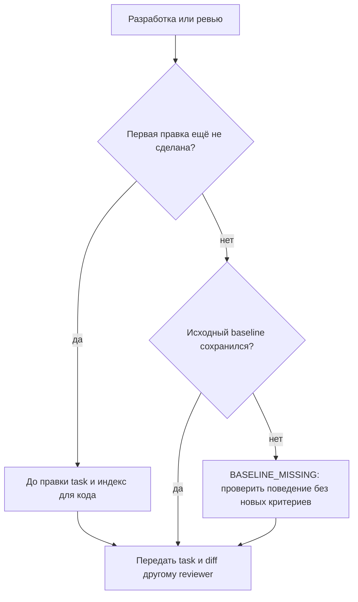

# 2026-10-28 · Scheduled run: auto-hub-261028-critic-loop-gauntlet-from-openflow

_Full working session of an LLM coding agent, scrubbed by rule (names kept as stable pseudonyms; surnames, e-mails, phones, street addresses and ages replaced by [ФАМИЛИЯ], [EMAIL], [ТЕЛЕФОН], [АДРЕС], [ВОЗРАСТ]; hosts and keys replaced). Row `s_9540e150` of the [dataset](https://huggingface.co/datasets/TonyDzi/agent-sessions)._

**User:**

<scheduled-task name="auto-hub-261028-critic-loop-gauntlet-from-openflow" file="C:\Users\dev\.claude\scheduled-tasks\auto-hub-261028-critic-loop-gauntlet-from-openflow\SKILL.md">
This is an automated run of a scheduled task. The user is not present to answer questions. For implementation details, execute autonomously without asking clarifying questions — make reasonable choices and note them in your output. "write" actions (e.g. MCP tools that send, post, create, update, or delete), only take them if the task file asks for that specific action. When in doubt, producing a report of what you found is the correct output.

Первым действием: mcp__ccd_session_mgmt__set_session_title(session_id="self", title="⚙️ · 🧪🔁 Критик-петля из OpenFlow: лимиты, критик-запускает, чекпоинты").

Заказ оператора 28.10.2026 (дословно): «Ты советуешь взять у них 4 механизма. Раунды исполнитель → критик с жесткими лимитами по деньгам, времени, число раунда, да. Правило, критик обязан что-то запустить, иначе одобрение не считается, верно. Закрепленный набор задач для замеров на одной модели, верно. Чекпоинт после каждого раунда, верно. Да, согласен, давай это делать, поднимай на это сессии».
Эта сессия берёт ТРИ механизма из четырёх (четвёртый, эталонный набор задач на одной модели, в соседней сессии auto-hub-261028-pinned-eval-corpus):
(1) раунды implementer → critic с жёсткими лимитами: деньги, wall clock, число раундов; первый сработавший лимит останавливает; модель без известной цены = отказ стартовать;
(2) critic-must-execute: одобрение reviewer'а без хотя бы одного успешного запуска (тест/команда) против проверяемого критерия НЕ засчитывается;
(3) чекпоинт состояния дерева после каждого раунда (у OpenFlow: commit-tree через временный индекс в refs/openflow/<run>/round-<n>, без трогания HEAD/индекса пользователя, восстановление только руками).

Источник механизмов — код OpenFlow, склонирован локально: E:\!CLAUDE-HUBPC-June26\_oss\openflow (packages/flow/FLOW.md разделы про gauntlet, verify, checkpoint; packages/flow/lib/checkpoint.ts; src/graph/ledger.ts, coach.ts). MIT, идеи берём, код при копировании с атрибуцией.
Наша сторона: docs/agent-protocol.md (роли coordinator/implementer/reviewer, artifact.proposed), ~/.claude/scripts/aibus/, /llm-pact, /llms, red_proof.py, /tt, /codex-review.

Правила: RECALL первым (brain_ask.py "критик реviewer лимиты раундов чекпоинт" + grep памяти; может часть уже есть, например red_proof = близко к critic-must-execute). /codex-review до правки кода. АК-47: минимальная деталь, без нового фреймворка. Тень первой (§5.7): дата старта и 🌾 урожая в 00-System/Shadow-First-Queue.md. Тест обязан покраснеть на сломанном коде. Паспорт + счётчик использования (§5.8). Назови вызывателя (кто будет звать: /llm-pact reviewer, /tt и т.п.) и подключи. Коммит с трейлерами §5.11. Перед правкой общего: onair.py declare.
Итог оператору в чат этой сессии: что построено, улики (команды и вывод с exit-кодом), где в тени, что дальше. Подпись machine_stamp.py sig. Блок «🧒 Простыми словами» в конце.
</scheduled-task>

---

> `ToolSearch` -- {"query": "select:mcp__ccd_session_mgmt__set_session_title", "max_results": 1}

---

> `mcp__ccd_session_mgmt__set_session_title` -- {"session_id": "self", "title": "⚙️ · 🧪🔁 Критик-петля из OpenFlow: лимиты, критик-запускает, чекпоинты · H45914"}

---

> `Bash` -- {"command": "cd \"E:/!CLAUDE-HUBPC-June26\"; timeout 90 python D:/Vault/_imports/brain_ask.py \"критик reviewer лимиты раундов чекпоинт critic must execute\" 2>&1 | head -40; echo \"---\"; ls ~/.claude/scripts | grep -iE \"critic|gauntlet|checkpoint|red_proof|review_gate|round\" ; echo \"---

---

> `Bash` -- {"command": "ls ~/.claude/scripts | grep -iE \"critic|gauntlet|checkpoint|red_proof|review|round|budget\" ; echo \"---\"; grep -rliE \"critic|gauntlet\" ~/.claude/projects/P---WORKDIR-HUB/memory/ 2>/dev/null | head; echo ---; ls \"E:/!CLAUDE-HUBPC-June26/_oss/openflow/packages/flow

---

> `Read` -- {"file_path": "C:\\Users\\dev\\AppData\\Local\\Temp\\claude\\P---WORKDIR-HUB\\s_9540e150\\tasks\\bovogdxbg.output"}

---

> `Bash` -- {"command": "cd ~/.claude/scripts; for f in critic_pool.py plan_budget.py _exam_critic_protocol.py red_proof.py; do echo \"=== $f $(wc -l <$f)\"; head -60 $f; done"}

---

> `Bash` -- {"command": "cd \"E:/!CLAUDE-HUBPC-June26/_oss/openflow/packages/flow\"; grep -n -iE \"^#+ \" FLOW.md docs/*.md 2>/dev/null | grep -iE \"gauntlet|verify|checkpoint|budget|round|limit\" | head -30; ls docs; sed -n 1,200p lib/checkpoint.ts"}

---

> `Bash` -- {"command": "cd \"E:/!CLAUDE-HUBPC-June26/_oss/openflow\"; ls; grep -rn -iE \"maxRounds|budget|wallclock|wall.clock|unpriced|no price|ran nothing|must (run|execute)|verified\" --include=*.ts --include=*.md . 2>/dev/null | grep -v node_modules | head -40"}

---

> `Grep` -- {"pattern": "maxRounds|budget|unpriced|must run|ran nothing|didn't run|no command", "path": "E:\\!CLAUDE-HUBPC-June26\\_oss\\openflow\\packages\\flow\\src", "output_mode": "content", "-i": true, "head_limit": 40}

---

> `Bash` -- {"command": "cd \"E:/!CLAUDE-HUBPC-June26/_oss/openflow/packages/flow/src\"; sed -n 1770,1830p server/engine.ts; echo ====; grep -n -iE \"ran nothing|shell|command bar|pass\" graph/coach.ts | head -30"}

---

> `Bash` -- {"command": "cd \"E:/!CLAUDE-HUBPC-June26\"; wc -l docs/agent-protocol.md; grep -n -iE \"^#+ |review\\.|approve|artifact\\.(proposed|accepted|reviewed)|verdict\" docs/agent-protocol.md | head -60; ls ~/.claude/scripts/aibus/ 2>&1 | head; git -C \"E:/!CLAUDE-HUBPC-June26\" rev-parse --show-

---

> `Bash` -- {"command": "cd \"E:/!CLAUDE-HUBPC-June26\"; sed -n 24,58p docs/agent-protocol.md; sed -n 126,147p docs/agent-protocol.md; grep -n -iE \"def cmd_review|verified|findings|def main|add_parser\\(\" ~/.claude/scripts/aibus/aibus_lite.py | head -40; wc -l ~/.claude/scripts/aibus/aibus_lite.py"}

---

> `Bash` -- {"command": "cd ~/.claude/scripts; ls | grep -iE \"price|cost|spend\" | grep -v bak; grep -ln -iE \"PRICES|price_per|usd_per\" *.py 2>/dev/null | head; ls ~/.claude/*.json | grep -iE \"price|cost\""}

---

> `Bash` -- {"command": "cd ~/.claude/scripts; grep -n -iE \"price|usd|\\\\\\$\" token_cost.py routine_cost_audit.py | head -30; ls ~/.claude/llm_routing.json && python -c \"import json;d=json.load(open('$HOME/.claude/llm_routing.json'.replace('\\$HOME','') if False else __import__('os').path.expanduser('~/.cla

---

> `Skill` -- {"skill": "codex-review", "args": "Новая деталь critic_loop.py (лимиты раундов implementer→critic, receipts «критик запустил», git-чекпоинт раунда через временный индекс) + shadow-проверка receipt в aibus_lite.py review --verdict verified."}

---

**User:**

Base directory for this skill: C:\Users\dev\.claude\skills\codex-review

# codex-review — «Claude проверяет Codex»

Тонкий брокер ревью-пары. Codex пишет код; Claude независимо ревьюит его дифф. (Старая заметка «`codex exec` headless на Windows виснет» устарела: на codex-cli 0.141+ headless работает нативно — проверено 07.07 на ноуте и 14.07 на хабе.) Файловый хэндофф, без общих кредов, подписка (не платный API).

## Постоянный инженерный вход: Code Indexer первым

Machine: HUB-01 (Хаб) · Agent: Codex · Operator: dev · 2026-10-19

Общий источник условий: [[protocol-engineering-five-practices-canary-h79753]] в волте
текущего узла из `machine.env`. При любой работе с кодом из ЛЮБОГО скилла сначала исполни
[единственную процедуру Code Indexer](references/code-navigation.md). Здесь общий вход,
в соседних скиллах только вызовы. Это постоянное правило оператора от 19.10, не срок NATS TRIAL.
Если готовишь scoped-изменение поведения кода или делегируешь его, ДО первой правки:

1. Зафиксируй в существующей задаче цель, разрешённые файлы, наблюдаемые условия приёмки,
   одного независимого reviewer и hash спецификации либо проверенную revision. Дай задаче
   устойчивый ID. При позднем ревью отсутствующий исходный baseline назови `BASELINE_MISSING`;
   критерии задним числом не выдумывай. Проверка фактического поведения всё равно продолжается.
2. Приложи task/project/target SHA, запрос, freshness evidence и сверку исходника из общего
   входа. Отсутствие/устаревание индекса означает явный ограниченный fallback, не разрешение
   регистрировать проект, запускать reindex или менять сервер/конфиг. Новый корпус отдельно согласуется.
3. Если работа передаётся другому агенту, проверь добавочный mailbox через существующий
   `/llms` или `/inbox`; порядок один: [общая инструкция](../llms/references/mailbox-canary.md).
   Письмо не даёт полномочий; прежние каналы сохраняются. Ревьюеру передай исходный task через
   уже поддерживаемый `--task`, точный diff и улики, а не пересказ условий.

Чистая правка обычного текста не требует индексирования или benchmark; условия конкретной
docfix можно проверить чтением и отрицательным примером. Сами проверки поведения выполняет
существующий `/tt`, ресурсные сравнения только по условиям `/corpus-bench`.

Запиши факт применения, а не открытия скилла: `task_id · node · actor · practice · evidence ·
outcome · measurement` (либо причина неприменимости). Аудит и docfix учитываются отдельно от
реализации; отсутствие замера пользы не превращается в экономию.

После появления реальной улики вызови существующий `_shared.skill_usage_log.log`:
`log('hilum-canary.structural-search', kind='part', source='skill:codex-review', outcome='ok', extra=...)`
и отдельно `log('hilum-canary.acceptance-before-work', ...)` только для действительно выполненных практик.
В `extra` обязательны actual `task`, `declared_agent` (`head@node`), `evidence_ref`,
`event='practice.applied'`, `measurement` с `test_or_live` (`live|test|negative_control`),
`benefit_verdict='UNKNOWN'` до доказанной пользы и фактическими числами. Полный runnable пример
один в общем протоколе; после записи проверь `read_all()` (дедуп по id), затем найди свежую запись по task/evidence_ref.
Число вызовов сырого отчёта не равно пользе. Используй имеющиеся capability; покупку/активацию
и индексацию обычный prework не разрешает. AST fallback явно ограничивает полноту связей.

## 🌳 Дерево решений



## Когда запускать
оператор сделал изменение через Codex (или просто есть дифф/правка в репозитории) и хочет независимую проверку «второй парой глаз». Триггеры см. в `description`.

⭐ **Чужой код берём в работу только через панель ломателей** (dev 28.10.2026, голосом: «когда используем чей-то код и уверены, что правы, мы используем панель ломателей из наших LLM»). Это касается и чужого PR/патча/сниппета, который мы вливаем к себе, и нашего PR кому-то: до «готово» дифф уходит в `secondop.py t3 --ritual tt --task <id> --context "<цель + дифф>"` без `--engine` (кворум ≥2 разных вендоров с ok), а не только в один `claude -p`. Один вендор = первое мнение, не второе. Правило и дверь на `gh pr create`: `/outbound-gate` шаг 2-кватер; Библия `reglament-vtoroe-mnenie-eto-panel-a-ne-odin-vendor` §Поправка 28.10.

## Что делаю
1. **Определяю цель.** Спрашиваю/беру путь к репозиторию, где Codex внёс изменение (или путь к патч-файлу). По умолчанию — рабочий репозиторий, который оператор назвал.
2. **Запускаю движок** (детерминированно, 0 моих токенов на сам прогон — ревью делает headless `claude -p`):
   ```
   python "%USERPROFILE%\.claude\scripts\cc-review\cc_review.py" --repo "<путь к репо>" --model sonnet
   ```
   - модель: **Sonnet по умолчанию** (бесплатный бак подписки, на тесте поймал оба бага за 25с); **Opus** для трудных/safety-critical изменений (`--model opus`) — гейт качества.
   - другие режимы: `--range "HEAD~1 HEAD"` (конкретный коммит), `--diff "<патч.diff>"` (готовый патч), `--task "<task.md>"` (что Codex просили сделать — даёт ревьюеру контекст).
3. **Подаю результат оператору:** вердикт (`APPROVE` / `REQUEST_CHANGES`), список находок (file:line · severity · что не так · фикс), и путь к `review-<ts>.md`. Если REQUEST_CHANGES — предлагаю починить корень (а не симптом).

## Границы
- Движок принудительно гасит `ANTHROPIC_API_KEY` → ревью идёт по подписке, не по платному ключу.
- Гигантский дифф обрезается до 120k символов (с пометкой) — если упёрлись, ревьюить по частям/по файлам.
- Это РЕВЬЮ, не авто-правка: фиксы предлагаю/делаю отдельно по AK-47 (легко-обратимое — сам; развилка — спрашиваю).
- Полную авто-пару (Codex headless тоже) можно достроить позже под WSL2/Docker — отдельный шаг (сейчас не нужно).

> **2026-06-28 (хаб HUB-01):** движок `cc_review.py` был утрачен (нет в git/`.stversions`/на дисках) → **пересобран** как простой Windows-нативный «обычный режим» (вызов выше). Прогнан вживую (`/tt`): баги→`REQUEST_CHANGES`, чистый→`APPROVE`, пустой/не-репо→graceful. Артефакты вне волта (`reviews/`), счётчик `reviews/_log.jsonl`. ⚠️ Канон-обновление в [[decision-hermes-multivendor-arbitrage-rejected]] (аддендум 28.06).

## ⭐ Двусторонняя гетеро-пара (обе стороны работают на хабе)
Полная симметрия: обе стороны ревьюят друг друга, финальную проверку всегда делает ДРУГОЙ вендор.
- **Claude → ревьюит Codex** (прямой) — РАБОТАЕТ: `python "%USERPROFILE%\.claude\scripts\cc-review\cc_review.py" --repo "<репо>" --model sonnet` (см. выше).
- **Codex → ревьюит Claude** (обратный, зеркало) — РАБОТАЕТ И НА ХАБЕ: `python "%USERPROFILE%\.claude\scripts\cc-review\codex_review.py" --repo "<репо>"` — движок /tt-проверен 2026-07-07 (ноут, codex-cli 0.141.0) и 2026-07-14 (хаб `HUB-01`, codex-cli 0.144.4: `npm i -g @openai/codex`, логин ChatGPT-подписка уже был в `~/.codex/auth.json`; smoke: подложенные баги→REQUEST_CHANGES с точными file:line за 16с · чистый дифф→APPROVE · пустой дифф→graceful без вызова Codex). Нативный `codex exec -s read-only` на Windows без WSL2. Флаги: `--range "HEAD~1 HEAD"`, `--diff <патч>`, `--task <task.md>`, `--timeout 300`. Read-only песочница: Codex только рассуждает над диффом. Вывод: `review-codex-<ts>.md` + `VERDICT: APPROVE|REQUEST_CHANGES|AMBIGUOUS` и exit-code гейт (0=APPROVE · 3=REQUEST_CHANGES · 4=AMBIGUOUS/не сказан · 1/2=ошибка скрипта; пустой дифф=0). Контракт вердикта (инструкция модели + парсер, одна копия на все движки вкл. `grok_review.py`/`cc_review.py`) = `scripts/_shared/verdict_parse.py`; модель обязана закончить строкой `===VERDICT=== <значение>`.

## Полный авто-режим WSL2 (архивный путь — НЕ развёрнут на хабе)
⚠️ Оркестратор `codex_pair.py` на хабе `HUB-01` отсутствует в живом дереве (уцелел лишь в снапшоте `_config-backup\snapshot-2026-07-04`), WSL2 тут не установлен → режим не запускается. Чтобы поднять: восстановить `codex_pair.py` из снапшота + поставить WSL2/Codex, затем `/tt`.
Исторический контекст (машина, где строили 2026-06-22): WSL2 Ubuntu-24.04 + Node22 + Codex 0.142.3 (залогинен ChatGPT), `codex exec --full-auto` headless. Что делал: Codex реализует задачу headless в WSL → берёт git-дифф → Claude ревьюит (`cc_review.py`) → вердикт + `codex-change-*.diff` + `review-*.md`. Репо в Linux-fs WSL (`/root/...`); нормализатор путей выправлял искажение Git-Bash `/root/...`.

## Расширение — обратная сторона ГОТОВА (хаб полностью двусторонний с 2026-07-14)
Обратная сторона (Codex ревьюит Claude) построена = `codex_review.py` (см. блок «Двусторонняя гетеро-пара»), нативный `codex exec` на Windows. Codex CLI установлен на хаб `HUB-01` 2026-07-14 (`npm i -g @openai/codex`, v0.144.4, логин по ChatGPT-подписке) и smoke-тест пройден — гетеро-пара работает в обе стороны. Тем же днём развёрнут и на **Маяке** (fleet-anchor, headless: `auth.json` переносим scp'ом, browser-OAuth не нужен; оба движка + smoke ✅) — Маяк = дополнительный узел, живые тесты дуэта только в чате 04 с хаба.


ARGUMENTS: Новая деталь critic_loop.py (лимиты раундов implementer→critic, receipts «критик запустил», git-чекпоинт раунда через временный индекс) + shadow-проверка receipt в aibus_lite.py review --verdict verified.

---

> `Bash` -- {"command": "mkdir -p \"E:/!CLAUDE-HUBPC-June26/docs/specs\"; cat > \"E:/!CLAUDE-HUBPC-June26/docs/specs/critic-loop-H45914.md\" <<'EOF'\n# Спека: critic_loop.py (три механизма из OpenFlow gauntlet) · task H45914-critic-loop\n\nMachine: HUB-01 (Хаб) · Agent: Claude Code (Opus 5.5) ·

---

**Claude:**

Спека приёмки записана (`docs/specs/critic-loop-H45914.md`, 7 критериев). Объявляю зону в onair и пишу `critic_loop.py`.

---

> `Bash` -- {"command": "cd \"E:/!CLAUDE-HUBPC-June26\"; python ~/.claude/scripts/onair.py declare --zone fleet-code/critic-loop --mode exclusive --title \"critic_loop.py: лимиты раундов, critic-must-execute, чекпоинт\" --also aibus --ttl-hours 4 --code H45914 2>&1 | tail -3; python ~/.claude/scripts/works

---

> `Bash` -- {"command": "cd \"E:/!CLAUDE-HUBPC-June26\"; python ~/.claude/scripts/workspace_write_lease.py acquire --session s_9540e150 \"C:/Users/dev/.claude/scripts/aibus/aibus_lite.py\" 2>&1 | tail -2; head -40 ~/.claude/scripts/aibus/aibus_lite.py | sed -n 1,35p; git -C ~/.c

---

> `Bash` -- {"command": "cd ~/.claude/scripts/aibus; grep -n -E \"CREATE TABLE|def now|def log|def conn|DB *=|HERE\" aibus_lite.py | head; grep -n -A6 \"def log\" aibus_lite.py; grep -n -A3 \"def now\" aibus_lite.py"}

---

> `Write` -- {"file_path": "C:\\Users\\dev\\.claude\\scripts\\critic_loop.py", "content": "#!/usr/bin/env python3\n# -*- coding: utf-8 -*-\n\"\"\"critic_loop.py -- три механизма петли implementer -> critic, взятые из OpenFlow gauntlet.\n\nMachine: HUB-01 (Хаб) · Agent: Claude Code (Opus 5.5) · Operator:

---

> `Bash` -- {"command": "git -C \"E:/!CLAUDE-HUBPC-June26/_oss/openflow\" remote get-url origin; head -3 \"E:/!CLAUDE-HUBPC-June26/_oss/openflow/LICENSE\"*"}

---

> `Bash` -- {"command": "cd ~/.claude/scripts; sed -i 's#OpenFlow (MIT, github.com/... локально _oss/openflow):#OpenFlow (MIT, github.com/SeeRay11/OpenFlow, локально _oss/openflow):#' critic_loop.py; grep -n \"SeeRay11\" critic_loop.py\ncat > critic_loop_prices.json <<'EOF'\n{\n  \"_doc\": \"Прайс для critic_lo

---

> `Bash` -- {"command": "cd ~/.claude/scripts/aibus; cp aibus_lite.py aibus_lite.py.bak-H45914; python - <<'EOF'\np='aibus_lite.py'\ns=open(p,encoding='utf-8').read()\nold='''        if reviewer == owner:\n            sys.exit(f\"ERROR: reviewer ({reviewer}) cannot equal owner ({owner}) - independent reviewer r

---

> `Bash` -- {"command": "cd ~/.claude/scripts/aibus; python - <<'EOF'\np='aibus_lite.py'\ns=open(p,encoding='utf-8').read()\nold='''        sys.exit(4) if print(f\"REJECT verified {task_id}: {why}\", file=sys.stderr) is None else None'''\nnew='''        print(f\"REJECT verified {task_id}: {why}\", file=sys.stde

---

> `Bash` -- {"command": "cd ~/.claude/scripts/aibus; file aibus_lite.py.bak-H45914 aibus_lite.py; python - <<'EOF'\nb=open('aibus_lite.py.bak-H45914','rb').read(); n=open('aibus_lite.py','rb').read()\nprint(b.count(b'\\r\\n'), n.count(b'\\r\\n'))\nif b.count(b'\\r\\n') and not n.count(b'\\r\\n'):\n    open('aib

---

> `Write` -- {"file_path": "C:\\Users\\dev\\AppData\\Local\\Temp\\claude\\P---WORKDIR-HUB\\s_9540e150\\scratchpad\\crlf.py", "content": "import os\nd = os.path.expanduser(\"~/.claude/scripts/aibus/\")\nb = open(d + \"aibus_lite.py.bak-H45914\", \"rb\").read()\nn = open(d 

---

> `Bash` -- {"command": "cd ~/.claude/scripts/aibus; python \"C:/Users/dev/AppData/Local/Temp/claude/P---WORKDIR-HUB/s_9540e150/scratchpad/crlf.py\"; diff aibus_lite.py.bak-H45914 aibus_lite.py | wc -l"}

---

**Claude:**

Чиню переводы строк в `aibus_lite.py` (Windows записал CRLF вместо исходного LF), дальше тест.

---

> `Write` -- {"file_path": "C:\\Users\\dev\\AppData\\Local\\Temp\\claude\\P---WORKDIR-HUB\\s_9540e150\\scratchpad\\crlf.py", "content": "import os\nd = os.path.expanduser(\"~/.claude/scripts/aibus/\")\nb = open(d + \"aibus_lite.py.bak-H45914\", \"rb\").read()\nn = open(d 

---

> `Bash` -- {"command": "cd ~/.claude/scripts/aibus; python \"C:/Users/dev/AppData/Local/Temp/claude/P---WORKDIR-HUB/s_9540e150/scratchpad/crlf.py\"; diff aibus_lite.py.bak-H45914 aibus_lite.py"}

---

> `Edit` -- {"replace_all": false, "file_path": "C:\\Users\\dev\\.claude\\scripts\\aibus\\aibus_lite.py", "old_string": "        ok, why = (mode != \"enforce\"), f\"critic_loop недоступен: {e}\"\n    if ok:", "new_string": "        ok, why = False, f\"critic_loop недоступен (прибор сломан): {e}\"\n    if ok:"

---

> `Write` -- {"file_path": "C:\\Users\\dev\\.claude\\scripts\\_test_critic_loop.py", "content": "#!/usr/bin/env python3\n# -*- coding: utf-8 -*-\n\"\"\"_test_critic_loop.py -- приёмка A1-A6 спеки docs/specs/critic-loop-H45914.md.\n\nMachine: HUB-01 (Хаб) · Agent: Claude Code (Opus 5.5) · Operator: dev

---

> `Bash` -- {"command": "cd ~/.claude/scripts; python _test_critic_loop.py; echo \"exit=$?\"", "timeout": 180000}

---

> `Bash` -- {"command": "cd ~/.claude/scripts; sed -i 's#^CL = os.environ.get(\"CRITIC_LOOP_UNDER_TEST\") or os.path.join(HERE, \"critic_loop.py\")#CL = (sys.argv[1] if len(sys.argv) > 1 else None) or os.environ.get(\"CRITIC_LOOP_UNDER_TEST\") or os.path.join(HERE, \"critic_loop.py\")#' _test_critic_loop.py; gr

---

> `Bash` -- {"command": "set -o pipefail; cd ~/.claude/scripts; sed -i 's#^CL = os.environ.get(\"CRITIC_LOOP_UNDER_TEST\") or os.path.join(HERE, \"critic_loop.py\")#CL = (sys.argv[1] if len(sys.argv) > 1 else None) or os.environ.get(\"CRITIC_LOOP_UNDER_TEST\") or os.path.join(HERE, \"critic_loop.py\")#' _test_c

---

> `Bash` -- {"command": "set -o pipefail; cd ~/.claude/scripts; T=\"C:/Users/dev/.claude/scripts/_test_critic_loop.py\"\npython red_proof.py --file critic_loop.py --old 'good = [r for r in found if r.get(\"rc\") == 0]' --new 'good = found' --expect-fail \"{py} $T {f}\" 2>&1 | tail -2; echo \"rp1=$?\"\npython 

---

**Claude:**

Пока мутанты гоняются в фоне, подключаю вызывателей: протокол, `/llm-pact`, `/tt`, очередь тени.

---

> `Bash` -- {"command": "ls ~/.claude/skills/llm-pact/SKILL.md ~/.claude/skills/tt/SKILL.md; grep -n -iE \"reviewer|ревьюер\" ~/.claude/skills/llm-pact/SKILL.md | head -10; grep -n -E \"^#+ \" ~/.claude/skills/tt/SKILL.md | head -20; V=D:/Vault/Vault-Knowledge/00-System/Shadow-First-Queue.md; ls -la $V; tail

---

> `Bash` -- {"command": "cat \"C:/Users/dev/AppData/Local/Temp/claude/P---WORKDIR-HUB/s_9540e150/tasks/b9hy6esuf.output\"; tail -3 ~/.claude/scripts/_red_proof.jsonl | cut -c1-300"}

---

> `Bash` -- {"command": "set -o pipefail; cd ~/.claude/scripts; sed -i 's#^AIBUS = os.path.join(HERE, \"aibus\", \"aibus_lite.py\")#AIBUS = (sys.argv[2] if len(sys.argv) > 2 else None) or os.path.join(HERE, \"aibus\", \"aibus_lite.py\")#' _test_critic_loop.py; grep -n \"^AIBUS\" _test_critic_loop.py\npython red

---

> `Bash` -- {"command": "set -o pipefail; cd ~/.claude/scripts; sed -i 's#               PYTHONIOENCODING=\"utf-8\")#               PYTHONIOENCODING=\"utf-8\", PYTHONPATH=os.path.dirname(os.path.realpath(CL)))#' _test_critic_loop.py; grep -n \"PYTHONPATH\" _test_critic_loop.py\npython red_proof.py --file aibus/

---

> `Bash` -- {"command": "cd \"E:/!CLAUDE-HUBPC-June26\"; python ~/.claude/scripts/workspace_write_lease.py acquire --session s_9540e150 \"E:/!CLAUDE-HUBPC-June26/docs/agent-protocol.md\" \"C:/Users/dev/.claude/skills/llm-pact/SKILL.md\" \"C:/Users/dev/.claude/skills/tt/SK

---

**Claude:**

Insert lines into the three docs.

---

> `Edit` -- {"replace_all": false, "file_path": "C:\\Users\\dev\\.claude\\skills\\llm-pact\\SKILL.md", "old_string": "  `artifact.proposed`, финальный статус ставит ревью другого вендора.\n", "new_string": "  `artifact.proposed`, финальный статус ставит ревью другого вендора.\n- ⭐ **Reviewer обязан ЗАПУСТИТЬ 

---

> `Edit` -- {"replace_all": false, "file_path": "C:\\Users\\dev\\.claude\\skills\\tt\\SKILL.md", "old_string": "## Шаг 2.5 — ВТОРОЕ МНЕНИЕ: ⭐ПАНЕЛЬ, все рельсы ОДНОВРЕМЕННО (приказ оператора 05.08.2026)\n", "new_string": "## Шаг 2.5 — ВТОРОЕ МНЕНИЕ: ⭐ПАНЕЛЬ, все рельсы ОДНОВРЕМЕННО (приказ Antона 05.08.2026)\n\n

---

> `Edit` -- {"replace_all": false, "file_path": "C:\\Users\\dev\\.claude\\skills\\tt\\SKILL.md", "old_string": "(приказ Antона 05.08.2026)", "new_string": "(приказ оператора 05.08.2026)"}

---

> `Edit` -- {"replace_all": false, "file_path": "E:\\!CLAUDE-HUBPC-June26\\docs\\agent-protocol.md", "old_string": "  ⚠️ `review --verdict verified` в нём пока принимает пустые findings: это НЕ приёмка по I2 без улики.", "new_string": "  ⚠️ `review --verdict verified` в нём пока принимает пустые findings: 

---

**Claude:**

Shadow queue entry (append with backup).

---

> `Bash` -- {"command": "V=\"D:/Vault/Vault-Knowledge/00-System/Shadow-First-Queue.md\"; cp \"$V\" \"E:/!CLAUDE-HUBPC-June26/_app-backups/Shadow-First-Queue-H45914-20261028.before.md\"; printf '%s\\n' \"- 🌑 critic-must-execute + critic-loop (H45914, старт **2026-10-28**): \\`aibus_lite.py review --verdi

---

**Claude:**

Теперь ревью другого вендора (Codex) по диффу.

---

> `Bash` -- {"command": "cd ~/.claude; S=\"C:/Users/dev/AppData/Local/Temp/claude/P---WORKDIR-HUB/s_9540e150/scratchpad\"; git status --short scripts/critic_loop.py scripts/critic_loop_prices.json scripts/_test_critic_loop.py scripts/aibus/aibus_lite.py skills/llm-pact/S

---

> `Bash` -- {"command": "S=\"C:/Users/dev/AppData/Local/Temp/claude/P---WORKDIR-HUB/s_9540e150/scratchpad\"; cd ~/.claude/scripts && git status --short critic_loop.py critic_loop_prices.json _test_critic_loop.py aibus/aibus_lite.py | head; git -C ~/.claude/skills status 

---

**Claude:**

Codex упал по таймауту 450 с на диффе 33 КБ. Сужаю дифф до кода без теста и перезапускаю в фоне с запасом.

---

> `Bash` -- {"command": "S=\"C:/Users/dev/AppData/Local/Temp/claude/P---WORKDIR-HUB/s_9540e150/scratchpad\"; cd ~/.claude/scripts; ( diff -u aibus/aibus_lite.py.bak-H45914 aibus/aibus_lite.py; diff -u /dev/null critic_loop.py ) > \"$S/critic-loop-core.diff\"; wc -c \"$S/

---

**Claude:**

Пока Codex думает, живой прогон на боевом состоянии и реальном репо (чекпоинт только зоны `docs/specs`).

---

> `Bash` -- {"command": "cd \"E:/!CLAUDE-HUBPC-June26\"; C=~/.claude/scripts/critic_loop.py; H0=$(git rev-parse HEAD); S0=$(git status --porcelain | md5sum); I0=$(md5sum < .git/index)\npython $C start --run H45914-live --models claude-plan,codex --max-usd 1 --max-minutes 30 --max-rounds 2; echo \"start=$?\

---

> `Read` -- {"file_path": "C:\\Users\\dev\\AppData\\Local\\Temp\\claude\\P---WORKDIR-HUB\\s_9540e150\\tasks\\bfn70470m.output"}

---

> `Bash` -- {"command": "cd ~/.claude/skills; git diff --stat llm-pact/SKILL.md tt/SKILL.md; cd \"E:/!CLAUDE-HUBPC-June26\"; git diff --stat docs/agent-protocol.md; python ~/.claude/scripts/machine_stamp.py sig --model \"Opus 5.5\""}

---

**Claude:**

Дифф чистый, только мои строки. Жду живой прогон и Codex.

---

> `ToolSearch` -- {"query": "select:Monitor", "max_results": 1}

---

> `Bash` -- {"command": "cd ~/.claude/scripts; git add critic_loop.py critic_loop_prices.json _test_critic_loop.py aibus/aibus_lite.py && git commit -q -F - <<'EOF'\ncritic_loop: round caps, critic-must-execute receipts, per-round git checkpoint (shadow)\n\nThree mechanisms from OpenFlow gauntlet (MIT, github.c

---

> `Bash` -- {"command": "cd \"E:/!CLAUDE-HUBPC-June26\"; git add docs/specs/critic-loop-H45914.md docs/agent-protocol.md && git commit -q -m \"agent-protocol: verified needs reviewer run receipt (critic_loop, shadow to 11.11); spec H45914\n\nAssisted-by: Claude Code/claude-opus-5-5\nMachine: HUB-01\

---

**Claude:**

Индекс занят моим же живым прогоном (`git status` на 5.9 ГБ). Жду его завершения.

---

> `Bash` -- {"command": "until grep -q \"Date:\\|fatal\\|round2=\" \"C:/Users/dev/AppData/Local/Temp/claude/P---WORKDIR-HUB/s_9540e150/tasks/bfn70470m.output\"; do sleep 5; done; sleep 20; cat \"C:/Users/dev/AppData/Local/Temp/claude/P---WORKDIR-HUB/01bd48

---

**Claude:**

Жду два фоновых результата: живой прогон на реальном репо и ревью Codex.

---

**User:**

<task-notification>
<task-id>bfn70470m</task-id>
<tool-use-id>toolu_017yTohHRRpJjWV66C743kyq</tool-use-id>
<output-file>C:\Users\dev\AppData\Local\Temp\claude\P---WORKDIR-HUB\s_9540e150\tasks\bfn70470m.output</output-file>
<status>completed</status>
<summary>Background command "cd "E:/!CLAUDE-HUBPC-June26"; C=~/.claude/scripts/critic_loop.py; H0=$(git rev-parse HEAD); S0=$(git status --porcelain | md5sum); I0=$(md5sum &lt; .git/index)
python $C start --run H45914-live --models claude-plan,codex --max-usd 1 --max-minutes 30 --max-rounds 2; echo "start=$?"
python $C start --run H45914-live2 --models claude-plan,openrouter/gpt-x --max-usd 1 --max-minutes 30 --max-rounds 2; echo "start_unpriced=$?"
python $C exec --task H45914-critic-loop --reviewer claude-subagent --author claude-H45914 -- python C:/Users/dev/.claude/scripts/_test_critic_loop.py &gt; /dev/null; echo "exec=$?"
python $C verify-approval --task H45914-critic-loop --reviewer claude-subagent --author claude-H45914; echo "verify=$?"
python $C verify-approval --task H45914-critic-loop --reviewer codex; echo "verify_codex_noexec=$?"
time python $C round --run H45914-live --model claude-plan --checkpoint-repo "E:/!CLAUDE-HUBPC-June26" --paths docs/specs; echo "round1=$?"
python $C round --run H45914-live --model codex; echo "round2=$?"
echo "HEAD same: $([ "$H0" = "$(git rev-parse HEAD)" ] &amp;&amp; echo yes)"; echo "status same: $([ "$S0" = "$(git status --porcelain | md5sum)" ] &amp;&amp; echo yes)"; echo "index same: $([ "$I0" = "$(md5sum &lt; .git/index)" ] &amp;&amp; echo yes)"
git show --stat refs/critic-loop/H45914-live/round-1 | head -8" completed (exit code 0)</summary>
</task-notification>

---

> `Read` -- {"file_path": "C:\\Users\\dev\\AppData\\Local\\Temp\\claude\\P---WORKDIR-HUB\\s_9540e150\\tasks\\bfn70470m.output"}

---

**Claude:**

Живой прогон зелёный по всем пунктам. Коммичу главный репо.

---

> `Bash` -- {"command": "cd \"E:/!CLAUDE-HUBPC-June26\"; ls .git/index.lock 2>&1; git add docs/specs/critic-loop-H45914.md docs/agent-protocol.md && git commit -q -m \"agent-protocol: verified needs reviewer run receipt (critic_loop, shadow to 11.11); spec H45914\n\nAssisted-by: Claude Code/claude-opus-5-5

---

> `Bash` -- {"command": "until grep -q \"codex_rc=\" \"C:/Users/dev/AppData/Local/Temp/claude/P---WORKDIR-HUB/s_9540e150/scratchpad/codex-review2.out\" 2>/dev/null; do sleep 10; done; tail -60 \"C:/Users/dev/AppData/Local/Temp/claude/P---WORKDIR-HUB/01bd48

---

**Claude:**

Коммиты есть во всех трёх репо. Жду вердикт Codex.

---

**User:**

<task-notification>
<task-id>bhzwutyoa</task-id>
<tool-use-id>toolu_01YGLDbd1JTDxaHwWaWF1H2h</tool-use-id>
<output-file>C:\Users\dev\AppData\Local\Temp\claude\P---WORKDIR-HUB\s_9540e150\tasks\bhzwutyoa.output</output-file>
<status>completed</status>
<summary>Background command "S="C:/Users/dev/AppData/Local/Temp/claude/P---WORKDIR-HUB/s_9540e150/scratchpad"; cd ~/.claude/scripts; ( diff -u aibus/aibus_lite.py.bak-H45914 aibus/aibus_lite.py; diff -u /dev/null critic_loop.py ) &gt; "$S/critic-loop-core.diff"; wc -c "$S/critic-loop-core.diff"; python cc-review/codex_review.py --repo "C:/Users/dev/.claude/scripts" --diff "$S/critic-loop-core.diff" --task "E:/!CLAUDE-HUBPC-June26/docs/specs/critic-loop-H45914.md" --timeout 1100 &gt; "$S/codex-review2.out" 2&gt;&amp;1; echo "codex_rc=$?" &gt;&gt; "$S/codex-review2.out"" completed (exit code 0)</summary>
</task-notification>

---

> `Bash` -- {"command": "S=\"C:/Users/dev/AppData/Local/Temp/claude/P---WORKDIR-HUB/s_9540e150/scratchpad\"; cat \"$S/codex-review2.out\" | tail -40; f=$(grep -o \"review-codex-[0-9T_-]*\\.md\" \"$S/codex-review2.out\" | tail -1); echo \"file=$f\""}

---

> `Agent` -- {"subagent_type": "adversarial-reviewer", "description": "Break critic_loop diff", "prompt": "Попытайся ОПРОВЕРГНУТЬ изменение. Только чтение, ничего не правь.\nСпека и критерии приёмки A1-A7: E:\\!CLAUDE-HUBPC-June26\\docs\\specs\\critic-loop-H45914.md\nКод: C:\\Users\\dev\\.claude\\scripts\

---

> `Bash` -- {"command": "cd ~/.claude/scripts; grep -n \"def _git\\|def _write_json\\|tmp = path\\|if min(max_usd\\|    if run.get(\\\"stopped\\\"):\\|    elif cost_usd is not None:\\|    except OSError:\\|^import\\|      {id, task, reviewer\\|      artifact.proposed. Иначе\\|  что ломается\" critic_loop.py"}

---

> `Read` -- {"file_path": "C:\\Users\\dev\\.claude\\scripts\\critic_loop.py", "offset": 14, "limit": 22}

---

**Claude:**

Write a patch script (heredoc guard forbids code via heredoc).

---

> `Write` -- {"file_path": "C:\\Users\\dev\\AppData\\Local\\Temp\\claude\\P---WORKDIR-HUB\\s_9540e150\\scratchpad\\patch2.py", "content": "import os\np = os.path.expanduser(\"~/.claude/scripts/critic_loop.py\")\ns = open(p, encoding=\"utf-8\", newline=\"\").read()\nR = [\

---

> `Edit` -- {"replace_all": false, "file_path": "C:\\Users\\dev\\.claude\\scripts\\_test_critic_loop.py", "old_string": "        # A6: чекпоинт не трогает", "new_string": "        # R: находки ревью H45914 (ломатель): обходы потолка и честность причин\n        r = cl(\"start\", \"--run\", \"rn\", \"--models\"

---

> `Bash` -- {"command": "set -o pipefail; cd ~/.claude/scripts; python \"C:/Users/dev/AppData/Local/Temp/claude/P---WORKDIR-HUB/s_9540e150/scratchpad/patch2.py\" && python _test_critic_loop.py | grep -E \"FAIL|ALL PASS|^PASS R\"; echo \"test=${PIPESTATUS[0]}\"", "timeout

---

**Claude:**

38 из 38 зелёные. Доказываю красное на двух новых починках и коммичу.

---

> `Bash` -- {"command": "set -o pipefail; cd ~/.claude/scripts; T=\"C:/Users/dev/.claude/scripts/_test_critic_loop.py\"\npython red_proof.py --file critic_loop.py --old '    why = exhausted(run)  # лимит мог' --new '    why = None  # лимит мог' --expect-fail \"{py} $T {f}\" 2>&1 | tail -1; echo \"rp5=${PIPEST

---

> `Bash` -- {"command": "cd \"E:/!CLAUDE-HUBPC-June26\"; python ~/.claude/scripts/workspace_write_lease.py release-session --session s_9540e150 2>&1 | tail -1; python ~/.claude/scripts/onair.py close --help 2>&1 | head -3; python ~/.claude/scripts/onair.py close 2026-10-28T154647Z

---

**Claude:**

## Итог: критик-петля из OpenFlow, сессия 45914

Построил три механизма из четырёх (четвёртый, закреплённый набор задач, делает соседняя сессия). Всё в одном файле `~/.claude/scripts/critic_loop.py`, только стандартный Python, без нового фреймворка. Код OpenFlow переписан, а не скопирован; атрибуция MIT (SeeRay11/OpenFlow) стоит в паспорте.

**1. Раунды с жёсткими лимитами.**
- `start` задаёт три потолка: деньги, минуты и число раундов.
- Модель, которой нет в прайсе `critic_loop_prices.json`, не даёт прогону стартовать (exit 2).
- `round` записывает раунд. Первый сработавший лимит останавливает прогон (exit 3), проверки идут в том же порядке, что у OpenFlow: цена неизвестна → деньги → время → раунды.

**2. Критик обязан запустить проверку.**
- `exec` запускает команду ревьюера и пишет квитанцию: команда, код выхода, sha256 вывода.
- `aibus_lite.py review --verdict verified` теперь требует квитанцию с rc=0, снятую после `propose`; автор не может ревьюить сам себя.
- Пока режим тени: проверка печатает WOULD-REJECT, но не блокирует. `CRITIC_MUST_EXECUTE=enforce` превращает это в отказ.

**3. Чекпоинт после каждого раунда.**
- Состояние дерева сохраняется в `refs/critic-loop/<run>/round-<n>` через временный индекс. Ваши HEAD, индекс и рабочие файлы при этом не меняются.
- Восстанавливать только руками: `git checkout <ref> -- <путь>`.

**Где подключено:** `aibus_lite review`, скиллы `/llm-pact` и `/tt`, абзац в `docs/agent-protocol.md`. Соседняя сессия с эталонным набором задач уже вызывает `critic_loop` вживую: в журнале использования есть её прогон `test-repair-base1`.

### Улики
- **Тест** `_test_critic_loop.py`: 38 проверок, `ALL PASS`, `test=0`.
- **Красное доказано 6 из 6** (`red_proof.py`, каждый раз «КРАСНОЕ ДОКАЗАНО», exit=0). Тест упал на шести сломанных копиях, боевые файлы не тронуты.
- **Живой прогон на реальном репо** (5,9 ГБ):
  - модель без цены → `start_unpriced=2`;
  - квитанция с rc=0 → `verify=0`;
  - codex ничего не запускал → `verify_codex_noexec=4`;
  - второй раунд упёрся в лимит → `round2=3`;
  - `HEAD same: yes`, `status same: yes`, `index same: yes`, чекпоинт `34603175`, 22 с.
- **Коммиты:** scripts `3d27d4f` + `c9cb478`, skills `ee36d16`, главный репо `8a0b01f`, все с трейлерами.

### Ревью: ⚠️ только своим вендором
- **Codex дважды завис** (таймауты 450 с и 1100 с), чужого ревью нет.
- **Вместо него ломатель-субагент Claude.** Он поставил «доработать» и нашёл четыре реальных дефекта, все починены и закрыты тестами:
  - отрицательная стоимость и NaN пробивали денежный потолок;
  - раунд записывался после того, как время уже вышло;
  - без git раунд терялся;
  - нечитаемый файл квитанций выдавался за «ревьюер не запускал».
- **Две границы честно записаны в паспорт, а не закрыты:**
  - имя ревьюера он называет сам (как и `--owner` в шине), поэтому квитанция доказывает факт запуска, но не личность;
  - квитанции хранятся на той машине, где их сняли. Если ревью принимают на другом узле, будет ложный WOULD-REJECT.

**Проверено:** A1–A7 из спеки, живой прогон, красное на мутантах.
**Не проверено:** ревью чужим вендором (рельса Codex мертва на этом заходе); работа на других узлах флота.

### Тень и дальше
- Тень записана в `00-System/Shadow-First-Queue.md`: старт 28.10, урожай 🌾 **11.11.2026**.
- На урожае считаем долю одобрений с квитанцией против WOULD-REJECT и ложные срабатывания. Потом решаем: `enforce` или правка.
- Раскатка на флот после урожая, сейчас только хаб. Откат: `aibus_lite.py.bak-H45914`.
- Следующий шаг: прогнать дифф через Codex или панель, когда рельса оживёт.

🏛H · Opus 5.5 · 45914

### 🧒 Простыми словами
Раньше ревьюер мог сказать «всё хорошо», даже не включив тесты. Теперь «хорошо» засчитывается только с чеком: какую команду он запустил и чем она кончилась. У петли «написал, проверили, переписал» появился кошелёк с лимитом денег, будильник и счётчик кругов. После каждого круга делается фотография файлов, чтобы можно было откатиться к лучшему варианту. Две недели система только предупреждает и ничего не блокирует, потом смотрим цифры.
