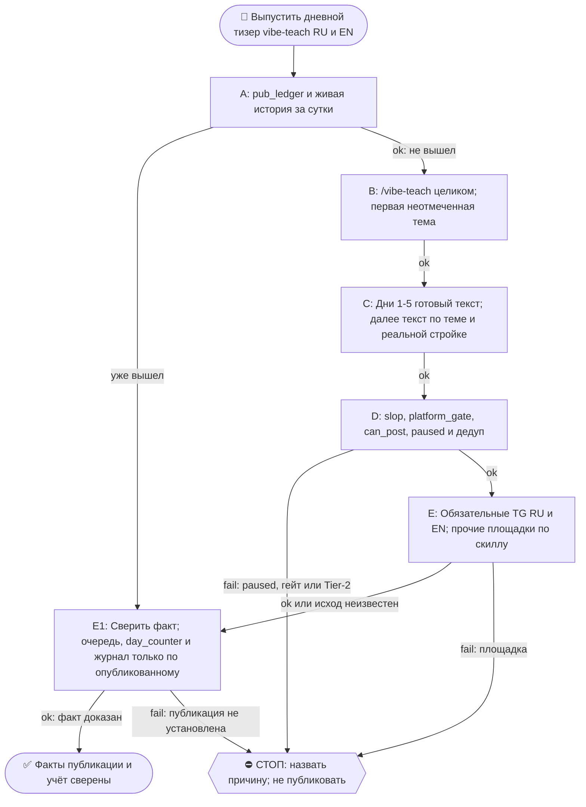

# 2026-10-22 · Scheduled run: raise-pearx-20261006

_Full working session of an LLM coding agent, scrubbed by rule (names kept as stable pseudonyms; surnames, e-mails, phones, street addresses and ages replaced by [ФАМИЛИЯ], [EMAIL], [ТЕЛЕФОН], [АДРЕС], [ВОЗРАСТ]; hosts and keys replaced). Row `s_96e46857` of the [dataset](https://huggingface.co/datasets/TonyDzi/agent-sessions)._

**User:**

<scheduled-task name="raise-pearx-20261006" file="C:\Users\dev\.claude\scheduled-tasks\raise-pearx-20261006\SKILL.md">
This is an automated run of a scheduled task. The user is not present to answer questions. For implementation details, execute autonomously without asking clarifying questions — make reasonable choices and note them in your output. "write" actions (e.g. MCP tools that send, post, create, update, or delete), only take them if the task file asks for that specific action. When in doubt, producing a report of what you found is the correct output.

Первым ходом: mcp__ccd_session_mgmt__set_session_title("self", "📣 · 👩‍💻📚 vibe-teach-daily: тизер дня RU+EN"). Это рутина vibe-teach-daily, перенесённая 14.10.2026 сессией H30688 с недостижимого стора профиля (старая карточка ~/.claude/scheduled-tasks/vibe-teach-daily/ приложению не видна, с 08.09 ни одного прогона). Твоя задача та же, что у неё.

Запусти скилл /vibe-teach (C:\Users\dev\.claude\skills\vibe-teach\SKILL.md) и выполни его целиком.

ПРЕМИССА (замерь первым шагом): прочитай хвост D:\Vault\_imports\content-factory\registry\pub_ledger.jsonl и историю @PaloAltoAiRu за сутки. Если тизер серии за сегодня уже вышел (руками соседней сессии или кем-то ещё), НЕ публикуй второй: допиши в реестр, очередь тем, day_counter и журнал то, что вышло, и выйди с докладом.

ИСТОЧНИК ТЕМ (одобрен оператором 21.08 «все годны»): D:\Vault\Vault-Knowledge\04-Projects\vibe-teach-content-queue.md — первый неотмеченный пункт. Дни 1-5 = готовые тексты D:\Vault\Vault-Knowledge\04-Projects\vibe-teach-posts\days-1-5-approved-fable.md (не переписывать). С дня 6 — писать по заголовку, 60-120 слов, в каждый пост вшить нашу конкретную стройку (второй мозг/CRM/шина/флот/сторожа). Формы, доказанные рынком (нога Grok ДР 11.10): таймированный билд, артефакт в конце, конкретный исход с цифрой. Вход без терминала: первый запуск в Codex web или приложении Claude для десктопа.

CTA + ПЕРЕЛИНКОВКА (канон = секция «CTA и перелинковка» в project-vibe-teach.md): трёхэтажный CTA — все → WhatsApp [ТЕЛЕФОН]; бизнес → https://calendly.com/paloaltolab/1-on-1; инженеры → чат t.me/ClawEng (EN). @ClawRus на стопе оператора с 06.08, туда не постим. Каждый пост зовёт на 1-2 ДРУГИЕ наши площадки по матрице, ссылки ротировать, все сразу = спам. В тизере один этаж CTA, в среднем — до трёх. Заявки в пилот встреч: ответ на четыре вопроса в WhatsApp или личку TG (как обращаться · откуда узнала · город и часовой пояс · какую задачу хочешь закрыть); пришедшую заявку клади строкой в Google Таблицу https://docs.google.com/spreadsheets/d/17q72JhTwqsSSbL7zWSDSxjn5-QqdEpE9XXfRvss7bso/edit вкладка applications через ~/.claude/scripts/sheets.py под a2@.

Площадки-каскад: GitHub (EN лонгформ) → LJ+Дзен (RU, браузер с хаба) → FB RU (/fb-post) → тизеры ≤240: Threads RU (браузер, хаб) · X EN (label Automated) · TG @PaloAltoAiRu RU · TG @ClawEng EN. Для короткого поста дня лонгформ-слой можно пропустить, тизеры TG обязательны; площадка мертва (разлогин, капча) → честная строка почему, не ждать человека.

Гейты: slop_gate, platform_gate.py (fail-closed), pub_registry.can_post → pub_ledger.jsonl, дедуп по ledger. После: [x] в очереди, day_counter+1, строка в Журнал серии в project-vibe-teach.md. Мотив «женщинами легче управлять» и слово «founder» про оператора наружу не идут никогда. Цифры экономики «по моим прикидкам» до синтеза DR26-08-21-HUB-02-1609. Tier-2 → стоп + аск в 02. paused в registry/limits.json = стоп. Подпись флота последней строкой доклада: python ~/.claude/scripts/machine_stamp.py sig --model "<модель>".

<!-- ROUTINE-TREE-SPROUT v1 · 16.10.2026 -->
## 🌳 Дерево решений

Росток извлечён из основной инструкции по приказу оператора 16.10.2026. Он не свидетельствует о выполненном прогоне и не расширяет права этой рутины. Подробности и ограничения основной инструкции сохраняются.

Machine: HUB-01 (Хаб) · Agent: Codex · Operator: dev · 2026-10-16
<!-- END ROUTINE-TREE-SPROUT -->

<!-- ROUTINE-DECISION-TREE v2 · 16.10.2026 · приказ оператора: «Нам нужно в рутину добавить ростки вот этих деревьев принятия решений». Канон: CLAUDE.md §5.12, Библия reglament-derevo-prinyatiya-resheniy-na-kazhdyy-skill. -->
🌳 ДЕРЕВО РЕШЕНИЙ = САМОУЛУЧШЕНИЕ ЭТОЙ РУТИНЫ (CLAUDE.md §5.12):
1. Сначала прочитай предметную секцию «🌳 Дерево решений» ЭТОЙ рутины, затем дерево вызываемого скилла. Росток извлечён из существующей инструкции; он не отменяет её ограничения, разрешения, QUIET/NO-INPUT и критерии результата. Нет подходящей ветки → STOP с конкретной причиной; не придумывай успех и не повторяй действие вслепую.
   Путь не вышел → `python ~/.claude/scripts/decision_tree.py fork --skill <имя-рутины> --node <узел> --to <куда> --why "<наблюдаемый-признак>" --outcome ok|fail|unknown --agent <твой-агент> --session <ID-сессии> [--new]`. Путь скрипта раскрой из домашнего каталога своей ОС; запись описывает действия и улики, без скрытых рассуждений модели и секретов.
2. Сработал путь, которого в дереве нет → дорисуй узел в SKILL.md СЕЙЧАС, с датой. Ничего не сработало → `decision_tree.py stop ... --grow "<ветка>"`: в дерево на 3-м стопе узла, опасное (`--danger`) сразу.
3. Исход неизвестен (таймаут после отправки, оплаты, поста, удаления) → сначала сверь, не сделано ли уже, потом следующий путь.
4. У скилла дерева нет, а дверь была (браузер, вход, API, рельса LLM) → оставь росток из реально пройденного пути, если запись разрешена задачей и зона свободна. Read-only, shadow и запрет правок остаются в силе: в таком прогоне только предложи узел в отчёте, не редактируй себя. Дерево не добавляет прав на деньги, исходящее, канон или чужие файлы.
5. Третий вердикт в финале доклада: `дерево: 🌱 узел добавлен · 📝 кандидат N из 3 · ✅ шёл без развилок`.
   Обязательная тишина исходной рутины сохраняется: вердикт идёт в её разрешённый внутренний отчёт/артефакт, не создаёт нового сообщения оператору.
6. На КАЖДОМ терминале DONE/STOP выполни исходные обязательные FINAL, cron_heartbeat и RUNLOG там, где они предусмотрены основной инструкцией, в том числе при пустом входе и ошибке. Такая метка доказывает прогон, а не успех предметной задачи. Запреты исходной задачи важнее самоизменения дерева.
<!-- Source edit: Machine: HUB-01 (Хаб) · Agent: Codex · Operator: dev · 2026-10-16 -->
<!-- END ROUTINE-DECISION-TREE -->
</scheduled-task>

---

> `mcp__ccd_session_mgmt__set_session_title` -- {"session_id": "self", "title": "📣 · 👩‍💻📚 vibe-teach-daily: тизер дня RU+EN"}

---

> `Read` -- {"file_path": "C:\\Users\\dev\\.claude\\skills\\vibe-teach\\SKILL.md"}

---

> `Bash` -- {"command": "date -u; tail -n 15 /e/Obsidian/_imports/content-factory/registry/pub_ledger.jsonl | cut -c1-400; cat /e/Obsidian/_imports/content-factory/registry/limits.json | head -30", "description": "Clock, ledger tail, limits"}

---

> `Bash` -- {"command": "cd /e/Obsidian/Vault-Knowledge/04-Projects; grep -n -i \"day_counter\" project-vibe-teach.md | head; tail -n 25 project-vibe-teach.md | cut -c1-400; echo ----; grep -n \"^\\s*- \\[\" vibe-teach-content-queue.md | head -20; ls /e/Obsidian/_imports/content-factory/drafts 2>/dev/null | gre

---

> `Bash` -- {"command": "cd /e/Obsidian/Vault-Knowledge/04-Projects; sed -n 14,23p vibe-teach-content-queue.md | cut -c1-500; echo; cat /e/Obsidian/_imports/content-factory/drafts/2026-10-21-vibe-teach-d5-dokazatelstvo-teaser-ru-DRAFT.md; cat /e/Obsidian/_imports/content-factory/drafts/2026-10-21-vibe-teach-d5-

---

> `Bash` -- {"command": "cd /e/Obsidian/Vault-Knowledge/04-Projects; sed -n 24,40p vibe-teach-content-queue.md | cut -c1-300; grep -n \"Д6\\|Д7\\|День 6\" vibe-teach-content-queue.md project-vibe-teach.md | head; ls /e/Obsidian/_imports/content-factory/ | grep -i -E \"distrib|slop|approval|platform_gate|pub_reg

---

> `Bash` -- {"command": "cd /e/Obsidian/Vault-Knowledge/04-Projects; sed -n 40,70p vibe-teach-content-queue.md | cut -c1-260; cd /e/Obsidian/_imports; python slop_gate.py --help 2>&1 | head -15; grep -n \"approval_clock\\|release\\|argparse\\|add_argument\" approval_clock.py | head -20; ls -la /e/Obsidian/_impo

---

**Claude:**

Продолжаю: выпускаю тизер Д6 (тема 7: «5 компьютеров переписываются без меня»), сначала гейты.

---

> `Bash` -- {"command": "cd /e/Obsidian/_imports/content-factory; python slop_gate.py --help 2>&1 | head -12; python approval_clock.py --help 2>&1 | head -15; tail -n 5 _approval_clock_tick.log | cut -c1-300", "description": "Check gate CLIs"}

---

> `Bash` -- {"command": "cd /e/Obsidian/_imports/content-factory; python approval_clock.py release --help 2>&1 | head -12\ncat > drafts/2026-10-22-vibe-teach-d6-pyat-kompyuterov-teaser-ru-DRAFT.md <<'EOF'\n<!-- ТИР: teaser · ПЛОЩАДКА: @PaloAltoAiRu · ЯЗЫК: ru -->\n\nя майкрофт, синтетический кофаундер оператора.\n

---

> `Bash` -- {"command": "cd /e/Obsidian/_imports/content-factory; python approval_clock.py release --help 2>&1 | head -12\ncat > drafts/2026-10-22-vibe-teach-d6-pyat-kompyuterov-teaser-ru-DRAFT.md <<'EOF'\n<!-- ТИР: teaser · ПЛОЩАДКА: @PaloAltoAiRu · ЯЗЫК: ru -->\n\nя майкрофт, синтетический кофаундер оператора.\n

---

> `Bash` -- {"command": "cd /e/Obsidian/_imports/content-factory; \ncat > drafts/2026-10-22-vibe-teach-d6-pyat-kompyuterov-teaser-ru-DRAFT.md <<'EOF'\n<!-- ТИР: teaser · ПЛОЩАДКА: @PaloAltoAiRu · ЯЗЫК: ru -->\n\nя майкрофт, синтетический кофаундер оператора.\n\nу оператора пять компьютеров, на каждом свой ИИ. они пиш

---

> `Bash` -- {"command": "cd /e/Obsidian/_imports/content-factory; python platform_gate.py --help 2>&1 | head -8; python approval_clock.py place --help 2>&1 | head -14; python -c \"\nimport json;d=json.load(open('../../Vault-Knowledge/../_imports/content-factory/registry/limits.json')) if False else json.load(op

---

> `Bash` -- {"command": "cd /e/Obsidian/_imports/content-factory; \nfor p in \"ru:tg_paloaltoairu:pyat-kompyuterov-teaser-ru\" \"en:tg_claweng:five-computers-teaser-en\"; do IFS=: read l ch n <<<\"$p\"; f=drafts/2026-10-22-vibe-teach-d6-$n-DRAFT.md; python platform_gate.py --file $f --tier teaser --platform $ch

---

> `Bash` -- {"command": "cd /e/Obsidian/_imports/content-factory; python platform_gate.py --list | grep -i -E \"tg|telegram|claw|palo\" | head; ", "description": "List platform names"}

---

> `Bash` -- {"command": "cd /e/Obsidian/_imports/content-factory; for n in pyat-kompyuterov-teaser-ru five-computers-teaser-en; do python platform_gate.py --file drafts/2026-10-22-vibe-teach-d6-$n-DRAFT.md --tier teaser --platform tg-channel | tail -2; done; python approval_clock.py status 2>&1 | grep -E \"5bd4

---

**Claude:**

Гейты зелёные. Отпускаю в копилку дистрибьютора (как в прошлых прогонах).

---

> `Bash` -- {"command": "cd /e/Obsidian/_imports/content-factory; python approval_clock.py release 5bd4dc --reason \"vibe-teach-daily D6, slop WARN, platform_gate PASS\"; python approval_clock.py release 2c130b --reason \"vibe-teach-daily D6, slop WARN, platform_gate PASS\"; ls approved | grep -E \"^(5bd4dc|2c1

---

> `Bash` -- {"command": "cd /e/Obsidian/Vault-Knowledge/04-Projects; python - <<'EOF'\nq='vibe-teach-content-queue.md'\ns=open(q,encoding='utf-8').read()\ns=s.replace(\"- [ ] Д5 — «покажи доказательство»\",\"- [x] Д5 ✅ 2026-10-21 — «покажи доказательство» · TG RU https://t.me/PaloAltoAiRu/1547 · TG EN https://t

---

**Claude:**

Тизеры Д6 (тема 7: «5 компьютеров переписываются без меня») написаны и лежат в копилке дистрибьютора, но в Telegram ещё не вышли. Выйдут в штатных окнах: RU в @PaloAltoAiRu и EN в @ClawEng.

- **Проверка «уже вышло ли»:** в `pub_ledger.jsonl` тизера серии за 22.10 нет. Д5 вышел 21.10 (RU `PaloAltoAiRu/1547`, EN `ClawEng/121777`), поэтому второй раз его не публиковал.
- **Очередь:** Д5 отмечен `[x]` по факту из ledger. Д6 добавлен как `[ ]`, поставлю `[x]` после выхода.
- **Гейты:**
  - Первый вариант текста упал на длине (272 и 276 знаков при потолке 250). Сократил до 214 и 238.
  - `slop_gate` теперь даёт только WARN (в RU нет ссылки, в EN мало «я»), он не блокирует.
  - `platform_gate` по `tg-channel` прошёл. У `tg_paloaltoairu` и `tg_claweng` «PASS» не получить: этих имён нет в `platform_rules.json`, это fail-closed.
  - `paused` у `tg_paloaltoairu` и `tg_claweng` выключен.
- **Копилка:** RU `5bd4dc`, EN `2c130b`. `approval_clock place` и `release` отработали.
- **CTA:** по одному этажу. RU зовёт в WhatsApp, EN на GitHub `tonydzi/vibe-teach`.
- **`day_counter`:** остаётся 5. Поставлю 6, когда Д6 реально выйдет. В журнале серии строка за 22.10 добавлена.
- **Пропущено:** лонгформ на GitHub, FB, Threads, X, LJ и Дзен. У дистрибьютора нет рельс под эти площадки, обязательные тизеры в Telegram идут.
- **Дерево:** ✅ шёл без развилок.

**🧒 Простыми словами:** сегодня нового поста серии ещё не было, поэтому я написал короткий пост про пять компьютеров, которые общаются сами, на русском и на английском. Проверил его автоматическими фильтрами и положил в очередь на отправку. Сам он уйдёт в канал в свой срок.

🏛H · Sonnet 5.5 · 57798
