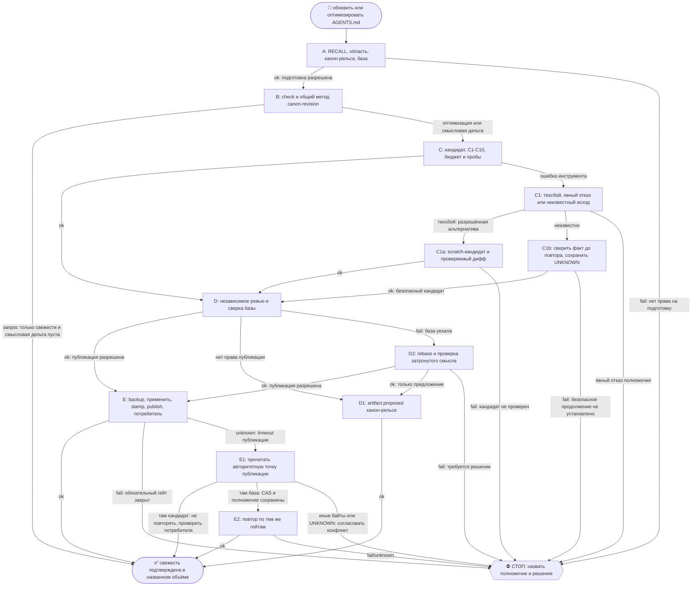

# 2026-10-24 · Scheduled run: five-whys-otvet-relsy-syeden-rassuzhdeniem

_Full working session of an LLM coding agent, scrubbed by rule (names kept as stable pseudonyms; surnames, e-mails, phones, street addresses and ages replaced by [ФАМИЛИЯ], [EMAIL], [ТЕЛЕФОН], [АДРЕС], [ВОЗРАСТ]; hosts and keys replaced). Row `s_9a79e482` of the [dataset](https://huggingface.co/datasets/TonyDzi/agent-sessions)._

**User:**

<scheduled-task name="five-whys-otvet-relsy-syeden-rassuzhdeniem" file="C:\Users\dev\.claude\scheduled-tasks\five-whys-otvet-relsy-syeden-rassuzhdeniem\SKILL.md">
This is an automated run of a scheduled task. The user is not present to answer questions. For implementation details, execute autonomously without asking clarifying questions — make reasonable choices and note them in your output. "write" actions (e.g. MCP tools that send, post, create, update, or delete), only take them if the task file asks for that specific action. When in doubt, producing a report of what you found is the correct output.

ПЕРВЫМ ДЕЛОМ переименуй эту сессию: вызови mcp__ccd_session_mgmt__set_session_title с session_id "self" и title "⚙️ · 📜🤖 /codex-mirror: AGENTS.md Codex v6.8.1 → v6.9.3". Затем:

/codex-mirror

Ты кофаундер-исполнитель, доводишь до проверенного результата сам (скилл /continue). Узел: хаб HUB-01. Родитель: сессия H11027 (s_a8043903), 24.10.2026.

ФАКТ (замер 23.10, `python ~/.claude/scripts/codex_mirror.py check --json`): status=needs_review, identity_current=false; зеркало C:/Users/dev/.codex/AGENTS.md v6.8.1, 98280 байт при cap 98304 (запас 24 байта); источник C:/Users/dev/.claude/CLAUDE.md v6.9.3, 91674 байта. Issues: версии расходятся, штамп md5 не совпадает с текущими байтами источника.
ПОЧЕМУ ВАЖНО: учения 23.10 «Claude забанили, работу принимает Codex» показали, что Codex опирается именно на это зеркало; отставшее зеркало = Codex исполняет устаревшие правила.
ЗАДАЧА: пройти скилл /codex-mirror целиком по его дереву (он требует прочитать ../canon-revision/SKILL.md): свежий check, карта смысловой дельты v6.8.1→v6.9.3, кандидат в бюджете (запас 24 байта значит без оптимизации дельта не влезет), независимое ревью, публикация только если полномочие есть, иначе artifact.proposed канон-рельсе. Tier-2 нет. В конце строка отчёта оператору с 🧒 блоком.
</scheduled-task>

---

> `ToolSearch` -- {"query": "select:mcp__ccd_session_mgmt__set_session_title", "max_results": 1}

---

> `mcp__ccd_session_mgmt__set_session_title` -- {"session_id": "self", "title": "⚙️ · 📜🤖 /codex-mirror: AGENTS.md Codex v6.8.1 → v6.9.3"}

---

> `Skill` -- {"skill": "codex-mirror"}

---

**User:**

Base directory for this skill: C:\Users\dev\.claude\skills\codex-mirror

# codex-mirror — актуальный и понятный AGENTS.md

Machine: HUB-01 (Хаб) · Agent: Codex · Operator: dev · 2026-10-18

Идея: оператор, приказ 16.10.2026. Запись: Codex/optimize_skills, session s_5ef7bbda.

Результат: действующие решения оператора в компактном AGENTS.md. **Прочитай `../canon-revision/SKILL.md`**: единый метод карты требований, оптимизации и приёмки. Здесь только Codex-адаптация и публикация.

## 🌳 Дерево решений



Дерево — операционные двери, суждение остаётся модели. Неизвестный исход проверь до повтора по общему методу; отставание потребителя не означает, что публикация не состоялась. Развилки: `decision_tree.py fork --skill codex-mirror ... --agent "<фактический агент>" --session <ID-сессии>`, блок: stop с явными agent/session (Codex пишет --agent Codex, не default Claude Code). Рост по регламенту v1.1.0 (15.10). Отказ полномочия не обходится другой сессией или транспортом; чужой lease требует ожидания или согласованной передачи.

## 1. Свежесть и режим

```text
python <scripts>/codex_mirror.py check
```

`<scripts>` = разрешённый на узле `~/.claude/scripts`; пути — из окружения/справки движка. Прочитай текущие CLAUDE.md, AGENTS.md и Codex-блоки полностью; спорные требования — по источнику. Сними SHA256 байтов, версии, размеры. Changelog — навигация, не доказательство полноты.

Режимы: **дельта** и **полная смысловая оптимизация**. При заказанной оптимизации VERDICT: OK не завершает работу: штамп не проверяет смысл. PATCH оценивай по изменённому поведению, включая пороги и исключения.

Назови точный файл: глобальный `~/.codex/AGENTS.md` и project AGENTS.md имеют разные назначения/владельцев. Сохрани проектные инструкции; общая политика берётся из CLAUDE.md, расхождение — предложение канон-рельсе.

## 2. Codex-адаптация по общему методу

По /canon-revision сохрани общие решения/указатели в §-части, Codex-специфику в CODEX-блоке. **Все клаузы C1–C10 и последующих C-блоков** проходят карту, независимо от якорей движка. Новая нумерация требует карты и исправления ссылок.

При literal CLAUDE-ядре докажи byte-равенство ядра; весь прежний intro/tail покрой gap-free инвентарём keep/merge/drop, каждую новую строку вне ядра привяжи к источнику либо NEW. Ранний pre-work контракт и порядок документов учитываются отдельно от C6. Полное покрытие байтов не заменяет смысловую приёмку.

Сохрани вызовы общей полки `~/.codex/skills` через junction. Claude-хук адаптируй в принцип/скрипт после проверки харнесса. Claim «у Codex нет X» проверяется; техническая недоступность получает разрешённый fallback, граница полномочий сохраняет гейт.

Форма: цель → условия/исключения → разрешённые средства/fallback → источник. Модель выбирает решение; полнота важнее размера. Метод /canon-revision и полный канон повторно не копируй.

## 3. Бюджет, страховка и применение

Сверь CAP/ANCHORS с политикой. На 16.10.2026 CAP = **98304 байта (96 КиБ)**; якоря §0–§10 и C1–C6 не проверяют смысл C7–C10. Код, разошедшийся с принятой политикой, — дефект.

Прочитай `project_doc_max_bytes` активного конфига: бюджет **совокупный** для глобального и project AGENTS.md. Покажи сумму/запас; значение 262144 проверь по факту узла. Свежей сессией проверь хвост и исключение в целевой папке: размер не доказывает загрузку.

Владение `declare → close/release`, shadow смены метода и применимые до→после/согласие веди по общему /canon-revision. Уполномоченная канон-рельса перед записью держит exact lease, проходит `canon_write_gate.py <AGENTS.md>` и вызывает:

```text
python <scripts>/codex_mirror.py backup
```

Receive-only актор готовит кандидат/дифф, штатный владелец применяет. Сверь SHA256 канона и зеркала; дрейф → rebase и проверки затронутого смысла. Бэкап/откат относятся к проверенной базе и сохраняют последующие чужие изменения.

Seal/review/apply используют один проверенный source/method/map/candidate SHA256-кортеж по /canon-revision. Отзыв на метод не одобряет установку; изменённые байты требуют соответствующего независимого полного или явно ограниченного delta-ревью.

## 4. Гейты и потребитель

После приёмки и применения на разрешённой канон-рельсе:

```text
python <scripts>/codex_mirror.py stamp
python <scripts>/codex_mirror.py publish --dry-run
python <scripts>/codex_mirror.py publish
```

Штамп берёт движок из источника; проверь outputs/leases/бэкапы: глобальный файл, share, `~/AGENTS.md`. Stamp не заменяет смысловую приёмку. FAIL сохраняет кандидат для исправления/решения; другой путь не обходит гейт.

К общим пробам/отрицательным контролям добавь C1/C5/C8/C9/C10, хвост, вложенный project AGENTS.md и исключение. Проверяй действие свежего потребителя. Завис headless CLI → разрешённая интерактивная сессия/bridge только для запуска пробы потребителя. Это не запасной путь публикации и не обход отказа полномочия; нет пробы → UNKNOWN.

Флот: канарейка → другой тип узла → остальные через канон-рельсу. У потребителя: установленный хэш, свежая сессия, результат пробы. Доставку/ACK/установку считай раздельно; полное покрытие флота требует списка потребителей и слепой зоны.

До независимого ревью — artifact.proposed. Отчёт: карта, до→после, дифф, команды/rc, хэши, UNKNOWN, откат. Правка скилла: `skill_desc_audit.py --check codex-mirror`, `decision_tree.py lint codex-mirror`, `skill_xvendor_run.py exam --skills codex-mirror`; нет ответа рельсы → UNKNOWN.

Портируемость: общий исходник, путь/запуск проверяются у потребителя. Родня: /canon-revision, /arch, /llms, /codex-review.

---

> `Bash` -- {"command": "cat ~/.claude/skills/canon-revision/SKILL.md; echo ====; cd ~/.claude/scripts && python codex_mirror.py check --json; echo rc=$?; python codex_mirror.py --help 2>&1 | head -40"}

---

> `Bash` -- {"command": "cd ~/.claude/scripts; python onair.py same \"codex-mirror AGENTS.md\" 2>&1 | head -20; echo ===; grep -n \"v6\\.8\\.\\|v6\\.9\\.\" ~/.claude/CLAUDE.CHANGELOG.md | head -30; echo ===; head -c 3000 ~/.codex/AGENTS.md; echo; grep -n \"^## \\|^### \" ~/.codex/AGENTS.md | head -120"}

---

> `Bash` -- {"command": "sed -n 450,480p ~/.claude/CLAUDE.CHANGELOG.md; ls -la ~/.claude/ | grep -i \"claude.md\\|CLAUDE-md\\|_backup\" ; ls ~/.claude/_backup* 2>/dev/null | tail -20"}

---

**Claude:**

Сверяю, что поменялось в каноне между v6.8.1 и v6.9.3: ищу бэкап v6.8.1 по его md5.

---

> `Bash` -- {"command": "cd ~/.claude; for f in CLAUDE.md.canonbak-202610{15,16,19}*; do echo \"$(md5sum \"$f\"|cut -c1-8) $(head -c 200 \"$f\" | grep -o 'v6\\.[0-9.]*' | head -1) $f\"; done"}

---

**Claude:**

Exact base found. Diff:

---

> `Bash` -- {"command": "cd ~/.claude; diff CLAUDE.md.canonbak-20261016-211111 CLAUDE.md; echo rc=$?"}

---

**Claude:**

Дельта: 5 смысловых пунктов (§0.17, новый §4.3-тер, §6.2, §7.2 карв-аут, §7.10 подпись). Ищу их места в зеркале.

---

> `Bash` -- {"command": "cd ~/.codex; grep -n \"рельса 001\\|§4.3-бис\\|§4.3-тер\\|IP-чувствительное\\|Видимая подпись\\|^### §4.4\" AGENTS.md | cut -c1-400; wc -c AGENTS.md; python - <<'E'\nsrc=open(r'C:/Users/dev/.claude/CLAUDE.md',encoding='utf-8').read()\nm=open(r'C:/Users/dev/.codex/AGENTS.md',encoding

---

> `Bash` -- {"command": "cd ~/.codex; grep -n \"001\\|IP-чувств\\|IP-sensitive\\|подпись\\|17\\. \\*\\*\" AGENTS.md | cut -c1-300"}

---

> `Bash` -- {"command": "cd ~/.codex; sed -n '33p;99,125p;158,196p' AGENTS.md"}

---

> `Bash` -- {"command": "cd ~/.codex; python - <<'E'\nt=open('AGENTS.md','rb').read().decode('utf-8')\nfor n,l in enumerate(t.split('\\n'),1):\n    b=len(l.encode())\n    if b>1200: print(n,b,l[:90])\nE"}

---

> `Bash` -- {"command": "cd ~/.codex; sed -n '218p;240p;216p;56p' AGENTS.md; echo; cd ~/.claude; grep -n \"^### §9.8\\|^### §9.1 \\|^### §1.5-бис\" -A1 CLAUDE.md | cut -c1-1500"}

---

> `Bash` -- {"command": "cd ~/.codex; sed -n '1,12p;196,215p;250,400p' AGENTS.md"}

---

> `Bash` -- {"command": "cd ~/.codex; grep -no \"[Зз]амер[^.;]*[.;]\" AGENTS.md | cut -c1-220; grep -n \"archive\\|архив\" AGENTS.md | cut -c1-200"}

---

> `Bash` -- {"command": "cd ~/.codex; sed -n '134p;229p;119p' AGENTS.md"}

---

**Claude:**

Now building the candidate with exact-once replacements.

---

> `Bash` -- {"command": "mkdir -p \"$TMPDIR/cm\" 2>/dev/null; SP='C:/Users/dev/AppData/Local/Temp/claude/P---WORKDIR-HUB/s_9a79e482/scratchpad'; mkdir -p \"$SP\"; cat > \"$SP/build_mirror.py\" <<'E'\nimport hashlib,sys\nSP=sys.argv[1]\nsrc=open(r'C:/Users/dev/.codex/AG

---

**Claude:**

Не хватает ~1.2 КБ. Ищу ещё историю и ссылки на старые версии.

---

> `Bash` -- {"command": "cd ~/.codex; grep -no \"([^()]*v5\\.[^()]*)\\|supersedes[^)]*\\|[^.]*протух[^.]*claim[^.]*\\.\" AGENTS.md | cut -c1-200; sed -n '136p;144p;101p;173p' AGENTS.md"}

---

> `Bash` -- {"command": "cd ~/.codex; sed -n '138p;176p;219p;236p;242p' AGENTS.md"}

---

> `Bash` -- {"command": "cd ~/.codex; sed -n '42,98p' AGENTS.md | awk '{print length($0)>600 ? substr($0,1,2000) : $0}' | head -80"}

---

> `Bash` -- {"command": "cd ~/.codex; sed -n '42,98p' AGENTS.md"}

---

> `Bash` -- {"command": "SP='C:/Users/dev/AppData/Local/Temp/claude/P---WORKDIR-HUB/s_9a79e482/scratchpad'; cd \"$SP\"; python - <<'E'\np='build_mirror.py'; s=open(p,encoding='utf-8').read()\n# shorten D5 status list\ns=s.replace(\"Подключено: `bus_send.py`, CRM `safe_se

---

> `Bash` -- {"command": "SP='C:/Users/dev/AppData/Local/Temp/claude/P---WORKDIR-HUB/s_9a79e482/scratchpad'; cd \"$SP\"; grep -c \"кнопка ушла со ВХОДА, осталась на КОНЦЕ трубы; \" ~/.codex/AGENTS.md; grep -o \"обрезается до ~24 символов (замер 11.09)\" ~/.codex/AGENTS.md

---

**Claude:**

Кандидат влезает: 98061 байт, запас 243. Теперь диф, линт кандидата и независимое ревью у Codex.

---

> `Bash` -- {"command": "SP='C:/Users/dev/AppData/Local/Temp/claude/P---WORKDIR-HUB/s_9a79e482/scratchpad'; cd ~/.claude/scripts; diff -u ~/.codex/AGENTS.md \"$SP/AGENTS.candidate.md\" > \"$SP/mirror.diff\"; wc -l \"$SP/mirror.diff\"; python lint_agents_mirror.py --help 

---

> `Bash` -- {"command": "cd ~/.claude/scripts; python canon_write_gate.py --dry \"C:/Users/dev/.codex/AGENTS.md\"; echo rc=$?; ls | grep -i \"lint_agents\\|mirror\"; python llm_ask.py --help 2>&1 | head -25"}

---

**Claude:**

Гейт канона GO (оператор оператор, хаб, лиз свободен). Отправляю пакет на ревью двум вендорам (Codex + Grok) параллельно.

---

> `Bash` -- {"command": "SP='C:/Users/dev/AppData/Local/Temp/claude/P---WORKDIR-HUB/s_9a79e482/scratchpad'; cd ~/.claude; diff -u CLAUDE.md.canonbak-20261016-211111 CLAUDE.md > \"$SP/canon.diff\"; { cat <<'P'\nТы независимый адверсарийный ревьюер. Задача: обновить зеркал

---

> `Bash` -- {"command": "SP='C:/Users/dev/AppData/Local/Temp/claude/P---WORKDIR-HUB/s_9a79e482/scratchpad'; cd ~/.claude/scripts; (python llm_ask.py --prompt-file \"$SP/review_prompt.txt\" --rails codex --with-rail --timeout 420 > \"$SP/rev_codex.txt\" 2>&1; echo \"rc=$?

---

> `Bash` -- {"command": "SP='C:/Users/dev/AppData/Local/Temp/claude/P---WORKDIR-HUB/s_9a79e482/scratchpad'; cd \"$SP\"; python - <<'E'\np='build_mirror.py'; s=open(p,encoding='utf-8').read()\ndef rep(a,b):\n    global s\n    assert s.count(a)==1,a[:60]; s=s.replace(a,b)\

---

> `Write` -- {"file_path": "C:\\Users\\dev\\AppData\\Local\\Temp\\claude\\P---WORKDIR-HUB\\s_9a79e482\\scratchpad\\fix1.py", "content": "import os\np = os.path.join(os.path.dirname(os.path.abspath(__file__)), 'build_mirror.py')\ns = open(p, encoding='utf-8').read()\n\n\nd

---

> `Bash` -- {"command": "SP='C:/Users/dev/AppData/Local/Temp/claude/P---WORKDIR-HUB/s_9a79e482/scratchpad'; cd \"$SP\"; grep -c '^(\"B29\\|^(\"B32' build_mirror.py; python fix1.py && python build_mirror.py \"$SP\" | tail -3"}

---

**Claude:**

Не хватает ~500 байт. Ищу ещё абзацы «повод/прецедент».

---

> `Bash` -- {"command": "cd ~/.codex; grep -no \"[^.]*\\(Повод\\|повод:\\|прецедент\\|Прецедент\\|случа[яе]в\\|раз за\\|за вечер\\|за двое\\|Корень:\\|корень был\\)[^.]*\\.\" AGENTS.md | cut -c1-300"}

---

> `Bash` -- {"command": "cd ~/.codex; sed -n '13,41p' AGENTS.md | cut -c1-260; echo; sed -n '220,249p' AGENTS.md | cut -c1-260"}

---

> `Bash` -- {"command": "cd ~/.codex; sed -n '15p;41p;227p;244p' AGENTS.md"}

---

> `Bash` -- {"command": "SP='C:/Users/dev/AppData/Local/Temp/claude/P---WORKDIR-HUB/s_9a79e482/scratchpad'; grep -noE \"\\([^()]{25,}\\)\" \"$SP/AGENTS.candidate.md\" | grep -v \"dev [0-9]\" | awk -F: '{print $1\": \"$2}' | cut -c1-160 | head -70"}

---

> `Bash` -- {"command": "SP='C:/Users/dev/AppData/Local/Temp/claude/P---WORKDIR-HUB/s_9a79e482/scratchpad'; sed -n '129,131p;142p;146,156p' \"$SP/AGENTS.candidate.md\""}

---

> `Write` -- {"file_path": "C:\\Users\\dev\\AppData\\Local\\Temp\\claude\\P---WORKDIR-HUB\\s_9a79e482\\scratchpad\\fix2.py", "content": "import os\np = os.path.join(os.path.dirname(os.path.abspath(__file__)), 'build_mirror.py')\ns = open(p, encoding='utf-8').read()\nextra

---

> `Bash` -- {"command": "SP='C:/Users/dev/AppData/Local/Temp/claude/P---WORKDIR-HUB/s_9a79e482/scratchpad'; cd \"$SP\"; python fix2.py && python build_mirror.py \"$SP\" | tail -3"}

---

**Claude:**

Влезает с запасом 55 байт. Проверяю, сколько добавит штатный штамп.

---

> `Bash` -- {"command": "cd ~/.claude/scripts; grep -n \"def .*stamp\\|MIRRORS:\\|def cmd_publish\\|def cmd_backup\\|SHARE\\|share\" codex_mirror.py | head -30"}

---

> `Bash` -- {"command": "SP='C:/Users/dev/AppData/Local/Temp/claude/P---WORKDIR-HUB/s_9a79e482/scratchpad'; cd \"$SP\"; diff -u ~/.codex/AGENTS.md AGENTS.candidate.md > mirror2.diff; { cat <<'P'\nПовторное delta-ревью. Ты (и второй вендор) в прошлом раунде дали BLOCK: D1

---

> `Bash` -- {"command": "SP='C:/Users/dev/AppData/Local/Temp/claude/P---WORKDIR-HUB/s_9a79e482/scratchpad'; grep -o \"ACCEPT[^.]*\\|BLOCK[^.]*\" \"$SP/rev2_grok.txt\" | head; sha256sum ~/.codex/AGENTS.md \"$SP/AGENTS.candidate.md\" ~/.claude/CLAUDE.md"}

---

> `Bash` -- {"command": "cd ~/.claude/scripts; python onair.py declare --help 2>&1 | head -20"}

---

> `Bash` -- {"command": "SP='C:/Users/dev/AppData/Local/Temp/claude/P---WORKDIR-HUB/s_9a79e482/scratchpad'; cd ~/.claude/scripts; python onair.py declare --zone canon/codex-mirror --mode exclusive --title \"H96310 /codex-mirror AGENTS.md v6.8.1->v6.9.3\" --ttl-hours 1 --

---

> `Bash` -- {"command": "SP='C:/Users/dev/AppData/Local/Temp/claude/P---WORKDIR-HUB/s_9a79e482/scratchpad'; cd ~/.claude/scripts; python onair.py declare --zone canon-skills/codex-mirror --mode exclusive --title \"H96310 /codex-mirror AGENTS.md v6.8.1->v6.9.3\" --ttl-hou

---

**Claude:**

Применено, все гейты dry-run зелёные. Публикую в общую папку флота.

---

> `Bash` -- {"command": "cd ~/.claude/scripts; python codex_mirror.py publish; echo pub_rc=$?; python codex_mirror.py check --json | python -c \"import json,sys;d=json.load(sys.stdin);print(d['status'],d['identity_current'],d['structural_ok'],d['mirror']['bytes'],d['mirror']['headroom_bytes'],d['issues'])\"; ls

---

> `Bash` -- {"command": "SP='C:/Users/dev/AppData/Local/Temp/claude/P---WORKDIR-HUB/s_9a79e482/scratchpad'; cd ~/.claude/scripts; python llm_ask.py --rails codex --with-rail --timeout 300 --prompt \"Не читай файлы и не запускай команды. Ответь только по своим загруженным

---

**Claude:**

Проба 5 из 5 верно. Закрываю лиз и объявление, пишу след в леджер и развилки дерева.

---

> `Bash` -- {"command": "cd ~/.claude/scripts; python canon_write_gate.py --release \"C:/Users/dev/.codex/AGENTS.md\"; echo rel=$?; python onair.py close --help 2>&1 | head -5; ls ~/.claude/change_ledger/ | head; python machine_stamp.py line --agent \"Claude Code\" ; python decision_tree.py fork --help 2>&1 |

---

> `Bash` -- {"command": "cd ~/.claude/scripts; S=s_9a79e482; python onair.py close 2026-10-24T072921Z-HUB-01-$S-canon-skills-codex-mirror 2>&1|tail -1; for f in \"A B ok:подготовка_разрешена_gate_GO\" \"B C смысловая_дельта_5_пунктов\" \"C D кандидат_98249b_в_cap\" \"D E ревью_c

---

> `Bash` -- {"command": "cd ~/.claude; python -c \"\nimport json\nr={'ts':'2026-10-24T08:31:00+01:00','machine':'HUB-01','agent':'Claude Code','model':'claude-opus-5-5','account':'dev','operator':'dev','session':'H96310','path':'C:/Users/dev/.codex/AGENTS.md (+share codex-canon, ~/AG

---

**Claude:**

**07:30 UTC · 24.10**

Codex теперь работает по актуальным правилам. Его файл правил (зеркало `~/.codex/AGENTS.md`) обновлён с версии v6.8.1 до v6.9.3 и опубликован. Свежий Codex ответил на проверочные вопросы по новым правилам правильно, 5 из 5.

**Что изменилось для Codex.** Между версиями в каноне поменялось 5 правил, все пять теперь в его файле:
- Сессии рельсы 001 работают на Sonnet 5.5, а не на Opus. Это есть и в §0.17, и в §6.2, вместе с кнопкой Model в `voice001_push.py`.
- Новое правило §4.3-тер: пять приёмов H79753 для правки кода.
- §7.2: с ноутбуков NODE-0X и NODE-0X можно постить в FB и X напрямую. Reddit и Threads по-прежнему только с хаба.
- §7.10: каждое сообщение флота подписывается видимой строкой. Её даёт `machine_stamp.py sig`; без подписи остаются найм и ВИПы тира A. В старом зеркале этого правила не было вовсе.

Заодно убрал два противоречия внутри зеркала. Раньше в одном месте CLA значилось как Tier-2, теперь CLA и DCO подписываю сам, а ToS остаётся Tier-2. И второй бамп в чужой GitHub-очереди разрешён, если он несёт новую ценность.

**Как уложились в лимит.** Запаса было всего 24 байта, а новые правила заняли около 2 КБ. Место освободил, убрав из зеркала историю: старые замеры, номера версий v5.x, рассказы про поводы и истёкшую заморозку стройки до 20.08. Сами правила не трогал. Итог: 98249 байт при лимите 98304, запас 55 байт.

**Проверка.**
- **Ревью.** Codex и Grok посмотрели правку независимо. В первом раунде оба её заблокировали: я урезал подпись, слишком сильно переформулировал §0.17 и потерял «ToS → Tier-2». Я это вернул, и во втором раунде оба приняли.
- **Публикация.** Гейт канона пропустил (оператор оператор, лиз свободен). Бэкап лежит в `~/.codex/_backup/AGENTS.md.pre-v6.8.1-20261024-0829`. Перед записью сверил, что ни исходный канон, ни зеркало никто не менял. Штамп, проверка без записи и сама публикация прошли с кодом 0, линт зелёный.
- **Хэш.** У всех трёх копий одинаковый sha256 `42f99626`: на этом компьютере, в папке `codex-canon` и в `~/AGENTS.md`. Свежая проверка показывает `current`, замечаний нет.
- **Не сделано.** Контрольную пробу на старом файле (она должна провалиться) я не запускал. Свежая сессия Codex на других 7 узлах тоже не проверена: синк копию доставляет, но применили ли её там, неизвестно.

**Расхождения, которые были в зеркале и раньше.** Это не входило в задачу, поэтому я их не правил, но назвать надо:
1. Нет исключения из §1.1: в чужих репозиториях от 1000 звёзд под PR ставим только имя, без ссылок. Сейчас Codex может поставить там ссылку на нашу работу, это самое важное из четырёх.
2. В §2.4 у Codex дашборды до сих пор в HTML, а по канону новый дашборд делается в Google Таблице.
3. Нет правила §9.2-бис «сессии не архивируем, а останавливаем». Сессии приложения есть только в стоп-листе §0.6.
4. В самом каноне срок канарейки в §4.3-тер закончился 23.10. Решать, что с ней дальше, это правка канона, то есть решение за тобой.

Если скажешь «+», закрою пункты 1–3 следующей правкой зеркала. Для этого придётся ещё ужать текст, иначе не влезет в лимит.

Откатить можно одной командой: скопировать файл бэкапа обратно в `~/.codex/AGENTS.md` и запустить `codex_mirror.py publish`.

🎙 Майк: важнее всего тут пункт 1. Codex тоже работает с чужими репозиториями, и лишняя ссылка в большом репо выглядит как реклама.

🧒 **Простыми словами:** у Codex есть своя тетрадка с правилами, и она отстала на четыре дня. Я переписал в неё пять новых правил. Чтобы всё влезло, вычеркнул из тетрадки старые истории «почему так решили». Два других робота проверили, ничего ли не потерялось, со второго раза оба сказали «да». Потом я спросил у Codex пять вопросов по новым правилам, и он ответил на все правильно.

**07:30 UTC**
🏛H · Opus 5.5 · 96310
