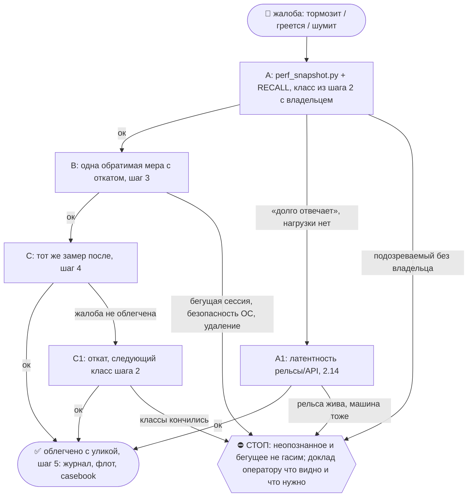

# 2026-10-24 · Нужно провести глубокое исследование: компьютер HUB сильно тормозит, нужно понять причину

_Full working session of an LLM coding agent, scrubbed by rule (names kept as stable pseudonyms; surnames, e-mails, phones, street addresses and ages replaced by [ФАМИЛИЯ], [EMAIL], [ТЕЛЕФОН], [АДРЕС], [ВОЗРАСТ]; hosts and keys replaced). Row `s_9bf8c0a4` of the [dataset](https://huggingface.co/datasets/TonyDzi/agent-sessions)._

**User:**

Нужно провести глубокое исследование: компьютер HUB сильно тормозит, нужно понять причину.

Задача:
- Настроить систему мониторинга производительности.
- Определить, какие процессы нагружают компьютер: CPU, RAM, диск, сеть и другие ресурсы.
- Регулярно замерять нагрузку и выявить, что именно «жрёт» мощность.
- После диагностики — оптимизировать, чинить, отключать или исправлять проблемные процессы/программы.
- Встроить/установить программы мониторинга в рабочий процесс, чтобы постоянно видеть причины тормозов.

Нужно заняться этим плотно и как можно быстрее, потому что компьютер сильно тормозит, а причина пока непонятна.
__Перевела: GPT-5.5 + whisper__

• • • • •

Нужно провести глубокое исследование: компьютер сильно тормозит, и непонятно из-за каких процессов.

Нужна система мониторинга, которая будет показывать и замерять:
- какие процессы грузят компьютер;
- что потребляет CPU, RAM, диск, GPU и другие ресурсы;
- какие приложения/службы вызывают тормоза.

После выявления проблемных процессов их нужно оптимизировать, отключить, починить или заменить. Задача срочная: нужно как можно быстрее поставить программы мониторинга и заняться диагностикой.
__Перевела: GPT-5.5 + 11labs__

---

> `Skill` -- {"skill": "perf"}

---

**User:**

Base directory for this skill: C:\Users\dev\.claude\skills\perf

# /perf — почему тормозит машина и как это лечить

Скилл = **первая дверь** для любой жалобы на скорость. Он не дублирует соседей, а ведёт по ним:
`/deflate` (планировщик, автозапуск, GPU, питание), `/hdd-storage-cleaning` (диск),
`mcp_lazy_audit.py` (MCP всех агентов), `/claude-repair` (приложение Claude не стартует).

Цель: облегчить конкретную жалобу человека. Нагрузка может быть сосредоточена в одном процессе,
размазана по группам или ограничена питанием, памятью и вводом-выводом. Классы ниже — гипотезы,
а не список обязательных вмешательств. Выбирай ветку по текущим данным.

До первого замера зафиксируй: машина, симптом (горячо/шумно, прокрутка/ввод, запуск или ответ),
обычная задача и критерий улучшения. Используй уже сказанное человеком; уточняй лишь недостающее.
«Ноут крайне горячий» задаёт тепловую ветку, а не только замер скорости скрипта.
Согласуй зоны с существующим владельцем инцидента; один владелец контрольного окна на узел.
Не запускай одинаковые сборщики из нескольких LLM. Учитывай собственные процессы и фон ремонта.

Один источник на каждую тему:
- Тип устройства и ОС до первого замера → [profiles](references/profiles.md). Имя узла не выбирает профиль.
- Как мерить по веткам CPU/память/диск/GPU/ввод/MCP и по ОС → [triage](references/triage.md).
- Датированные случаи с цифрами → [casebook](references/casebook.md); новый широкий поиск → [recall-map](references/recall-map.md).
- Перед изменением и приёмкой → [acceptance](references/acceptance.md).

На Windows адресная CPU/RAM/thread атрибуция: `python <каталог-perf>/scripts/windows_probe.py --interval 3 --top 8`
(дополнительная ветка по вопросу, не второй параллельный сбор; input latency и тепло не меряет).
Дерево Claude Desktop на Windows раскладывает `python <каталог-perf>/scripts/claude_session_map.py`.
Неслитая ветка v2.0.0 (Codex хаба, 15.10: дерево решений §5.12, мышь) лежит в
`references/v2.0.0-codex-hub-20261015-unmerged.md`, её ждёт слияние (шина msg 160348).

⚠️ **Диагностика сама греет.** Каждый субагент или параллельная сессия = ещё процесс CLI на 300+ МБ,
а у агента с плагинами или stdio-MCP на каждый поток (Codex с плагинами) ещё и свой комплект MCP.
Такой агент ведёт разбор тормозов в одном потоке, без сабагентов и параллельных тредов. Число
процессов своего агента входит в замер «до» и «после». Случай: casebook 12.10 NODE-0X (79 → 182
процесса за 6 мин разбора, термозажим).

## 🌳 Дерево решений



Развилку пиши `python3 ~/.claude/scripts/decision_tree.py fork --skill perf --node <узел> --to <куда> --why "<признак>" --outcome ok|fail|unknown`; застрял → `stop ... --grow`. Строка в отчёте: `🌳 perf · <узел> не вышел (<признак>) → <куда>`.

## Шаг 0 — RECALL (одна минута)
Свежие уроки узла: память `mcp-server-costs-ram-in-every-session`, `laptop-chokes-while-hub-idles-55gb`,
`never-archive-sessions-stop-them`, `ps-cpu-is-lifetime-average`; хаб памяти `hub-mcp-codex-runtime`;
шаг 1-бис скилла `/deflate` (хаб 07.10); похожий случай в casebook. Читай последнюю связанную
проверку результата вместе с карточкой задачи: старое done не отменяет более позднее OPEN.
Исторические цифры помечай датой. Новый случай записывай существующим журналом поломок;
защищённый скилл меняется предложением.

## Шаг 1 — Замер одной командой

При исполнении `/perf` передай `PERF_INVOCATION_SOURCE=skill:perf` только окружению дочернего
сборщика; прямой запуск без метки честно считается manual. После реального выполнения запиши
применение `/perf` существующим skill_usage_log, если harness ещё не сделал это; чтение для
ревью/симуляции не является рабочим применением. Счётчик не доказывает охлаждение.

```bash
python3 ~/.claude/scripts/perf_snapshot.py          # mac / linux
python  %USERPROFILE%\.claude\scripts\perf_snapshot.py   # windows
```

Печатает нагрузку, свободную RAM, своп (на Windows — файл подкачки), показатель ограничения CPU,
CPU и RAM **по группам процессов**, число процессов каждого агента, найденные по маркерам копии MCP
и список ПОДОЗРЕВАЕМЫХ с номером класса ниже. Замер ложится в `~/.claude/_perf/`, им же меряешь «после».
Паспорт прибора и его слепые зоны: [acceptance](references/acceptance.md#паспорт-общего-perf_snapshot).

Для текущего CPU используй дельту CPU-time за известный интервал или вторую пробу `top`,
а не одиночный `ps %CPU`. Указывай нормировку: 100% одного ядра либо всей машины.
Пустой вывод, ошибка провайдера или отсутствующее поле = UNKNOWN/INSTRUMENT_ERROR, не ноль.
Отказ счётчика не разрешает перестраивать системные счётчики или менять ОС.
Список suspects — подсказка; его надписи «ПЕРЕГРЕВ» и «скорость» не являются диагнозом.
Начни одним коротким сбором. Дополнительный сбор должен отвечать на названный вопрос о следующем
действии. Два раунда без нового основания — останови повторные пробы, сохрани OPEN и назови пробел.
Во время теплового контроля отложи свои бэкапы, индексацию, профили и сборки (правило бэкапа не обходи:
запись с бэкапом делай до или после окна).
⛔ «Свободной памяти много» не значит «быстро»: 14.10 на NODE-0X было 3.6 ГБ свободно при лимите 20%.

**История тепла и питания** (жалоба «грелся вчера/ночью»): чёрный ящик
`~/.claude/scripts/_power_thermal/power_thermal_YYYYMM.csv` (`power_thermal_logger.py`, на NODE-0X cron `*/10`).
«До» бери оттуда, новый демон не заводи. ⚠️ На Mac по теплу прибор слепой: `tz_c` пуст во всех
строках, в `note` попадает только `CPU_Scheduler_Limit<100`, а `CPU_Speed_Limit` не пишется
(19.10 23:53 `pmset -g therm`: Scheduler=100 при Speed=40, строка вышла чистой). Пустой note ≠
«перегрева не было»: тепло за прошлое = UNKNOWN, сейчас меряй `pmset -g therm`. По CSV на Mac
остаются `cpu_load`, `power_src`, `batt_pct`. Под cron пусты и `boot_id`/`uptime_s` (2664 из 2721
строки октября на 19.10): `sysctl` лежит в `/usr/sbin`, которого нет в PATH cron; `--selftest` в
интерактивном shell зелёный и этого не ловит. Починка самого logger — отдельная задача, не внутри /perf.

## Шаг 2 — Классы, по убыванию цены (каждый оплачен реальным случаем)

**2.0 Своп и нехватка RAM.** Своп, занятый когда-то, сам по себе не диагноз. Смотри текущее
давление и задержку живой задачи (macOS `memory_pressure` + разница `vm_stat`, Linux PSI или
`si/so` в `vmstat 1 3`, Windows commit и текущий paging; подробно triage «Память и агенты»).
Сумма RSS считает общие страницы несколько раз — не обещай такое же освобождение RAM.
Дальше иди по группам RAM сверху вниз (`perf_snapshot.py`; Windows `Group-Object ProcessName` +
сумма `WorkingSet64`): сперва счёт по группам, потом вина. Хаб 07.10: 2417 процессов, 135 `claude.exe`
= 45 ГБ из 128, сирот 313 на 2.7 ГБ — гипотезу «виноваты сироты» опроверг тот же замер; аудит фона
назвал бы машину здоровой. Windows, RAM по каждой сессии: `python %USERPROFILE%\.claude\scripts\claude_proc_mem.py`
(private working set каждого `claude.exe`, сшитый с state-файлами сессий). NODE-0X 08.10 (load 465,
57 МБ свободно) разложился по классам 2.2–2.5: casebook.

**2.1 Нагрев, питание и ограничение CPU.** `CPU_Speed_Limit` (Mac) и `Performance Limit Flags`
(Windows) — сигналы ограничения, не измеренная частота и не причина. Высокие kernel_task/sys тоже
не устанавливают перегрев. Метод тепловой ветки, пассивный HP-сенсор и запрет будить dGPU прибором:
[triage](references/triage.md#gpu-thermal-питание). Питание подтверждай фактическим readback: разряд
батареи не доказывает отсутствие внешнего питания, кабель дисплея/дока тоже питает ноут.
Меняй один безопасный фактор за раз; вынужденные одновременные изменения отметь как смешанный опыт.
Не повторяй отказавшую запись pmset без новых прав. Доступ к root, кабелям и настройкам определяется
текущими разрешениями, а не этим скиллом.
Критерий — устойчивое облегчение нагрева/шума при обычной задаче. Возврат лимита к 100% без
охлаждения не закрывает жалобу. Исторический пример 15.10: 100% первые минуты, затем 80%,
температура 76.1→80.5°C — `NO_SUSTAINED_COOLING_CONFIRMED`, не результат на сегодня.

**2.2 stdio-MCP и жизненный цикл агентов.** Проверяй реальные копии и принадлежность:
command-конфиг допускает отдельные процессы, но число и время жизни зависят от клиента.
Сопоставь runtime с конфигами и plugin-пакетами. PASS аудитора, пропустившего живой сервер,
означает неполное покрытие, не отсутствие нагрузки. Число процессов не доказывает их вред.
`python3 ~/.claude/scripts/mcp_lazy_audit.py` смотрит `~/.claude.json`, `.mcp.json`, `~/.codex/config.toml`, Grok.
⛔ До снятия замерь РЕАЛЬНЫЕ вызовы по блокам `tool_use` (grep имени врёт в ~40 раз из-за списка
отложенных инструментов) и проверь, зовёт ли сервер скилл; считай по паре namespace+name.
Снятие: `claude mcp remove <имя>`, у Codex `codex mcp remove <имя>` или `codex_mcp_lazy_fix.py --install`
только в разрешённой зоне после проверки владельца, реальных потребителей и отката.
Перед любым stop сопоставь PID + время запуска + команду + родительское дерево + активную работу.
Неизвестное использование не равно нулевому. Общий backend и дочерние MCP активной сессии сохраняй.
Не используй `pkill -f`. Проверяй один полный безопасный цикл клиента: вызов инструмента и корректное
освобождение ресурса; EOF-тест отдельного сервера не доказывает выгрузку существующим клиентом.
Замеры 08–16.10 (agent-chrome, screenpipe, node под Codex): casebook.
Правило §7.13: в always-on конфиге только серверы с `url`.

**2.2-тер Обёртка в `command`.** Если stdio всё же нужен (вне always-on, через `claude mcp add`),
в `command` пиши прямой интерпретатор, а не обёртку (`uv run`, `npx -y …@latest`, shell). На Windows
обёртка оставляет сирот (умирает uv.exe, `python main.py` живёт), а `npx …@latest` на каждый поток
делает сетевую проверку, распаковку и скан Defender. Признак в замере: пары `cmd/npx/uv` плюс
дочерний сервер, ~87 МБ на обёртку. Лечение: venv-python или глобальная установка пакета и прямой
путь в конфиге. Случаи (до 60 сирот/сутки → 0; Codex 56% + антивирус 17%): casebook.

**2.3 Индексатор или эмбеддер на коротком тике.** Тяжёлый фон по расписанию «каждые N минут».
Сверь ПАСПОРТ тика с ЛОГОМ: обещанный «холостой прогон 0.4 с» на деле 34–49 с, настоящий
7–9 минут, а один прогон в логе шёл 4906 с (`brain_shard_embed`, NODE-0X 14.10, тик каждые 30 минут
днём, 300% CPU). Лечение на время: ночное окно §4.6 (`StartCalendarInterval` / задача на ночь),
бэкап расписания, строка в `change_ledger`.
⚠️ Ночь = временная мера, а не починка. Свежесть общего поиска при этом падает до суток, и
Codex на /llms 15.10 не принял её как постоянную. Корень: проверка по датам (stat-first) в движке
ЕСТЬ, но смена даты у файла без смены содержимого (`moved≠0`, `changed=0`) заставляет его
перезаписать весь шард. Чинить пропуском записи, когда состав данных не изменился, затем
вернуть частый тик. Спящий ноутбук и обёртка, выходящая с 0 при занятом эмбеддере, могут
отодвинуть тик больше чем на сутки (triage «Индексатор»).
⛔ Не приписывай охлаждение одной мере, если меры шли вместе: 14.10 пауза Codex и перенос тика
совпали по времени, вклад каждой не разделён.

**2.4 Слишком много живых сессий и тредов.** 33 процесса агентов на NODE-0X 08.10, 64 `claude` и
16.5 ГБ на хабе 15.10. ⛔ Сессии НЕ архивируем (§9.2-бис, хук `never_archive_sessions.py`):
архив прячет сессию с экрана и не доказывает освобождения ресурсов. Перед reaper/apply прочитай
его текущую реализацию и dry-run: возраст сессии, низкий CPU или ожидание I/O не доказывают
простой. Без доказанной завершённости задачи и принадлежности процесс сохраняй.
⭐ **оператор 19.10.2026, голосом:** «ни в коем случае не останавливать сессии, которые сейчас работают».
⭐ **оператор 22.10.2026, голосом:** «если она остановилась [больше 8 часов], нет смысла ей продолжать
[держать память]». Остановившаяся сессия (последняя запись user/assistant старше 8 ч, хода нет)
выгружается из памяти сама: launchd `ai.paloalto.mac-session-reaper` раз в час
`mac_session_reaper.py --hours 8 --apply` гасит ПРОЦЕСС, карточка остаётся в списке и откроется
при следующем ходе. Простой = timestamp последней записи user/assistant, НЕ mtime файла: служебные
строки (system, api-request, attachment) двигают mtime без работы (22.10: сессия OpenLLM молчала
8 суток при сегодняшнем mtime; две по 57 ч считались свежими). Тест `_test_mac_session_reaper_activity.py`.
Процессы без `--resume` сцепляются по cwd + рождению транскрипта ±180 с. Осиротевшие хосты
OpenLLM (`openllm daemon __session-host`, ppid=1, `openllm sessions kill` отвечает «no session
matches») гасятся по PID после сверки старта и команды. `stop_session` простаивающую не освобождает.
Жнец НЕ гасит (защиты сессии A16433, 22.10, тест `_test_mac_session_reaper_guards.py`, 3 мутанта красные):
сессию со взведённой слежкой за комментариями артефакта (22.10 я погасил две такие, слежки умерли,
перевзвели вручную) · сессию, чей последний ход = tool_use без ответа (идёт или ждёт апрува) ·
сессию с живыми субагентами (`<uuid>/`) · процессы вне `Application Support/Claude/claude-code`
(OpenLLM, терминал). Процесс без `--resume` сцепляется с карточкой приложения по createdAt и
priorCliSessionIds, неоднозначно = не судим. Порог флота 8 ч: NODE-0X и NODE-0X (22.10).
Нехватка ресурсов при многих
живых сессиях лечится потолком на НОВЫЕ запуски, не отстрелом бегущих: `hooks/session_concurrency_gate.py`
(PreToolUse start_session / hand_off / Bash-запуск claude, CAP 8) и `scripts/session_cap.py` для роботов
(exit 3 = отложить). Замер 19.10: 38 процессов claude, 16 родились за час от scheduled-task'ов и роботов.
Проверка потолка: `grep -c session_concurrency_gate ~/.claude/settings.json` (≥1 = дверь стоит) ·
`python3 ~/.claude/hooks/_test_session_concurrency_gate.py` (19 проверок, PASS) ·
`python3 ~/.claude/scripts/session_cap.py` (печатает `N/CAP`, exit 3 = потолок) · откуда новые:
`ps -Ao etime=,ppid=,comm= | grep claude` по родителям (scheduled-task / `claude_run.py` / startedBy).
**Codex Desktop живёт внутри ChatGPT.app:** каждый когда-либо открытый тред = свой «Codex (Renderer)»
плюс node-помощники MCP под app-server (`thread_unload_delay_secs` их не выгружает). оператор видит
2–3 треда, машина держит 40: лечится закрытием тредов в приложении или его перезапуском, не kill'ом
рендереров. Общий app-server может обслуживать много чатов: число чатов не равно числу лишних backend.
**Windows, Claude Desktop:** процесс CLI рождается при открытии сессии в сайдбаре, включении Remote
Control или запуске сидом и живёт до перезапуска приложения; `stop_session` idle-сессию не трогает
и память не освобождает. Карта: `claude_session_map.py` (процесс → сессия, часы с последнего
сообщения человека, метка ЗАБЫТА = >24 ч). Освободить забытые можно только перезапуском приложения
(когда бегущих нет) или kill их PID после сверки PID + время старта + команда, и это решение оператора.
**Codex Desktop на Windows:** крестик и мягкий `taskkill` без `/F` прячут приложение в трей,
`codex.exe app-server` живёт и читает `config.toml` лишь при старте: правка конфига без рестарта мертва.
Рестарт = трей → Quit, или по приказу оператора `taskkill /PID <ChatGPT.exe> /T /F` +
`Start-Process "shell:AppsFolder\OpenAI.Codex_2p2nqsd0c76g0!App"`; приёмка = НОВЫЙ PID и время
старта у обоих. Ключ `-c ...enabled=true` в командной строке app-server выключенный плагин не
воскрешает (проверено `codex mcp list` 16.10). Цифры случаев 12–19.10: casebook.
Не назначай SIGSTOP общей GUI/backend стандартным лечением: он может остановить управление
и затронуть активную работу. В допустимой точечной паузе восстановление должно быть обеспечено
заранее независимым механизмом; ограничения на планировщик сохраняются.

**2.5 Сироты: поисковики и консоли.** `find /` или `grep -r` по всему диску и Google Drive
(342% CPU, NODE-0X 07.10); 347 `conhost` на хабе 15.10. Мёртвый родитель или возраст
сильно больше задачи — лишь повод проверить владельца, а не разрешение остановить.
Переподчинённый системному менеджеру сервис может быть штатным. Перед stop нужны сведения
о задаче и потребителях, а не только PPID/возраст. Сомнительный процесс сохраняй.
Маскирующийся процесс (имя системного демона при чужом пути, Natively 08.10) проверяй на возврат
через элементы входа.

**2.6 Параллельные запросы к мозгу.** Каждый `brain_ask.py` грузит модель эмбеддингов
(⚠️ «~1.7 ГБ на процесс, пик 5 ГБ» записано без даты, узла и прибора, это не замер). Перемерь
пик RSS одного запроса: Mac `/usr/bin/time -l python3 brain_ask.py "x"` (maximum resident set size);
Linux `/usr/bin/time -v` (Maximum resident set size); Windows `PeakWorkingSet64` процесса python в
`Get-Process` во время запроса. Два-три одновременных запроса из разных агентов дают пик в несколько
ГБ и обычно заканчиваются сами за минуты. Повторяется → не убивать, а вести запросы через общий
сервер поиска (на хабе `ask_server`). Сам сервер тоже бывает источником нагрузки (casebook 14–15.10:
1311 потоков), поэтому приёмка по числу потоков и RSS сервера; снижает ли он RAM, ⚠️ не измерено.

**2.7 Антивирус и системные службы.** Defender 97–115% CPU на хабе 15.10: сканирует то, что мы
сами пишем потоком (волт, `node_modules`, `.claude`). ⛔ Исключения в Defender = настройка
безопасности, её меняет оператор руками; мы называем путь и цифру.
Прибор: `scripts/defender_hotspots.ps1` (запись 120 с, топ папок/процессов/расширений, готовая
команда `Add-MpPreference` только для наших рабочих папок + откат). Запускает человек от админа,
один раз вместе с перерегистрацией уборщика: `scripts/perf_admin_once.ps1`. На хабе стоит
Kaspersky, Defender там выключен (решение 08.07), на маках Defender нет: прибор это скажет кодом 2.
NODE-0X 22.10: при 55% CPU ядро 35%, Defender 10.5%, а 20 процессов Claude всего 3.9% и 59 ГБ RAM
свободно: закрытие сессий освобождает память, а не процессор.
**Уборщик сессий** (`session_reaper.py`, 0 LLM, модель не нужна): 2 раза в сутки 07:30/19:30 с
`--resume-match --resume-kill --include-chats`, посылка `reaper-2xday-v2-20261023` на 8 узлов.
Без флагов 14 из 22 процессов «не сшиты» и не режутся. ⚠️ Приложение 3.x переложило стор в
`%LOCALAPPDATA%\Claude-Data\claude_<pkg>`: старый `_shared/task_store.py` тихо слепнет (exit 0).

**2.8 Оболочка.** Исторический `com.apple.dock.extra` 93% CPU сутки (NODE-0X 14.10) —
зацепка, не готовая цель kill. Проверяй identity/владельца/активную работу по §2.2 до любого stop.
`WindowServer` высок на Retina при множестве окон Electron (Claude, Codex, ChatGPT). Для
`fileproviderd` проверь фактическую операцию и путь. Для `syncthing` проверь ошибки, needFiles,
завершение скана и повторяющиеся ретраи: большой волт не исключает баг или конфликт имён.
Синк/данные не меняй, если это исключено пользователем; передай доказательство владельцу.
⭐ Замер NODE-0X 15.10: 239 файловых событий/час, почти все пульсы и сердцебиения хаба и Маяка
(`Pulse.html/txt` 20/ч, `_pulse`, `_broker-beat`, `part-usage`, `tgoffset`, `_heartbeat-robot`);
локальный `.stignore` ломает живость (их читают peer_help, hub_deadman, consensus), `fsWatcherDelayS`
против удалённых пульсов бесполезен (COUNTER Codex 19.10).
Решение оператора 19.10: **пульсы флота раз в 6 часов**, пороги потребителей ≥8 ч тем же коммитом
(consensus #0c3cdea8). **Spotlight** на маках: `.metadata_never_index` в корне волта, `_imports`,
Google Drive и `~/.claude` (оператор 19.10: «на всех маках»); остаток руками в Конфиденциальности Spotlight.
Для мощности GPU учитывай внешние экраны, активный GPU и обычную задачу.

**2.9 Машина выключается сама: сперва железо.** Хаб до 20.07: 9 внезапных выключений за 30 дней,
минидампов нет; месяц «чинили» флап Claude Desktop, поднимая приложение. Сторож, оживляющий
приложение, маскирует корень. Улика: Windows `Get-WinEvent` журнала System по 41 (Kernel-Power,
авария) · 6008 (неожиданное выключение) · 1074 (чистый плановый ребут, не авария); Mac `last -x`.
Чёрный ящик `power_thermal_logger.py` (сэмпл раз в 5 мин, CSV см. Шаг 1, state `_power_thermal_state.json`
читать `utf-8-sig`) после ребута шлёт POWER-BLACKBOX с последними 8 сэмплами; сам сверяет только 6008
и судит о ребуте по пропуску сэмплов, событие 41 проверяй руками. Лечение не софтовое: UPS, осмотр БП
и охлаждения = руки оператора. ⚠️ Тревога POWER-BLACKBOX ≠ ребут, пока не сверена с журналом ОС:
17.08 NODE-0X 6–7 тревог за сутки при одной перезагрузке 12:22 (событие 1074), нуле событий
41/6008 и 22–23 живых сессиях; пропуск сэмплов бывает от сна и нагрузки.

**2.10 Перегруз выглядит как поломка рельсы.** Таймаут браузерной или DR-рельсы при load ≫ числа
ядер сначала разбирай через `/perf`, а не как «браузер залип». Тяжёлый локальный инференс = хаб (§7.1).
Случаи 04–29.09 NODE-0X (inject timeout, pageload 120 с, 7B GGUF в свопе): casebook.

**2.11 Spotlight и фоновые службы Apple** (`mds_stores`, `mdworker`, `corespotlightd`, `photoanalysisd`,
`mediaanalysisd`, `backupd`). Замер: `top -l 2 -s 3 -o cpu -stats pid,command,cpu`. Лечение: файл
`.metadata_never_index` в корне волта, `_imports`, папки Google Drive и `~/.claude` с строкой в
`change_ledger` (оператор 19.10: «Obsidian и Google Drive исключить из Spotlight на всех маках»; NODE-0X 19.10:
Spotlight 18% → 6%). `mdutil -i off /` и правку Конфиденциальности Spotlight делает оператор руками.

**2.12 Браузеры автоматизации.** `geckodriver`, `firefox -marionette`, `chrome --headless`, профили
selenium после DR-веера. Замер: `ps -axo pid,ppid,etime,command | grep -E 'geckodriver|marionette|--headless'`.
Гасить только дерево СВОЕГО завершённого прогона после сверки PID + время старта + команда; профили
оператора и его живые окна не трогаем (§0.6).

**2.13 Локальный инференс днём.** whisper, `podcast_essence`, GGUF/Ollama, эмбеддеры: ночная задача
съехала в рабочее время. Замер по группам `perf_snapshot.py`; лечение = окно §4.6 или хаб (§7.1).

**2.14 «Медленно» = сеть или лимит, а не машина.** Жалоба «долго отвечает» сначала сверяется с
латентностью и ошибками рельсы (`llm_ask.py` журнал, 429, таймаут), потом с CPU. Ноль нагрузки при
медленном ответе = не наш класс, говорить вслух.

**2.15 Диск и память под гостями.** `df -h /` < 10% свободно = сначала `/hdd-storage-cleaning`, не
своп. Windows: `vmmem`/`VmmemWSL` в топе RAM = граница WSL (`.wslconfig memory=`), Docker аналогично.

**2.16 Linux Маяк.** `vmstat 1 3` (столбцы `si/so` своп, `st` steal времени VM), `free -m`,
`journalctl -k --since -1d | grep -i oom` (OOM-killer), `systemctl list-timers` (кто будит). Своп при
`st` > 10% = нехватка ресурсов хоста VM, не наш процесс.

**2.17 ⭐ Тяжёлое считается не на том железе (оператор 24.10.2026: «ты думаешь, что это частная проблема»).**
Это класс, а не случай: модель, эмбеддер, whisper или реранкер молча ушли на CPU, хотя на машине есть
GPU/MPS. Признаки: группа python/node съедает 5–12 ядер, видеокарта 0%, в логе задачи слово
`device: cpu` после строки «GPU auto-pin», прогресса в логе нет часами. Три корня всегда проверяй вместе:
1. **Не тот интерпретатор.** Глобальный Python несёт `torch …+cpu`, а CUDA-torch живёт в отдельном venv
   (хаб: `~/.brain-venv`). Задача, сессия или агент зовут голый `python` и попадают в CPU-сборку.
   После любой переустановки Python (хаб 02.10, возраст-чистка AppData) `pip install torch` под Windows
   по умолчанию ставит CPU-колесо. Прибор: `python <каталог-perf>/scripts/torch_device_probe.py`:
   каждый найденный Python → версия torch → видит ли ускоритель; `MISMATCH` и список включённых
   задач планировщика с тяжёлыми словами на CPU-интерпретаторе; exit 2 = расхождение.
   Лечение: CUDA-колесо с индекса PyTorch (`--index-url https://download.pytorch.org/whl/cu130`,
   для Blackwell 50xx нужна CUDA ≥ 12.8) или абсолютный путь к GPU-venv в задаче. Откат = записанный
   `pip freeze` старых версий torch/torchvision/torchaudio.
2. **Тихий спуск.** Код выбирает устройство и при неудаче молча продолжает на CPU. Чинится
   fail-closed: GPU на машине есть, а torch его не видит → тяжёлая задача останавливается с тревогой,
   CPU только по явному `--cpu` и с потолком потоков (OMP/MKL/torch threads).
3. **Фон без потолка.** Агент запустил тяжёлое через `nohup … &` и ушёл: нет потолка времени,
   нет строк прогресса, нет владельца. Перед запуском тяжёлого фона: проверь устройство пробой,
   поставь лимит потоков и времени, пиши прогресс в лог раз в несколько минут, назови владельца.
Частота: тяжёлая переиндексация 2–4 раза в сутки, не каждые 15 минут (оператор 24.10). Сверяй
РЕАЛЬНЫЙ триггер задачи (`Repetition.Interval`), а не её имя: «Brain Reindex Frequent (15m)» на деле PT2H.
Случай хаба 24.10 (13 ч ~10 ядер, 5060 Ti 0%): casebook.

## Шаг 3 — Лечение: порядок и границы
1. Для доказанной причины выбери наименьшее вмешательство с откатом. Пауза/ночной перенос —
   временное сдерживание с названной потерей свежести; корень проверяется отдельным тестом:
   воспроизведение до, исправление, тот же вход после и сохранение полезной функции.
2. Фон и расписания → `/deflate` (у него `propose`/`apply` с журналом изменений).
3. ⛔ Не удаляем, не чистим по маске, не архивируем (§0.6, §9.2-бис). Диск → `/hdd-storage-cleaning`.
4. ⛔ Настройки безопасности ОС (Defender, Gatekeeper, SIP) не трогаем, говорим оператору.
5. Перенос нагрузки: ноутбук задыхается, а хаб свободен → тяжёлое и постоянное едет на хаб
   (§7.1). Сравни ОБЕ машины одним прибором, а не «на глаз»: 11.10 хаб имел 55 ГБ свободно при 4%
   CPU, пока NODE-0X сидел в свопе, и числился мёртвым только из-за сломанного писателя пульса.

## Шаг 4 — Доказать
- Приёмка правки конфига агента (Codex `config.toml`, `~/.claude.json`) = НОВЫЙ PID и время старта процесса-владельца: app-server читает конфиг только при старте (12–19.10 правка Codex не действовала 9 дней).

Повтори релевантные поля на той же машине, при сопоставимой задаче и питании, в том же заходе
(время пары и сон между пробами: [acceptance](references/acceptance.md#время-и-сон-между-пробами)).
Для задержек повтори заранее выбранное действие; для нагрева — ограниченное окно наблюдения с
температурой, шумом/вентиляторами, мощностью и потолком CPU, насколько эти данные доступны.
Один срез или фиксированные 5 минут не гарантируют устойчивость; длительность выбирай по тренду.
Нет датчика/неисправен счётчик — UNKNOWN с ограничением, не «0 задержки».
Запиши отдельно: исправление причины; результат компонента; результат жалобы человека; остаток.
Ускорение сборщика, меньше потоков, PASS MCP-аудита или число claude PID не закрывают всю машину.
Между разными ОС, входами и режимами не вычисляй «во столько раз быстрее».
Если после ремонта критерий не пройден, оставь результат OPEN и выбери следующий подтверждаемый
кандидат причины; не продолжай одинаковые пробы. Пользовательское подтверждение результата
дополняет измерения. Не объявляй его за человека.

## Шаг 5 — Корень и флот
После фактически проверенного ремонта или приёмки выполни [обновление опыта](references/profiles.md#после-проверенного-ремонта): область применимости, доказательство, регрессия/откат и потребители. Это шаг завершения текущего ремонта, не новая фоновая рутина.
Строка в журнал поломок: `python3 ~/.claude/scripts/selfheal.py journal --class <класс> --what "<цифры>"`.
Класс уже был на другом узле → это флотовая починка: посылка `deploy_register.py` и проверка
фактом: канарейка → узел другого типа → остальные потребители. Сохраняй локальные различия;
доставка/ACK/NOTFORME не равны применению и успешной проверке. Недоступные узлы остаются
непроверенными, не объявляй их мёртвыми. Полный охват не заявляй до фактического verify.
Новый случай — строка в casebook; правка защищённого скилла — отдельное предложение.
Вердикт о скилле (§9.3-бис) в отчёте.

## Что этот скилл НЕ делает
Не чинит само приложение Claude (`/claude-repair`), браузер (`/chrome-fix`), диск (`/hdd-storage-cleaning`).
Не меняет модель или темп рутин массово без переспроса: это `/routine-opt` и §0.7.

## Журнал версий
- 1.3.1 · 20.10.2026 · NODE-0X · Claude Code (Opus 5.5): восстановлена основа 1.3.0 поверх отката на 1.0.0; классы 2.2-тер, 2.9, 2.10, история CSV чёрного ящика в шаге 1, «диагностика сама греет», 2.0 и 2.6 переписаны; датированные цифры перенесены в casebook, метод тепла в triage.
- 1.3.0 · 19.10.2026: правило оператора о бегущих сессиях, потолок сессий, Codex/Claude Desktop, пульсы и Spotlight.
- 1.3.2 · 2026-10-20 · NODE-0X (A40884): дерево решений (§5.12, из невлитой v2.0.0 Codex), классы 2.11–2.16 по критику полноты RECALL-воркфлоу, приёмка правки конфига по новому PID.
- 1.4.0 · 2026-10-24 · HUB-01 (H81412) · Claude Code (Opus 5.5): класс 2.17 «тяжёлое не на том железе» (не тот интерпретатор, тихий спуск на CPU, фон без потолка, частота по реальному триггеру) + прибор `scripts/torch_device_probe.py`; приказ оператора 24.10, ремонт индексатора ведёт Codex H75924.

---

> `PowerShell` -- {"command": "$env:PERF_INVOCATION_SOURCE='skill:perf'; python \"$env:USERPROFILE\\.claude\\scripts\\perf_snapshot.py\"", "description": "Run one-shot perf snapshot on hub", "timeout": 180000}

---

> `PowerShell` -- {"command": "python \"$env:USERPROFILE\\.claude\\skills\\perf\\scripts\\windows_probe.py\" --interval 3 --top 10 2>&1 | Select-Object -First 80", "description": "Per-process CPU/thread attribution", "timeout": 120000}

---

> `PowerShell` -- {"command": "python \"$env:USERPROFILE\\.claude\\skills\\perf\\scripts\\torch_device_probe.py\" 2>&1 | Select-Object -First 60", "description": "Check heavy tasks running torch on CPU", "timeout": 120000}

---

> `PowerShell` -- {"command": "$o = python \"$env:USERPROFILE\\.claude\\skills\\perf\\scripts\\windows_probe.py\" --interval 4 --top 12 | Out-String | ConvertFrom-Json\n$o.processes.top_processes | Select-Object -First 14 | ForEach-Object { \"{0,6} {1,-22} cpu={2}% thr={3}\" -f $_.pid,$_.name,$_.cpu_percent_of_machin

---

> `PowerShell` -- {"command": "$s1 = Get-CimInstance Win32_PerfFormattedData_PerfProc_Process | Where-Object { $_.Name -ne '_Total' -and $_.Name -ne 'Idle' } | Sort-Object PercentProcessorTime -Descending | Select-Object -First 15 IDProcess,Name,PercentProcessorTime,ThreadCount,IOReadBytesPersec,IOWriteBytesPersec\n$

---

> `PowerShell` -- {"command": "$ids = 327924,124076,35228,121324,34168,27712,134868,162348,55748,86508,18540,56460,51060,127104\nGet-CimInstance Win32_Process | Where-Object { $ids -contains $_.ProcessId } | ForEach-Object {\n $par = $_.ParentProcessId\n $pn = (Get-Process -Id $par -ErrorAction SilentlyContinue).Proc

---

> `PowerShell` -- {"command": "foreach($id in 134868,327924,115836,213640,17960,337436,305824,127104){ $p=Get-CimInstance Win32_Process -Filter \"ProcessId=$id\" -ErrorAction SilentlyContinue; if($p){ $cl=[string]$p.CommandLine; if($cl.Length -gt 300){$cl=$cl.Substring(0,300)}; \"{0} {1} start={2:MM-dd HH:mm} ppid={3

---

> `PowerShell` -- {"command": "$a = Get-Process | Select-Object Id,ProcessName,@{n='r';e={$_.ReadTransferCount}},@{n='w';e={$_.WriteTransferCount}},@{n='cpu';e={$_.TotalProcessorTime.TotalSeconds}}\nStart-Sleep 6\n$b = Get-Process | Select-Object Id,ProcessName,@{n='r';e={$_.ReadTransferCount}},@{n='w';e={$_.WriteTra

---

> `Bash` -- {"command": "cd ~/.claude; ls scripts | grep -iE 'perf|census|proc_|sampler|monitor|load_log|hub_load' | head -30; echo ---; ls _perf | tail -8; echo ---; python -c \"import psutil;print(psutil.__version__)\"; schtasks /query /fo csv /nh 2>/dev/null | grep -iE 'perf|census|sampl|monitor' | head", "d

---

> `Bash` -- {"command": "cd ~/.claude/scripts; sed -n 1,40p perf_counter_history.ps1; echo ----; ls ~/.claude/_perf/waves | tail -5; ls | grep -iE 'wave_catcher|proc_census|perf_' ; schtasks /query /fo list 2>/dev/null | grep -iE 'TaskName.*(perf|wave|counter|patrol)'", "description": "Inspect existing counter 

---

> `Bash` -- {"command": "cd ~/.claude/_perf/waves; cat LAST_WAVE.md | head -60; echo ----; cat wave_catcher.pid; echo; tail -c 1500 HUB-01-20261023.jsonl; echo; ls -la; ps -W 2>/dev/null | head -0; tasklist //FI \"IMAGENAME eq powershell.exe\" //V 2>/dev/null | head -0", "description": "Read last wave an

---

> `PowerShell` -- {"command": "\"pid file 6428:\"; Get-CimInstance Win32_Process -Filter \"ProcessId=6428\" | Select ProcessId,Name,CreationDate | Format-List | Out-String\n\"--- catcher/counter procs:\"; Get-CimInstance Win32_Process | Where-Object { $_.CommandLine -match 'wave_catcher|perf_counter_history' } | ForE

---

> `PowerShell` -- {"command": "foreach($n in 'Revert Wave Guard','Perf Wave Catcher','Perf Wave Dump'){ $t=Get-ScheduledTask -TaskName $n; \"== $n author=$($t.Principal.UserId) run=$($t.Principal.RunLevel)\"; $t.Actions | ForEach-Object { \"  EXE: $($_.Execute)`n  ARG: $($_.Arguments)\" }; $t.Triggers | ForEach-Objec

---

> `Bash` -- {"command": "cd ~/.claude; ls _onair 2>/dev/null | head -3; grep -l -iE 'perf|cpu' _onair/ACTIVE_NOW.*.md 2>/dev/null | head; grep -iE 'H75924|perf-root' _onair/ACTIVE_NOW.*.md 2>/dev/null | head -5; ls \"E:/!CLAUDE-HUBPC-June26/_scratch/perf-root-20261024\" | head -30", "description": "Check C

---

> `Bash` -- {"command": "cd ~/.claude/scripts; grep -n -iE 'wave_catcher' _proc_patrol_HUB-01.log | tail -5; grep -c . _proc_patrol_HUB-01.log; sed -n 1,30p wave_catcher.py", "description": "Why did wave_catcher die; read its header"}

---

> `PowerShell` -- {"command": "Start-ScheduledTask -TaskName 'Perf Wave Catcher'; Start-Sleep 75\nGet-CimInstance Win32_Process | Where-Object { $_.CommandLine -match 'wave_catcher' } | Select ProcessId,Name,CreationDate | Format-Table | Out-String\nGet-Content \"$env:USERPROFILE\\.claude\\_perf\\waves\\HUB-01

---

> `Bash` -- {"command": "cd ~/.claude/_perf/waves; sed -n 1,16p LAST_WAVE.md | cut -c1-330; grep -A3 'Все процессы' LAST_WAVE.md | cut -c1-500", "description": "Read the freshly caught wave"}

---

> `PowerShell` -- {"command": "$ids=51060,127104,37288,162348\n$a=@{}; foreach($i in $ids){ $p=Get-Process -Id $i -EA SilentlyContinue; if($p){$a[$i]=$p.TotalProcessorTime.TotalSeconds} }\nStart-Sleep 10\nforeach($i in $ids){ $p=Get-Process -Id $i -EA SilentlyContinue; $w=Get-CimInstance Win32_Process -Filter \"Proce

---

> `PowerShell` -- {"command": "Get-CimInstance Win32_Process | Where-Object { $_.CommandLine -match 'perf_counter_history|wave_dump' } | ForEach-Object { \"{0} {1}\" -f $_.ProcessId,$_.CommandLine.Substring(0,[math]::Min(250,$_.CommandLine.Length)) }\nGet-ScheduledTask | Where-Object { $_.TaskName -match 'counter|his

---

> `Bash` -- {"command": "cd ~/.claude/scripts; python selfheal.py journal --class hub-slow-many-small-hogs --what \"24.10 hub: RAM free 58GB, CPU 84% (kernel 45%), cpuqueue 77/28 cores, C: busy 391% burst; wave_catcher dead since 23.10 07:41 (restarted); Defender RT on 2.3 cores; indexer was 26 cores 23.10 (Cod

---

**Claude:**

🕐 06:55 (Лиссабон)

**Что нашёл.** Одного виновника сейчас нет. Хаб тормозит от множества мелких нагрузок разом, и сильнее всего нагружено ядро Windows.

| Замер | Значение |
|---|---|
| RAM | свободно 58 ГБ, память не причина |
| CPU | 84% на 28 ядрах |
| Доля CPU в режиме ядра | 45% (при 1,4 млн системных вызовов в секунду) |
| Очередь процессора | 77 потоков ждут при 28 ядрах |
| Диск C: | в один момент был занят на 391%, потом утих |

Главные потребители по замерам (в ядрах):
- **Defender (`MsMpEng`):** 2,3 ядра на проверке файлов в реальном времени, 783 МБ.
- **Syncthing:** 1,5 ядра.
- **Постоянные `python` и `powershell`:** по 1–2,7 ядра на группу.
- **Спин `ssh.exe`:** около 1 ядра.
- **`plaud_who.py`:** около 1 ядра, живёт 43 минуты.
- **~1000–1500 процессов:** 32 `claude`, 15 `codex`, 48 `chrome`, 103 `node`, 199 `conhost`.

Вчера, 23.10 в 07:40, главным виновником был `brain_sessions_index.py`: 26 ядер подряд. Его чинит сессия Codex H75924, у неё эксклюзивная зона. Сейчас вместо него идёт GPU-воркер на видеокарте, примерно 1 ядро. Я эту зону не трогал.

**Что я сделал:**
1. **Поднял монитор волн.** Задача `Perf Wave Catcher` была мертва с 23.10 07:41: после этого мы ничего не записывали. Я перезапустил её, и первая волна уже записана (`~/.claude/_perf/waves/LAST_WAVE.md`). Порог сработки у неё 60% общего CPU, поэтому он не ловит перегруз одного диска или одного ядра. Это его слабое место.
2. **Сохранил замер «до»** в `~/.claude/_perf/HUB-01-20261024-075003.json` и записал случай в журнал поломок (`selfheal`).
3. **Не стал запускать второй сборщик.** Codex уже гоняет пробную версию постоянного регистратора счётчиков (`perf_counter_history.ps1`, каталог `_scratch/perf-monitor-20261024`). Второй сборщик только добавил бы нагрузки.

**Что не сделал и почему:**
- **Не гасил чужое.** Часть процессов принадлежит другим сессиям, а у нескольких нельзя прочитать команду. Без владельца их останавливать нельзя.
- **Не трогал Defender.** Это настройка безопасности. В каноне записано, что на хабе стоит Kaspersky, а Defender выключен (решение 08.07). Сейчас Kaspersky не найден, а Defender включён и работает в реальном времени. Либо запись устарела, либо Kaspersky потерялся после чисток. Это нужно решить вам.

**Нужны ваши руки (одним запуском от администратора):** `scripts/perf_admin_once.ps1`. Он запишет, какие наши папки Defender сканирует больше всего, и даст готовую команду исключений для рабочих папок с откатом. Исключения применять только вам.

**Что осталось непроверенным.** Диск C: один раз показал 391%, но источник не поймал. Температура и задержка ввода не измеряются вообще. Снижение нагрузки пока не доказано: я собрал диагноз и инструменты, но ничего не облегчил. Следующий шаг: подождать 1–2 волны в мониторе, взять «после» тем же прибором и сопоставить.

🧒 **Простыми словами:** Память свободна, а компьютер всё равно еле ползёт. Он не из-за одной тяжёлой программы, а из-за сотни мелких, которые одновременно суетятся. Главные: антивирус, который проверяет каждый файл, и синхронизация. Вчерашний главный обжора, индексатор, уже лечится другой сессией. Я включил «камеру наблюдения» (монитор волн), она умерла вчера, и теперь снова записывает, кто грузит компьютер. Чтобы приглушить антивирус, нужно ваше разрешение руками.

🏛H · Sonnet 5.5 · 78988
