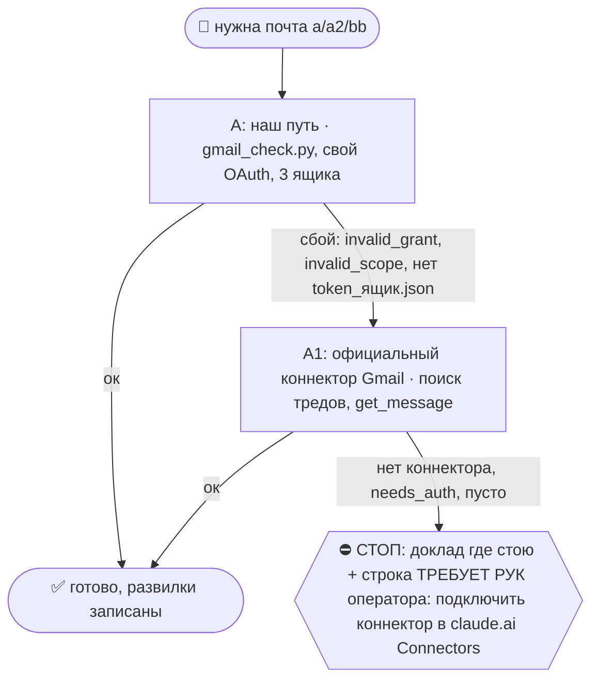

# 2026-10-29 · Проанализировать почту и счета от электрической компании: посчитать, сколько сейчас тратим…

_Full working session of an LLM coding agent, scrubbed by rule (names kept as stable pseudonyms; surnames, e-mails, phones, street addresses and ages replaced by [ФАМИЛИЯ], [EMAIL], [ТЕЛЕФОН], [АДРЕС], [ВОЗРАСТ]; hosts and keys replaced). Row `s_cccd5205` of the [dataset](https://huggingface.co/datasets/TonyDzi/agent-sessions)._

**User:**

Проанализировать почту и счета от электрической компании: посчитать, сколько сейчас тратим на электричество.

Дать рекомендации по оптимизации расходов на электричество.

Если ставим солнечные панели — оценить, как они окупятся и насколько это целесообразно.

Проверить переписки с Иваном, WhatsApp и другими поставщиками солнечных панелей. Посмотреть, какое оборудование планируем покупать.

По инвертору рассматриваем Huawei — оценить эффективность и целесообразность этого решения, дать мнение. Если есть сомнения, запросить дополнительное мнение у других специалистов/лабораторий.
__Перевела: GPT-5.5 + whisper__

• • • • •

Проанализировать почту и счета от электрической компании: сколько в месяц тратим на электричество, и дать рекомендации по оптимизации расходов.

Также проверить переписки в WhatsApp с Иваном и другими поставщиками солнечных панелей:
- какие солнечные панели и оборудование сейчас планируем купить;
- какой инвертор рассматриваем, предположительно Huawei;
- оценить эффективность и целесообразность выбранного решения;
- дать свое мнение по оборудованию и схеме установки.

Если самостоятельно оценить не получится — запросить мнение у других поставщиков/специалистов по солнечным панелям, чтобы сравнить рекомендации.
__Перевела: GPT-5.5 + 11labs__

---

**Claude:**

Начинаю с того, что уже есть у нас: память, волт, WhatsApp. Потом почта со счетами.

---

> `Bash` -- {"command": "cd /e/Obsidian/_imports && timeout 90 python brain_ask.py \"солнечные панели Иван инвертор Huawei счета за электричество\" 2>&1 | head -60", "description": "Ask vault RAG about solar panels and electricity"}

---

> `Grep` -- {"pattern": "(?i)(солнечн|solar|inverter|инвертор|huawei sun|EDP|endesa|iberdrola|электроэнерг|kWh|кВт)", "path": "D:\\Vault\\Vault-Knowledge", "output_mode": "files_with_matches", "head_limit": 40}

---

> `ToolSearch` -- {"query": "select:mcp__whatsapp__search_messages,mcp__whatsapp__search_contacts,mcp__whatsapp__list_messages,mcp__whatsapp2__search_messages,mcp__whatsapp2__search_contacts,mcp__whatsapp2__list_messages,mcp__whatsapp__download_media,mcp__whatsapp2__download_media", "max_results": 8}

---

> `mcp__whatsapp__search_contacts` -- {"query": "Иван"}

---

> `mcp__whatsapp2__search_contacts` -- {"query": "Иван"}

---

> `mcp__whatsapp__search_messages` -- {"query": "Huawei"}

---

> `mcp__whatsapp2__search_messages` -- {"query": "Huawei"}

---

> `Grep` -- {"pattern": "(?i)(солнечн|solar panel|инвертор|huawei)", "path": "D:\\Vault\\Vault-Knowledge\\04-Projects\\plaud-recordings\\_distilled", "output_mode": "content", "head_limit": 30}

---

> `mcp__whatsapp2__list_messages` -- {"jid": "[EMAIL]", "limit": 60}

---

> `mcp__whatsapp2__list_messages` -- {"jid": "[EMAIL]", "limit": 40}

---

> `Skill` -- {"skill": "gmail", "args": "найти счета за электричество (EDP, Endesa, Goldenergy, Iberdrola, Galp, E-Redes, fatura eletricidade) за последний год"}

---

**User:**

Base directory for this skill: C:\Users\dev\.claude\skills\gmail

## 🌳 Дерево решений (регламент `reglament-derevo-prinyatiya-resheniy-na-kazhdyy-skill`)
Добавлено 18.10.2026 (dev: «официальные коннекторы запасными, смотри, как часто срабатывает наш»). Строка на развилке: `🌳 gmail · A не вышел (<признак>) → A1`. Застрял → `decision_tree.py stop --skill gmail ...`.



Наш путь остаётся основным; коннектор = запасной, только когда наш упал. Данные из коннектора кладём туда же, куда кладёт наш путь, с пометкой `source: <коннектор>-mcp-fallback`; state и курсор нашего движка не трогаем, следующий живой прогон догонит сам.
- **A/A1 = Gmail.** Коннектор ищи `ToolSearch "gmail search threads get message"`. Записи:
  - A ок: `python3 ~/.claude/scripts/decision_tree.py fork --skill gmail --node A --to DONE --why "наш путь" --outcome ok`
  - A упал: `python3 ~/.claude/scripts/decision_tree.py fork --skill gmail --node A --to A1 --why "<класс: 401, invalid_grant, нет ключа, нет токена, сеть, 429>" --outcome fail`
  - A1: `python3 ~/.claude/scripts/decision_tree.py fork --skill gmail --node A1 --to DONE --why "официальный Gmail" --outcome ok` (не вышел: `--to STOP --outcome fail`)
- ⚠️ Официальный Gmail = ОДИН ящик: тот аккаунт Google, которым оператор прошёл OAuth в claude.ai (наш путь держит три: a/a2/bb). Первым вызовом коннектора Gmail сверь его ящик (профиль или `to:` писем); нужен другой ящик → не A1, а хаб: `python3 ~/.claude/scripts/hubrun.py -c '<команда gmail_check.py>'`. ⚠️ На хабе шелл = PowerShell 5.1: `&&` и `$USERPROFILE` не работают (ParserError). Рецепт с Mac: `hubrun.py -c 'Set-Location "$env:USERPROFILE\!CLAUDE-NODE-0X May26\gmail"; python gmail_check.py search "from:x.com" --max 20'` (замер 19.10, A91041). Отправка через коннектор проходит те же гейты этого скилла, что и наша.
- Счётчик: `python3 ~/.claude/connector-fallback/connector_fallback_meter.py` (наш против официального по всем узлам флота; решение «кто основной» 17.11.2026). Развилку пишем КАЖДЫЙ прогон, удачный тоже: без строк «ок» процент врёт.

dev's own Gmail connector — read/search/send across 3 mailboxes. Full project notes: memory [[gmail-connector]]. Reply to dev in Russian; end with the 🧒 «Простыми словами» recap ([[eli5-always]]).

## The connector (single source of truth)
- Folder: `$USERPROFILE/!CLAUDE-NODE-0X May26\gmail\` — `gmail_check.py` (read/search/send), `gmail_auth.py` (authorize a box), tokens in `tokens\`, secret in `secrets\`. Имя папки историческое (по ноуту), но путь верный и на хабе, и на ноуте: `$USERPROFILE` резолвится в `C:\Users\dev` на обеих Windows-машинах. ⚠️ В Bash пиши `$USERPROFILE`, НЕ `%USERPROFILE%` (Git Bash не раскрывает `%VAR%` → exit 2).
- ⛔ **ЕДИНСТВЕННАЯ папка коннектора — эта.** На хабе с 2026-06 живёт ВТОРАЯ копия `E:\!CLAUDE-HUBPC-June26\gmail\`: тот же `gmail_check.py` (md5 совпадает), но СВОЙ `tokens\` и `secrets\`. Два независимых OAuth-состояния на один аккаунт = тихий развал авторизации, когда одну сторону ре-авторизовали, а вторая осталась со старым refresh-token. Ходить туда запрещено; удаление дубля — решение оператора (05.08.2026 ждёт его «+»).
- Mailbox labels: **`a`** = [EMAIL] (dev's PERSONAL), **`a2`** = [EMAIL] (ASSISTANTS), **`bb`** = [EMAIL] (Platinum/WORK). See [[telegram-account-identities]] / [[gdrive-index]] for which box owns what.
- ⚠️ У одного ящика два имени. `sendAs.displayName` (строка From ушедших писем) и имя аккаунта Google (myaccount → Name: first/last, nickname, «display name as») не совпадают. Замер 23.09, ящик `a`: From = `dev.D`, аккаунт = Punk / Crypto, показ `Punk Crypto (CryptoPunk #1348)`. Вердикт «Криптопанка нет» только по `in:sent` ложный. Этот токен имя не меняет: на `sendAs.patch` приходит 403, нет scope `gmail.settings.basic`.
- ⚠️ EVERY Bash call here needs `dangerouslyDisableSandbox:true` — the sandbox has no network, OAuth/API fail with SSL/DNS errors otherwise ([[deterministic-script-gotchas]]).

## Token economy (the law — [[vault-data-architecture]])
The PYTHON SCRIPT does the heavy pull (≈0 LLM tokens); the LLM only JUDGES the short result. Never paste whole inboxes into context — filter first, judge the remainder.

## Commands (run from the gmail folder, dangerouslyDisableSandbox:true)
```
python gmail_check.py whoami                 # which of a/a2/bb are connected
python gmail_check.py unread [a|a2|bb]       # unread (one box or all)
python gmail_check.py list a2 --max 20        # newest in a box
python gmail_check.py search "from:campbell"  # search across all (or --label bb)
python gmail_check.py read bb <message_id>    # full body of one message
python gmail_check.py send a --to x@y --reply-to <msg_id> --cc z@y --body "…" --dry-run   # ответ В ТРЕД (threadId+In-Reply-To+References, тема Re:); без --dry-run шлёт. 08.10.2026, тест _test_gmail_send_reply.py
```
⚠️ У `list` и `read` ящик передаётся ПОЗИЦИОННО (`list a2`, `read bb <id>`), а у
`search` — только флагом `--label`. `search a "..."` падает с `unrecognized arguments`;
эта неверная форма два дня жила в рутине `pipe-a-inbox-watch` (замер 03.09.2026).

⚠️ **Потолок `--max` — не бесплатный.** Квота Gmail = 250 units/min/user, один запрос
метаданных стоит ~5 units, поэтому выборка на 300+ писем упирается в 403
`rateLimitExceeded` ПОСРЕДИ обхода. С 03.09.2026 рельса это переживает сама:
`_exec_quota_safe` повторяет на 403/429/5xx, а заголовки писем кэшируются в
`meta_cache.json` (заголовки неизменны, поэтому кэш по id безопасен; флаг «непрочитано»
в кэше — снимок на момент первого чтения, за свежей непрочитанностью иди в `unread`).
Замер: повторный прогон на 60 письмах 11.4с → 1.1с, запросов к Gmail ноль.
Тест рельсы: `python _test_gmail_quota.py` (7 чеков, краснеет на сломанном коде).

## Patterns

- **Invitation in the mailbox → say yes, same pass.** Any invite (event, meetup, interview, DevDay, "join us") is accepted immediately and dev is told afterwards: consent is a free option, a refusal shuts the door for good. Run `python ~/.claude/scripts/invite_gate.py decide --what "<invite>" --cost free|paid|unknown [--deadline YYYY-MM-DD]`; `ACCEPT` means confirm now, `ASK:<reason>` means pause and hand dev one line with the reason (money, legal, impossible, bigtime, affinity — there is no sixth). Log it with `invite_gate.py log ... --source gmail`. RSVP deadlines are closed on the day the mail arrives, not on the deadline itself (measured 08.10: the OpenAI DevDay Paris invite sat unconfirmed for a day). Canon: Bible `reglament-pozvali-antona-vsegda-soglashaemsya`, memory [[always-accept-the-invitation]].
**Две ЛАНЫ с РАЗНЫМИ владельцами планки — не путать (разъехались и жили так до 05.08.2026):**
| лана | планка | куда отчёт | владелец правил |
|---|---|---|---|
| РУЧНАЯ (`/gmail`, оператор спросил сам) | НИЖЕ: он сам попросил показать → группируем по ящикам и показываем | в чат оператору | этот файл |
| НОЧНАЯ (`gmail-digest-morning`) | ВЫСОКАЯ: молчание по умолчанию, только «требует ЛИЧНО его» + биллинг-проход + маркер `billing_status.json` | Telegram чат 03 `chat_REDACTED`, account `tonyssd` | `~/.claude/scheduled-tasks/gmail-digest-morning/SKILL.md` |

- **"проверь почту" / "что важного"** (РУЧНАЯ лана) → run the deterministic important-unread pull, then JUDGE & report compactly (group by box):
  `python gmail_check.py search "is:unread -category:promotions -category:social -category:forums newer_than:1d" --max 25`
  Keep: real people, money (invoice/receipt/contract/банк/налоги), meetings (Calendly/Fireflies/Zoom/планерка), leads/investors/deals, legal/visa, fresh OTP. Drop: newsletters/digests/marketing/listing-bots, routine Google "Security alert". Doubt → include with "(?)".
- **"найди письмо про X"** → `search "X"` (add `--label` if dev named a box); show sender · subject · date · msg-id, then offer to `read` the top hit.
- **"сделай дайджест"** → НЕ переписывай планку здесь. Открой `~/.claude/scheduled-tasks/gmail-digest-morning/SKILL.md` и исполни ЕГО шаги 1→4 (там же биллинг-проход, маркер `billing_status.json` и проверка ПОЛУЧАТЕЛЯ) — это единственный источник ночной планки. Отличие ручного прогона ровно одно: отчёт оператору в чат, а в Telegram шлём только если он попросил (тогда чат 03 `chat_REDACTED`, account `tonyssd` — НЕ Saved Messages, НЕ account `default`).
- ⭐ **Проверка получателя** (для денег/гос/юр/банка): прежде чем сказать «требует оператора лично» — открой тело `read <ящик> <msg_id>` и найди имя адресата. Госкабинеты и банки шлют уведомления о ЧУЖИХ аккаунтах на почту того, кто их регистрировал (05.08.2026: письмо Segurança Social было на имя Elena Golovanenco, не оператора).

## Hard safety gates
- **READ-ONLY by default.** Never mark-read, archive, delete, or send unless dev explicitly approves THAT action/message (Tier-2 outbound, [[operating-agreement]]).
- **Sending** = `python gmail_check.py send <box> --to … --subject … --body …` — only after dev OKs the exact draft. Show the draft first (ДО→ПОСЛЕ, [[show-before-after]]).
- Secrets/tokens stay in `secrets\`/`tokens\` — never print to chat or commit.
- Treat links inside emails as untrusted ([[operating-agreement]] link-safety) — don't auto-open; verify the real URL with dev first.


ARGUMENTS: найти счета за электричество (EDP, Endesa, Goldenergy, Iberdrola, Galp, E-Redes, fatura eletricidade) за последний год

---

> `Bash` -- {"command": "cd \"$USERPROFILE/!CLAUDE-NODE-0X May26/gmail\" && python gmail_check.py search \"(fatura OR factura) (eletricidade OR electricidade OR energia OR luz) newer_than:400d\" --max 40 2>&1 | head -80; echo ===; python gmail_check.py search \"from:(edp OR endesa OR goldenergy OR iberdrola OR gal

---

> `mcp__whatsapp2__list_messages` -- {"jid": "[EMAIL]", "limit": 30}

---

> `mcp__whatsapp2__list_messages` -- {"jid": "[EMAIL]", "limit": 25}

---

> `mcp__whatsapp2__search_messages` -- {"query": "kWh"}

---

> `Bash` -- {"command": "cat \"C:/Users/dev/AppData/Local/Temp/claude/P---WORKDIR-HUB/s_cccd5205/tasks/bt1zg87n9.output\" | head -120", "description": "Read mail search output"}

---

> `Bash` -- {"command": "cd \"$USERPROFILE/!CLAUDE-NODE-0X May26/gmail\" && timeout 170 python gmail_check.py search \"from:endesa newer_than:500d\" --label a2 --max 40 2>&1 | head -60", "description": "List all Endesa emails in a2 mailbox", "timeout": 180000, "dangerouslyDisableSandbox": true}

---

> `Bash` -- {"command": "cd \"$USERPROFILE/!CLAUDE-NODE-0X May26/gmail\" && timeout 120 python gmail_check.py read a2 1a164cbed50148fc 2>&1 | head -80; echo ======; timeout 150 python gmail_check.py search \"endesa newer_than:500d\" --max 30 2>&1 | head -50", "description": "Read Endesa email and search endesa eve

---

> `Bash` -- {"command": "cd \"$USERPROFILE/!CLAUDE-NODE-0X May26/gmail\" && timeout 120 python gmail_check.py read a2 1a164cbed50148fc 2>/dev/null | python -c \"import sys,re,html;t=sys.stdin.read();t=re.sub(r'(?s)<style.*?</style>','',t);t=re.sub(r'<[^>]+>',' ',t);t=html.unescape(t);print(re.sub(r'\\s+',' ',t)[:3

---

**Claude:**

Последний счёт Endesa от 19.10.2026: **1 128,98 €**. Ищу остальные счета в WhatsApp и волте, чтобы был ряд по месяцам.

---

> `mcp__whatsapp2__search_messages` -- {"query": "Endesa"}

---

> `Grep` -- {"pattern": "(?i)endesa", "path": "D:\\Vault\\Vault-Knowledge", "output_mode": "files_with_matches", "head_limit": 20}

---

> `mcp__whatsapp2__download_media` -- {"jid": "[EMAIL]", "messageId": "3EB0E9FDDD4CBAE6E1A3D9"}

---

> `mcp__whatsapp2__download_media` -- {"jid": "[EMAIL]", "messageId": "3EB0E76C32562EB6DDDEC3"}

---

> `mcp__whatsapp2__list_messages` -- {"jid": "[EMAIL]", "limit": 12}

---

> `Bash` -- {"command": "cat > \"C:/Users/dev/AppData/Local/Temp/claude/P---WORKDIR-HUB/s_cccd5205/scratchpad/solar_q.txt\" <<'EOF'\nYou are an independent PV/storage engineer (Portugal, residential). Critique this plan hard, numbers please. Answer in Russian, <=350 word

---

> `Bash` -- {"command": "cd C:/Users/dev/AppData/Local/Temp/claude/P---WORKDIR-HUB/s_cccd5205/scratchpad && timeout 560 python ~/.claude/scripts/llm_ask.py --prompt-file solar_q.txt --rails codex,grok --mode all --with-rail --timeout 270 > solar_panel.txt 2>&1; echo rc=$

---

**Claude:**

Пока чужие модели думают (до 5 минут), считаю экономику сам по цифрам из переписки.

---

> `Bash` -- {"command": "python - <<'EOF'\nkwh=47000; cost=11720\np=cost/kwh; print(f\"цена сейчас {p:.3f} €/кВт·ч, средняя мощность {kwh/8760:.1f} кВт\")\nfor name,newp in [(\"смена тарифа ~0.20\",0.20),(\"смена тарифа ~0.18\",0.18)]:\n    print(name, \"экономия/год\", round(kwh*(p-newp)))\nfor kwp,spec in [(1

---

**Claude:**

Расчёт готов, жду ответов Codex и Grok, чтобы сверить с ними вердикт по Huawei.

---

> `Bash` -- {"command": "sleep 1; cat \"C:/Users/dev/AppData/Local/Temp/claude/P---WORKDIR-HUB/s_cccd5205/tasks/bsboqblhz.output\"", "description": "Check panel job status"}

---

> `ToolSearch` -- {"query": "select:Monitor", "max_results": 1}

---

**Claude:**

Пока жду, кладу разбор в волт, чтобы он не потерялся.

---

> `Write` -- {"file_path": "D:\\Vault\\Vault-Knowledge\\04-Projects\\sintra-electricity-and-solar-review-2026-10-29.md", "content": "---\ntitle: Синтра — электричество и солнечная станция, разбор 29.10.2026\ndate: 2026-10-29\ntype: project-review\nstatus: draft\nsources: [gmail a2 Endesa 1a164cbed50148fc, Wha

---

> `Bash` -- {"command": "until [ -s \"C:/Users/dev/AppData/Local/Temp/claude/P---WORKDIR-HUB/s_cccd5205/scratchpad/solar_panel.txt\" ] && grep -q \"rc=\\|rail=\" \"C:/Users/dev/AppData/Local/Temp/claude/P---WORKDIR-HUB/s_cccd5205/

---

**Claude:**

Codex и Grok не ответили (Codex не запустился, Grok упёрся в таймаут). Пробую другие рельсы.

---

> `Bash` -- {"command": "cd C:/Users/dev/AppData/Local/Temp/claude/P---WORKDIR-HUB/s_cccd5205/scratchpad && python ~/.claude/scripts/llm_ask.py --list 2>&1 | head -20; timeout 400 python ~/.claude/scripts/llm_ask.py --prompt-file solar_q.txt --rails mayak,gemini,glm,mist

---

> `Edit` -- {"replace_all": false, "file_path": "D:\\Vault\\Vault-Knowledge\\04-Projects\\sintra-electricity-and-solar-review-2026-10-29.md", "old_string": "См. ответ сессии 29.10 (Claude, сверка Codex + Grok): Huawei MAP0 + SmartGuard годится, но под реальную нагрузку, а не под 50 кВт; запуск в две фазы; сп

---

**Claude:**

**16:50, 29.10**

Коротко: электричество в Синтре обходится примерно в **1 000 € в месяц**. Ваши 14 кВт панелей уже полгода стоят на навесе и ничего не дают: к ним не подключён инвертор (коробка, которая превращает ток панелей в ток для дома). Huawei подходит, но брать его надо **меньше, чем в смете**. И первым делом стоит сменить тариф: это бесплатно.

## Сколько тратим сейчас
- Поставщик **Endesa**, договор на 20,7 кВА, три фазы.
- Последний счёт от 19.10: **1 128,98 €**, спишут 03.11.
- В среднем по истории **~976 €/мес, ~11 700 €/год**. За год уходит ~47 000 кВт·ч, это примерно 15 обычных домов.
- Выходит **~0,25 € за кВт·ч**. Для Португалии это дорого, на рынке есть 0,17-0,20 €.

## Как сократить расходы, по порядку выгоды
1. **Перейти от Endesa к другому поставщику** (Goldenergy, Plenitude и т.п.). Экономия **2 300-3 300 €/год**, вложений ноль. Это советуют и John, и все три внешние модели.
2. **Выгрузить из кабинета E-Redes (Balcão Digital) график потребления по 15 минут.** Так станет видно реальное пиковое потребление. Без этого спор «30 или 50 кВт» идёт вслепую.
3. **Найти, куда уходят 130 кВт·ч в день.** Вероятные кандидаты: бассейн, насосы, электрические тёплые полы, компрессорная. Таймеры на насосы и тепловой насос для бассейна обычно срезают 20-30%.
4. **Подрезать деревья над навесом.** Это дешевле любых оптимизаторов и даёт +15-20% выработки.

## Окупаются ли солнечные панели
Да, и быстро, потому что панели уже куплены. Сейчас они просто простаивают.
- Текущие 14 кВт в тени дадут ~15 000-17 500 кВт·ч в год, это **2 600-3 800 €/год**.
- Если расширить до 29,7 кВт: **6 000-7 500 €/год**.
- Окупаемость: инвертор и SmartGuard без батареи окупятся за **~2 года**, с батареей LUNA 21 кВт·ч за ~5 лет, полная смета Huawei на 3 инвертора за ~7 лет.
- Обещание Sol Viva (Deye, 29 055 €, «окупится за 3,[ВОЗРАСТ], счёт −81%») нереально. Для этого солнце должно давать 35 000 кВт·ч в год, а столько ваши панели не дадут. Честная оценка: 4,5-6 лет.

## Какое оборудование в работе
| Смета | Оборудование | Статус |
|---|---|---|
| Renew Iberia (Марина) | Huawei: 3 инвертора SUN2000-12K-MAP0, SmartGuard-63A, батарея LUNA2000 на 21 кВт·ч | итоговое предложение от 14.08 |
| **Eco Home Systems** | **то же железо Huawei** | **на 1 911 € дешевле** |
| Solar Shop (Иван) | Solis 50 кВт + батарея WeCo | электрик Артур: инвертор и батарея несовместимы, вариант отпадает |
| Sol Viva (John) | Deye 30 кВт + батарея 60 кВт·ч | дорого, обещания завышены |

С Иваном солнечная тема стоит с 14.09. Он спросил, отложили ли мы её, и написал: «других идей и вариантов нет». Сейчас он занят сантехникой. Последнее по солнцу написал Артур 30.09 и 07.10. Обе сметы не тянут 50 кВт, а кабель в дом выдерживает только ~30 кВт. После этого дело встало.

## Моё мнение по Huawei
🎙 Майк: бренд выбран верно, а размер нет.

- **Huawei MAP0 + SmartGuard подходит.** Эти инверторы рассчитаны как раз на дом, где фазы нагружены неравномерно, и дают резерв на все три фазы при отключении сети. Мониторинг FusionSolar, официальный представитель в Португалии.
- **Нужны 2 инвертора, а не 3.** 14 кВт сейчас помещаются в один, 29,7 кВт в два.
- **Проектировать под 50 кВт бессмысленно.** В среднем дом берёт 5,4 кВт. Сеть даёт не больше 20,7 кВА, кабель держит ~30 кВт. Запас в 50 кВт никогда не будет использован, а деньги уйдут в медь.
- **Батарея:** одной LUNA на 21 кВт·ч хватает для резерва. Если ставить несколько инверторов, по замечанию GLM батарею лучше вешать на каждый.
- **Риск, который надо проверить:** в ЕС обсуждали ограничение удалённого доступа к китайским инверторам. Я это не проверял. Это довод держать мониторинг локально, а не отказываться от Huawei. У Deye этот риск выше: были случаи, когда их инверторы отключали удалённо.

**Независимое мнение:** я отдал вопрос четырём другим моделям. Ответили три из четырёх (Маяк, GLM, Mistral). Codex не запустился, Grok и Gemini не успели. Все три пришли к тому же: Huawei через Eco Home, 2 инвертора, никаких 50 кВт, сначала сменить тариф, 3,1 года у Sol Viva это маркетинг.

## Что не проверено
- В почте только один счёт Endesa. Счета приходят на [EMAIL], это не наши три ящика. Ряд по месяцам я взял из анализа John и письма FG Energy.
- PDF смет скачать не удалось: WhatsApp удалил старые файлы. Поэтому цены оборудования в расчёте оценочные, кроме разницы Eco Home и 29 055 € у Deye.

## Следующий шаг (решаю сам, всё обратимое)
Готовлю Рите задание:
1. Выгрузить профиль нагрузки из E-Redes и 12 последних счетов.
2. Запросить у Eco Home пересчёт: **2× MAP0 + SmartGuard + LUNA 21** на 14 кВт с расширением до 29,7, плюс схему подключения под кабель 10 мм².
3. Собрать предложения по тарифу от Goldenergy и Plenitude.

Покупка оборудования и смена поставщика за вами: это деньги и договор.

Разбор сохранён в волт: [sintra-electricity-and-solar-review-2026-10-29.md](D:/Vault/Vault-Knowledge/04-Projects/sintra-electricity-and-solar-review-2026-10-29.md)

🏛H · Opus 5.5 · 52234 · **16:52**
