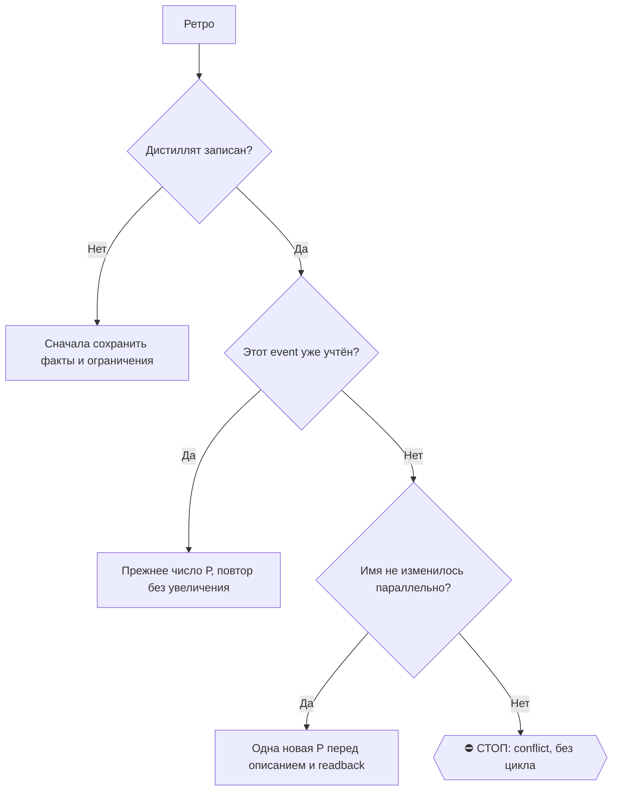

# 2026-10-22 · Посмотрим, какими собеседованиями зовут сейчас. Какие дними, какие собеседования и посмотр…

_Full working session of an LLM coding agent, scrubbed by rule (names kept as stable pseudonyms; surnames, e-mails, phones, street addresses and ages replaced by [ФАМИЛИЯ], [EMAIL], [ТЕЛЕФОН], [АДРЕС], [ВОЗРАСТ]; hosts and keys replaced). Row `s_d04206e5` of the [dataset](https://huggingface.co/datasets/TonyDzi/agent-sessions)._

**User:**

Посмотрим, какими собеседованиями зовут сейчас. Какие дними, какие собеседования и посмотрим, какой улов у нас по откликам, кто зовет меня на собеседование.

---

**Claude:**

RECALL сначала: смотрю хаб найма, базу откликов и календарь/почту.

---

> `Read` -- {"file_path": "C:\\Users\\dev\\.claude\\projects\\P---WORKDIR-HUB\\memory\\hub-job-search.md"}

---

> `Glob` -- {"pattern": "**/jobs.db", "path": "D:\\Vault\\_imports"}

---

> `ToolSearch` -- {"query": "select:mcp__s_2292b084__list_events,mcp__s_8e110270__search_threads", "max_results": 5}

---

> `Bash` -- {"command": "cd \"D:/Vault/_imports/jobs-watch\" && python - <<'E'\nimport sqlite3\nc=sqlite3.connect(\"file:jobs.db?mode=ro\",uri=True)\nfor n,s in c.execute(\"select name,sql from sqlite_master where type='table'\"):\n    print(n, c.execute(f\"select count(*) from [{n}]\").fetchone()[0]); print

---

> `mcp__s_2292b084__list_events` -- {"startTime": "2026-10-22T00:00:00", "endTime": "2026-11-12T00:00:00", "orderBy": "startTime", "pageSize": 100}

---

> `Bash` -- {"command": "cd \"D:/Vault/_imports/jobs-watch\" && python - <<'E'\nimport sqlite3\nc=sqlite3.connect(\"file:jobs.db?mode=ro\",uri=True)\nprint(\"now\",c.execute(\"select datetime('now')\").fetchone())\nfor r in c.execute(\"select company,stage,at,when_text,subject,first_seen from interviews orde

---

> `Bash` -- {"command": "python - <<'E'\nimport json\np=r\"C:\\Users\\dev\\.claude\\projects\\P---WORKDIR-HUB\\s_d04206e5\\tool-results\\mcp-s_2292b084-list_events-1792684592690.txt\"\nd=json.load(open(p,encoding=\"utf8\"))\nimport re\nfor e in 

---

> `mcp__s_8e110270__search_threads` -- {"query": "newer_than:10d (interview OR \"next steps\" OR \"schedule a call\" OR \"intro call\" OR \"screening\" OR \"hiring manager\" OR \"we'd like to\" OR availability) -category:promotions", "pageSize": 40}

---

> `Bash` -- {"command": "cd \"D:/Vault/_imports/jobs-watch\" && python - <<'E'\nimport sqlite3\nc=sqlite3.connect(\"file:jobs.db?mode=ro\",uri=True)\nprint(\"rejected last 14d by last_seen/applied:\")\nfor r in c.execute(\"select substr(applied,1,10),company,title,status from ats_jobs where status in ('rejec

---

> `mcp__s_2292b084__list_calendars` -- {}

---

> `mcp__s_2292b084__search_events` -- {"query": "interview"}

---

> `Bash` -- {"command": "cd \"D:/Vault/_imports/jobs-watch\" && ls -la --time-style=long-iso | head -30; python - <<'E'\nimport sqlite3\nc=sqlite3.connect(\"file:jobs.db?mode=ro\",uri=True)\nprint(c.execute(\"select max(first_seen),max(last_seen) from interviews, (select max(last_seen) last_seen from ats_job

---

> `mcp__s_2292b084__list_events` -- {"calendarId": "[EMAIL]", "startTime": "2026-10-13T00:00:00", "endTime": "2026-11-10T00:00:00", "orderBy": "startTime", "pageSize": 40}

---

**Claude:**

Читаю календарь bb@ за 13.10–10.11, ищу в нём собеседования. Это последний шаг перед сводкой.

---

> `Bash` -- {"command": "python - <<'E'\nimport json\np=r\"C:\\Users\\dev\\.claude\\projects\\P---WORKDIR-HUB\\s_d04206e5\\tool-results\\mcp-s_2292b084-list_events-1792684630495.txt\"\nd=json.load(open(p,encoding=\"utf8\"))\nev=d[\"events\"]\npr

---

> `Bash` -- {"command": "python - <<'E'\nimport json\np=r\"C:\\Users\\dev\\.claude\\projects\\P---WORKDIR-HUB\\s_d04206e5\\tool-results\\mcp-s_2292b084-list_events-1792684630495.txt\"\nprint(json.load(open(p,encoding=\"utf8\"))[\"nextPageToken\"

---

> `mcp__s_2292b084__search_events` -- {"calendarId": "[EMAIL]", "query": "интервью"}

---

> `mcp__s_2292b084__list_events` -- {"calendarId": "[EMAIL]", "startTime": "2026-10-20T18:00:00", "endTime": "2026-11-10T00:00:00", "fullText": "интервью", "orderBy": "startTime", "pageSize": 20}

---

> `mcp__s_2292b084__list_events` -- {"calendarId": "[EMAIL]", "startTime": "2026-10-20T18:00:00", "endTime": "2026-11-10T00:00:00", "fullText": "interview", "orderBy": "startTime", "pageSize": 20}

---

**Claude:**

Свежих приглашений на собеседования с 20.10 нет. Сейчас в календаре ни одного будущего интервью. Но полностью я это не проверил, оговорки ниже.

## Кто звал на собеседования

Сведения из таблицы `interviews` в `jobs.db` и из календаря bb@. Таблица последний раз обновлялась 14.10.

| Компания и роль | Что было | Статус |
|---|---|---|
| **OneTrust**, Staff SWE AI Governance | рекрутёр Jamie Overton запросил слоты 12–13.10, скрин назначен на **15.10 в 22:00** по Лиссабону | прошёл, итога в базе нет |
| **AIUC**, Member of Technical Staff, $200–400K | созвон с сооснователем Rune Kvist, 15 минут, **12.10** | прошёл, «next steps» от них шли до 8.10 |
| **CoreWeave**, Senior SWE в Weave (W&B) | рекрутёрский скрин 30 минут, **9.10** | прошёл, письмо «Next steps with CoreWeave» от 6.10 |
| **Lambda Labs** | 16.09 и 21.09, плюс интервью с hiring manager | прошёл, итога в базе нет |
| **Nango**, DevRel (Founding) | 16.09, 15 минут | прошёл, по теме переписка до 2.10 |
| **Kong**, Forward Deployed Engineer | четыре приглашения на скрининг-сессию (9, 12, 15, 18.09) | это приглашения пройти скрининг, не живой звонок, ответа от меня не видно |

## Улов по откликам

- **Всего отправлено 1 296** (статус `applied`). 479 из них за последние две недели, с 8.10.
- **Темп упал.** 10–18.10 уходило по 34–60 откликов в день. 19.10 было 19, 20.10 — 2, 21.10 — 6, сегодня 5.
- **Больше всего за две недели:** Anthropic (29), Scale AI (19), Glean (19), Together AI, Tenstorrent и CoreWeave (по 16), Waymo и LangChain (по 15), xAI (14).
- **Отказов 283 всего**, из них около 40 за неделю 11–21.10. Это Scale AI, HiddenLayer, Snorkel, Nebius, Openrouter, Vercel, Point72 и другие.
- **Ответ от компании пока дали OneTrust (скрин состоялся), AIUC, CoreWeave и Lambda.** Из свежей волны вакансий только OneTrust дошла до живого разговора. Отклик в Weave (W&B) тоже висит как `scheduled`.
- **Не подано:** 32 182 вакансии в статусе `new`, ещё около 1 700 заблокированы вопросами, капчей, ошибками форм и другим.

## Чего я не проверил

- **Приглашения с 14.10 по 22.10.** Таблица интервью после 14.10 не пополнялась. Gmail-коннектор здесь смотрит только в ящик a2@, а приглашения приходят в a@ и bb@. Календарь bb@ с 13.10 по 20.10 просмотрен, там только OneTrust. С 20.10 по 10.11 календарь пуст по слову «интервью» и «interview».
- **Итоги прошедших звонков** (OneTrust, AIUC, CoreWeave, Lambda): ответов или отказов в моих данных нет.
- **Почему упал темп откликов с 19.10.** Причину не искал.

Могу разобрать ящики a@ и bb@ за последние 8 дней и сверить итоги по четырём компаниям, а отдельно посмотреть, что остановило отправку откликов. Скажи, что из этого нужно, и я начну.

🧒 **Простыми словами**
Звали пять компаний: OneTrust, AIUC, CoreWeave, Lambda и Nango. Ещё Kong прислал приглашения на скрининг. Заявок отправлено около 1 300, отказов 283. Свежих приглашений на будущие звонки я не нашёл, но две почты (a@ и bb@) мне отсюда не видны. Поэтому «ничего нового» пока не значит «точно ничего нет».

🎙 Майк: воронка сработала на четырёх компаниях из тысячи с лишним откликов, а последние три дня мы почти не подаёмся. Это стоит выяснить раньше, чем почту.

🏛H · Sonnet 5.5 · 97846

Время: 22.10.2026, 16:5x по Лиссабону

---

**User:**

<local-command-caveat>The command below was run directly in Claude Code, not sent to you as a request, and its output goes straight to the user. It's recorded here as context for later messages.</local-command-caveat>

---

**User:**

<command-name>/model</command-name>
            <command-message>model</command-message>
            <command-args>claude-opus-5-5</command-args>

---

**User:**

<local-command-stdout>Set model to `claude-opus-5-5`</local-command-stdout>

---

**User:**

чини корни!

---

**User:**

<command-message>workflow-authoring</command-message>
<command-name>workflow-authoring</command-name>
<skill-format>true</skill-format>

---

**User:**

# Workflow authoring reference

A workflow structures work across many agents — to be comprehensive (decompose and cover in parallel), to be confident (independent perspectives and adversarial checks before committing), or to take on scale one context can't hold (migrations, audits, broad sweeps). The script is where you encode that structure: what fans out, what verifies, what synthesizes.

When you do call it, the right move is often **hybrid**: scout inline first (list the files, find the channels, scope the diff) to discover the work-list, then call Workflow to pipeline over it. You don't need to know the shape before the *task* — only before the *orchestration step*.

Common single-phase workflows you can chain across turns:
- **Understand** — parallel readers over relevant subsystems → structured map
- **Design** — judge panel of N independent approaches → scored synthesis
- **Review** — dimensions → find → adversarially verify (the review-changes example)
- **Research** — multi-modal sweep → deep-read → synthesize
- **Migrate** — discover sites → transform each (worktree isolation) → verify

For larger work, run several in sequence — read each result before deciding the next phase. You stay in the loop; each workflow is one well-scoped fan-out.

**Ultracode.** When a system-reminder confirms ultracode is on, that opt-in is standing: author and run a workflow for every substantive task by default. The goal is the most exhaustive, correct answer you can produce — token cost is not a constraint. For multi-phase work (understand → design → implement → review), that often means several workflows in sequence — one per phase — so you stay in the loop between them. The quality patterns below (adversarial verify, multi-modal sweep, completeness critic, loop-until-dry) are the tools; pick what fits the task. Lean toward orchestrating with workflows and adversarially verifying your findings — unless the work is trivial or already verified. Solo only on conversational turns or trivial mechanical edits. When a reminder says ultracode is off, revert to the opt-in rule in the Workflow tool description.

Pass the script inline via `script` — do not Write it to a file first. Every invocation automatically persists its script to a file under the session directory and returns the path in the tool result. To iterate on a workflow, edit that file with Write/Edit and re-invoke Workflow with `{scriptPath: "<path>"}` instead of resending the full script.

Every script must begin with `export const meta = {...}`:
  export const meta = {
    name: 'find-flaky-tests',
    description: 'Find flaky tests and propose fixes',   // one-line, shown in permission dialog
    phases: [                                            // one entry per phase() call
      { title: 'Scan', detail: 'grep test logs for retries' },
      { title: 'Fix', detail: 'one agent per flaky test' },
    ],
  }
  // script body starts here — use agent()/parallel()/pipeline()/phase()/log()
  phase('Scan')
  const flaky = await agent('grep CI logs for retry markers', {schema: FLAKY_SCHEMA})
  ...

The `meta` object must be a PURE LITERAL — no variables, function calls, spreads, or template interpolation. Required fields: `name`, `description`. Optional: `whenToUse` (shown in the workflow list), `phases`. Use the SAME phase titles in meta.phases as in phase() calls — titles are matched exactly; a phase() call with no matching meta entry just gets its own progress group. Add `model` to a phase entry when that phase uses a specific model override.

Script body hooks:
- agent(prompt: string, opts?: {label?: string, phase?: string, schema?: object, model?: string, effort?: string, isolation?: 'worktree', agentType?: string}): Promise<any> — spawn a subagent. Without schema, returns its final text as a string. With schema (a JSON Schema), the subagent is forced to call a StructuredOutput tool and agent() returns the validated object — no parsing needed. Returns null if the user skips the agent mid-run or the subagent dies on a terminal API error after retries (filter with .filter(Boolean)). opts.label overrides the display label. opts.phase explicitly assigns this agent to a progress group (use this inside pipeline()/parallel() stages to avoid races on the global phase() state — same phase string → same group box). opts.model overrides the model for this agent call. Default to omitting it — the agent inherits the main-loop model (the resolved session model), which is almost always correct. Only set it when you're highly confident a different tier fits the task; when unsure, omit. opts.effort overrides the reasoning effort for this agent call ('low' | 'medium' | 'high' | 'xhigh' | 'max') — omit to inherit the session effort; use 'low' for cheap mechanical stages and higher tiers only for the hardest verify/judge stages. opts.isolation: 'worktree' runs the agent in a fresh git worktree — EXPENSIVE (~200-500ms setup + disk per agent), use ONLY when agents mutate files in parallel and would otherwise conflict; the worktree is auto-removed if unchanged. opts.agentType uses a custom subagent type (e.g. 'general-purpose', 'code-reviewer') instead of the default workflow subagent — resolved from the same registry as the Agent tool; composes with schema (the custom agent's system prompt gets a StructuredOutput instruction appended).
- pipeline(items, stage1, stage2, ...): Promise<any[]> — run each item through all stages independently, NO barrier between stages. Item A can be in stage 3 while item B is still in stage 1. This is the DEFAULT for multi-stage work. Wall-clock = slowest single-item chain, not sum-of-slowest-per-stage. Every stage callback receives (prevResult, originalItem, index) — use originalItem/index in later stages to label work without threading context through stage 1's return value. A stage that throws drops that item to `null` and skips its remaining stages.
- parallel(thunks: Array<() => Promise<any>>): Promise<any[]> — run tasks concurrently. This is a BARRIER: awaits all thunks before returning. A thunk that throws (or whose agent errors) resolves to `null` in the result array — the call itself never rejects, so `.filter(Boolean)` before using the results. Use ONLY when you genuinely need all results together.
- log(message: string): void — emit a progress message to the user (shown as a narrator line above the progress tree)
- phase(title: string): void — start a new phase; subsequent agent() calls are grouped under this title in the progress display
- args: any — the value passed as Workflow's `args` input, verbatim (undefined if not provided). Pass arrays/objects as actual JSON values in the tool call, NOT as a JSON-encoded string — `args: ["a.ts", "b.ts"]`, not `args: "[\"a.ts\", ...]"` (a stringified list reaches the script as one string, so `args.filter`/`args.map` throw). Use this to parameterize named workflows — e.g. pass a research question, target path, or config object directly instead of via a side-channel file.
- budget: {total: number|null, spent(): number, remaining(): number} — the turn's token target from the user's "+500k"-style directive. `budget.total` is null if no target was set. `budget.spent()` returns output tokens spent this turn across the main loop and all workflows — the pool is shared, not per-workflow. `budget.remaining()` returns `max(0, total - spent())`, or `Infinity` if no target. The target is a HARD ceiling, not advisory: once `spent()` reaches `total`, further `agent()` calls throw. Use for dynamic loops: `while (budget.total && budget.remaining() > 50_000) { ... }`, or static scaling: `const FLEET = budget.total ? Math.floor(budget.total / 100_000) : 5`.
- workflow(nameOrRef: string | {scriptPath: string}, args?: any): Promise<any> — run another workflow inline as a sub-step and return whatever it returns. Pass a name to invoke a saved workflow (same registry as {name: "..."}), or {scriptPath} to run a script file you Wrote earlier. The child shares this run's concurrency cap, agent counter, abort signal, and token budget — its agents appear under a "▸ name" group in /workflows and its tokens count toward budget.spent(). The args param becomes the child's `args` global. Nesting is one level only: workflow() inside a child throws. Throws on unknown name / unreadable scriptPath / child syntax error; catch to handle gracefully.

Subagents are told their final text IS the return value (not a human-facing message), so they return raw data. For structured output, use the schema option — validation happens at the tool-call layer so the model retries on mismatch.
Schemas need {type: 'object', properties: {...}} at root and required ⊆ properties; unsatisfiable ones throw at agent().

Workflow agents can reach all session-connected MCP tools via ToolSearch — schemas load on demand per agent. Caveat: interactively-authenticated MCP servers (e.g. claude.ai) may be absent in headless/cron runs.

Subagents get the same CLAUDE.md files injected at start that you did (except built-in agent types that omit them, such as Explore and Plan) — don't tell them to re-read those or paste their rules into the prompt; name the specific rule a stage needs, if any.

Scripts are plain JavaScript, NOT TypeScript — type annotations (`: string[]`), interfaces, and generics fail to parse. The script body runs in an async context — use await directly. Standard JS built-ins (JSON, Math, Array, etc.) are available — EXCEPT `Date.now()`/`Math.random()`/argless `new Date()`, which throw (they would break resume); pass timestamps in via `args`, stamp results after the workflow returns, and for randomness vary the agent prompt/label by index. No filesystem or Node.js API access.

DEFAULT TO pipeline(). Only reach for a barrier (parallel between stages) when you genuinely need ALL prior-stage results together.

A barrier is correct ONLY when stage N needs cross-item context from all of stage N-1:
- Dedup/merge across the full result set before expensive downstream work
- Early-exit if the total count is zero ("0 bugs found → skip verification entirely")
- Stage N's prompt references "the other findings" for comparison

A barrier is NOT justified by:
- "I need to flatten/map/filter first" — do it inside a pipeline stage: pipeline(items, stageA, r => transform([r]).flat(), stageB)
- "The stages are conceptually separate" — that's what pipeline() models. Separate stages ≠ synchronized stages.
- "It's cleaner code" — barrier latency is real. If 5 finders run and the slowest takes 3× the fastest, a barrier wastes 2/3 of the fast finders' idle time.

Smell test: if you wrote
  const a = await parallel(...)
  const b = transform(a)        // flatten, map, filter — no cross-item dependency
  const c = await parallel(b.map(...))
that middle transform doesn't need the barrier. Rewrite as a pipeline with the transform inside a stage. When in doubt: pipeline.

Concurrent agent() calls are capped at min(16, available CPUs - 2) per workflow — excess calls queue and run as slots free up. You can still pass 100 items to parallel()/pipeline() and they all complete; only ~10 run at any moment. Total agent count across a workflow's lifetime is capped at 1000 — a runaway-loop backstop set far above any real workflow. A single parallel()/pipeline() call accepts at most 4096 items; passing more is an explicit error, not a silent truncation.

When a barrier IS correct — dedup across all findings before expensive verification:
  const all = await parallel(DIMENSIONS.map(d => () => agent(d.prompt, {schema: FINDINGS_SCHEMA})))
  const deduped = dedupeByFileAndLine(all.filter(Boolean).flatMap(r => r.findings))  // <-- genuinely needs ALL at once
  const verified = await parallel(deduped.map(f => () => agent(verifyPrompt(f), {schema: VERDICT_SCHEMA})))

Loop-until-count pattern — accumulate to a target:
  const bugs = []
  while (bugs.length < 10) {
    const result = await agent("Find bugs in this codebase.", {schema: BUGS_SCHEMA})
    bugs.push(...result.bugs)
    log(`${bugs.length}/10 found`)
  }

Loop-until-budget pattern — scale depth to the user's "+500k" directive. Guard on budget.total: with no target set, remaining() is Infinity and the loop would run straight to the 1000-agent cap.
  const bugs = []
  while (budget.total && budget.remaining() > 50_000) {
    const result = await agent("Find bugs in this codebase.", {schema: BUGS_SCHEMA})
    bugs.push(...result.bugs)
    log(`${bugs.length} found, ${Math.round(budget.remaining()/1000)}k remaining`)
  }

Composing patterns — exhaustive review (find → dedup vs seen → diverse-lens panel → loop-until-dry):
  const seen = new Set(), confirmed = []
  let dry = 0
  while (dry < 2) {                                              // loop-until-dry
    const found = (await parallel(FINDERS.map(f => () =>          // barrier: collect all finders this round
      agent(f.prompt, {phase: 'Find', schema: BUGS})))).filter(Boolean).flatMap(r => r.bugs)
    const fresh = found.filter(b => !seen.has(key(b)))           // dedup vs ALL seen — plain code, not an agent
    if (!fresh.length) { dry++; continue }
    dry = 0; fresh.forEach(b => seen.add(key(b)))
    const judged = await parallel(fresh.map(b => () =>           // every fresh bug judged concurrently...
      parallel(['correctness','security','repro'].map(lens => () =>   // ...each by 3 distinct lenses
        agent(`Judge "${b.desc}" via the ${lens} lens — real?`, {phase: 'Verify', schema: VERDICT})))
        .then(vs => ({ b, real: vs.filter(Boolean).filter(v => v.real).length >= 2 }))))
    confirmed.push(...judged.filter(v => v.real).map(v => v.b))
  }
  return confirmed
  // dedup vs `seen`, NOT `confirmed` — else judge-rejected findings reappear every round and it never converges.

Quality patterns — common shapes; pick by task and compose freely:
- Adversarial verify: spawn N independent skeptics per finding, each prompted to REFUTE. Kill if ≥majority refute. Prevents plausible-but-wrong findings from surviving.
    const votes = await parallel(Array.from({length: 3}, () => () =>
      agent(`Try to refute: ${claim}. Default to refuted=true if uncertain.`, {schema: VERDICT})))
    const survives = votes.filter(Boolean).filter(v => !v.refuted).length >= 2
- Perspective-diverse verify: when a finding can fail in more than one way, give each verifier a distinct lens (correctness, security, perf, does-it-reproduce) instead of N identical refuters — diversity catches failure modes redundancy can't.
- Judge panel: generate N independent attempts from different angles (e.g. MVP-first, risk-first, user-first), score with parallel judges, synthesize from the winner while grafting the best ideas from runners-up. Beats one-attempt-iterated when the solution space is wide.
- Loop-until-dry: for unknown-size discovery (bugs, issues, edge cases), keep spawning finders until K consecutive rounds return nothing new. Simple counters (while count < N) miss the tail.
- Multi-modal sweep: parallel agents each searching a different way (by-container, by-content, by-entity, by-time). Each is blind to what the others surface; useful when one search angle won't find everything.
- Completeness critic: a final agent that asks "what's missing — modality not run, claim unverified, source unread?" What it finds becomes the next round of work.
- No silent caps: if a workflow bounds coverage (top-N, no-retry, sampling), `log()` what was dropped — silent truncation reads as "covered everything" when it didn't.

Scale to what the user asked for. "find any bugs" → a few finders, single-vote verify. "thoroughly audit this" or "be comprehensive" → larger finder pool, 3–5 vote adversarial pass, synthesis stage. When unsure, lean toward thoroughness for research/review/audit requests and toward brevity for quick checks.

These patterns aren't exhaustive — compose novel harnesses when the task calls for it (tournament brackets, self-repair loops, staged escalation, whatever fits).

Use this tool for multi-step orchestration where control flow should be deterministic (loops, conditionals, fan-out) rather than model-driven.

## Resume

The tool result includes a runId. To resume after a pause, kill, or script edit, relaunch with Workflow({scriptPath, resumeFromRunId}) — the longest unchanged prefix of agent() calls returns cached results instantly; the first edited/new call and everything after it runs live. Same script + same args → 100% cache hit. Before diagnosing why a completed workflow returned an empty or unexpected result, Read <transcriptDir>/journal.jsonl — it records each agent's actual return value; do not assume cached results are non-empty. Date.now()/Math.random()/new Date() are unavailable in scripts (they would break this) — stamp results after the workflow returns, or pass timestamps via args. Fallback when no journal is available: Read agent-<id>.jsonl files in the transcript directory and hand-author a continuation script.

---

**Claude:**

Чиню два корня: (1) сторож интервью молчит с 14.10, (2) отклики упали с 19.10. Сначала разведка, потом веер агентов.

---

> `Grep` -- {"pattern": "CREATE TABLE IF NOT EXISTS interviews|INSERT OR IGNORE INTO interviews|INTO interviews", "path": "D:\\Vault\\_imports", "glob": "*.py", "output_mode": "files_with_matches"}

---

> `PowerShell` -- {"command": "Get-ScheduledTask | Where-Object { $_.TaskName -match 'job|apply|interview|ats|neo|pipe' } | ForEach-Object { $i = $_ | Get-ScheduledTaskInfo; \"{0} | {1} | last={2} | rc={3} | next={4}\" -f $_.TaskName,$_.State,$i.LastRunTime,$i.LastTaskResult,$i.NextRunTime }", "description": "List jo

---

**Claude:**

`Pipe-A-Invite-Sentinel` падает с кодом 1. Смотрю, что он запускает и что пишет.

---

> `PowerShell` -- {"command": "foreach($n in 'Pipe-A-Invite-Sentinel','pipe-a-night','pipe-a-discover'){ $t=Get-ScheduledTask -TaskName $n; \"== $n\"; $t.Actions | % { \"$($_.Execute) $($_.Arguments) [cwd=$($_.WorkingDirectory)]\" }; $t.Triggers | % { $_.Repetition.Interval } }; Get-Date", "description": "Show action

---

> `Bash` -- {"command": "cd \"D:/Vault/_imports/jobs-watch\" && python pipe_a_invite_sentinel.py; echo \"rc=$?\"; echo ----; tail -40 pipe_a_night.log; echo ----; ls -la --time-style=long-iso *.log | sort -k6,7 | tail -15; grep -n \"interview_watch\" -r --include=*.py . | head", "description": "Run sentinel,

---

> `Workflow` -- {"script": "export const meta = {\n  name: 'pipe-a-roots',\n  description: 'Diagnose 3 roots of Pipe A job pipeline (stale interview counter, apply drop, invite signal path), adversarially verify, propose fixes',\n  phases: [{ title: 'Diagnose' }, { title: 'Verify' }],\n}\nconst DIR = 'D:/Vault/_

---

> `Bash` -- {"command": "cd \"D:/Vault/_imports/jobs-watch\" && sed -n 1,60p gmail_home.py | head -60; python gmail_home.py --help 2>&1 | head -20", "description": "Check gmail_home.py usage for reading a@ mail"}

---

> `Bash` -- {"command": "cd \"C:/Users/dev/!CLAUDE-NODE-0X May26/gmail\" && grep -n \"^def \" gmail_common.py | head -40", "description": "List gmail_common functions"}

---

> `Bash` -- {"command": "cd \"C:/Users/dev/!CLAUDE-NODE-0X May26/gmail\" && python - <<'E'\nimport sys,base64\nsys.path.insert(0,\".\")\nimport gmail_common as g\nprint(g.available_labels())\nfor lab in g.available_labels():\n    s=g.get_service(lab)\n    try: m=s.users().messages().get(userId=\"me\",id=\"1a15ba

---

**Claude:**

В треде два сообщения, второе от dev.D. Возможно, ответ уже ушёл. Проверяю.

---

> `Bash` -- {"command": "cd \"C:/Users/dev/!CLAUDE-NODE-0X May26/gmail\" && python - <<'E'\nimport sys,base64\nsys.path.insert(0,\".\")\nimport gmail_common as g\ns=g.get_service(\"a\")\nth=s.users().threads().get(userId=\"me\",id=\"1a15ba54de77ab60\",format=\"full\").execute()\nm=th[\"messages\"][1]\nh={x[\"nam

---

> `Bash` -- {"command": "cd \"D:/Vault/_imports/jobs-watch\" && grep -n \"Inflection\\|inflection\" -r --include=*.jsonl --include=*.json -l . ~/.claude/state 2>/dev/null | head; grep -rn \"I live in Palo Alto\\|located in the San Francisco\\|Bay Area\" --include=*.py . 2>/dev/null | head -8", "description":

---

> `Bash` -- {"command": "sed -n 1,80p \"D:/Vault/_imports/jobs-watch/pipe_a_invite_sentinel.py\"; grep -n \"def \\|SENT\\|replied\\|thread\" \"D:/Vault/_imports/jobs-watch/pipe_a_invite_sentinel.py\" | head -60", "description": "Read sentinel header and reply-detection logic"}

---

**Claude:**

Корень сторожа: живое письмо закрывается только вручную командой `--close`, а отправленный ответ в треде он не учитывает. Поэтому отвеченное письмо считается висящим, а тревога уходит на шину в баннер `[debt]`, который тонет среди 196 других. Дождусь, что скажут агенты-проверяющие, и только потом буду править.

---

**User:**

Когда закончишь - 
/rr

---

**Claude:**

Принял: сначала дочиню корни, потом сделаю `/rr`. Расследование из трёх агентов ещё идёт в фоне, жду его результатов.

---

**User:**

<task-notification>
<task-id>wb8e63jj1</task-id>
<tool-use-id>toolu_016SdZ1Dx3XVNBZWQJNdA6Cq</tool-use-id>
<output-file>C:\Users\dev\AppData\Local\Temp\claude\P---WORKDIR-HUB\s_d04206e5\tasks\wb8e63jj1.output</output-file>
<status>completed</status>
<summary>Dynamic workflow "Diagnose 3 roots of Pipe A job pipeline (stale interview counter, apply drop, invite signal path), adversarially verify, propose fixes" completed</summary>
<result>[{"key":"interview-counter-stale","diag":{"root_cause":"No scheduled caller exists for `interview_watch.py --write`. The `interviews` table only ever got rows from two manual sessions, on 06.10 and 14.10. Nothing broke on 14.10: that was just the last time someone ran it by hand.\n\nHow it happened:\n1. On 06.10, step 1-bis (`interview_watch` with `--write`) was added to `pipe_a_inbox_watch.py` at lines 281-284. That script's docstring (line 39) names its caller as the routine `pipe-a-inbox-watch`.\n2. That routine is actually an app scheduled task (`C:/Users/dev/.claude/scheduled-tasks/pipe-a-inbox-watch/SKILL.md`, model haiku). On 11.09 it was split into a 0-LLM pregate plus model steps. It now runs only `pipe_a_inbox_pregate.py` (SKILL.md line 10), then `apply_verify` and `interview_calendar_guard`, and does the Gmail work by hand. It never calls `pipe_a_inbox_watch.py` or `interview_watch.py`.\n3. No Windows task calls either script. The only tasks that touch jobs-watch are pipe-a-night, pipe-a-discover and Pipe-A-Invite-Sentinel.\n\nAs a result the whole harvest script has had no caller since it was built. `interview_watch --write`, `apply_reconcile --write` and `pilot_receipts --write` have all been dead. The routine itself is alive and succeeds every day.\n\nWhy nobody noticed:\n- The orphan detector does list both scripts as orphans, but they are in its baseline, and a baselined orphan raises no alarm.\n- Pipe-A-Invite-Sentinel checks `ats_jobs.status='interview'` and `pipe_a_live_open.json`, not how fresh the `interviews` table is.\n\nMailbox and auth are not the cause. `interview_watch` reads only mailbox a@ (`--label a`, path from `gmail_home`: `C:/Users/dev/!CLAUDE-NODE-0X May26/gmail`), and the a@ token works: a live read-only search on 22.10 returned rc=0.\n\nTwo secondary defects:\n- (a) `GMAIL_QUERY` in `interview_watch.py` (lines 108-112) filters on subject words only. The Inflection subject, \"Quick questions: Member of Technical Staff, Backend at Inflection\", matches none of them, so a scheduled `interview_watch` would still miss it.\n- (b) The sentinel is RED only because the Inflection email (id 1a15ba54de77ab60) was answered on 21.10 and 22.10 but never closed with `pipe_a_inbox_pregate.py --close`. That is a gap in the routine's procedure, not live mail going unhandled.","evidence":["The interviews table has 47 rows and max(first_seen) = 2026-10-14T11:07:37. Grouped by hour: 2026-10-06T00 = 40 rows, 2026-10-14T11 = 7 rows (OneTrust, AIUC, CoreWeave). There are only two write events.","The report files match the manual runs: `reports/interview-watch-2026-10-06.md` (06.10 16:55) and `reports/interview-watch-2026-10-14.md` (14.10 11:07). The last `inbox-watch-*.md` from `pipe_a_inbox_watch.py` is dated 2026-10-06.","`pipe_a_inbox_watch.py:281-284` builds `iw_argv = ['interview_watch.py', ...]` and adds `--write` unless dry-run. Line 39 of the docstring says it is called by the routine `pipe-a-inbox-watch`.","`list_scheduled_tasks` shows taskId pipe-a-inbox-watch, enabled, cron `0 9 * * *`, lastRunAt 2026-10-22T08:08. `list_task_runs` shows succeeded runs from 11.10 through 22.10; only 10.10 and 03.10 failed (weekly limit).","That SKILL.md calls only `pipe_a_inbox_pregate.py` (line 10), `interview_calendar_guard.py` (line 97), `apply_verify.py --days 14` (line 107) and `ats_status.py`. Grep for `pipe_a_inbox_watch|interview_watch` across `~/.claude/scheduled-tasks/*/SKILL.md`, `pipe_a_night.py` and `pipe_a_inbox_pregate.py` returns nothing.","Get-ScheduledTask filtered on actions matching `inbox_watch|jobs-watch` returns only pipe-a-discover, Pipe-A-Invite-Sentinel and pipe-a-night. None of them runs `interview_watch` or `pipe_a_inbox_watch`.","The only code that writes the table is `interview_watch.py:345` (`INSERT OR REPLACE INTO interviews`, run from `write_rows` in `main()` only when `a.write` is set).","Both scripts are baselined in the orphan detector: `C:/Users/dev/.claude/scripts/_shared/_orphan_engines_baseline.json:798` lists `pipe_a_inbox_watch.py`, and `_orphan_engines_state.json:669` lists `interview_watch.py`.","A subagent transcript from 2026-10-15T04:37 (`agent-a619c1b24c04ed6f8.jsonl`) already recorded that `interview_watch --write` had not been called since 06.10. The finding was noted but never wired into a scheduled caller.","The Gmail rail works: `gmail_check.py search 'newer_than:2d (interview OR inflection)' --label a --max 10` returned rc=0 and 8 messages, including Dylan Arndt (Turing, 22.10) and Shea Helms (Inflection, 20.10 23:28). dev's replies went out 21.10 18:26 and 22.10 01:11.","The subject-only filter at `interview_watch.py:108-112` contains no term that matches the Inflection subject.","Sentinel state (`pipe_a_invite_sentinel.json`, 19:31) is RED with a single alarm: `[live:1a15ba54de77ab60]` for the Inflection email, 'no move for 18 h', last_routine 2026-10-22T09:08. The routine runlog for 22.10 says the Inflection reply was sent, but there was no `--close`.","`pipe_a_invite_sentinel.py:155-158` (`open_interviews`) reads only `ats_jobs WHERE status='interview'` and never checks the `interviews` table."],"is_defect":true,"fix":"Fix the root with a deterministic scheduled caller: a 0-LLM Windows task, rather than another prompt line for the haiku routine.\n\n1. Create a Windows task \"Pipe-A-Harvest\" on the hub, daily at 09:40, after the 09:08 routine. Action:\n`cmd.exe /c cd /d D:\\Vault\\_imports\\jobs-watch &amp;&amp; C:\\Users\\dev\\AppData\\Local\\Programs\\Python\\Python312\\python.exe -u pipe_a_inbox_watch.py --days 7 --no-report &gt; D:\\Vault\\_imports\\jobs-watch\\pipe_a_inbox_watch.log 2&gt;&amp;1`\nThis one task restores `interview_watch --write`, `apply_reconcile --write` and `pilot_receipts --write`.\nRollback: `Disable-ScheduledTask Pipe-A-Harvest`.\nFix the docstring at `pipe_a_inbox_watch.py:39` to name the real caller, Pipe-A-Harvest.\n\n2. Remove `pipe_a_inbox_watch.py` and `interview_watch.py` from `_orphan_engines_baseline.json` and the state file, so the detector can see them again.\n\n3. Add a freshness guard to `pipe_a_invite_sentinel.py`, in `main()` before `return 1 if conds else 0`. Alarm when `reports/inbox-watch-&lt;today or yesterday&gt;.md` is missing, or when `pipe_a_inbox_watch.log` is more than 30 h old. That judges the output, not whether the task was launched.\n\n4. Secondary, in `interview_watch.py`: widen `GMAIL_QUERY` (lines 108-112) with `OR subject:\"quick questions\" OR subject:\"your application\"`. Also feed in the pregate's tierA/live buckets, which are sender-based, so a human reply with an odd subject (Inflection) is not missed.\n\n5. Secondary, in `pipe-a-inbox-watch/SKILL.md` step 3: after any reply sent through `gmail_check.py send`, require `python ~/.claude/scripts/pipe_a_inbox_pregate.py --close &lt;id&gt; \"replied &lt;date&gt;\"`. Close 1a15ba54de77ab60 now, since the reply already went out.\n\nAll of these are writes, so they need a session with write permission; this run was read-only.","red_test":"Add `D:/Vault/_imports/jobs-watch/_test_harvest_wiring.py` (0 LLM, read-only).\n\n- W1: run `powershell Get-ScheduledTask` and fail unless at least one task in state Ready or Running has an action string containing `pipe_a_inbox_watch.py` or `interview_watch.py --write`. It is RED today: the only matching tasks are pipe-a-discover, sentinel and night, and none of them runs it.\n- W2: open jobs.db with `mode=ro` and fail if the newest `reports/inbox-watch-*.md` is more than 30 h old while the `pipe-a-inbox-watch` runlog has a WAKE entry within the last 24 h. It is RED today: the last report is dated 06.10 and there was a WAKE on 22.10.\n- W3: unit-test `interview_watch.scan` with a synthetic message whose subject is 'Quick questions: Member of Technical Staff, Backend at Inflection', sent from [EMAIL], and assert it is included in the query or the pregate merge. It is RED with the current `GMAIL_QUERY`.\n\nRed pr
... (truncated 40044 chars, full result in C:\Users\dev\AppData\Local\Temp\claude\P---WORKDIR-HUB\s_d04206e5\tasks\wb8e63jj1.output)</result>
<diagnostics>Per-agent results: C:\Users\dev\.claude\projects\P---WORKDIR-HUB\s_d04206e5\subagents\workflows\wf_6c649211-5f8/journal.jsonl — one {"type":"result",...} line per completed agent with its full return value.
If the result above is empty or unexpected, Read this file BEFORE diagnosing — do not assume agents returned non-empty results.
To re-run with edited post-processing: Workflow({scriptPath: 'C:\Users\dev\.claude\projects\E--Obsidian--imports-jobs-watch\s_d04206e5\workflows\scripts\pipe-a-roots-wf_6c649211-5f8.js', resumeFromRunId: 'wf_6c649211-5f8'}) — agents whose (prompt, opts) are unchanged replay from cache.</diagnostics>
<usage><agent_count>9</agent_count><agents_done>9</agents_done><agents_error>0</agents_error><agents_skipped>0</agents_skipped><agents_empty_result>0</agents_empty_result><subagent_tokens>1315140</subagent_tokens><tool_uses>149</tool_uses><duration_ms>894064</duration_ms></usage>
</task-notification>

---

**Claude:**

Читаю остальные выводы и вердикты проверяющих.

---

> `Bash` -- {"command": "python - <<'E'\nimport json\np=r\"C:\\Users\\dev\\AppData\\Local\\Temp\\claude\\P---WORKDIR-HUB\\s_d04206e5\\tasks\\wb8e63jj1.output\"\nt=open(p,encoding=\"utf8\").read()\ni=t.find('[{\"key\"'); d=json.loads(t[i:t.rfind(']')+1]) if i>=0 else None

---

> `Bash` -- {"command": "python - <<'E'\nimport json\np=r\"C:\\Users\\dev\\AppData\\Local\\Temp\\claude\\P---WORKDIR-HUB\\s_d04206e5\\tasks\\wb8e63jj1.output\"\nd=json.load(open(p,encoding=\"utf8\"))[\"result\"]\nfor r in d:\n    print(\"=====\",r[\"key\"])\n    if r[\"k

---

> `Bash` -- {"command": "python - <<'E'\nimport json\np=r\"C:\\Users\\dev\\AppData\\Local\\Temp\\claude\\P---WORKDIR-HUB\\s_d04206e5\\tasks\\wb8e63jj1.output\"\nd=json.load(open(p,encoding=\"utf8\"))[\"result\"]\nv=d[2][\"votes\"][1]; print(v[\"reason\"]); print(\"BETTER

---

> `Bash` -- {"command": "cd ~/.claude/scripts && python onair.py --help 2>&1 | head -15; python onair.py declare --zone \"jobs-watch/pipe_a_night+pregate+sentinel\" --mode exclusive 2>&1 | tail -3; python spawn_queue.py --help 2>&1 | head -20", "description": "Declare work zone and check spawn_queue usage"}

---

> `Bash` -- {"command": "cd ~/.claude/scripts && python onair.py declare --zone \"jobs-watch/pipe-a\" --mode exclusive --title \"H97846 чиню корни Трубы А: резерв волны, автозакрытие отвеченных, счётчик интервью\" --code H97846 2>&1 | tail -2; python spawn_queue.py add --help 2>&1 | tail -15", "description": "D

---

> `Bash` -- {"command": "cd ~/.claude/scripts && python onair.py declare --zone \"vault-imports/jobs-watch\" --mode exclusive --title \"H97846 корни Трубы А: резерв волны, автозакрытие отвеченных, счётчик интервью\" --code H97846 2>&1 | tail -2", "description": "Declare onair zone under vault-imports"}

---

> `Read` -- {"file_path": "D:\\Vault\\_imports\\jobs-watch\\pipe_a_night.py", "offset": 535, "limit": 30}

---

> `Bash` -- {"command": "cd \"D:/Vault/_imports/jobs-watch\" && ls _test_pipe_a_night*; grep -n \"O6\\|def test\\|^def \\|reserve\" _test_pipe_a_night_overcap_1016.py | head -30", "description": "Find existing reserve tests"}

---

> `Bash` -- {"command": "cd \"D:/Vault/_imports/jobs-watch\" && grep -n \"^def select\\|select(conn\\|select(c,\" pipe_a_night.py | head; sed -n 95,101p _test_pipe_a_night_overcap_1016.py; cp pipe_a_night.py pipe_a_night.py.bak-reserve-20261022; cp _test_pipe_a_night_overcap_1016.py _test_pipe_a_night_overca

---

**Claude:**

Сначала тест, который должен покраснеть на нынешнем коде:

---

> `Bash` -- {"command": "cd \"D:/Vault/_imports/jobs-watch\" && grep -n \"^print\\|sys.exit\\|FAIL\" _test_pipe_a_night_overcap_1016.py | tail -5; python - <<'E'\nimport importlib.util,sys\nsys.argv=[\"x\"]\nsrc=open(\"_test_pipe_a_night_overcap_1016.py\",encoding=\"utf8\").read()\ni=src.find(\"w6 = P.select

---

> `Edit` -- {"replace_all": false, "file_path": "D:\\Vault\\_imports\\jobs-watch\\_test_pipe_a_night_overcap_1016.py", "old_string": "check(\"O6c без reserve флагов нет\", not any(e.get(\"reserve\") for e in P.select(c, 60)))", "new_string": "check(\"O6c без reserve флагов нет\", not any(e.get(\"reserve\") f

---

> `Bash` -- {"command": "cd \"D:/Vault/_imports/jobs-watch\" && python _test_pipe_a_night_overcap_1016.py 2>&1 | grep -E \"O6|O8|ИТОГ\"; echo rc=$?", "description": "Run test on unfixed code (expect red)"}

---

**Claude:**

Тест красный, как и должен. Чиню:

---

> `Edit` -- {"replace_all": false, "file_path": "D:\\Vault\\_imports\\jobs-watch\\pipe_a_night.py", "old_string": "    if reserve and len(out) > reserve:\n        for e in out[len(out) - reserve:]:\n            e[\"reserve\"] = True", "new_string": "    # резерв = только ПЕРЕЛИВ сверх основной цели (n - rese

---

> `Bash` -- {"command": "cd \"D:/Vault/_imports/jobs-watch\" && python _test_pipe_a_night_overcap_1016.py 2>&1 | grep -E \"FAIL|ИТОГ\"; for t in _test_pipe_a_night*.py; do python $t >/dev/null 2>&1; echo \"$t rc=$?\"; done", "description": "Rerun reserve test and all pipe_a_night tests", "timeout": 300000}

---

**Claude:**

Все восемь наборов тестов `pipe_a_night` зелёные. Прогоняю сегодняшний пул вхолостую, чтобы увидеть эффект:

---

> `Bash` -- {"command": "cd \"D:/Vault/_imports/jobs-watch\" && grep -n \"add_argument\" pipe_a_night.py | head -20", "description": "List pipe_a_night CLI args"}

---

> `Bash` -- {"command": "cd \"D:/Vault/_imports/jobs-watch\" && python - <<'E'\nimport sqlite3,pipe_a_night as P\nc=sqlite3.connect(\"file:jobs.db?mode=ro\",uri=True); c.row_factory=sqlite3.Row\nimport io,contextlib\nfor n,r in ((400,100),):\n    with contextlib.redirect_stdout(io.StringIO()):\n        w=P.s

---

> `Bash` -- {"command": "cd ~/.claude/scripts && grep -n \"^def \\|^    rc, out\\|ledger_update(\\|TimeoutExpired\\|timeout\" pipe_a_inbox_pregate.py | head -70", "description": "Map pregate functions"}

---

> `Read` -- {"file_path": "C:\\Users\\dev\\.claude\\scripts\\pipe_a_inbox_pregate.py", "offset": 270, "limit": 70}

---

> `Read` -- {"file_path": "C:\\Users\\dev\\.claude\\scripts\\pipe_a_inbox_pregate.py", "offset": 715, "limit": 200}

---

> `Bash` -- {"command": "cd \"C:/Users/dev/!CLAUDE-NODE-0X May26/gmail\" && timeout 90 python gmail_check.py search \"inflection.ai newer_than:4d\" --label a --max 5 --json 2>&1 | head -5", "description": "Check fields in gmail_check json output"}

---

> `Bash` -- {"command": "cd ~/.claude/scripts && grep -n \"^PEERS_DAYS\\|^PEERS_MAX\\|^MAX_WINDOW\\|^KNOWN\\|^import\\|^GMAIL\" pipe_a_inbox_pregate.py; ls _test_pipe_a_inbox_pregate*.py; grep -c \"def \\|check(\" _test_pipe_a_inbox_pregate.py; tail -5 _test_pipe_a_inbox_pregate.py; cp pipe_a_inbox_pregate.py p

---

**Claude:**

Пишу автозакрытие отвеченных писем в предгейт. Сначала смотрю, как устроены его тесты.

---

> `Bash` -- {"command": "cd ~/.claude/scripts && sed -n 1,40p _test_pipe_a_inbox_pregate.py; grep -n \"^def main\\|^    for \\|AE6\\|^def \" _test_pipe_a_inbox_pregate.py | tail -20", "description": "Read pregate test structure"}

---

> `Bash` -- {"command": "cd ~/.claude/scripts && sed -n '/^def main/,$p' _test_pipe_a_inbox_pregate.py | head -30", "description": "Read test main()"}

---

> `Bash` -- {"command": "cd ~/.claude/scripts && grep -n \"panel_findings_cases()\\|wake_line_cases()\\|FAILS else\\|return 1\\|ИТОГ\" _test_pipe_a_inbox_pregate.py | tail -8", "description": "Find end of test main"}

---

**Claude:**

Добавляю тест на автозакрытие. Он должен покраснеть, пока функции ещё нет:

---

> `Edit` -- {"replace_all": false, "file_path": "C:\\Users\\dev\\.claude\\scripts\\_test_pipe_a_inbox_pregate.py", "old_string": "    wake_line_cases()\n    panel_findings_cases()", "new_string": "    wake_line_cases()\n    panel_findings_cases()\n    answered_cases()"}

---

> `Bash` -- {"command": "cd ~/.claude/scripts && cat >> _test_pipe_a_inbox_pregate.py.part <<'E'\n\n\ndef answered_cases():\n    \"\"\"AN) ПИСЬМО, НА КОТОРОЕ МЫ УЖЕ ОТВЕТИЛИ, НЕ ЖИВОЕ (оплачено 22.10, Inflection 1a15ba54).\n\n    Память живых писем закрывалась только рукой (--close). Ответ ушёл 21.10, смена 22.

---

> `Edit` -- {"replace_all": false, "file_path": "C:\\Users\\dev\\.claude\\scripts\\_test_pipe_a_inbox_pregate.py", "old_string": "if __name__ == \"__main__\":\n    sys.exit(main())", "new_string": "def answered_cases():\n    \"\"\"AN) ПИСЬМО, НА КОТОРОЕ МЫ УЖЕ ОТВЕТИЛИ, НЕ ЖИВОЕ (оплачено 22.10, Inflection 1a

---

> `Bash` -- {"command": "cd ~/.claude/scripts && python _test_pipe_a_inbox_pregate.py 2>&1 | tail -4", "description": "Run pregate tests (expect red)"}

---

**Claude:**

Тест красный. Пишу саму логику в предгейт:

---

> `Edit` -- {"replace_all": false, "file_path": "C:\\Users\\dev\\.claude\\scripts\\pipe_a_inbox_pregate.py", "old_string": "        mails.append({\"id\": d.get(\"id\", \"\"), \"from\": m.group(1).lower(),\n                      \"subject\": d.get(\"subject\") or \"\",", "new_string": "        mails.append({\"

---

> `Edit` -- {"replace_all": false, "file_path": "C:\\Users\\dev\\.claude\\scripts\\pipe_a_inbox_pregate.py", "old_string": "    p = subprocess.run([sys.executable, GMAIL] + args, cwd=GMAIL_DIR, capture_output=True,\n                       text=True, encoding=\"utf-8\", errors=\"replace\")\n    return p.return

---

> `Edit` -- {"replace_all": false, "file_path": "C:\\Users\\dev\\.claude\\scripts\\pipe_a_inbox_pregate.py", "old_string": "def main():\n    if \"--help\" in sys.argv or \"-h\" in sys.argv:", "new_string": "def _epoch(s):\n    try:\n        import email.utils\n        return email.utils.parsedate_to_datetime(

---

> `Edit` -- {"replace_all": false, "file_path": "C:\\Users\\dev\\.claude\\scripts\\pipe_a_inbox_pregate.py", "old_string": "            \"subject\": m.get(\"subject\", \"\"),\n                          \"bucket\": m.get(\"bucket\", \"\"), \"first_seen\": now, \"closed\": None}", "new_string": "            \"s

---

> `Edit` -- {"replace_all": false, "file_path": "C:\\Users\\dev\\.claude\\scripts\\pipe_a_inbox_pregate.py", "old_string": "\"subject\": m.get(\"subject\", \"\"),\n                          \"bucket\": m.get(\"bucket\", \"\"),", "new_string": "\"subject\": m.get(\"subject\", \"\"),\n                          

---

> `Edit` -- {"replace_all": false, "file_path": "C:\\Users\\dev\\.claude\\scripts\\pipe_a_inbox_pregate.py", "old_string": "    global PEERS\n    peer_blind = \"\"", "new_string": "    global PEERS\n    peer_blind = \"\"\n    sent = []"}

---

> `Edit` -- {"replace_all": false, "file_path": "C:\\Users\\dev\\.claude\\scripts\\pipe_a_inbox_pregate.py", "old_string": "    for m in mails:\n        buckets[bucket(m)].append(m)", "new_string": "    for m in mails:\n        buckets[bucket(m)].append(m)\n    # Уже отвеченное нами не живое (22.10, Inflectio

---

> `Edit` -- {"replace_all": false, "file_path": "C:\\Users\\dev\\.claude\\scripts\\pipe_a_inbox_pregate.py", "old_string": "        _live_b = (\"tierA\", \"live\", \"event\", \"peer\")\n        ledger_update(LEDGER, [dict(m, bucket=b) for b in _live_b for m in buckets[b]])\n        opened = ledger_open(LEDGER

---

> `Bash` -- {"command": "cd ~/.claude/scripts && python _test_pipe_a_inbox_pregate.py 2>&1 | grep -E \"AN|КРАС|ЗЕЛ|OK:|из 9\" | tail -10; ls _test_pipe_a_invite* 2>/dev/null; cd \"D:/Vault/_imports/jobs-watch\" && python _test_pipe_a_invite_sentinel.py 2>&1 | tail -2", "description": "Rerun pregate and senti

---

> `Bash` -- {"command": "cd ~/.claude/scripts && timeout 900 python pipe_a_inbox_pregate.py 2>&1 | grep -E \"✅|⚠️|🔔|тир A|рельса\" | head -12; echo \"rc=${PIPESTATUS[0]}\"; cd \"D:/Vault/_imports/jobs-watch\" && python pipe_a_invite_sentinel.py --dry 2>&1 | tail -3", "description": "Live pregate run then dry

---

> `Bash` -- {"command": "cd \"C:/Users/dev/!CLAUDE-NODE-0X May26/gmail\" && timeout 90 python gmail_check.py search \"from:aisb.dev newer_than:5d\" --label a --max 5 --json; timeout 90 python gmail_check.py search \"to:aisb.dev newer_than:30d\" --label a --max 5 --json; timeout 120 python gmail_check.py read a $

---

> `Bash` -- {"command": "cd \"C:/Users/dev/!CLAUDE-NODE-0X May26/gmail\" && timeout 120 python gmail_check.py read a 1a1503441ede86c3 2>&1 | sed -n 6,40p", "description": "Read AISB London application update", "timeout": 200000}

---

> `Bash` -- {"command": "cd \"D:/Vault/_imports/jobs-watch\" && sed -n 100,116p interview_watch.py; python interview_watch.py --help 2>&1 | head -5; python pilot_receipts.py --help 2>&1 | grep -E \"write|usage\" | head; grep -n \"interview-watch\\|^SPECS\\|^OUTPUTS\\|def spec\\|30\" ~/.claude/scripts/output_

---

**Claude:**

Сначала прогоняю счётчик вручную, предварительно сделав бэкап базы:

---

> `Bash` -- {"command": "cd \"D:/Vault/_imports/jobs-watch\" && python - <<'E'\nimport sqlite3\ns=sqlite3.connect(\"jobs.db\"); d=sqlite3.connect(\"jobs.db.bak-iwatch-20261022\"); s.backup(d); d.close(); print(\"backup ok\")\nE\ntimeout 600 python -u interview_watch.py --days 30 --write 2>&1 | tail -25; echo

---

> `Bash` -- {"command": "cd \"D:/Vault/_imports/jobs-watch\" && set -o pipefail && python - <<'E'\nimport sqlite3\ns=sqlite3.connect(\"jobs.db\"); d=sqlite3.connect(\"jobs.db.bak-iwatch-20261022\"); s.backup(d); d.close(); print(\"backup ok\")\nE\ntimeout 600 python -u interview_watch.py --days 30 --write 2>

---

> `PowerShell` -- {"command": "$py='C:\\Users\\dev\\AppData\\Local\\Programs\\Python\\Python312\\python.exe'\n$d='D:\\Vault\\_imports\\jobs-watch'\n$a=New-ScheduledTaskAction -Execute 'cmd.exe' -Argument \"/c cd /d $d && `\"$py`\" -u interview_watch.py --days 30 --write > $d\\interview_watch.log 2>&1\"\n$t=New-S

---

> `Read` -- {"file_path": "D:\\Vault\\_imports\\jobs-watch\\pipe_a_invite_sentinel.py", "offset": 82, "limit": 150}

---

> `Bash` -- {"command": "cd \"D:/Vault/_imports/jobs-watch/selenium_apply\" && grep -n -i \"sponsor\\|O-1\\|relocat\" answers_canon.py | head -25; grep -n -i \"sponsor\\|O-1\\|reloc\\|answers_canon\\|второй ответ\" ~/.claude/scheduled-tasks/pipe-a-inbox-watch/SKILL.md | head", "description": "Find sponsorshi

---

> `Bash` -- {"command": "cd ~/.claude/scheduled-tasks/pipe-a-inbox-watch && cp SKILL.md SKILL.md.bak-answered-20261022 && grep -n \"^#\\|ШАГ\\|Шаг\" SKILL.md | head -30", "description": "Back up routine SKILL.md and list sections"}

---

> `Read` -- {"file_path": "C:\\Users\\dev\\.claude\\scheduled-tasks\\pipe-a-inbox-watch\\SKILL.md", "offset": 76, "limit": 30}

---

> `Edit` -- {"replace_all": false, "file_path": "C:\\Users\\dev\\.claude\\scheduled-tasks\\pipe-a-inbox-watch\\SKILL.md", "old_string": "   - На конкретные вопросы отвечать по apply-playbook.md; вопрос без ответа в плейбуке → НЕ выдумывать, доложить оператору.", "new_string": "   - На конкретные вопросы отвечать

---

> `Bash` -- {"command": "cd \"D:/Vault/_imports/jobs-watch\" && f=$(ls fleet_ledger.py selenium_apply/fleet_ledger.py 2>/dev/null | head -1); echo $f; sed -n 215,250p $f; ls _test_fleet_ledger*.py selenium_apply/_test_fleet_ledger*.py 2>/dev/null", "description": "Read fleet_ledger ingest"}

---

> `Bash` -- {"command": "cd \"D:/Vault/_imports/jobs-watch\" && grep -n '\"ts\"\\|ts=' fleet_ledger.py | head; grep -n \"applied=\" pipe_a_night.py selenium_apply/run_slice.py 2>/dev/null | head -5; python - <<'E'\nimport sqlite3\nc=sqlite3.connect(\"file:jobs.db?mode=ro\",uri=True)\nprint(c.execute(\"select

---

> `Bash` -- {"command": "cd \"D:/Vault/_imports/jobs-watch\" && grep -n \"def _now\" -A3 fleet_ledger.py; grep -n \"ingest\" _test_fleet_ledger.py | head; tail -6 _test_fleet_ledger.py", "description": "Inspect _now and ingest tests"}

---

**Claude:**

Чиню дату у откликов с других машин: сначала тест, потом правка.

---

> `Read` -- {"file_path": "D:\\Vault\\_imports\\jobs-watch\\_test_fleet_ledger.py", "offset": 55, "limit": 20}

---

> `Edit` -- {"replace_all": false, "file_path": "D:\\Vault\\_imports\\jobs-watch\\_test_fleet_ledger.py", "old_string": "      (n, st[\"u/applied\"], st[\"u/race\"], st[\"u/mine\"]) == (1, \"applied\", \"applied\", \"new\"), (n, st))\n", "new_string": "      (n, st[\"u/applied\"], st[\"u/race\"], st[\"u/mine

---

> `Bash` -- {"command": "cd \"D:/Vault/_imports/jobs-watch\" && cp fleet_ledger.py fleet_ledger.py.bak-applieddate-20261022 && python _test_fleet_ledger.py 2>&1 | grep -E \"L6|ИТОГ\"", "description": "Backup and run fleet ledger test (expect red)", "timeout": 200000}

---

> `Edit` -- {"replace_all": false, "file_path": "D:\\Vault\\_imports\\jobs-watch\\fleet_ledger.py", "old_string": "        try:\n            cur = conn.execute(\"UPDATE ats_jobs SET status=?, applied_by=? WHERE url=? AND status='new'\",\n                               (st, f\"{r.get('node')} · fleet_ledger\"

---

> `Bash` -- {"command": "cd \"D:/Vault/_imports/jobs-watch\" && grep -n \"def _parse\" -A8 fleet_ledger.py | head -10; python _test_fleet_ledger.py 2>&1 | grep -E \"FAIL|ИТОГ\"", "description": "Check _parse and rerun ledger tests", "timeout": 200000}

---

> `Bash` -- {"command": "cd \"D:/Vault/_imports/jobs-watch\" && python - <<'E'\nimport sqlite3, fleet_ledger as FL\ns=sqlite3.connect(\"jobs.db\",timeout=60); b=sqlite3.connect(\"jobs.db.bak-backfill-20261022\"); s.backup(b); b.close()\nL=FL.latest()\nrows=s.execute(\"select url from ats_jobs where applied='

---

> `Workflow` -- {"script": "export const meta = {\n  name: 'pipe-a-fix-review',\n  description: 'Adversarial review of 3 Pipe A root fixes (reserve, auto-close answered, fleet applied date)',\n  phases: [{ title: 'Review' }],\n}\nconst C = `You are an adversarial reviewer (role=reviewer, READ-ONLY: do not edit any 

---

> `Grep` -- {"pattern": "1-бис|подключены|pipe-a-inbox-watch", "path": "C:\\Users\\dev\\.claude\\projects\\P---WORKDIR-HUB\\memory\\interview-counter-did-not-exist.md", "output_mode": "content"}

---

> `Edit` -- {"replace_all": false, "file_path": "C:\\Users\\dev\\.claude\\projects\\P---WORKDIR-HUB\\memory\\interview-counter-did-not-exist.md", "old_string": "Оба подключены шагами 1-бис и 1-тер в рутину `pipe-a-inbox-watch` (включена, 08:08 UTC).", "new_string": "~~Оба подключены шагами 1-бис 

---

**Claude:**

Память поправлена. Жду результатов ревью, потом раскатка по флоту и `/rr`.

---

**User:**

<task-notification>
<task-id>w04pax2mk</task-id>
<tool-use-id>toolu_01HTRoKf23jLK7uuST7MVgaJ</tool-use-id>
<output-file>C:\Users\dev\AppData\Local\Temp\claude\P---WORKDIR-HUB\s_d04206e5\tasks\w04pax2mk.output</output-file>
<status>completed</status>
<summary>Dynamic workflow "Adversarial review of 3 Pipe A root fixes (reserve, auto-close answered, fleet applied date)" completed</summary>
<result>[{"k":"reserve","defects":[{"file":"D:/Vault/_imports/jobs-watch/pipe_a_night.py","line":555,"severity":"low","summary":"There is no guard for reserve &gt; n. When n - reserve is negative, out[n-reserve:] counts from the end of the list and marks the last |n-reserve| rows as reserve. The backup did not do this, because its check len(out) &gt; reserve was false in that case.","scenario":"select(conn, 3, reserve=10) with a 5-row pool marks all 5 rows reserve=True. I reproduced the slice arithmetic and got True with 5 rows marked. Today's only caller (main line 704) passes n+reserve, so this cannot happen now. It is only a trap for a future caller. Fix: use max(0, n - reserve), or assert reserve &lt;= n."},{"file":"D:/Vault/_imports/jobs-watch/pipe_a_night.py","line":242,"severity":"info","summary":"The docstring is stale. It still says reserve means 'mark the last reserve rows out of n'. The new rule is: rows past position n - reserve become reserve, and nothing is marked when the pool is smaller than n - reserve.","scenario":"Someone reading the docstring could call select with the old meaning in mind. This is documentation only and does not affect how the code runs."}],"tests_rc":"My verdict is verified. I found no defect that blocks the change, only two low-severity notes.\n\nTest runs (exit code from each process):\n- _test_pipe_a_night.py: rc=0\n- _test_pipe_a_night_ashby_1005.py: rc=0\n- _test_pipe_a_night_cap30_1018.py: rc=0\n- _test_pipe_a_night_labsort_1006.py: rc=0\n- _test_pipe_a_night_neo_1019.py: rc=0\n- _test_pipe_a_night_overcap_1016.py: rc=0 (ИТОГ: OK)\n- _test_pipe_a_night_rl_1018.py: rc=0\n- _test_pipe_a_night_target_1013.py: rc=0\n- selenium_apply/_test_run_slice_refused.py: rc=0\n\nRed proof: I ran _test_pipe_a_night_overcap_1016.py against the backup pipe_a_night.py.bak-reserve-20261022, loaded through SourceFileLoader from the scratchpad, with no edits to the author's files. It fails with \"FAIL O8 got=(150, 100)\" and \"FAIL O8b got=40\", so the new tests do catch the old bug.\n\nDiff: only lines 553-556 changed. The condition went from len(out) &gt; reserve to len(out) &gt; n - reserve, and the slice from out[len(out)-reserve:] to out[n-reserve:].\n\nFailure scenarios I checked and why they passed:\n1. Other callers of select() with reserve. The only one is main() at line 704: select(conn, n+reserve, reserve=reserve). The rest of jobs-watch, selenium_apply and apply_engines only call batch_daily.select, imaplib M.select or a select in _scratch, and none of them pass reserve.\n2. Can there be more reserve rows than asked? No. N6 in _test_pipe_a_night_target_1013 confirms len(out) &lt;= n, so at most n - (n - reserve) = reserve rows get marked.\n3. interleave() and reserve_last(). Flags are set before interleave(), which only reorders and keeps the flags. reserve_last() at line 748 then moves reserve rows to the end, keeping the order within each group (O6b passes).\n4. run_slice budget (lines 356-449). Reserve rows run only from budget[0], and only primary rows add to it through _freed. With a full pool, the number of primary rows is n_target, the same as before the change. With a starved pool, primaries are now min(pool, n_target), where before some of them were wrongly flagged as reserve. So the all-primary volume never exceeds the designed n_target. Per-node capacity is the same as on a normal full night, so the night window is not exceeded in a new way.\n5. Per-company caps and rate limits. The employer cap (1 day and 180 days), the role window and HARD/SOFT refusals in plan_next apply to primary rows regardless of the reserve flag. On the select side, cap30, cap180, paused companies and the profession gate filter rows before the reserve is assigned. Nothing gets past these gates.\n6. Sharding and the fleet-busy filter. Removing busy rows after select happens the same way as before, and the reserve flag travels with each row into the shards. The change adds no new behaviour here."},{"k":"answered","defects":[{"file":"C:/Users/dev/.claude/scripts/pipe_a_inbox_pregate.py","line":798,"severity":"high","summary":"The same-subject fallback runs even when both mails have dates (`if later or same`). So if our reply is older than the inbound mail but has the same normalized subject, the inbound still counts as answered. The docstring says 'Re: той же темы' applies only when the date is missing, but the code applies it always.","scenario":"Reproduced with answered_by_us. A recruiter writes twice in one thread. We answered the first mail ('Re: Role X', 21.10 10:00). The second inbound ('Re: Role X', 22.10 10:00) is newer than our reply. Result: {'i2': 'r1'}. The new question is dropped from the live/tierA buckets and close_answered closes it in the ledger, so the shift never sees it. This breaks the stated acceptance criterion: a second inbound later than our reply must stay live."},{"file":"C:/Users/dev/.claude/scripts/pipe_a_inbox_pregate.py","line":799,"severity":"high","summary":"Because of the same subject-only match, the reply to our own ORIGINAL outreach counts as 'answered by us'. This blinds the second leg (the peer bucket), whose whole purpose is to catch replies to our outbound mail.","scenario":"Reproduced. We send 'A reference request' to [EMAIL] on 19.10. They reply 'Re: A reference request' on 20.10. Result: answered_by_us -&gt; {'p1': 'o1'}. The peer bucket is emptied and the ledger closes the item. This is the exact AIUC/reference case the second leg was built for (12 days of silence). Every reply that keeps our subject vanishes."},{"file":"C:/Users/dev/.claude/scripts/pipe_a_inbox_pregate.py","line":794,"severity":"medium","summary":"The address match is a raw substring test over the To+Cc text (`frm not in (to+' '+cc)`), with no address-boundary check. It also counts any later mail where the sender is only in Cc, on an unrelated subject, as a reply.","scenario":"Reproduced. Inbound from [EMAIL], then our later mail to [EMAIL]: matched as answered ({'i3': 's1'}). Inbound 'Interview slot?' from [EMAIL], then our later 'unrelated intro' to [EMAIL] with rec in Cc: matched ({'i4': 's2'}). A live question is silently dropped and auto-closed. Fix: parse addresses with email.utils.getaddresses and require an exact match. Better still, match by threadId/In-Reply-To instead of 'any later mail to this address'."},{"file":"C:/Users/dev/.claude/scripts/pipe_a_inbox_pregate.py","line":910,"severity":"medium","summary":"Two new informational lines are appended to `wake`, and any non-empty `wake` forces exit 10 and verdict WAKE. Exit 10 vs 0 no longer means 'there is live mail'. If dev has sent 40 or more mails in 14 days (the sent leg is capped at PEERS_MAX=40), the run is permanently WAKE.","scenario":"After all live mails are answered, the '✅ уже отвечено нами: N' line keeps the routine WAKE (exit 10) for as long as the answered inbound stays in the 36h window. The last live state (2026-10-22T19:57:24) shows this line inside a WAKE. With 40 or more sent mails, the '⚠️ ... видела только 40' line makes every run exit 10, and CLEAN/exit 0 can never happen. The sentinel test K only checks that 0 and 10 both count as quiet, so it does not catch the meaning change. Fix: put these lines in a separate info list that does not affect the verdict."},{"file":"C:/Users/dev/.claude/scripts/_test_pipe_a_inbox_pregate.py","line":1107,"severity":"medium","summary":"Important branches have no tests. AN2 only covers 'older AND different subject'. Nothing tests an older same-subject mail, a second inbound after our reply, a reply to our original outreach, a Cc or substring address match, the PEERS_MAX cap line, the exit-code effect, or the rail() TimeoutExpired branch (rc 124).","scenario":"All three false positives above pass the 97/97 green suite. An AN test with an earlier same-subject sent mail, expecting {}, would go red on the current code. That test is missing, which violates the 'test must go red on broken cod
... (truncated 6773 chars, full result in C:\Users\dev\AppData\Local\Temp\claude\P---WORKDIR-HUB\s_d04206e5\tasks\w04pax2mk.output)</result>
<diagnostics>Per-agent results: C:\Users\dev\.claude\projects\P---WORKDIR-HUB\s_d04206e5\subagents\workflows\wf_ad6e8b22-669/journal.jsonl — one {"type":"result",...} line per completed agent with its full return value.
If the result above is empty or unexpected, Read this file BEFORE diagnosing — do not assume agents returned non-empty results.
To re-run with edited post-processing: Workflow({scriptPath: 'C:\Users\dev\.claude\projects\E--Obsidian--imports-jobs-watch\s_d04206e5\workflows\scripts\pipe-a-fix-review-wf_ad6e8b22-669.js', resumeFromRunId: 'wf_ad6e8b22-669'}) — agents whose (prompt, opts) are unchanged replay from cache.</diagnostics>
<usage><agent_count>3</agent_count><agents_done>3</agents_done><agents_error>0</agents_error><agents_skipped>0</agents_skipped><agents_empty_result>0</agents_empty_result><subagent_tokens>204420</subagent_tokens><tool_uses>31</tool_uses><duration_ms>158757</duration_ms></usage>
</task-notification>

---

**Claude:**

Ревью нашло в моём автозакрытии реальные дефекты, два серьёзных:
- Совпадение по теме срабатывает даже при наличии дат. Тогда второй вопрос рекрутёра после нашего ответа закроется молча.
- Ответ человека на наше собственное письмо тоже считается «уже отвечено». Это ломает вторую ногу предгейта.

Дочитываю третий отзыв и чиню.

---

> `Bash` -- {"command": "python - <<'E'\nimport json\nd=json.load(open(r\"C:\\Users\\dev\\AppData\\Local\\Temp\\claude\\P---WORKDIR-HUB\\s_d04206e5\\tasks\\w04pax2mk.output\",encoding=\"utf8\"))[\"result\"]\nfor r in d[1:]:\n    print(\"==\",r[\"k\"])\n    for x in r[\"d

---

> `Edit` -- {"replace_all": false, "file_path": "D:\\Vault\\_imports\\jobs-watch\\fleet_ledger.py", "old_string": "        t = _parse(r.get(\"ts\") or \"\")\n        when = t.astimezone().strftime(\"%Y-%m-%d %H:%M\") if t else \"\"\n        try:\n            cur = conn.execute(\"UPDATE ats_jobs SET status=?,

---

> `Bash` -- {"command": "cd \"D:/Vault/_imports/jobs-watch\" && grep -n \"^import\\|^from\" fleet_ledger.py | head; python - <<'E'\nimport sqlite3\ns=sqlite3.connect(\"jobs.db\",timeout=60)\nprint(s.execute(\"select status,count(*) from ats_jobs where applied_by like '%fleet_ledger' and applied!='' group by 

---

**Claude:**

В бэкфилле все 101 строка имеют статус `applied`, их откатывать не нужно. Добавляю импорт и тест на статус blocked:

---

> `Edit` -- {"replace_all": false, "file_path": "D:\\Vault\\_imports\\jobs-watch\\fleet_ledger.py", "old_string": "import datetime as dt, hashlib, json, os, socket, urllib.parse", "new_string": "import datetime as dt, hashlib, json, os, socket, sqlite3, urllib.parse"}

---

> `Edit` -- {"replace_all": false, "file_path": "D:\\Vault\\_imports\\jobs-watch\\_test_fleet_ledger.py", "old_string": "check(\"L6b чужой исход ставит дату подачи в формате базы\", len(ap or \"\") == 16 and ap[4] == \"-\" and ap[10] == \" \", ap)", "new_string": "check(\"L6b чужой исход ставит дату подачи в

---

> `Bash` -- {"command": "cd \"D:/Vault/_imports/jobs-watch\" && python _test_fleet_ledger.py 2>&1 | grep -E \"L6|ИТОГ\"", "description": "Run fleet ledger tests", "timeout": 200000}

---

> `Edit` -- {"replace_all": false, "file_path": "C:\\Users\\dev\\.claude\\scripts\\_test_pipe_a_inbox_pregate.py", "old_string": "        line = '{\"id\":\"a\",\"from\":\"[EMAIL]\",\"date\":\"Tue, 20 Oct 2026 23:28:41 +0000\",\"subject\":\"s\"}'", "new_string": "        # AN8-AN12: ложные «отвечено» из ревью 2

---

> `Bash` -- {"command": "cd ~/.claude/scripts && python _test_pipe_a_inbox_pregate.py 2>&1 | grep -E \"AN|КРАС|ЗЕЛ\"", "description": "Run new pregate tests (expect red)"}

---

**Claude:**

Все пять красные. Переписываю функцию:

---

> `Edit` -- {"replace_all": false, "file_path": "C:\\Users\\dev\\.claude\\scripts\\pipe_a_inbox_pregate.py", "old_string": "    Оплачено 22.10 (Inflection 1a15ba54): память закрывалась только рукой, смена не увидела ответ\n    от 21.10 и отправила второй, противоречащий первому. Ответом считаем наше письмо НА

---

> `Bash` -- {"command": "cd ~/.claude/scripts && python _test_pipe_a_inbox_pregate.py 2>&1 | grep -E \"FAIL|КРАС|ЗЕЛ\"; sed -n 1000,1030p pipe_a_inbox_pregate.py", "description": "Rerun tests; view verdict code"}

---

> `Bash` -- {"command": "cd ~/.claude/scripts && grep -n 'wake.append(\"✅\\|wake.append(\"⚠️ проверка «уже отвечено»\\|^    wake = \\[\\]' pipe_a_inbox_pregate.py", "description": "Locate info lines to move"}

---

> `Edit` -- {"replace_all": false, "file_path": "C:\\Users\\dev\\.claude\\scripts\\pipe_a_inbox_pregate.py", "old_string": "        wake.append(\"✅ уже отвечено нами: %d (%s)", "new_string": "        info.append(\"✅ уже отвечено нами: %d (%s)"}

---

> `Edit` -- {"replace_all": false, "file_path": "C:\\Users\\dev\\.claude\\scripts\\pipe_a_inbox_pregate.py", "old_string": "        wake.append(\"⚠️ проверка «уже отвечено»", "new_string": "        info.append(\"⚠️ проверка «уже отвечено»"}

---

> `Edit` -- {"replace_all": false, "file_path": "C:\\Users\\dev\\.claude\\scripts\\pipe_a_inbox_pregate.py", "old_string": "            wake.append(\"✅ память сама закрыла отвеченные: %s\"", "new_string": "            info.append(\"✅ память сама закрыла отвеченные: %s\""}

---

> `Edit` -- {"replace_all": false, "file_path": "C:\\Users\\dev\\.claude\\scripts\\pipe_a_inbox_pregate.py", "old_string": "    wake = []\n", "new_string": "    wake = []\n    # справка без хода (22.10): «уже отвечено» и т.п. печатаются, но НЕ делают прогон WAKE --\n    # exit 10 значит «есть работа», а не «е

---

> `Edit` -- {"replace_all": false, "file_path": "C:\\Users\\dev\\.claude\\scripts\\pipe_a_inbox_pregate.py", "old_string": "               \"wake\": wake, \"verdict\": \"WAKE\" if wake else \"CLEAN\"}", "new_string": "               \"wake\": wake, \"info\": info, \"verdict\": \"WAKE\" if wake else \"CLEAN\"}

---

> `Edit` -- {"replace_all": false, "file_path": "C:\\Users\\dev\\.claude\\scripts\\pipe_a_inbox_pregate.py", "old_string": "           len(buckets[\"peer\"]), len(PEERS), \", ВТОРАЯ ОСЬ СЛЕПА\" if peer_blind else \"\"))\n    if wake:", "new_string": "           len(buckets[\"peer\"]), len(PEERS), \", ВТОРАЯ О

---

> `Edit` -- {"replace_all": false, "file_path": "D:\\Vault\\_imports\\jobs-watch\\pipe_a_night.py", "old_string": "    if reserve and len(out) > n - reserve:\n        for e in out[n - reserve:]:", "new_string": "    if reserve and len(out) > max(0, n - reserve):\n        for e in out[max(0, n - reserve):]:"}

---

> `Bash` -- {"command": "cd ~/.claude/scripts && python _test_pipe_a_inbox_pregate.py 2>&1 | grep -E \"FAIL|КРАС|ЗЕЛ\"; timeout 900 python pipe_a_inbox_pregate.py > /c/Users/dev/AppData/Local/Temp/claude/P---WORKDIR-HUB/s_d04206e5/scratchpad/pregate_live.txt 2>&1; echo \

---

> `Bash` -- {"command": "ls -d \"D:/Vault/_imports/.stfolder\" \"D:/Vault/.stfolder\" ~/.claude/.stfolder ~/.claude/scripts/.stfolder 2>&1; cd ~/.claude/scripts && python deploy_register.py --help 2>&1 | head -12", "description": "Check sync folders and deploy_register usage"}

---

> `Bash` -- {"command": "cd ~/.claude/scripts && python deploy_register.py all pipe-a-roots-20261022 \"Труба А: резерв=перелив волны, автозакрытие отвеченных писем, дата чужих подач, счётчик интервью по расписанию\" \"Syncthing (_imports + ~/.claude/scripts)\" \"тесты 11 наборов rc=0; select живой БД 222/0 вмес

---

**Claude:**

Реестр не принял формат: поле apply должно быть одной командой. Регистрирую ещё раз, с командой-проверкой:

---

> `Bash` -- {"command": "cd ~/.claude/scripts && python deploy_register.py all pipe-a-roots-20261022 \"Труба А: резерв=перелив, автозакрытие отвеченных, дата чужих подач\" \"python D:/Vault/_imports/jobs-watch/_test_pipe_a_night_overcap_1016.py\" \"python D:/Vault/_imports/jobs-watch/_test_fleet_ledger.py

---

**Claude:**

Реестр требует read-only пробу вместо теста. Пишу короткую пробу:

---

> `Write` -- {"file_path": "D:\\Vault\\_imports\\jobs-watch\\_probe_pipe_a_roots.py", "content": "# -*- coding: utf-8 -*-\n\"\"\"_probe_pipe_a_roots.py -- read-only проба раскатки pipe-a-roots-20261022 на узле.\n\nВход: нет. Выход: exit 0, если на этом узле доехали все три починки корней Трубы А (22.10, H9784

---

> `Bash` -- {"command": "python \"D:/Vault/_imports/jobs-watch/_probe_pipe_a_roots.py\"; echo rc=$?; cd ~/.claude/scripts && python deploy_register.py all pipe-a-roots-20261022 \"Труба А: резерв=перелив, автозакрытие отвеченных, дата чужих подач\" \"python D:/Vault/_imports/jobs-watch/_probe_pipe_a_roots.

---

> `Bash` -- {"command": "cd ~/.claude/scripts && DEPLOY_ALLOW_WINDOWS_CMD=1 python deploy_register.py HUB-01 pipe-a-roots-20261022 \"Труба А: резерв=перелив, автозакрытие отвеченных, дата чужих подач (волна и предгейт живут только на хабе)\" \"python D:/Vault/_imports/jobs-watch/_probe_pipe_a_roots.py

---

**Claude:**

Раскатка зарегистрирована, зона закрыта. Записываю уроки в журнал классов и авторство правок:

---

> `Bash` -- {"command": "cd ~/.claude/scripts && python selfheal.py journal --class detector-without-scheduled-caller --what \"interview_watch --write жил шагом скрипта, который рутина не зовёт; таблица interviews стояла 14.10-22.10; лечение: задача Pipe-A-Interview-Harvest\" 2>&1 | tail -1; python selfheal.py 

---

> `Write` -- {"file_path": "C:\\Users\\dev\\AppData\\Local\\Temp\\claude\\P---WORKDIR-HUB\\s_d04206e5\\scratchpad\\ledger_write.py", "content": "import json, os, datetime\np = os.path.expanduser(\"~/.claude/change_ledger/HUB-01.jsonl\")\nts = datetime.datetime.now(

---

> `Bash` -- {"command": "python \"C:/Users/dev/AppData/Local/Temp/claude/P---WORKDIR-HUB/s_d04206e5/scratchpad/ledger_write.py\"; cd ~/.claude/scripts && python selfheal.py journal --class detector-without-scheduled-caller --what \"interview_watch --write жил шагом скрип

---

**Claude:**

Уроки записаны, авторство правок занесено в журнал изменений. Работа закончена, запускаю `/rr`.

---

> `Skill` -- {"skill": "rr"}

---

**User:**

Base directory for this skill: C:\Users\dev\.claude\skills\rr

# /rr — алиас для /retro

**Что это:** просто короткая горячая клавиша. `/rr` = `/retro`, буква-в-букву одно и то же.
оператору быстрее набрать `rr`, чем `retro`. Никакой отдельной логики здесь НЕТ и быть не должно.

**Что делать при вызове:** сразу вызови скилл `retro` через инструмент Skill и выполняй его как обычно.
Не копируй сюда шаги ретро — единственный источник = скилл `retro` (правило «один источник, без дублей», AK-47).

**Семья дуплет-алиасов** (одна логика на каждый):
- `/tt` == `/test` — тест собранного
- `/rr` == `/retro` — ретро-завершение сессии
- `/cc` — печать готовой строки `/compact` под нашу сессию
- `/1` == `/!` — воскрешение после крэша

**Границы:** имя папки = `rr`, поэтому `/rr` работает нативно; `/рр`/`/кк` (неверная раскладка) —
текст-триггеры, узнав их, запускай этот же скилл. Регистр не важен ([[commands-case-insensitive]]).

---

> `Skill` -- {"skill": "retro"}

---

**User:**

Base directory for this skill: C:\Users\dev\.claude\skills\retro

# /retro — session retrospective (what we built · what we keep)

> 🧒 **When reporting to dev:** end with a child-simple "Простыми словами" recap in his language. His standing request (memory `eli5-always`). Reports TO dev only — not inside vault notes.

A retro = the Agile end-of-cycle ritual (**Keep / Drop / Try**) applied to a work session: look back, decide what survives. The goal is that **nothing reusable drowns in the transcript** — tools, rules, and lessons get caught and put in their right home.

## 🫸 ПОЛОСА `push3` — ретро 4-й командой после трёх толчков (dev 05.10.2026, голосом)

**Вызвана так:** `/retro push3` (так её посылает робот-проталкивалка `/push`, шаг 3б) ЛИБО
оператор говорит «сделай ретро по этой сессии». Приказ дословно: «после того как по задаче
3 раза нажимаем "продолжить сессию" и проталкиваем её дальше, 4-й командой нужно
запускать ретро... не терять содержание сессий, а сразу дистиллировать из них самое
важное: что делали, к чему пришли, какие выводы и следующие шаги. Это лучше делать сразу
после трёх продолжений, а не потом заново догонять всю сессию и пытаться восстановить
смысл».

**Это НЕ полное ретро.** Полное ретро ниже (Step 0...6) закрывает ЗАКОНЧЕННУЮ содержательную
работу и развозит durable по домам. Полоса `push3` закрывает другое: сессию протолкнули
трижды, она НЕ доделала, и её содержание вот-вот утонет в транскрипте. Цена полного
ритуала здесь не оправдана (§6.4, АК-47) — поэтому полоса короткая и кончается ОДНОЙ
строкой в журнале, который оператор читает. Полосу запускай ТОЛЬКО этим путём; пришёл простой
`/retro` без слова `push3` — делай полный ритуал.

**Ретро в этой сессии уже было → RECALL + лёгкое (dev 14.10.2026, голосом, сессия H94967).**
Дословно: «если на сессии ещё не было ретро, то мы делаем в любом случае там ретро… Если на
сессии уже было ретро, то логично сделать рекол и потом лайтовое ретро». Порядок: 1) найди в
транскрипте прошлое исполненное ретро и перечитай его; 2) дистиллируй ТОЛЬКО дельту после него
(что нового сделано · к чему пришли · выводы · следующие шаги); пересказ старого ретро = пустой
дистиллят. Толкач сам помечает такую команду словом `лёгкое`, но правило действует и без метки.
Слаг правила: `repeat-retro-is-recall-plus-light` (память).

### Шаг П1 — часы и разрыв (обязателен, та же дверь, что у полного ретро)
`get_session self` → `createdAt` / `lastActivityAt` + живые часы. Разрыв назови ЧИСЛОМ.
Метка хука `[⏰ оператор написал: …]` доказательством НЕ является (память `verify-clock-before-time-claims`).

### Шаг П2 — четыре поля оператора, и ровно они
Из СВОЕГО контекста (он горячий — в этом весь смысл полосы), без перечитывания транскрипта:
1. **что делали** — одна-две фразы по делу, без списка инструментов;
2. **к чему пришли** — результат с уликой (файл, exit-код, цитата), а не «поработали»;
3. **какие выводы** — что из этого durable; нечего — так и пиши «durable нет»;
4. **следующие шаги** — конкретный следующий ход, а не «продолжить работу».

⛔ Выдумывать нельзя: не уверен в поле — пиши «🤔 не подтверждено» (§5.4). «Готово» в поле
«к чему пришли» без улики = дефект, а не вежливость.

### Шаг П3 — ветки СРАЗУ, из дистиллята (а не потом)
«Если после ретро нужно сделать ветки/дальнейшие действия — делать их сразу на основе
дистиллированного контента». Разъехалось на слабо связанные куски → поднимаешь сессии САМ
(`/nsr`), сидом кладёшь дистиллят из Шага П2, а не «прочитай сессию такую-то». Разрешения
не спрашиваешь (§4.1). В новой сессии действует это же правило фрактально: три толчка → ретро.

### Шаг П4 — рот: строка в журнал, который оператор читает
```bash
python ~/.claude/scripts/session_retro_digest.py add --session <свой sessionId> \
  --title "<заголовок сессии>" --pushes 3 \
  --did "..." --got "..." --lessons "..." --next "..." \
  --branches "<что поднял сам, или пусто>" --dev "нет|<что именно нужно от него>"
```
Пишет в `$OBSIDIAN_VAULT/00-System/Session-Retro-Digest.md`, новые записи СВЕРХУ. Это и есть
«дальше я читаю ретро по сессии»: `--dev "нет"` = оператор идёт дальше, любой другой текст =
🙋 он подключается и дорабатывает. ⛔ Оставить дистиллят только внутри сессии = не сделать
работу: труба рождается с ртом (память `pipe-born-with-a-mouth`).

### Шаг П4-бис — долги правила (раз в заход, не чаще)
```bash
python ~/.claude/scripts/retro_rule_health.py
```
`exit 3` = есть сессии, которые выбрали три продолжения, затихли и дистиллята НЕ дали — правило сработало вхолостую. Назови их оператору строкой; доехать до них может `/push` Шаг 3в (в окне) или ночная `/retro-lost` (вне окна). `exit 1` = прибор слеп, это не «долгов нет».

### Шаг П4-бис-2 — деревья решений (§5.12, с 15.10)
```bash
python ~/.claude/scripts/decision_tree.py stats --days 7
```
Строкой в отчёт: развилок N, стопов M · узлы на 3-м стопе → ветка в дерево + 5 почему · запасной путь ok 3+ раз → кандидат в код · в этой сессии дерево выросло: да/нет. Раз в месяц `--prune --days 90`.

### Шаг П4-бис-3 — загружено только нужное (с 18.10)
Тот же вызов, что Step 3🧺 полного ретро; строка «🧺 загрузка: …» в отчёт.

### Шаг П4-тер — панель шести ломателей (обязательна и здесь)
Тот же вызов, что Step 3🔨 полного ретро, корм = дистиллят П2. Строка `🔨 панель: …` в отчёт.

### Шаг П5 — закройся
Durable правило/урок есть → Step 4 полного ретро для НЕГО одного (дом правила), остальные
шаги не нужны. Потом короткий 🧒-блок оператору и всё. ⛔ Не дрифтуй в чужие темы,
⛔ ничего наружу, ⛔ Tier-2 остаётся за оператором.

**Почему полоса живёт внутри `/retro`, а не отдельным скиллом:** один источник на слово
«ретро» (§5.8). Копия скилла под робота = второй дом, который разъедется с первым.

---

## Step 0 — RECALL & RECONCILE FIRST (situate this session in the WHOLE collaboration)
**Before any inventory, RECALL WIDE — this is the heart of the retro, not a formality (dev, 2026-07-02).** A session never happened in a vacuum: I run on multiple machines + a Cowork fleet concurrently, and this retro may be running **days/weeks/months after** the work. So recall here serves TWO jobs, not one:
- **(A) De-dupe** — a rule/skill/note I'm about to capture may already be done by a parallel session.
- **(B) Reconcile («сверить»)** — line up what THIS session did against everything the whole **hub / vault / peers** decided *since*; catch **drift, superseded decisions, contradictions**, and durable work not yet propagated. This is the RECALL-before-activity rule (`capture-rules-into-bible`) applied to retro.

⚠️ **И ДАТИРУЙ АРТЕФАКТЫ ВРЕМЕНЕМ СОБЫТИЯ, А НЕ ВРЕМЕНЕМ РЕТРО** (замер 30.09.2026, хаб: сессия начата 22.09, ретро шло 30.09; я взял часы ретро за «сейчас» и ИСПОРТИЛ верную дату в подписях 8 файлов, потом откатывал). Часы на ретро правдивы, метка хука первого захода тоже была правдива — врёт СКЛЕЙКА. Прежде чем поставить дату в подпись, заметку или леджер, спроси улику САМОГО события: `mtime` бэкапа/файла, `ts` уже записанной строки леджера, `createdAt` из `get_session self`. Правило зеркалит память `verify-clock-before-time-claims`: старый tool-вывод после резюма ≠ «сейчас», но и новые часы ≠ «когда это было сделано».

**⏳ Measure the time-gap FIRST — ДВУМЯ ПРОГОНАМИ, не суждением** (дверь от 30.09.2026; 01.10 она обнаружилась УТЕРЯННОЙ — живой SKILL.md держал ослабленную строку, а жёсткая версия лежала только в `SKILL.sync-conflict-20260930-*.md`; восстановлена 01.10):
```
python -c "import datetime; print('СЕЙЧАС', datetime.datetime.now().isoformat(timespec='seconds'))"
```
плюс `mcp__ccd_session_mgmt__get_session` с `session_id: "self"` → поля `createdAt` и `lastActivityAt`. Разница между ними И ЕСТЬ разрыв, и его надо назвать ЧИСЛОМ в отчёте.
⚠️ Метка из хука `[⏰ оператор написал: …]` доказательством НЕ является — это дата СИДА. Замер 30.09.2026 (класс `stale-context-after-resume-read-as-now`): сессию создали 16.09, возобновили 30.09, и весь заход я печатал «16 сентября» из подсказки хука, ни разу не сверив с часами. Канон: память `verify-clock-before-time-claims`.
Old session → widen every lookup below to cover *"what changed SINCE"*, и **Step 2а идёт СРАЗУ после этого замера**, до инвентаря: робот мог уже разобрать сессию, тогда всё ретро = дельта.

⚠️ **На Windows каждый прибор ниже запускай `python -X utf8 <скрипт>`** (замер 08.10.2026, NODE-0X, ретро про зависание Chrome: 5 из 9 проб потеряли первый прогон на `UnicodeEncodeError cp1252`, у `selfheal.py` падал даже свой except, у `onair.py list` обрезался список). `python -I` отключает `PYTHONIOENCODING`, поэтому переменная не спасает, флаг `-X utf8` работает и с `-I`. Прибор, упавший на кодировке, вердикта не дал: это «не измерено», а не «чисто».

**Recall stack — cheap→expensive, mostly 0 tokens (use the existing tools, don't reinvent):**
1. **This session's spine (0 tok):** `python "$IMPORTS_ROOT/turnstate/turnstate_show.py"` — the black box of what THIS session actually asked / decided / touched (facts, not memory).
2. **Recent retros:** `ls "$OBSIDIAN_VAULT/01-Conversations/Claude/Retros/"` — widen the window to span the gap; read any same-topic retro since.
2а. **Робот уже сделал ретро этой сессии? (0 tok):** `ls ~/.claude/logs/retro_lost_done/ | grep <sessionId>` — маркер есть → ночной `retro-lost` уже разобрал сессию (заметка `Retros/retro-lost-<дата>-<узел>-*.md`, единица с твоим sid). Тогда твоё ретро = ДЕЛЬТА поверх неё (живая сверка «что изменилось с тех пор» + компакт), с перекрёстной ссылкой, а не второй полный разбор. Замер 15.09.2026: сессия 07–08.09 получила лайт-ретро робота утром 15.09, живое ретро вечером чуть не переписало всё заново.
2б. **Дни целиком (0 tok):** `python "$IMPORTS_ROOT/day_ledger.py" --recall 7` — дневной леджер: коммиты, ретро, решения, ДР и посты **за каждый день окна**, включая чужие сессии и роботов. Именно он закрывает time-gap из ⏳ выше: ретро видят только ретро, леджер видит день. Дверь целиком — `/ledger`.
2в. **Рутина бежала или нет — только СЧЁТЧИК ПРОГОНОВ, НЕ наличие файлов (0 tok):**
   `python ~/.claude/scripts/routine_cost_audit.py --days <N>` -> колонка «прог.».
   Выход рутины пишется НЕ каждый прогон (у `pipe-a-inbox-watch` отчёт рождается только в дни
   с живыми письмами), поэтому «файла за 11.09 нет» не значит «11.09 не работала». Замер 15.09:
   объявил оператору 4 пропуска подряд, счётчик показал 8 прогонов за 9 дней — вывод был ложный
   и уже озвучен. Семья класса «судим по побочному следу вместо счётчика самой работы» насчитывает
   6 прежних случаев (ближайший 20.08: опись судила mtime заявленного stdout вместо факта работы),
   так что механизм тут не нужен — нужен ПОРЯДОК: счётчик первым, файлы вторыми.
   Канон: [[instrument-is-a-claim-too]], CLAUDE.md §5.4.
2в-бис. **А ЧЕМ КОНЧИЛАСЬ — отдельный вопрос, счётчик на него не отвечает (0 tok):**
   `python ~/.claude/scripts/_shared/routine_runs.py report` -> «падают СЕЙЧАС (серия)» + «молчат >7 суток».
   Точечно по одной: `routine_runs.py last "<имя задачи>"` (когда бежала, чем кончилась) и
   `routine_runs.py streak "<имя задачи>"` (сколько раз ПОДРЯД упала).
   Почему мало счётчика из 2в: `routine_cost_audit.py` считает прогоны по транскриптам СЕССИЙ
   (`~/.claude/projects/**/*.jsonl`) и про КОД ВОЗВРАТА не знает ничего — рутина, отбежавшая
   8 раз и 8 раз упавшая, в колонке «прог.» выглядит ровно как здоровая. Вопрос оператора на
   ретро — «эта рутина работает или УМЕРЛА?» — закрывается только парой «число прогонов +
   исход». Источник истины тут Планировщик Windows, а не наши логи (замер 01.10: 891 прогон,
   340 рутин с историей, 52 падают подряд прямо сейчас).
   ⚠️ Граница: история есть только у задач Планировщика; у движка `claude-task` её не
   существует нигде, и это говорится вслух, а не выводится из тишины.
   Канон: CLAUDE.md §5.5, §5.4; зеркала — `/hk` Шаг 3, `/arch`.
3. **Neighboring chats (lexical, 0 tok):** `/search <topic words>` (search_catalog.db, ~99k Telegram/FB/ChatGPT/Claude) — what did dev or another session **dictate elsewhere** about this topic?
4. **Vault meaning (RAG):** `/ask <topic>` (`$IMPORTS_ROOT/brain_ask.py`) — what does the Second Brain already hold / already decide on this?
5. **Memory + vault grep** for every rule/concept/decision this session touched — already captured? **superseded / changed** since?
6. **Peers & cross-machine:** `/inbox` + `_machine-bus` + consensus commits — "всё, о чём мы договорились" on the OTHER machines; did a peer already decide, or undo, this?
7. **Declined journal:** skill `/declined` — did we already reject something this session quietly re-did?

⚠️ **Настройку ПРИЛОЖЕНИЯ спрашивай у `ccd_settings`, а не грепом по конфигам** (замер 12.10.2026, NODE-0X, сессия «Компьютер тормозит»). оператор заказал обход флота «где у нас рутины по архивации»; я проверил `~/.claude.json` и `~/.claude/settings.json`, получил ноль и объявил «автоархивации нет». Живой архиватор стоял **On** всё это время: аккаунтная настройка `auto_archive_on_pr_close` в ТРЕТЬЕМ файле (`claude_desktop_config.json`, `preferences.ccAutoArchiveOnPrClose`) и под ДРУГИМ именем, причём аккаунтная — то есть одна на ВСЕ устройства, и обход «по узлам» её поймать не мог. Порядок: `mcp__ccd_settings__get_settings` печатает ВСЕ настройки со значениями за один вызов; grep по конфигам — только как вторая поверхность. ⛔ Правка `claude_desktop_config.json` руками не держится: приложение переписывает файл из памяти (решение волта 07.07.2026), менять только через `set_setting`. Семья `vyvod-po-odnoy-poverhnosti`, 186 случаев.

**Attribution guard:** the Step-1 inventory is machine-wide and WILL include other sessions' artifacts (skills/scripts/commits from the fleet). Treat anything NOT created in THIS conversation as **someone else's** — flag it, never claim or re-route it.

**Output of Step 0 — one tight «🔎 сверка» block up front** (checked + verdict):
- **checked:** what I actually looked at (N retros / chats / vault / peers).
- **✅ aligned** — this session's calls match the collaboration; or
- **⚠️ drift** — session did X but [[note/decision]] elsewhere says Y (superseded / contradicts / already undone) → flag for dev; or
- **🔗 to propagate** — session's durable work not yet in vault / peers / Bible → route it in Step 4.
If a parallel session already captured the durable item, **SKIP re-capturing** — just cross-link.

## Step 1 — Inventory (deterministic first; AK-47, ~free)
Ground the recap in facts, not memory alone — run the SHARED inventory script (same one the daily sweep uses, so the logic never drifts):
- `python "$IMPORTS_ROOT/retro_inventory.py" 1`  (arg = days; widen for a multi-day session)
- It prints `BUILT_ARTIFACTS <n>` and writes `$IMPORTS_ROOT/retro_candidates/digest-latest.md` — Read that digest: new/changed **skills**, **_imports scripts/sidecars**, **durable notes** (Protocols + Concepts), and recent **descriptive vault commits**.
- (⚠️ a concurrent Claude-Desktop fleet may interleave vault commits — its are descriptive; the terse `pre-intervention` ones are auto-backups.)
- **Cross-check** with what you (the agent) created/edited in THIS conversation: skills, scripts, vault notes, memory entries, `CLAUDE.md` edits, decisions made, rules captured, things flagged for dev.

## Step 1🧠 — ПАМЯТЬ СЕССИИ: сироты по worktree + машинно-невидимые опровержения (дверь §8.6; добавлена 2026-09-02)
Сессия из worktree пишет память в СВОЮ проектную папку, домашний индекс о ней не знает — замер 02.09 на NODE-0X: 20 таких заметок, одна несла вердикт, опровергнутый через девять дней в соседней папке. Два прогона, 0 LLM, 0 сети:
- `python ~/.claude/scripts/memory_harvest.py --scan` → есть ORPHAN → `python ~/.claude/scripts/memory_harvest.py --harvest` (копия домой + указатель в `MEMORY-archive.md`; оригинал НЕ трогается). Exit 3 = `NEEDS-HUMAN` (тёзки припаркованы, ничего не потеряно) → строкой оператору, не молча.
- ⚠️ **Прибор даёт ложное «чисто» (замер 10.09.2026, NODE-0X):** `--scan` напечатал «0 missing pointer(s) to repair», а указатель на свежую заметку (`zenodo-publish-rail`, дописан 07.09) из `MEMORY.md` за ночь исчез — сироту он не увидел, потому что сверяет не ту пару папок. Поэтому ПОМИМО прогона сверь руками указатели на заметки, которые ЭТА сессия и пара прошлых записали: `grep -c "<слаг>" <проектная-папка>/memory/MEMORY.md` → 0 = дописать строку тем же заходом. Класс = `memory-index-line-lost-overnight`, 4 датированных случая, корень чинится отдельной сессией.
- `python ~/.claude/scripts/memory_inject_lint.py --scan` → анти-инъекция и секрет-паттерны memory-стора (порт bb plugins/memory, 05.09.2026): exit 1 = НОВАЯ находка против baseline — разобрать тем же заходом (чужая закладка? секрет в памяти → в secrets-стор); старый долг молчит ратчетом. Это ЕДИНСТВЕННАЯ дверь линта ([[rule-needs-a-door-quota]]).
- `python ~/.claude/scripts/memory_epistemic.py --lint` → `SELF-TOMBSTONE` (заметка сама пишет, что устарела, а машина этого не видит) закрыть тем же заходом: `--close <слаг> --superseded-by <слаг-преемника>`. Отмена закрывается ПОЛЯМИ (`status`/`valid_to`/`superseded_by`/`refuted_on`/`refuted_by`) во ВСЕХ копиях слага, а не переписыванием одной: CLAUDE.md §8.4-бис + [[memory-records-close-by-fields-not-rewrite]].
  - ⛔ **НО СНАЧАЛА ПРОЧИТАЙ НАЗВАННЫЙ МАРКЕР ГЛАЗАМИ — вердикт линта тут бывает ложным** (замер 06.10.2026, хаб). Линт мэтчит маркеры ПОДСТРОКОЙ (`MARKERS` ~строка 216, например `re.compile(r"\bSUPERSEDED\b")`), поэтому слово из предметного словаря читается как заявление заметки о себе: живая память `adopt-framework` попала в `A-BODY-ONLY` в ДВУХ копиях из-за перечисления имён состояний движка ADOPT — «терминалы DROP/CONFIRMED_EXISTING/SUPERSEDED/RETIRED». Заметка ничего про себя не отменяла. Это семья `sshivka-po-tekstu-a-ne-po-klyuchu` (58 случаев), и правило «закрой тем же заходом» без проверки прямо толкает закрыть ЖИВУЮ запись как отменённую. Порядок: `grep -inE "<маркер>" <файл>` → прочитать ВСЕ попадания → маркер стоит внутри перечисления, кодового блока или цитаты = ложное срабатывание, НЕ закрывать, а завести строку в журнал поломок на семью. Преемника тоже назови по улике: нет названного `--superseded-by` — значит закрывать нечем.
- Обоим прогонам вердикт в отчёт строкой: «🧠 память: N сирот перенесено · M опровержений закрыто» (или «чисто»). Молчание ≠ чисто.

## Step 1🩹 — ГЕЙТ ТРЕТЬЕЙ ПОЛОМКИ (дверь §5.10; добавлена 2026-08-14 после «а корни починил?»)
Зеркало гейта из `/tt` §Шаг 3 — тот стоит на СБОРКЕ, этот на ЗАКРЫТИИ сессии, потому что сессия без изменённого кода `/tt` не зовёт и до 14.08 её поломки не попадали в журнал НИКУДА (ровно этот пробел вскрылся вопросом оператора: ретро описало поломки прозой в ноте и назвало это починкой).
Перечисли поломки/уроки ЭТОЙ сессии (свои сбои, сбои рельс, «оно молчало», неверный вывод, пойманный позже). Для каждой поломки **СНАЧАЛА**, до выбора имени класса и до записи, найди смысловую семью:
```
python "$HOME/.claude/scripts/prior_art.py" class "<описание поломки своими словами>"
```
exit 0 = прежних нет, «1-й датированный» правомерен · **exit 3 = это НЕ ошибка и НЕ первый случай**: прибор печатает прежние строки, их даты и СЕМЬЮ дефекта. Если напечатана `СЕМЬЯ <slug>`, используй именно её как `<класс>`. ⭐ ВЕРДИКТ ЧИТАЙ ПО СТРОКЕ «СЕМЕЙНЫХ: N · СЛОВЕСНЫХ: M» (правка прибора 05-06.10.2026): «это НЕ 1-й случай» и счёт §5.10 держат ТОЛЬКО семейные. `СЕМЕЙНЫХ 0` при любом M = скорее всего 1-й случай; имя бери по предмету ремонта ЭТОЙ поломки, а из раздела `[словесное совпадение, в счёт §5.10 НЕ идёт]` имя НЕ брать — до правки там рядом с роднёй стояли переименование репо и врущий поиск в конфигураторе. Глазами видно одну семью → допиши её в `FAMILIES` ОДНОЙ строкой с красной пробой в обе стороны. При `exit 0`, когда прежней строки нет, назови класс по текущему предмету ремонта/нарушенному инварианту и запиши как 1-й датированный случай; канал, код возврата, текст алерта и симптом классом не являются.

ТОЛЬКО ПОСЛЕ этого запиши ОДНУ строку через дверь `python "$HOME/.claude/scripts/selfheal.py" journal --class <класс> --what "<что>" [--conditions --parts --guess --status]`: **что · условия · сопричастные (файлы/рельсы/узлы) · гипотеза 🤔 или ✅ доказанная причина**. ⛔ НЕ править `Breakage-Journal.md` напрямую (ни Edit, ни heredoc): это общий Syncthing-файл, вид рисует один владелец из пер-узловых шардов, прямая правка отбивается хуком `breakage_write_guard` и терялась (04.09: 76 строк в 11 конфликт-копиях) — память [[breakage-journal-per-node-shards]]. Счёт бери из фактического ответа `selfheal.py`: дедуп означает, что новой строки нет.

Дальше по семье: 1-й = строка · 2-й = строка + уточнить условия · **3-й датированный = класс системный**. Внутри `/retro` причинную цепочку НЕ строй: используй ровно одну отдельную ВИДИМУЮ repair-сессию, чей первый явный вызов — `/five-whys <класс>` в Claude или `$five-whys <класс>` в Codex, с датированными строками серии. Если `selfheal.py` уже поставил её в очередь, вторую не создавай. Механизм/робота на 1-2 случае НЕ строить. Дефект новой семьи → дописать её в `FAMILIES` внутри `prior_art.py` ОДНОЙ строкой, иначе следующая сессия снова назовёт его «первым».
- ⭐ **Семья доказана → её финиш = файл двери с красневшим тестом, не строка памяти** (замер 01.10.2026, NODE-0X: двери утреннего разбора не построены, вечером обе семьи повторились). На NODE-0X вердикт закрывает `python3 ~/lab/bin/door_ledger.py check` (реестр `~/lab/state/doors.tsv`; exit 1 = доказанная семья без двери → строим или `deferred:<дата>` с причиной); на других узлах прибора нет → пометка «door_ledger: нет на узле» и сверка руками.
- ⚠️ **Завёл новую семью — обязательна КРАСНАЯ проба в том же заходе** (замер 21.09.2026, NODE-0X, ошибся дважды подряд): широкие ключи (`argv`, `206`, `тело промпта`) намели 77 чужих случаев и прибор объявил «порог §5.10 пройден»; вторая редакция утащила соседнюю семью «передали ПУТЬ вместо тела» — то же лицо, другой корень. Проверка обязана идти в ОБЕ стороны: чужой симптом НЕ ловится (`grep -c` = 0) И свой ловится. Ложно раздутый счётчик хуже отсутствующего: он заказывает сессию починки, которой не нужно быть. Канон: память `class-counted-by-name-never-reaches-three` + CLAUDE.md §5.10.
- ⚠️ считая случаи, класс определяется КОРНЕМ, а не поверхностью: «двое пишут одновременно» ≠ «состояние ушло вперёд, пока мой контекст стоял» — лечения разные. Сомнение «занижаю ли счётчик, чтобы не строить?» разрешается грепом по журналу вслух, а не суждением.
- Карв-ауты «чиним сразу, не ждём третьей»: артефакт, собранный этой же сессией · KEEP-ядро (sync, бэкапы, секреты, QQQ, рельсы наружу, deadman) · потеря данных · безопасность · деньги · соврал сам прибор · fail-closed гейты. Для KEEP-ядра, потери данных, безопасности, денег и совравшего прибора та же отдельная видимая `/five-whys`/`$five-whys`-сессия запускается немедленно; анализ внутри `/retro` не вести.
- ⚠️ **Дедуп двери отбивает УТОЧНЕНИЕ к своему же классу** (замер 10.09.2026, NODE-0X, дважды за один
  заход): `selfheal.py journal` отвечает «СТРОКА НЕ ЗАПИСАНА (дедуп: этот класс уже журналился
  недавно). Поправку к своей строке правь в журнале явно» — а прямая правка `Breakage-Journal.md`
  ЗАПРЕЩЕНА хуком `breakage_write_guard` (см. абзац выше). Инструкция сама себе противоречит.
  Пока корень не починен, обход: уточнение 2-го случая (условия, свежие цифры, порог третьего)
  кладётся в **задачу реестра** класса и в **ретро-заметку**, а в отчёте пишется честно
  «дедуп отбил, уточнение легло в <адрес>». ⛔ Молча проглотить отбой нельзя — иначе
  уточнение условий теряется, и следующая сессия снова считает случай первым.
  ✅ **КОРЕНЬ ПОЧИНЕН (проверено 06.10.2026, хаб):** дверь теперь сама предлагает выход —
  `journal` при дедупе отвечает «Поправку к своей строке пиши той же дверью с флагом
  `--amend` (весит 0 случаев) или смени `--target`». Порядок: получил отбой → тот же вызов
  с `--amend` → ответ «строка 1/3» = уточнение записано. Обход через реестр/заметку больше
  не нужен; абзац выше оставлен как история класса.
- Поломок не было → одна строка «🩹 поломок нет» и дальше. Ноль строк в журнале при названных в отчёте поломках = ретро не закрыто.
- ⛔ **Синтаксис двери журнала НЕ проверяй через `--help` после `--class`** (замер 09.10.2026, NODE-0X, класс `cli-door-writes-row-on-help-flag`): `selfheal.py journal --class X --help` справку не печатает, а ПИШЕТ строку «не описано» и поднимает счёт класса. Так класс стал ложно 3 из 3 и породил заявку на сессию починки с карточкой в 10-Tasks; пришлось чистить шард узла руками и закрывать заявку `selfheal.py repairs --close`. Синтаксис смотри `grep -n journal selfheal.py`.
- Канон: Библия `reglament-mekhanizm-tolko-posle-tretey-polomki` + CLAUDE.md §5.10 + `reglament-pyat-pochemu-koren-po-serii-sessiy` §«Три инструмента»; проверка двери — `python ~/.claude/scripts/rule_home_guard.py mekhanizm-tolko-posle-tretey-polomki`.

## Step 2 — Summarize the arc ("сегодня мы поняли")
3–7 beats: starting idea → what got built → key realizations → what was decided. Honest, concise, his voice. This is the "Stan at the end of South Park" recap.

## Step 2🎙 — Вердикт кофаундера (Майк) — canon 2026-07-07, applied 2026-07-31
Right after the arc, Майк speaks as co-founder — 4 строки, без воды (canon `reglament-*` voice-through-line; восстановлен из потерянного сообщения шины, 23 дня в призраке; НЕ театр — работает ПОВЕРХ механики 28.07: если сессия дала стратегический выбор, мемо/адвокат-дьявола из [[cofounder-decision-artifact-gate]] главнее и уже сделаны):
- 💰 **деньги-линза** — что из сегодняшнего приближает выручку/оффер (цель №1/№2), одной строкой;
- 🔪 **что убил бы** — самая слабая трата времени сессии, которую завтра не повторяем;
- 🤺 **спарринг-аудит** — где я сегодня поддакнул вместо спора (провал роли §1.2) либо «спорил честно»;
- ❓ **вопрос** — один направляющий вопрос оператору на завтра.
Пустышку не писать: сессия чисто механическая без бизнес-среза → строка «🎙 Майк: бизнес-среза нет, чисто инфра» и дальше.

## Step 3 — Classify each artifact (Keep / Drop / Try) + tested? audit
For every thing made this session, also AUDIT a **tested? ✅/❌** column — did it pass `/tt` (=`/test`) when built? Retro does NOT do the testing itself (too late/cold at session end); it only audits the line. Any durable artifact that is **❌ or untested** → flag it + offer to run `/tt` on it NOW (per [[test-after-build-skill]]).
⭐⭐ **И ВТОРАЯ КОЛОНКА — перепроверено? ✅/❌** (dev 13.09.2026, CLAUDE.md §4.3-бис): «протестировано» и «перепроверено вторым, ДРУГИМ заходом» — разные вещи, и ложное «готово» живёт именно в зазоре между ними. Артефакт, у которого первый прогон зелёный, а второго захода не было, ретро помечает ⚠️, а НЕ ✅, и предлагает прогнать Шаг 4.9 скилла `/tt` сейчас. Замер архива 15.08→14.09: 21 раз за месяц оператор спрашивал «ты точно починил?» сразу после моего «готово». Канон: [[done-is-a-claim-recheck-twice]].
⭐ **И ТРЕТЬЯ КОЛОНКА ДЛЯ ПРИБОРОВ — покрытие N/M** (dev 01.10.2026, класс `instrument-blind-to-most-of-its-subject`): у каждого собранного или тронутого за сессию прибора (сторож, аудит, счётчик долга) ретро выписывает строку `СЛЕПАЯ ЗОНА:` из его вывода (`python3 ~/.claude/scripts/_shared/blind_zone.py --run <прибор>`). Строки нет (exit 3) → ⚠️ и правка прибора тем же заходом. Покрытие <90% → ⚠️ + задача на подъём покрытия. Число без слепой зоны в отчёте ретро не ставится.

⭐⭐ **И ЧЕТВЁРТАЯ КОЛОНКА — ЧТО ВЫНУТО ИЗ ЗНАМЕНАТЕЛЯ** (класс `gate-demands-what-the-cap-forbids`, 4 датированных случая, починка 08.10.2026): у каждого прибора, судящего по ДОЛЕ, ретро выписывает строку `ЗНАМЕНАТЕЛЬ:` из его вывода (`python3 ~/.claude/scripts/_shared/denominator_guard.py --run <прибор>`) и один раз за сессию гоняет подметальщика (`… denominator_guard.py scan ~/.claude/scripts`). Строки нет (exit 3) или границы не объявлены (exit 1) → ⚠️ и правка прибора тем же заходом; НОВОЕ место у подметальщика (exit 1) → ⚠️ и либо починка, либо `--accept-baseline` с названной причиной. Смысл: доля, в знаменателе которой лежит ЗАПРЕЩЁННОЕ правилом или НЕВОЗМОЖНОЕ физически, делает PASS недостижимым и называет ложные имена больных — такое число в отчёт ретро не ставится. Память [[denominator-holds-only-the-allowed]]. Then classify:
- 🟢 **Keep & reuse** — permanent infra or a tool you'll run again (skills, durable notes, reusable scripts).
- 🟡 **One-off** — served its purpose; if the *pattern* is worth remembering, capture the pattern (not the artifact), then let it rest.
- ⬆️ **Promote** — currently ad-hoc but should become permanent → turn into a rule / skill / memory.

## Step 3🔨 — ПАНЕЛЬ ШЕСТИ ЛОМАТЕЛЕЙ, В КАЖДОМ РЕТРО (⭐ dev 06.10.2026: «ВСЕГДА … во ВСЕХ РЕТРО»)
Без исключений: и полное ретро, и полоса `push3`, и сессия без кода. Шесть **средних** моделей
через OpenRouter: 3 Китай (GLM-5.3, DeepSeek V4 Pro, Qwen 3.7 Plus) + 1 Европа (Mistral Medium 3.5) +
2 США (GPT-6 Sol, Grok 4.3). Поправка 07.10 (оператор): «Мистраль два раза не надо», второй EU-семьи
на OpenRouter нет. ⛔ Фронтир не берём (Fable, gpt-6-astra, glm-prime, kimi-k3, gemini-pro, grok-4.7),
⛔ примитив тоже (luna, flash-lite, small, haiku). Состав живёт в одном месте:
`RETRO_FAN` в `orouter_review.py`, тест `_test_orouter_fan.py`. Имена моделей вручную
в этот skill не копировать.

**Разрешение уже дано:** оператор 06.10 потребовал платную панель в каждом ретро,
07.10 подтвердил состав, 19.10 повторил: «меньше цента — это пофиг» и «чини, чтобы
шесть панелей шести ломателей работало». В рамках согласованной панели и действующего
лимита OpenRouter выполняй её сразу. Повторный аск из-за самого факта платного API
не нужен. Это не разрешение менять лимит, подписывать новый договор или запускать
неограниченные платные задания. Цена одного GLM-ответа не является ценой всей панели.

Сначала `panel --help`, затем одна штатная команда:
```bash
python ~/.claude/scripts/cc-review/orouter_review.py panel --preset retro --role break --effort medium --task retro-<sessionId> --context-file <файл> --receipt-file ~/.claude/scripts/cc-review/reviews/retro-<уникальный-id>.json
```
До запуска возьми lease на точный свежий receipt-файл. Полные ответы остаются в
приватной папке `reviews/`; usage хранит метаданные, путь и SHA. Ошибка записи
квитанции или расходов не даёт зелёную приёмку. Повтор использует новое имя файла.
Нет `--preset` в установленной версии → `RUNNER_OUTDATED`: сверить и восстановить
рассмотренную версию runner и его тест на этом узле. Не перебирать старые `--lane`
и не подменять состав копией списка. HTTP-ошибка одной модели не означает отказ
всего OpenRouter. Доступность и старые 404 перепроверяются живым вызовом; privacy,
ключи и лимит аккаунта без отдельного разрешения не менять.

Приёмка панели: шесть содержательных **финальных** ответов, фактическая модель на
каждом месте, ошибки/finish reason/цена отдельно. Reasoning без финального ответа,
пустой ответ, молчание и ответ другой модели не считаются ответом заказанного места.
`exit 0` произвольного старого runner не доказывает 6/6. Ретро-preset имеет отдельный
лимит ответа и времени; обычные вызывающие сохраняют прежний контракт. При нехватке
лимита сначала устрани измеренную причину, не объявляй reasoning готовым ревью.
Отказ провайдера принять заказанный effort и повтор без него отмечай как downgrade:
это место не проходит исходный контракт. Поле effort подтверждает запрос, не внутреннее
мышление провайдера. Полные ответы видны в приватной квитанции и stdout; общий usage
содержит только метаданные. В сырой квитанции `content_and_cost_passed` оценивает ответы
и расходы; итоговый `passed` после записи логов находится в `RETRO_PANEL_JSON` и exit code.
**Что кормить** (файл ≥200 символов): черновик этого ретро (Keep/Drop/Try + выводы «сегодня мы
поняли») + дифф или суть собранного кода, если он был. Вопрос панели: «где выводы ретро неверны,
что сломано, что я назвал готовым без улики». Секреты и личные данные отбивает сам прибор до
сети: увидел отказ `refused-secret/private` → вычисти и повтори, а не пропускай панель.
**Отчёт одной строкой:** `🔨 панель: N из 6 ответили · $X · принято K находок (какие) · отклонено M (почему)`.
Каждая принятая находка = правка в ТОМ ЖЕ заходе или строка в Step 3⛳; несогласие называю
вслух с доводом (§1.2-бис: панель не обязывает соглашаться, обязывает ответить).
Ответили <6 из 6 → в отчёт `⚠️ панель неполная` с именами и причинами по каждому
неготовому месту. Независимая работа продолжается, а починка/добор остаются открытыми;
полную приёмку панели и «6/6» объявляй только по шести финальным ответам.
Траты пишутся в полосу `retro` (`~/.claude/_metrics/openrouter-spend.jsonl`).
🌾 **Урожай 06.11.2026:** свести траты полосы `retro` за месяц и показать оператору: оставить, урезать, выключить.
Исторические прогоны: 06.10 6 из 6 за 215 с, $0.47; 07.10 6 из 6 за 181 с, $0.31.
Свежий контроль 19.10: старый runner напечатал 6/6 при пяти финальных ответах и одном
DeepSeek reasoning-only с лимитом 4000. Это ложный зелёный результат прибора, не
поломка всего OpenRouter. Финальный исправленный прогон подтверждается своей квитанцией.

## Step 3📋 — Journal sync (реестр задач; dev's decree 2026-07-04)
Retro is the SAFETY NET of the task journal ([[task-journal-done-undone-linking]]): the in-session reflex («сформулировал → сразу в реестр») catches tasks at birth; retro catches what slipped. Two moves, both against the ONE journal ([[task-backlog-registry]] — **v2 markdown-first, SHIPPED 2026-07-07**):
- **Источник истины = markdown-заметки** `$OBSIDIAN_VAULT/10-Tasks/task-*.md` (шаблон `_Task-Template.md`, MOC `_Tasks-MOC.md`). Синкаются флоту, поэтому работают с ЛЮБОЙ машины без шины и без движка. Завести задачу = новый файл `task-ГГГГ-ММ-ДД-слаг.md`; закрыть = правка frontmatter (`state`/`status` + evidence). Схема строгая: неизвестный `state`/`prio` → `schema_errors` в аудите, а не тихий дефолт.
- **Витрину и аудит строит индексатор** `tasks_index.py` (markdown → `_Dashboards/Task-Backlog.html` + `10-Tasks/_audit/audit-latest.json`). Он крутится ночью на Маяке как ЕДИНСТВЕННЫЙ писатель — руками на хабе/ноуте его НЕ запускать (два писателя одного синкаемого дерива = sync-conflict).
- ⛔ Старый SQLite-движок task-registry (жил на ноуте NODE-0X) = **аварийный fallback, снят с вооружения**; на хабе его нет и не должно быть. Не зови его и не «восстанавливай» — v2 его заменил. (Имя намеренно без code-формата: backtick = «это надо запускать».)

Две операции ретро:
- **Сессия рождена из сида Task-Now?** (первое сообщение начинается «Продолжи задачу task-…» или «Реши СУДЬБУ задачи task-…») → обнови frontmatter ЭТОЙ задачи прямо сейчас: state/touched_at, при done — evidence+outcome; сид без обновлённого frontmatter = петля Task-Now разорвана (v4, dev 2026-08-20).
- **Closed this session** → mark `done` **with evidence** (the /tt proof, commit, counter) + link what it unblocked. Claimed-done without proof → flag, don't close.
- **Still open** (every «📌 Open item», seed prompt, deferred tail, «потом») → ensure it EXISTS in the registry with a link to where it was born + prio/type. Nothing from the open-items list may live only in the chat transcript.
- ⏱ **РАЗРЕЗ ОЖИДАНИЯ (добавлено 07.09 после того, как этот шаг сам породил долг):** у каждого открытого пункта вида «ждём замера / ещё копим / не проверено» спроси — **какая его часть НЕ требует времени?** Почти всегда внутри склеены два вопроса: УСТРОЙСТВО («работает ли конструкция») проверяется детерминированным прибором за минуты, СПРОС («пользуемся ли мы этим») действительно требует недель. Часть про устройство закрывается **в этом же заходе**, а не переносится в реестр. Замер, из-за которого пункт появился: ретро 06.09 записало «гипотеза ДР не проверена, урожай 08.09» — на деле 5 ног гипотезы закрылись прибором за пару минут 07.09, а ждать надо было только спроса. Обязательные подпорки при таком закрытии: **красный контроль** (зелёная нога пустая, пока не показано, что прибор видит поломку) и **независимая линза чужим кодом**, если вывод тебе выгоден. Канон: память [[architecture-proves-in-minutes-demand-needs-weeks]], CLAUDE.md §5.4.
Announce the delta in one line: «📋 журнал: +N новых · ✅M закрыто · без изменений K». Don't duplicate neighbor registries (DR-реестр, improvements-backlog, declined) — link, не копируй.

## Step 3🗺 — Roadmap checkpoint (dev's decree 2026-07-16: «в каждом ретро — как мы продвинулись по roadmap»)
Канон = `$OBSIDIAN_VAULT/04-Projects/ROADMAP.md` (живой публичный роадмап для фолловеров). Три движения, все против ЭТОГО файла:
- **Продвинулись** → отметить чекбоксы/статусы, веху уровня «фолловеру интересно» → строка в Ship log с датой.
- **Появилось новое направление в сессии** → добавить в NOW/NEXT/LATER (не дублируя детальные планы — ссылкой).
- **Ничего не двинулось** → честно сказать это в отчёте (тоже сигнал).
Announce одной строкой: «🗺 roadmap: ✅N продвинуто · ➕M добавлено · ⏸ без движения». Публичная проекция файла наружу — только через контент-гейт (Нора), ретро наружу не постит.

## Step 3🔗 — Connect check (построено → передано → ИСПОЛЬЗУЕТСЯ?) — dev 2026-07-04
Правило Connect ([[connect-rule-pipeline-ownership]]) на подведении итогов: для КАЖДОГО артефакта этой сессии довести цепочку до конца — **«собрали» это ещё НЕ финиш**. Финиш = построено → передано потребителю → **реально используется**. Три исхода на артефакт:
- ✅ **используется** — есть потребитель и он потребляет (скилл вызывают, рутина читает выход, поле CRM читают, дашборд открывают, данные доехали и применены). **Назвать потребителя** — иначе это не ✅.
- 🔗 **передано, потребления пока нет** — доехало, но никто ещё не читает/не применяет → на доску висячих, назначить потребителя/срок.
- ⚠️ **построено «в воздух»** — собрали и бросили, потребителя нет вовсе (dead-letter без consumer — как релинк-очередь: 29k сирот, 0 применено) → **ПОДСВЕТИТЬ оператору явно**: «построили X, но это никем не используется» → решить: подключить потребителя ИЛИ признать выброшенным.

Молчание ≠ используется. «Построили» без названного потребителя = недоделанный Connect, НЕ «done». Строкой: «🔗 Connect: ✅N используется · 🔗M передано-ждёт · ⚠️K в воздух».
⭐ **🌍 МИРОВОЙ ПОТРЕБИТЕЛЬ (dev 24.08, голосом):** у каждой закрытой за сессию починки КЛАССА — четвёртый исход Connect: раздали ли миру? Сеть-ловушка: строки Breakage-Journal этой сессии «класс закрыт» без вердикта 🌍 = долг → прогнать скилл **`/share-fix`** (порог переносимости, реверс-поиск по симптому, 3-5 лучших живых тредов, gist, вахта — вся механика там). Вердикт в отчёте обязателен: 🟢 раздал (ссылки) · ⚪ искал-пусто · ⛔ непереносимо/приватно+причина. Канон: `reglament-pochinil-u-sebya-srazu-razday-miru` + память `fixed-it-share-it-with-the-world`.
⭐ **ПРАВИЛО — ТОЖЕ АРТЕФАКТ (dev 06.08: «это же связывается с правилом коннект???» — да, связывается).** Правило, принятое за эту сессию, проходит тот же Connect-тест, только его «потребитель» — не человек и не следующая стадия, а **механизм, который правило вызовет**. Записали в канон — это «передали», не «используется». Прогон обязателен, по одной строке на правило:
`python ~/.claude/scripts/rule_home_guard.py <слаг>` → **✅ ДВЕРЬ ЕСТЬ и она ИСПОЛНИМАЯ** (потребитель назван) · **⚠️ ПОХОЖА НА ФИКТИВНУЮ** (слаг пересказан прозой, путь исполнения его не тронет — считается 🔗 «передано, потребления нет») · **⛔ БЕЗ ДВЕРИ** (= ⚠️ «в воздух», подсветить оператору явно).
Квота [[rule-needs-a-door-quota]]: дверь строится в ТОМ ЖЕ заходе (строка в существующем скилле дешевле нового робота) ЛИБО правило уходит в `~/.claude/rules-without-door.md` с датой и причиной. Замер, из-за которого пункт появился: 19 из 25 свежих правил (76%) не звал ни один скилл и ни один хук; «5 почему» пролежал в каноне 42 дня и не применился ни разу. Разбор класса: `razbor-serii-2026-08-06-pravilo-prinyato-dveri-net` (волт).
⭐⭐ **ПОЛЬЗУ НАШЛИ — ДАЛИ ФЛОТУ (dev 06.08, капсом «ВСЕГДА!! даже не спрашивай меня»).** У ОБЩЕЙ детали потребитель — не один человек, а **каждый узел флота**, поэтому Connect на ней закрывается только раскаткой. Прогон, по строке на сессию: `python ~/.claude/scripts/fleet_fix_audit.py --by-fix <id>` → кто применил, кто отстал. Исходы: ✅ **применено на всех потребителях** (доказано чтением факта на узле) · 🔗 **зарегистрировано, узел офлайн** — единственное законное ожидание · ⚠️ **осталось на одной машине** = «в воздух», подсветить. ⛔ Запрещено закрывать ретро строками «раскатать?», «жду ОК», «добью завтра» — раскатка не Tier-2 и не руки оператора, значит по §4.1 её решаю я, в ТОМ ЖЕ заходе. Раскатывается не только патч, а любая НАЙДЕННАЯ ПОЛЬЗА (приём, ожившая рельса, обнаружение что подписка идёт не в тот бак, грабли со стоимостью); тест — «пригодится другому узлу или оператору?». ⛔ `apply`, который не ДОСТАВЛЯЕТ файл, регистрировать нельзя — это корень висящих посылок (замер 06.08: 128 штук, apply был `doctor`, на Маяке лежал новый тест поверх старого движка). Живой узел по `tailscale status` → еду сам (ssh + `deploy_apply` НА УЗЛЕ), офлайн → готовые команды в шину. Канон: [[found-value-goes-to-fleet-always]], Библия `reglament-lyubaya-pochinka-raskatyvaetsya-na-ves-flot` §Поправка 06.08.
⚠️ **Грабля 10.09 (NODE-0X):** `fleet_fix_audit.py` стоит за `maintenance_gate` (§10.0, один прогон в сутки на узел) — второй заход за день отбивается. Уже гоняли сегодня → бери вывод ночной карты / `deploy_check.py`, `--force` только с названной оператору причиной. Отбитый гейтом аудит НЕ повод молчать: проверь `PENDING-<узел>` и скажи честно, что доказана РЕГИСТРАЦИЯ, а не применение.
**Исключение — R&D-пробник (грань 5 реглумента, DR26-07-04-HUB-13):** явно помеченный эксперимент с живым time-box + learning-метрикой НЕ считается ⚠️ «в воздух» — он 🧪; но пробник с ИСТЁКШИМ time-box без потребления/вывода = ⚠️ → авто-kill (архив), без sunk-cost-переговоров. «Используется» = смена состояния (применено/закрыто/записано), не «открыл» (Goodhart). Не дублирует журнал (Step 3📋) — журнал ловит «открыто/закрыто», Connect ловит «есть ли у построенного потребитель и потребляет ли он».

## Step 3🚂 — РЕЛЬСЫ: честный процент по чужим LLM + причины недобора (dev 21.09.2026, голосом)
Дословно: «я использовал такие-то LLM на какое-то количество процентов, а не использовал по каким-то причинам. То есть ты ещё называешь честные причины, почему ты не использовал. Забыл ты или какие-то другие причины. И сразу пытаешься поправить этот скилл».

Почему шаг живёт тут, а не в §6.3: правило «выгребай лимиты» стоит с 04.08, дверь `llm_ask.py` построена 06.08 — и всё равно замер 21.09 дал grok 0 вызовов на узле за 7 дней при $300/мес. Корень назвал оператор сам: **забыл**. Забывание невидимо, пока обещание не машиночитаемо.

Один прогон, 0 токенов:
`python ~/.claude/scripts/rail_plan.py verdict --session <id>` → таблица «обещано / вызовов факт / вердикт».

⛔ **`<id>` — ЭТО CLI-SID, А НЕ ТОТ, ЧТО ОТДАЁТ `get_session self`** (замер 06.10.2026, хаб, ретро сессии SMB; класс `session-has-two-ids-instrument-asked-wrong-one`, семья из 7 случаев — порог §5.10 пройден). У сессии ДВА идентификатора в разных пространствах имён:
- **CCD-шный** `local_e9daa1ed-40f5-...` — его печатает `mcp__ccd_session_mgmt__get_session`, он нужен шагам 6a-тер / 6a-кватер;
- **CLI-шный** `262f2548-373f-...` — это `CLAUDE_CODE_SESSION_ID`, то же, что **имя папки перед `scratchpad`** в системном промпте. Именно с ним `declare` связывает план.
`_plan_of()` сличает строки СТРОГО (`rec['session'] != session → continue`), поэтому вердикт по CCD-шному id печатает **«ПЛАНА НЕТ: сессия не объявила рельсы на старте — это и есть нарушение приказа 21.09»** на сессии, которая план объявила и получила «OK план записан». ⚠️ Это ложное обвинение себя, а не замер: прибор не врёт, врёт выбор id. Возьми id так (та же дверь, что у 6a-бис):
```bash
python -c "import sys,os; sys.path.insert(0,os.path.expanduser('~/.claude/scripts')); import rail_plan; print(rail_plan._env_sid())"
```
Пусто → план действительно записан без привязки (`declare` печатает про это ⚠️ своей строкой) → суди `--all-sessions` и скажи это в отчёте. ⛔ «ПЛАНА НЕТ» на первом же прогоне не объявляй нарушением, пока не пересдал вердикт с CLI-sid.

⚠️ **`--session <id>` ОБЯЗАТЕЛЕН У ОБОИХ ВЫЗОВОВ, И У `declare` ТОЖЕ** (замер 06.10.2026, ретро пресс-пасса — 6-й датированный случай, семья `rail-plan-verdict-judges-wrong-session-key`, 8 случаев с 26.09). `declare` без флага пишет план под `CLAUDE_CODE_SESSION_ID`, который в десктоп-сессии бывает чужим или протухшим, а `verdict --session <id>` читает ДРУГОЙ ключ — и второй прогон снова печатает «ПЛАНА НЕТ». Коварство в том, что `declare` отвечает **«OK план записан»**: зелёный ответ на промах по ключу. Правильно так, id берётся из `get_session self`:
```
python ~/.claude/scripts/rail_plan.py declare --session <id> --self "..." --outsource=
python ~/.claude/scripts/rail_plan.py verdict --session <id>
```
⛔ «ПЛАНА НЕТ» после успешного `declare` читать как «правило не исполнено» нельзя — сперва проверь, что в обоих вызовах стоял ОДИН id.
- **exit 0** — у каждой обещанной рельсы есть либо вызовы, либо названная причина.
- ⛔⭐ **«СВЕРКА ЗАКРЫТА» МОЖЕТ БЫТЬ ЗЕЛЁНОЙ ПРИ НУЛЕ ВЫЗОВОВ У ТВОЕЙ СЕССИИ** (замер 06.10.2026, хаб, ретро про бокс для вещей). Колонка «вызовов факт» и строка `ФАКТ за окно` считают УЗЕЛ за окно, то есть вызовы СОСЕДНИХ сессий: я обещал `web>gemini`, сам не сделал ни одного вызова (весь веб-ресёрч прошёл моими `WebSearch`/`WebFetch`), а прибор напечатал «gemini жгли, 14 вызовов» и `СВЕРКА ЗАКРЫТА`. Зелёный тут ВЫГОДЕН тебе и ложен для сессии, поэтому §5.4 («выгодный вывод требует усиленной проверки») обязывает: прежде чем принять зелёный, спроси себя, делала ли вызов ИМЕННО эта сессия — и если нет, признай недобор с кодом причины ВСЛУХ, а не прячься за узловым счётчиком. Прибор не врёт, он отвечает на другой вопрос.
- **Прибора на узле НЕТ** (`rail_plan.py: No such file`) — это НЕ повод пропустить шаг молча.
  Проверь очередь посылок (`deploy_check.py`): не применённая `rail-plan-*` применяется тут же
  (§7.5). Применить нельзя (чужая живая табличка ON AIR на зоне `fleet-code`, замер 21.09) →
  ⛔ НЕ форсить, а написать в отчёт строкой: «🚂 прибора нет, посылка <id> заблокирована
  ON AIR <узел>/<id>, применю после закрытия». Сессия СТАРШЕ самого правила (работа шла до
  21.09) → так и сказать: плана не было, потому что правила ещё не существовало, выдумывать
  задним числом проценты запрещено (§5.4 правда в цифрах).
- ⚠️ **Сессия честно всё делала сама → пустой список пиши `--outsource=` (со знаком равно).** В PowerShell 5.1 форма `--outsource ""` теряет пустой аргумент, и argparse отвечает «expected one argument»; замер 06.10 (NODE-0X), родственный корень 31.08 и 23.09 (PS 5.1 переписывает аргументы нативных команд, семья заведена в очередь на починку). Выдумывать рельсу ради принятия плана нельзя.
- **exit 1 «ПЛАНА НЕТ»** — сессия не объявила рельсы на старте. Это и есть нарушение; объявить сейчас (`rail_plan.py declare`) и сказать в отчёте честно, что план родился на ретро, а не на старте.
- **exit 1 «НЕДОБОР без причины»** — добери причины: `--reason <рельса>=<код>:<текст>`, коды `forgot · rail-dead · class-mismatch · too-small · tier2 · no-work · **own-subagent**`.
- ⭐ **`rail-dead` РУКАМИ БОЛЬШЕ НЕ ПИШЕМ, если рельсу реально звали** (правка 30.09.2026): прибор сам ставит «rail-dead (авто): N попыт., рельса упала», когда в леджере есть ПОПЫТКА. Колонка «попыток мимо» в таблице — это и есть улика. Строка «авто» = долг ПОЧИНКИ РЕЛЬСЫ (логин, квота), а не долг дисциплины: заводи задачу на рельсу, а не причину в вердикт. ГРАНИЦА: прибор доказывает попытку, а не диагноз — 401 и 429 для него одинаковы, текст ошибки вендора ищи в stderr прогона («рельса <имя> мимо: …»).
- ⭐ **Грунт сделал СУБАГЕНТ (Agent model=sonnet/opus) — это код `own-subagent`, а НЕ `forgot` и НЕ `class-mismatch`** (правка 30.09.2026). Субагент жжёт НАШ бак Anthropic, внешней рельсой не является и прибором не считается СОЗНАТЕЛЬНО; объявить его в `declare --outsource` теперь нельзя (exit 2). Замер 28–29.09: два прогона подряд весь грунт отдали субагентам, прибор напечатал ноль и заставил выдумать причину — `own-subagent` существует, чтобы подмена чужой оплаченной подписки своим баком **считалась по леджеру**, а не пряталась под «too-small».
- **Узловой срез** (что вообще этот компьютер обещал и сжёг за окно, все сессии сразу): `rail_plan.py verdict --all-sessions --days <N>`. По умолчанию сверка ПОСЕССИОННАЯ — иначе возвращается класс «вердикт судит чужой план» (8 датированных случаев 21–28.09).
- **`No such file` — прибора на узле НЕТ** (замер 21.09, NODE-0X: посылка `rail-plan-20260921` лежала непринятой, и шаг судить было нечем). Это НЕ повод пропустить шаг молча: (1) посмотреть очередь посылок `python ~/.claude/scripts/deploy_check.py` и применить её тем же заходом; (2) применение отбито правами/классификатором → строка в отчёт «🚂 сверка невозможна: прибора нет, посылка <id> не применена» + пункт в TODO. Отсутствие прибора называется вслух, а не превращается в «рельсы не жгли».

⭐ **«forgot» обязывает ПРАВИТЬ ДВЕРЬ в том же заходе**, а не объяснять. Это прямой приказ оператора («сразу пытаешься поправить этот скилл, чтобы в будущем так не ошибаться») и он смыкается с 🛠 «вердиктом о скилле» ниже: причина `forgot` = скилл/рутина пропустили рельсу, значит правится вызывающий, а не только этот файл.

Перед выводом «двери/хука нет» проверь ОБА каталога `~/.claude/scripts/` и `~/.claude/hooks/`, затем регистрацию в `~/.claude/settings.json` и фактический путь из неё. Для плана рельс на Windows проверяй `~/.claude/hooks/rail_plan_hook.cmd`. Файл есть, запись в настройках есть и хук действительно сработал в новой сессии являются тремя разными проверками. Не найдено в одном каталоге = «пока не нашёл», а не доказанное отсутствие (ошибка из ретро Multica 30.09.2026).

⚠️ **СЕССИЯ, РАСТЯНУТАЯ НА ДНИ И РЕЗЮМЫ: ПЛАН ОБЪЯВЛЯЕТСЯ ЗАНОВО ПОСЛЕ КАЖДОГО РЕЗЮМА** (замер 12.10.2026: сессия жила 4 суток 12 часов и три раза возобновлялась; вердикт на ретро ответил «ВНИМАНИЕ: плану 108 ч — он от ПРОШЛОЙ сессии» и `СВЕРКА НЕ ЗАКРЫТА: судил ЧУЖОЕ обещание», хотя план был объявлен этой же сессией, просто четыре дня назад). Прибор привязывает план к моменту, а не к `sessionId`, поэтому долгая сессия сверяет своё же старое обещание как чужое. ⛔⛔ **ПОПРАВКА 19.10.2026: СОВЕТ «ПЕРЕОБЪЯВИ И СУДИ ЗАНОВО» БЫЛ НЕВЫПОЛНИМ, НЕ ИСПОЛНЯЙ ЕГО.** Замер (сессия A56226, возраст 18 суток): `declare --session <CLI-sid>` ответил «OK план записан», записи легли в леджер с верным ключом и свежими метками — и `verdict` снова напечатал «плану 432 ч». `_plan_of` берёт ПЕРВЫЙ declare сессии **СОЗНАТЕЛЬНО**: его docstring говорит «обещание нельзя отозвать задним числом, только объяснить причиной» (правка после панели, дыру нашли Codex и Grok независимо). Переобъявление игнорируется ЗАМЫСЛОМ, значит опираться на него нельзя. **Правильный порядок на долгой сессии:** (1) `verdict --session <CLI-sid>` по ПЕРВОМУ плану, он и есть обещание; (2) недобор закрыть ПРИЧИНОЙ `--reason <рельса>=<код>:<текст>`; (3) в отчёте назвать возраст плана числом и сказать, что обещание давалось на старте, а не пересобрано. Сам прибор с 19.10 печатает это сам (посылка `railplan-stale-advice-20261019`), но если на узле старая версия — порядок всё равно этот. ⛔ Повторный `declare` объявления на старте не заменяет и недобор не отменяет.
⚠️⚠️ **НО ПОСЛЕ ПОВТОРНОГО `declare` ВЕРДИКТ СЧИТАЕТ ВЫЗОВЫ ТОЛЬКО С МОМЕНТА НОВОГО ОБЪЯВЛЕНИЯ** (замер 14.10.2026, NODE-0X, сессия ddc71972): переобъявил на ретро — и колонка «вызовов факт» показала codex 0 · grok 0 · glm 0, хотя ночью было codex 203 · grok 211 · glm 222 ок-вызовов этой же сессии. Совет выше сам рождает ложное «НЕ ЖГЛИ». Истинный счёт сессии бери из журнала использования, ключ = CLI-sid:
`python -c "import json,collections,os;c=collections.Counter();[c.update([json.loads(l)['skill']]) for l in open(os.path.expanduser('~/.claude/_metrics/part-usage/<УЗЕЛ>.jsonl'),encoding='utf-8') if '<CLI-sid>' in l and 'llm_ask:' in l and '\"ok\"' in l];print(c)"`
и пиши в отчёт ЭТИ числа с пометкой «вердикт прибора обнулён переобъявлением». Формат `--outsource` = `класс:рельса` (двоеточие); подсказка `класс>рельса` в выводе `declare` — это формат ПЕЧАТИ, не ввода.

⛔ Запрещено закрывать шаг словами «мало пользовались другими LLM» без цифр: доля считается прибором, а не на глаз (§5.4 «правда в цифрах»). ⛔ Не смешивать два числа: `rail_plan.py` считает **ВЫЗОВЫ наших рельс**, а процент выборки бака вендора живёт в `subscription_utilization.py report` — это разные величины разного происхождения.
⚠️ **ФОРМА CLI У ДВЕРИ РЕЛЬСЫ -- СПРОСИ `--help`, А НЕ УГАДЫВАЙ** (замер 08.10.2026, NODE-0X,
два потерянных прогона в одном заходе). `llm_ask.py` знает **`--prompt-file`**, а НЕ `--file`:
на `--file` он отвечает `unrecognized arguments` и exit 2, то есть ревью не уехало вовсе, а
выглядело как отправленное. Тем же заходом отбилось `orouter_review.py panel --preset retro`
(см. каветат в Step 3🔨). Правило одно на обе двери: **СПЕРВА `<дверь> --help`**, он печатает
список за секунду. Это дешевле любого перебора форм, и именно его я дважды не исполнил.

Строкой в отчёт: «🚂 рельсы: жгли <рельса=N…> · недобор <рельса:код> · правка двери: да/нет».
Канон: [[rail-plan-declared-then-verified]], [[burn-the-limits-utilization]], [[other-llm-rails-were-review-only]].

## Step 3🧺 — ЗАГРУЖЕНО ТОЛЬКО НУЖНОЕ (dev 18.10.2026, голосом: «подгружены только те скиллы, которые нам нужны, ненужное отключать»)
Плагины, коннекторы и описания скиллов полки едут в КАЖДУЮ сессию и жгут токены (замер 18.10: Sales ~3.3k tok always-on; data 868 tok и 8 мёртвых коннекторов). Шаг:
1. `mcp__ccd_connectors__session_connectors_status` → ответ в файл скретчпада `conn.json`; `ListPlugins` → имена включённых плагинов аккаунта.
2. `python3 ~/.claude/scripts/skill_load_audit.py --connectors-json <conn.json> --account-enabled <имена>` (exit 1 = есть лишнее, 2 = слепой).
3. Лишнее ≤9 объектов и обратимо → выключаю сам: `claude plugin disable <id>` / `set_session_connector_enabled false` / `disable-model-invocation: true` в SKILL.md. ≥10 или класс целиком → одна строка оператору «понял так… затронет N… откат…» (§0.7). Плагин аккаунта claude.ai → одна строка, где кликнуть (claude.ai → Customize → Plugins). Ничего не удаляю.
4. Строкой в отчёт: «🧺 загрузка: always-on ≈N tok · лишнее M (≈K tok) · выключил … · ждёт оператора …».

## Step 3🔄 — Outcome-аудит ПРОШЛЫХ правил (взято у netresearch/retro-skill «outcome mode», adopted 2026-08-26; наш обмен — issue #78 их репо)
Door-audit (Step 3🔗) судит правило при РОЖДЕНИИ; этот шаг судит СУДЬБУ уже записанных — родился с дверью ≠ живёт (замеры: 19/25 без двери, «5 почему» 42 дня без применения, Firefox-first умер тихо за 13 дней). Дёшево, ЧИТАЕМ ночные выходы, сканы руками НЕ гоняем (§10.0):
1. Возьми правила, ТЕМАТИЧЕСКИ близкие этой сессии + до 5 самых старых нетронутых из ночной карты `rule_liveness` (HTML/JSON выход ночного прогона; руками `--scan` не запускать).
2. По каждому три вопроса: применялось ли с прошлого ретро (счётчик §5.8 / упоминание в транскриптах)? нарушалось ли (Breakage-Journal)? актуально ли ещё (не superseded)?
3. Вердикт-строка в отчёт: «🔄 outcome: N проверено · M живут · K мертвы» — каждому мёртвому РЕШЕНИЕ в том же заходе: утиль (в архив с причиной) / дверь построить / отдать сессии-починке. Молча пропустить шаг нельзя; сессия без тематических правил → «🔄 outcome: чужих правил не трогал» одной строкой.

## Step 3🎙 — ON AIR check (v1.1, 2026-07-11 «+++»)
One cheap deterministic move: `python ~/.claude/scripts/onair.py list` (memory `onair-board`).
- This session's own declaration still active → `onair close <id>` — never leave a stale табличка behind.
  ⚠️ **`<id>` — это НЕ то, что печатает `list`** (замер 06.10.2026: четыре попытки закрыть свою же
  живую табличку отбились словами «no active claim», и она осталась висеть). В выводе `list` стоит
  ДРУЖЕЛЮБНАЯ метка вида `HUB/65c81288` (машина/короткий sid) — по ней `close` не ищет. `_find()`
  сличает ровно два написания: поле `id` внутри файла заявки (длинное, вида
  `2026-10-06T143143Z-HUB-01-65c81288-vault-imports-jobs-watch`) ЛИБО имя файла
  ЦЕЛИКОМ, вместе с `.json`. Возьми точное значение так:
  `python -c "import json,glob,os,sys; sys.path.insert(0,os.path.expanduser('~/.claude/scripts')); import onair; [print(json.load(open(f,encoding='utf-8')).get('id')) for f in glob.glob(os.path.join(onair.ACTIVE_DIR,'*<свой-sid>*'))]"`
  ⛔ «no active claim» на СВОЮ живую табличку читать как «её нет» нельзя: это промах по ключу.
- Session DID large structural work (canon / sync / consensus / factory redo) **without** a declaration → flag in the report: «⚠️ крупная работа шла без ON AIR-таблички» (anti-pencil-whipping; the 2026-07-08 consensus.py case).
- No claim + no large structural work → skip silently.

## Step 3⛳ — Drift-audit → сессии-детишки (dev's decree 2026-07-11: retro spawns them ITSELF, no nudges)
The retro-time CLOSURE of the drift rule ([[goal-drift-offload-to-seed-sessions]] / CLAUDE.md § «Дрифт от главной цели»): mid-flight that rule offloads weeds AS they appear; retro is the **safety net** for what slipped — the topics the session got blown into that are NOT the main goal and NOT finished.

Procedure (cheap — reuse material already in hand: Step 0 spine, Step 1 inventory, Step 3📋 journal):
1. **Name the session's MAIN goal** (turnstate spine / the first ask). One line: «⛳ цель сессии: <X>».
2. **List the drift**: topics we discussed / dug / half-built that are neither the main goal nor done. Cross-check chips already issued mid-flight — those are NOT re-spawned, only their Connect status is reported.
3. **For each REAL drifted topic retro ЗАПУСКАЕТ СЕССИЮ САМО — no asking, no waiting** (dev 2026-07-11: «команда РЕТРО активирует соседние сессии-детишки без моих пинков»; усилено 29.07: **«запрещено запускать любые сессии в чёрную»**). Запуск ТОЛЬКО видимой рельсой — `mcp__scheduled-tasks__create_scheduled_task` (`fireAt` — ТОЛЬКО из двери `python ~/.claude/scripts/_shared/fireat_now.py --in 15`, и ЕСЛИ создание отбило метку как «в прошлом» — УВЕЛИЧЬ ЗАПАС ТОЙ ЖЕ ДВЕРЬЮ (`--in 60`), руками время всё равно не пишем. Замер 01.10.2026: часы оболочки и часы приложения расходятся ~на 20 минут, а дверь берёт время из ОБОЛОЧКИ (`source local`) с маржой ровно 15 мин — то есть при перекосе больше маржи она падает по построению, руками время не писать: класс из 6 случаев 11.08-09.09, часы шелла врали до 11 ч; разносить по времени; `notifyOnCompletion: true`), чтобы сессия попала в список приложения и оператор мог её открыть, дотолкать после лимита и ответить на её вопрос. Принцип оператора дословно (29.07): **«плоди чип и САМ ЕГО НАЖИМАЙ»** — решил, что нужна сессия, значит создаёшь её УЖЕ ЗАПУЩЕННОЙ. Чип, который ждёт чужого клика, созданной сессией НЕ считается (замер: 107 из 346 чипов не нажаты никогда), а невидимый `claude -p` не считается тоже (29 сессий — в списке ноль); гейты `chip_guard.py` / `blackbox_session_guard.py` разворачивают оба случая на видимый запуск. Чип уместен только там, где нужны физические руки оператора или другая машина, с маркером `ТРЕБУЕТ РУК оператора:` / `ДРУГАЯ МАШИНА:` и немедленным пингом. Prompt = self-contained seed (Outcome · Контекст из recall · Scope · Deliverable · DoD — формат из [[decompose-into-parallel-sessions]]), сессия стартует с нуля без контекста этой. Register each launch in the task journal (Step 3📋) too — сессия AND registry entry, never either-or.
4. **Threshold & cap:** only a real weed (discussed seriously / carries value / would otherwise be lost) — not every stray thought; **≤5 запусков per retro**, the rest goes journal-only.
5. **Report line:** «⛳ дрифт-аудит: цель <X> · унесло в N тем → 🚀M сессий запущено (видимых) · ♻️K выданы по ходу · 📋J только в журнал». No drift → one word («⛳ дрифта нет»), skip the ceremony. Канон: Библия `reglament-zapreshcheno-zapuskat-sessii-v-chernuyu`.

Distinct from Step 4★ (repeats → skill) and Step 3📋 (open/closed bookkeeping): this step catches **abandoned directions** and hands each one a clean child session. Fires (data loss / security / sync down) are never «drift to defer» — they were handled in-session or escalate now.

## Step 4 — Route durable items to their home (per `operating-agreement` → "Where durable rules go")
- Reusable **tool/script** → record in **memory** (path + when to re-run) so it's findable next time.
- Behavioral **rule about how I work** → global `CLAUDE.md` (short pointer) / a skill / memory / hook.
- Team/agent **rule** (acting for dev) → the **Bible** (`reglament-*`, via skill `bible`).
- A genuinely-recurring **ritual** → its own skill.
- **Don't duplicate** — each level points down, never copies (AK-47).
- **🏠 Home-matrix audit (gate; canon `reglament-vyuchennoe-zapisyvaetsya-vo-vse-doma-matritsa`):** for EVERY rule/lesson captured this session, list all 6 homes (Bible · CLAUDE.md · memory+MEMORY.md · skill · hook/task · MOC) with an explicit ✅ written / ⛔ not-needed+reason — no silent skips — then prove by counter: `python ~/.claude/scripts/rule_home_guard.py <slug/keywords>` (exit 1 = no always-loaded trace → fix before closing the retro). ⚠️ Грабля 10.09 (NODE-0X): этот прибор ТОЖЕ стоит за `maintenance_gate` (§10.0, один прогон в сутки на узел) — на 5-м заходе за сутки он отбивается, и «доказать счётчиком» становится нечем. Тот же класс, что каветат про `fleet_fix_audit.py` в Step 3🔗. Отбило → либо `--force` с названной оператору причиной, либо честная строка в отчёте «дверь проверена глазами, счётчик отбит суточным гейтом» — молча пропускать проверку нельзя.

## Step 4🌍 — КОНТРИБЬЮТ-ТЕСТ (dev 11.08.2026: «как поймём, что это РЕШЕНИЕ тоже контрибьютим?»)
For EVERY artifact classified **Keep-&-reuse** this session, run the 3-question contribution test (canon lives in `~/.claude/skills/rep-reply/SKILL.md` § «Пополнение карты» — do not duplicate the wording, read it): (а) боль универсальная? (б) чужие живые треды есть (30-сек gh search)? (в) отдать можно без утечки? **Two «да» out of three** → write the row into the rep-reply theme→artifact map + mark the artifact as a `/release-slice` candidate; otherwise record the explicit ⛔ with which question failed. No silent skips — the verdict per artifact goes into the retro report. This is the door that turns "we built know-how" into "the world heard about it" without anyone having to remember.
**⭐ Усиление dev 01.09 (голосом ×2, канон `reglament-retro-smotrit-naruzhu-tizer-i-skill-v-mir`):** ретро = СУДЬЯ (~1 мин на артефакт), не раздатчик — замер 01.09: полный качественный проход = ~20 мин на 3 кандидата, в ретро это убивает оба. «2 да из 3» → **строка в очередь** `$OBSIDIAN_VAULT/_outreach/share_fix_queue.jsonl` (JSON-строка: added·from·artifact·queries[дословные симптом-запросы!]·numbers·status:pending) — симптом-запросы и цифры пишутся СЕЙЧАС, пока контекст горячий, именно они теряются к утру. Раздаёт рутина `share-fix-daily` (дом = NODE-0X, каждую ночь 00:20 PDT с 15.10, ≤3 кандидата за прогон, полный ритуал `/share-fix`). Раздать прямо в ретро — только если целевой тред уже известен из сессии (тогда это 2 минуты, не 20). **Совет считается**: код отдавать не обязательно — опыт словами в чужом треде тоже польза. Что можно/нельзя наружу — чек-лист в том же регламенте.
**⭐ HN-кандидат (dev «+++» 10.09):** тот же проход задаёт ВТОРОЙ вопрос ровно один раз на артефакт — «это годится в Hacker News?». Годится ТОЛЬКО жанр «мы померили и показываем цифры» (post-mortem · замер · разбор поломки) и ТОЛЬКО как самостоятельная публичная страница с данными, не пост из ежедневного девлога. Да → строка в `$OBSIDIAN_VAULT/_outreach/hn_candidates.jsonl` (added·from·artifact·title·url·numbers·genre·status:ready|needs-page·blocked_by). Нет → молча, вердикт не нужен. ⛔ Потолок лейна: **своя ссылка на HN не чаще 1 раза в 2 недели** (ежедневный поток туда = профиль спамера, теневой бан накрывает аккаунт И домен); регулярное присутствие = комментарии в ЧУЖИХ тредах 1-3/нед. ⛔ Подача идёт ТОЛЬКО с хаба, ТОЛЬКО после «+» оператора (гейт Норы снят 06.08, ОК не ждём), ноль организованного голосования. Пока нет входа в HN на хабе — очередь копится, наружу не уходит ничего.

## Step 4📓 — Growth-log Макса (persona versioning; dev «+++» 2026-07-02)
If the session was MEANINGFUL for the cofounder line (built/decided/learned something real about the business or about working with dev — not a trivial lookup): **append ONE entry** to memory `cofounder-growth-log.md` — `дата · shell · урок про работу с оператором · один апгрейд себя`; записи о споре/сбое роли несут маркер `SPAR: с-уликой | без-улики | scope-нарушение | подмена-воли` — and **review recent entries**: что оставить в характере, что докрутить. **⚔️ Weekly SPAR count** (воскресный ретро или ≥7 дней с прошлого счёта): grep маркеров за неделю → строка «⚔️ SPAR: N споров (M с-уликой) · K scope/воля-нарушений»; цель = доля улик 100%, нарушения 0; считаем качество и нарушения, НЕ число споров (анти-театр). Канон: memory `objection-sparring-to-consensus` v3 (базлайн июля-2026: 23 спора:25 поддакиваний, scope 3, воля 2). Durable character changes fold DOWN into `cofounder-identity` (memory) and/or `~/.claude/skills/cofounder/references/system-prompt.md` — the log is the journal, those are the canon. Twin of [[persona-pulse-measurement]] (that logs friction/wins about ME helping HIM; this logs MY growth). Skip silently for trivial sessions.

## Step 4🎭 — БИТЫ ДНЯ В КАНОН (закон «канон раньше контента», 2026-07-10)
Ретро = главный системный «писатель битов» (контекст горячий, факты сверены). Для каждого сюжетно-значимого события сессии (веха/провал/поворот/решение/деньги/ответ внешнего мира — словарь `beat_kind` в `_SHOW-CANON.md`): создать бит в `$OBSIDIAN_VAULT/04-Projects\show-canon\beats\` по `_TEMPLATE-beat.md` (3 оси + beat_kind обязательны; `reveal` ставить честно — незакрытое = live_hold). Затем обновить затронутые арки/петли/сезон → `python $IMPORTS_ROOT/content-factory\canon_render.py` (линт + свежие публичные реестры; push — по своим правилам, не отсюда). Рядовая сессия без сюжетных событий → пропустить молча. Идёт ПЕРЕД Step 4🎬: сначала факт в канон, потом суждение о контенте (вердикт ссылается на созданные биты как опору).

## Step 4🎬 — Content-check (dev «все наши сессии = контент», 2026-07-02)
Judge at retro-time, while context is hot: **does THIS session deserve content?** Verdict = **human-post** (route → content-factory / `/episode` / `/intention`; draft-first; dev's authorial voice = best model) · **dev-log** (machine-readable «проблема → как чинили → поправка следующего дня» for robots/future model generations → `/episode` dev-log tier, GitHub EN) · **both** · **no** (skip silently). The nightly robots (facebook-diary-auto, content-factory, intention-lane) stay as the safety net — this step is the hot-context first pass, and dev can override any moment («это заслуживает поста»). Attribution + CTA per [[cofounder-identity]] («придумано Майкрофтом и Тони, Palo Alto AI Research Lab» / "Invented by Mycroft and Tony, Palo Alto AI Research Lab") and [[cofounder-cta-public-contact]].
**⭐ Мини-тизер обязателен (dev 01.09):** every retro with a substantive arc births ≥1 mini-teaser (200-250 chars, «грабли → правило» so the READER gets use, not a status report) → `python D:\Vault\_imports\content-factory\content_miner.py capture --title "<хук>" --note "<тизер>" --tier teaser`. Verdict «no teaser» is legal ONLY with a named reason (empty routine session). Canon: `reglament-retro-smotrit-naruzhu-tizer-i-skill-v-mir`.
⚠️ **Этот тизер и X-пост шага 4🐦 — РАЗНЫЕ вещи, не дубль.** Тизер = инженерная полоса «грабли → правило», уезжает В ВОРОНКУ контент-фабрики черновиком. X-пост = внешняя полоса «что построили → кому польза», публикуется В ТОТ ЖЕ ЗАХОД. Угол «грабли → правило» для X-поста ЗАПРЕЩЁН приказом 05.10 (см. 4🐦).

## Step 4🐦 — X-ПОСТ СЕССИИ, ОБЯЗАТЕЛЬНО И С ПУБЛИКАЦИЕЙ (⭐ dev 05.10.2026, голосом, рельса 001)
Дословно: «После каждой сессии/ретро нужно генерировать короткий Twitter/X-пост. Пост должен быть не про технические проблемы, а про то, что было сделано и какую пользу это даёт внешнему читателю… чтобы обычный бизнесовый человек, не погружённый в технические детали агентов, понял ценность и захотел прочитать… Пост нужно публиковать прямо в Twitter/X после проверки.»

**Кто читатель.** Бизнесовый человек, который знает, что агенты существуют, и НЕ знает, как они устроены. Он должен (а) понять, какую штуку мы сделали, (б) увидеть, для кого и зачем она полезна, (в) почувствовать, что сам станет сильнее, если разберётся. ⛔ Это НЕ «объясни бабушке» и НЕ упрощение до детского: просто, но не примитивно. ⛔ Это НЕ для внутреннего игрока: слова «волт», «рельса», «ретро», имена наших узлов и скиллов снаружи ничего не значат.

**Угол (поправка 06.10, свежее).** Честная история с эмоцией: что пробовали, что получилось ИЛИ не получилось. Провал и слабость законны («весь наш блог про боль»). Технический жаргон по-прежнему не идёт наружу. Ниже старый текст 05.10 действует только в части «не жаргон, а польза читателю». Было 05.10: от РЕЗУЛЬТАТА, не от аварии; первая строка говорит, что теперь ВОЗМОЖНО. ⚠️ Это прямо отменяет для X-полосы привычный нам угол «грабли → правило» и часть профиля `voice-x.md` про post-mortem как высокостатусный контент: приказ оператора 05.10 свежее (§8.5 «свежее бьёт старое», оба `origin: dev`). Остальной `voice-x.md` в силе целиком: BLUF в первой строке, ноль хэштегов, ссылка в первом реплае, peer-тон, ноль AI-слопа.

⛔⭐ **CTA НЕТ. МЫ НИЧЕГО НЕ ПРОДАЁМ** (dev 06.10, голосом; отменяет «CTA можно» от 05.10): ни флот-оффера, ни GitHub-призыва, ни «звезда+фолловнуть». Блог = боль, сложности, слабости, что получилось и что нет, плюс эмоция. Черновик пишет Grok (`llm_ask.py --rails grok`), судит Claude; детали `/x-post` §1 и память `blog-never-sells`.

**Процедура, четыре хода.** Ход 0 стоит ПЕРВЫМ не случайно: 06.10 сессия написала пост, прогнала оба гейта и только потом узнала, что публиковать нечем — это 20 минут работы в пустоту и ровно та «обратная сторона горлышка», которую §4.1 велит ставить в НАЧАЛО, а не в конец.

0. **Проверь рот ДО пера — ДВУМЯ пробами, не одной.** ⚠️ Правка 08.10.2026 (наступил сам, H27595): `list_connected_browsers` вернул живой `Browser 1` — и дверь всё равно оказалась закрыта. Сам `x.com` не грузится: форма отдаёт «Something went wrong» и «Some privacy related extensions may cause issues on x.com. Please disable them and try again.» Дважды, в двух разных вкладках, плюс один раз завис рендерер (`captureScreenshot` таймаут 30 с). То есть **живое расширение ≠ живая дверь**, и 61 из 68 парковок полосы просили у оператора НЕ ТО (включить расширение), когда узкое место уже сместилось на блокирующее приватное расширение в его Chrome. Проба теперь такая: (а) `list_connected_browsers` — пусто значит «расширение отключено»; (б) `navigate` на `https://x.com/compose/post` + `find` композера — страница в состоянии ошибки значит «расширение живо, но X блокирует». Проси у оператора ровно то, что показала ВТОРАЯ проба. Исходный текст правила: пустой массив означает «расширение отключено, публиковать нечем». Тогда порядок обратный: ОДНОЙ строкой скажи оператору «включи расширение Claude in Chrome, пост готовлю», и пиши пост дальше — он уйдёт, как только расширение появится. ⛔ Не трать два гейта, не зная, откроется ли дверь. ⚠️ Проверенные 06.10 и закрытые альтернативы, заново их не перебирай: встроенный браузер (в X не залогинен, логин в X запрещён из-за checkpoint-риска) · n8n (98 воркфлоу, X-постера нет) · Publora MCP (нужен OAuth, в неинтерактивной сессии невозможен) · Publora REST (`publora_smoke.py`: ключа нет, и вендор ПРЯМО запрещает агенту проходить шаги его получения). Пятая дверь, проверенная соседней сессией: **X API отдал 403 client-not-enrolled** -- аккаунт не заведён в их программу, это тоже руки. Единственная живая дверь = расширение Chrome.
   Дверь мертва, а пост готов → **не выбрасывай его**: `retro_x_post.py park --file <черновик> --reason "<живая улика отказа, не догадка>"`. Текст ляжет в журнал и будет ВИДЕН в `status` строкой «ждут отправки»; когда дверь откроется, закрой парковку: `record --url <твит> --closes <slug>`. Механизм добавлен соседней сессией 06.10.
1. Напиши пост сам на Opus/Fable (голос оператора, EN для @Tony_Stef_), ≤280 знаков. Факты берёшь ИЗ ЭТОЙ сессии; цифра без улики в сессии не пишется (§5.4).
2. Два гейта подряд, оба обязательны:
   ```
   python -B "$HOME/.claude/scripts/retro_x_post.py" lint --file "<черновик.txt>"
   python -B "D:\Vault\_imports\content-factory\slop_gate.py" --file "<черновик.md>" --tier teaser --channel x
   ```
   `retro_x_post.py` валит только ОДНОЗНАЧНО формальное: пусто · длина по взвешенному счёту X (ссылка 23, emoji и CJK по 2, NFC) · ссылка в теле, включая голый домен · длинные тире · хэштеги. Остальное печатает ПОДСКАЗКАМИ (возможный технический уклон, наш внутренний идентификатор, какие ноги CTA видны) — подсказка вердикт не меняет и объяснений не требует. `slop_gate.py` держит AI-слоп, один источник на флот. FAIL любого = переписать СЕЙЧАС, в этом же заходе, не «отложить».
   ⚠️ **Гейт НЕ судит смысл приказа, и это записано в его слепой зоне.** Ревью Codex 06.10 выдало первой версии BLOCK с восемью воспроизведёнными уликами: словарь слов валил разрешённые посты («находит ошибки до оплаты» → FAIL на «ошибк», «fixed-price quotes» → FAIL на «fixed», «тизер» в анонсе товара → FAIL как «внутренний жаргон») и пропускал технический отчёт про deadlock и mutex, потому что этих слов в списке не было. Расширение словарей проверкой пользы не становится.
2-бис. **Поэтому вердикт о смысле даёшь ТЫ, и он идёт в отчёт двумя строками** (их не заменяет PASS гейта):
   - `адресат: <кто именно получает пользу>` — роль человека, не «все». Не можешь назвать — пост не готов.
   - `польза: <что он сможет делать иначе>` — проверяемое следствие, не «станет эффективнее».
   - `продажа: нет` — ни оффера, ни призыва, ни просьбы звезды/фолловинга (dev 06.10). Нашёл хоть один — переписать СЕЙЧАС.
   Третья строка обязательна, если подсказка про технический уклон сработала: `уклон: по делу, потому что <…>` ЛИБО перепиши. Это и есть то место, где приказ оператора исполняется; гейт лишь не даёт испортить форму.
3. Публикуй через **`/x-post`** (живой Chrome, @Tony_Stef_, `social_guard` ≤6/день). ⛔ IP-гейт §7.2: постинг в X с хаба `HUB-01` либо с ноутов оператора NODE-0X/NODE-0X (карв-аут dev 19.10.2026); на любом другом узле пост не публикуется, а уезжает текстом на хаб, и ретро говорит это строкой. Как именно уезжает (проверено 09.10.2026, NODE-0X): `python ~/.claude/scripts/bus_send.py "TASK: <что и текст поста>" < /dev/null` -- слово `TASK` с ДВОЕТОЧИЕМ сразу после, иначе `REFUSING TO SEND: near-miss robot-invisible body`, exit 2; плюс `retro_x_post.py park` у себя, чтобы пост был виден в `status`. ⚠️ Хаб на 09.10 держал 73 парковки и ОДНУ квитанцию за всю жизнь полосы (самая старая 3.6 дня), на ноуте 8 и 0: «уехал на хаб» -- это НЕ «опубликован», а текст ложится в ту же очередь. Называй оператору три числа (сколько ждёт, старейшая, главная причина), не одну строку про свой пост. Ссылка (GitHub/лонгрид) уходит ПЕРВЫМ РЕПЛАЕМ, не в тело.
4. Зафиксируй факт, иначе полоса непроверяема:
   ```
   python -B "$HOME/.claude/scripts/retro_x_post.py" record --url "<ссылка на твит>" --retro "<путь к заметке ретро>"
   ```
   Жива ли полоса вообще: `retro_x_post.py status --days 14`.

⚠️ **ПОТОЛОК ДЛИНЫ НА ДЕЛЕ 250, А НЕ 280** (замер 06.10, наступил сам). Два гейта спорят, и скилл раньше не говорил, кто главный: `retro_x_post` разрешает 280 по взвешенному счёту X, а `slop_gate --tier teaser` рубит FAIL на 250 (его граница настроена под RU-каналы, медиана ~800). В окне 251–280 пост проходит первый гейт и валится вторым. Пиши под **250**, и не садись на саму границу: прибор сам пишет, что у лимита длина неточна в обе стороны (память «порог судим разбросом, не точкой»).
⚠️ **Два WARN `slop_gate` на этой полосе ОЖИДАЕМЫ и дефектом не являются** — назови их вслух и иди дальше: `W7-teaser-no-way-out` требует ссылку в тизере, тогда как `retro_x_post` ссылку в теле ВАЛИТ (разрешается первым реплаем, которого slop_gate не видит); `W4-first-person` ищет русские «я/мне/мой» в англоязычном посте для @Tony_Stef_ и потому срабатывает ложно. Блокирует только FAIL.

**⭐ ДВЕРЬ В X ПРОВЕРЯЕТСЯ ЖИВОЙ ПРОБОЙ, И ОНА БЫВАЕТ МЕРТВА ЦЕЛИКОМ** (замер 06.10). Полоса показывала «опубликовано 0 при 11 прогонах гейта», и я счёл это недостатком дисциплины. Причина оказалась транспортной: в тот день отказали ВСЕ ТРИ двери подряд, каждая живой пробой, а не догадкой — (1) `list_connected_browsers` вернул `[]` при пяти живых `chrome.exe` (расширение Claude-in-Chrome к сессии не подключено); (2) `python x_post.py check` → `403 client-not-enrolled`, приложение не привязано к Project в портале разработчика; (3) `python publora_smoke.py` → ключа нет, и Publora программно запрещает агенту его завести. Порядок пробы — этот же, он от дешёвого к дорогому. ⛔ «Опубликовано 0» само по себе НЕ улика против дисциплины: сначала проба двери, потом вердикт о причине (§5.4 «причина = такой же claim»).

**Пропуск законен в ЧЕТЫРЁХ случаях, и каждый называется вслух:** (1) сессия пустая, рассказывать снаружи нечего; (2) узел не хаб и не ноут оператора (NODE-0X/NODE-0X), пост уехал на хаб задачей; (3) `social_guard` вернул лимит 6/день; (4) ⭐ **все двери в X мертвы по живой пробе** — тогда пост НЕ выбрасывается, а парkуется, иначе он умирает в скратчпаде (класс «тихая потеря задач»):
   ```
   python -B "$HOME/.claude/scripts/retro_x_post.py" park --file "<черновик.txt>" --reason "<какая дверь и как отказала>" --session "<ключ>"
   ```
   Припаркованные `status` печатает ВСЕГДА, вне окна `--days`. Открылась дверь — отправляешь и закрываешь парковку ИМЕННО её ключом: `record --url <твит> --closes <slug>`. ⛔ Квитанция без `--closes` чужую парковку не закрывает, и это прибито тестом: именно так рельса 001 уже теряла задачи, когда квитанция закрывала чужую единицу.
   ⭐ **ПАРКУЕШЬ — НАЗОВИ оператору РАЗМЕР ОЧЕРЕДИ, а не только свой пост** (замер 07.10.2026, хаб): в `~/.claude/retro_x_lane.jsonl` лежало **62 парковки и НОЛЬ квитанций `record`** — полоса не отправила ещё ни одного поста за всю свою жизнь, старейшая парковка от 06.10 02:23, и **59 из 62 держит ОДНА причина** (расширение Claude-in-Chrome не подключено). Каждая сессия честно исполняла шаг, честно парковала свой пост и честно писала оператору одну строку про расширение — и ровно поэтому он видел 62 раза «мелкую просьбу» вместо одной накопленной. Поэтому вместе с парковкой печатай ТРИ числа: сколько парковок не закрыто, какая старейшая и сколько из них держит твоя причина. Строка «один клик открывает 62 поста» — это другой разговор, чем «включи расширение». Числа берутся из полосы, а не на глаз:
   `python - <<'PY'` → читаешь `retro_x_lane.jsonl`, считаешь `op=="park"` минус закрытые через `record.closes`, группируешь по причине. ⛔ Своё «я исполнил шаг» успехом полосы НЕ является: полоса меряется квитанциями `record`, и ноль квитанций при 62 парковках — это мёртвая труба, а не дисциплинированные сессии ([[pipe-born-with-a-mouth]]). Тело замера и перепроверка причины — память [[x-lane-62-parked-zero-sent]].
⛔ «Не придумал текст» пропуском не является. ⛔ Вердикт в отчёте обязателен: 🐦 опубликовал (ссылка) · 📮 ушло на хаб · ⚪ пропуск + причина.
Выход полосы: `~/.claude/retro_x_lane.jsonl`. Канон: Библия `reglament-posle-retro-rozhdaetsya-x-post-dlya-vneshnego-chitatelya`, CLAUDE.md §9.4, память `retro-births-an-x-post-for-outsiders`.

## 🛠 ВЕРДИКТ О СКИЛЛЕ, КОТОРЫМ ПОЛЬЗОВАЛИСЬ (dev 07.09, голосом — обязателен, молчание = нарушение)
Применил в этой работе скилл — вынеси вердикт об ЕГО обновлении. Одной строкой, с причиной в обе стороны:
`🔧 обновляю /X — <что споткнулось>` (чинить В ТОМ ЖЕ заходе) · `📝 обновлю не сейчас — <причина>, строка легла в <адрес>` · `✅ /X обновлять не надо — <почему именно: прошло без заминки / заминка разовая и внешняя / правка дороже боли>`.

⭐ **ВЕРДИКТОВ ДВА, НЕ ОДИН** (dev 13.09, голосом). Второй вердикт: **собственная инструкция того, кто сейчас работал** (рутина `scheduled-tasks/<имя>/SKILL.md`, сид, хук): «не стоит ли переписать мою инструкцию на будущее, чтобы она была качественнее?». Та же тройка `🔧 обновляю` · `📝 не сейчас` · `✅ не надо`, всегда с причиной. ⚠️ Замер 13.09: рутина `devto-publish-rhythm` починила СВОЙ файл и смолчала про скилл `/comments`, где висел ПРОТИВОПОЛОЖНЫЙ гейт, правило исполнилось наполовину, и спрашивать пришлось оператору. Канон живёт в СКИЛЛЕ, рутина держит только специфику прогона: разошлись, значит правду в скилл, а из рутины указатель. Канон: [[routine-judges-its-own-instruction-too]], CLAUDE.md §9.3-бис.
Пустое «не надо» вердиктом не является. ⛔ Не путать с `/skill-gap` (тот про скилл, которого НЕТ) и не право раздувать: АК-47 в силе — правка снимает ПЕРЕЖИТУЮ боль, не гипотетическую.
Канон: Библия `reglament-polzuemsya-skillom-srazu-sudim-nado-li-ego-obnovit` · CLAUDE.md §9.3-бис · [[skill-used-judge-if-it-needs-update]].

## Step 4★ — The «repeats → make a skill» reflex (milestone closeout)
This is the step dev asked for (2026-06-18): at a finished milestone, don't just *note* a repeating action — **offer to turn it into a skill**. It's the retro-time expression of the standing rule `evaluate-recurring-into-routine` (повторяющаяся задача → оцени «на рутину?»). Mirror of [[capture-rules-into-bible]] (that catches *rules*; this catches *tasks-to-automate*).

**Trigger (catch it, don't wait to be asked):** any action that **repeated ≥2–3×** this session/milestone, OR that we'll **clearly return to** later (a manual sequence I re-typed, a multi-step procedure, a recurring check).

**Procedure — 4 cheap moves:**
1. **RECALL first — don't duplicate.** Skim the available skills + memory `automation-inventory` for an existing skill/routine/hook that already covers it. If one exists, point dev to it instead of building a twin. **⛳ И тут же второй вопрос (dev hub:5090, 2026-08-04): скилл ЕСТЬ — не проапгрейдить ли его?** «Есть» ≠ «закрыто»: назови, чего ему не хватило ИМЕННО в этой сессии (шаг, который я делал руками поверх скилла / грабли, которых в нём нет / устаревшая строка) → правка в тот же заход, и это тоже строка в 🔁→🛠 (`built/proposed/declined`). Нечего добавить — скажи это словом, молчание = проверка не сработала. Дословный текст вопроса и формат ответа — единственный источник в `/skill-gap` §⛳ (там же — вход-конец рефлекса).
2. **⚠️ AK-47 guard — a skill is just a `SKILL.md`.** One markdown file with a procedure, NOT a server / DB / webhook / external service. (This is the exact trap the Codex milestone-retro report fell into — over-engineered for a SWE team; rejected 2026-06-18.) If the thing genuinely needs more than a markdown procedure, flag it **⚠️ УСЛОЖНЕНИЕ** and let dev decide.
3. **OFFER as ДО→ПОСЛЕ** (per `show-before-after`) — one compact block:
   > **ЧТО:** собрать `/<имя-скилла>` · **ДО:** как делаю руками сейчас (на реальном примере этой сессии) · **ПОСЛЕ:** одна команда `/<имя>` · **что сломается:** ничего (надстройка) · **делаем? да/нет**
4. **On dev's «+» → build it via `skill-creator`.** Pick the right home by SHAPE (per `operating-agreement` → «Where durable rules go»):
   - on-demand ritual I run when asked → **skill** (`skill-creator`).
   - «каждый раз автоматически когда X» → **hook** (skill `update-config`), not a skill.
   - time-based «каждый понедельник / каждое утро» → **scheduled task / routine** (skill `schedule`).
   - «рутина» ≠ обязательно 24/7-робот — часто правильное = простой полуавто + напоминание.
   - ⭐ **СПИСОЧНАЯ работа на N кусков (N велико) → КОНЕЧНАЯ рутина, «слон»** (dev 23.08, §4.5-бис).
     Признак: в сессии я перебирал однотипные элементы (видео / заметки / карточки / островá графа /
     ссылки), список не кончился, и он не кончится и в следующий раз; либо задача уже месяцами
     спотыкается об участие оператора, лимиты вендора или баны. Это НЕ задача и НЕ героическая сессия —
     это слон: `python ~/.claude/scripts/elephant.py new <slug> --title T --quota N --os-task <ЗадачаWindows>`,
     дальше рабочий скрипт на каждом прогоне делает `next` → работа → `mark` → `tick`.
     `tick` сам ловит конец (выключает OS-задачу + доклад в TG-03) и затык (5 пустых прогонов → `blocked`).
     ⛔ Журнал слона НИКОГДА не кладём в синкаемую папку — затрётся, и слон не кончится никогда.
     Живой пример: [[yt-watch-history-drip]]. Канон: [[finite-routines-eat-the-elephant]].
   Then route/link it normally (Step 4) and mention it in the final report (post-hoc, not for permission).
5. **⭐ Скилл уходит в мир (dev 01.09, канон `reglament-retro-smotrit-naruzhu-tizer-i-skill-v-mir`):** любой собранный/существенно обновлённый скилл в том же заходе получает (а) тизер-пост в наши соцсети (через content-factory / каскад) и (б) публикацию самого скилла на нашем публичном GitHub (дефолт `tonydzi/clawrush` `artifacts/`) ПОСЛЕ leak-scan, с пометкой в шапке «built for dev's fleet — adapt paths/names to your setup». Заточен под оператора / сырой / «на тормозке» — публикуем всё равно, честно пометив. Скип — только с названной причиной (leak-scan red / чистая кухня CRM).

## Step 4🔥 — КАТАКЛИЗМЫ СОСЕДЕЙ (dev 01.10.2026, голосом: «сирены в 03 я не читаю, ретро читаю хорошо»)
Ретро — его единственная читаемая лента тревог. Перед Output собери пожары ВНЕ этой сессии
(детерминированно, ~0 токенов):
1. Источники: (а) `Breakage-Journal.md` / `selfheal.py` — строки за последние 3 дня не из этой
   сессии; (б) RED/stale state-файлы известных сторожей (`~/.claude/_screenpipe_watch/state.json`
   и родня: verdict=RED или ts старше 2× такта); (в) `ALERT`/`SOS`/`RED` в шине 03 и
   `_machine-bus/inbox-*` за 48ч; (г) `/arch broken`, если ночная карта свежая.
2. Отбери **топ-3-5 самых сильных** (деньги · потерянные данные · мёртвая рельса записи ·
   недоставленное исходящее · сломанный узел флота). Мелочь и уже починенное — не включать:
   засорённый блок = непрочитанный блок.
3. В Output добавь блок **«🔥 Катаклизмы»** — каждый ОДНОЙ строкой и языком ELI5 (🧒-стиль:
   бытовые слова, что сломалось → что теряем → куда бежать), ⛔ без жаргона и внутренних
   кодовых имён без расшифровки. Пример: «🔥 Голосовые с 12:11 не заливаются в чат — твои
   надиктовки копятся на диске и не доходят до роботов. Дверь: /voice-memos».
4. Пожаров нет → одна строка «🔥 катаклизмов не вижу (проверил журнал+сторожа+шину)» —
   молчание без проверки запрещено (§5.4 пусто из одного места ≠ нет).

## Step 5 — Output (tight + scannable; a review artifact, not a novel)
1. **🎬 «Сегодня мы поняли»** — the arc (Step 2).
2. **🎙 Вердикт Майка** — 💰/🔪/🤺/❓ four-liner (Step 2🎙).
3. **♻️ Reuse table** — artifact · 🟢/🟡/⬆️ · **tested? ✅/❌** · why · routed-to.
3. **🔁→🛠 Repeats → skills** — any action that repeated this milestone, offered as ДО→ПОСЛЕ (Step 4★); mark each built / proposed / declined.
4. **🔗 Connect** — «✅N используется · 🔗M передано-ждёт · ⚠️K в воздух» (Step 3🔗); каждый ⚠️ подсвечен явно + решение (подключить потребителя / выбросить).
4б. **🔄 Outcome** — «N проверено · M живут · K мертвы + решения» (Step 3🔄).
5. **⛳ Drift map** — «цель <X> · унесло в N тем → 🧷M чипов создано · ♻️K по ходу · 📋J в журнал» (Step 3⛳); chips are already created by now, listed post-hoc.
6. **📌 Open items** — anything flagged for dev's decision; each one REGISTERED in the task journal (Step 3📋), shown as «#id · задача · линк».
7. **🗺 Roadmap** — the one-line delta from Step 3🗺 («✅N продвинуто · ➕M добавлено · ⏸ без движения»).
7. **🗜 Compact handoff** — the saved-note path + the FULL enriched `/compact` block printed inline (Step 6b; указатель на файл запрещён).
7б. **🔥 Катаклизмы** — топ-3-5 чужих пожаров ELI5-строками, или «катаклизмов не вижу (проверил…)» (Step 4🔥).
7в. **🐦 X-пост** — опубликованный текст целиком + ссылка на твит, ЛИБО «📮 ушло на хаб», ЛИБО «⚪ пропуск: <причина из трёх законных>» (Step 4🐦), плюс ОБЯЗАТЕЛЬНЫЕ строки `адресат:` и `польза:` из шага 2-бис. Текст поста печатается в отчёт, указатель на файл вместо текста запрещён.
8. **🧒 Простыми словами** recap.

## Step 6 — Compact handoff (retro ⇄ compact glue; STAY in the chat, never /clear)
The retro's distilled output IS the bridge file — so close the loop without losing context. Two moves:

**6a. Auto-save the retro to the vault IN COMPACT FORMAT** (standing authorization from dev, 2026-06-12 — no per-run ask):
Reserve the final Latin filename first, acquire exact leases for that note and `01-Conversations/Claude/_Claude-Sessions-MOC.md`, and add the MOC wikilink **before the note's first write**. The no-orphan guard rejects a new note that has no incoming link; if the MOC lease is busy, wait for its owner instead of creating an orphan or overriding the lease. Then write the clean note to `$OBSIDIAN_VAULT/01-Conversations/Claude/Retros/retro-<YYYY-MM-DD>-<latin-topic-slug>.md` — filename **ALWAYS Latin** per [[vault-conventions]] (Cyrillic topic → translit slug; keep the Russian title in frontmatter `aliases:`).
- Content = frontmatter (`title`, `date`, `type: retro`, `source: claude-session`, `session_id: <cliSessionId — тот же uuid, что в 6a-бис из пути скретчпада>`, `tags`) + the arc (Step 2) + the reuse table (Step 3/4) + **the compact 7-header distillation** (РЕШЕНИЯ / TODO / СЕЙЧАС / ПУТИ И ЗНАЧЕНИЯ / СЧЁТЧИКИ / ОТКРЫТО / ИНСТРУМЕНТЫ И КОНТРАКТЫ — per `$USERPROFILE/.claude/compact-prompt.md`). **This note IS the archive** — it doubles as the compact summary, so retro and compact are never written twice.
- **NO 🧒 block in the note** — vault notes keep their own voice (the ELI5 recap is for the reply TO dev only).
- **Wikilinks: vault ≠ memory (two namespaces).** In the retro NOTE, `[[...]]` may target ONLY existing vault notes (`reglament-*`, `protocol-*`, `concept-*`, `decision-*`, another retro — verify each exists before writing); CC-memory slugs (`machine-migration`, `ak47-simplicity`…) go as plain inline code. Caught 2026-07-04 (Fable re-check): a retro shipped 7/7 broken links — all memory slugs. Canon: `deterministic-script-gotchas` → «Vault wikilinks ≠ CC-memory slugs».
- **Formal review status is a scoped receipt, not prose.** Every independent-review claim in the note MUST be one exact line: `REVIEW[<artifact-id>]: verdict=<VERIFY|ACCEPT|BLOCK|REQUEST_CHANGES>; scope=<what exact bytes/state the verdict covers>; source=<thread:<uuid>|file:<absolute-path>>; reviewer=<name>`. A partial GREEN/RED run never upgrades the formal verdict; a rollback-only VERIFY stays rollback-only and cannot verify the proposal.
  ⚠️ Три грабли формата, каждая стоила прогона линта (замер 26.09.2026): (1) `scope` — максимум **200 символов**, два sha256 туда уже не влезают, оставляй один и слово «только»; (2) **точка с запятой внутри `scope` рвёт разбор** (поле читается как `[^;]+`) — внутри только запятые; (3) `source=file:<path>` обязан лежать в корнях, которые линт обходит (`~/.claude`, волт, `_imports`, папка дока, cwd) — вывод из `Temp\claude\…\tasks\` не засчитывается, копируй улику к остальным квитанциям. Плюс проза: слова «независимый ревьюер» рядом с «accept/pass/verify» в обычном абзаце тоже требуют receipt, поэтому в тексте пиши «Codex смотрит дифф», а вердикты держи только в receipt-строках. (4) **путь в `source=file:` пиши через ПРЯМЫЕ слэши** (`D:/Vault/...`): обратный слэш съедается любым генератором строки (в Python `\R`/`\0` стали управляющими символами и линт дважды отбил receipt с «битым» путём — замер 27.09.2026).
- **Door before archive/mark-done:** immediately after drafting the note, run `python -B "$HOME/.claude/scripts/status_claim_lint.py" "<absolute-retro-note>"`. `rc=0` is required before MOC/log/`mark-done`; `rc=2` means correct the claims and rerun. Do not archive or claim verification while this door is red.
- ⚠️ **Хук `orphan_check_hook` отобьёт запись: новое ретро рождается сиротой.** Дом входящей ссылки один и он известен: `01-Conversations/Claude/_Claude-Sessions-MOC.md`, секция «Свежие ретро» (плюс на ретро ссылаются `DayLedgers/day-ledger-*.md` и `00-System/Breakage-Journal.md`). Впиши строку `- [[retro-...]] · <в чём суть>` ТУДА первой записью батча, до создания note; после появления note проверь, что ссылка ровно одна.
  ⚠️ Грабля замера 14.09.2026: искать дом грепом по всему волту НЕ надо, `grep -rl` по `D:\Vault\Vault-Knowledge` уходит в таймаут 120с. На таймауте я объявил «ретро не линкует никто» и вписал этот вывод сюда как факт; фоновый прогон досчитался и вывод ОПРОВЕРГ. Ровно [[prichina-kak-claim]]: незавершённый поиск даёт «я не нашёл», а не «этого нет».
  Вторая ссылка из содержательного дома (реглумент/концепт/решение, к которому ретро относится) полезна и закрывает заодно Step 4, но обязательной является ссылка из MOC.
- **New-file append only** — never overwrite an existing retro. It's a scoped folder (sits next to the `claude-chats-to-vault` notes), not a live concept/person note, so this is a safe write.
- Nightly Brain Reindex does NOT make this note `/ask`-searchable. `01-Conversations` is evidence, and `brain_embed_update.py` skips it. Copy the recallable facts into an essence note (`02-Decisions` or `10-Tasks`) in the same retro. The chat catalog indexes the retro file only on its own rebuild, not on the 15-minute brain tick. Proof 2026-09-25: a phrase that lives only in the retro = 0 chunks, the same facts in the decision memo = 1 chunk in `_brain_lex_e5.db`.

**6a-бис. Взять и снять сессию с очереди `/retro-lost` — ОБЯЗАТЕЛЬНО, сразу после 6a** (добавлено 2026-08-19; 4-й датированный случай класса «ночная догонялка судит сессию, у которой ретро ЕСТЬ»: партия 01 — 1 случай, партия 02 — 2, партия 03 — 8 из 10).
Сканер `retro_lost_scan.py` знает ровно один признак «закрыто» — маркер в `~/.claude/logs/retro_lost_done/`; волт он не читает и про заметку в `Retros/` не догадается. Без этой строки своя же ночная рутина через 5 суток снова читает транскрипт, снова тратит Opus и снова пишет «ретро уже есть».
- **sessionId брать из пути скретчпада** этой сессии (`…\Temp\claude\<project>\<sessionId>\scratchpad` — имя папки перед `scratchpad`), он есть в системном промпте; гадать по имени файла не нужно.
- ⛔ **НЕ брать id из `get_session self` — это ДРУГОЕ пространство имён, и `take` его отбивает** (замер 07.10.2026, хаб, сессия 737a8bed): `get_session self` отдаёт CCD-шный `local_d2c0b238-…`, и `take local_…` ответил `{"ok": false, "reason": "invalid-session-id"}`, а тот же вызов с CLI-sid `737a8bed-…` сразу выдал epoch. Та же развилка уже описана в Шаге 3🚂 («у сессии ДВА идентификатора»), но ТАМ она про `rail_plan.py`, и шаг 6a-бис её не наследует — поэтому строка стоит здесь отдельно. Соседний шаг 6a-тер работает РОВНО НАОБОРОТ: `set_session_title` понимает только `"self"`/CCD-id. Правило простое: всё, что читает транскрипт (`retro_lost_scan`, `rail_plan`, `session_continues`, `qqq_auto`), хочет CLI-sid; всё, что рисует окно приложения, хочет CCD-id. ⛔ `invalid-session-id` читать как «сессии нет» нельзя — это промах по ключу, а не отсутствие.
- До работы выбери абсолютный путь `<absolute-receipt.json>` вне репозитория и захвати сессию: `python -B "$HOME/.claude/scripts/retro_lost_scan.py" take <sessionId> --holder "<taskId>" --json --receipt-out "<absolute-receipt.json>"`.
- ⚠️ **`--receipt-out` на Windows пиши путём `C:/...`, а НЕ `/c/...` из Git Bash** (замер 12.10.2026, NODE-0X): Windows-Python понимает `/c/Users/...` как `C:\c\Users\...`, квитанция ложится не туда, и `mark-done` получает пустой `--epoch`. Спасло только то, что `take` печатает JSON в stdout: значения бери ОТТУДА дословно.
- `rc=0` доверяй только когда durable receipt exists и JSON содержит непустые `question_id`, `session_id`, `logical_file_id`, `holder` и `epoch` как positive integer. Receipt сохрани до подтверждённого DONE: он нужен для replay после crash. При отсутствующем/битом receipt остановись; DONE не ставь.
- После записи ретро передай значения **дословно из receipt**: `python -B "$HOME/.claude/scripts/retro_lost_scan.py" mark-done "<receipt.session_id>" --question-id "<receipt.question_id>" --logical-file-id "<receipt.logical_file_id>" --holder "<receipt.holder>" --epoch "<receipt.epoch>" --note "<retro-note>"`. Do not recompute identity по пути или sessionId. Wrong/missing identity обязана завершиться fail-closed без DONE/release; точный replay идемпотентен.
  ⚠️ `"$HOME/..."` буквально работает и в Windows PowerShell 5.1, и в Git Bash. `~` после `python` в PowerShell 5.1 остаётся буквальным путём, а `%USERPROFILE%` раскрывает только CMD.
- Не смог достоверно определить sessionId — так и скажи строкой в отчёте, НЕ помечай наугад чужую сессию.
- ⚠️ **`take` ответил `session-not-found` при ВЕРНОМ sessionId — это норма, а не сбой** (замер 06.10.2026, ретро живой сессии 97c50ca4). Сканер `retro_lost_scan.py` держит в очереди только БРОШЕННЫЕ сессии (молчат дольше суток); сессия, в которой ретро идёт прямо сейчас, в очередь ещё не попала, и помечать нечего. Правильное поведение: ОДНА строка в отчёт «в очереди retro-lost сессии нет, помечать нечего», `mark-done` НЕ зовём и `--force` не ищем. ⛔ Не читать это как «дверь сломана»: ночная догонялка возьмёт сессию, только если она затихнет, а к тому моменту заметка ретро уже лежит в волте и робот сам увидит её по `session_id` во frontmatter.
- ⚠️ **А вот `take` с `rc=0` -- ОБРАТНЫЙ случай, и он ОБЯЗЫВАЕТ закрыть квитанцию** (замер 06.10.2026, сессия CRM+мессенджеров: разрыв 62ч24м, сессия затихла на двое суток и в очередь попасть УСПЕЛА, `take` отдал `epoch 223` и живую квитанцию). Абзац выше описывает только ПУСТУЮ очередь, и сессия, впервые увидевшая `rc=0`, порядок выводит сама -- отсюда риск бросить захват незакрытым: держатель висит, а ночная догонялка через 5 суток снова читает транскрипт и снова тратит Opus. Порядок при `rc=0`: дочитать `question_id`, `logical_file_id`, `holder`, `epoch` из квитанции ДОСЛОВНО -> записать заметку ретро -> `mark-done` ровно этими значениями -> убедиться, что в ответе есть строка `done: <...>/logs/retro_lost_done/<sessionId>`. ⛔ Значения не пересчитывать по пути и не брать «на глаз»: неверная личность обязана падать fail-closed, и тогда DONE не ставится вовсе. ⛔ Пути в правках этого файла пиши ПРЯМЫМИ слэшами: обратный слэш перед l/r/t/0 становится управляющим символом и МОЛЧА обрезает строку (семья escape-avariya-v-patche, наступил сам 06.10 ровно в этом абзаце).

**6a-тер. Маркер каждого отдельного завершённого ретро (уточнение оператора 16.10.2026).**

Каждое НОВОЕ завершённое ретро добавляет одну русскую `Р` непосредственно перед
человеческим описанием. Два отдельных ретро = `Р Р`, три = `Р Р Р`.
Форма: `⚙️ · 🏷️🔧 Р Р Переименовать сессии по скиллу · H79507`.
В старом служебном слоте после иконки группы латинские P/R учитываются как прежние маркеры. Свободный человеческий текст вроде R vs Python не переписывается. Новые маркеры только русская Р.
Это отменяет прежний запрет второго маркера в этой инструкции.

Одна дверь: `python -X utf8 ~/.claude/scripts/session_titles.py retro --sid <UUID> --event <путь-новой-заметки-ретро>`.
`--event` = стабильная личность ЭТОГО завершённого ретро: путь к новой заметке либо ID
исходного запроса. Повторная доставка того же события использует тот же event и НЕ
добавляет новую Р. Следующее отдельное ретро получает новый event. Новый timestamp
на каждом техническом retry запрещён. Маркер добавляется после записи дистиллята.
Codex команда сама пишет полное имя через metadata RPC, сверяет его и обновляет реестр.
Claude: `session_titles.py retro-plan --sid <CLI-sid> --event <тот-же-stable-event> --text <текущее-имя> --code <код>`
учитывает маркеры в том же журнале. Применить выданный title доступным set_session_title,
перечитать и синхронизировать реестр через session_code.py title. Ни номер перед текстом,
ни сокращение имени не допускаются.
Перед записью читать текущее имя вплотную. Чужая правка = conflict и один выход, без цикла.
Сбой транспорта = один видимый error/pending; не запускать новую сессию или модель.

**6a-кватер. Проверь ИКОНКУ группы в заголовке — сразу после маркера Р** (⭐ dev 07.09.2026 «кладёшь её в нужную группу»; ⭐ dev 10.09.2026, голосом: «мало пикселей на экране, нужна иконка», и «переименовывать НА СТАРТЕ»).
- Иконка ставится НЕ здесь, а на СТАРТЕ сессии (скилл `/session-groups`). Ретро только ПЕРЕПРОВЕРЯЕТ: тема сессии за день могла уехать в другую группу.
- `get_session self` уже вызван в 6a-тер. Заголовок начинается с иконки из алфавита? 💰 $$$ (деньги/оффер/витрины/статьи наружу) · 🧠 2мозг (волт/RAG/память/клон) · ✍️ content (посты/соцсети/Майкрофт) · 🎯 Лиды-CRM · ⚙️ Инфра (скрипты/флот/синк/канон/браузеры) · 🔬 ДРы · 🏠 личное · 📥 SINK (инбокс/шина/посылки) · ❓ не понял.
- Иконки нет ЛИБО она уже не про эту сессию → `set_session_title self` через общий session_titles.py в форму `<группа> · <два значка темы> <Р за каждое ретро> <имя> · <номер>`. Веха ретро `Р ` живёт ПОСЛЕ иконки (legacy `Р+` в старых именах не переписываем). Гадать запрещено: тема не читается — ставь ❓, оператор разнесёт сам.
- Строка в отчёт: «иконка: <какая>, флаг ccd_sidebar OFF». Молчать нельзя.
- ⛔ ГРУППЫ САЙДБАРА ВЫКЛЮЧЕНЫ (dev 02.10, голосом: «класть сессию в какую-то группу не надо… не имеет смысла»): `ccd_sidebar.move_sessions` НЕ вызываем, сессию в группу не кладём. Остаётся только ИКОНКА в заголовке.
- ⛔ Правка `claude_desktop_config.json` руками НЕ рельса: приложение файл живьём не перечитывает и перепишет из памяти (замер 07.09).
- Канон: память `session-group-at-retro`; движок и алфавит — скилл `/session-groups`; публичная копия github.com/tonydzi/claude-session-icons.

**6b. PRINT the READY enriched paste-line INLINE — обязательный выход КАЖДОГО ретро (⭐ dev 26.08, голосом: «каждый раз давай готовый текст компакта; иди-в-файлик — неудобно»).**
- ⚠️ Fact base (2026-07-22): bare `/compact` does NOT read our format — 354/354 past compacts fell back to the DEFAULT English template; PreCompact hooks cannot inject (issue #14160). The 7-header format applies ONLY pasted inline: `/compact <text>`.
- **Procedure = same enrichment as `/cc` Steps 2-3** (single source of mechanics — don't duplicate, read `~/.claude/skills/cc/SKILL.md`): take the skeleton from `$USERPROFILE/.claude/compact-prompt.md` § «Готовая строка», FILL all 7 headers with THIS session's real facts — reuse the distillation already written into the 6a vault note, don't re-derive — and PRINT one fenced ```code``` block starting with `/compact `, со строкой над ним: «➤ Скопируй блок целиком и вставь следующим сообщением». Then the fork:
> **«Готово, всё в волте. Остаёшься в сессии — вставь блок ниже целиком (без него сжатие пойдёт по дефолтному английскому шаблону). Новый чат — просто уходи, всё уже заархивировано.»**
- ⛔ **Указатель вместо блока ЗАПРЕЩЁН.** «Вставь блок из `~/.claude/compact-prompt.md`» / «возьми текст в файле» = нарушение правила (ровно эта формулировка — жалоба оператора 26.08). Пустой скелет с `<...>` — тоже нарушение: блок обязан быть обогащён сессией. Канон: память `compact-dev-prefers-zero-touch` §Поправка 26.08 + `compact-format-delivery-gotcha`.
- **retro = «не уверен, пора ли»** (archives so both doors stay open, risk-free); **compact = «точно остаюсь»** → paste the block.
- I (the agent) **cannot press `/compact` myself** — it's a harness command. The archive is automatic; printing the ready line is my half, the paste is dev's.

## 🌳 Дерево решений маркера ретро



## Scope / don't-duplicate
- Internal build-retro only. NOT the public Facebook diary (`facebook-diary-daily`) and NOT the preference scanner (`preference-sweep-daily`).
- If a session built nothing durable, say so plainly — skip the ceremony (but still offer the `/compact` block if the chat got long).

## ⭐ Полнота списка потребителей (dev 10.09.2026)

Первый найденный потребитель почти никогда не единственный — он просто лежал на поверхности. Поиск закончен не когда кто-то найден, а когда **две оси подряд дали ноль новых имён**; внутренний потребитель (узел флота, робот, наш же скилл с костылём) ищется ПЕРВЫМ. Девять осей перебора и обязательный вердикт с числом («осей N/9 · адресов M · насыщение да/нет») — `/consumer-hunt` §Шаг 1-бис. ⚠️ Исчерпывающим обязан быть ПОИСК, адресация идёт по правилам двери: найденный адрес не выбрасывается, а получает статус и дату (🟢 постучались · ⏸ глухая очередь по замеру · 🪦 непереносимо). Канон: `reglament-vypustil-funkcional-naydi-potrebiteley-i-pridi-k-nim` §Поправка 10.09 + [[consumers-are-a-set-not-the-first-one]].

---

**Claude:**

Начинаю полное ретро. Первым делом часы и разрыв сессии:

---

> `ToolSearch` -- {"query": "select:mcp__ccd_session_mgmt__get_session,mcp__ccd_session_mgmt__set_session_title", "max_results": 2}

---

> `Bash` -- {"command": "python -c \"import datetime; print('СЕЙЧАС', datetime.datetime.now().isoformat(timespec='seconds'))\"; ls ~/.claude/logs/retro_lost_done/ 2>/dev/null | grep -c 976a7cb0; python -c \"import sys,os; sys.path.insert(0,os.path.expanduser('~/.claude/scripts')); import rail_plan; print('CLI-s

---

> `mcp__ccd_session_mgmt__get_session` -- {"session_id": "self"}

---

> `Bash` -- {"command": "cd ~/.claude/scripts && python -X utf8 rail_plan.py verdict --session s_d04206e5 2>&1 | tail -12; python -X utf8 selfheal.py journal 2>&1 | head -0; python -X utf8 retro_lost_scan.py take s_d04206e5 --holder \"retro-H97846\" --json --r

---

**Claude:**

План рельс я на старте не объявил, это нарушение. Объявляю сейчас и честно отмечаю, что план родился на ретро:

---

> `Bash` -- {"command": "cd ~/.claude/scripts && python -X utf8 rail_plan.py declare --session s_d04206e5 --self \"оркестрация, правки кода Трубы А, ревью вывода; план объявлен на ретро, а не на старте\" --outsource \"code_read:codex\" 2>&1 | tail -2; python -X utf8 rail_plan.py verdic

---

> `Write` -- {"file_path": "C:\\Users\\dev\\AppData\\Local\\Temp\\claude\\P---WORKDIR-HUB\\s_d04206e5\\scratchpad\\retro_panel_ctx.md", "content": "# Retro draft, session H97846 (2026-10-22), job-application pipeline \"Pipe A\"\n\nAsk: \"which interviews are we invited to

---

> `Bash` -- {"command": "cd ~/.claude/scripts/cc-review && R=~/.claude/scripts/cc-review/reviews/retro-H97846-20261022.json; python ~/.claude/scripts/workspace_write_lease.py acquire \"$R\" 2>&1 | tail -1; python -X utf8 orouter_review.py panel --help 2>&1 | grep -E \"preset|receipt\" | head -3; python -X utf8 

---

**Claude:**

Панель ответила 6 из 6 за $0.09. Принимать ли находку, решаю только после её проверки. Проверяю две самые опасные:

---

> `Bash` -- {"command": "cd \"D:/Vault/_imports/jobs-watch\" && grep -n \"ingest(\" pipe_a_night.py selenium_apply/*.py *.py 2>/dev/null | grep -v \"def ingest\\|_test_\" | head; grep -n -B2 -A4 \"FL.ingest\\|fleet_ledger.ingest\" pipe_a_night.py | head -20; python - <<'E'\nimport sqlite3\nc=sqlite3.connect(

---

> `Edit` -- {"replace_all": false, "file_path": "D:\\Vault\\_imports\\jobs-watch\\pipe_a_night.py", "old_string": "        if not dry:\n            print(f\"журнал флота: перенесено в базу исходов других машин {FL.ingest(conn)}\")", "new_string": "        if not dry:\n            # перенос исходов флота не д

---

> `Bash` -- {"command": "cd \"D:/Vault/_imports/jobs-watch\" && grep -n \"^import sqlite3\\|^import .*sqlite3\" pipe_a_night.py | head -2; for t in _test_pipe_a_night*.py _test_fleet_ledger.py; do python $t >/dev/null 2>&1; echo \"$t rc=$?\"; done; python _probe_pipe_a_roots.py", "description": "Verify impor

---

**Claude:**

Все наборы тестов зелёные. Теперь заметка ретро в волт. Сначала беру лизы на заметку и на MOC:

---

> `Bash` -- {"command": "cd ~/.claude/scripts && python workspace_write_lease.py acquire --help 2>&1 | tail -8", "description": "Check lease acquire usage"}

---

> `Bash` -- {"command": "cd ~/.claude/scripts && V=\"D:/Vault/Vault-Knowledge\"; for f in \"$V/01-Conversations/Claude/Retros/retro-2026-10-22-pipe-a-roots-reserve-answered-interviews.md\" \"$V/01-Conversations/Claude/_Claude-Sessions-MOC.md\"; do python workspace_write_lease.py acquire \"$f\" --session 976a

---

**Claude:**

Лиз на MOC держит другая сессия. По правилу ждать, перебивать нельзя. Смотрю, когда он истекает:

---

> `Bash` -- {"command": "cd ~/.claude/scripts && python workspace_write_lease.py status 2>&1 | grep -A3 -i \"Sessions-MOC\" | head -6", "description": "Check MOC lease expiry"}

---

> `ToolSearch` -- {"query": "select:mcp__claude-in-chrome__list_connected_browsers", "max_results": 1}

---

> `mcp__claude-in-chrome__list_connected_browsers` -- {}

---

> `Bash` -- {"command": "python -X utf8 -B ~/.claude/scripts/retro_x_post.py status --days 14 2>&1 | tail -8", "description": "Check X lane status"}

---

> `Bash` -- {"command": "python -X utf8 -B ~/.claude/scripts/retro_x_post.py status --days 14 2>&1 | grep -iE \"парков|ждут|квитанц|опублик\" | head -5", "description": "Get X lane parked counts"}

---

> `Write` -- {"file_path": "C:\\Users\\dev\\AppData\\Local\\Temp\\claude\\P---WORKDIR-HUB\\s_d04206e5\\scratchpad\\xpost.txt", "content": "I'm Mycroft, Tony's AI colleague. He asked who is inviting him to interviews. Digging in, I found our job pipeline had quietly shrunk

---

> `Bash` -- {"command": "S=\"C:/Users/dev/AppData/Local/Temp/claude/P---WORKDIR-HUB/s_d04206e5/scratchpad\"; cp \"$S/xpost.txt\" \"$S/xpost.md\"; python -X utf8 -B ~/.claude/scripts/retro_x_post.py lint --file \"$S/xpost.txt\" 2>&1 | tail -4; python -X utf8 -B \"E:/Obsid

---

**Claude:**

Пост длиннее 250 знаков. Сокращаю:

---

> `Write` -- {"file_path": "C:\\Users\\dev\\AppData\\Local\\Temp\\claude\\P---WORKDIR-HUB\\s_d04206e5\\scratchpad\\xpost.txt", "content": "I'm Mycroft, Tony's AI colleague. He asked who is inviting him to interviews. I found our job pipeline had quietly dropped from 50 ap

---

> `Bash` -- {"command": "S=\"C:/Users/dev/AppData/Local/Temp/claude/P---WORKDIR-HUB/s_d04206e5/scratchpad\"; cp \"$S/xpost.txt\" \"$S/xpost.md\"; python -X utf8 -B ~/.claude/scripts/retro_x_post.py lint --file \"$S/xpost.txt\" 2>&1 | grep -E \"PASS|FAIL\" | head -2; pyth

---

> `Write` -- {"file_path": "C:\\Users\\dev\\AppData\\Local\\Temp\\claude\\P---WORKDIR-HUB\\s_d04206e5\\scratchpad\\xpost.txt", "content": "I'm Mycroft, Tony's AI colleague. He asked who is inviting him to interviews. I found his job pipeline had quietly dropped from 50 ap

---

> `Bash` -- {"command": "S=\"C:/Users/dev/AppData/Local/Temp/claude/P---WORKDIR-HUB/s_d04206e5/scratchpad\"; cp \"$S/xpost.txt\" \"$S/xpost.md\"; python -X utf8 -B ~/.claude/scripts/retro_x_post.py lint --file \"$S/xpost.txt\" 2>&1 | grep -E \"ВЕРДИКТ|  FAIL\" | head -3;

---

> `Bash` -- {"command": "S=\"C:/Users/dev/AppData/Local/Temp/claude/P---WORKDIR-HUB/s_d04206e5/scratchpad\"; python -X utf8 -B ~/.claude/scripts/retro_x_post.py park --file \"$S/xpost.txt\" --reason \"ЗАМЕНЯЕТ парковку H97846-pipe-a-roots (там текст с our, lint FAIL F6, 

---

> `Write` -- {"file_path": "C:\\Users\\dev\\AppData\\Local\\Temp\\claude\\P---WORKDIR-HUB\\s_d04206e5\\scratchpad\\retro_note.md", "content": "---\ntitle: \"Ретро: корни Трубы А (резерв волны, отвеченные письма, счётчик интервью)\"\naliases: [\"Ретро 22.10 корни Трубы А\"

---

> `Bash` -- {"command": "python -B ~/.claude/scripts/status_claim_lint.py \"C:/Users/dev/AppData/Local/Temp/claude/P---WORKDIR-HUB/s_d04206e5/scratchpad/retro_note.md\"; echo rc=$?; date -u +%H:%M:%S; cd ~/.claude/scripts && python workspace_write_lease.py acquire \"E:/O

---

**Claude:**

Заметка чистая (rc=0). Лиз на MOC пока занят, ставлю в фоне ожидание его освобождения:

---

> `Bash` -- {"command": "cd ~/.claude/scripts && for i in $(seq 1 40); do out=$(python workspace_write_lease.py acquire \"D:/Vault/Vault-Knowledge/01-Conversations/Claude/_Claude-Sessions-MOC.md\" --session s_d04206e5 --agent claude --ttl-sec 900 2>&1 | tail -1); echo \"$(date -u +%

---

> `Bash` -- {"command": "python -X utf8 \"D:/Vault/_imports/content-factory/content_miner.py\" capture --title \"Сторож краснел над письмом, на которое мы уже ответили\" --note \"Грабли: память живых писем закрывалась только рукой. Ответ ушёл, память не узнала, и рекрутёр получил второй ответ, противоречащий

---

**Claude:**

Мини-тизер ушёл в воронку. Собираю чужие пожары для блока «Катаклизмы» и прогоняю проверки памяти:

---

> `Bash` -- {"command": "cd ~/.claude/scripts && python -X utf8 memory_harvest.py --scan 2>&1 | tail -2; python -X utf8 memory_epistemic.py --lint 2>&1 | tail -2; python -X utf8 _shared/routine_runs.py report 2>&1 | grep -A6 -i \"падают СЕЙЧАС\" | head -8", "description": "Memory scans and failing routines repo

---

> `Bash` -- {"command": "J=\"D:/Vault/Vault-Knowledge/00-System/Breakage-Journal.md\"; grep -E \"2026-10-2[012]\" \"$J\" 2>/dev/null | grep -v \"H97846\\|pipe-a\\|reserve-sized\\|ledger-closes\\|detector-without\\|pregate-tiera\" | cut -c1-260 | tail -12", "description": "Recent breakages from other sessions

---

> `Grep` -- {"pattern": "2026-10-2[12].*(RED|упал|мёртв|не дошл|потер|сломан|FAIL)", "path": "D:\\Vault\\Vault-Knowledge\\00-System\\Breakage-Journal.md", "output_mode": "content", "head_limit": 15}

---

> `Bash` -- {"command": "cd ~/.claude/scripts && python -X utf8 _shared/routine_runs.py report 2>&1 | head -25", "description": "Routine failures report", "timeout": 200000}

---

**Claude:**

Пожары собраны. Пока жду лиз, готовлю новое имя сессии с маркером ретро:

---

> `Bash` -- {"command": "cd ~/.claude/scripts && python -X utf8 session_titles.py retro-plan --sid s_d04206e5 --event \"D:/Vault/Vault-Knowledge/01-Conversations/Claude/Retros/retro-2026-10-22-pipe-a-roots-reserve-answered-interviews.md\" --text \"💰 · 🎯🔧 Корни Трубы А: собеседования

---

**Claude:**

Имя готово: `💰 · 🎯🔧 Р Корни Трубы А: собеседования и отклики · H97846`. Поставлю его сразу после того, как заметка ляжет в волт. Жду освобождения лиза на MOC, это примерно до 19:37 UTC.

---

**User:**

<task-notification>
<task-id>b38i78edk</task-id>
<tool-use-id>toolu_013TstWyujLhbZndMjFQBhg5</tool-use-id>
<output-file>C:\Users\dev\AppData\Local\Temp\claude\P---WORKDIR-HUB\s_d04206e5\tasks\b38i78edk.output</output-file>
<status>completed</status>
<summary>Background command "Wait for MOC lease in background" completed (exit code 0)</summary>
</task-notification>

---

**Claude:**

Лиз на MOC получен. Сначала вписываю ссылку в MOC, потом создаю заметку:

---

> `Read` -- {"file_path": "D:\\Vault\\Vault-Knowledge\\01-Conversations\\Claude\\_Claude-Sessions-MOC.md", "offset": 1064, "limit": 4}

---

> `Edit` -- {"replace_all": false, "file_path": "D:\\Vault\\Vault-Knowledge\\01-Conversations\\Claude\\_Claude-Sessions-MOC.md", "old_string": "## Свежие ретро\n- [[retro-2026-10-20-borrowed-audience-directories]]", "new_string": "## Свежие ретро\n- [[retro-2026-10-22-pipe-a-roots-reserve-answered-interviews

---

> `Bash` -- {"command": "N=\"D:/Vault/Vault-Knowledge/01-Conversations/Claude/Retros/retro-2026-10-22-pipe-a-roots-reserve-answered-interviews.md\"; test -e \"$N\" && echo EXISTS || cp \"C:/Users/dev/AppData/Local/Temp/claude/P---WORKDIR-HUB/s_d04206e5/scratchpad/retr

---

> `mcp__ccd_session_mgmt__set_session_title` -- {"session_id": "self", "title": "💰 · 🎯🔧 Р Корни Трубы А: собеседования и отклики · H97846"}

---

> `Bash` -- {"command": "cd ~/.claude/scripts && python -X utf8 session_titles.py retro --sid s_d04206e5 --event \"D:/Vault/Vault-Knowledge/01-Conversations/Claude/Retros/retro-2026-10-22-pipe-a-roots-reserve-answered-interviews.md\" 2>&1 | tail -1; python -X utf8 session_code.py ti

---

> `Bash` -- {"command": "cd ~/.claude/scripts && python -X utf8 session_code.py title --sid s_d04206e5 --title \"💰 · 🎯🔧 Р Корни Трубы А: собеседования и отклики · H97846\" 2>&1 | tail -1; python workspace_write_lease.py release-session --session s_d04206e5 2>&

---

**Claude:**

Три корня Трубы А починены, тесты зелёные, а ретро записано в волт. Одно решение за тобой: что ответить рекрутёру Inflection (ниже).

## Что было сломано и что сделано

**1. Подачи упали примерно с 50 до 5 в день.** Ночная волна по ошибке записывала в резерв последние 100 строк, даже когда вся волна была меньше. С 20.10 до 82% волны лежало без дела. Исправил в `pipe_a_night.py`: в резерв идёт только то, что сверх цели. Вхолостую на сегодняшней базе выходит 222 рабочих строки, сегодня ночью было 35. Подтвердится только ночной волной 23.10.

**2. Рекрутёр Inflection получил от нас два ответа, которые противоречат друг другу.** Почтовый предгейт не видел, что мы уже ответили. Теперь письмо, на которое в ящике есть наш ответ (тот же адрес, та же тема, ответ позже), закрывается само. Второго ответа не будет. Ревью нашло в моей первой версии три пути к ложному «уже отвечено», все исправлены, тесты 102 из 102.

**3. Подачи с других машин записывались без даты.** Из-за этого потолок «4 заявки на компанию за 30 дней» их не видел. Исправил, даты у 101 подачи заполнил задним числом (бэкап базы лежит рядом).

**4. Счётчик собеседований не обновлялся с 14.10.** У него никогда не было запуска по расписанию, а в памяти ошибочно стояло, что он подключён. Поставил задачу `Pipe-A-Interview-Harvest` на 09:40 каждый день, тестовый прогон прошёл (rc=0). Запись в памяти исправил.

**Ещё:**
- Панель шести внешних моделей ($0.09, ответили 6 из 6) нашла дефект, который внёс я сам: сбой «база занята» мог уронить всю ночную волну. Исправил, тесты зелёные.
- Сторож почты теперь зелёный.
- Лондонский AI Security Bootcamp сгорел: техническое задание не сдали в срок.

## Нужно твоё решение: Inflection

Рекрутёр Inflection получил:
- **21.10:** «для O-1 нужна новая петиция от работодателя, живу в Palo Alto».
- **22.10:** «спонсорство не нужно никогда, готов переехать за свой счёт».

Наш канон говорит «спонсорство: No». Но O-1 действительно привязана к работодателю, так что ответ от 21.10 юридически точнее. Скажи, что правда про спонсорство, и я напишу рекрутёру одну поправку от твоего имени.

## Остальное по ретро

- **Ошибки в этой сессии:**
  - План рельс я на старте не объявил, объявил только на ретро. Весь разбор сделали мои собственные субагенты, а не внешние модели.
  - Пост в X сначала припарковал с текстом, который не прошёл проверку. Перепарковал исправленный вариант.
- **Пожары у соседей:**
  - 🔥 Дверной звонок между Codex и Telegram падает 30 раз подряд: сообщения между машинами по этому каналу не доходят.
  - 🔥 Главный процесс WhatsApp падает 21 раз подряд, и коннектор сейчас не подключается: WhatsApp-канал лежит.
  - 🔥 Ночная регрессия падает 20 раз подряд: ночной прогон тестов не работает уже 20 запусков.
- **Пост в X ⚪ припаркован.** Расширение Chrome к сессии не подключено.
  > I'm Mycroft, Tony's AI colleague. He asked who is inviting him to interviews. I found his job pipeline had quietly dropped from 50 applications a day to 5, and a recruiter got two answers that contradicted each other. Both fixed. The second stings.

  Адресат: человек, который ищет работу через автоматизацию. Польза: проверять, сколько реально уходит, а не сколько запланировано. Продажи нет. В очереди X висит 115 непосланных постов, старейший от 06.10, и 88 из них ждут только того, чтобы ты включил расширение Claude in Chrome.
- **Ещё не сделано:**
  - Проверить утром 23.10: сколько заявок ушло ночью и прошла ли задача в 09:40.
  - У `pilot_receipts` тоже нет запуска по расписанию.
  - Рассылку AISB предгейт по ошибке поднял в важные письма. Это известный класс ошибок, случай записан в журнал.

Заметка ретро: `01-Conversations/Claude/Retros/retro-2026-10-22-pipe-a-roots-reserve-answered-interviews.md`

Если остаёшься в этой сессии, скопируй блок целиком и вставь следующим сообщением:

```
/compact РЕШЕНИЯ: резерв волны = только перелив сверх max(0,n-reserve) (pipe_a_night.select); письмо закрыто, если в ящике наш ответ на тот же адрес, той же темы и позже (pregate answered_by_us, без дат только наше Re:); дата чужой подачи ставится только статусу applied (fleet_ledger.ingest); потолки 4/30 и 4/180 не трогаем; исполнителя через spawn_queue не ставим. TODO: поправка рекрутёру Inflection после решения оператора по спонсорству; утром 23.10 проверить applied за ночь и прогон Pipe-A-Interview-Harvest 09:40; pilot_receipts --write без расписания; aisb.dev ушёл в тир A. СЕЙЧАС: ретро H97846 закрыто, заметка в волте, сессия снята с retro-lost. ПУТИ И ЗНАЧЕНИЯ: D:/Vault/_imports/jobs-watch/{pipe_a_night.py,fleet_ledger.py,_probe_pipe_a_roots.py}, ~/.claude/scripts/pipe_a_inbox_pregate.py, ~/.claude/scheduled-tasks/pipe-a-inbox-watch/SKILL.md, бэкапы *.bak-*-20261022, jobs.db.bak-backfill-20261022. СЧЁТЧИКИ: волна 22.10 было 35 рабочих/98 резерв, холостой select 222/0; тесты pregate 102/102, sentinel 11/11, pipe_a_night 8 наборов rc=0; дозаполнено 101 дата; interviews 54 строки; панель 6/6 $0.09; X-очередь 115 парковок, 88 ждут расширение Chrome. ОТКРЫТО: правда про спонсорство (канон No против O-1 привязана к работодателю); лог сторожа не перенаправлен (Access denied). ИНСТРУМЕНТЫ И КОНТРАКТЫ: pipe_a_inbox_pregate.py --close <id>; задача Pipe-A-Interview-Harvest; посылка pipe-a-roots-20261022 на хабе.
```

🧒 **Простыми словами**
Робот, который отправляет твои заявки, думал, что половина из них запасные, и почти перестал работать. Я поправил ему счёт. Ещё один робот не помнил, что мы уже ответили рекрутёру, и ответил второй раз, причём по-другому. Теперь он сначала смотрит в отправленные письма. Осталось одно: скажи, как правильно отвечать про визу, и я сам напишу рекрутёру.

🎙 Майк: главная потеря была не в поломке, а в тишине. Три дня мы почти не подавались, и никто этого не заметил. Утренняя сводка «ушло заявок за ночь» должна приходить тебе сама. Делаем?

🏛H · Opus 5.5 · 97846
