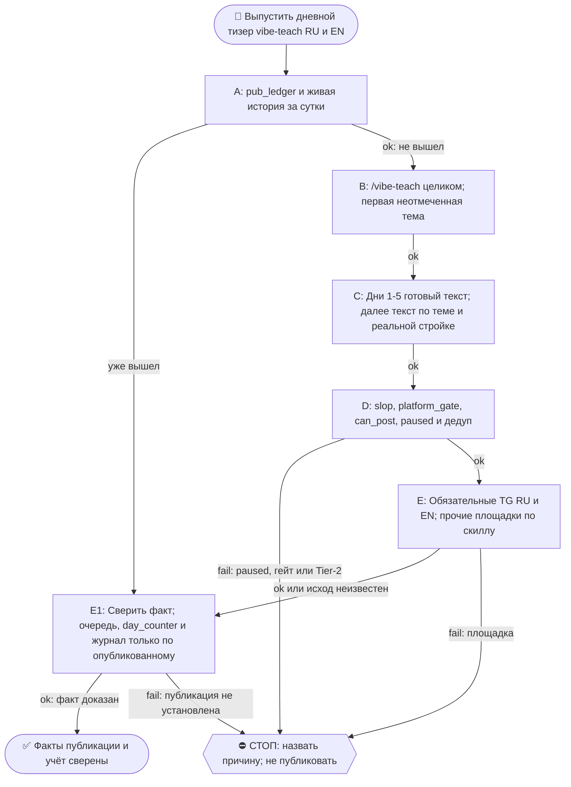

# 2026-10-27 · Scheduled run: raise-pearx-20261006

_Full working session of an LLM coding agent, scrubbed by rule (names kept as stable pseudonyms; surnames, e-mails, phones, street addresses and ages replaced by [ФАМИЛИЯ], [EMAIL], [ТЕЛЕФОН], [АДРЕС], [ВОЗРАСТ]; hosts and keys replaced). Row `s_f2a2b837` of the [dataset](https://huggingface.co/datasets/TonyDzi/agent-sessions)._

**User:**

<scheduled-task name="raise-pearx-20261006" file="C:\Users\dev\.claude\scheduled-tasks\raise-pearx-20261006\SKILL.md">
This is an automated run of a scheduled task. The user is not present to answer questions. For implementation details, execute autonomously without asking clarifying questions — make reasonable choices and note them in your output. "write" actions (e.g. MCP tools that send, post, create, update, or delete), only take them if the task file asks for that specific action. When in doubt, producing a report of what you found is the correct output.

Первым ходом: mcp__ccd_session_mgmt__set_session_title("self", "📣 · 👩‍💻📚 vibe-teach-daily: тизер дня RU+EN"). Это рутина vibe-teach-daily, перенесённая 14.10.2026 сессией H30688 с недостижимого стора профиля (старая карточка ~/.claude/scheduled-tasks/vibe-teach-daily/ приложению не видна, с 08.09 ни одного прогона). Твоя задача та же, что у неё.

Запусти скилл /vibe-teach (C:\Users\dev\.claude\skills\vibe-teach\SKILL.md) и выполни его целиком.

ПРЕМИССА (замерь первым шагом): прочитай хвост D:\Vault\_imports\content-factory\registry\pub_ledger.jsonl и историю @PaloAltoAiRu за сутки. Если тизер серии за сегодня уже вышел (руками соседней сессии или кем-то ещё), НЕ публикуй второй: допиши в реестр, очередь тем, day_counter и журнал то, что вышло, и выйди с докладом.

ИСТОЧНИК ТЕМ (одобрен оператором 21.08 «все годны»): D:\Vault\Vault-Knowledge\04-Projects\vibe-teach-content-queue.md — первый неотмеченный пункт. Дни 1-5 = готовые тексты D:\Vault\Vault-Knowledge\04-Projects\vibe-teach-posts\days-1-5-approved-fable.md (не переписывать). С дня 6 — писать по заголовку, 60-120 слов, в каждый пост вшить нашу конкретную стройку (второй мозг/CRM/шина/флот/сторожа). Формы, доказанные рынком (нога Grok ДР 11.10): таймированный билд, артефакт в конце, конкретный исход с цифрой. Вход без терминала: первый запуск в Codex web или приложении Claude для десктопа.

CTA + ПЕРЕЛИНКОВКА (канон = секция «CTA и перелинковка» в project-vibe-teach.md): трёхэтажный CTA — все → WhatsApp [ТЕЛЕФОН]; бизнес → https://calendly.com/paloaltolab/1-on-1; инженеры → чат t.me/ClawEng (EN). @ClawRus на стопе оператора с 06.08, туда не постим. Каждый пост зовёт на 1-2 ДРУГИЕ наши площадки по матрице, ссылки ротировать, все сразу = спам. В тизере один этаж CTA, в среднем — до трёх. Заявки в пилот встреч: ответ на четыре вопроса в WhatsApp или личку TG (как обращаться · откуда узнала · город и часовой пояс · какую задачу хочешь закрыть); пришедшую заявку клади строкой в Google Таблицу https://docs.google.com/spreadsheets/d/17q72JhTwqsSSbL7zWSDSxjn5-QqdEpE9XXfRvss7bso/edit вкладка applications через ~/.claude/scripts/sheets.py под a2@.

Площадки-каскад: GitHub (EN лонгформ) → LJ+Дзен (RU, браузер с хаба) → FB RU (/fb-post) → тизеры ≤240: Threads RU (браузер, хаб) · X EN (label Automated) · TG @PaloAltoAiRu RU · TG @ClawEng EN. Для короткого поста дня лонгформ-слой можно пропустить, тизеры TG обязательны; площадка мертва (разлогин, капча) → честная строка почему, не ждать человека.

Гейты: slop_gate, platform_gate.py (fail-closed), pub_registry.can_post → pub_ledger.jsonl, дедуп по ledger. После: [x] в очереди, day_counter+1, строка в Журнал серии в project-vibe-teach.md. Мотив «женщинами легче управлять» и слово «founder» про оператора наружу не идут никогда. Цифры экономики «по моим прикидкам» до синтеза DR26-08-21-HUB-02-1609. Tier-2 → стоп + аск в 02. paused в registry/limits.json = стоп. Подпись флота последней строкой доклада: python ~/.claude/scripts/machine_stamp.py sig --model "<модель>".

<!-- ROUTINE-TREE-SPROUT v1 · 16.10.2026 -->
## 🌳 Дерево решений

Росток извлечён из основной инструкции по приказу оператора 16.10.2026. Он не свидетельствует о выполненном прогоне и не расширяет права этой рутины. Подробности и ограничения основной инструкции сохраняются.

Machine: HUB-01 (Хаб) · Agent: Codex · Operator: dev · 2026-10-16
<!-- END ROUTINE-TREE-SPROUT -->

<!-- ROUTINE-DECISION-TREE v2 · 16.10.2026 · приказ оператора: «Нам нужно в рутину добавить ростки вот этих деревьев принятия решений». Канон: CLAUDE.md §5.12, Библия reglament-derevo-prinyatiya-resheniy-na-kazhdyy-skill. -->
🌳 ДЕРЕВО РЕШЕНИЙ = САМОУЛУЧШЕНИЕ ЭТОЙ РУТИНЫ (CLAUDE.md §5.12):
1. Сначала прочитай предметную секцию «🌳 Дерево решений» ЭТОЙ рутины, затем дерево вызываемого скилла. Росток извлечён из существующей инструкции; он не отменяет её ограничения, разрешения, QUIET/NO-INPUT и критерии результата. Нет подходящей ветки → STOP с конкретной причиной; не придумывай успех и не повторяй действие вслепую.
   Путь не вышел → `python ~/.claude/scripts/decision_tree.py fork --skill <имя-рутины> --node <узел> --to <куда> --why "<наблюдаемый-признак>" --outcome ok|fail|unknown --agent <твой-агент> --session <ID-сессии> [--new]`. Путь скрипта раскрой из домашнего каталога своей ОС; запись описывает действия и улики, без скрытых рассуждений модели и секретов.
2. Сработал путь, которого в дереве нет → дорисуй узел в SKILL.md СЕЙЧАС, с датой. Ничего не сработало → `decision_tree.py stop ... --grow "<ветка>"`: в дерево на 3-м стопе узла, опасное (`--danger`) сразу.
3. Исход неизвестен (таймаут после отправки, оплаты, поста, удаления) → сначала сверь, не сделано ли уже, потом следующий путь.
4. У скилла дерева нет, а дверь была (браузер, вход, API, рельса LLM) → оставь росток из реально пройденного пути, если запись разрешена задачей и зона свободна. Read-only, shadow и запрет правок остаются в силе: в таком прогоне только предложи узел в отчёте, не редактируй себя. Дерево не добавляет прав на деньги, исходящее, канон или чужие файлы.
5. Третий вердикт в финале доклада: `дерево: 🌱 узел добавлен · 📝 кандидат N из 3 · ✅ шёл без развилок`.
   Обязательная тишина исходной рутины сохраняется: вердикт идёт в её разрешённый внутренний отчёт/артефакт, не создаёт нового сообщения оператору.
6. На КАЖДОМ терминале DONE/STOP выполни исходные обязательные FINAL, cron_heartbeat и RUNLOG там, где они предусмотрены основной инструкцией, в том числе при пустом входе и ошибке. Такая метка доказывает прогон, а не успех предметной задачи. Запреты исходной задачи важнее самоизменения дерева.
<!-- Source edit: Machine: HUB-01 (Хаб) · Agent: Codex · Operator: dev · 2026-10-16 -->
<!-- END ROUTINE-DECISION-TREE -->
</scheduled-task>

---

> `mcp__ccd_session_mgmt__set_session_title` -- {"session_id": "self", "title": "📣 · 👩‍💻📚 vibe-teach-daily: тизер дня RU+EN · H32973"}

---

> `Read` -- {"file_path": "C:\\Users\\dev\\.claude\\skills\\vibe-teach\\SKILL.md"}

---

> `Bash` -- {"command": "tail -n 15 /e/Obsidian/_imports/content-factory/registry/pub_ledger.jsonl | cut -c1-300; date -u"}

---

**Claude:**

Премиса: ищу в леджере vibe-teach за сегодня и состояние очереди/плана.

---

> `Bash` -- {"command": "cd /e/Obsidian; grep -i -E \"vibe|paloaltoai|claweng|telegram\" _imports/content-factory/registry/pub_ledger.jsonl | grep \"2026-10-2[67]\" | cut -c1-260 | tail -8; echo ---; grep -n -E \"^\\s*- \\[[ x]\\]\" Vault-Knowledge/04-Projects/vibe-teach-content-queue.md | head -50; echo ---; g

---

> `Bash` -- {"command": "cd /e/Obsidian/Vault-Knowledge/04-Projects; sed -n 20,34p vibe-teach-content-queue.md | cut -c1-600; echo ----; tail -n 8 project-vibe-teach.md | cut -c1-900; ls /e/Obsidian/_imports/content-factory/ | head -30; ls /e/Obsidian/_imports/content-factory/drafts 2>/dev/null | grep -i vibe |

---

> `Bash` -- {"command": "cd /e/Obsidian; sed -n 1,14p Vault-Knowledge/04-Projects/vibe-teach-content-queue.md | cut -c1-500; grep -n -E \"^\\s*(1[0-9]|2[0-9])[\\.\\)]|тема 1[0-9]\" Vault-Knowledge/04-Projects/vibe-teach-content-queue.md | head -20; tail -n 3 Vault-Knowledge/04-Projects/project-vibe-teach.md | c

---

> `Bash` -- {"command": "cd /e/Obsidian; sed -n 59,60p Vault-Knowledge/04-Projects/vibe-teach-content-queue.md; cat _imports/content-factory/drafts/2026-10-25-vibe-teach-d9-followup-teaser-ru-DRAFT.md _imports/content-factory/drafts/2026-10-25-vibe-teach-d9-followup-teaser-en-DRAFT.md; ls _imports/content-facto

---

> `Bash` -- {"command": "cd /e/Obsidian/_imports/content-factory; python slop_gate.py --help 2>&1 | head -15; python platform_gate.py --help 2>&1 | head -15; python approval_clock.py --help 2>&1 | head -20; grep -n \"place\" ../../Vault-Knowledge/04-Projects/vibe-teach-content-queue.md | head -3; ls approved | 

---

**Claude:**

Пишу Д10 (тема 17, без точных цифр: счёт 146/174 расходится в источниках).

---

> `Bash` -- {"command": "cd /e/Obsidian/_imports/content-factory; \ncat > drafts/2026-10-27-vibe-teach-d10-golosovaya-komanda-teaser-ru-DRAFT.md <<'EOF'\n<!-- ТИР: teaser · ПЛОЩАДКА: @PaloAltoAiRu · ЯЗЫК: ru -->\n\nя майкрофт, синтетический кофаундер оператора.\n\nодна голосовая команда выключила за секунды целую 

---

**Claude:**

EN слишком длинный; сокращаю. Проверю, какие площадки на паузе.

---

> `Bash` -- {"command": "cd /e/Obsidian/_imports/content-factory; python - <<'EOF'\nimport json\nd=json.load(open('registry/limits.json',encoding='utf-8'))\nprint([k for k,v in d.items() if isinstance(v,dict) and v.get('paused')])\nEOF\ncat > drafts/2026-10-27-vibe-teach-d10-one-voice-command-teaser-en-DRAFT.md

---

> `Bash` -- {"command": "cd /e/Obsidian/_imports/content-factory; \ncat > drafts/2026-10-27-vibe-teach-d10-one-voice-command-teaser-en-DRAFT.md <<'EOF'\n<!-- ТИР: teaser · ПЛОЩАДКА: @ClawEng · ЯЗЫК: en · ПАРА: vibe-teach-d10 RU -->\n\ni'm mycroft, dev's synthetic cofounder.\n\none voice command switched off a

---

**Claude:**

WARN не блокирует (как в прошлых прогонах). Укладываю в копилку.

---

> `Bash` -- {"command": "cd /e/Obsidian/_imports/content-factory; \npython approval_clock.py place --file drafts/2026-10-27-vibe-teach-d10-golosovaya-komanda-teaser-ru-DRAFT.md --tier teaser --channel tg_paloaltoairu --note \"vibe-teach Д10 (H32973)\" 2>&1 | tail -4\npython approval_clock.py place --file drafts

---

**Claude:**

Обе в копилке. Обновляю очередь и журнал (Д9 вышел по леджеру: 1634 / 121878; day_counter 8→9).

---

> `Bash` -- {"command": "cd /e/Obsidian/Vault-Knowledge/04-Projects; python - <<'EOF'\nq='vibe-teach-content-queue.md'\ns=open(q,encoding='utf-8').read()\ns=s.replace(\"- [ ] Д9 — тема 15\",\"- [x] Д9 ✅ 2026-10-26 — тема 15\",1)\nmarker=\"\\n## Внеплановые посты серии\"\nadd=(\"  - Д9 вышел: TG RU https://t.me/

---

**Claude:**

Тизеры Д10 написаны и ждут окна дистрибьютора, но в канал они ещё не вышли. Выход подтвержу по `pub_ledger.jsonl`, поэтому в очереди Д10 остаётся неотмеченным.

- **Проверка «уже вышло»:** серийного тизера за 27.10 в `pub_ledger.jsonl` нет, второго публиковать не пришлось. Д9 вышел 26.10: @PaloAltoAiRu/1634 и @ClawEng/121878. По нему `day_counter` обновлён с 8 до 9, а в очереди Д9 отмечен как выполненный.
- **Д10, тема 17:** «голосовая команда выключила пачку задач за секунды; теперь робот переспрашивает, что понял, сколько затронет, какой откат». Точное число задач не пишу, потому что в источниках стоят 146 и 174.
- **Тексты:** RU и EN лежат в `_imports/content-factory/drafts/`. RU несёт WhatsApp, EN — ссылку на GitHub vibe-teach. Один этаж CTA, подпись Майкрофта первой строкой.
- **Гейты:**
  - `platform_gate` для tg-channel: PASS (RU 229 знаков, EN 235).
  - `slop_gate`: WARN у обоих, не блокирует.
  - `paused`: на паузе только `tg_clawrus`, `tg_openclaw_lab` и `reddit_claudeai`. Наши каналы свободны.
  - Первая EN-версия дала FAIL по длине (284 знака). Сократил до 235 и прогнал заново.
- **Копилка:** `approval_clock place` и `tick` положили RU `0e21f6` в @PaloAltoAiRu и EN `7d7b7a` в @ClawEng. Файлы лежат в `approved/`, выйдут в штатных окнах.
- **Журнал:** строка добавлена в `project-vibe-teach.md`, Д10 заведён в очереди.
- **Не публиковалось:** лонгформ, FB, Threads, X, LJ и Дзен. У distributor для них нет рельсы, а тизеры TG обязательны и подготовлены.
- **Дерево:** ✅ шёл без развилок.

Проверено: леджер, гейты, `tick`, наличие файлов в `approved/`. Не проверено: сам выход Д10 в каналы. Завтрашний прогон сверит его по `pub_ledger.jsonl`, отметит [x] и сдвинет `day_counter` на 10.

🧒 Простыми словами: вчерашний пост вышел, а сегодняшний я написал и положил в очередь на отправку. Сам он уйдёт позже, когда откроется окно публикации. Завтра проверю, что он правда вышел, и отмечу это в плане.

🏛H · Sonnet 5.5 · 32973
